# 第01章 从 Transformer 到大模型推理

> 一段文本如何经过模型，变成一个又一个输出 token？

## 本章定位

本章不是完整的 Transformer 理论课，也不讨论训练、反向传播和优化器。目标是建立
阅读 vLLM 所需的最小推理模型，让读者在进入 Engine 和 Scheduler 前真正理解：

1. 模型接收和输出的究竟是什么。
2. prefill 与 decode 为什么是两种不同的工作负载。
3. KV Cache 为什么能加速生成，又为什么会占用大量显存。
4. vLLM 优化的是模型计算之外的哪些系统问题。

## 阅读目标

> **本节先看：** 下面的清单是读完本章后的能力检查，不要求你现在就会。先浏览一遍，阅读正文时再用它确认自己是否抓住主线。

- 解释 token、embedding、hidden state、logits 和 sampling 的关系。
- 画出一个 decoder-only Transformer 的单次 forward 数据流。
- 区分 prefill 与 decode 的输入形状和计算特征。
- 推导为什么 KV Cache 能减少重复计算，以及显存为何随序列增长。
- 将通用推理概念映射到 vLLM 的模型、Attention 和 Sampler 实现。

## 前置知识

> **本节先看：** 只需具备下面这些基础就可以开始。遇到陌生数学或系统概念时，本章会先给直觉和小例子，再进入源码。

- 能阅读 Python 类、函数、列表和循环。
- 知道向量是一组数字，矩阵可以对向量做线性变换。
- 知道 GPU 擅长执行大规模并行数值计算即可，不要求 CUDA 编程经验。

## 版本与范围

> **本节先看：** 这一部分先划定结论成立的源码版本和讨论边界。超出范围的实现不能直接套用本章结论，需要重新核对源码。

- 源码仓库：`vllm-project/vllm`
- 源码 commit：`05caae03c20f69436ff7ec23ded339ea104f1a01`（vLLM `main`，提交日期 2026-11-09；正文最初按 v0.33.0 `4ba787ec` 写成，2026-11-10 重新钉扎到此 revision：源码引用与行号已逐条核对，Model Runner V1 删除已重新绑定；其余行为未在 05caae03 上全面重核，清单见 `meta/upgrade-main-05caae03-2026-11-10/`）
- 阅读主线：decoder-only 文本生成、vLLM V1 Engine、Llama 类模型。
- 本章使用单层、单 attention head 的教学模型建立直觉；真实模型通常有多层、
  多个 query heads，并可能使用 GQA、量化、TP 和不同 attention backend。
- 本章中的复杂度只用于解释增长趋势，不代替具体 kernel benchmark。

## 核心术语

> **本节先看：** 这张表给出术语在本章中的工作定义。第一次阅读理解含义即可，看到它们在调用链中的位置后再回来看会更清楚。

| 术语 | 本章中的含义 |
|---|---|
| Token | Tokenizer 划分出的离散单位，模型实际处理的是 token ID。 |
| Vocabulary | 模型能够输出的全部 token 集合。 |
| Embedding | 将 token ID 查表转换成连续向量。 |
| Hidden state | 某个 token 在网络当前层中的向量表示。 |
| Logits | 模型对词表中每个候选 token 给出的未归一化分数。 |
| Attention | 让当前位置按相关程度聚合历史位置 Value 的计算。 |
| Causal mask | 禁止一个位置读取未来 token 的约束。 |
| RoPE | 通过旋转 Query/Key 向量注入位置信息的方法。 |
| Prefill | 处理尚未计算的 prompt token，建立 KV Cache；可拆成多个 chunk。 |
| Decode | 利用已有 KV Cache 继续生成 token。 |
| KV Cache | 保存各层历史 token 的 Key 和 Value。 |
| Sampling | 对 logits 做规则处理并选出下一个 token。 |

## 全局位置

先把一次生成压缩成一张图。Transformer 负责把已有 token 变成下一 token 的
logits；sampling 决定选择哪个 token；自回归循环把新 token 再送回模型。

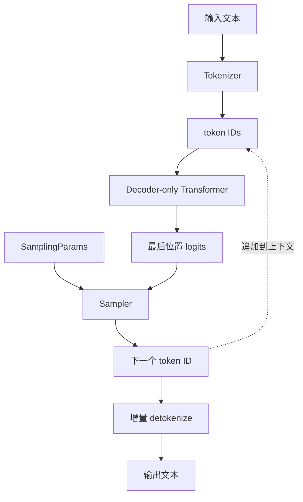

> **读图方法：** 阅读“全局位置”这张流程图时，先把方框看成对象或状态，把箭头看成数据或控制的移动。第一遍从上向下建立顺序，第二遍再核对分支发生的条件。

这张图有两个重要边界：

- **模型边界：** 输入 token IDs 和位置，输出 hidden states 或 logits。
- **系统边界：** 多个请求何时进入模型、每次放多少 token、KV 放在哪里，不由
  Transformer 数学本身决定，而是 vLLM 后续章节的核心。

### 本章阅读路线

本章按“对象 -> 单层计算 -> 时间维度 -> 系统实现”的顺序推进：

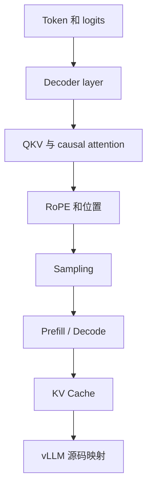

> **读图方法：** 从上向下看本章的学习顺序：先理解 token 和模型计算，再引入时间维度与缓存。箭头表示知识铺垫，不是函数调用；第二遍按末尾的源码映射回查实现。

第一次阅读时，先抓住每节开头的图和结论；第二次再手算数值例子并运行代码；第三次
进入第 1.9 节，逐跳对照 vLLM 源码。不要一开始就在 CUDA kernel 中寻找完整的
Transformer 结构，kernel 通常只实现其中一个局部算子。

## 如何阅读本章

你可以把这一章当作推理原理的入门课。即使只用过聊天产品，不熟悉 prompt、token、
temperature 或上下文长度，也可以从术语表与 1.1 节开始，不要求学过深度学习课程。第一次阅读只需
回答三个问题：数据长什么样、一次 forward 做什么、为什么生成必须重复 forward。

遇到向量和矩阵公式时，先看 shape，不要先做代数推导。例如 `[T, D] -> [T, vocab_size]`
首先表示“每个待计算 token 的隐藏向量被变成一组词表分数”。公式中的求和、softmax
和旋转随后只是解释这些 shape 内部怎样计算。书中的小数字例子用于建立直觉，不要求
你手算真实模型的 4096 维向量。

本章可以使用一条贯穿始终的类比：token ID 是字典编号，embedding 是查到的工作向量，
attention 是按相关性翻阅历史笔记，KV Cache 是保存已经整理好的历史笔记，sampler
则根据模型给出的候选分数做最后选择。类比只帮助入门，进入源码时仍以张量、位置和
缓存所有权为准。

**先明确四个核心前置概念。** Tensor（张量）可以先当作多维数组，shape 是各维的长度；
`[3,4]` 就是 3 行、每行 4 个数。forward 是一次从输入算到输出的前向计算，不包含训练。
prompt 是用户交给模型的已有文本；上下文是预测时允许参考的 token 序列。

**第一遍走法：** 先读 1.1、1.3 的手算例子、1.5–1.8，再读 1.2 和 1.4 补齐模型结构，
最后进入 1.9 的源码；TP/PP 和两代 Runner 先只认职责，留到第 07、09 章。
**停下来算：** prompt 有 4 个 token，刚采样出第一个输出时，缓存有几个位置？
答案是 4：新 token 的 KV 要等下一次 forward 才生成。

## 1.1 语言模型到底输出什么

> **本节先看：** 本节要回答：**语言模型到底输出什么**。下面的小节会逐层拆开概念、运行过程和源码落点；第一次阅读先抓对象之间的关系，第二次再记类名、字段和分支。

### 文本不会直接进入神经网络

神经网络只能处理数值。Tokenizer 先把字符串转换成 token ID 序列。例如下面只是
示意，不代表任何真实 tokenizer：

```text
"我喜欢读源码"
    ↓ tokenizer
[101, 4287, 2301, 992, 7612]
```

Token 不等于“单词”。同一段中文可能按字、词片段、字节或特殊组合切分；空格、
标点和前缀空格也可能属于 token 的一部分。因而：

- 字符数不能直接当作 token 数。
- 同样长度的中英文字符串可能产生不同数量的 token。
- 模型最大上下文和计费通常按 token，而不是按字符。

### Token ID 如何变成向量

模型有一张 embedding 表：

```text
embedding_table.shape = [vocab_size, hidden_size]
```

token ID 是这张表的行号。若 `vocab_size=32,000`、`hidden_size=4,096`，那么一个
token ID 会被查成一个长度为 4,096 的向量。这个向量不是人工定义的词义，而是训练
得到的数值表示。

### Logits 为什么不是概率

经过所有 decoder layers 后，模型把 hidden state 投影回词表维度：

```text
hidden state: [hidden_size]
       ↓ lm_head
logits:       [vocab_size]
```

每个 logit 对应一个候选 token。logit 越大，候选通常越有可能被选择，但 logit 本身
可以为负，也不要求总和为 1。概率需要经过 softmax：

$$
p_i = \frac{e^{z_i}}{\sum_j e^{z_j}}
$$

**白话：**softmax 把一串可正可负的分数变成一串加起来等于 1 的正数：分数越大，分到的比例越大；
比例只取决于分数之间的差距，不取决于分数本身有多大。

**其中：**$z$ 是形状 `[vocab_size]` 的分数向量，词表大小写作 $\lvert\mathcal V\rvert$（在张量形状里写 `vocab_size`）；
$z_i$ 是候选 $i$ 的 logit，$j$ 遍历全部候选；$e\approx2.718$ 是自然指数的底数；$p_i$ 是无单位的概率。

**怎么算出来：**

1. 指数 $e^{z_i}$ 把任意实数变成正数，并保持大小顺序：$z_i$ 越大，$e^{z_i}$ 越大；
2. 要让所有概率相加为 1，只需把每个正数除以它们的总和 $\sum_j e^{z_j}$，这就是分母；
3. 验证：$\sum_i p_i=\dfrac{\sum_i e^{z_i}}{\sum_j e^{z_j}}=1$。

算例：取 $z=[4,2,1,0]$（后文 temperature 一节用同一组数）。$e^4\approx54.598$、$e^2\approx7.389$、$e^1\approx2.718$、$e^0=1$，
总和约 65.705，所以 $p_0\approx54.598/65.705\approx0.8310$。两个候选分数相同时 $p=e^{z}/(2e^{z})=1/2$，各占一半。

**核对：**随书 `softmax()`（`examples/ch01_minimal_inference.py:46-50`）按这个定义实现，只是先减去最大值（原因见 1.3 节“稳定 softmax”）；
上面的 0.8310 与 temperature 一节 $\tau=1$ 的那一列一致，由 `examples/ch01_numerical_walkthrough.py` 与
`tests/test_ch01_numerical_walkthrough.py` 固定。

实际高性能 sampler 不一定显式构造完整 softmax；数学上的概率定义与实现是否物化整张概率表是两回事（MRV2 的做法见 1.5 节）。

## 1.2 Decoder-only Transformer 的最小结构

Decoder-only 模型由多层相同结构堆叠而成。以当前 revision 的 Llama 路径为例，
`LlamaModel` 持有 embedding、若干 `LlamaDecoderLayer` 和最终 RMSNorm；
`LlamaForCausalLM` 再增加 `lm_head` 与 `LogitsProcessor`。

### 单层数据流

> **本节先看：** 这一小节先用图建立“单层数据流”的整体路径。先找输入、关键状态和输出，再阅读图后的源码解释，不必一开始记住全部节点。

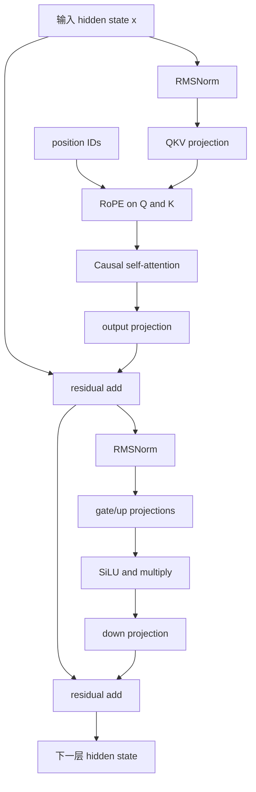

> **读图方法：** 这是“单层数据流”的流程图。先从上向下只追一条主路径，确认输入经过哪些关键阶段到达输出；第二遍再看虚线、回边和旁路，它们通常表示反馈、复用或可选分支。

图中每个模块解决的问题不同：

- **Attention：** 在 token 位置之间交换信息。
- **MLP：** 对每个 token 的向量做非线性变换，不直接混合不同位置。
- **Residual：** 保留原输入并让深层网络更容易传递信息。
- **RMSNorm：** 控制数值尺度。它规范化的是向量，不是把值变成概率。

当前 Llama 实现使用 pre-norm 风格。`LlamaDecoderLayer.forward` 先对输入做
`input_layernorm`，执行 self-attention，再经过 `post_attention_layernorm` 和 MLP。
vLLM 的 RMSNorm 接口能够把 residual 融合进调用，因此源码中的写法和教学图不一定
逐行相同，但数据依赖一致。

### MLP 不是一个普通的两层 ReLU

当前 `LlamaMLP` 使用 gate/up 两个投影与 SiLU 门控，概念上可写成：

$$
\operatorname{MLP}(x) = W_{\mathrm{down}}\bigl(\operatorname{SiLU}(W_{\mathrm{gate}}x) \odot W_{\mathrm{up}}x\bigr)
$$

**白话：**先把一个 token 的向量同时送进两条路：一条经过 SiLU 变成“门”（各维度放行多少），
另一条是“内容”；门和内容逐维相乘，再投影回原来的宽度。它只在每个 token 自己的向量上做运算，不混合不同位置。

**其中：**$x$ 是一个 token 的列向量（本节局部字母），shape `[D]`，$D$ 是 hidden size；
$D_{\mathrm{ff}}$ 是 MLP 中间宽度，$W_{\mathrm{gate}}$、$W_{\mathrm{up}}$ 的 shape 为 `[D_ff,D]`，$W_{\mathrm{down}}$ 为 `[D,D_ff]`；
$\odot$ 是对应位置相乘；SiLU 逐元素计算 $\operatorname{SiLU}(u)=u/(1+e^{-u})$，$u$ 是任一标量输入（本节局部字母），
可理解为按输入大小调节通过量的门：$u$ 很大时几乎原样通过，$u$ 很负时接近 0。

**怎么算出来：**

1. gate 路：$W_{\mathrm{gate}}x$ 把 `[D]` 变成 `[D_ff]`，再逐元素过 SiLU，得到 `[D_ff]` 的门值；
2. up 路：$W_{\mathrm{up}}x$ 同样把 `[D]` 变成 `[D_ff]`，是被门调节的内容；
3. $\odot$ 逐位置把门值乘到内容上，shape 仍是 `[D_ff]`；
4. $W_{\mathrm{down}}$ 把 `[D_ff]` 投回 `[D]`，这样 MLP 的输出才能与输入做 residual 相加。

教学数字算例：$D=2$、$D_{\mathrm{ff}}=1$，$W_{\mathrm{gate}}=[1,1]$、$W_{\mathrm{up}}=[1,-1]$、$W_{\mathrm{down}}=[2,3]^{\top}$，输入 $x=[1,2]$。
gate 路 $1\times1+1\times2=3$，$\operatorname{SiLU}(3)=3/(1+e^{-3})\approx2.858$；up 路 $1\times1+(-1)\times2=-1$；
逐位置相乘得 $2.858\times(-1)=-2.858$；再乘 $W_{\mathrm{down}}$ 得输出 $[2\times(-2.858),\,3\times(-2.858)]\approx[-5.715,\,-8.573]$，
shape 从 `[1]` 回到 `[2]`。

**核对：**`LlamaMLP`（`vllm/model_executor/models/llama.py:82-122`）里 `gate_up_proj` 是输出宽度 `[intermediate_size]*2` 的合并列并行线性层
（`:95-102`），一次算出 gate 与 up 两段；`SiluAndMul`（`vllm/model_executor/layers/activation.py:116`，计算式在 `:144`）
对结果的前半 `x[..., :d]` 做 SiLU、乘后半 `x[..., d:]`；最后是 `down_proj`（`:103-111`）。构造函数只接受 `hidden_act == "silu"`（`:112-115`）。
随书 `ToyDecoder._finish_layer` 的 `silu(left) * right`（`examples/ch01_minimal_inference.py:173`）是同一个计算。

本式用列向量；下一节为了展示多 token batch，改用每行一个 token 的矩阵表示（权重相应转置）。源码中 `gate_proj` 与 `up_proj` 被合并为
`MergedColumnParallelLinear`，这是执行优化和 Tensor Parallel 布局，不改变上述数学角色。

## 1.3 Self-Attention 与张量形状

> **本节先看：** 本节要回答：**Self-Attention 与张量形状**。下面的小节会逐层拆开概念、运行过程和源码落点；第一次阅读先抓对象之间的关系，第二次再记类名、字段和分支。

### 先区分教学形状与 vLLM 形状

教程通常使用带 batch 和 sequence 维度的形状：

```text
X: [B, S, D]
```

- `B`：batch size。
- `S`：序列长度。
- `D`：hidden size。

vLLM 为了把不同长度请求放进同一个 step，常把本轮实际计算的 token 打包成一个
扁平维度：

```text
X: [T, D]
```

`T` 是本 step 所有被调度 token 的总数。每个请求的边界、长度和 KV 位置由
attention metadata 与 block table 描述。看到 `[T,D]` 不代表 sequence 维度消失，
而是它从规则 tensor 维度转移到了元数据。

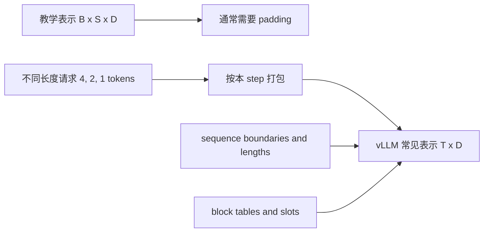

> **读图方法：** 阅读“先区分教学形状与 vLLM 形状”这张流程图时，先把方框看成对象或状态，把箭头看成数据或控制的移动。第一遍从左向右建立顺序，第二遍再核对分支发生的条件。

### Q、K、V 是什么

对每个 token 的 hidden state 做三个线性投影：

$$
Q = XW_Q, \quad K = XW_K, \quad V = XW_V
$$

可以把它们理解为：

- **Query：** 当前 token 想找什么信息。
- **Key：** 当前 token 提供什么可匹配的索引特征。
- **Value：** 匹配后真正被聚合的内容。

**白话：**同一份 hidden state $X$ 分别乘三个不同的权重矩阵，得到三种用途不同的向量：拿去“提问”的 $Q$、拿去“被匹配”的 $K$、拿去“被取走”的 $V$。

**其中：**$X$ 是这一层 `input_layernorm`（RMSNorm）之后的 hidden state，shape `[T,D]`，每行是一个 token；
$W_Q$、$W_K$、$W_V$ 是训练得到的权重。先看单个 head：用“每行一个 token”的写法，$W_Q$、$W_K$ 的 shape 是 `[D,d_h]`，$W_V$ 是 `[D,d_v]`，
于是 $Q$ 是 `[T,d_h]`、$K$ 是 `[T,d_h]`、$V$ 是 `[T,d_v]`；$d_h$ 是 Query/Key 的单 head 宽度，$d_v$ 是 Value 的单 head 宽度（Llama 里两者相等）。
真实模型有多个 head，每个 head 各有一份这样的切片，合并成一个大矩阵一次算出（见下文“Multi-Head 与 GQA”）。

**怎么算出来：**

1. 取 $X$ 的第 $t$ 行 $x_t$（$D$ 个数），乘 $W_Q$ 的每一列做点积（$D$ 次乘加），得到 $q_t$ 的一个分量；$d_h$ 个分量合起来就是 $q_t=x_tW_Q$。$K$、$V$ 同理。
2. 因此 $Q$、$K$、$V$ 的第 $t$ 行**只依赖第 $t$ 个 token**，与其他行无关：后来的 token 不会改变历史行的 $k_t$、$v_t$。这是 KV Cache 能成立的前提（1.7 节）。
3. 整个矩阵一起乘，就是把 $T$ 个 token 各做一遍：`[T,D]`·`[D,d_h]`=`[T,d_h]`。
4. 三个权重互相独立，所以 vLLM 把它们拼成一个 `qkv_proj` 一次乘出，再按 `q_size, kv_size, kv_size` 切开。

教学数字算例（与下一小节的数字一致）：取 $D=d_h=2$，三个 token 的 hidden state 为 $[1,0]$、$[0,1]$、$[1,1]$。
若 $W_K=\begin{bmatrix}1&0\\0&1\end{bmatrix}$，则 $K$ 的三行就是 $[1,0]$、$[0,1]$、$[1,1]$，正是下一小节的 $K$。
若 $W_Q=\begin{bmatrix}1&0\\0&0.5\end{bmatrix}$，当前（第 3 个）token 的 $q=[1,1]W_Q=[1\times1+1\times0,\ 1\times0+1\times0.5]=[1,0.5]$，正是下一小节的 $Q$。
$V$ 由另一个 $W_V$ 得到，下一小节直接给出结果。

**核对：**`LlamaAttention.forward`（`vllm/model_executor/models/llama.py:224-233`）依次执行 `qkv, _ = self.qkv_proj(hidden_states)`（`:229`）、
`q, k, v = qkv.split([self.q_size, self.kv_size, self.kv_size], dim=-1)`（`:230`）、`q, k = self.rotary_emb(positions, q, k)`（`:231`）和 `self.attn(q, k, v)`（`:232`）；
所以 Llama 里 $Q$、$K$ 在投影之后还要过一次 RoPE（1.4 节），$V$ 不过。随书 `ToyDecoder._qkv`（`examples/ch01_minimal_inference.py:150-156`）用 `matvec(self.wq, normalized)` 等三次投影，同样先 RMSNorm、再投影、再对 $Q$、$K$ 做旋转。

单个 head 的 attention 为：

$$
\begin{aligned}
&\operatorname{Attention}(Q,K,V)\\
&\qquad=\operatorname{softmax}\!\left(\frac{QK^{\top}}{\sqrt{d_h}}+\mathrm{Mask}\right)V.
\end{aligned}
$$

**白话：**每个 Query 拿去和所有“可见”的 Key 比相似度，把相似度用 softmax 变成加起来为 1 的权重，再按权重把对应的 Value 混合起来，得到这个 Query 的输出。

**其中：**先取单 head、无 batch 的例子：若本轮有 $N_q$ 个 Query、可读取 $N_k$ 个历史及当前位置，则 $Q$ 是 `[N_q,d_h]`、$K$ 是 `[N_k,d_h]`、$V$ 是 `[N_k,d_v]`；
上标 $\top$ 表示转置，$K^{\top}$ 是 `[d_h,N_k]`；$\mathrm{Mask}$ 与分数表同形状 `[N_q,N_k]`，允许位置填 0，屏蔽位置填 $-\infty$；
softmax 对分数表的每一行（沿 key 方向）归一化。分数和权重都没有时间或字节单位。

**怎么算出来：**

1. 打分：$(QK^{\top})_{ij}=q_i\cdot k_j$，即第 $i$ 个 Query 与第 $j$ 个 Key 的点积；一次矩阵乘法得到全部 $N_q\times N_k$ 个分数，shape `[N_q,N_k]`。
2. 缩放：每个分数除以 $\sqrt{d_h}$（原因见下一段）。
3. 加 Mask：不可见位置加 $-\infty$，因为 $e^{-\infty}=0$，softmax 后权重恰为 0；可见位置加 0，分数不变。
4. softmax：对每一行取指数再除以该行之和，行内权重相加为 1。
5. 聚合：权重表 `[N_q,N_k]` 乘 $V$ 的 `[N_k,d_v]`，输出第 $i$ 行是 $\sum_j a_{ij}v_j$，即按权重混合 Value 的各行，shape `[N_q,d_v]`。
   输出与 $V$ 的量纲相同（本章的 $V$ 也没有单位）。

下一小节用 3 个 Key 把这五步逐个数字算一遍。

**核对：**`LlamaAttention.__init__` 里 `self.scaling = self.head_dim**-0.5`（`vllm/model_executor/models/llama.py:162`），并在构造通用 `Attention` 时作为缩放因子传入（`:212-215`）；
随书 `ToyDecoder._finish_layer` 先算 `dot(query, key) / math.sqrt(...)`（`examples/ch01_minimal_inference.py:161-163`）、再 `softmax`（`:164`）、再按权重累加 Value（`:165-167`）。
真实 backend 的 kernel 通常不物化 $\mathrm{Mask}$ 这张表，而是用 causal 参数和 metadata 达到同样的屏蔽效果（第 06 章）。

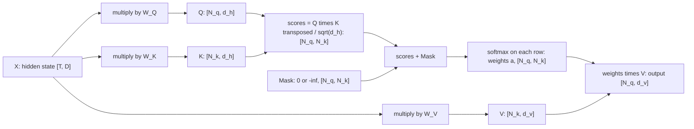

> **读图方法：** 这是单个 head 的 attention 数据流，只表达“Q、K、V 从哪来、怎样变成输出”。先看左边三条并行的投影线：它们读同一个 $X$，所以 Q、K、V 的行数都等于 token 数；
> 再从 `scores` 往右走，依次是缩放、加 Mask、逐行 softmax、乘 V，每个方框的 shape 对应上面五步里的 shape。
> 箭头是数据依赖，不是函数调用；图中省略了 Llama 在投影之后对 Q、K 做的 RoPE（见 1.4 节）和多个 head 的并行。

**为什么除以 $\sqrt{d_h}$？**

**白话：**$d_h$ 越大，点积的数值波动越大，softmax 容易“一边倒”；除以 $\sqrt{d_h}$ 把波动拉回到固定尺度。

**其中：**$q,k$ 是 Query、Key 中的一行（长度 $d_h$），$q_i$、$k_i$ 是它们的第 $i$ 个分量（$i$ 为局部下标）。

**怎么算出来：**先看一个简化假设：$q,k$ 的所有分量相互独立，均值为 0、方差为 1。

1. 一个乘积项 $q_ik_i$：两个独立零均值变量的乘积，均值为 0，方差为 $\mathbb E[q_i^2]\,\mathbb E[k_i^2]=1\times1=1$；
2. 点积 $q\cdot k=\sum_i q_ik_i$ 是 $d_h$ 个相互独立的乘积项之和，均值为 0，方差为 $d_h\times1=d_h$（独立变量的方差相加）；
3. 除以 $\sqrt{d_h}$ 把方差乘以 $1/d_h$，变回 1。这解释了缩放怎样抵消维度增长带来的分数尺度变化。

例如 $d_h=128$ 时，未缩放分数的标准差是 $\sqrt{128}\approx11.3$；缩放之后回到 1。这不是实际模型分数范围的承诺。

**核对：**vLLM 的 Llama 路径就是这个缩放：`self.scaling = self.head_dim**-0.5`（`vllm/model_executor/models/llama.py:162`）。

缩放可缓解 softmax 过度集中，但不保证注意力始终平缓，也不保证训练梯度一定通畅。
真实模型的 Q/K 来自学习到的投影，并不必然符合上述独立、单位方差假设。
原论文以训练中的小梯度说明动机；本书推理路径沿用模型定义的缩放，不执行反向传播。
[原始论文](https://arxiv.org/html/1706.03762v7#S3.SS2.SSS1)给出了这一假设与推导。

还应区分**分数缩放**与**指数运算的数值稳定性**。稳定 softmax 会先减去最大分数，
例如 `[1000,999]` 先变为 `[0,-1]`，再求指数；不能声称只靠除以维度平方根就防止溢出。
本章教学函数也采用减最大值的方法。

**白话：**softmax 里每个分数同时减去同一个数，结果不变；减去最大值只是为了不让指数溢出。

**怎么算出来：**把分子分母同乘 $e^{-c}$：$\dfrac{e^{z_i}}{\sum_j e^{z_j}}=\dfrac{e^{z_i-c}}{\sum_j e^{z_j-c}}$（$c$ 是任意常数，这里取最大分数）。
算例：$[1000,999]$ 取 $c=1000$ 得 $[0,-1]$，$e^0=1$、$e^{-1}\approx0.368$，权重为 $[1/1.368,\ 0.368/1.368]\approx[0.731,\ 0.269]$；
直接算 $e^{1000}$ 会超出 float32（上限约 $e^{88.7}$）和 float64（上限约 $e^{709.8}$）的表示范围，得到 Inf。

**核对：**随书 `softmax()`（`examples/ch01_minimal_inference.py:46-50`）先 `max(values)` 再减。

[源码] `vllm/model_executor/models/llama.py` - `LlamaAttention.__init__` 中的 `scaling`


### 一个可以手算的 Attention

假设当前位置是序列中的第 3 个 token，因此它能看到三个 Key。为了能手算，把 head
size 缩小为 2：

$$
\begin{aligned}
Q &= \begin{bmatrix}1.0 & 0.5\end{bmatrix},\\
K &= \begin{bmatrix}1.0&0.0\\0.0&1.0\\1.0&1.0\end{bmatrix},\\
V &= \begin{bmatrix}1.0&0.0\\0.0&2.0\\2.0&1.0\end{bmatrix}.
\end{aligned}
$$

**白话：**这是一个为手算而编的最小例子：一个 Query 去看三个位置，每个位置有一个 Key 和一个 Value。

**其中：**这些都是**教学数字**，不是真实模型的取值。$Q$ 是 `[N_q,d_h]`=`[1,2]`（只有当前这一个 Query，$N_q=1$）；$K$ 是 `[N_k,d_h]`=`[3,2]`、$V$ 是 `[N_k,d_v]`=`[3,2]`
（$N_k=3$，$d_h=d_v=2$）。$K$、$V$ 的三行分别对应位置 0、1、2，记作 $K_0,K_1,K_2$ 与 $V_0,V_1,V_2$。

**怎么算出来：**当前 token 是第 3 个，位置 0、1、2 都不晚于它（包括它自己），所以这一行 $\mathrm{Mask}$ 全是 0，可以直接省掉；
真实模型里，$K$ 的前几行来自缓存，最后一行由当前 token 现算。三个 Key 选成 $[1,0]$、$[0,1]$、$[1,1]$，是为了让它们与 $Q$ 的点积各不相同。

**核对：**这组数字与 `examples/ch01_numerical_walkthrough.py` 的 `attention_walkthrough()` 使用的 `query`、`keys`、`values` 相同，
`tests/test_ch01_numerical_walkthrough.py` 固定了下面的输出。

第一步，计算缩放点积：先对每个 Key 求点积 $Q\cdot K_j$（对应分量相乘再相加），再除以 $\sqrt{d_h}=\sqrt{2}\approx1.4142$：

| Key | 原始点积 $Q\cdot K$ | 除以 $\sqrt{2}$ 后的 score |
|---|---:|---:|
| K0 | $1.0\times1.0+0.5\times0.0=1.0$ | 0.7071 |
| K1 | $1.0\times0.0+0.5\times1.0=0.5$ | 0.3536 |
| K2 | $1.0\times1.0+0.5\times1.0=1.5$ | 1.0607 |

第二步，对 scores 做 softmax，得到权重向量 $a$：

$$
a\approx[0.3199,\;0.2246,\;0.4555].
$$

**白话：**softmax 把三个分数变成三个加起来为 1 的权重：分数最高的 K2 权重最大，K1 最小。

**其中：**$a$ 是长度 $N_k=3$ 的权重向量，$a_j$ 是第 $j$ 个 Key 的权重（无单位，$a_0+a_1+a_2=1$）。

**怎么算出来：**

1. 对三个 score 取指数：$e^{0.7071}\approx2.0281$、$e^{0.3536}\approx1.4241$、$e^{1.0607}\approx2.8883$；
2. 求和：$2.0281+1.4241+2.8883=6.3405$；
3. 每个指数除以总和：$2.0281/6.3405\approx0.3199$、$1.4241/6.3405\approx0.2246$、$2.8883/6.3405\approx0.4555$。

实现里会先减去最大分数 1.0607，三个指数变成 $0.7022$、$0.4931$、$1$，总和 $2.1953$，得到同样的 $[0.3199,0.2246,0.4555]$（见上一节的“稳定 softmax”）。
$0.3199+0.2246+0.4555=1.0000$，满足归一化。

**核对：**`attention_walkthrough()` 的 `probabilities`，由 `tests/test_ch01_numerical_walkthrough.py::test_attention_walkthrough` 检查权重之和为 1。

第三步，用权重聚合 Value：

$$
\begin{aligned}
\mathrm{output} &\approx 0.3199V_0 + 0.2246V_1 + 0.4555V_2 \\
&\approx [1.2309,\;0.9047].
\end{aligned}
$$

**白话：**输出是三个 Value 行的加权平均：谁的权重大，输出就更像谁的 Value。

**其中：**$\mathrm{output}$ 是这个 Query 的 attention 输出，长度 $d_v=2$；$V_0,V_1,V_2$ 是上面 $V$ 的三行。

**怎么算出来：**按分量分别加权。第 0 个分量：$0.3199\times1.0+0.2246\times0.0+0.4555\times2.0=0.3199+0+0.9110=1.2309$；
第 1 个分量：$0.3199\times0.0+0.2246\times2.0+0.4555\times1.0=0+0.4492+0.4555=0.9047$。
没有单位；每个分量都落在对应 $V$ 列的最小值与最大值之间（第 0 列在 0 到 2 之间，第 1 列在 0 到 2 之间），因为权重非负且相加为 1。

**核对：**`attention_walkthrough()` 的 `output`，测试断言 $[1.2309211\ldots,\ 0.9047402\ldots]$（`tests/test_ch01_numerical_walkthrough.py:26-27`）；
这些数字也可以直接运行 `examples/ch01_numerical_walkthrough.py` 复现。这里最容易混淆的
一点是：**Query/Key 决定权重，Value 决定被混合的内容。** Key 本身不会直接按权重
相加成为 attention 输出。

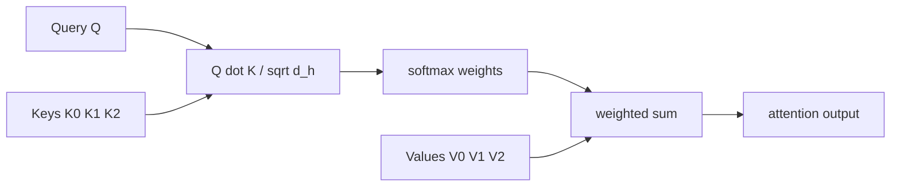

> **读图方法：** 这张图用于压缩“一个可以手算的 Attention”的整体关系。先从左向右找到起点、关键转换和终点，再问每条跨层箭头是否意味着函数调用、消息传递、内存访问或状态更新。

### Multi-Head 与 GQA

真实模型会把 hidden 维拆成多个 heads：

| Tensor | 教学形状 | vLLM attention 层内部常见形状 |
|---|---|---|
| Query | `[B,S,H_q,d_h]` | `[T,H_q,d_h]` |
| Key | `[B,S,H_kv,d_h]` | `[T,H_kv,d_h]` |
| Value | `[B,S,H_kv,d_v]` | `[T,H_kv,d_v]` |
| Output | `[B,S,H_q,d_v]` | `[T,H_q*d_v]` |

（表里的 $H_q$、$H_{\mathrm{kv}}$ 在 Tensor Parallel 下是每张卡上的 head 数；Llama 里 $d_v=d_h$。）

普通 Multi-Head Attention 中 $H_q=H_{\mathrm{kv}}$。Grouped-Query Attention（GQA）让多组
query heads 共享较少的 KV heads，即 $H_{\mathrm{kv}}<H_q$。这样可以显著减少 KV Cache，
也是容量公式必须使用 `num_key_value_heads` 而不是盲目使用
`num_attention_heads` 的原因。

**白话：**Query head 可以很多，但 Key/Value head 可以少：几个 Query head 共用同一份 K、V。共用得越多，要缓存的 K、V 就越少。

**其中：**$H_q$ 是 Query head 数，$H_{\mathrm{kv}}$ 是 KV head 数；每个 KV head 被 $H_q/H_{\mathrm{kv}}$ 个 Query head 共享，这个比值必须是整数；
$h$ 是 Query head 的序号（$0\le h<H_q$，本节局部字母）。

**怎么算出来：**

1. 把 $H_q$ 个 Query head 按序号**连续**分成 $H_{\mathrm{kv}}$ 组，每组 $H_q/H_{\mathrm{kv}}$ 个；
2. 序号为 $h$ 的 Query head 落在第 $\lfloor h\,H_{\mathrm{kv}}/H_q\rfloor$ 组，就读第几号 KV head；
3. $H_{\mathrm{kv}}=H_q$ 时每组 1 个，就是普通 Multi-Head；$H_{\mathrm{kv}}=1$ 时所有 Query head 共用一份 K、V（常称 MQA）。

教学数字算例：$H_q=8$、$H_{\mathrm{kv}}=2$，每组 $8/2=4$ 个；Query head 5 落在第 $\lfloor5\times2/8\rfloor=\lfloor1.25\rfloor=1$ 组，读 KV head 1；
Query head 0 到 3 读 KV head 0。要缓存的 K/V 只有普通 Multi-Head 的 $H_{\mathrm{kv}}/H_q=2/8=1/4$（后面的容量公式把这一点换算成字节）。

**核对：**通用 `Attention` 在构造时断言 `num_heads % num_kv_heads == 0`（`vllm/model_executor/layers/attention/attention.py:350`）；
Triton backend 取 `num_queries_per_kv = num_heads // num_kv_heads`（`vllm/v1/attention/backends/triton_attn.py:542`），
kernel 里第 `kv_head_idx` 号 KV head 对应的 Query head 序号是 `kv_head_idx * num_queries_per_kv + (0 … num_queries_per_kv-1)`
（`vllm/v1/attention/ops/triton_unified_attention.py:457`），即上面的“连续分组”。
表中的形状来自 `Attention.forward` 的 `view(-1, num_heads, head_size)`、`view(-1, num_kv_heads, head_size)`、`view(-1, num_kv_heads, head_size_v)`
（`attention.py:564-569`）以及输出宽度 `num_heads * head_size_v`（`attention.py:558`）。
`LlamaAttention` 在 TP 下把两者各除以 TP 路数：`self.num_heads = total_num_heads // tp_size`（`llama.py:146`）、
`self.num_kv_heads = max(1, total_num_kv_heads // tp_size)`（`llama.py:156`）。

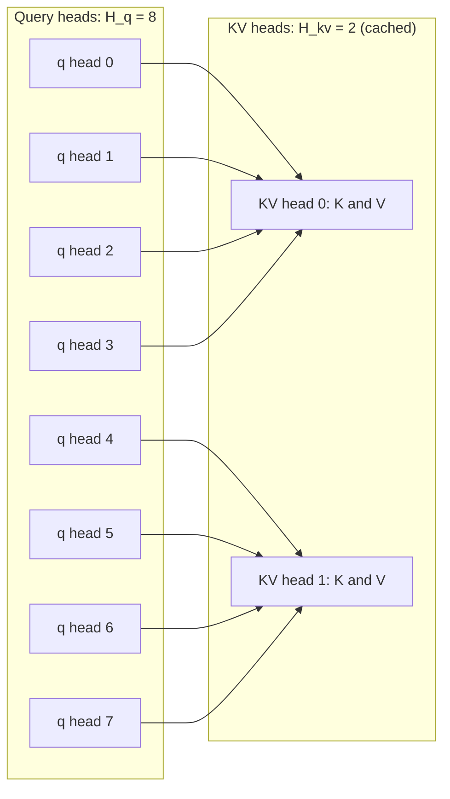

> **读图方法：** 这是 GQA 的对应关系图（教学数字：8 个 Query head、2 个 KV head），只回答“哪个 Query head 读哪个 KV head”。左边每个方框是一个 Query head，右边每个方框是一份要缓存的 K/V；
> 箭头表示“这个 Query head 用那个 KV head 的 K、V 做 attention”，同一个 KV head 前面有 $H_q/H_{\mathrm{kv}}=4$ 条箭头。
> 把右边改成 8 个方框、一一对应就是普通 Multi-Head；改成 1 个方框就是 MQA。缓存里只存右边的方框，所以 KV Cache 随 $H_{\mathrm{kv}}$ 而不是 $H_q$ 增长。

当前 `LlamaAttention.forward` 的顺序非常清晰：

```text
hidden_states
  -> qkv_proj
  -> split(q_size, kv_size, kv_size)
  -> rotary_emb(positions, q, k)
  -> Attention(q, k, v)
  -> o_proj
```

而 `Attention.forward` 会把扁平 Q/K/V reshape 成 head 维度，再交给实际 attention
backend。PagedAttention 和 backend 选择将在第 06 章展开。

## 1.4 Causal Mask 与 RoPE

> **本节先看：** 本节要回答：**Causal Mask 与 RoPE**。下面的小节会逐层拆开概念、运行过程和源码落点；第一次阅读先抓对象之间的关系，第二次再记类名、字段和分支。

### 为什么不能读取未来

自回归模型在位置 `i` 预测下一个 token 时，只允许读取位置 `0..i`。长度为 4 的
causal attention 可见关系如下：

| Query 位置 | K0 | K1 | K2 | K3 |
|---:|:---:|:---:|:---:|:---:|
| Q0 | 可见 | 屏蔽 | 屏蔽 | 屏蔽 |
| Q1 | 可见 | 可见 | 屏蔽 | 屏蔽 |
| Q2 | 可见 | 可见 | 可见 | 屏蔽 |
| Q3 | 可见 | 可见 | 可见 | 可见 |

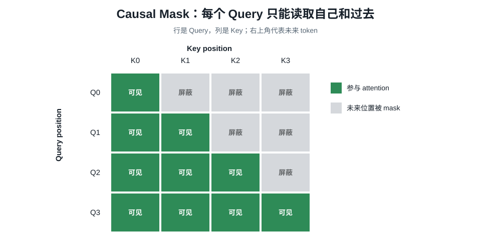

训练或 prefill 时可以一次计算所有位置，但上三角的未来位置会被 mask 成极小值，
softmax 后概率近似为 0。并行计算所有位置不等于允许看到未来。

从矩阵还能直接看出计算量增长：第 0 行读取 1 个 Key，第 1 行读取 2 个，依次到第
$S-1$ 行读取 $S$ 个，总数为 $1+2+\cdots+S=\frac{S(S+1)}{2}$。这就是 causal prefill 中
attention score 数量呈二次增长的来源。

**白话：**causal 下每一行只数“可见”的格子，总数大约是整张 $S\times S$ 表的一半。

**其中：**$S$ 是序列长度（token 数），也是表的行数和列数；第 $i$ 行（$i=0,\dots,S-1$）有 $i+1$ 个可见位置。

**怎么算出来：**把求和正着写一遍、倒着写一遍，上下对齐相加：每一列的和都是 $S+1$，共 $S$ 列，所以两倍的总数是 $S(S+1)$，总数是 $\frac{S(S+1)}{2}$。
算例：$S=4$ 时 $1+2+3+4=10$，公式给出 $4\times5/2=10$；数上面表里的“可见”格子也是 $1+2+3+4=10$，而整张表有 $4\times4=16$ 格。

**核对：**上面的可见性表和 `figures/causal-mask.svg` 的下三角；随书 `attention_score_counts()`（`examples/ch01_minimal_inference.py:217-227`）逐步求的就是这个和（1.7 节“计算量直觉”）。

### 只有 token 含义还不够

如果没有位置信息，“我喜欢源码”和“源码喜欢我”包含相同 token 集合，attention
难以区分顺序。Llama 使用 RoPE，把位置编码作用在 Query 和 Key 上，而不是简单加到
Value 上。

对向量中的一对维度 $(x_0,x_1)$，RoPE 可直观理解为按位置旋转：

$$
\begin{bmatrix}
x'_0 \\ x'_1
\end{bmatrix} =
\begin{bmatrix}
\cos\theta & -\sin\theta \\
\sin\theta & \cos\theta
\end{bmatrix}
\begin{bmatrix}
x_0 \\ x_1
\end{bmatrix}
$$

**白话：**把一对数当成平面上的一个点，绕原点转 $\theta$ 角。位置越靠后，转得越多；旋转不改变点到原点的距离，所以只把位置写进了方向，没有改变向量的“强度”。

**其中：**$(x_0,x_1)$ 是 Query 或 Key 向量里的一对分量（本节局部字母），$(x'_0,x'_1)$ 是旋转后的值，$\theta$ 是旋转角（弧度）。
一个 head 的 $d_h$ 维向量被分成 $d_h/2$ 对，第 $j$ 对（$j=0,\dots,d_h/2-1$，局部下标）在位置 $\mathrm{pos}$ 的旋转角是

$$
\theta=\mathrm{pos}\cdot\omega,\qquad \omega=\mathtt{rope\_theta}^{-2j/d_h}.
$$

这里 $\omega$ 是第 $j$ 对的“每个位置转多少”（本节局部字母），$\mathtt{rope\_theta}$ 是配置里的基数（源码名 `rope_theta`，缺省 10000，各模型的配置可以不同）。
下面只讲最基本的 `rope_type="default"`；llama3、YaRN 等变体会改写 $\omega$，不在本章范围内。

**怎么算出来：**

1. 旋转矩阵从和角公式来：把点写成 $(x_0,x_1)=\lVert x\rVert(\cos\varphi,\sin\varphi)$（$\varphi$ 是它原来的角度，本节局部字母）。转 $\theta$ 之后角度变成 $\varphi+\theta$：
   $x'_0=\lVert x\rVert\cos(\varphi+\theta)=x_0\cos\theta-x_1\sin\theta$，$x'_1=\lVert x\rVert\sin(\varphi+\theta)=x_0\sin\theta+x_1\cos\theta$，
   这正是矩阵的两行；长度 $\lVert x\rVert$ 不变。
2. 频率从快到慢：$j=0$ 时 $\omega=\mathtt{rope\_theta}^{0}=1$，每个位置转 1 弧度；$j$ 越大 $\omega$ 越小，最后一对只有 $\mathtt{rope\_theta}$ 分之一的量级，相隔很远的位置才看得出差别。
3. 为什么点积里只剩相对位置：记 $R(\theta)$ 为上面的 $2\times2$ 旋转矩阵，转 $\alpha$ 再转回 $-\alpha$ 等于没转，所以 $R(\alpha)^{\top}=R(-\alpha)$，且 $R(\alpha)^{\top}R(\beta)=R(\beta-\alpha)$。
   Query 在位置 $\mathrm{pos}_q$、Key 在位置 $\mathrm{pos}_k$ 时，同一对分量旋转后的点积是
   $(R(\mathrm{pos}_q\,\omega)q)\cdot(R(\mathrm{pos}_k\,\omega)k)=q^{\top}R(\mathrm{pos}_q\,\omega)^{\top}R(\mathrm{pos}_k\,\omega)k=q^{\top}R\bigl((\mathrm{pos}_k-\mathrm{pos}_q)\,\omega\bigr)k$，
   只取决于位置差 $\mathrm{pos}_k-\mathrm{pos}_q$，不取决于它们各自的绝对位置。这里 $q,k$ 是旋转前的这一对分量。

算例一（$\omega$ 的取值）：$d_h=4$、$\mathtt{rope\_theta}=10000$，共 2 对：$j=0$ 时 $\omega=10000^{0}=1$；$j=1$ 时 $\omega=10000^{-2/4}=1/\sqrt{10000}=0.01$。
位置 $\mathrm{pos}=3$ 的两对分别转 $3\times1=3$ 弧度和 $3\times0.01=0.03$ 弧度。

算例二（旋转本身，教学数字：取 $\theta=90^\circ$）：$(x_0,x_1)=(1,0)$，$\cos90^\circ=0$、$\sin90^\circ=1$，
$x'_0=1\times0-0\times1=0$，$x'_1=1\times1+0\times0=1$，得到 $(0,1)$；长度仍是 1。

算例三（相对位置，教学数字：取每个位置转 $90^\circ$）：$q=k=(1,0)$。Query 在位置 2、Key 在位置 0：Query 转 $180^\circ$ 得 $(-1,0)$，Key 不转，点积 $-1$；
Query 在位置 5、Key 在位置 3：Query 转 $450^\circ$（等于 $90^\circ$）得 $(0,1)$，Key 转 $270^\circ$ 得 $(0,-1)$，点积 $-1$。两种情形位置差都是 2，点积相同，与绝对位置无关。

**核对：**vLLM 的 Llama 在 split 之后立即执行 `q, k = self.rotary_emb(positions, q, k)`（`vllm/model_executor/models/llama.py:231`），然后才调用 `self.attn(q, k, v)`（`:232`），
`_init_rotary_emb` 里 `is_neox_style = True`（`:241`）。`get_rope` 取 `rope_theta`（缺省 10000），`rotary_dim` 来自配置里的 `rope_dim`，没有时取 `head_size * partial_rotary_factor`
（`vllm/model_executor/layers/rotary_embedding/__init__.py:64-72`；`partial_rotary_factor` 缺省 1，所以通常 `rotary_dim` 等于 $d_h$）；
频率与角度在 `RotaryEmbedding._compute_inv_freq`（`vllm/model_executor/layers/rotary_embedding/base.py:80-92`，即 $\omega$）和 `_compute_cos_sin_cache`（`:94-102`，`t` 与 `inv_freq` 的外积再取 cos、sin，即 $\theta=\mathrm{pos}\cdot\omega$）里算好并缓存；
旋转在 `ApplyRotaryEmb.forward_static`（`vllm/model_executor/layers/rotary_embedding/common.py:134-173`）：neox 风格把 head 向量切成前后两半 `x1, x2`，
`o1 = x1 * cos - x2 * sin`、`o2 = x2 * cos + x1 * sin`（`:163-164`），就是上面的矩阵。
所以 Llama 在 vLLM 里配对的是第 $j$ 维和第 $j+d_h/2$ 维，而不是相邻两维；随书 `rotate_pairs()`（`examples/ch01_minimal_inference.py:53-67`）为了好读用相邻配对，
两者只是维度排列不同，旋转的数学一样。`tests/kernels/core/test_rotary_embedding.py` 是上游对旋转实现的测试。

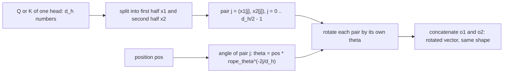

> **读图方法：** 这是 RoPE 在一个 head 内部的坐标映射图（neox 风格，Llama 使用）。先看最上面一路：向量被切成前后两半，第 $j$ 对由前半的第 $j$ 个数和后半的第 $j$ 个数组成；
> 再看左下的 position 一路：每一对按自己的频率算出一个角度；两路在 `rotate` 汇合，每一对各自旋转，最后把前后两半拼回原来的 shape。
> 图里没有任何新增参数，也不改变向量长度；位置只通过角度进入。

不同维度对使用不同频率，旋转角随 position 变化。旋转后的 Q/K 点积包含相对位置
关系（上面第 3 步）。当前 Llama 路径中，`qkv_proj` 和 split 之后立即执行
`self.rotary_emb(positions, q, k)`，然后才进入 attention。

## 1.5 从 Logits 到下一个 Token

> **本节先看：** 本节要回答：**从 Logits 到下一个 Token**。下面的小节会逐层拆开概念、运行过程和源码落点；第一次阅读先抓对象之间的关系，第二次再记类名、字段和分支。

### Greedy 与随机采样

最简单的方法是 greedy：选择最大 logit 的 token。$z_i$ 是候选 $i$ 的分数，
$i_{\mathrm{next}}$ 是选中的 token ID。

$$
i_{\mathrm{next}} = \operatorname*{arg\,max}_{i} z_i
$$

**白话：**挑分数最高的那个候选，不做任何随机选择。

**其中：**$z_i$ 是候选 $i$ 的 logit，$i$ 遍历 $0,\dots,\lvert\mathcal V\rvert-1$；$\operatorname*{arg\,max}$ 返回使 $z_i$ 最大的下标 $i$（而不是最大值本身）；
$i_{\mathrm{next}}$ 是选中的 token ID，无单位。

**怎么算出来：**从头到尾扫描一遍，记住当前最大的分数和它的下标，遇到更大的就更新；扫完得到的下标就是 $i_{\mathrm{next}}$。
算例：$z=[4,2,1,0]$ 时最大分数是 4，下标 0，所以 $i_{\mathrm{next}}=0$（后文 temperature 一节里的候选 A）。
如果两个分数并列最大，公式本身没有规定选谁，要看实现的并列处理规则。

**核对：**随书 `sample_logits()` 在 `temperature == 0` 时直接 `max(range(len(logits)), key=logits.__getitem__)`（`examples/ch01_minimal_inference.py:94-95`），
并列时取下标最小的；`tests/test_ch01_minimal_inference.py::test_temperature_zero_is_greedy` 检查这个分支。
vLLM 的 `gumbel_noised_argmax` 在 `temp == 0` 时不加噪声，退化为普通 argmax（`vllm/v1/worker/gpu/sample/gumbel.py:172-212`）；
`SamplingParams.__post_init__` 在 temperature 小于 `_SAMPLING_EPS`（1e-5）时按 greedy 处理（`vllm/sampling_params.py:619-623`）。

给定完全相同的 logits 和并列值处理规则，它总会选择同一项；但不同硬件或 batch
引起的浮点误差仍可能改变非常接近的分数，所以 `temperature=0` 不是跨环境逐字复现
的保证。随机采样则按处理后的概率分布选择。

### Temperature

Temperature 在 softmax 前缩放 logits：

$$
p_i(\tau) = \frac{\exp(z_i/\tau)}{\sum_j \exp(z_j/\tau)}, \qquad \tau>0
$$

**白话：**先把所有 logit 都除以同一个正数 $\tau$ 再做 softmax：$\tau$ 小于 1 时分数差距被放大，分布更尖锐；大于 1 时差距被压平，分布更平。

**其中：**$\tau$ 是无单位的温度参数（$\tau>0$），与前面表示 token 数的 `T`（形状 `[T,D]` 的第 0 维）无关，所以本书把温度写成 $\tau$；
$p_i(\tau)$ 是温度为 $\tau$ 时候选 $i$ 的概率；输入和输出都是长度 $\lvert\mathcal V\rvert$ 的向量。本公式只适用于 $\tau>0$。

**怎么算出来：**

1. 把每个 logit 除以 $\tau$：$z_i/\tau$；
2. 对结果做普通 softmax（1.1 节）：取指数、除以总和；
3. 为什么能“放大/压平”：任意两个候选的概率之比是 $\dfrac{p_a}{p_b}=e^{(z_a-z_b)/\tau}$。$\tau<1$ 时指数里的差距被放大，$\tau>1$ 时被缩小；
   $\tau\to0$ 时最大分数的候选概率趋近 1，就是 greedy，所以 vLLM 把 $\tau=0$ 单独当作 greedy 处理，而不去除以 0。

算例：固定 $z=[4,2,1,0]$。$\tau=0.5$ 时 $z/\tau=[8,4,2,0]$，指数约为 $2981.0$、$54.60$、$7.389$、$1$，总和约 $3043.9$，候选 A 的概率 $2981.0/3043.9\approx97.93\%$；
$\tau=1$ 时 $z/\tau=[4,2,1,0]$，指数约 $54.60$、$7.389$、$2.718$、$1$，总和约 $65.71$，A 为 $83.10\%$；
$\tau=2$ 时 $z/\tau=[2,1,0.5,0]$，指数约 $7.389$、$2.718$、$1.649$、$1$，总和约 $12.76$，A 为 $57.93\%$。下面的表就是这样一列列算出来的。

**核对：**vLLM 的 `_temperature_kernel` 逐元素执行 `logits = logits / temperature`（`vllm/v1/worker/gpu/sample/gumbel.py:44`），
temperature 为 0 或 1 时提前返回、不改 logits（`:34-36`）；`SamplingParams` 把落在 $(0,0.01)$ 的 temperature 提高到 0.01（`vllm/sampling_params.py:564-572`），
并要求 temperature 有限、非负且不大于 2（`:660-676`）。随书表格由 `temperature_rows()`（`examples/ch01_numerical_walkthrough.py`）生成，
`tests/test_ch01_numerical_walkthrough.py::test_temperature_distributions_sum_to_one` 检查每组概率之和为 1。

- `0 < τ < 1`：差距被放大，分布更尖锐。
- `τ > 1`：差距被压平，选择更多样。
- 在 vLLM `SamplingParams` 中，`temperature=0` 表示 greedy。

固定 logits `[4,2,1,0]`，只改变 temperature：

| Token | Logit | `τ=0.5` | `τ=1.0` | `τ=2.0` |
|---|---:|---:|---:|---:|
| A | 4 | 97.93% | 83.10% | 57.93% |
| B | 2 | 1.79% | 11.25% | 21.31% |
| C | 1 | 0.24% | 4.14% | 12.93% |
| D | 0 | 0.03% | 1.52% | 7.84% |

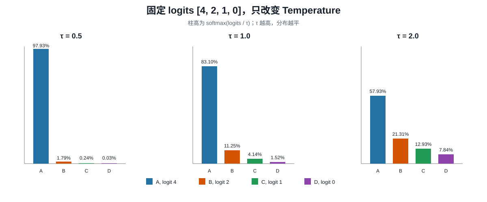

Temperature 不会改变 logit 的大小顺序（除以正数不改变大小关系），所以单纯改变 temperature 不会改变 greedy
的 argmax；它改变的是随机采样时各候选被选中的相对概率。

### Top-k 与 Top-p

> **本节先看：** 下面先给出“Top-k 与 Top-p”的结论清单。先理解每一项为什么存在，再记参数名或实现细节。

- **Top-k：** 按最大的 `top_k` 个分数设定筛选边界；没有边界并列时可理解为保留 `top_k` 个候选。
- **Top-p：** 按概率从高到低保留，直到累计概率达到 `top_p`。

仍使用 $\tau=1$ 的概率（上一节表中的第三列）：

```text
A: 0.8310
B: 0.1125    cumulative A+B = 0.9435
C: 0.0414
D: 0.0152
```

**白话：**top-k 按个数截断，top-p 按累计概率截断；留下来的候选重新归一化，被排除的概率变成 0。

**其中：**$\mathrm{top\_k}$ 是保留的候选个数；$\mathrm{top\_p}\in(0,1]$ 是累计概率阈值；$p_i$ 是候选 $i$ 在温度处理之后的概率；重新归一化后的概率是 $p_i/\sum_{j\in\mathrm{kept}}p_j$，其中 $\mathrm{kept}$ 是保留下来的候选集合，$j$ 遍历它。

**怎么算出来：**

- $\mathrm{top\_k}=2$ 保留 A、B（概率最大的两个）。保留项的概率之和是 $0.8310+0.1125=0.9435$，每项除以它：
  $0.8310/0.9435\approx88.08\%$、$0.1125/0.9435\approx11.92\%$，两者相加为 100%。
- $\mathrm{top\_p}=0.9$：从高到低累加概率。A 单独是 $0.8310<0.9$，不够；加入 B 后 $0.8310+0.1125=0.9435\ge0.9$，停止，所以也保留 A、B。
- $\tau=2$ 时概率是 $[57.93\%,\ 21.31\%,\ 12.93\%,\ 7.84\%]$：A+B 只有 $57.93\%+21.31\%=79.24\%<90\%$，还要加入 C，累计 $92.17\%\ge90\%$，所以保留 A、B、C。
  这说明 temperature 会间接改变 nucleus 的候选数量。

**核对：**随书 `sample_logits()` 按降序累加概率取 nucleus、再按 `top_k` 截断、再对保留项重新归一化（`examples/ch01_minimal_inference.py:97-115`）；
vLLM 里的实现和并列规则见下面的 `apply_top_k_top_p`。

Top-k 与 top-p 最终都通过 mask 排除候选，并对保留项重新归一化。两者同时开启时，
不能把“先截断并归一化，再用新概率计算另一个阈值”的教学捷径当成所有实现的精确
语义；应查看固定 revision 的 `apply_top_k_top_p` 及其等价性测试。

边界并列时要看实现。当前 PyTorch 参考路径屏蔽的是“严格小于第 k 大分数”的项；
例如 logits 为 `[4,2,2]`、`top_k=2`，两个分数为 2 的候选都可能保留，不能据此断言
一定只剩两个 token。随书模型按排序后截取候选，是教学简化；其他 backend 的并列
处理需分别核对，不能只凭 top-k 名称推断。v0.33.0（`4ba787ec`）的 Triton top-k-only 路径按索引打破第 k 位并列，
保留恰好 k 项；PyTorch 参考实现可以额外保留并列项。对应测试只要求额外项确实与第 k 位同分，
不再要求两条实现的候选数严格相同（`tests/v1/sample/test_topk_topp_sampler.py:181` 的注释）。

[测试] `tests/v1/sample/test_topk_topp_sampler.py` - `TestTritonTopkTopp`

[源码] `vllm/v1/sample/ops/topk_topp_sampler.py` - `apply_top_k_top_p_pytorch`、`apply_top_k_only`

**批内有的请求只开 top-p 时，kernel 怎么分工。** 这一节只在 CUDA 上的 Triton 路径成立，是工程细节，不改变上面的
采样语义。同一个 batch 里，每行请求可以有自己的 `top_k` 与 `top_p`：`top_k` 等于词表大小 $\lvert\mathcal V\rvert$ 表示
“这一行没开 top-k”，`top_p` 等于 1 表示“没开 top-p”。vLLM 的 Triton 实现有两种 kernel：
单体 kernel 同时处理 top-k 与 top-p（对带 top-k 的行很快）；当 batch 不超过 64（`_SPLIT_MAX_BATCH`，
`vllm/v1/sample/ops/topk_topp_triton.py:986`）且开了 top-p 时，对“没开 top-k”的行改用分块的 split top-p 流水线，
因为小 batch 下单体 kernel 的纯 top-p 路径受延迟限制。若 batch 里还混着带 top-k 的行，这些行先由单体 kernel 处理，
之后**仅当确有纯 top-p 的行**才再补跑一遍 split top-p。MRV2 为此在每步算一个布尔值：

$$
\mathrm{has\_topp\_only\_rows}=\mathrm{do\_top\_p}\ \wedge\ \exists\, i:\ (\mathrm{top\_k}_i\ge\lvert\mathcal V\rvert\ \wedge\ \mathrm{top\_p}_i<1)
$$

**白话：**只要本批里至少有一行“没开 top-k 但开了 top-p”，就必须补跑；否则可以省掉这一遍。

**其中：**$\mathrm{do\_top\_p}$、$\mathrm{has\_topp\_only\_rows}$ 是源码里布尔变量 `do_top_p`、`has_topp_only_rows` 的公式写法；

- $\mathrm{top\_k}_i$：第 $i$ 行请求的 `top_k`，等于 $\lvert\mathcal V\rvert$ 表示该行没开 top-k；
- $\mathrm{top\_p}_i$：第 $i$ 行请求的 `top_p`，范围 $(0,1]$，等于 1 表示该行没开 top-p；
- $\lvert\mathcal V\rvert$：词表大小（logits 最后一维）；
- $\mathrm{do\_top\_p}$：本批是否有任何一行 $\mathrm{top\_p}_i\ne 1$；
- $\mathrm{has\_topp\_only\_rows}$：是否需要补跑 split top-p；
- $\wedge$ 是“且”，$\exists\,i$ 是“存在某一行 $i$”，$i$ 是行号（本节局部字母）。

**怎么算出来：**

1. 一行“没开 top-k”：`SamplingStates` 把 `top_k <= 0` 或大于词表的值都存成词表大小（`vllm/v1/worker/gpu/sample/states.py:49-50`），所以“没开”等价于 $\mathrm{top\_k}_i\ge\lvert\mathcal V\rvert$；
2. 一行“开了 top-p”就是 $\mathrm{top\_p}_i<1$；
3. 两条同时成立的行就是“纯 top-p 行”；批里存在这样的行（$\exists\,i$，代码里是对布尔数组取 `np.any`），就必须补跑；
4. 前面再乘一个 $\mathrm{do\_top\_p}$ 在数学上是多余的（有一行 $\mathrm{top\_p}_i<1$ 就一定有一行 $\mathrm{top\_p}_i\ne1$），
   但 `do_top_p` 本来就要先算出来决定要不要传 `top_p`，写成 `and` 可以在整批都没开 top-p 时短路，少做一次数组比较。

手算例子：$\lvert\mathcal V\rvert=100$，一批 4 行，$\mathrm{top\_k}=[100,100,5,100]$，$\mathrm{top\_p}=[0.9,1.0,0.9,1.0]$。$\mathrm{do\_top\_p}$ 为真（第 0、2 行不等于 1）；
第 0 行 $\mathrm{top\_k}_0=100\ge\lvert\mathcal V\rvert$ 且 $\mathrm{top\_p}_0=0.9<1$，所以结果为真，要补跑。若换成 $\mathrm{top\_k}=[5,3]$、$\mathrm{top\_p}=[0.9,0.8]$，
两行都开了 top-k，没有任何一行满足括号里的条件，结果为假，补跑被跳过；若所有行 $\mathrm{top\_p}=1$，$\mathrm{do\_top\_p}$ 为假，结果也为假。

**核对：**`SamplingStates.get_top_k_top_p()`（`vllm/v1/worker/gpu/sample/states.py:105-121`）里 `do_top_p = np.any(top_p_np != 1.0)`，
`has_topp_only_rows = bool(do_top_p and np.any((top_k_np >= vocab_size) & (top_p_np < 1.0)))`（`:118-120`）就是上面的公式；
调用方 `apply_top_k_top_p_triton()` 末尾 `if use_split and has_topp_only_rows:` 才补跑 `_apply_topp_split`（`vllm/v1/sample/ops/topk_topp_triton.py:1723-1724`）。

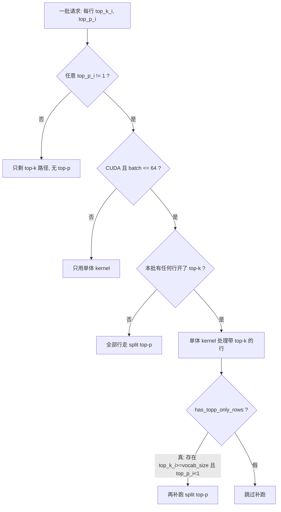

> **读图方法：** 这是 Triton top-k/top-p 在一个 batch 内如何分工的决策图。先从上往下看三道条件：有没有 top-p、是不是小批量 CUDA、有没有带 top-k 的行；最后一个菱形就是上面公式的结果，它只决定“要不要多跑一遍 split top-p”。

这个布尔值在 `SamplingStates.get_top_k_top_p()`（`vllm/v1/worker/gpu/sample/states.py:105`）里用 CPU 侧 numpy 数组
一次算好，经 `apply_top_k_top_p(..., has_topp_only_rows=…)`（`vllm/v1/sample/ops/topk_topp_sampler.py:198`）传给
`apply_top_k_top_p_triton()`（`vllm/v1/sample/ops/topk_topp_triton.py:1618`），其函数 docstring 明确要求：
只要有行满足 $\mathrm{top\_p}<1$ 且 $\mathrm{top\_k}\ge\lvert\mathcal V\rvert$，调用方必须传 `True`，否则这样的行会得不到 top-p。默认值是 `True`（保守）。
上游提交：[7b6310c10](https://github.com/vllm-project/vllm/commit/7b6310c10)（[#61996](https://github.com/vllm-project/vllm/pull/61996)）。
同一区间内 split top-p 还修了两个正确性问题：第 k 位并列时的“并列配额”现在能跨 block 累计
（[ce49c47cb](https://github.com/vllm-project/vllm/commit/ce49c47cb)，[#62046](https://github.com/vllm-project/vllm/pull/62046)，
测试 `test_topp_ties_across_blocks`）；logits 极大时 split top-p 不再把整行屏蔽掉
（[852989f58](https://github.com/vllm-project/vllm/commit/852989f58)，[#58231](https://github.com/vllm-project/vllm/pull/58231)）。

[源码] `vllm/v1/worker/gpu/sample/states.py` - `SamplingStates.get_top_k_top_p`

[源码] `vllm/v1/sample/ops/topk_topp_triton.py` - `apply_top_k_top_p_triton`

### Penalty、Bias 与约束

生产请求通常不只有 temperature、top-k 和 top-p：

| 参数或约束 | 作用对象 | 直觉 |
|---|---|---|
| presence penalty | 是否在已生成输出中出现过 | 出现过一次就调整，鼓励或抑制重复主题 |
| frequency penalty | 在已生成输出中的出现次数 | 出现越多，调整越多 |
| repetition penalty | prompt 与输出中的已有 token | 按 logit 符号和倍率改变重复倾向 |
| logit bias | 指定 token IDs | 人工提高或降低候选分数 |
| allowed token IDs | 候选集合 | 只允许白名单 token |
| bad words | token 序列 | 在即将拼成禁用词时，屏蔽该序列的末尾 token |
| structured output mask | 语法允许集合 | 只保留当前语法状态允许的 token |

presence/frequency 的计数范围是输出；repetition 还会考虑 prompt。一个 token
只在输入中出现、尚未生成时，不能据此给它加 presence/frequency penalty。

[源码] `vllm/model_executor/layers/utils.py` - `apply_penalties`

[源码] `vllm/v1/worker/gpu/sample/penalties.py` - `_penalties_kernel`

这些操作不是纯粹的“语言模型概率”。它们在模型给出 logits 后改变可选集合或分数，
因此同一模型、同一上下文可以因请求参数不同而输出不同 token。

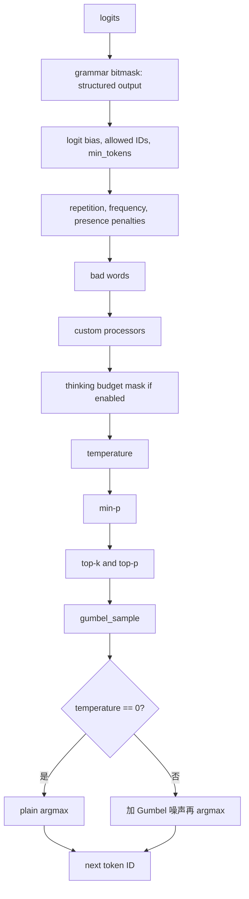

> **读图方法：** 这是“Penalty、Bias 与约束”的流程图，按 MRV2 的 `Sampler` 调用顺序画。先从上向下只追一条主路径：前一步产出的 logits 交给下一步，每个方框只改写 logits，最后一步才选出 token；第二遍再看末尾的菱形，它说明 greedy 和随机采样共用同一个 `gumbel_sample` 入口，只差“要不要加噪声”。grammar bitmask 不在 `Sampler` 里，而是在调用 `Sampler` 之前由 Model Runner 就地写入 logits（见第 07 章）。图中省略 logprobs、spec decode 的 rejection sampler 以及 FlashInfer/XPU 的 fused 分支。

从 v0.33.0 之后的 main 起，第一代 Model Runner（Model Runner V1，简称 MRV1）已被 `aac1b2a4f3`（#63373，`[Core] Remove Model Runner V1`）整体删除，`v1/sample/sampler.py` 里的旧 `Sampler` 和 `apply_logits_processors` 都不再存在；这个 revision（`05caae03`）里只剩 MRV2 一套采样实现。上面的图就是它的顺序，对应源码如下：

- 第二代 Model Runner（Model Runner V2，简称 MRV2，位于 `vllm/v1/worker/gpu/model_runner.py`）把 sampling state、penalty、bad words、logprob 等拆到
  `vllm/v1/worker/gpu/sample/`，并大量使用 Triton 实现。`Sampler.__init__`（`vllm/v1/worker/gpu/sample/sampler.py:43`）
  按固定顺序构造 `logits_processors` 列表：bias（含 allowed token IDs 与 `min_tokens` 对应的 stop token 屏蔽，
  `logit_bias.py` 的 `LogitBiasState`）→ penalties → bad words → 用户配置的 custom processors；源码注释写明
  “bias 加分、penalty 按倍率缩放，二者不可交换”。`Sampler.apply_sampling_params`（`:223`）逐个调用
  `processor.apply(logits, ctx)`，然后应用 thinking budget（思考预算掩码）、temperature、min-p；默认在此继续应用
  top-k/top-p；但正常 `sample()`（`:275`）调用始终传入 `skip_top_k_top_p=True`，先延后过滤，
  再由 `_sample_random`（`:325`）的 fused kernel 或非 fused `apply_top_k_top_p` 分支执行。
  先加分再按倍率惩罚，通常不等于反过来。thinking budget 放在自定义 processor 后，避免它强制的结束标记被后续自定义逻辑覆盖。
- `Sampler.__call__`（`:131`）是入口：先（可选）统计 NaN，再调用 `sample()`，最后组装 logprobs、`num_sampled` 与 `SamplerOutput`。
  没有任何请求需要 logits 处理时，`apply_sampling_params` 在 `:235` 直接返回原 logits，不做 FP32 拷贝。
- MRV2 可以使用 Gumbel sampling 等方法避免简单地“先物化完整 softmax 再抽样”。
  `_sample_random` 还可走 FlashInfer 或 XPU fused sampler，但需同时满足能力门控与
  batch 条件：例如有 greedy 请求、显式 seed 或需要 processed logprobs 时，不走该
  fused 分支。不能把“支持某 backend”理解为每个 batch 都选择它。
- greedy 与随机采样在 MRV2 里不是两条独立路径：temperature 为 0（或 1）的请求，temperature kernel 提前返回
  不改 logits（`vllm/v1/worker/gpu/sample/gumbel.py:34`），`gumbel_noised_argmax`（`:172`）在 `temp == 0` 时不加噪声，
  退化为普通 argmax；温度大于 0 才加 Gumbel 噪声。

[源码] `vllm/v1/worker/gpu/sample/sampler.py` - `Sampler.__init__`、`Sampler.__call__`、
`apply_sampling_params`、`sample`、`_sample_random`

[源码] `vllm/v1/worker/gpu/sample/gumbel.py` - `_temperature_kernel`、`gumbel_noised_argmax`、`gumbel_sample`

custom processor 收到的 `LogitsContext` 按 logits 行描述 batch，不保证一行就是一个
独立请求；speculative decoding 下同一请求可占多行。持久状态按 request slot 保存，
slot 会复用，`add_request` 必须重新初始化，不能把上一请求的状态带给下一请求。

[源码] `vllm/v1/worker/gpu/sample/logits_processor/interface.py` -
`LogitsContext`、`LogitsProcessor.add_request`、`LogitsProcessor.apply`

因此源码阅读时要区分三层：参数语义、数学等价形式、实际 kernel 实现。

## 1.6 Prefill 与 Decode

假设 prompt 有 4 个 token：

```text
[我] [喜欢] [读] [源码]
```

### Prefill

Prefill 处理尚未计算的 prompt token。先看不分块、无前缀命中的简化情况：一次提交
全部 prompt token。每个位置通过 causal mask 读取自己和之前的位置，生成
所有层的初始 K/V。通常只需要最后一个有效位置的 logits 来选择首个输出 token；若
请求 prompt logprobs，则还可能保留其他位置的 logits 结果。

### Decode

首个输出 token 被追加后，下一轮只需要为这个新 token 计算新的 Q/K/V。它的 Query
读取历史 KV Cache，得到下一个 logits。之后不断重复。

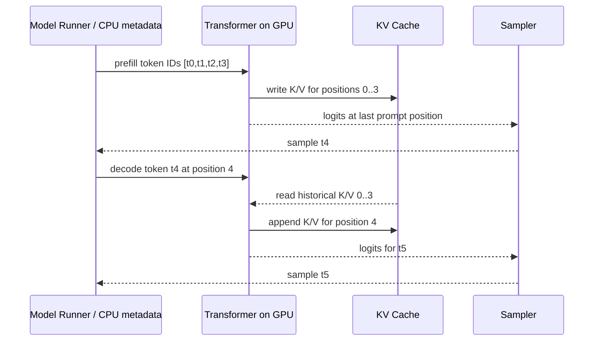

> **读图方法：** 这是“Decode”的时序图。先从左到右确认参与者分别负责什么，再从上到下追踪消息；第一遍只看正常路径，第二遍再看返回、异步消息和失败分支。

### 两类工作负载为什么不同

> **本节先看：** 下面先用表格整理“两类工作负载为什么不同”。先横向比较每一列解决的问题和适用边界，再把具体名称映射到源码。

| 对比项 | Prefill | Decode |
|---|---|---|
| 本轮新 token 数 | 通常较多 | 普通生成通常每请求 1 个 |
| 历史 KV | 起始时没有或部分命中 | 通常已有完整历史 |
| 主要并行维度 | 本层内的 prompt token、head、矩阵元素 | 请求数、head、历史长度 |
| 常见瓶颈直觉 | 大矩阵计算更突出 | 内存读取和 launch overhead 更突出 |
| 输出 | 建立 KV，产生首个采样位置 | 追加 KV，产生后续采样位置 |

同一请求的 decoder layers 依赖上一层输出，不能同时独立计算。第 09 章的流水线并行
是让不同批次占据不同层段，不会消除这个依赖。

从硬件视角，可以先比较两种常见趋势。**算术强度**指每搬运一个字节数据所做的
浮点运算量，单位为 FLOPs/byte；它帮助判断计算量与数据搬运量的相对关系。

- **较长 prefill 常更偏计算受限**：许多 token 一起做矩阵乘法，同一权重可被多个
  token 复用。但短 chunk、特定 attention、通信或 CPU 准备仍可能成为瓶颈。
- **小 batch decode 常更偏带宽或启动开销受限**：每请求本轮通常只有一个新 token，
  相对数据搬运量，计算量较小。不过多个请求合批后依然可以做矩阵乘法，并非整个
  GPU batch 永远只有一个向量。大 batch、量化、MoE、TP/CP（张量并行与上下文并行）和上下文长度都会改变瓶颈。

权重与 KV 按层和 tile 读取，不会把几十 GB 数据同时完整搬入片上 SRAM。滑动窗口、
稀疏注意力等路径也不一定读取全部历史。这里是分析直觉，不能替代指定配置的 profile。

[源码] `vllm/v1/worker/gpu/model_runner.py` - `GPUModelRunner.prepare_inputs`

[源码] `vllm/model_executor/models/llama.py` - `LlamaModel.forward` 的逐层循环

### 用三个请求理解扁平 Token Batch

假设一个调度 step 中有三个请求：

| 请求 | 已有上下文长度 | 本 step 新计算 token | 类型 |
|---|---:|---:|---|
| R0 | 0 | 4 | 新 prompt 的 prefill chunk |
| R1 | 37 | 1 | 普通 decode |
| R2 | 100 | 2 | 被切分的 prefill 或多 token 路径 |

教学框架可能构造 `[B=3,S=4,D]` 并为 R1、R2 padding。vLLM 更接近把实际工作打包：

```text
input_ids: [r0t0, r0t1, r0t2, r0t3, r1t37, r2t100, r2t101]
T = 4 + 1 + 2 = 7
hidden_states.shape = [7, D]
```

**白话：**把三个请求本 step 要算的 token 首尾相接排成一行，$T$ 是这一行的总长度；再用“每个请求从哪里开始”和“每个请求现在一共多长”两组数字，把请求边界补回来。

**其中：**$N_{q,r}$ 是请求 $r$ 本 step 的 query token 数（表中的“本 step 新计算 token”）；$N_{\mathrm{ctx},r}$ 是它已有的上下文 token 数（表中的“已有上下文长度”，源码里的 `num_computed_tokens`）；
$S_r$ 是请求 $r$ 本 step 之后的序列长度；$\mathrm{qsl}_r$ 是 `query_start_loc[r]`，请求 $r$ 的 query 在展平 batch 里的起点；$r=0,1,2$ 是请求序号。

**怎么算出来：**

1. 总 token 数：$T=\sum_r N_{q,r}=4+1+2=7$；
2. 起点：第 0 个请求从 0 开始，后一个请求紧接在前一个之后，$\mathrm{qsl}_{r+1}=\mathrm{qsl}_r+N_{q,r}$，得 $0,\ 0+4=4,\ 4+1=5,\ 5+2=7$，即 `[0,4,5,7]`，最后一项就是 $T$；
3. 序列长度：已有上下文加本步新 token，$S_r=N_{\mathrm{ctx},r}+N_{q,r}$，得 $0+4=4$、$37+1=38$、$100+2=102$，即 `[4,38,102]`；
4. 每个 token 的位置：请求 $r$ 的第 $k$ 个新 token（$k$ 从 0 起）位置是 $N_{\mathrm{ctx},r}+k$，所以 R1 的位置是 37，R2 的是 100、101，与上面 `input_ids` 里的 `r1t37`、`r2t100`、`r2t101` 一致。

**核对：**GPU Model Runner 的 `prepare_inputs`（`vllm/v1/worker/gpu/model_runner.py:1458`）用 `np.cumsum(num_scheduled_tokens_np, out=query_start_loc_np[1 : num_reqs + 1])`
算起点（`:1533-1535`，`query_start_loc_np[0] = 0`）；序列长度在 `_prepare_pos_seq_lens_kernel` 里 `seq_len = num_computed_tokens + query_len`（`vllm/v1/worker/gpu/input_batch.py:383`）。

仅凭这 7 个 token 无法恢复请求边界，因此还必须有：

- 每个请求本 step 的 token 数。
- query start locations，例如 `[0,4,5,7]`。
- 每个请求的完整 sequence length，例如 `[4,38,102]`。
- 当前 token 写入 KV Cache 的 slot mapping。
- 每个请求读取历史 KV 的 block table。

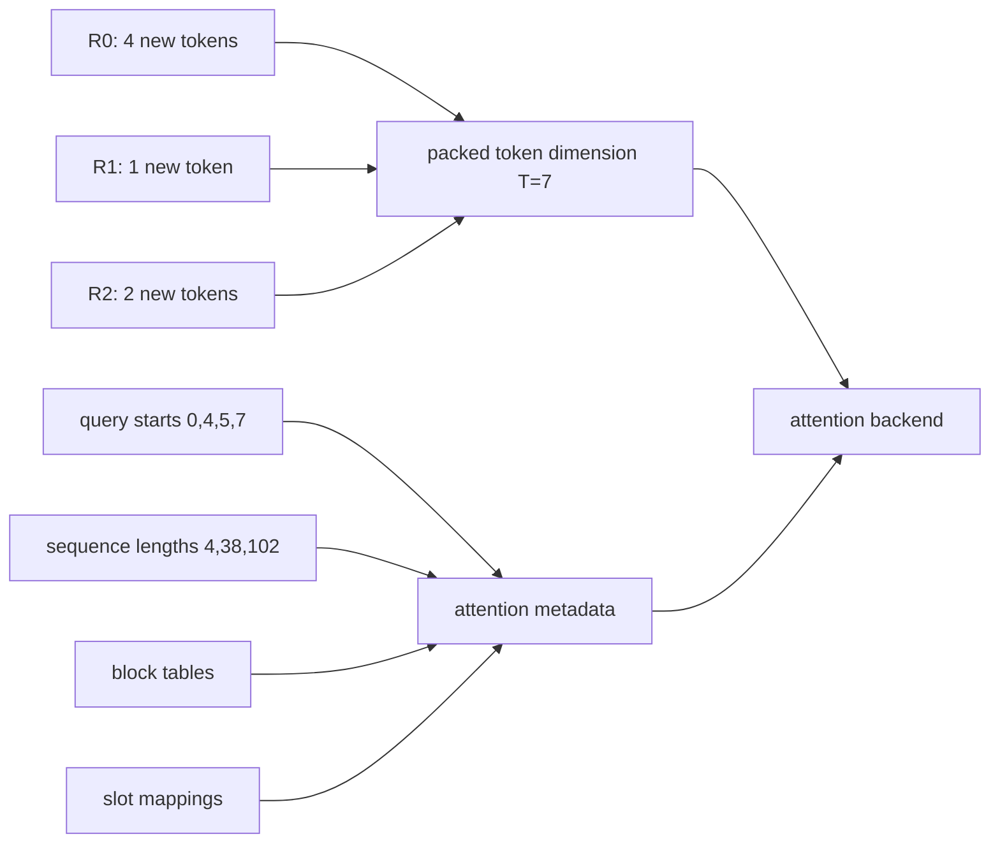

> **读图方法：** 这张图用于压缩“用三个请求理解扁平 Token Batch”的整体关系。先从左向右找到起点、关键转换和终点，再问每条跨层箭头是否意味着函数调用、消息传递、内存访问或状态更新。

这正是 vLLM 源码比普通 Transformer 教程复杂的原因：数学公式往往只写一个规则
矩阵，而推理系统必须描述每个 token 属于谁、能读哪些历史、写到哪里。

### 一个请求的状态账本

对普通自回归请求，可以用下面的账本理解状态增长：

| 时刻 | token IDs | 本轮 Query | KV Cache 中的位置 | 用于采样的 logits |
|---|---|---|---|---|
| prefill 前 | `[t0,t1,t2,t3]` | 无 | 空 | 无 |
| prefill 后 | `[t0,t1,t2,t3]` | `t0..t3` | `K/V 0..3` | position 3 |
| sample 后 | `[t0..t3,t4]` | 尚未计算 t4 | 仍为 `0..3` | 已消费 position 3 |
| decode t4 后 | `[t0..t4]` | `t4` | `K/V 0..4` | position 4 |
| sample 后 | `[t0..t5]` | 尚未计算 t5 | 仍为 `0..4` | 已消费 position 4 |

“token 已经被采样”与“这个 token 的 K/V 已经写入缓存”不是同一时刻。新 token 先由
上一位置 logits 选出，下一次 model forward 才为它计算 hidden state 与 K/V。阅读
Scheduler 和 Model Runner 时，这个一拍的差异非常重要。

“decode 每次只有一个 token”是普通自回归生成的基础直觉，但 speculative decoding、
multi-token prediction 等机制可以让一个请求在 step 中处理多个 token。第 04、07 章
会说明 vLLM 为什么以“本 step 调度多少 token”而不是僵硬的二阶段状态机建模。

## 1.7 KV Cache 为什么有效

> **本节先看：** 本节要回答：**KV Cache 为什么有效**。下面的小节会逐层拆开概念、运行过程和源码落点；第一次阅读先抓对象之间的关系，第二次再记类名、字段和分支。

### 没有缓存会重复什么

生成新 token 后，如果把整个增长后的序列重新送入模型，历史 token 在每一层的 K/V
都会被重复计算。序列越长，浪费越大。

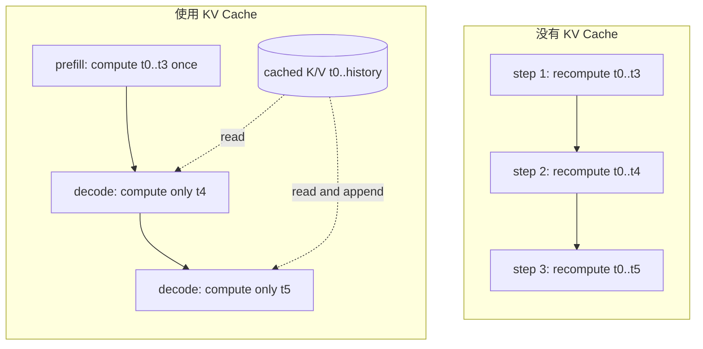

> **读图方法：** 这是“没有缓存会重复什么”的流程图。先从上向下只追一条主路径，确认输入经过哪些关键阶段到达输出；第二遍再看虚线、回边和旁路，它们通常表示反馈、复用或可选分支。

缓存后，历史 K/V 不需要重新投影，但新 Query 仍要与历史 Keys 做 attention，并读取
历史 Values。因此 KV Cache 消除了重复投影和历史层计算，却没有让 decode 成为常数
时间；单个新 token 的 attention 工作仍随上下文长度增长。

### 为什么普通自回归推理缓存 K/V，而不长期缓存历史 Q？

Attention 同时使用 Q、K、V，为什么缓存通常只保留后两者？可以把 Q 想成当前要查询
的问题，K/V 想成可供未来查询的历史记录。这个类比限定在本章的普通因果注意力路径。

第 $t$ 个位置的 $q_t$ 用来计算该位置的 attention 输出；下一位置改用新的
$q_{t+1}$，不需要读取历史 $q_t$。相反，历史 $k_t,v_t$ 会在未来允许关注位置 $t$
的查询中继续使用，因此值得跨 step 保存。Q 在当前计算内可能被多次使用或暂存，
“不长期缓存历史 Q”不表示它只能读取一次，也不限制调试或其他算法保存中间结果。

**白话：**每个位置的输出只需要“自己的 Query”和“所有可见位置的 Key、Value”；旧位置的 Query 用完就没用了，旧位置的 Key、Value 却会被之后每个新位置反复读到。

**其中：**$t$ 是位置序号（本章局部字母，从 0 起）；$q_t$ 是位置 $t$ 的 Query，$k_j$、$v_j$ 是位置 $j$ 的 Key、Value；位置 $t$ 的输出是 $\sum_{j\le t}a_jv_j$，权重 $a_j$ 是 softmax 之后 $q_t$ 对第 $j$ 个 Key 的权重，打分为 $q_t\cdot k_j/\sqrt{d_h}$。

**怎么算出来：**

1. 把位置 $t$ 的输出展开：打分 $q_t\cdot k_j$ 里只出现当前的 $q_t$，而 $j$ 遍历 $0,\dots,t$，所以需要 $k_0,\dots,k_t$ 和 $v_0,\dots,v_t$；
2. 到位置 $t+1$，打分换成 $q_{t+1}\cdot k_j$（$j=0,\dots,t+1$），需要 $k_0,\dots,k_{t+1}$ 和 $v_0,\dots,v_{t+1}$——旧的 $k_j,v_j$ 又用了一次，而 $q_t$ 没有再出现；
3. 算例：4 个 token 的 prompt（位置 0 到 3）生成第 5 个 token（位置 4）时，需要 $q_4$ 和 $k_0,\dots,k_4$、$v_0,\dots,v_4$；再下一步需要 $q_5$ 和 $k_0,\dots,k_5$、$v_0,\dots,v_5$。
   整个过程里没有任何一步重新用到 $q_0,\dots,q_3$，而 $k_0,v_0$ 在每一步都被读取。

**核对：**`LlamaAttention.forward` 只把当前 step 的 `q, k, v` 交给 `Attention`，由它把新的 K/V 写进缓存、从缓存读历史 K/V（下面两条 `[源码]`）；缓存的对象是 K 和 V，没有为历史 Q 设置缓存。

[源码] `vllm/model_executor/models/llama.py` - `LlamaAttention.forward`
[源码] `vllm/model_executor/models/llama.py` - `LlamaAttention.forward`

[源码] `vllm/model_executor/layers/attention/attention.py` - `Attention.forward`、`unified_kv_cache_update`

### 计算量直觉

只数 causal attention 中的 QK 点积：长度 $S$ 的完整序列约需要
$\frac{S(S+1)}{2}$ 次。带缓存的一个 decode token 只新增约 $S$ 次点积。

本章最小实验使用 $N_{\mathrm{prompt}}=128$ 的 prompt 生成 $N_{\mathrm{out}}=32$ 个 token，得到：

```text
完整重算 QK 次数: 333136
缓存路径 QK 次数: 12720
```

**白话：**没有缓存时，每生成一个 token 都把当前整条序列重新算一遍；有缓存时，prompt 只算一次，之后每步只让新 token 的 Query 去和已有的 Key 做点积。这里数的就是这两种做法的 QK 点积次数。

**其中：**$N_{\mathrm{prompt}}=128$、$N_{\mathrm{out}}=32$ 是本章最小实验的教学数字；$S$ 是某一次计算时的序列长度（token）。第一个输出 token 来自 prefill 的 logits，所以共有 1 次长度 128 的计算加 31 次 decode。

**怎么算出来：**

1. 无缓存：32 次计算的序列长度依次是 $128,129,\dots,159$，每次需要 $S(S+1)/2$ 次点积。
   $\sum S=32\times(128+159)/2=4592$，$\sum S^2=661680$（用 $\sum_{S=1}^{n}S^2=n(n+1)(2n+1)/6$：$n=159$ 得 1352560，$n=127$ 得 690880，相减），所以总数是 $(661680+4592)/2=333136$；
2. 有缓存：prefill 一次，$128\times129/2=8256$ 次；之后 31 次 decode，序列长度依次是 $129,130,\dots,159$，每步新增 $S$ 次（新 Query 对全部 $S$ 个 Key，含它自己），
   共 $31\times(129+159)/2=31\times144=4464$ 次；合计 $8256+4464=12720$；
3. 比值 $333136/12720\approx26.2$。

**核对：**`attention_score_counts(128, 32)`（`examples/ch01_minimal_inference.py:217-227`）按上面两条逐项求和，运行 `python3 examples/ch01_minimal_inference.py` 打印 `no-cache=333136, cached=12720`（见 1.8 节的实际观察）。

这里的数字只统计教学模型中的 QK score，不包含 QKV projection、MLP、kernel launch、
显存访问和 batch 效率，不能当作 26 倍端到端加速结论。

### KV Cache 容量公式

令 $M_{\mathrm{tok}}$ 表示每 token 的 KV 字节数，$b_{\mathrm{elem}}$ 表示每个
数值元素占用的字节数。基础 KV 容量可估算为：

$$
M_{\mathrm{tok}} = L(H_kd_k + H_vd_v)\,b_{\mathrm{elem}}
$$

**白话：**生成并缓存一个 token，要在每一层各存下它的 K 和 V；这个公式数的就是“一个 token 的 K、V 一共占多少字节”。

**其中：**

- $L$：有 attention KV 的层数；
- $H_k,d_k$：Key 的 head 数和单 head 宽度（元素）；
- $H_v,d_v$：Value 的 head 数和单 head 宽度（元素）；
- $b_{\mathrm{elem}}$：每个元素占的字节数（bf16 为 2，byte/元素）；
- $M_{\mathrm{tok}}$：每 token 的 KV 字节数（byte/token）。

**怎么算出来：**

1. 一层里，一个 token 的 K 有 $H_k$ 个 head、每个 head $d_k$ 个元素，共 $H_kd_k$ 个元素；V 共 $H_vd_v$ 个元素，加起来是 $H_kd_k+H_vd_v$ 个元素；
2. 共 $L$ 层，一个 token 在所有层一共是 $L(H_kd_k+H_vd_v)$ 个元素；
3. 每个元素 $b_{\mathrm{elem}}$ 字节，乘上去得到字节数；因为数的是“每个 token”，单位是 byte/token。

单位检查：元素数 × byte/元素 = byte，每个 token 各存一份，所以是 byte/token。

**核对：**vLLM 的 `AttentionSpec` 只有一个 `num_kv_heads`，K 与 V 的 head 数相同，二者的宽度分别是 `head_size`、`head_size_v`
（`head_size_v` 缺省等于 `head_size`，`vllm/v1/kv_cache_interface.py:563-592`）；一个 page 的字节数是
`num_heads * num_states * (head_size + head_size_v) * dtype_size`（`state_content_size_bytes` 与 `unpadded_page_size_bytes`，`:601-609`），
其中 `num_states` 默认等于 `block_size`（`:262-266`）。除以 `block_size` 就是一层一个 token 的字节数 $H_{\mathrm{kv}}(d_k+d_v)\,b_{\mathrm{elem}}$，再乘 $L$ 层就是上式
（$H_k=H_v=H_{\mathrm{kv}}$；上式允许 $H_k\ne H_v$ 只是更一般的写法）。

普通 Llama 类 attention 中 Key/Value 通常拥有相同的 head 数和 head size，于是简化为：

$$
M_{\mathrm{tok}} = 2LH_{\mathrm{kv}}d_h\,b_{\mathrm{elem}}
$$

**白话：**K 和 V 一样大，所以把括号里的两项合并成“2 倍”。

**其中：**$H_{\mathrm{kv}}$ 是 KV head 数，$d_h$ 是单 head 宽度；前面的 $2$ 表示 K 和 V 两份；其余符号同上式。

**怎么算出来：**在上式里令 $H_k=H_v=H_{\mathrm{kv}}$、$d_k=d_v=d_h$：$L(H_{\mathrm{kv}}d_h+H_{\mathrm{kv}}d_h)\,b_{\mathrm{elem}}=2LH_{\mathrm{kv}}d_h\,b_{\mathrm{elem}}$。
代入 $L=32$、$H_{\mathrm{kv}}=8$、$d_h=128$、$b_{\mathrm{elem}}=2$：$2\times32\times8\times128\times2=131072\ \mathrm{byte/token}$（下面的算例逐步展开）。

**核对：**与下面两个算例一致；这是普通 K/V 张量的情形，MLA 等压缩缓存不在这两个式子之内（见下文）。

上述两式都以逐层保存普通 K/V 张量为前提。通用 `Attention` 接口允许 `head_size_v`
与 `head_size` 不同，此时应使用第一式，不能机械套用 `2×` 简式。

MLA（多头潜在注意力）需要另看实际缓存表示：当前 `MLAAttentionSpec` 使用单份潜在
状态，并将 `head_size_v` 设为 0（`vllm/v1/kv_cache_interface.py:759`）；还可能包含量化和对齐开销。不能把模型的 Query/Key/Value
维度直接代入普通 K/V 公式来估算 MLA 显存，应读取实际 spec 的 `page_size_bytes`。

上述公式的 $b_{\mathrm{elem}}$ 假设每个元素占整数个字节。v0.33.0 起 `--kv-cache-dtype` 可由平台通过
`register_kv_cache_dtype()` 注册新名字（[9499c949b](https://github.com/vllm-project/vllm/commit/9499c949b)，
[#52670](https://github.com/vllm-project/vllm/pull/52670)），其存储布局、量化 scale 和对齐由各 spec/backend 决定，
因此不能再默认用元素字节数估算；以实际 spec 的 `page_size_bytes` 为准。

[源码] `vllm/model_executor/layers/attention/attention.py` - `Attention.__init__`

[源码] `vllm/v1/kv_cache_interface.py` - `AttentionSpec`、`MLAAttentionSpec`

例：32 层、32 个 KV heads、head size 128、FP16/BF16（2 bytes）：

$$
\begin{aligned}
M_{\mathrm{tok}} &= 2\times32\times32\times128\times2\;\frac{\mathrm{byte}}{\mathrm{token}}
= 524288\;\frac{\mathrm{byte}}{\mathrm{token}}
= 512\,\frac{\mathrm{KiB}}{\mathrm{token}},\\
M_{2048} &= (2048\,\mathrm{token})\,M_{\mathrm{tok}} = 1\,\mathrm{GiB}.
\end{aligned}
$$

**白话：**每个 token 要存 512 KiB，2048 个 token 就是整整 1 GiB。

**其中：**$M_{2048}$ 是 2048 个 token 的 KV 总字节数；$1\,\mathrm{KiB}=2^{10}$ byte，$1\,\mathrm{MiB}=2^{20}$ byte，$1\,\mathrm{GiB}=2^{30}$ byte；其余符号同上。

**怎么算出来：**

1. 连乘：$2\times32=64$，$64\times32=2048$，$2048\times128=262144$（元素/token），再乘每个元素的 2 字节得 $524288$ byte/token；
2. 换算单位：$524288/1024=512$，即 512 KiB/token；
3. 2048 个 token：$2048\times524288=1073741824=2^{30}$ byte，正好 1 GiB。单位检查：token × byte/token = byte。

**核对：**与第一个通式、简式的代入一致；这个算例是 KV head 数等于 Query head 数（普通 Multi-Head）时的上界，下面的 GQA 算例是同一模型换成 8 个 KV head。

若同样模型采用 8 个 KV heads 的 GQA：

$$
\begin{aligned}
M_{\mathrm{tok}} &= 2\times32\times8\times128\times2\;\frac{\mathrm{byte}}{\mathrm{token}}
= 131072\;\frac{\mathrm{byte}}{\mathrm{token}}
= 128\,\frac{\mathrm{KiB}}{\mathrm{token}},\\
M_{2048} &= (2048\,\mathrm{token})\,M_{\mathrm{tok}} = 256\,\mathrm{MiB}.
\end{aligned}
$$

**白话：**KV head 从 32 个减到 8 个，每个 token 的字节数也降到 1/4。

**其中：**符号同上，只有 $H_{\mathrm{kv}}$ 从 32 变成 8，其余（$L=32$、$d_h=128$、$b_{\mathrm{elem}}=2$）不变。

**怎么算出来：**$2\times32=64$，$64\times8=512$，$512\times128=65536$，$65536\times2=131072$ byte/token $=131072/1024=128$ KiB/token；
$2048\times131072=268435456=2^{28}$ byte $=256\,\mathrm{MiB}$。比值 $8/32=1/4$：$M_{\mathrm{tok}}$ 与 $H_{\mathrm{kv}}$ 成正比，其他因子都没变，所以 $128/512=1/4$，$256\,\mathrm{MiB}/1\,\mathrm{GiB}=1/4$。

**核对：**与上一个算例相差正好 $8/32$ 倍；32 层、8 个 KV head、head size 128 只是本章选用的教学配置，真实模型的取值要读各自的配置文件。

令 $S_r$ 为请求 $r$ 缓存的 token 数，$M_{\mathrm{total}}$ 为总字节数。把公式
扩展到并发请求：

$$
M_{\mathrm{total}} \approx M_{\mathrm{tok}} \sum_r S_r
$$

**白话：**每个请求缓存多少个 token，就乘上每 token 的字节数；所有请求加起来就是总量。

**其中：**$r$ 遍历所有并发请求，$S_r$ 的单位是 token，$M_{\mathrm{tok}}$ 是 byte/token，所以 $M_{\mathrm{total}}$ 是 byte；用 $\approx$ 是因为下一节列出的 block 对齐、前缀共享等因素没有算进去。

**怎么算出来：**请求 $r$ 的 KV 是 $S_r$ 个 token 各 $M_{\mathrm{tok}}$ 字节，即 $S_rM_{\mathrm{tok}}$；各请求的 KV 互不重叠，加起来得 $\sum_rS_rM_{\mathrm{tok}}=M_{\mathrm{tok}}\sum_rS_r$。
算例一：8 个请求平均各缓存 2,048 token，$8\times256\,\mathrm{MiB}=2\,\mathrm{GiB}$。
算例二：1.6 节的三个请求序列长度是 $S=[4,38,102]$，共 $144$ token，用 GQA 的 $128\,\mathrm{KiB/token}$ 得 $144\times128\,\mathrm{KiB}=18432\,\mathrm{KiB}=18\,\mathrm{MiB}$。

**核对：**这是理论下限式的估算，没有 block 对齐和共享；真实的 KV block 数由第 05 章从 `KVCacheSpec` 反推。

仅基础 K/V 数值就已经如此；如果请求继续生成，缓存还会逐 token 增长。

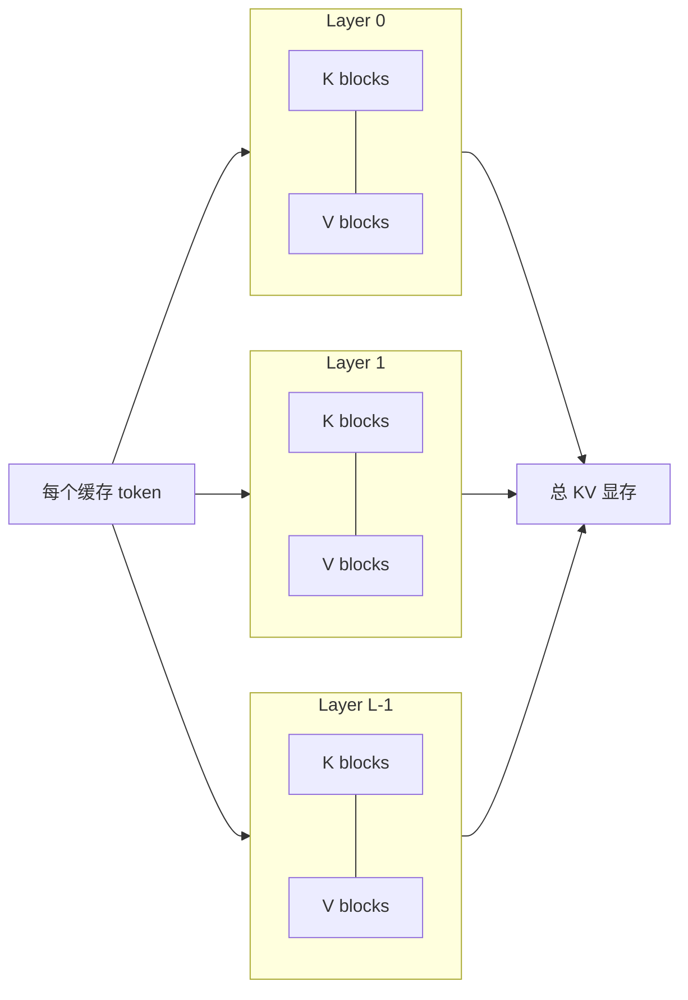

> **读图方法：** 从左到右看一个 token 在各层留下的 K/V，再把各层字节数相加。箭头表示容量的组成关系，不表示函数调用；第二遍对照公式检查层数、KV head 数与元素字节数。

这解释了为什么并发请求和长上下文会迅速消耗显存。实际 vLLM 容量还受 block 对齐、
pipeline/tensor parallel、KV dtype、滑动窗口、MLA、Mamba、prefix sharing 和运行时
预留显存影响，第 05 章会建立完整模型。

### 公式还没有包含什么

> **本节先看：** 下面先给出“公式还没有包含什么”的结论清单。先理解每一项为什么存在，再记参数名或实现细节。

- **Block 对齐：** 最后一个 block 可能只使用部分 token slots。
- **Tensor Parallel：** KV heads 可能分片，也可能在 KV head 少于 TP size 时复制，
  不能始终简单除以 TP size。
- **量化元数据：** FP8 等格式可能需要额外 scale。
- **混合 KV：** sliding-window、Mamba state、MLA 等不一定使用相同公式。
- **Prefix sharing：** 两个请求共享物理 blocks 时，逻辑 token 总数不等于实际占用。
- **运行时预留：** CUDA Graph、activation、workspace 和通信 buffer 也会占显存。

因此本节公式用于建立数量级直觉；第 05 章会从 `KVCacheSpec` 和实际配置反推物理
block 数，而不是只用一个理论公式决定可用容量。

### KV Cache 缓存的不是输出文本

KV Cache 是每层 attention 的中间张量，不是 token 文本、完整 hidden state 或最终
logits。它依赖模型权重、位置、token 前缀和具体层结构，不能随意跨模型复用。

## 1.8 可运行的最小推理器

本章提供一个只依赖 Python 标准库的教学实现：

- [最小推理器](../../examples/ch01_minimal_inference.py)
- [数值推导脚本](../../examples/ch01_numerical_walkthrough.py)
- [一致性测试](../../tests/test_ch01_minimal_inference.py)
- [数值推导测试](../../tests/test_ch01_numerical_walkthrough.py)
- [完整实验记录](../../experiments/ch01-minimal-inference.md)

它包含一层 decoder、一个 attention head、RMSNorm、RoPE 风格旋转、门控 MLP、
causal attention、KV Cache 和 temperature/top-k/top-p sampling。权重由固定随机种子
生成，因此输出没有语言意义；实验验证的是计算结构，不是模型质量。

### 关键接口

> **本节先看：** 下面的代码或调用链只保留“关键接口”的主干。阅读时依次寻找输入、状态变化和输出，暂时忽略辅助分支。

```python
full_logits = model.forward_full(token_ids)
prefill_logits, cache = model.prefill(token_ids)
next_logits = model.decode_one(next_token_id, cache)
```

- `forward_full`：不复用缓存，完整重算序列。
- `prefill`：一次构造 prompt K/V。
- `decode_one`：只追加新 token 的 K/V，并读取全部历史缓存。

### 代码如何对应 Transformer

`ToyDecoder` 有意保留真实结构的所有关键边，同时删除并行和硬件细节：

| 教学代码 | 对应概念 | 真实 vLLM 中的扩展 |
|---|---|---|
| `embeddings[token_id]` | token embedding lookup | vocab parallel embedding、PP first rank |
| `_qkv` | RMSNorm、QKV projection、RoPE | fused QKV、多个 heads、TP shard、custom RoPE op |
| `_finish_layer` 前半 | attention score、softmax、Value 聚合 | backend metadata、KV blocks、Flash/Triton/CUDA kernel |
| `_finish_layer` 后半 | output projection、residual、gated MLP | fused activation、quantization、TP collective |
| `_logits` | LM head | vocab parallel projection、gather 或 local logits |
| `prefill` | prompt forward 和初始缓存 | packed tokens、chunked prefill、prefix cache |
| `decode_one` | 单 token cached decode | continuous batching、多请求、speculative tokens |
| `sample_logits` | temperature/top-k/top-p | per-request states、penalties、Triton/Gumbel/FlashInfer |

最重要的等价性断言是：

```python
token_ids = prompt_ids + [next_token_id]
_, cache = model.prefill(prompt_ids)
recomputed = model.forward_full(token_ids)[-1]
cached = model.decode_one(next_token_id, cache)
assert max_abs_diff(cached, recomputed) < 1e-12
```

缓存优化若改变了对应位置的数学结果，就是正确性错误，而不是允许的性能取舍。真实
低精度 kernel 可能有浮点容差，但仍需和参考实现比较，而不是只看生成文本“似乎差不多”。

### 逐步阅读 `prefill`

> **本节先看：** 下面先给出“逐步阅读 `prefill`”的结论清单。先理解每一项为什么存在，再记参数名或实现细节。

1. 每个 token 经过 `_qkv`，得到带位置的 Query/Key 和 Value。
2. 所有 Key/Value 保存到 cache；它们将在未来 decode 中重复读取。
3. 第 `i` 个 Query 只读取 `keys[:i+1]`，这就是 causal mask 的列表实现。
4. 每个位置完成 output projection、residual 和 MLP。
5. 最后 hidden state 通过 tied embedding 得到 logits。

### 逐步阅读 `decode_one`

> **本节先看：** 下面先给出“逐步阅读 `decode_one`”的结论清单。先理解每一项为什么存在，再记参数名或实现细节。

1. `position=len(keys)`，因此新 token 的位置紧跟缓存末尾。
2. 只计算新 token 的 Query/Key/Value。
3. 把新 Key/Value 追加到 cache。
4. 新 Query 读取包括自己在内的全部 cached keys/values。
5. 返回新位置 logits，供下一轮 sampling 使用。

这个实现把 cache 写成 Python lists。vLLM 的关键差异不是“是否缓存”，而是如何在固定
显存池中分页管理这些 K/V，并为动态 batch 构造可被 kernel 消费的地址映射。

### 运行命令

> **本节先看：** 下面的代码或调用链只保留“运行命令”的主干。阅读时依次寻找输入、状态变化和输出，暂时忽略辅助分支。

```bash
python3 examples/ch01_minimal_inference.py
python3 -m unittest tests/test_ch01_minimal_inference.py
python3 examples/ch01_numerical_walkthrough.py
python3 -m unittest tests/test_ch01_numerical_walkthrough.py
```

### 2026-09-07 实际观察

> **本节先看：** 下面的代码或调用链只保留“2026-09-07 实际观察”的主干。阅读时依次寻找输入、状态变化和输出，暂时忽略辅助分支。

```text
prompt: <bos> 我 喜欢 读
prefill cache entries per layer: 4
decode step 1: max cached/full diff=0.00e+00, sampled=5:学习
decode step 2: max cached/full diff=0.00e+00, sampled=5:学习
decode step 3: max cached/full diff=0.00e+00, sampled=6:。
QK score count example (P=128, G=32): no-cache=333136, cached=12720
```

脚本输出里的 `P`、`G` 就是正文的 $N_{\mathrm{prompt}}=128$、$N_{\mathrm{out}}=32$。

缓存路径与完整重算在三个 decode step 上得到相同 logits，最大绝对误差为 0。测试还
覆盖 prefill 全位置一致性、连续 decode 一致性、temperature=0 greedy 和 top-k=1。

数值推导脚本同时复现了正文使用的 temperature 与 attention 表：

```text
T=0.5: [0.9793, 0.0179, 0.0024, 0.0003]
T=1.0: [0.8310, 0.1125, 0.0414, 0.0152]
T=2.0: [0.5793, 0.2131, 0.1293, 0.0784]
attention scores: [0.7071, 0.3536, 1.0607]
attention probabilities: [0.3199, 0.2246, 0.4555]
attention output: [1.2309, 0.9047]
```

脚本输出里的 `T=0.5` 等标签是温度 $\tau$（正文表格里写作 $\tau=0.5$），不是 token 数 `T`。

### 实验限制

> **本节先看：** 下面先给出“实验限制”的结论清单。先理解每一项为什么存在，再记参数名或实现细节。

- 使用 Python list 和循环，没有 GPU kernel，也不代表真实性能。
- 只有一层、一个 head，没有 GQA、TP、PagedAttention 和动态 batch。
- 使用随机权重，生成 token 只用于验证流程。
- `prefill` 的 Python 写法仍逐位置完成聚合；真实 backend 会并行处理大量 token。

### 实验结果应该怎样解释

本章实验能证明：

- 给定同一权重和输入，教学模型的 cached/full 路径数学等价。
- causal attention、temperature 和 Value 加权的数值与公式一致。
- KV Cache 能减少教学计数中的重复 QK 工作。

它不能证明：

- vLLM 在某张 GPU 上必然获得相同倍数的性能提升。
- 任意 attention backend 都逐 bit 一致。
- Python lists 的 cache 布局与 PagedAttention 物理布局相同。
- 随机权重模型的 token 输出具有语言质量。

## 1.9 映射到当前 vLLM 源码

> **本节先看：** 本节要回答：**映射到当前 vLLM 源码**。下面的小节会逐层拆开概念、运行过程和源码落点；第一次阅读先抓对象之间的关系，第二次再记类名、字段和分支。

### 最小源码地图

> **本节先看：** 下面先用表格整理“最小源码地图”。先横向比较每一列解决的问题和适用边界，再把具体名称映射到源码。

| 教学概念 | 当前源码入口 | 作用 |
|---|---|---|
| Llama 模型主体 | `vllm/model_executor/models/llama.py::LlamaModel` | embedding、decoder layers、final norm |
| 单层 decoder | `vllm/model_executor/models/llama.py::LlamaDecoderLayer` | attention/MLP/residual/RMSNorm |
| QKV 与 RoPE | `vllm/model_executor/models/llama.py::LlamaAttention` | QKV projection、split、RoPE、attention |
| 通用 attention 层 | `vllm/model_executor/layers/attention/attention.py::Attention` | KV 写入、backend attention、输出 |
| LM head/logits | `vllm/model_executor/models/llama.py::LlamaForCausalLM.compute_logits` | hidden states 投影到 vocabulary |
| Logits processor | `vllm/model_executor/layers/logits_processor.py::LogitsProcessor` | 并行 LM head 与 logits 处理 |
| 用户采样参数 | `vllm/sampling_params.py::SamplingParams` | temperature、top-k、top-p、penalties 等 |
| 采样（MRV2） | `vllm/v1/worker/gpu/sample/sampler.py::Sampler` | stateful、Triton-oriented 的 logits 处理与采样；MRV1 的 `v1/sample/sampler.py` 已在 #63373 删除 |

### 模型内部调用链

> **本节先看：** 这一小节先用图建立“模型内部调用链”的整体路径。先找输入、关键状态和输出，再阅读图后的源码解释，不必一开始记住全部节点。

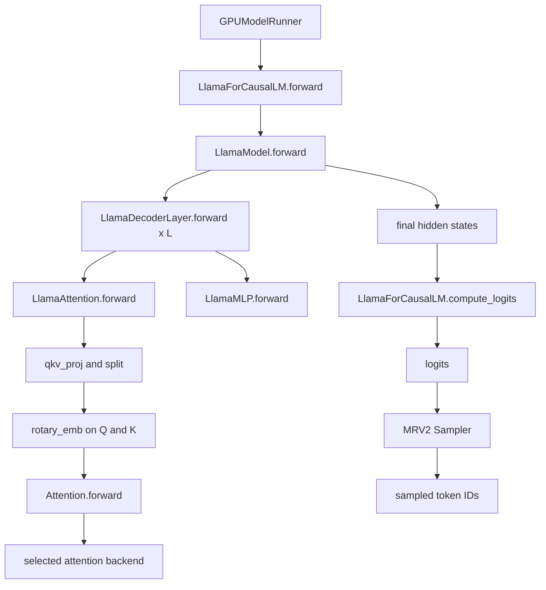

> **读图方法：** 这张图用于压缩“模型内部调用链”的整体关系。先从上向下找到起点、关键转换和终点，再问每条跨层箭头是否意味着函数调用、消息传递、内存访问或状态更新。

图中的 attention backend 与 sampler 内部仍有配置分支（例如 FlashInfer fused sampler 的门控）。
本章只确认概念接口，不在这里展开 kernel dispatch；`GPUModelRunner` 如今只有 MRV2 一个实现（`vllm/v1/worker/gpu/model_runner.py`），见第 07 章。

### 关键源码事实

以下行号只适用于本章固定 commit，长期定位应优先使用完整路径和符号名：

1. `LlamaAttention.forward` 在 `vllm/model_executor/models/llama.py` 中执行 QKV projection，随后 split、
   RoPE，再调用 `self.attn(q,k,v)`。
2. `LlamaDecoderLayer.forward` 在 `vllm/model_executor/models/llama.py` 中体现两次 RMSNorm、attention、
   MLP 与 residual 数据流。
3. `LlamaModel.forward` 在 `vllm/model_executor/models/llama.py` 中遍历当前 PP rank 所拥有的 layers，
   最后一个 PP rank 执行 final norm。
4. `LlamaForCausalLM.forward` 返回模型输出：最后 PP rank 是 hidden states，非最后
   rank 是供下一 stage 使用的 `IntermediateTensors`；`compute_logits` 在
   `vllm/model_executor/models/llama.py` 中单独调用 `LogitsProcessor`。模型 forward 不等于 sampling。
5. 通用 `Attention` 类在 `vllm/model_executor/layers/attention/attention.py` 中声明自己的职责包括写 KV Cache、
   执行 attention 和返回输出；具体 backend 由配置和能力选择。
6. `Attention.forward` 接收扁平 token tensor，并 reshape 为
   `[num_tokens,num_heads,head_size]` 后进入实现层。
7. 当前的 `Sampler` 在 `vllm/v1/worker/gpu/sample/sampler.py`（MRV2）。`vllm/v1/sample/ops/topk_topp_sampler.py`
   里是被它复用的 top-k/top-p 算子，不是另一个 `Sampler`；旧的 MRV1 `Sampler`（`v1/sample/sampler.py`）已不存在。

### 第一步：模型对象怎样组装

`LlamaForCausalLM.__init__` 并不是把所有计算平铺在一个类中。它持有：

- `self.model`：`LlamaModel`，负责 embedding、decoder layers 和 final norm。
- `self.lm_head`：把 hidden size 投影到 vocabulary；只在最后一个 PP rank 上存在
  真正实现，其他 rank 使用 `PPMissingLayer`。
- `self.logits_processor`：只在最后 PP rank 构造，负责应用 LM head、处理 TP gather、
  vocabulary padding、scale 和 soft cap 等。

当 `tie_word_embeddings=True` 时，输出 head 可以与输入 embedding 共享权重。共享权重
不代表输入输出语义相同：输入侧按 token ID 查一行，输出侧用整个权重矩阵对 hidden
state 做投影，得到每个 token 的 score。

### 第二步：`LlamaModel.forward` 怎样穿过 layers

在第一个 PP rank：

```text
input_ids -> embed_input_ids -> hidden_states
```

在中间或最后 PP rank：输入可能来自上一 stage 的 `IntermediateTensors`。随后只遍历
当前 rank 拥有的 `[start_layer,end_layer)`。非最后 rank 把 hidden states 和 residual
重新包装为 `IntermediateTensors`；最后 rank 执行 final RMSNorm 并返回 hidden states。

这说明教学图里的“所有 $L$ 层连续执行”是单设备视角。在 Pipeline Parallel 下，数学
层次不变，但对象所有权和数据传输跨进程/设备分段。

### 第三步：`LlamaDecoderLayer.forward` 的 residual 为什么看起来特殊

教学伪代码通常写成：

```python
x = x + attention(norm(x))
x = x + mlp(norm(x))
```

当前 vLLM Llama 实现传递 `(hidden_states,residual)`，让 RMSNorm 可以融合 residual add：

```text
input_layernorm(hidden_states, residual)
  -> self_attn(...)
post_attention_layernorm(hidden_states, residual)
  -> mlp(...)
```

阅读这种 fused 接口时不要只盯变量名。应追踪函数返回值中哪个代表规范化输入、哪个
保留 residual，再确认下一次 fused norm 在哪里完成加法。否则容易误判源码“漏掉了
residual connection”。

### 第四步：QKV、RoPE 与 Attention 的边界

`LlamaAttention` 负责模型结构相关部分：

1. 根据 TP size 推导本 rank 的 query heads 和 KV heads。
2. 用 `QKVParallelLinear` 一次生成打包的 QKV。
3. 按 `q_size,kv_size,kv_size` split。
4. 给 Q/K 应用模型配置对应的 RoPE。
5. 调用通用 `Attention` 层。
6. 用 row-parallel `o_proj` 投影回 hidden size。

通用 `Attention` 负责执行系统相关部分：

1. 根据 head size、dtype、KV dtype、sliding window、attention type 和平台能力选择
   backend，或使用调用者显式传入的 backend。
2. 构造 backend implementation，并注册到 compilation static forward context。
3. 在 `forward` 中从 forward context 读取 Model Runner 预先设置的 attention metadata。
4. 将 Q/K/V reshape 为 head 维度，写入/读取已经绑定的 KV cache，并执行实现层。

因此 `LlamaAttention` 与 `Attention` 不能合并理解：前者知道 Llama 的 head 配置和投影，
后者知道 vLLM 的 backend、KV cache 和运行时 metadata 契约。

### 第五步：Hidden States 怎样成为 Logits

`LlamaForCausalLM.compute_logits` 把工作交给 `LogitsProcessor`。后者的关键步骤是：

```text
hidden_states
  -> lm_head projection
  -> gather vocabulary shards when TP > 1
  -> remove vocabulary padding
  -> optional soft cap
  -> optional scale
  -> logits
```

当前实现还提供 `compute_logits_local`。MRV2 的 batch-sharded sampling 可以先在各 TP
rank 计算 local vocabulary logits，再通过专门通信只为本 rank 负责的请求拼出完整
词表。由此可见，“logits tensor 一定先在每个 rank 完整生成”不是可靠假设。

### 第六步：MRV2 怎样选择采样位置

模型 forward 可能为一个 step 产生多个 token 的 hidden states，但并非每个位置都需要
采样。MRV2 `GPUModelRunner.sample` 使用 `input_batch.logits_indices` 选择需要产生
logits 的 hidden states：

```text
hidden_states[input_batch.logits_indices]
  -> model.compute_logits(...)
  -> optional structured-output grammar mask
  -> self.sampler(logits, input_batch)
  -> SamplerOutput
```

普通未完成的 prefill chunk 不会在每个 chunk 末尾都向用户生成 token；prompt
logprobs 又可能要求额外位置的 logits。`logits_indices` 正是“模型计算了哪些 hidden
states”和“哪些位置需要进入 sampling”的显式桥梁。

在 `sample_tokens` 中，最后 PP rank 执行上述 sampling，并把 sampled tokens 广播给
其他 PP ranks；非最后 rank 没有最终 hidden states，因此不能独立完成 LM head 和
sampling。这是模型数学与分布式所有权结合的一个具体例子。

### 第七步：`SamplingParams` 在进入 Sampler 前做什么

固定 revision 下，`SamplingParams.__post_init__` 和 `_verify_args` 会规范化并校验参数：

- 极小但非零的 temperature 会被提高到内部最小值，以降低 NaN/Inf 风险。
- temperature 必须有限、非负，并且当前校验范围为 `[0,2]`。
- `top_p` 必须在 `(0,1]`。
- `top_k=0` 或 `-1` 表示禁用，其他值至少为 1。
- `min_p` 必须在 `[0,1]`。
- temperature 小于 greedy epsilon 时，会把 top-p、top-k、min-p 重置为禁用状态，
  再检查 greedy 条件，例如 `n` 必须为 1。
- stop strings 需要 detokenization；空 stop string 会被拒绝。

上面这些步骤在 `SamplingParams.__post_init__` 里的先后顺序（`vllm/sampling_params.py:563-636`）决定了结果，尤其是 temperature：

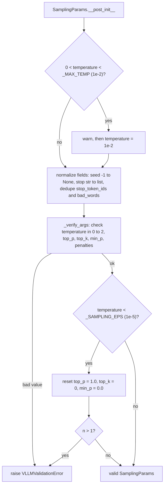

> **读图方法：** 这张图只回答一个问题：一个 temperature 值在 `__post_init__` 里会经过哪几道门。先沿最左的主路径从上到下读：先“抬高”过小的正 temperature，再整理字段，再统一校验，最后才判断是否 greedy；
> 菱形是分支，指向 `raise` 的两条边是拒绝请求的出口。注意顺序带来的一个结论：因为 $0<\tau<10^{-2}$ 已在第一道门被抬到 $10^{-2}$，而 greedy 的门槛是 $10^{-5}$，所以实际走到 greedy 分支的只有 temperature 恰好为 0 的请求。
> 图中只画 `SamplingParams` 自己的构造期检查；`InputProcessor._validate_params` 之后调用的 `params.verify` 属于下一段说明的准入校验，不在图内。

这些是基础参数契约，不等于所有校验都由 `SamplingParams` 独立完成。
`InputProcessor._validate_params`（`vllm/v1/engine/input_processor.py:130`）先调用 `params.verify`，再调用
custom logits processor 的参数校验器（`:165`；校验器由 `_build_logits_processors_params_validator`，`:92`，
从 `vllm/v1/worker/gpu/sample/logits_processor` 的 loader 构造）；因此仅构造 `SamplingParams` 成功，不能证明请求
能通过当前 Runner 的准入校验。`prompt_logprob_token_ids` 也在此检查与
`kv_sharing_fast_prefill` 的不兼容（`:156`）。Sampler 内部仍有防御性处理，但不能把所有
非法参数都留给 GPU kernel 才发现。

v0.32.0 的 `prompt_logprob_token_ids` 是逐 causal prompt row 的二维整数数组或嵌套列表，
不是一份对所有位置复用的 token ID 列表。行数必须为
`max(prompt_len - 1 - prompt_logprob_start, 0)`，第 i 行对应预测后一个 prompt token；
填充值 -1 的得分为负无穷。`InputProcessor.process_inputs` 在知道实际 prompt 长度后检查行数。
另外 `watermarking=None` 表示采用默认请求意图，最终是否应用由配置与请求兼容性解析为布尔值，
不是每个请求都必定加水印。

[源码] `vllm/sampling_params.py` - `SamplingParams.prompt_logprob_token_ids`、`watermarking`

[源码] `vllm/v1/engine/input_processor.py` - `resolve_watermarking`、`apply_watermarking`、`process_inputs`

[源码] `vllm/v1/engine/input_processor.py` -
`InputProcessor._build_logits_processors_params_validator`、`_validate_params`

### 源码证据矩阵

> **本节先看：** 下面先用表格整理“源码证据矩阵”。先横向比较每一列解决的问题和适用边界，再把具体名称映射到源码。

| 结论 | 生产源码 | 相关上游测试 |
|---|---|---|
| RoPE 修改 Query/Key | `vllm/model_executor/models/llama.py::LlamaAttention.forward`、`rotary_embedding/` | `tests/kernels/core/test_rotary_embedding.py` |
| SamplingParams 校验 greedy、top-k/top-p | `vllm/sampling_params.py` | `tests/test_sampling_params.py`、`tests/benchmarks/test_sampling_params.py` |
| MRV2 penalty / bad words / allowed IDs | `vllm/v1/worker/gpu/sample/penalties.py`、`bad_words.py`、`logit_bias.py` | `tests/v1/sample/test_sampling_params_e2e.py::test_penalties`（只验证带这些参数能跑通，不比对数值）、`test_bad_words`、`test_allowed_token_ids`；MRV1 的 `test_sampler.py` 已随 #63373 删除 |
| top-k/top-p 参考实现与 kernel 等价 | `vllm/v1/sample/ops/topk_topp_sampler.py` | `tests/v1/sample/test_topk_topp_sampler.py` |
| Attention backend 由条件选择 | `vllm/v1/attention/selector.py` | `tests/v1/attention/test_attention_backends_selection.py` |

测试不是设计文档，但它能揭示维护者认为必须保持的行为。阅读生产函数后，应主动找
参数化测试、reference implementation 和 backend equivalence 测试反证自己的理解。

## 并发、进程与设备边界

本章的数学计算最终发生在 Worker 所管理的 accelerator 上，但以下工作不属于
Transformer 层本身：

- Tokenization 和多数请求校验通常在 frontend CPU 路径。
- Scheduler 决定本 step 哪些请求获得多少 token budget。
- Model Runner 把不同请求打包为 GPU 输入并构造 attention metadata。
- Attention backend 根据 metadata 和 block table 访问 KV Cache。
- Sampler 通常在 GPU 执行主要数值处理，再把必要结果交回输出侧。
- Detokenization、streaming 和 stop string 处理属于输出处理路径。

因此“模型一次 forward”与“用户收到一个 token”之间还有调度、数据准备、GPU 同步、
采样、IPC 和输出处理。后续章节会逐层展开这些边界。

## 设计取舍

> **本节先看：** 下面不只说明代码怎样写，还解释为什么采用这种边界。比较每个方案时，同时考虑正确性、复杂度、显存和性能。

### 为什么缓存 K/V，而不缓存所有结果

历史 token 的 K/V 会被未来每个 Query 重复使用，缓存收益明确。完整 hidden states
虽然也可能被某些功能使用，但普通下一 token attention 的直接依赖是每层 K/V；全部
缓存会进一步放大显存占用，且不能消除新 token 穿过所有 layers 的计算。

### 为什么不把所有请求 padding 到同一长度

规则 `[B,S,D]` tensor 容易理解，但在线服务的请求长度差异大。大量 padding 会让 GPU
为不存在的 token 做工作。vLLM 使用 token packing、metadata 和分页 KV，把“规则
矩形”转化为“紧凑 token + 显式边界”，代价是实现复杂度提高。

### 为什么 sampling 不塞进模型类

同一个模型 logits 可以用于 greedy、随机采样、logprobs、打分或受约束生成。把采样
作为独立阶段能让请求拥有不同参数，也便于在 Model Runner 中批量处理和优化。

## 异常路径与边界条件

> **本节先看：** 下面先给出“异常路径与边界条件”的结论清单。先理解每一项为什么存在，再记参数名或实现细节。

- 空 prompt 通常需要 BOS 或其他输入策略，不能假设模型可以对零 token 直接采样。
- `temperature < 0`、非法 `top_p`、越界 token ID 应在进入 kernel 前被拒绝。
- `temperature=0` 走 greedy 语义，不能直接执行除以 0。
- FP16/BF16 logits 常转为 FP32 再处理，以降低采样数值问题；MRV2 里这一步发生在两处：
  `Sampler.apply_sampling_params` 在需要 logits 处理时先拷成 FP32 tensor（`sampler.py:239`），temperature、
  Gumbel 与 logprob kernel 内部也用 `logits.to(tl.float32)`（`gumbel.py:43`、`:333`，`logprob.py:43`）。
- EOS、stop token、stop string 和最大生成长度是不同停止条件，部分发生在 token
  侧，部分需要 detokenize 后判断。
- KV Cache 中的 position、token 前缀或模型身份不匹配会破坏正确性，缓存不是任意
  可拼接的字节数组。
- Prompt logprobs、speculative decoding、structured output 会改变需要计算或保留的
  logits，不能把“只取最后位置”推广到所有请求。

## 最小验证实验

> **本节先看：** 先用最小实验验证机制和边界，再扩大模型与负载。功能正确、调用链可见和性能更好是三种不同结论。

| 验证项 | 方法 | 当前状态 | 能证明什么 |
|---|---|---|---|
| 教学模型 cached/full 等价 | Python 标准库 + 4 个单元测试 | 已运行 | KV 复用不改变教学模型结果 |
| Attention/temperature 数值 | 固定向量与 logits + 2 个单元测试 | 已运行 | 正文表格、公式和插图数值一致 |
| vLLM 静态调用链 | 固定 commit 的路径、符号和上游测试 | 已完成 | 当前 revision 存在所述职责边界 |
| 真实预训练模型输出 | `examples/basic/offline_inference/basic.py` | 未运行 | tokenizer、模型权重和生成闭环 |
| GPU runtime trace | NVIDIA GPU + vLLM 可运行环境 | 未运行 | 当前配置实际选择的 runner/backend/kernel |

完整的已运行命令和环境记录见
[第 01 章最小推理实验记录](../../experiments/ch01-minimal-inference.md)。

### 真实 vLLM 验证清单

在具备 NVIDIA GPU、PyTorch 和已编译 vLLM 的环境中，使用上游自带最小示例：

```bash
cd /path/to/vllm
VLLM_LOGGING_LEVEL=DEBUG python3 examples/basic/offline_inference/basic.py
```

运行时至少记录：

1. 模型和 tokenizer 名称、revision、dtype。
2. `VLLM_USE_V2_MODEL_RUNNER` 是否被设置：它已不再是开关，值为 `1` 只打 warning，其他值会在
   `Platform.validate_environ`（`vllm/platforms/interface.py:1514-1524`）里直接 `ValueError`；这里应记录“未设置”。
3. 实际 attention backend。
4. prompt token IDs、prompt length、输出 token IDs。
5. 首次 prefill 与后续 decode 的 scheduled token 数。
6. CUDA Graph 是否启用；为了阅读 eager 调用栈，可另做 `enforce_eager` 对照。
7. 一个 greedy 请求与一个随机采样请求，确认参数语义和复现条件。

该实验没有在当前机器执行，因此本章没有填写虚构日志或性能数字。

## 阅读与调试指南

> **本节先看：** 调试时先确定请求停在哪一层，再选择日志、断点或 profile。不要从最底层 kernel 开始漫无目的地搜索。

| 看到的现象 | 先检查什么 | 不要先下什么结论 |
|---|---|---|
| 输出 token 不同 | temperature、seed、top-k/top-p、模型 revision | 模型 forward 一定错误 |
| logits shape 不像 `[B,S,vocab_size]` | `logits_indices`、packed token 数、TP local/global logits | sequence 维度丢失 |
| 源码没看到显式 causal mask | backend metadata、kernel 的 causal 参数 | 模型允许读取未来 |
| decoder layer 没看到 `x + f(x)` | fused RMSNorm 的 residual 输入输出 | residual connection 被删掉 |
| KV cache tensor 不连续 | block table 和 slot mapping | attention 无法读取完整历史 |
| prefill chunk 没输出 token | 是否仍有 prompt token 未计算 | sampler 丢失输出 |
| temperature 很小却不是原值 | `SamplingParams.__post_init__` 的最小温度规范化 | 浮点计算随机改变参数 |
| TP rank 没拿到完整 logits | `compute_logits_local`、gather、batch-sharded sampling | LM head 只覆盖部分词表 |

## 常见误解

> **本节先看：** 下面集中修正最容易由名称或旧版本经验造成的误解。先判断自己原来的理解，再用后面的源码事实校正。

- **误解：Token 就是一个单词。** 实际切分由 tokenizer 决定。
- **误解：Logits 已经是概率。** 它们是未归一化分数。
- **误解：Prefill 是训练。** Prefill 没有反向传播，仍是推理。
- **误解：有 KV Cache 后 decode 是 O(1)。** 新 Query 仍需读取并关注历史 KV。
- **误解：KV Cache 保存完整 hidden states。** 普通 attention cache 保存各层 K/V。
- **误解：模型 forward 会直接返回字符串。** forward 返回 tensor，采样和
  detokenization 在其他组件完成。
- **误解：源码没有 `[B,S,D]` 就没有 batch/sequence。** vLLM 常用 `[T,D]` 加元数据
  表达 ragged batch。
- **误解：Sampling 是 Transformer 的固定组成。** 它是模型 logits 之后的策略层。

## 本章小结

Decoder-only 推理是一个循环：token IDs 经 embedding 和多层 Transformer 变成 hidden
states，LM head 产生词表 logits，sampler 选择下一个 token，再把它追加到上下文。

Prefill 并行处理 prompt 并建立 KV Cache；decode 每轮处理新 token，复用历史 K/V。
KV Cache 避免重复计算，但显存随层数、KV heads、head size 和缓存 token 数增长。
vLLM 的核心任务，是在多个不同长度请求之间高效安排这些 token 计算和 KV 存储。

## 自检问题

> **本节先看：** 建议先不看答案，用自己的话回答下面的问题。能够解释原因、画出数据流并指出源码位置，才算真正理解。

1. 为什么 prefill 能一次处理多个位置，却没有违反 causal 约束？
2. 一个模型从 32 个 KV heads 改为 8 个 KV heads，在其他条件不变时，每 token KV
   Cache 理论容量怎样变化？为什么 Query heads 不一定同步减少？
3. 为什么有 KV Cache 后，新 token 仍需要经过所有 decoder layers？
4. 在 vLLM 中看到 hidden state 形状 `[T,D]` 时，如何找到每个请求的 sequence 边界？
5. 为什么 `temperature=0` 应走 greedy 分支，而不是直接套用 $z_i/\tau$？

## 源码追踪题

> **本节先看：** 这些题目要求把概念重新落到代码。先从给出的入口搜索定义和调用点，再记录对象、状态与边界，不要只找到同名符号。

1. 从 `LlamaForCausalLM.forward` 追踪到一次 `Attention.forward`，记录每一跳输入输出。
2. 在 `LlamaAttention.forward` 中标注 Q/K/V split 后的本 rank 维度来源。
3. 找到 `Attention` 选择 backend 的位置，列出影响选择的至少四个条件。
4. 对比 MRV2 `Sampler.apply_sampling_params` 中 bias、penalty、bad words 与 temperature、min-p、top-k/top-p 的先后顺序，
   说明为什么 top-k/top-p 要延后到 `_sample_random` 里执行。
5. 从 MRV2 `GPUModelRunner.sample_tokens` 追踪到 `model.compute_logits` 和 sampler，
   说明为什么模型类没有 `sample()` 主入口。

## 自检题参考答案

<details>
<summary>1. 为什么 prefill 并行处理多个位置仍然保持 causal？</summary>

并行描述的是 GPU 同时计算多个 Query；可见性由 causal mask 或等价的 backend 边界
保证。位置 `i` 的 Query 只聚合 `0..i` 的 K/V，未来位置即使同时存在于 tensor 中，
其 score 也被屏蔽。
</details>

<details>
<summary>2. 从 32 个 KV heads 改为 8 个，KV 容量怎样变化？</summary>

在层数、head size、dtype 和 token 数不变，且 Key/Value 形状相同的简化条件下，容量
与 KV head 数成正比（$M_{\mathrm{tok}}=2LH_{\mathrm{kv}}d_h\,b_{\mathrm{elem}}$ 里只有 $H_{\mathrm{kv}}$ 变了），因此降为原来的 $8/32=1/4$。Query heads 可以继续保持 32，
由每组多个 Query heads 共享一个 KV head，这就是 GQA。
</details>

<details>
<summary>3. 为什么有 KV Cache 后，新 token 仍要经过所有 decoder layers？</summary>

缓存只保存历史 token 在每层的 K/V。新 token 在第 0 层的输出会成为第 1 层输入，
因此仍需逐层计算新的 Q/K/V、attention、MLP 和 residual；只是每层不再重算历史 token
的投影和 hidden states。
</details>

<details>
<summary>4. `[T,D]` 中怎样恢复请求边界？</summary>

依赖 Model Runner 构造的元数据，例如每请求 scheduled token 数、query start locations、
sequence lengths、request ordering，以及用于 KV 寻址的 block tables 和 slot mappings。
不能只看 tensor 本身。
</details>

<details>
<summary>5. 为什么 temperature=0 不能直接计算 logits/T？</summary>

除以 0 没有定义，会产生 Inf/NaN。temperature=0 的 API 语义是 greedy，因此参数校验
会禁用随机采样过滤并让 sampler 走 argmax 路径。
</details>

## 未解决问题

这些问题在后续章节回答：

- 不同长度请求如何组成一个没有大量 padding 的 step？见第 04 章。
- KV Cache 怎样分页、共享、释放和淘汰？见第 05 章。
- `[T,D]` token 怎样通过 block table 找到非连续 KV？见第 06 章。
- MRV2 如何准备 tensor、执行 forward 和 sampling？见第 07 章。
- CUDA Graph 为什么要求稳定地址和 shape？见第 08 章。

## 源码与资料索引

> **本节先看：** 下面按主题整理本章使用的证据入口。需要复核结论时，优先按路径和符号定位，不依赖可能漂移的行号。

- `vllm/model_executor/models/llama.py`
  - `LlamaMLP`
  - `LlamaAttention`
  - `LlamaDecoderLayer`
  - `LlamaModel`
  - `LlamaForCausalLM`
- `vllm/model_executor/layers/attention/attention.py::Attention`
- `vllm/model_executor/layers/rotary_embedding/`
- `vllm/model_executor/layers/logits_processor.py::LogitsProcessor`
- `vllm/sampling_params.py::SamplingParams`
- `vllm/v1/worker/gpu/sample/sampler.py::Sampler`
- `docs/design/model_runner_v2.md`
- `tests/test_sampling_params.py`
- `tests/v1/sample/test_sampling_params_e2e.py`
- `tests/v1/sample/test_topk_topp_sampler.py`
- `tests/kernels/core/test_rotary_embedding.py`
- `examples/basic/offline_inference/basic.py`
- [本项目章节源码映射](../../meta/chapter-source-map.md)
- [第 01 章实验记录](../../experiments/ch01-minimal-inference.md)

## 完成状态

> **本节先看：** 这里区分正文完成、静态源码核对和真实 GPU 运行验证。没有执行过的实验不会因为正文完整就被标记为已验证。

- [x] 核心概念从 token 讲到自回归循环。
- [x] Attention、RoPE、sampling、prefill/decode、KV Cache 有公式与图解。
- [x] 提供可运行的最小模型、数值推导和 6 个单元测试。
- [x] 映射到固定 commit 的 Llama、Attention、LogitsProcessor 和 MRV2 Sampler。
- [x] 包含异常路径、设计取舍、自检题、答案和源码追踪题。
- [ ] 在真实 NVIDIA GPU 上执行预训练模型与 vLLM runtime trace。
- [ ] 由独立审阅者复核后将状态从 `draft` 改为 `verified`。

本章内容已经完整，`content_complete=true`。按照本项目规则，AI 生成内容不能仅因篇章
完成就自行标记为 `verified`；当前 `runtime_verified=false`，等待 GPU 动态验证和独立
审阅。

