# 第03章 Engine 与 EngineCore

> Engine 如何把持续到来的请求，变成一轮轮可执行、可取消、可排空的 GPU 工作？

## 本章定位

第 02 章沿着一次请求走完了端到端路径。本章把镜头固定在中间的控制面：

```text
LLMEngine / AsyncLLM
        <-> EngineCoreClient
        <-> EngineCore / EngineCoreProc
        <-> Scheduler + Executor
```

这一层不实现 Transformer 数学，也不负责把 token 解码成最终文本。它解决的是另一组
系统问题：配置如何汇合、前后端怎样隔离、谁驱动主循环、一轮执行何时算完成、GPU
执行期间到达的 abort 怎样生效、多个 batch 如何保持在途，以及进程退出或 worker
故障如何被前端看见。

本章绑定源码 revision `05caae03c20f69436ff7ec23ded339ea104f1a01`（vLLM `main`，提交日期 2026-11-09，美国太平洋时间；2026-11-10 核对源码引用与行号）。文中区分：

- **源码事实**：可在固定 revision 的实现或测试中直接定位。
- **设计含义**：由多个源码事实推导出的工程解释。
- **教学模型**：随书最小实现，用于验证控制流，不等价于完整 vLLM。

## 阅读目标

读完本章后，你应该能够：

1. 区分 `LLMEngine`、`AsyncLLM`、`EngineCoreClient`、`EngineCore` 和
   `EngineCoreProc`。
2. 解释 `EngineArgs -> VllmConfig -> Executor -> EngineCore` 初始化链。
3. 根据 multiprocessing、asyncio 和 data parallel 配置判断 client 类型。
4. 逐步解释 `EngineCore.step()` 的 schedule、execute、sample、abort、update。
5. 说明 `non_block=True` 为什么不必然意味着调用者不阻塞。
6. 画出 input socket thread、core busy loop、output socket thread 的协作关系。
7. 解释 batch queue 如何保持多个 batch 在途，并按 FIFO 结算。
8. 区分 abort、pause、sleep、shutdown 和 executor failure。
9. 说明 Ray `EngineCoreActor` 复用了什么，又替换了什么。

## 如何阅读本章

可以把 EngineCore 看成推理系统的主控循环，而不是“另一个模型类”。它反复做三件事：
接收新请求，向 Scheduler 询问本轮工作，把工作交给 Executor 并结算结果。先掌握这个
循环，再研究同步、异步和多进程版本如何改变等待方式。

阅读状态机和队列代码时，建议在纸上保留三栏：新输入、在途 batch、已返回结果。每看到
一次 enqueue、dequeue、schedule 或 update，就把对象在三栏之间移动。这样比记忆每个
成员变量更容易发现背压、乱序结果和 shutdown 的真实含义。

本章涉及的“异步”主要是控制流并发，不等于 GPU kernel 自动并行。看到 async、线程或
ZMQ 时先问“谁可以继续做别的工作”，再问“结果由谁、在何时确认”。

**先理解 Future。** Future 像一张取货凭证：拿到它表示有地方领取结果；
`.result()` 可能需要等待，也可能立刻得到已经完成的结果。队列的 enqueue/dequeue
就是入队/出队；FIFO 表示先进先出，RPC 表示经通信边界请求另一端调用方法。

**第一遍走法：** 读 3.1、3.3–3.4、3.8–3.11，再运行 3.18；配置回写、pause 和 Ray
留作第二遍。**停下来追：** 前端 `LLMEngine.step()` 正在等结果，后端还能继续工作吗？
默认 SyncMPClient 可以，因为后端有独立 busy loop；InprocClient 则由同一调用链推进。

## 3.1 Engine 不是 EngineCore

源码里最容易产生误解的词是 “Engine”。不同类名字接近，却处在不同责任层。

| 组件 | 面向谁 | 持有的核心状态 | 不负责什么 |
|---|---|---|---|
| `LLMEngine` | 同步离线调用者 | Renderer、输入/输出处理器、client | 不直接运行 Scheduler 算法 |
| `AsyncLLM` | 在线 asyncio 服务 | collector、output handler、client | 不直接轮询 ZMQ socket |
| `EngineCoreClient` | Engine 前端 | IPC、进程管理、输出接收、utility RPC | 不决定本轮算哪些 token |
| `EngineCore` | 控制面内核 | Scheduler、Executor、KV 配置、batch queue | 不做 tokenization、SSE |
| `EngineCoreProc` | 多进程运行壳 | ZMQ 线程、队列、busy loop、shutdown state | 不替代 EngineCore 算法 |

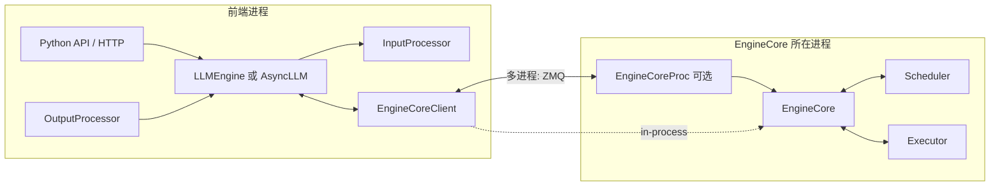

> **读图方法：** 阅读“Engine 不是 EngineCore”这张流程图时，先把方框看成对象或状态，把箭头看成数据或控制的移动。第一遍从左向右建立顺序，第二遍再核对分支发生的条件。

**源码事实：** `LLMEngine` 的类注释是 “Legacy LLMEngine for backwards
compatibility”。Legacy 指同步兼容门面，不代表它连接的是旧 V0 内核。当前类依然创建
V1 `InputProcessor`、`OutputProcessor` 和 `EngineCoreClient`。

阅读时不要笼统地问“Engine 在哪里”，而要问：当前方法位于用户协议侧、client 侧还是
core 侧？它是在提交工作、推进工作，还是接收结果？这次调用是否跨线程、跨进程或跨
设备？

### 在线路径为什么把 EngineCore 放在独立进程？

把 Scheduler 循环放进 `asyncio.create_task()`，并不会自动让其中的同步 CPU 工作
让出事件循环。将前端请求处理与 EngineCore 主循环分开，可以让两侧独立推进；常见
启用 GIL 的 CPython 部署也可减少两侧对同一解释器锁的竞争。**推断：** 这是对上述
进程分工的工程解释；仅凭分工不能证明具体收益，吞吐与延迟仍需实测。离线还保留
显式关闭多进程的 `InprocClient`。

进程隔离也提供故障检测边界，但**不等于自动恢复服务**。当前
`MPClient.start_engine_core_monitor` 发现 core 意外退出后标记 `engine_dead` 并清理，
后续操作抛 `EngineDeadError`。API 可报告错误；已经开始的流式响应不能再把 HTTP
状态改为 500。默认故障退出逻辑还会要求服务退出，没有在这里安全重建引擎的保证。

[源码] `vllm/v1/engine/core_client.py` - `MPClient.start_engine_core_monitor`

[源码] `vllm/entrypoints/serve/exception_handling/handlers/vllm_error.py` - `engine_error_handler`

[源码] `vllm/entrypoints/launchers/launcher.py` - `terminate_if_errored`

## 3.2 配置对象怎样诞生

用户看到的是大量 CLI 或 Python 参数，例如模型名、dtype、最大 batch token 数、TP/PP
大小、KV cache dtype 和 CUDA Graph 模式。内核不适合携带几百个散落参数，因此
`EngineArgs.create_engine_config()` 会把它们整理为一个 `VllmConfig` 聚合对象。

### 3.2.1 不是把字典塞进 dataclass

`create_engine_config()` 的工作包括：

1. 让当前 platform 预注册并修正参数。
2. 校验环境变量。
3. 创建 `ModelConfig`，由模型信息推导 tokenizer、dtype、最大长度等。
4. 解析 cache、parallel、scheduler、compilation、observability 等子配置。
5. 根据硬件、usage context 和功能组合补默认值。
6. 构造 `VllmConfig`，触发跨配置一致性检查。

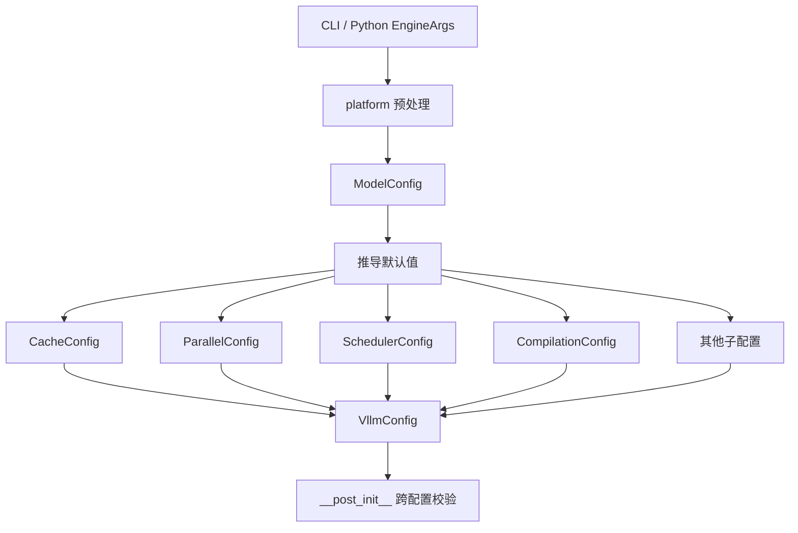

> **读图方法：** 这张图用于压缩“不是把字典塞进 dataclass”的整体关系。先从上向下找到起点、关键转换和终点，再问每条跨层箭头是否意味着函数调用、消息传递、内存访问或状态更新。

`VllmConfig` 保留多个领域子配置，而不是变成扁平参数表：

| 子配置 | 主要回答的问题 |
|---|---|
| `ModelConfig` | 加载什么模型、长度和架构是什么 |
| `CacheConfig` | KV 用多少显存、block 多大、是否 prefix cache |
| `ParallelConfig` | TP/PP/DP/EP 等拓扑如何组织 |
| `SchedulerConfig` | 一轮最多多少请求和 token、调度策略是什么 |
| `CompilationConfig` | eager、compile、CUDA Graph 如何配置 |
| `ObservabilityConfig` | trace、metrics 和迭代详情如何采集 |

这种结构使各模块读取自己的领域配置，同时仍能在 `VllmConfig.__post_init__()` 做跨领域
约束。模型能力、并行方式、KV connector 与 CUDA Graph 组合不能总是独立决定。

### 3.2.2 启动后配置还会回写

前端创建 `VllmConfig` 时，尚不知道模型加载后究竟还剩多少 GPU 显存给 KV cache。
`EngineCore._initialize_kv_caches()` 会 profile 内存，计算 block 数，并可能因 auto-fit
调小 `max_model_len`。

auto-fit 缩小 `max_model_len` 之后，读取这个长度的组件也要同步，否则会沿用旧值。v0.33.0 中，
MRV2（V2 Model Runner，新一代 Model Runner）的 draft-model speculator 改为在 auto-fit 之后读取 `max_model_len`，draft attention
metadata 的 `max_seq_len` 取“draft 上限”与 `max_model_len` 的较小值（#60513，提交
`636da2476`）。

`05caae03` 里这条链更完整：`DraftModelSpeculator.max_model_len` 是 property，每次读 `model_config.max_model_len`；
CUDA graph 里的 draft 步改读一个 GPU 标量 `max_model_len_gpu`。EngineCore 在 auto-fit 把 `max_model_len` 改小后
调用 `collective_rpc("update_max_model_len", ...)`（`vllm/v1/engine/core.py:364`），经 Worker、MRV2 Runner（`gpu/model_runner.py:378-382`）
传到 `speculator.update_max_model_len`，对 `max_model_len_gpu` 做 `fill_`（`speculator.py:272-273`），这样 capture 之后的缩小也作用于 graph replay。

[源码] `vllm/v1/worker/gpu/spec_decode/speculator.py` - 读取 `max_model_len` 的 draft metadata 构造、`update_max_model_len`

多进程模式下，EngineCore 通过 `EngineCoreReadyResponse` 把最终的
`max_model_len`、`num_gpu_blocks`、`block_size`、dtype 和并行大小回传给 client；client
再同步前端配置。因此“配置对象已构造”不等于“所有运行时容量已定值”。

本 revision 还回传 `effective_attention_block_size`。它来自 Scheduler 创建后实际
full-attention cache manager 的 block size：只有集合中恰好一种大小才给出整数，
否则为 `None`。MPClient 汇总各 READY response 时也只在值一致时保留该值。
它不是简单复制 CLI 的 `block_size`，也不能把 `None` 读成“没有 KV cache”。

v0.33.0 的 `EngineCoreReadyResponse` 另增三个字段，服务于 Elastic EP 的外部负载均衡模式
（#43202）：`coord_store_port`（引擎侧 `ParallelConfig._coord_store_port`）、
`coordinator_input_address` 与 `coordinator_output_address`（DP 协调器的两个后端地址）。
`MPClient._apply_ready_response` 对它们采取“第一个有效值生效，其后必须一致”的策略：
端口已有非零值时 `assert` 相等，地址已记录时同样 `assert` 相等。`enable_elastic_ep` 打开时，
握手阶段的 ready 消息还会携带 `elastic_ep_max_dp_size` 与 `num_redundant_experts`。
这些字段只在 Elastic EP 场景有意义；普通部署里端口为 0、地址为 `None`。

[源码] `vllm/v1/engine/core.py` - `EngineCore._initialize_effective_attention_block_size`、
`EngineCoreProc._make_ready_response`

[源码] `vllm/v1/engine/core_client.py` - `MPClient._apply_ready_response`

[源码] `vllm/v1/engine/__init__.py` - `EngineCoreReadyResponse`

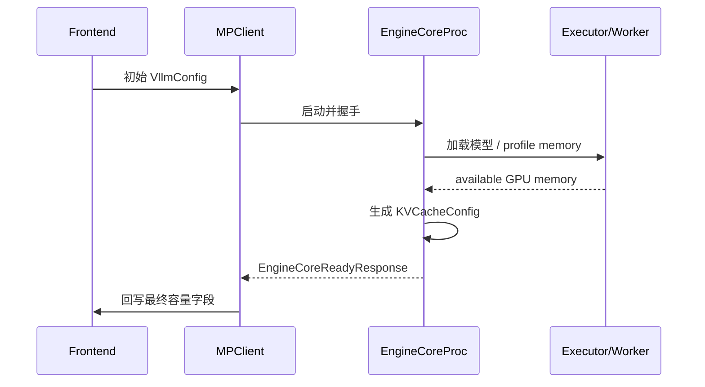

> **读图方法：** 这是“启动后配置还会回写”的时序图。先从左到右确认参与者分别负责什么，再从上到下追踪消息；第一遍只看正常路径，第二遍再看返回、异步消息和失败分支。

## 3.3 两个前端门面怎样驱动内核

> **本节先看：** 本节要回答：**两个前端门面怎样驱动内核**。下面的小节会逐层拆开概念、运行过程和源码落点；第一次阅读先抓对象之间的关系，第二次再记类名、字段和分支。

### 3.3.1 同步 `LLMEngine`

同步离线前端由调用线程循环取结果；默认后台 EngineCore 独立推进：

```text
add_request(...)
while has_unfinished_requests():
    outputs = llm_engine.step()
```

`LLMEngine.step()` 本身不实现模型计算。它做四件事：

1. 从 `engine_core.get_output()` 获取一组 `EngineCoreOutputs`。
2. 交给 `OutputProcessor.process_outputs()` 做 detokenization 和用户输出组装。
3. 把 stop string 等前端条件产生的 `reqs_to_abort` 发回 core。
4. 记录 scheduler 与 iteration metrics。

若 client 是 `InprocClient`，`get_output()` 会直接调用 `EngineCore.step_fn()`；若是
`SyncMPClient`，它会阻塞等待后台输出线程把 ZMQ 消息放入本地 queue。

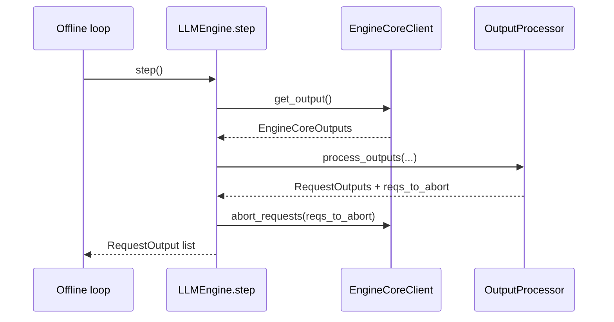

> **读图方法：** 这是“同步 `LLMEngine`”的时序图。先从左到右确认参与者分别负责什么，再从上到下追踪消息；第一遍只看正常路径，第二遍再看返回、异步消息和失败分支。

### 3.3.2 异步 `AsyncLLM`

在线服务不能让每个 HTTP coroutine 各自调用全局 step。`AsyncLLM` 使用后台 output
handler：

- `generate()` 为请求建立 collector，并提交到 `AsyncMPClient`。
- EngineCoreProc 自己运行 busy loop。
- output handler 持续 `await engine_core.get_output_async()`。
- OutputProcessor 把请求结果推入对应 collector。
- 每个 `generate()` coroutine 只消费自己的 collector 并 yield。

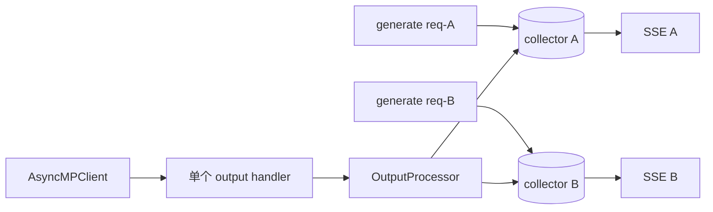

> **读图方法：** 这张图用于压缩“异步 `AsyncLLM`”的整体关系。先从左向右找到起点、关键转换和终点，再问每条跨层箭头是否意味着函数调用、消息传递、内存访问或状态更新。

output handler 按 `VLLM_V1_OUTPUT_PROC_CHUNK_SIZE` 切分大输出批次，并在 chunk 之间
`await asyncio.sleep(0)`，避免一次 CPU 输出处理长期占用 event loop。这里优化的是前端
公平性，不是 GPU batch 大小。

v0.33.0 对这个 handler 有两处时序调整。其一，多模态处理器缓存（P0）与引擎侧缓存（P1）
若漂移，EngineCore 会在输出里带回 `mm_cache_miss_hashes`；handler 现在在每个 chunk 的
`process_outputs()` **之前**调用 `renderer.queue_mm_cache_invalidations()`，保证已经排队的
渲染任务在下一次缓存查找前就看到失效标记，而不是等错误发布之后才清理（#62164）。
其二，`generate()` 与 `encode()` 都把 `GenerationError`（含可重试的 `RetryableRequestError`）与
`VLLMClientError`、`GracefulHTTPError` 一样视为“请求级失败”：只记录并向调用者抛出，
不当作引擎故障。只有 `generate()` 在这条分支里额外中止兄弟请求：`n>1` 时若一个子请求被拒绝，
它会 `abort(q.request_id, internal=True)` 回收其余同胞请求；`encode()` 这条分支不做这一步。

[源码] `vllm/v1/engine/async_llm.py` - `AsyncLLM._run_output_handler`、`AsyncLLM.generate`、`AsyncLLM.encode`

## 3.4 Client 工厂：四种组合，三条有效路径

`EngineCoreClient.make_client()` 的关键决策是 multiprocessing 与 asyncio：

| multiprocessing | asyncio | 结果 |
|---:|---:|---|
| false | false | `InprocClient` |
| true | false | `SyncMPClient` |
| true | true | `AsyncMPClient` 或 DP 变体 |
| false | true | 不支持，抛出 `NotImplementedError` |

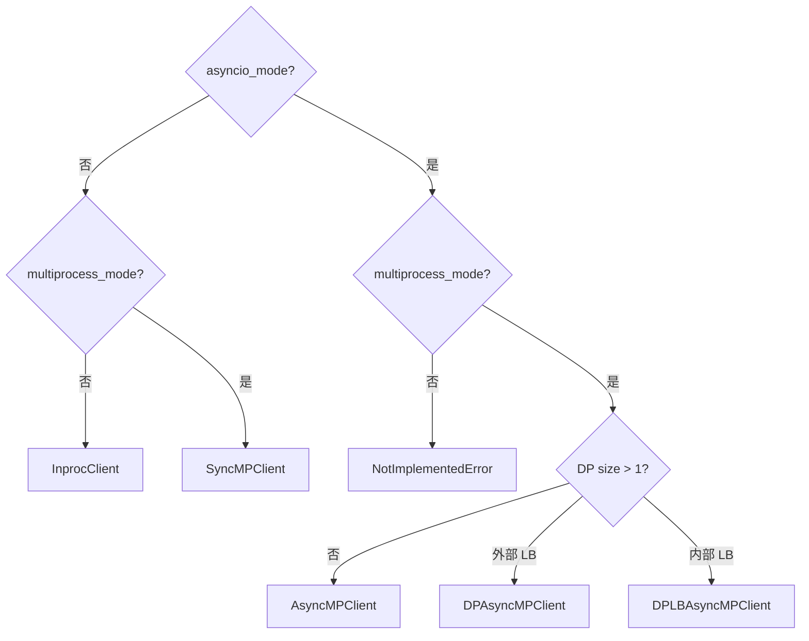

> **读图方法：** 这是“Client 工厂：四种组合，三条有效路径”的流程图。先从上向下只追一条主路径，确认输入经过哪些关键阶段到达输出；第二遍再看虚线、回边和旁路，它们通常表示反馈、复用或可选分支。

随书教学模型将前三条基础分支实现为
`examples/ch03_engine_core_loop.py::select_client`。

### 3.4.1 `InprocClient`

它在当前进程直接构造 `EngineCore`：

```text
add_request -> preprocess_add_request -> EngineCore.add_request
get_output  -> EngineCore.step_fn -> post_step
```

它没有后台 core busy loop，也没有 ZMQ 序列化。调用者不调用 `get_output()`，内核就不会
前进一步。这条路径容易调试，但不能代表在线服务的进程拓扑。

同进程不表示资源会自动及时释放。当前 `InprocClient` 用 `weakref.finalize` 注册
`EngineCore.shutdown`，显式 `shutdown()` 则先 detach finalizer 再清理，避免两条
清理路径重复执行。不要把对象失去引用的时机当作确定的 GPU 内存释放期限。

[源码] `vllm/v1/engine/core_client.py` - `InprocClient.__init__`、`shutdown`

### 3.4.2 `SyncMPClient`

它启动或连接 EngineCore 后台进程，输入用 ZMQ 发送，输出由独立线程接收并放进
`queue.Queue`。同步调用者在 `get_output()` 上等待本地 queue，而不是直接等待 GPU。

### 3.4.3 `AsyncMPClient`

它使用 `zmq.asyncio`，输出进入 `asyncio.Queue`。`add_request_async()` 会先给 request
写入 `client_index`，以便多个前端共享 EngineCore 时，结果仍回到正确 client。utility
方法使用 `call_id -> Future` 映射把远端结果交给等待 coroutine。

### 3.4.4 DP 变体：wave 由谁唤醒

DP 部署里，所有 rank 要在同一个“wave”（各 rank 同步推进的一轮运行周期）里一起空转或一起推进（MoE 需要各 rank 同步参与
all-to-all），所以只要有一个 rank 收到新请求，其余空闲 rank 也必须被叫醒。v0.32.0 里这件事
由**前端**发起：`DPAsyncMPClient.add_request_async()` 发现 `engines_running` 为假，就把
`("FIRST_REQ", engine)` 经内部 PAIR socket 交给统计任务，转给协调器。问题在于前端对
“引擎是否在运行”的判断可能过时，而处于暂停态的引擎会丢弃 `START_DP_WAVE`。

v0.33.0（#59559，提交 `a94c31571`）改成**只有引擎发起 wave**：

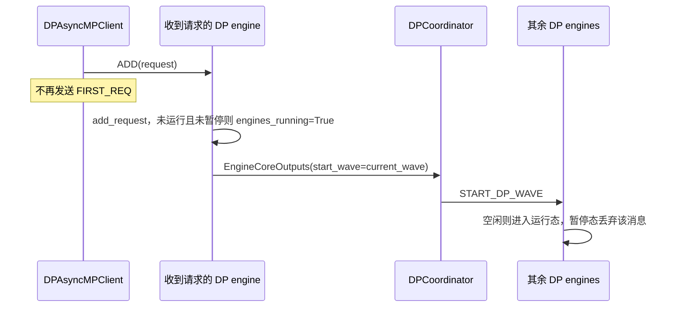

> **读图方法：** 这是“wave 由谁唤醒”的时序图。从上到下看一次新请求：前端只负责把 ADD 送到某个引擎；是否需要叫醒别的 rank，由收到请求的引擎判断并通知协调器。若协调器再收到前端消息，只会记录一条 error 日志。

对应的代码变化有三处：`DPEngineCoreProc.add_request()` 去掉了 `request_wave != current_wave`
这个前提，只要有协调器、引擎没在运行且调度器是 `UNPAUSED`，就发 `start_wave`；协调器
`DPCoordinatorProc` 不再处理前端来的 wave 消息；前端原来叫 `first_req_*` 的 socket 改名为
`scale_send_socket` / `scale_rcv_socket`，现在只用来传 `SCALE_ELASTIC_EP` 标记。

`DPLBAsyncMPClient` 还新增 `streaming_reqs` 集合（#58942）：流式输入会话的 abort 会发给
**所有**引擎，因为会话结束时仍在途的 chunk 可能已经在别的引擎上重建了该请求。

`DPAsyncMPClient`（外部负载均衡）在 `enable_elastic_ep` 时创建
`ExternalElasticEPScaleCoordinator`，`prepare_elastic_ep` / `commit_elastic_ep` /
`abort_external_elastic_ep` / `get_external_elastic_ep_status` 经它完成（#43202）；被缩容淘汰的
rank 通过 `set_elastic_ep_rank_retired(True)` 标记，之后 `AsyncLLM.check_health()` 直接返回，
`should_keep_api_server_alive` 为真，等待外部进程关闭它。Elastic EP 的完整流程不在本章展开，见 9.8.6。

[源码] `vllm/v1/engine/core_client.py` - `DPAsyncMPClient`、`DPLBAsyncMPClient`

[源码] `vllm/v1/engine/core.py` - `DPEngineCoreProc.add_request`

[源码] `vllm/v1/engine/coordinator.py` - `DPCoordinatorProc`

[测试] `tests/v1/engine/test_engine_core.py` - `test_idle_dp_rank_announces_wave_for_new_work`、
`test_paused_dp_rank_ignores_start_wave`

## 3.5 多进程拓扑与三条 CPU 通道

普通非 DP 在线路径至少包含三条 CPU 执行通道：

1. **input socket thread**：轮询 ZMQ、反序列化、预处理 ADD、写 input queue。
2. **core main thread**：唯一修改 Scheduler 主状态，运行 busy loop 和 step。
3. **output socket thread**：读 output queue、序列化并发送。

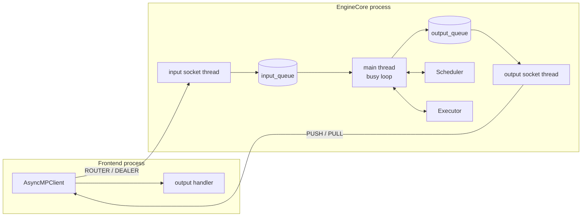

> **读图方法：** 阅读“多进程拓扑与三条 CPU 通道”这张流程图时，先把方框看成对象或状态，把箭头看成数据或控制的移动。第一遍从左向右建立顺序，第二遍再核对分支发生的条件。

socket IO 和部分序列化可以与 GPU 执行重叠，同时 Scheduler 的核心可变状态仍由 busy
loop 单线程拥有。这比网络线程直接改 Scheduler 更容易维持顺序和一致性。

### 3.5.1 ADD 为什么在 input thread 预处理

`process_input_sockets()` 对 ADD 使用类型化 `MsgpackDecoder(EngineCoreRequest)`，随后
调用 `preprocess_add_request()`，把传输对象转为运行态 `Request`。多模态缓存缺失或请求
预处理错误可在这里变成 request-scoped error，而不是让 core 主循环崩溃。

v0.33.0 又增加一类：预处理抛出 `VLLMValidationError` 时（当前用于请求选择的 structured
output 后端与 EngineCore 已锁定的后端不一致，#49625），`_handle_request_validation_error`
发出 `FinishReason.ERROR` 并附 `RequestError(code="validation_error")`；前端用
`RequestError.to_exception()` 还原成 `VLLMValidationError`，调用者看到的是请求参数错误，而不是
引擎故障。

### 3.5.2 ABORT 为什么同时进入两个队列

ABORT 被放入：

- `aborts_queue`：让正在等待 GPU Future 的 step 在 update 前尽快看见取消。
- `input_queue`：保持与 ADD 等消息的有序处理，避免竞态导致请求泄漏。

Scheduler abort 是幂等的，所以双路径处理不会重复破坏状态。

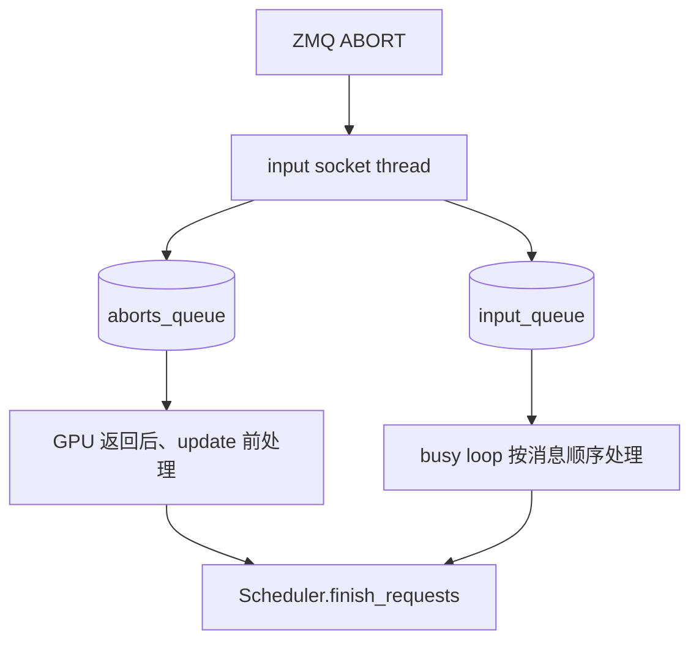

> **读图方法：** 这张图用于压缩“ABORT 为什么同时进入两个队列”的整体关系。先从上向下找到起点、关键转换和终点，再问每条跨层箭头是否意味着函数调用、消息传递、内存访问或状态更新。

### v0.33.0：IPC 与共享内存不是同一个开关

MPClient 先用 bind address 创建 socket，再从 `zmq.LAST_ENDPOINT` 得到真实 endpoint 并构造
`EngineZmqAddresses`；绑定地址与给 EngineCore 连接的地址要分开看，尤其是动态 TCP 端口。
v0.33.0 还把两端的真实地址保存为 `MPClient.input_address` 与 `output_address`。

共享内存 tensor arena 则位于 Engine→Worker 广播，不是替换所有 API→Engine 消息。
固定 commit 的 `ParallelConfig.enable_shm_tensor_arena` 默认 **False**，明确为实验性 opt-in；
启用后还要求 queue readers 全部 node-local。它面向较大的 CPU tensor，保留 /dev/shm 槽位。
v0.32.0 的发布摘要称其默认开启，与该 tag 源码不一致；v0.33.0 源码默认值仍为 `False`
（`enable_shm_tensor_arena: bool = False`），本章以源码默认值与门控为准，不把摘要当运行事实。

把这两个“开关”放到同一张图里看，才能分清一条消息每一跳走的是哪种通道：

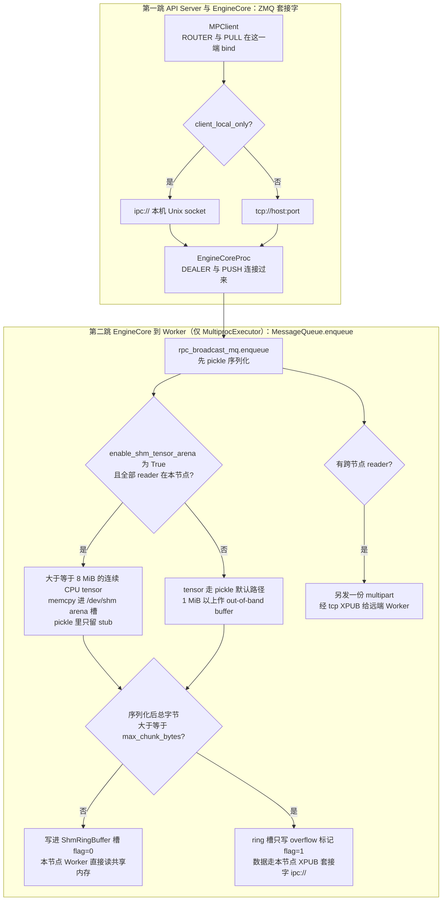

> **读图方法：** 图分两个框，对应两跳，每一跳各有自己的选择。上面的框回答“API 与 EngineCore 之间走哪种地址”：这一跳永远是 ZMQ，
> 只是在 `client_local_only` 为真时用 `ipc://`，否则用 `tcp://`，与共享内存无关。下面的框只覆盖 `MultiprocExecutor`：`UniProcExecutor` 没有 `MessageQueue`，EngineCore 与 worker 在同一进程里直接调用，没有这一跳。
> 在 MultiprocExecutor 路径上，下面的框回答“Engine→Worker 的广播怎么发”：第一遍只沿左侧的“否→否→写 ring”走，
> 这是默认路径（没开 arena、消息不大、只有本节点 Worker）；第二遍再看三处分叉：arena 只改变大 CPU tensor 怎么被序列化，
> 总字节过大会让数据改走 XPUB，跨节点 reader 额外走 tcp。菱形是条件，矩形是动作。

这张图里的每个判断都能对到固定 commit 的代码：

- **第一跳的地址。** `get_engine_zmq_bind_addresses` 在 `client_local_only` 为真时对输入、输出都取 `get_open_zmq_ipc_path()`（`ipc://` 加随机 UUID 路径），否则取 `tcp://host:0`
  （`vllm/v1/engine/utils.py:1144-1156`，路径函数在 `vllm/utils/network_utils.py:175-177`）；`MPClient.__init__` 在 client 一端 bind `ROUTER`（输入）与 `PULL`（输出）
  （`vllm/v1/engine/core_client.py:688-718`；引擎由外部启动、地址由外部给定时，地址由启动方决定，不经过这个函数），EngineCore 端是 `DEALER` 与 `PUSH`（`vllm/v1/engine/core.py:2194`、`:2304`）。
- **第二跳只属于 `MultiprocExecutor`。** `UniProcExecutor` 没有 `MessageQueue`（`vllm/v1/executor/uniproc_executor.py` 全程进程内 `collective_rpc` / `run_method`）。`MultiprocExecutor._init_executor` 只在 DP leader 节点创建 `rpc_broadcast_mq = MessageQueue(world_size, local_world_size, max_chunk_bytes=…)`
  （`vllm/v1/executor/multiproc_executor.py:202-208`），其中 `max_chunk_bytes = VLLM_MQ_MAX_CHUNK_BYTES_MB × 1 MiB`，默认 16 MiB（`vllm/envs.py:1962-1964`）。
  `MessageQueue.__init__` 有本节点 reader 时创建 `ShmRingBuffer(n_local_reader, max_chunk_bytes, max_chunks)`，`max_chunks` 默认 10（`vllm/distributed/device_communicators/shm_broadcast.py:507`、`:521-526`）。
  这与 `enable_shm_tensor_arena` 无关：关着 arena，小消息照样走共享内存 ring buffer。
- **“总字节过大”的判断。** `enqueue` 先 pickle，再比较 `total_bytes + len(all_buffers[0]) >= max_chunk_bytes`：成立时在 ring 槽里写 `buf[0] = 1`（overflow）并用本节点的 `XPUB` 套接字发 multipart，
  否则按“buffer 个数加各 buffer 长度”的格式写进槽里并置 `buf[0] = 0`（`shm_broadcast.py:992-1014`）；读端 `dequeue` 看到 overflow 标记就改从 `local_socket` 收（`:1029-1043`）。
- **arena 的门控与范围。** 只有 `enable_shm_tensor_arena and n_remote_reader == 0` 时才创建 `ShmTensorArena`（`shm_broadcast.py:532-535`）；
  `_ArenaPickler.reducer_override` 只改写满足“CPU、连续、不带梯度、字节数大于等于 8 MiB”的 tensor，其余、以及 arena 没有空槽时，原样走默认 pickle 路径
  （`vllm/distributed/device_communicators/shm_tensor_arena.py:44-49`、`:375-397`）。所以 arena 影响的是“大 tensor 的那一份拷贝怎么传”，不改变第一跳，也不替换 ring buffer。
- **跨节点 reader。** `n_remote_reader > 0` 时另建 `tcp://` 的 `XPUB`，`enqueue` 末尾把同一份 multipart 发给它们（`shm_broadcast.py:565-582`、`:1015-1016`）；
  有跨节点 reader 时 arena 不会创建，因为远端读不了本机共享内存。
- **回程不是同一个队列。** `nnodes_within_dp == 1` 时每个 Worker 另建一个 `MessageQueue(1, 1)` 作为 `worker_response_mq` 把结果送回 EngineCore（`multiproc_executor.py:752-759`），机制相同、方向相反；跨节点的分支（`:760` 起）本节不展开。

`MessageQueue` 的 reader 在 v0.33.0 有一处资源修复（#63165）：reader 一直忙、从不进入空闲
等待时，libzmq 仍会为每次 notify 在内部排一个命令，若从不 poll 就会无限增长。现在
`SpinCondition.record_read()` 每隔 `SHM_NOTIFY_POLL_INTERVAL_S`（2 秒）对 notify socket
做一次 `poll(timeout=0)` 并取走挂起消息。这不改变共享内存的读写协议。

[源码] `vllm/v1/engine/core_client.py` - `MPClient.__init__`

[源码] `vllm/config/parallel.py` - `ParallelConfig.enable_shm_tensor_arena`

[源码] `vllm/v1/executor/multiproc_executor.py` - `MultiprocExecutor._init_executor`

[源码] `vllm/distributed/device_communicators/shm_broadcast.py` - `MessageQueue`、`SpinCondition.record_read`

## 3.6 EngineCore 初始化：顺序就是契约

`EngineCore.__init__()` 的主顺序可以压缩为：

```text
load plugins
-> create Executor
-> register executor failure callback
-> discover/profile/allocate KV cache
-> create StructuredOutputManager
-> create Scheduler
-> connect KV/EC aggregators
-> configure batch queue and request block hasher（hasher 另带 `num_hash_lookahead_tokens`）
-> choose step_fn
-> freeze startup heap / cache env reads
```

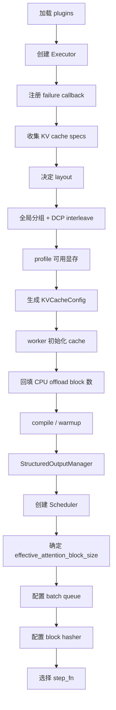

> **读图方法：** 这是“EngineCore 初始化：顺序就是契约”的流程图。先从上向下只追一条主路径，确认输入经过哪些关键阶段到达输出；第二遍再看虚线、回边和旁路，它们通常表示反馈、复用或可选分支。

### 3.6.1 Executor 必须先于 Scheduler

KV cache 的真实规格来自执行侧模型层，容量又依赖加载模型后的可用显存。Scheduler 需要
最终 `KVCacheConfig` 才能创建 block manager。因此不能先凭 CLI 参数创建完整 Scheduler，
再让 Worker 猜 cache。

### 3.6.2 KV 初始化不只是分配 tensor

`_initialize_kv_caches()` 会：

1. 从 worker 收集每层 KV spec。
2. 根据 backend 和模型能力解析 cache layout。
3. 用 `get_global_kv_cache_groups` 合并各 worker 的 spec 并分组，据此
   `adjust_dcp_kv_cache_interleave_size`，再通过
   `set_kv_cache_layout(layout, cp_kv_cache_interleave_size)` 把 layout 与 DCP（decode context parallel，把长上下文的 KV 按 token 维度分到多个 rank）的 interleave 大小一起下发。
4. profile 可用内存。
5. `get_kv_cache_configs` 生成各 worker cache config，直接复用第 3 步的分组；若 auto-fit 缩小了 `max_model_len`，经 `collective_rpc` 同步给 worker。
6. `generate_scheduler_kv_cache_config` 得到 Scheduler 汇总 config，并写入 `num_gpu_blocks`、`block_size`；非 extensible 时再调用 `update_kv_cache_capacity`，只记录并日志 KV 容量（token 数、最大并发）。
7. 调用 executor 初始化 cache（extensible 时这一步先按预留容量分配）。
8. compile 或 warm up 模型（启用 extensible KV cache 时，随后还要按 warmup 后的实测值 `finalize_extensible_kv_cache` 并 `extend_kv_cache` 定稿 block 数）。
9. 若启用 `SimpleCPUOffloadConnector` 且开了 prefix caching，向 worker 取回对齐后的 CPU block 数，
   写回 `cache_config.simple_cpu_offload_num_blocks`。

第 3 步是 v0.33.0 的顺序变化（#62330，提交 `3e75ccba2`）：全局分组与 DCP interleave 必须在
profile 之前确定，使 NIXL（跨实例传输 KV 的 connector）的 DCP interleave 大小在 profiling 开始时就是最终值；
第 9 步（#52921）让 PP 与 spec decode 下各 worker 的 CPU offload 池大小一致，由 worker 汇报
最终块数，缺失时直接 `assert` 失败。规划函数本身已迁到 `kv_cache_planning.py`（#61183），
细节见第 05 章 5.5.5。

下图把这九步按“先确定什么、后确定什么”分成四段，回答一个问题：为什么 profile 必须排在全局分组与 layout 之后，Scheduler 又必须排在这一切之后。

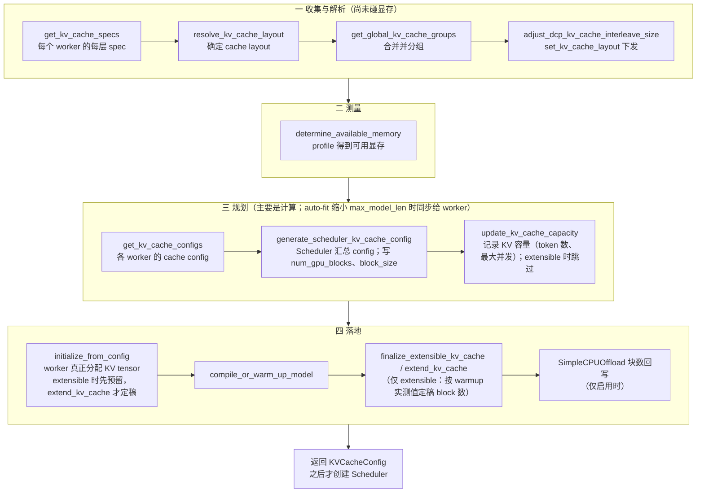

> **读图方法：** 先只沿主线从上到下走四段：先收集和解析，再 profile，再规划，最后落地，每段内部从左到右。第二遍留意三处细节：
> 第一段算好的全局分组会被第三段的 `get_kv_cache_configs` 直接复用（图里没有画这条边，因为它跨段回指），
> 这正是 v0.33.0 把分组和 DCP interleave 提前到 profile 之前的原因（NIXL 在 profile 时就要看到最终 interleave）；
> 第三段主要是计算，但 `get_kv_cache_configs` 若 auto-fit 缩小了 `max_model_len`，会在进入 C2 之前经 `collective_rpc` 同步给 worker，所以这一段除了计算还有一次向 worker 的同步；
> C2 写入 `num_gpu_blocks` 和 `block_size`，C3 的 `update_kv_cache_capacity` 只记录并日志 token 容量与最大并发，extensible 时整框跳过；
> 第四段里，extensible 路径在 D1 只按预留容量分配，warmup 之后才由 `finalize_extensible_kv_cache` / `extend_kv_cache` 定稿 block 数（D2 与 D3 之间的那一框；非 extensible 时跳过）。
> 最下面的出口说明：Scheduler 要的是第三段产出的汇总 config，所以只能在整个函数返回之后创建。

图中每个框都是 `EngineCore._initialize_kv_caches` 里的一次真实调用（`vllm/v1/engine/core.py` @ `05caae03`）：
`get_kv_cache_specs` `:284`、`resolve_kv_cache_layout` `:318`、`get_global_kv_cache_groups` `:324`、`adjust_dcp_kv_cache_interleave_size` `:325`、
`set_kv_cache_layout` `:326`、`determine_available_memory` `:342`、`get_kv_cache_configs` `:353`、auto-fit 后同步 `max_model_len` `:364`、
`generate_scheduler_kv_cache_config` `:366`（随后写 `num_gpu_blocks` `:367`、`block_size` `:379-383`）、
`update_kv_cache_capacity` `:388`（仅当 `kv_cache_groups and not extensible`，函数在 `vllm/v1/core/kv_cache_utils.py:1157-1175` 只记录并日志 `kv_cache_size_tokens` 与 `kv_cache_max_concurrency`）、
`initialize_from_config` `:408`、`compile_or_warm_up_model` `:411`、`finalize_extensible_kv_cache` / `extend_kv_cache` `:412-422`（仅 extensible）、SimpleCPUOffload 块数回写 `:425-439`。
编号列表里的第 8、9 步按源码顺序排列：compile/warm-up 在前，CPU offload 块数回写在后（extensible KV cache 下 worker 在 `extend_kv_cache` 里才创建 connector，所以必须等它）。

[源码] `vllm/v1/engine/core.py` - `EngineCore._initialize_kv_caches`

[源码] `vllm/v1/core/kv_cache_planning.py` - `get_global_kv_cache_groups`、`get_kv_cache_configs`

第 05 章会展开 block 生命周期；这里要记住的是 Scheduler 创建之前，内存契约必须确定。

### 3.6.3 `step_fn` 在启动时绑定

`VllmConfig.max_concurrent_batches` 决定是否创建 batch queue：

- 值为 1：`step_fn = step`。
- 值大于 1：创建有界 deque，`step_fn = step_with_batch_queue`。

容量由下面的规则决定：

$$
\mathtt{max\_concurrent\_batches}=
\begin{cases}
\mathrm{PP}, & \mathtt{async\_scheduling}=\mathrm{False},\\
\mathrm{PP}+1, & \mathtt{async\_scheduling}=\mathrm{True}.
\end{cases}
$$

**白话：**batch queue 里最多同时放几个已提交、还没结算的 batch。流水线并行要让每个 stage 都有活干，所以至少要有 stage 数那么多个 batch 在途；
再开 async scheduling，CPU 要多提前准备一个 batch 去和 GPU 重叠，所以多 1 个。

**其中：**$\mathrm{PP}$ 是 pipeline stage 数（无单位正整数，至少 1）；`async_scheduling` 是 `SchedulerConfig` 的开关；
$\mathtt{max\_concurrent\_batches}$ 是源码里 `VllmConfig.max_concurrent_batches` 属性的名字（个 batch），公式里直接用它，不另造符号。

**怎么算出来：**这是定义式，源码就是这几行：`pp_size = pipeline_parallel_size`，若 `async_scheduling` 则返回 `pp_size + 1`，否则返回 `pp_size`
（`vllm/config/vllm.py:559-565`，源码注释写明“PP 需要 PP-size 个并发 batch 才能填满流水线；async scheduling 需要 2 个并发 batch 才能重叠”）。
逐个代入：

| $\mathrm{PP}$ | `async_scheduling` | 容量 | `step_fn` |
|---|---|---|---|
| 1 | 关闭 | $1$ | `step`，不创建 batch queue |
| 1 | 开启 | $1+1=2$ | `step_with_batch_queue`，即 §3.11.2 的容量为 2 的时间线 |
| 4 | 关闭 | $4$ | `step_with_batch_queue`，容量 4（async 关闭时就是 PP 本身，只要 $\mathrm{PP}>1$ 就会建队列） |
| 4 | 开启 | $4+1=5$ | `step_with_batch_queue`，容量 5，并不是固定 2 |

**核对：**`EngineCore.__init__` 把这个属性读成 `batch_queue_size`，大于 1 时创建 `deque(maxlen=batch_queue_size)`（`vllm/v1/engine/core.py:222-228`）；
`step_with_batch_queue` 里用 `len(batch_queue) < self.batch_queue_size` 判断队列是否未满（`:787`、`:829`）。
MRV1 已随 #63373 删除，曾经的“MRV1 在 PP=1 时为 2、PP>1 时仍返回 PP”分支不再存在。
这是 `VllmConfig.max_concurrent_batches` 的规则；其他配置校验还可能拒绝不支持的组合。

[源码] `vllm/config/vllm.py` - `VllmConfig.max_concurrent_batches`

[源码] `vllm/v1/engine/core.py` - `EngineCore.__init__` 中 `step_fn` 的绑定

## 3.7 请求消息与 Utility RPC

`EngineCoreRequestType` 使用单字节值，避免再编码一层字符串：

| 类型 | 用途 | 普通用户路径 |
|---|---|---|
| `ADD` | 提交请求 | 是 |
| `ABORT` | 取消请求 | 是 |
| `START_DP_WAVE` | DP wave 协调 | 否 |
| `UTILITY` | profile、LoRA、sleep、cache reset 等 RPC | 间接 |
| `EXECUTOR_FAILED` | executor failure callback 的进程内哨兵 | 否 |
| `WAKEUP` | shutdown 时唤醒阻塞 input queue | 否 |

同步 client 为 utility call 创建 `concurrent.futures.Future`，异步 client 创建
`asyncio.Future`。消息携带 `call_id`，core 返回 `UtilityOutput` 后，client 查表设置结果或
异常。

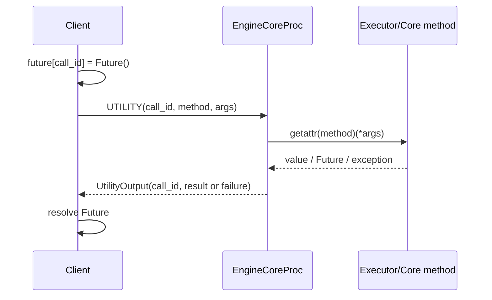

> **读图方法：** 这是“请求消息与 Utility RPC”的时序图。先从左到右确认参与者分别负责什么，再从上到下追踪消息；第一遍只看正常路径，第二遍再看返回、异步消息和失败分支。

`profile` 这类 utility 在 v0.33.0 多带一个 `profiler_kwargs`（#51974）。它是与 `profile_prefix`
并列的另一个字段（`profile_prefix` 仍是单独参数，不属于 `profiler_kwargs`）：`AsyncLLM.start_profile`
收到的 `profiler_kwargs` 字典经 `EngineCoreClient.profile` → `EngineCore.profile` →
`executor.profile` 原样透传，不在中途解释。

返回值本身也可能是 Future，例如 pause 要等 engine 真正 idle。`_invoke_utility_method()`
会注册 callback，而不是阻塞 core 主线程。

## 3.8 普通 `EngineCore.step()` 的精确顺序

普通 step 主链为：

```python
if not scheduler.has_requests():
    return {}, False

scheduler_output = scheduler.schedule(...)
future = model_executor.execute_model(scheduler_output, non_block=True)
grammar_output = scheduler.get_grammar_bitmask(scheduler_output)
model_output = future.result()
if model_output is None:
    model_output = model_executor.sample_tokens(grammar_output)

_process_aborts_queue()
outputs = scheduler.update_from_output(scheduler_output, model_output)
return outputs, scheduler_output.total_num_scheduled_tokens > 0
```

伪代码省略 tracing、统计和错误 dump，但保留了时序契约。

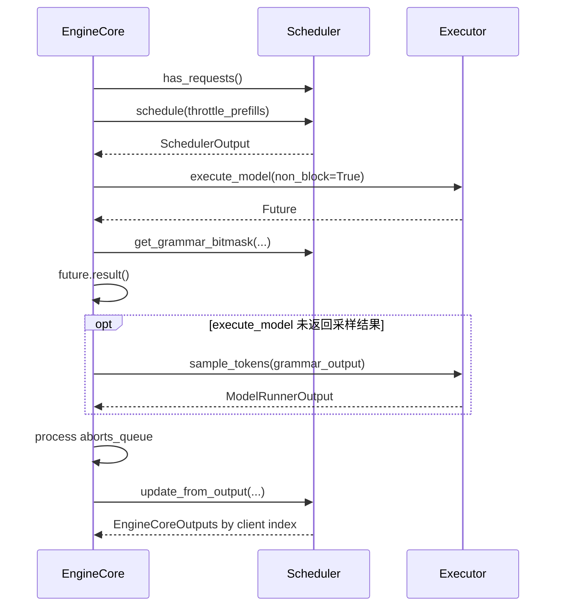

> **读图方法：** 这是“普通 `EngineCore.step()` 的精确顺序”的时序图。先从左到右确认参与者分别负责什么，再从上到下追踪消息；第一遍只看正常路径，第二遍再看返回、异步消息和失败分支。

### 3.8.1 `SchedulerOutput` 是执行契约

它描述“这一轮准备做什么”，包括每个请求的 token 数、block 变化、running/resumed/
preempted 信息，以及 structured output、KV connector、encoder input 等 metadata。
EngineCore 不把 Scheduler 内部可变对象直接交给 Worker，而是交付一个本轮快照。

### 3.8.2 `non_block=True` 的真实边界

它表示 executor 以 Future 形式交付结果；这不保证 Python 方法本身在后台线程运行。
例如 `UniProcExecutor.collective_rpc` 仍在当前线程执行 `run_method`，GPU 操作可异步入队，
返回值再包装为 Future。普通 step 随后就在同一函数调用
`future.result()`。因此：

> `non_block=True` 不等于整个 `EngineCore.step()` 不阻塞。

普通 step 统一了 executor API，并允许 IO 线程与设备执行重叠；真正让多个模型 batch
保持未结算状态的是 batch queue。

### 3.8.3 sample 为什么可能是第二阶段

某些 executor 的 `execute_model()` 返回完整 `ModelRunnerOutput`；另一些路径把 forward
与 sampling 拆开，forward 结果为 `None`，EngineCore 再调用
`sample_tokens(grammar_output)`。structured output 的 grammar bitmask 也在此边界参与。

### 3.8.4 `model_executed` 不等于“有用户输出”

布尔值来自 `total_num_scheduled_tokens > 0`。某一步可能只推进 connector、DP 协调或空
batch 控制状态，没有执行 token；模型执行也不一定立刻产生可发送文本。`post_step()`
和 busy loop 因而不能用“输出列表非空”替代它。

## 3.9 Abort 竞态：为什么必须在 update 前处理

考虑时间线：Scheduler 已把请求 R 放进 batch；GPU 正在执行 R 的最后一个 token；客户
端断开，ABORT 到达；随后 GPU 返回。如果先 `update_from_output()`，R 可能被报告为正常
stop/length 完成，connector 也看到错误完成原因。

当前实现先 drain `aborts_queue`，再把模型结果交给 Scheduler。

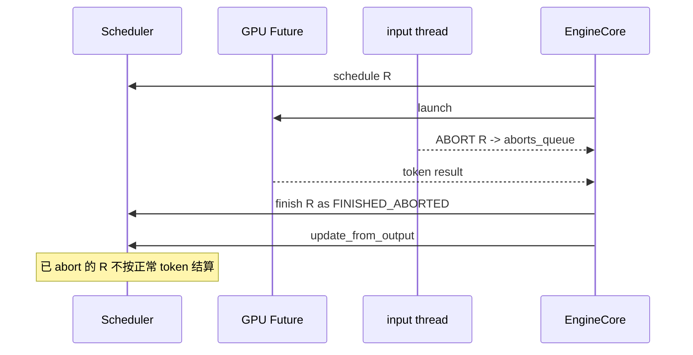

> **读图方法：** 这是“Abort 竞态：为什么必须在 update 前处理”的时序图。先从左到右确认参与者分别负责什么，再从上到下追踪消息；第一遍只看正常路径，第二遍再看返回、异步消息和失败分支。

上游 `tests/v1/engine/test_abort_final_step.py` 覆盖 final-step abort，并验证 connector 观察
到 `FINISHED_ABORTED`。随书测试 `test_abort_between_launch_and_update_wins` 用标准库模型
复现同一顺序。

## 3.10 Busy loop：空闲时等待，工作时推进

`EngineCoreProc.run_busy_loop()` 每轮为：

```text
while handle_shutdown():
    process_input_queue()
    maybe_publish_request_counts()
    process_engine_step()
    maybe_publish_request_counts()
raise SystemExit
```

真正行为取决于 `has_work()`、input queue 是否阻塞、batch queue 是否非空、DP engines
是否运行和 shutdown state。

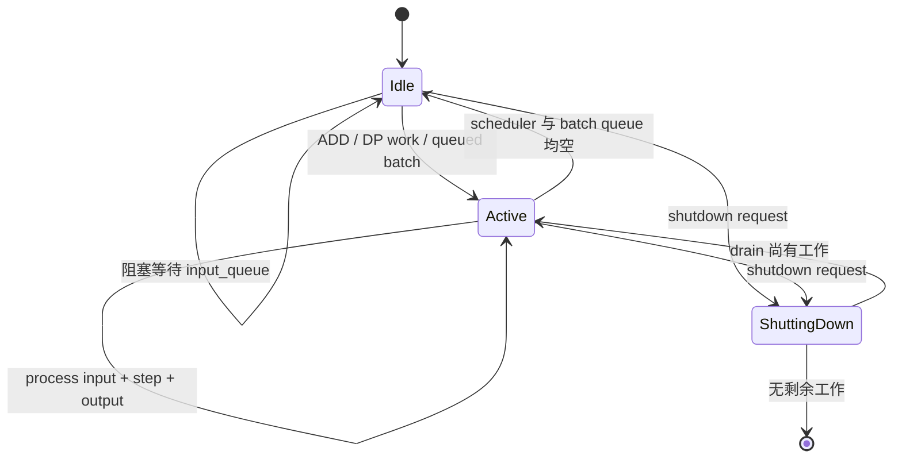

> **读图方法：** 这是“Busy loop：空闲时等待，工作时推进”的状态图。先找初始状态，再沿箭头观察触发条件和状态变化；重点不是背状态名，而是弄清谁触发转换、转换后哪些资源需要更新。

### 3.10.1 `has_work()` 不只看 Scheduler

它返回以下三者的或：

```text
engines_running
or scheduler.has_requests()
or bool(batch_queue)
```

即使 Scheduler 暂无可继续调度的请求，只要 batch queue 还有 Future，core 就不能 idle；
DP wave 仍运行时也一样。

### 3.10.2 空闲等待为什么使用 input queue

没有工作且状态为 RUNNING 时，主线程阻塞在 `input_queue.get()`，避免空转。shutdown
signal handler 不直接触碰可能被锁住的 queue mutex，而是通过 `SignalCallback` 放入
`WAKEUP` 哨兵，让主线程醒来后处理状态。

### 3.10.3 没有模型执行时为什么短暂 sleep

若本轮 `model_executed=False` 但 Scheduler 仍有请求，可能正在等 remote KV 或延迟 free。
busy loop 会 sleep 1ms，让持有 GIL 的后台传输线程获得进展机会，避免控制面热循环。

### 3.10.4 Watchdog：卡住时留下线程栈

v0.33.0 引入可选的栈转储看门狗（#55700）。它**默认关闭**：`WatchdogConfig.dump_dir`
为空字符串时，`start_watch_dog()` 直接返回一个什么都不做的 `NoopWatchDog`；配置了 `dump_dir`
才会启动 `ThreadedWatchDog`，并打开 `faulthandler`。看门狗只有三个动作：

- `feed()`：主线程“我还在推进”。`EngineCoreProc._process_engine_step()` 每次进入都先 `feed()`。
- `disable()`：暂停计时的上下文管理器。`_process_input_queue()` 在阻塞等待 `input_queue.get()`
  时包在 `with get_watch_dog().disable():` 里，因为空闲等请求不是故障。
- `handle_failure(reason)`：把所有线程的栈追加写入 `dump_dir` 下的
  `VLLM_STACK_DUMP_for_<name>_<pid>.log`。

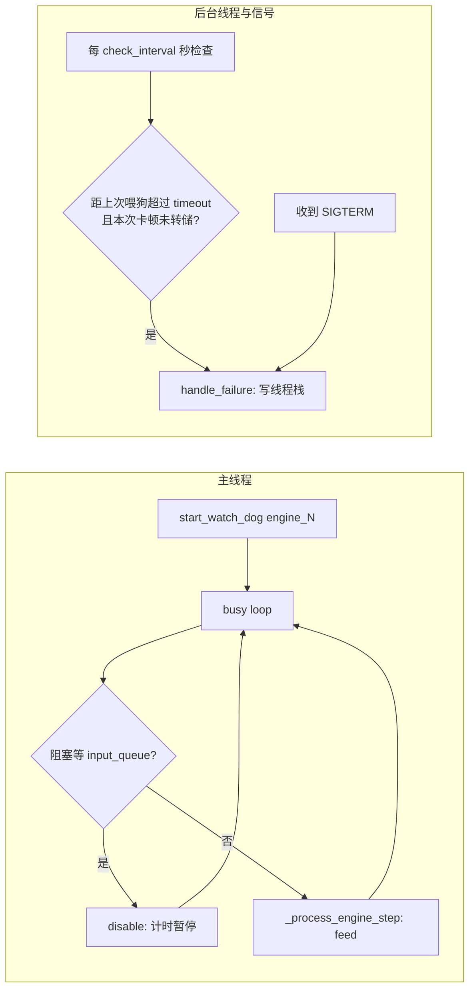

> **读图方法：** 左半是 busy loop 主线程，只在“进入一步引擎推进”时喂狗，空闲阻塞时暂停计时；右半是后台线程，只比较“距离上次喂狗多久”。看门狗只记录，不重启、不杀进程。

超时判定可以写成：

$$
\Delta t_{\mathrm{silent}}=t_{\mathrm{now}}-t_{\mathrm{feed}},\qquad
\mathrm{dump}\iff\bigl(\Delta t_{\mathrm{silent}}>\Delta t_{\mathrm{timeout}}\bigr)\wedge\bigl(t_{\mathrm{log}}<t_{\mathrm{feed}}\bigr)
$$

**白话：**后台线程每隔一会儿看一眼“主线程上次喂狗是多久以前”。超过超时秒数就判定卡住并写一次栈；
同一次卡顿只写一次，主线程重新喂狗之后才有资格再写。

**其中：**$\mathrm{dump}$ 表示“这一轮检查要不要转储线程栈”，是一个布尔量，$\wedge$ 是“并且”；$t_{\mathrm{now}}$ 是后台线程检查时 `time.monotonic()` 的读数，$t_{\mathrm{feed}}$ 是源码里的 `last_feed_time`（最近一次 `feed()` 的时刻），
$t_{\mathrm{log}}$ 是 `last_timeout_log`（上次转储的时刻，初值 0，所以第一次卡顿一定会转储），$\Delta t_{\mathrm{timeout}}$ 是 `WatchdogConfig.timeout`（正整数秒）；
三个时刻都在同一个单调时钟上，单位是秒；$\Delta t_{\mathrm{silent}}$ 是“已经多久没喂狗”（秒，时间自上次喂狗起算）。检查间隔是 `WatchdogConfig.check_interval`（正整数秒），不在公式里，只决定多久判一次。

**单位检查：**$t_{\mathrm{now}}$、$t_{\mathrm{feed}}$、$t_{\mathrm{log}}$ 都是同一单调时钟上的秒；$\Delta t_{\mathrm{silent}}$ 与 $\Delta t_{\mathrm{timeout}}$ 都是秒，相减和比较都合法。

**怎么算出来：**这是定义式，直接对应 `ThreadedWatchDog._check_loop`：先在 `active` 为假时把 `last_feed_time` 刷成 `now` 并跳过本轮，否则判断
`now - self.last_feed_time > self.timeout and self.last_timeout_log < self.last_feed_time`，为真就记 `last_timeout_log = now` 并调用 `handle_failure("feed timeout")`
（`vllm/utils/watch_dog.py:108-122` @ `05caae03`）。第二个条件的意思是“同一次卡顿只转储一次”：转储后 $t_{\mathrm{log}}\ge t_{\mathrm{feed}}$，
只要中间没有新的 `feed()`，条件就一直为假。
算例（教学数字）：$\Delta t_{\mathrm{timeout}}=60$，并假设检查足够频繁，$t_{\mathrm{log}}$ 初值 0：

| 时刻 $t_{\mathrm{now}}$（秒） | 事件 | $t_{\mathrm{feed}}$ | $\Delta t_{\mathrm{silent}}$ | $t_{\mathrm{log}}<t_{\mathrm{feed}}$ | 结果 |
|---|---|---|---|---|---|
| 100 | 主线程喂狗后卡住 | 100 | 0 | — | 不转储 |
| 161 | 检查 | 100 | 61 | $0<100$ 成立 | $61>60$，转储，$t_{\mathrm{log}}\leftarrow161$ |
| 170 | 检查 | 100 | 70 | $161<100$ 不成立 | 不重复转储 |
| 200 | 主线程恢复并喂狗 | 200 | 0 | — | 下一次卡顿重新有资格转储 |

`disable()` 期间 `active` 为假，后台线程把 $t_{\mathrm{feed}}$ 持续刷新到当前时刻（`:111-115`），所以恢复后的计时窗口从零开始，空闲等请求不会被当成卡住。

**核对：**条件与刷新逻辑逐行对应 `_check_loop`（`vllm/utils/watch_dog.py:108-122`）；`feed()` 只是把 `last_feed_time` 设为 `time.monotonic()`（`:64-65`），
`disable()` 把 `active` 置假并在退出时恢复（`:68-74`）。

[源码] `vllm/utils/watch_dog.py` - `ThreadedWatchDog`、`start_watch_dog`、`get_watch_dog`（`:41`、`:152`、`:147` @ `05caae03`）

[源码] `vllm/config/watchdog_config.py` - `WatchdogConfig`（`:13`）

[源码] `vllm/v1/engine/core.py` - `EngineCoreProc.run_engine_core`、`_process_engine_step`（启动 `:1757`，feed `:1872`，disable `:1854`；SIGTERM 时 `handle_failure` `:1718`）

[源码] `vllm/v1/executor/multiproc_executor.py` - `WorkerProc` 启动 watchdog（`:1081`）

## 3.11 Batch queue：把提交与结算拆开

当 `max_concurrent_batches > 1` 时，EngineCore 使用 `step_with_batch_queue()`。queue 元素为：

```text
(sampling_or_execute_future, scheduler_output, execute_model_future)
```

保留原始 execute Future，是为了 sampling Future 返回异常信号时追溯真正执行异常。

### 3.11.1 三条规则

> **本节先看：** 下面先给出“三条规则”的结论清单。先理解每一项为什么存在，再记参数名或实现细节。

1. queue 未满时优先 schedule 并提交新 batch。
2. 无 grammar 依赖、Future 已入队，且队列仍未满并满足
   `model_executed or scheduler.has_requests()` 时，返回 `None`，不急着等输出。
3. queue 已满或没有新工作时，从另一端 pop 最老 batch，等待并结算。

`appendleft()` 配合 `pop()` 形成 FIFO：新 batch 放左边，最老 batch 从右边取出。
但等待旧 token 的 structured-output batch 不能立即进入采样队列；图中先走暂存分支，
结算旧输出后才为新 batch 计算 grammar mask 并入队。

[源码] `vllm/v1/engine/core.py` - `EngineCore.step_with_batch_queue`

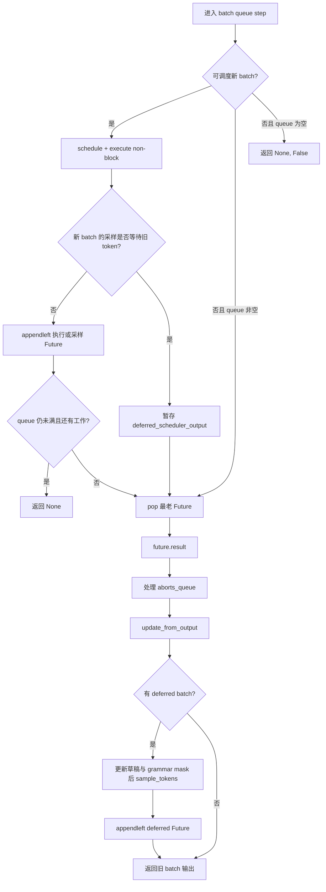

> **读图方法：** 这张图用于压缩“三条规则”的整体关系。先从上向下找到起点、关键转换和终点，再问每条跨层箭头是否意味着函数调用、消息传递、内存访问或状态更新。

### 3.11.2 容量为 2 的时间线

以下先看教学模型：同一请求有 3 份顺序工作，队列容量为 2。教学 executor 根据位置
生成固定 token，所以可以提前提交。真实自回归生成还依赖前一个采样 token；要得到
类似时间线，需要 async scheduling 的 placeholder 和 Worker 内部 token 回填配合。
仅有 batch queue，不保证同一请求能连续提前 decode；PP 场景还受调度节奏限制。

| 调用 | 新提交 | 调用后在途 | 本次结算 | 返回 |
|---|---|---|---|---|
| 1 | batch 1 | batch 1 | 无 | `None` |
| 2 | batch 2 | batch 2 | batch 1 | token 0 |
| 3 | batch 3 | batch 3 | batch 2 | token 1 |
| 4 | 无 | 空 | batch 3 | token 2 / finished |

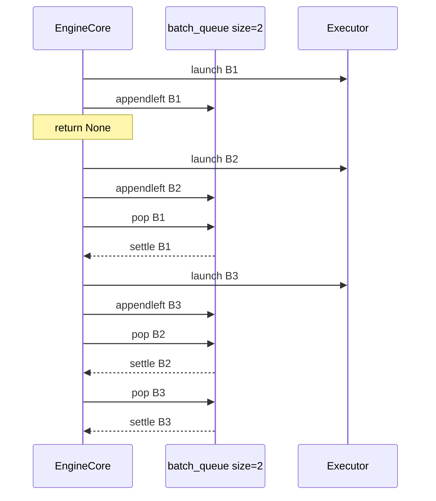

> **读图方法：** 这是“容量为 2 的时间线”的时序图。先从左到右确认参与者分别负责什么，再从上到下追踪消息；第一遍只看正常路径，第二遍再看返回、异步消息和失败分支。

`None` 与 `{}` 都不会产生待发送输出，但语义不同：`None` 主要表示 pipeline 填充；空
字典可能表示某个已结算步骤没有请求级输出。

### 3.11.3 structured output 的延迟 sampling

若新 batch 的 grammar bitmask 依赖前一轮刚产生的 token，就不能提前采样。实现暂存
`deferred_scheduler_output`，先结算旧结果，再计算 grammar mask、异步 sample，最后把
deferred batch 放回 queue。正确性依赖优先于最大化重叠。

## 3.12 Pause、Sleep 与 Resume

Pause 是 Scheduler 状态，不等于进程退出。

| mode | 已在途请求 | 新请求（`pause_generation`，用户暂停） | 新请求（`pause_scheduler`，如 sleep） | Core 侧完成边界 |
|---|---|---|---|---|
| `abort` | 标记 abort，结束输出入队 | 以可重试错误拒绝 | 入队但不调度 | Core 没有剩余工作，再同步设备 |
| `wait` | running 及持有 KV 的可恢复 waiting 请求继续 drain | 以可重试错误拒绝 | 未持有 KV 的新 waiting 请求暂停准入 | 可继续推进的请求与在途 batch 排空 |
| `keep` | 保留请求；KV 是否保留还看 `clear_cache` | 入队但不调度 | 入队但不调度 | 在途工作结算后同步设备 |

表中按普通非 DP 的 `EngineCoreProc` 路径解释。`_pause_complete()` 判断
`not has_work()`，`has_work()` 检查调度器、batch queue 和 engines_running；它没有直接
检查输出队列为空。RPC 回应还要经过输出线程，不能把 Core 的 Future 完成当作所有
客户端都已消费完终止消息。DP 另有跨 rank 的暂停协调。

`clear_cache=True` 时，`_finish_pause` 调用的 `_reset_caches` 默认会重置 running
请求：它们可能被抢占、释放 KV 并将其已计算 token 进度重置为零。要暂停后保留原 KV 继续计算，应明确
讨论 `keep` 配合 `clear_cache=False`；单看 `keep` 不能推断缓存一定保留。

[源码] `vllm/v1/engine/core.py` - `EngineCoreProc._pause_complete`、`has_work`、
`EngineCore._finish_pause`、`_reset_caches`、`DPEngineCoreProc._pause_complete`

基础 `EngineCore.pause_scheduler()` 不支持 in-process 的 `wait`；`EngineCoreProc` 覆盖该
方法，可返回 Future，在 engine idle callback 中同步设备并清 cache。

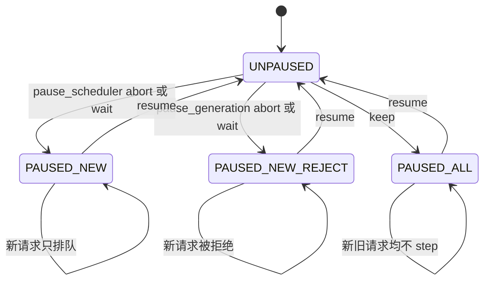

> **读图方法：** 这是“Pause、Sleep 与 Resume”的状态图。先找初始状态，再沿箭头观察触发条件和状态变化；重点不是背状态名，而是弄清谁触发转换、转换后哪些资源需要更新。`PAUSED_NEW_REJECT` 不是 Scheduler 的新枚举值，而是“`PAUSED_NEW` 加上 `EngineCoreProc.reject_new_requests=True`”的简称。

v0.33.0 同样不能只按 waiting/running 标签判断是否继续：`PAUSED_NEW` 还允许持有 KV 的
waiting 请求 drain，避免部分完成的请求占着资源而无法排空；真正尚未开始的新请求仍等待 resume。
具体资格由 Scheduler 判断：优先推进 `kv_holding_waiting`，只有该队列为空且 `UNPAUSED` 才取普通 `waiting`。
`get_num_unfinished_requests` 在 `PAUSED_NEW` 只统计持有 KV 的 waiting，并扣除等待后续流式输入者；
不能把“暂停前排队”简单等同于“持有 KV”。

[源码] `vllm/v1/core/sched/scheduler.py` - `Scheduler.schedule`、`get_num_unfinished_requests`

#### v0.33.0：用户暂停会拒绝新请求

`AsyncLLM.pause_generation()` 在 v0.33.0 不再调用 `pause_scheduler`，而是走新的 utility
`pause_generation`（#51488，提交 `d5b36699b`）。`EngineCoreProc.pause_generation()` 先执行
原来的 `pause_scheduler(mode, clear_cache)`，再设置 `reject_new_requests = (mode != "keep")`；
`resume_scheduler()` 把它复位为 `False`。sleep 等内部暂停仍然直接调用 `pause_scheduler`，
所以不改变“新请求入队”的旧行为。

```mermaid
sequenceDiagram
    participant U as 调用者
    participant A as AsyncLLM
    participant E as EngineCoreProc
    participant S as Scheduler
    U->>A: pause_generation(mode)
    A->>E: utility pause_generation
    E->>S: pause_scheduler(mode, clear_cache)
    E->>E: reject_new_requests = (mode 不是 keep)
    U->>A: generate(新请求)
    A->>E: ADD
    E->>E: _reject_add_while_paused
    E-->>A: EngineCoreOutput(ERROR, engine_paused, retryable)
    A-->>U: RetryableRequestError
    U->>A: resume_generation()
    E->>E: reject_new_requests = False
```

> **读图方法：** 从上到下读一次用户暂停。前半段设置两件事：调度器暂停与“拒绝新请求”开关；中间的 ADD 在 busy loop 处理输入时被拒绝；最后 resume 把开关复位。

拒绝发生在 `_handle_client_request()` 处理 ADD 的位置，`_reject_add_while_paused()` 有两个豁免：
`abort_immediately` 的请求（KV 清理标记）和 `scheduler.has_request(request_id)` 为真的请求
（已打开的 streaming session 的后续输入），它们都不算“新工作”。被拒绝的请求会收到
`EngineCoreOutput(finish_reason=ERROR, error=RequestError(code="engine_paused",
retryable=True))`；前端 `RequestError.to_exception()` 把可重试错误还原为
`RetryableRequestError`，其 `status_code` 为 `SERVICE_UNAVAILABLE`（503）。若被拒绝的请求带
`kv_transfer_params`，EngineCore 会把它标成 `abort_immediately` 再交给 Scheduler，让 KV
connector 释放为它保留的远端 block。前端对 `n>1` 请求的处理见 3.3.2。

因此上面模式表中 `abort` / `wait` 行的“入队但不调度 / 暂停准入”只描述 `pause_scheduler`
入口；用户暂停入口下的这两行是拒绝。状态图里的“新请求只排队”同理只属于 `PAUSED_NEW`。

[源码] `vllm/v1/engine/core.py` - `EngineCoreProc.pause_generation`、`resume_scheduler`、
`_reject_add_while_paused`

[源码] `vllm/v1/engine/async_llm.py` - `AsyncLLM.pause_generation`

[测试] `tests/v1/engine/test_engine_core.py` - `test_pause_generation_rejects_new_requests`

[源码] `vllm/v1/core/sched/scheduler.py` - `Scheduler.schedule`、`get_num_unfinished_requests`

`_finish_pause()` 先调用 executor collective RPC `synchronize_device`，再按需 reset cache。
否则调用者收到“pause 完成”时 GPU 仍可能访问即将释放的 KV。成功路径的上游测试固定顺序为：

```text
synchronize_device -> reset_caches -> Future complete
```

成功并非无条件：当前 `_reset_caches` 检查 `reset_prefix_cache` 的返回值，失败时抛出
`RuntimeError`，不会继续假装多模态与 encoder cache 全部清理成功。延迟完成的 pause
在 idle callback 中捕获 `_finish_pause` 异常并调用 `future.set_exception`，经 utility
RPC 把失败返回调用者；同步完成分支则直接传播异常。收到失败不能据此认为 pause
没有改变任何状态，更不能把失败当作“设备已安全清空”的确认。

[源码] `vllm/v1/engine/core.py` - `EngineCore._reset_caches`、
`EngineCoreProc.pause_scheduler`

Sleep 在 pause 之上增加设备内存管理：level 0 只暂停调度；level 1 offload 权重并丢弃
KV；level 2 不保留 sleep backend 管理的权重/KV 内容，Worker 会另存必要的模型
buffers。它不保证进程所有 GPU 占用降到零；源码日志仍会报告残余占用。wake up
只有在 executor 已不 sleeping 时才恢复
Scheduler，避免权重尚未驻留就调度请求。`wake_up` 现在返回 `fully_awake`，前端
据此更新 sleep 指标；一次部分唤醒不等于全部资源已恢复。

v0.33.0 还让 NIXL pull connector 支持 sleep（#59635）：唤醒时若 `tags` 为 `None` 或包含
`"kv_cache"`，EngineCore 会重新调用 `_set_kv_connector_handshake_metadata()`。该方法把各 worker
的握手元数据合并成 `{(pp_rank, tp_rank): metadata}` 交给 Scheduler 侧 connector；KV cache 重新
注册后元数据已变，不重发的话对端仍按旧地址拉取。

[源码] `vllm/v1/engine/core.py` - `EngineCore._set_kv_connector_handshake_metadata`、`wake_up`

[测试] `tests/v1/engine/test_engine_core.py` - `test_wake_up_republishes_kv_connector_handshake_metadata`

### 只释放 KV 物理内存的边界

`release_kv_cache_memory()` 与释放某个请求的 block 引用不同：它要求 pause 已完成、
Scheduler 无可推进工作、batch queue 已排空，而且 Executor 的内存当前全部驻留。
满足条件后先 `_reset_caches()`，再 `model_executor.discard(("kv_cache",))`，丢弃 KV
物理内存。`release_kv_cache_memory(reset_connector=True)` 的 `reset_connector` 参数和 `sleep` 一样，决定清缓存时是否连外部 KV connector 的缓存一起重置（默认为真，`core.py:1189`、`:1206`）。`keep` 保留的逻辑请求在唤醒后需重算，不能继续读取已丢弃的 KV。
这也不是一般的 `sleep(level=...)` 替代品：前置条件不满足就抛 `RuntimeError`，不会
替调用者自动等待 pause 完成。

[源码] `vllm/v1/engine/core.py` - `EngineCore.release_kv_cache_memory`、`wake_up`

## 3.13 Shutdown：立即 abort 与优雅 drain

EngineCoreProc 的状态为：

```text
RUNNING -> REQUESTED -> SHUTTING_DOWN
```

正常构造完成后，信号处理设置 REQUESTED，并通过 `SignalCallback` 唤醒 input queue；
不会直接在信号处理器中操作可能被中断线程持有的非重入 queue 锁。自 v0.32.0 起还记录
`shutdown_requested`：若 SIGTERM/SIGINT 在 EngineCore 构造期间到达，先保存标志，构造完成后
在进入 busy loop 之前转为 REQUESTED；callback 只在对象和队列已就绪后安装。
策略仍由 busy loop 的 `_handle_shutdown()` 执行，不能丢掉初始化窗口中的退出请求。
v0.33.0 在记录请求之前多一步：收到 `SIGTERM`（不含 SIGINT）时调用
`get_watch_dog().handle_failure(signal_name)`，看门狗启用时会先把所有线程栈写入转储文件，
便于事后判断退出时进程停在哪里（见 3.10.4）。

[源码] `vllm/v1/engine/core.py` - `EngineCoreProc.run_engine_core`

```mermaid
flowchart TD
    S[SIGTERM / SIGINT] --> R[REQUESTED]
    R --> W[WAKEUP input queue]
    W --> H[_handle_shutdown]
    H --> T{shutdown_timeout == 0?}
    T -- 是 --> A[abort 全部未完成请求<br/>发送 abort outputs]
    T -- 否 --> D[drain 已有请求]
    A --> SD[SHUTTING_DOWN]
    D --> SD
    SD --> Q{has_work?}
    Q -- 是 --> L[继续 busy loop]
    Q -- 否 --> X[SystemExit -> teardown]
```

> **读图方法：** 这张图用于压缩“Shutdown：立即 abort 与优雅 drain”的整体关系。先从上向下找到起点、关键转换和终点，再问每条跨层箭头是否意味着函数调用、消息传递、内存访问或状态更新。

进入非 RUNNING 状态后，新 ADD 被拒绝并返回 abort output；新 UTILITY 返回 “Server
shutting down” failure；已有 drain 请求继续推进。

`VllmConfig.shutdown_timeout` 描述请求 drain 宽限期。client/进程管理器的 shutdown
timeout 还负责等待进程和资源清理，两者不能混为一个 join timeout。

`EngineCore.shutdown()` 清理 structured output backend、executor、scheduler，撤销启动
时的 `gc.freeze()`，再清理 distributed environment 和显存缓存。MP client 侧还需停止
engine manager、关闭 socket、结束输出线程或 asyncio task。

### 多 Engine utility 结果不能只看一个 rank

v0.33.0 的 `AsyncMPClient.call_utility_all_async` 收集所有 managed engine 的结果。
`reset_prefix_cache_async` 与 `wake_up_async` 对结果取 all；`is_sleeping_async` 与
`is_scheduler_paused_async` 使用 consensus helper，结果不一致时抛错而不是任取一个状态。
这不表示所有 utility 都改成广播，仍应逐个查看方法调用的 helper。

[源码] `vllm/v1/engine/core_client.py` - `call_utility_all_async`、`call_utility_consensus_async`

## 3.14 Executor failure：请求错误与进程错误

请求输入不合法、多模态缓存漂移等可以转成单请求输出；Executor 整体失败可能破坏设备
或 worker 状态，不能假装只有一个请求失败。

```text
executor failure callback
-> input_queue.put(EXECUTOR_FAILED)
-> busy loop dispatch
-> raise RuntimeError("Executor failed.")
-> run_engine_core exception handler
-> output_queue ENGINE_CORE_DEAD
-> output socket thread sends sentinel
-> MPClient marks engine_dead
-> later operations raise EngineDeadError
```

```mermaid
sequenceDiagram
    participant W as Worker/Executor
    participant IQ as input_queue
    participant EC as EngineCoreProc
    participant OT as output thread
    participant C as MPClient
    W-->>IQ: EXECUTOR_FAILED
    IQ-->>EC: sentinel
    EC->>EC: raise fatal RuntimeError
    EC-->>OT: ENGINE_CORE_DEAD
    OT-->>C: dead sentinel
    C->>C: engine_dead = True
    C-->>C: raise EngineDeadError
```

> **读图方法：** 这是“Executor failure：请求错误与进程错误”的时序图。先从左到右确认参与者分别负责什么，再从上到下追踪消息；第一遍只看正常路径，第二遍再看返回、异步消息和失败分支。

MP client 另有 liveness monitor。若 EngineCore 未发送 sentinel 就意外退出，monitor 同样
标记 `engine_dead` 并清理。这是消息内故障和进程外故障的双保险。

## 3.15 Ray EngineCoreActor 改变了什么

`EngineCoreActor` 通过多重继承组合 `EngineCoreActorMixin + EngineCoreProc`，不是另一套
EngineCore 算法。

复用内容：EngineCore 初始化、Scheduler、Executor、step、batch queue、socket thread、
busy loop、pause、shutdown 和 utility dispatch。

替换内容：进程由 Ray actor 管理；地址在创建前已知，因此握手直接 yield；actor 按 Ray
分配尽早设置可见 GPU；`wait_for_init()` 通过 Ray method completion 表示初始化完成。

```mermaid
classDiagram
    class EngineCore {
      +step()
      +step_with_batch_queue()
      +shutdown()
    }
    class EngineCoreProc {
      +run_busy_loop()
      +process_input_sockets()
      +process_output_sockets()
    }
    class EngineCoreActorMixin {
      +_set_visible_devices()
      +_perform_handshakes()
      +run()
    }
    class EngineCoreActor
    EngineCore <|-- EngineCoreProc
    EngineCoreProc <|-- EngineCoreActor
    EngineCoreActorMixin <|-- EngineCoreActor
```

> **读图方法：** 这是“Ray EngineCoreActor 改变了什么”的类型关系图。先分清接口、实现和持有关系，再结合正文确认运行时真正实例化的是哪个类；类图说明结构，不等同于调用先后。

MP 与 Ray 的主要差异在部署和生命周期控制。阅读 Ray 路径时先找 mixin 覆盖的方法，再
回到 EngineCoreProc 看复用主链。

## 3.16 四条完整调用链

> **本节先看：** 本节要回答：**四条完整调用链**。下面的小节会逐层拆开概念、运行过程和源码落点；第一次阅读先抓对象之间的关系，第二次再记类名、字段和分支。

### 离线 in-process

> **本节先看：** 下面的代码或调用链只保留“离线 in-process”的主干。阅读时依次寻找输入、状态变化和输出，暂时忽略辅助分支。

```text
OfflineInferenceMixin._run_engine  [entrypoints/common/offline.py]
-> LLMEngine.step
-> InprocClient.get_output
-> EngineCore.step_fn
-> Scheduler.schedule
-> Executor.execute_model
-> 等待结果；若为 None，再 Executor.sample_tokens
-> Scheduler.update_from_output
-> OutputProcessor.process_outputs
```

同一调用线程主动推进，没有 core busy loop 和 ZMQ。

### 离线 multiprocess

> **本节先看：** 下面的代码或调用链只保留“离线 multiprocess”的主干。阅读时依次寻找输入、状态变化和输出，暂时忽略辅助分支。

```text
LLMEngine.step
-> SyncMPClient.get_output
-> local outputs_queue.get
<- SyncMPClient output thread
<- ZMQ PULL
<- EngineCoreProc output thread
<- output_queue
<- busy loop step
```

API 同步，但 core 在后台进程持续工作。

### 在线 async multiprocess

> **本节先看：** 下面的代码或调用链只保留“在线 async multiprocess”的主干。阅读时依次寻找输入、状态变化和输出，暂时忽略辅助分支。

```text
AsyncLLM.generate
-> AsyncMPClient.add_request_async
-> ZMQ
-> EngineCoreProc input thread
-> input_queue
-> busy loop step
-> output_queue
-> output thread
-> AsyncMPClient output task
-> AsyncLLM output handler
-> per-request collector
-> generate yields RequestOutput
```

### Utility call

> **本节先看：** 下面的代码或调用链只保留“Utility call”的主干。阅读时依次寻找输入、状态变化和输出，暂时忽略辅助分支。

```text
frontend method
-> client call_utility[_async]
-> UTILITY(call_id, method, args)
-> EngineCoreProc invoke
-> UtilityOutput
-> client resolves Future
-> caller resumes
```

## 3.17 调试方法

> **本节先看：** 本节要回答：**调试方法**。下面的小节会逐层拆开概念、运行过程和源码落点；第一次阅读先抓对象之间的关系，第二次再记类名、字段和分支。

### 请求提交后没有输出

按顺序检查：OutputProcessor 是否先注册请求；client 是否发送 ADD；input thread 是否
解码并入队；Scheduler 是否有请求且未 pause；batch queue 是否只在填充阶段返回
`None`；output thread 和前端 output task 是否存活。

### CPU 高但 GPU 没工作

检查 `model_executed` 是否持续为 false、Scheduler 是否等待 remote KV、busy loop 是否
给后台 transfer thread 让出 GIL，以及 pause/DP wave 是否让 `has_work()` 为真却没有
token batch。

### 服务卡在启动

区分三类等待：HELLO/READY 握手；模型加载、KV profile、compile/warmup；MP client 等待
各 engine identity 的 ready response。`VLLM_ENGINE_READY_TIMEOUT_S` 是秒，传给 ZMQ
poll 时换成毫秒。不要用无限增大 timeout 掩盖 EngineCore 已死亡。

### 关闭时状态异常

同时记录 `shutdown_timeout`、core state、新 ADD 是否被拒绝、batch queue 是否仍有
Future、output queue 是否发完 abort/final outputs。

## 3.18 可运行教学实验

教学模型位于
[`examples/ch03_engine_core_loop.py`](../../examples/ch03_engine_core_loop.py)，只依赖 Python
标准库。它实现 client 选择、Future executor、普通 step、FIFO batch queue、abort
时序、pause/resume、queue-facing EngineCoreProc、shutdown 与 executor failure。

运行：

```bash
python3 examples/ch03_engine_core_loop.py
python3 -m unittest tests/test_ch03_engine_core_loop.py
```

预期核心输出：

```text
tick=0 launched=True queue=1 outputs=None
tick=1 launched=True queue=1 outputs=(... token_ids=(100,) ...)
tick=2 launched=True queue=1 outputs=(... token_ids=(101,) ...)
tick=3 launched=False queue=0 outputs=(... token_ids=(102,), finish_reason='length')
```

第一轮只提交；第二、三轮提交新 batch 并结算旧 batch；第四轮只排空队列。

| 教学不变量 | 对应上游行为 |
|---|---|
| async + no multiprocessing 被拒绝 | client factory |
| 普通 step 同轮等待 Future | `EngineCore.step` |
| abort 在 update 前处理 | `_process_aborts_queue` 位置 |
| batch queue 先填后排、FIFO | `appendleft` + `pop` |
| keep pause 冻结调度 | `PauseState.PAUSED_ALL` |
| executor failure 为 fatal | `EXECUTOR_FAILED` dispatch |
| 零秒 shutdown abort 请求 | `_handle_shutdown` |

教学模型没有单独区分暂停前的 waiting 与 running，且 token 由位置直接生成，因此
不能用于证明真实 pause 准入规则或自回归 token 的数据依赖。

模型没有模拟真实 token budget、KV block、structured output、spec decode、ZMQ 序列化、
GPU stream 和分布式 collective，所以只验证控制流解释，不验证性能。

## 3.19 推荐源码阅读路线

> **本节先看：** 下面先给出“推荐源码阅读路线”的结论清单。先理解每一项为什么存在，再记参数名或实现细节。

1. `LLMEngine.__init__` 和 `LLMEngine.step`。
2. `AsyncLLM.__init__`、`generate`、`_run_output_handler`。
3. `EngineCoreClient.make_client`。
4. 三种 client 的 get/add/output 方法。
5. `EngineCore.__init__` 与 `_initialize_kv_caches`。
6. `EngineCore.step`，再读 `step_with_batch_queue`。
7. `run_busy_loop`、`_process_input_queue`、`_process_engine_step`。
8. 两个 socket thread。
9. shutdown、pause、engine dead。
10. 最后读 Actor mixin，只标覆盖点。

每读一个方法，记录四项：运行线程/进程、输入类型、输出类型、修改的持久状态。这样可以
快速区分“只是传输”“真正推进状态”和“只做资源操作”的代码。

## 3.20 常见误解与修正

> **本节先看：** 下面先给出“常见误解与修正”的结论清单。先理解每一项为什么存在，再记参数名或实现细节。

1. **`LLMEngine` 是旧内核。** Legacy 只指兼容同步门面，内部仍连接 V1 EngineCore。
2. **AsyncLLM 自己运行 step loop。** 在线主循环在 EngineCoreProc；AsyncLLM 主要接收和
   分发输出。
3. **`non_block=True` 后 step 立即返回。** 普通 step 随后调用 `future.result()`。
4. **input thread 直接操作 Scheduler。** 它做 IO、解码和预处理，主状态由 core main
   thread 修改。
5. **batch queue 是用户请求队列。** 它保存已 schedule、已提交的 batch Future。
6. **pause 就是 shutdown。** pause 可保留模型、排队新请求并 resume；shutdown 不可逆。
7. **所有错误都变成 EngineDeadError。** 请求错误可局部返回；致命 core/executor 错误才
   标记 engine dead。
8. **Ray Actor 重写 EngineCore。** Actor 主要替换部署、GPU 可见性和握手。

## 3.21 本章小结

Engine 前端与 EngineCore 分离，使 vLLM 可以在不改变 Scheduler 核心算法的前提下支持
同步离线、异步在线、in-process 调试、多进程隔离、DP client 和 Ray 部署。

普通 step 的关键顺序是：

```text
schedule
-> execute non-block shaped call
-> wait/sample
-> process racing aborts
-> update scheduler
-> emit EngineCoreOutputs
```

EngineCoreProc 在外部增加 input socket thread、core busy loop 和 output socket thread。
batch queue 再把提交与结算分开，使多个 batch 能同时在途。

下一章进入 Scheduler 内部，回答每个 step 选择哪些请求、分配多少 token，以及
continuous batching 为什么自然地从 token 级调度产生。

## 3.22 自检问题

第一遍先完成前 5 题；余下题目是第二遍源码阅读的扩展题库，不要求一次做完。

> **本节先看：** 建议先不看答案，用自己的话回答下面的问题。能够解释原因、画出数据流并指出源码位置，才算真正理解。

1. 为什么 `LLMEngine` 被称为 Legacy，却仍属于 V1 路径？
2. `EngineArgs.create_engine_config()` 为什么不能只做字段拷贝？
3. 哪种 client 组合当前不支持？
4. `InprocClient.get_output()` 与 `SyncMPClient.get_output()` 分别在等什么？
5. EngineCore 为什么先创建 Executor，再创建 Scheduler？
6. `non_block=True` 为什么不代表普通 step 不阻塞？
7. ABORT 为什么同时进入 input queue 和 aborts queue？
8. `model_executed` 与“返回用户 token”有什么区别？
9. batch queue 为什么用 `appendleft()` 和 `pop()`？
10. `wait` 与 `keep` pause 的关键差异是什么？
11. shutdown timeout 为 0 时如何处理未完成请求？
12. request-scoped error 与 fatal error 如何传播？
13. Ray Actor 为什么可复用 EngineCoreProc 的 busy loop？

## 3.23 源码追踪题

> **本节先看：** 这些题目要求把概念重新落到代码。先从给出的入口搜索定义和调用点，再记录对象、状态与边界，不要只找到同名符号。

1. 从 `LLMEngine.from_engine_args()` 追到 VllmConfig 和 executor class。
2. 找到 `VllmConfig.max_concurrent_batches` 的 PP 与 async scheduling 规则。
3. 列出 client 工厂四种组合并解释不支持的一种。
4. 在 KV 初始化中标出 profile、config、worker init、warmup。
5. 找到普通 step 处理 abort 的位置，与 final-step abort 测试对照。
6. 在 batch queue 路径证明 FIFO。
7. 从 ZMQ ABORT frame 追到 Scheduler `finish_requests()`。
8. 从 executor failure callback 追到 `EngineDeadError`。
9. 找到 pause 完成前同步设备的测试。
10. 对比普通握手与 Actor 的 `_perform_handshakes()`。

## 3.24 参考答案

<details>
<summary>1. Legacy 的含义</summary>

Legacy 指兼容旧式同步 API。该类创建 V1 InputProcessor、OutputProcessor 和
EngineCoreClient，内核仍是 V1 EngineCore。
</details>

<details>
<summary>2. 配置为什么不是字段拷贝</summary>

模型元数据、硬件、usage context 和功能组合会改变默认值与合法性；构造还要做跨配置
校验。KV 容量等字段甚至要在 EngineCore 启动后回写。
</details>

<details>
<summary>3. 不支持的 client 组合</summary>

`asyncio_mode=True` 且 `multiprocess_mode=False`。
</details>

<details>
<summary>4. 两个 get_output</summary>

InprocClient 直接调用 EngineCore step 并等待 executor Future；SyncMPClient 等本地输出
线程从 ZMQ 收到并放入 queue 的 EngineCoreOutputs。
</details>

<details>
<summary>5. 初始化顺序</summary>

Executor/Worker 提供真实 KV spec，并在加载后 profile 可用显存。Scheduler 构造需要最终
KVCacheConfig 和 block size。
</details>

<details>
<summary>6. non_block 边界</summary>

executor 返回 Future，但普通 step 紧接着 `future.result()`。它不保证调用者立即返回。
</details>

<details>
<summary>7. Abort 双队列</summary>

aborts queue 让取消在 GPU 返回后、Scheduler update 前生效；input queue 保持与 ADD 的
顺序。Scheduler abort 幂等。
</details>

<details>
<summary>8. model_executed</summary>

它表示本轮是否调度正数 token。控制面可变化但没有模型执行；模型执行也不一定立刻产生
用户文本。
</details>

<details>
<summary>9. Batch queue FIFO</summary>

新 Future `appendleft()`，结算 `pop()`，因此从右侧取出最老元素。
</details>

<details>
<summary>10. wait 与 keep</summary>

wait 暂停新工作准入，但允许 running 和持有 KV 的 waiting 请求 drain；纯新 waiting 请求等待 resume。
keep 暂停后续调度，已提交工作仍需结算；若还指定清缓存，
running 请求会被重置，不能再假定它们持有原 KV。
</details>

<details>
<summary>11. 零秒 shutdown</summary>

全部未完成请求标记 `FINISHED_ABORTED`，发送 abort outputs，进入 SHUTTING_DOWN，等
`has_work()` 为 false 后退出。
</details>

<details>
<summary>12. 两类错误</summary>

请求预处理错误可生成对应 client 的 error output；executor failure 触发致命哨兵和
ENGINE_CORE_DEAD，client 后续抛 EngineDeadError。
</details>

<details>
<summary>13. Actor 复用</summary>

Actor mixin 提供 Ray 生命周期、可见 GPU 和免握手覆盖；EngineCoreProc 已封装主循环和
传输线程，因此可以继承复用。
</details>

## 3.25 源码与资料索引

> **本节先看：** 下面按主题整理本章使用的证据入口。需要复核结论时，优先按路径和符号定位，不依赖可能漂移的行号。

- `vllm/engine/arg_utils.py`：`EngineArgs.create_engine_config`
- `vllm/config/vllm.py`：`VllmConfig.__post_init__`、`max_concurrent_batches`
- `vllm/v1/engine/llm_engine.py`：`LLMEngine.__init__`、`step`
- `vllm/v1/engine/async_llm.py`：`AsyncLLM.__init__`、`generate`、
  `_run_output_handler`、`abort`
- `vllm/v1/engine/core_client.py`：client factory、`InprocClient`、`MPClient`、
  `SyncMPClient`、`AsyncMPClient`、liveness monitor
- `vllm/v1/engine/core.py`：EngineCore 初始化、KV 初始化、两种 step、abort queue、
  busy loop、socket threads、pause、shutdown、Actor
- `vllm/v1/engine/__init__.py`：request/output/message/ready 类型
- `tests/v1/engine/test_engine_core.py`：batch queue 与 pause 顺序
- `tests/v1/engine/test_engine_core_client.py`：ready timeout 与 client 生命周期
- `tests/v1/engine/test_abort_final_step.py`：final-step abort
- `tests/v1/engine/test_startup_watch_processes.py`：进程 shutdown 与清理
- [本项目第 3 章教学模型](../../examples/ch03_engine_core_loop.py)
- [本项目第 3 章测试](../../tests/test_ch03_engine_core_loop.py)
- [第 3 章实验记录](../../experiments/ch03-engine-core-loop.md)

## 完成状态

> **本节先看：** 这里区分正文完成、静态源码核对和真实 GPU 运行验证。没有执行过的实验不会因为正文完整就被标记为已验证。

- [x] 解释 Engine 前端、client、EngineCore 与 EngineCoreProc 边界。
- [x] 追踪 `EngineArgs -> VllmConfig -> Executor/EngineCore` 初始化链。
- [x] 覆盖 Inproc、同步 MP、异步 MP 与 DP client 分支。
- [x] 逐阶段解释普通 step 和 batch queue step。
- [x] 画出 input thread、busy loop、output thread 和 ZMQ 拓扑。
- [x] 覆盖 abort、pause、sleep、shutdown 与 executor failure。
- [x] 解释 Ray EngineCoreActor 的复用边界。
- [x] 提供标准库教学模型、7 个单元测试和实验记录。
- [ ] 在真实 NVIDIA GPU 上采集 Future、CUDA stream 与 batch queue 时间线。
- [ ] 启动真实在线服务验证信号、ZMQ 和 EngineDeadError 传播。

本章正文已经完整，`content_complete=true`。当前机器缺少可用 vLLM GPU runtime，
因此 `runtime_verified=false`，按项目规则保持 `draft`。

