# 第04章 Scheduler 与 Continuous Batching

> 面对不同时间到达、不同 prompt 长度和不同输出长度的请求，当前 step 到底应该算谁？

## 本章定位

第 03 章看到 `EngineCore.step()` 反复执行：

```text
schedule -> execute_model -> update_from_output
```

本章进入第一个动作 `schedule()`。Scheduler 不执行 Transformer，也不直接管理 GPU
tensor；它根据请求进度、计算预算、KV 容量和调度策略，生成下一轮 Model Runner 应执行
的工作描述。

Continuous Batching 不是源码中的一个独立 `ContinuousBatching` 类。它是以下行为共同产生
的系统效果：

1. 请求可以在任意 engine step 之间进入 waiting queue；
2. Scheduler 每轮重新选择请求，而不是固定一个 batch 一直跑到底；
3. 已完成请求及时退出并释放容量；
4. 新请求可以填补空出的 sequence slot 和 token budget；
5. 长 prefill 可以切成多个 chunk，与 decode 工作共享一轮计算。

本章绑定源码 revision `05caae03c20f69436ff7ec23ded339ea104f1a01`（vLLM `main`，提交日期 2026-11-09；正文最初按 v0.33.0 `4ba787ec` 写成，2026-11-10 重新钉扎到此 revision：源码引用与行号已逐条核对，Model Runner V1 删除已重新绑定；其余行为未在 05caae03 上全面重核，清单见 `meta/upgrade-main-05caae03-2026-11-10/`）。文中继续区分：

- **源码事实**：固定 revision 的实现或测试可直接证明。
- **设计含义**：由多个源码事实推导出的系统解释。
- **教学模型**：随书最小实现，只保留核心状态机，不等价于完整 vLLM。

## 阅读目标

读完本章后，你应该能够：

1. 解释 static batching 为什么产生 head-of-line blocking 和 GPU 空洞。
2. 说明 continuous batching 为什么是逐 step 重组工作，而不是动态拼 tensor 的别名。
3. 区分 waiting、running、preempted、blocked 和 finished 状态。
4. 用 `num_computed_tokens` 与 `num_tokens_with_spec` 推导当前请求的工作量。
5. 区分 `max_num_scheduled_tokens`、`max_num_batched_tokens`、`max_num_seqs`、
   `max_model_len` 和 KV 容量。
6. 逐段解释 running-first、waiting-second 两个调度循环。
7. 说明 chunked prefill 如何降低短请求被长 prompt 阻塞的时间。
8. 解释 KV 不足时怎样选 victim、回收预算、重置进度并恢复请求。
9. 读懂 `SchedulerOutput` 如何把调度决策交给 Model Runner。
10. 解释 schedule 的乐观计数与 update 的回滚、完成和延迟释放。

## 如何阅读本章

Scheduler 可以先理解为一个受多种预算约束的工单调度员：请求很多，但每轮只有有限的
token 预算、序列名额和 KV block。它不是预测模型，也不是简单地从队列头取固定数量的
请求，而是在每个 step 重新分配稀缺资源。

本章公式优先按“账本”来读。`num_computed_tokens` 是已记账的计算进度，可能含已提交
但 GPU 尚未完成的工作；目标 token 数是
当前希望推进到的位置，两者之差就是待安排工作。先用几个整数手算，再看 chunked
prefill、speculative decoding 和 async scheduling 如何复用同一套差额模型。

第一次阅读抓住 waiting、running、preempted 三种状态和一次 `schedule()` 的主路径；
第二次再看 priority、encoder budget、remote KV 和 fence。调参前必须先明确优化的是
TTFT、TPOT、吞吐还是公平性，因为同一个参数不可能同时把所有指标都推向更好。

**先把预算换成数字。** token budget 是本轮计算位置的额度，sequence slot 是请求名额；
例如 3 个请求各算 1 个 token，占 3 个名额与 3 个 token 额度，和一个请求算 3 个 token
不同。TTFT 是首个输出的等待时间，TPOT 是首 token 后每输出 token 的平均时间。

**第一遍走法：** 读 4.1–4.11，运行 4.23，再看 4.13 的抢占；remote KV、Mamba、LoRA、
fence 是第二遍的扩展。**停下来算：** prompt=4、已接受输出=1、computed=4、无草稿，
差额为多少？是 1 个待计算位置，不是再计算全部 5 个 token。

## 4.1 Static Batch 的基本问题

先忽略 vLLM，考虑最直观的服务实现：收集一组请求，组成固定 batch，直到这一组请求都
生成完毕，才接收下一组。

假设 A、B、C 同时开始：

| 请求 | prompt | 生成长度 | 特点 |
|---|---:|---:|---|
| A | 8 | 2 | 很快结束 |
| B | 8 | 8 | 中等 |
| C | 8 | 20 | 很慢 |

固定 batch 在 A 结束后仍保留一个空位置，在 B 结束后又多一个空位置。新到达的 D、E
即使很短，也必须等待 C 完成。

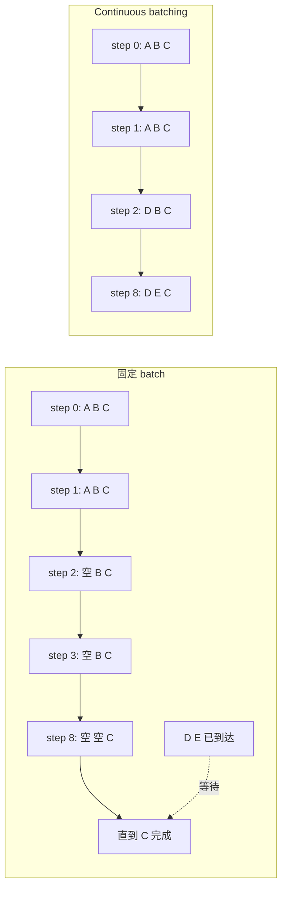

> **读图方法：** 阅读“Static Batch 的基本问题”这张流程图时，先把方框看成对象或状态，把箭头看成数据或控制的移动。第一遍从左向右建立顺序，第二遍再核对分支发生的条件。

图中只统计输出轮次，省略 prefill，并假设 A 在第 2 轮前结束、B 在第 8 轮前结束，
D 在第 8 轮仍运行；中间省略的轮次没有画出。

固定 batch 的问题不只是“吞吐少一点”：

- **空槽浪费**：结束得早的 sequence 不再贡献计算，却占据 batch 生命周期。
- **队首阻塞**：一个长输出拖住整批之后的请求。
- **TTFT 变差**：新请求的 first token 必须等待旧批次全部完成。
- **长度异质性惩罚**：生产请求长度差异越大，浪费越明显。

把序列 padding 到相同长度只能让 tensor 形状合法，不能消除上述生命周期问题。

### 生活化直觉：观光大巴 vs 动态电梯

如果觉得批处理模式抽象，可以用日常交通工具建立直观对比：

- **静态批处理（Static Batching / 观光大巴模式）**：假设本例一次接待固定的一批 50 名游客。如果车上有 1 位游客要去很远的山顶（生成 2000 个 token 的长请求），而另外 49 位游客只是在门口拍照（生成 5 个 token 的短请求），那 49 位结束后留下的名额，也不能在这一批结束前用于接待后来者；整批要等最后一位完成，才能接下一批人。空座极度浪费，后来者只能在景区门口排长队（队头阻塞）。
- **动态批处理（Continuous Batching / 动态电梯模式）**：电梯在每一层楼（每个 step）停靠时，门一打开，只要有乘客到了目的地（请求 finished），立刻走出电梯释放空间；如果电梯还有承重与名额余量（token 预算与 sequence slot），门外等候的新乘客（waiting 队列）立刻步入电梯并与里面的老乘客一起继续运行。这能减少固定批次留下的空槽，但不保证满载：还可能没有新请求，或受 KV、token 预算、通信和 CPU 准备限制。

## 4.2 Continuous Batching 的本质

Continuous Batching 通常被译为“连续批处理”或“动态批处理”。在系统实现层面上，它更准确的本质是“逐 step 连续重组批次”：每个 engine step 都允许批次成员与工作量动态变化。

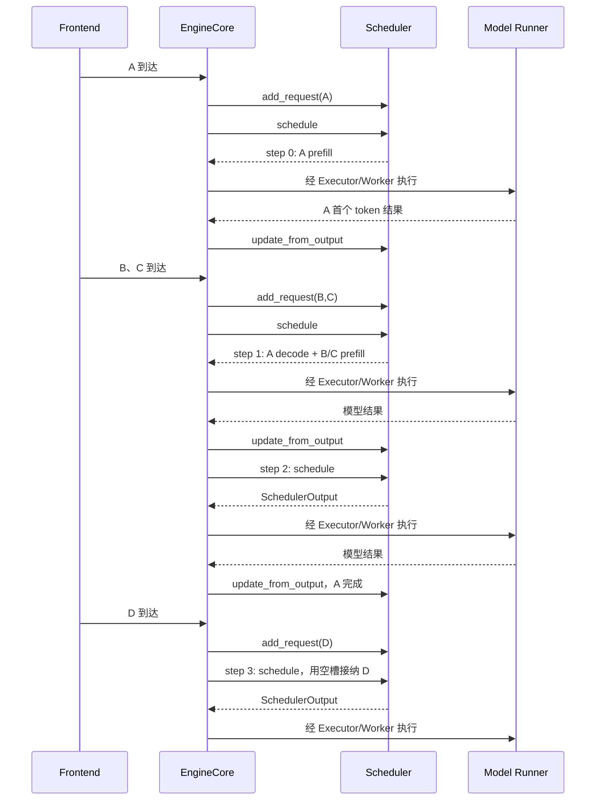

> **读图方法：** 这是“Continuous Batching 的本质”的时序图。先从左到右确认参与者分别负责什么，再从上到下追踪消息；第一遍只看正常路径，第二遍再看返回、异步消息和失败分支。

这里有三个层次不要混淆：

| 层次 | 含义 |
|---|---|
| 请求集合 | 哪些请求处于 waiting、running、finished |
| step 工作集合 | 本轮真正获得正数 token 的请求 |
| GPU batch | Model Runner 把 step 工作整理成设备输入后的执行形态 |

`running` 不等于“本轮一定执行”。源码允许某个 RUNNING 请求因 encoder budget、PP
cadence、Mamba 对齐或其他约束在本轮获得 0 token，而较后的请求继续执行。因此：

```text
scheduled requests <= running requests
```

Continuous Batching 描述的是跨 step 的成员变化；真正的 tensor 布局属于第 07 章。

## 4.3 Scheduler 在系统中的位置

Scheduler 位于协议前端和 GPU 执行之间。它接收已经 tokenized、参数已规范化的
`Request`，输出 `SchedulerOutput`。

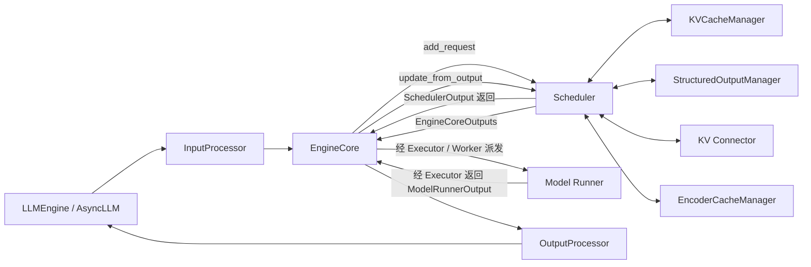

> **读图方法：** 这是“Scheduler 在系统中的位置”的流程图。先从左向右只追一条主路径，确认输入经过哪些关键阶段到达输出；第二遍再看虚线、回边和旁路，它们通常表示反馈、复用或可选分支。

Scheduler 的职责包括：

- 维护请求状态与 waiting/running 容器；
- 计算本轮每个请求的 token 数；
- 请求 KV block 分配、命中已有 prefix 或发起远端 KV 加载；
- 在容量不足时抢占 running 请求；
- 输出新请求全量数据和旧请求增量数据；
- 接收模型输出，追加 token、判断 stop、释放资源。

它不负责 tokenizer、chat template、Transformer kernel、HTTP streaming、文本
detokenize 和 PagedAttention 的物理寻址实现。

## 4.4 Request 的状态与计数

> **本节先看：** 本节要回答：**Request 的状态与计数**。下面的小节会逐层拆开概念、运行过程和源码落点；第一次阅读先抓对象之间的关系，第二次再记类名、字段和分支。

### 4.4.1 状态并不只有 waiting/running/finished

当前 `RequestStatus` 的非完成状态包括：

| 状态 | 含义 |
|---|---|
| `WAITING` | 尚未首次进入 Model Runner |
| `WAITING_FOR_STRUCTURED_OUTPUT_GRAMMAR` | 等待 grammar 准备完成 |
| `WAITING_FOR_REMOTE_KVS` | 已发起异步 KV 加载，尚不能 forward |
| `WAITING_FOR_STREAMING_REQ` | 可恢复的流式会话等待后续输入 |
| `RUNNING` | 已进入运行集合并持有执行侧状态 |
| `PREEMPTED` | 被抢占后回到等待队列，之后需要恢复 |

枚举中 `PREEMPTED` 之后的状态都被视为 finished，包括正常停止（stopped）、达到最大长度（length capped）、客户端中止（aborted）、忽略未处理（ignored）、运行异常（error）以及重复生成触发停止（repetition，对应 `FINISHED_REPETITION`）。

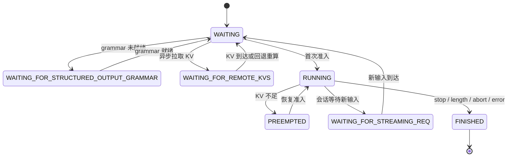

> **读图方法：** 这是“状态并不只有 waiting/running/finished”的状态图。先找初始状态，再沿箭头观察触发条件和状态变化；重点不是背状态名，而是弄清谁触发转换、转换后哪些资源需要更新。

图中把多个 finished 枚举合并为一个终态；真实源码保留具体 finish reason。

### 4.4.2 决策依赖的是一组计数

`Request` 中与本章最相关的字段是：

| 字段 | 回答的问题 |
|---|---|
| `num_prompt_tokens` | prompt 有多少 token |
| `_output_token_ids` | 已经接受了哪些输出 token |
| `spec_token_ids` | 本轮可验证的 draft token |
| `num_computed_tokens` | 已被 Scheduler 视为算到哪个位置 |
| `num_output_placeholders` | 异步调度预留了多少尚未回传的输出位置 |
| `num_in_flight_tokens` | 有多少已提交 token 尚未 update |
| `num_stale_output_tokens` | 抢占后仍在途、需要特殊处理的旧结果 |
| `is_prefill_chunk` | 乐观推进后是否仍未追上当前 token 序列 |
| `num_preemptions` | 被抢占次数 |
| `priority`、`arrival_time` | priority queue 的排序键 |

不要把 `num_computed_tokens` 理解成“已向用户返回的 token 数”。它是调度器对模型计算
位置的记账，可以包含已提交但尚未收到结果的工作。

## 4.5 V1 的统一 Token 差额模型

本节所有 `N` 都是以 token 为单位的整数计数，不是张量或耗时；下标分别标明 prompt、
已接受输出、草稿、预留位置和记账进度。“差额”是还需要安排多少个位置的计算，
之后还要经过预算裁剪，不能直接当作本轮输出 token 数。

Scheduler 源码在 `schedule()` 开头明确说明：调度器内部没有必须二选一的全局
“prefill phase”或“decode phase”。每个请求只有当前目标和已计算进度。

$$
N_{\mathrm{target}}
= N_{\mathrm{prompt}} + N_{\mathrm{out}} + N_{\mathrm{spec}}
$$

**白话：**请求这一步“最多要算到第几个位置”，等于它已经有的 token（prompt 加已确认的输出）再加上等着被验证的 draft token。

**其中：**$N_{\mathrm{prompt}}$ 是 prompt token 数，$N_{\mathrm{out}}$ 是已确认的输出 token 数，$N_{\mathrm{spec}}$ 是挂在请求上、本步等待验证的 draft token 数，单位都是 token。
$N_{\mathrm{target}}$ 是教学符号，对应 `request.num_tokens_with_spec`。源码实际返回
`len(request._all_token_ids) + len(request.spec_token_ids)`；在本章的普通文本生成路径中，
前一项由 prompt 和已接受输出组成。不能把 `prompt_token_ids` 一定非空当作所有输入模式的契约。

**怎么算出来：**

1. 请求的 token 序列 `_all_token_ids` 先放 prompt，之后每确认一个输出 token 就追加一个，所以它的长度是 $N_{\mathrm{tokens}}=N_{\mathrm{prompt}}+N_{\mathrm{out}}$（`Request.num_tokens`）；
2. draft token 还没被确认，不在 `_all_token_ids` 里，单独放在 `spec_token_ids`；把它们的个数 $N_{\mathrm{spec}}$ 加上去，就得到“已知位置加待验证位置”：$N_{\mathrm{target}}=N_{\mathrm{tokens}}+N_{\mathrm{spec}}$。

代入 $N_{\mathrm{prompt}}=4$、$N_{\mathrm{out}}=1$（已确认的 `x1`）、$N_{\mathrm{spec}}=2$：$N_{\mathrm{tokens}}=4+1=5$，$N_{\mathrm{target}}=5+2=7$ token。
没有 draft（$N_{\mathrm{spec}}=0$）时 $N_{\mathrm{target}}=5$，就是 4.5.1 里的 `target = 5`。单位检查：三项都是 token 数，相加仍是 token 数。

**核对：**`vllm/v1/request.py:333-338`（`Request.num_tokens`、`Request.num_tokens_with_spec`）@ `05caae03`；教学实现 `examples/ch04_continuous_batching.py` 的 `Request.num_tokens`（prompt 加已生成输出，不含 draft）。

[源码] `vllm/v1/request.py` - `Request.num_tokens_with_spec`、`Request.num_tokens`

忽略异步 placeholder 时，本轮需要追赶的差额为：

$$
N_{\mathrm{new}} = N_{\mathrm{target}} - N_{\mathrm{computed}}
$$

**白话：**目标位置减去已经算到的位置，差多少，就是还要安排多少个位置的计算。

**其中：**$N_{\mathrm{computed}}$ 是 `num_computed_tokens`，Scheduler 已记账的计算进度（可以包含已提交、还没返回结果的工作，见 4.18）；
$N_{\mathrm{new}}$ 是预算裁剪之前的差额，对应 `num_new_tokens` 的初值，单位 token。

**怎么算出来：**位置从 0 开始编号。已经记账的是位置 $0,\dots,N_{\mathrm{computed}}-1$，这一步要算到的是位置 $N_{\mathrm{computed}},\dots,N_{\mathrm{target}}-1$；
这个区间里的整数个数是 $N_{\mathrm{target}}-N_{\mathrm{computed}}$，每个位置需要一次 forward 的计算量，所以差额就是 token 数。

- 刚到的 prompt：$N_{\mathrm{target}}=4$，$N_{\mathrm{computed}}=0$，$N_{\mathrm{new}}=4-0=4$；
- 采样出第一个输出 token 之后：$N_{\mathrm{target}}=5$，$N_{\mathrm{computed}}=4$，$N_{\mathrm{new}}=5-4=1$；
- 同时挂着 2 个 draft：$N_{\mathrm{target}}=7$，$N_{\mathrm{computed}}=4$，$N_{\mathrm{new}}=7-4=3$（`x1` 的位置加 2 个待验证位置）。

4.5.1 里的 `deficit` 就是这里的 $N_{\mathrm{new}}$。

**核对：**`vllm/v1/core/sched/scheduler.py:800-804`（running 路径）、`:1301`（waiting 路径 `request.num_tokens - num_computed_tokens`）@ `05caae03`；教学实现 `examples/ch04_continuous_batching.py:55-60` 的 `deficit`。

源码中的 running 路径还会加入 `num_output_placeholders`：

$$
\begin{aligned}
N_{\mathrm{new}}={}&N_{\mathrm{target}}+N_{\mathrm{placeholders}}\\
&-N_{\mathrm{computed}}.
\end{aligned}
$$

**白话：**async 调度下，上一步采样出的 token 还没回传，计算进度却已经往前记了账；placeholder 数就是这些“已记账、还没落进 token 序列”的位置，加回去才不会少算。

**其中：**$N_{\mathrm{target}}$ 同上（`num_tokens_with_spec`）；$N_{\mathrm{placeholders}}$ 是 `num_output_placeholders`，异步调度为尚未回传的输出位置预留的个数；其余同上，单位 token。

**怎么算出来：**`_update_after_schedule` 在调度之后立刻把 $N_{\mathrm{computed}}$ 加上本步调度的 token 数（4.18），`AsyncScheduler` 同时把 $N_{\mathrm{placeholders}}$ 加上本步将要采样的 token 数（一个采样 token 加 draft 个数）。
这些输出 token 要等 `update_from_output` 才会追加到序列，所以回传之前，取自序列的 $N_{\mathrm{target}}$ 比 $N_{\mathrm{computed}}$ 少算了它们；加上 $N_{\mathrm{placeholders}}$ 补回，就是下一步真正还要算的位置数。

算例（async，无 draft，prompt 为 4）：

1. 第一步调度 4 个 prompt token：$N_{\mathrm{computed}}$ 从 0 变 4；最后一个位置要采样第一个输出 token，所以 $N_{\mathrm{placeholders}}$ 从 0 变 1（序列里仍只有 4 个 token，$N_{\mathrm{tokens}}=4$）；
2. 结果还没回来，下一步就可以调度：$N_{\mathrm{new}}=4+1-4=1$（`x1` 所在的位置）；调度后 $N_{\mathrm{computed}}=5$，$N_{\mathrm{placeholders}}=2$；
3. 第一步的结果回来，追加 `x1`，$N_{\mathrm{tokens}}=5$，$N_{\mathrm{placeholders}}=2-1=1$；再下一步 $N_{\mathrm{new}}=5+1-5=1$。

同步调度下 $N_{\mathrm{placeholders}}$ 恒为 0，公式退化成上一条。

**核对：**`scheduler.py:800-804`（`num_tokens_with_spec + num_output_placeholders - num_computed_tokens`）、`async_scheduler.py:45`（`num_output_placeholders +=`）、`scheduler.py:2823-2826`（回传后扣减）@ `05caae03`。

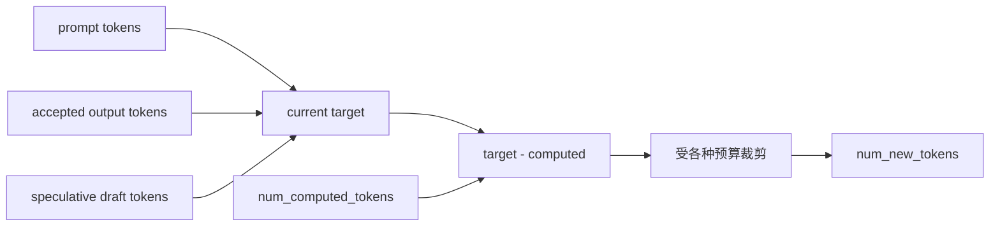

> **读图方法：** 这张图用于压缩“V1 的统一 Token 差额模型”的整体关系。先从左向右找到起点、关键转换和终点，再问每条跨层箭头是否意味着函数调用、消息传递、内存访问或状态更新。

### 4.5.1 一个最小例子

请求 prompt 长度为 4，尚无输出：

```text
target = 4
computed = 0
deficit = 4
```

首次 step 计算 4 个 prompt token，并从最后位置采样得到第一个输出 token `x1`。之后：

```text
target = prompt 4 + output 1 = 5
computed = 4
deficit = 1
```

下一轮差额为 1，这就是普通自回归 decode 常见的一 token 工作量。再采样出 `x2` 后，
target 变成 6，computed 变成 5，下一轮又差 1。

上面三段 `target`、`computed`、`deficit` 是教学写法：`target` 是 $N_{\mathrm{target}}$，`computed` 是 $N_{\mathrm{computed}}$，`deficit` 是预算裁剪之前的 $N_{\mathrm{new}}$，
算法就是 $N_{\mathrm{new}}=N_{\mathrm{target}}-N_{\mathrm{computed}}$：第一段 $4-0=4$，第二段 $5-4=1$。

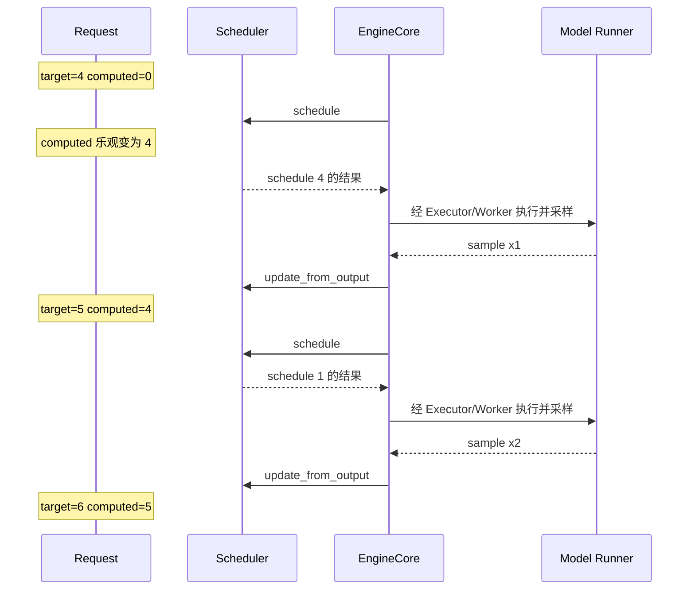

> **读图方法：** 这是“一个最小例子”的时序图。先从左到右确认参与者分别负责什么，再从上到下追踪消息；第一遍只看正常路径，第二遍再看返回、异步消息和失败分支。

普通 decode 通常表现为每请求一轮 1 个待计算 token，但不要把它写成 Scheduler 的绝对
定律。推测解码、扩散模型、多 token 采样和未来的 jump decoding 都会改变差额形态；
统一模型正是为了容纳这些情况。

### 4.5.2 同一公式怎样覆盖不同优化

> **本节先看：** 下面先用表格整理“同一公式怎样覆盖不同优化”。先横向比较每一列解决的问题和适用边界，再把具体名称映射到源码。

| 场景 | 对差额的影响 |
|---|---|
| Chunked prefill | 差额很大，但每轮只取预算允许的一部分 |
| Prefix caching | 命中部分直接增加 computed 起点，减少差额 |
| Speculative decoding | draft token 增加 target，一轮可能验证多个位置 |
| Async scheduling | placeholder 代表已预留但结果未回来的位置 |
| KV load failure | 降低 computed，使无效区间重新进入差额 |
| Preemption | computed 重置为 0，触发 recompute |

## 4.6 五类约束不要混成一个参数

调度常被错误简化为“batch size”。真实 Scheduler 至少同时受五类约束。

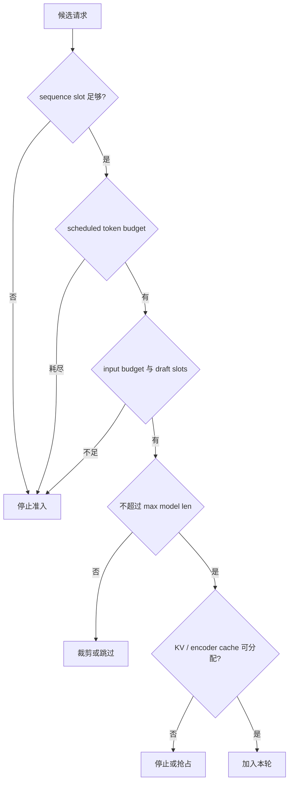

> **读图方法：** 阅读“五类约束不要混成一个参数”这张流程图时，先把方框看成对象或状态，把箭头看成数据或控制的移动。第一遍从上向下建立顺序，第二遍再核对分支发生的条件。

### 4.6.1 `max_num_scheduled_tokens`

令 $C_{\mathrm{step}}$ 表示 `max_num_scheduled_tokens` 的值，即 Scheduler 一轮
最多发出的 token 工作量：

$$
\sum_r N_{\mathrm{scheduled}}(r)\le C_{\mathrm{step}}
$$

**白话：**一轮里所有请求被调度的 token 数加起来，不能超过 `max_num_scheduled_tokens`：它是整轮的总额度，不是每个请求各自的额度。

**其中：**$r$ 是本轮被调度的请求下标；$N_{\mathrm{scheduled}}(r)$ 是本轮调度给请求 $r$ 的 token 数；$C_{\mathrm{step}}$ 是上限值；单位都是 token。

**怎么算出来：**Scheduler 用一个“剩余额度”变量 `token_budget` 记账：

1. 开始时 `token_budget` $=C_{\mathrm{step}}$；
2. 每调度一个请求，先把它的 token 数裁到不超过当前 `token_budget`（`min(…, token_budget, …)`），再从 `token_budget` 里扣掉；
3. priority 策略下，已经排进本轮的请求如果又被抢占，它的份额会退回 `token_budget`（4.13）。所以任何时刻都有 $\sum_r N_{\mathrm{scheduled}}(r)=C_{\mathrm{step}}-\text{token\_budget}$，而 `token_budget` 因为每次先裁剪再扣减，永远不会变成负数，于是和不超过 $C_{\mathrm{step}}$。

算例（4.11 的教学配置 $C_{\mathrm{step}}=8$）：step 1 调度 A 的 6 个与 B 的 2 个，$6+2=8\le8$，额度正好用完；step 2 调度 $1+1+2=4\le8$，剩 4。单位检查：两边都是 token。

**核对：**`vllm/v1/core/sched/scheduler.py:1624`（`assert total_num_scheduled_tokens <= self.max_num_scheduled_tokens`）和 `:1626`（`assert token_budget >= 0`）@ `05caae03`；教学实现 `examples/ch04_continuous_batching.py:328-355`。

若配置为 `None`，Scheduler 初始化时回退到 `max_num_batched_tokens`。v0.33.0 的配置校验
要求显式值至少为 1；不能用 `max_num_scheduled_tokens=0` 代替 pause。

[源码] `vllm/config/scheduler.py` - `SchedulerConfig.max_num_scheduled_tokens`

### 4.6.2 `max_num_batched_tokens`

这是单次迭代可处理的输入容量。通常与 scheduled token 上限相同，但当前源码允许两者
不同。模型可能在 batch 中追加位置，例如 speculative decoding，因此 Scheduler 发出的
token 数可以比最终输入容量上限更小。

源码每调度一个请求时，大致执行：

```text
token_budget -= num_new_tokens
input_budget -= num_new_tokens + draft_slots
```

所以 `draft_slots` 消耗 input budget，却不等同于本轮已确认的 scheduled token。

算例：设 `max_num_batched_tokens=8`、`draft_slots=2`，有 4 个 decode 请求，每个本轮差额 $N_{\mathrm{new}}=1$。第 1 个请求：`input_budget` 从 8 扣 $1+2=3$，剩 5，`token_budget` 剩 7；
第 2 个：`input_budget` 剩 $5-3=2$，`token_budget` 剩 6；第 3 个请求开始前检查 `input_budget <= draft_slots`，即 $2\le2$ 成立，直接停止。
所以这一轮只排了 2 个请求、2 个 scheduled token，`input_budget` 却被用到只剩 2：draft 位置消耗了输入容量，却没有进 `token_budget`。

### 4.6.3 `max_num_seqs`

`max_num_seqs` 决定 Model Runner 的请求 buffer 与 CUDA Graph 容量，并作为默认准入上限。
v0.31.0 新增 `max_num_active_seqs`：未设置时沿用 `max_num_seqs`；设置后只降低 RUNNING
准入上限，不缩小 Runner 容量，且必须不大于 `max_num_seqs`。两者都不是 token 总量。
100 个短 decode 请求和一个 10K prompt 会受到不同瓶颈。

[源码] `vllm/config/scheduler.py` - `SchedulerConfig`

[源码] `vllm/v1/core/sched/scheduler.py` - `Scheduler.__init__`、`schedule`

暂停等待 streaming input 的会话虽然不在普通 running 列表中，仍可能占 Model Runner
request slot；源码在准入时把它们计入 running 数。

### 4.6.4 `max_model_len`

即使本轮还有预算，也不能让位置越过模型最大长度。普通生成的 running 路径还要为
本轮采样预留 1 个位置；pooling 和 diffusion 不在 prefill 后追加普通采样 token，
`num_sampled_tokens_per_step=0`。v0.33.0 的 pooling 回归测试允许最后一个 chunk 恰好
到达 `max_model_len`，不能把“总要少算一个位置”推广到所有 runner。

[源码] `vllm/v1/core/sched/scheduler.py` - `Scheduler.__init__`、`Scheduler.schedule`

[测试] `tests/v1/core/test_scheduler.py` - `test_pooling_chunked_prefill_can_finish_at_max_model_len`

### 4.6.5 KV 与 encoder 容量

token budget 是计算配额，不代表 KV 一定有空间。Scheduler 必须调用
`KVCacheManager.allocate_slots()`；多模态请求还受 encoder compute budget 和 encoder
cache 约束。

因此合法调度不是单变量最小值，而是多个资源约束的交集。

## 4.7 一次 `schedule()` 的总体流程

去掉 connector、structured output 和模型特例后，主干如下：

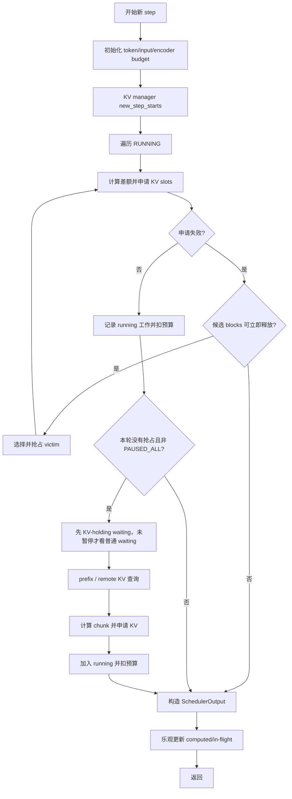

> **读图方法：** 这张图用于压缩“一次 `schedule()` 的总体流程”的整体关系。先从上向下找到起点、关键转换和终点，再问每条跨层箭头是否意味着函数调用、消息传递、内存访问或状态更新。

可以把它记成四句话：先保护已经运行的请求；必要时通过抢占解决其 KV 扩容；本轮没有
发生抢占时再用剩余预算处理 waiting；最后输出工作清单并乐观推进计数。`PAUSED_NEW`
仍会让已持有 KV 的等待请求继续 drain，但不接纳普通无 block 的 waiting 请求。

“本轮有抢占就不接纳 waiting”是重要稳定性策略。系统刚因容量不足驱逐请求时，立即
再加入新请求通常只会制造更多抖动。

## 4.8 第一段：先调度 RUNNING 请求

running 循环从列表头部向后遍历。对每个请求执行以下逻辑：

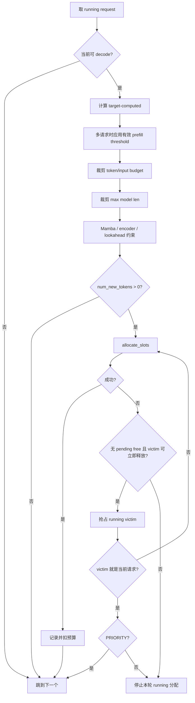

> **读图方法：** 这是“第一段：先调度 RUNNING 请求”的流程图。先从上向下只追一条主路径，确认输入经过哪些关键阶段到达输出；第二遍再看虚线、回边和旁路，它们通常表示反馈、复用或可选分支。

### 4.8.1 Running 优先不等于每个 running 都必跑

当 `num_new_tokens == 0` 时，源码使用 `continue` 而不是 `break`。注释明确承认，这会
允许更靠后的低优先级请求执行，因此不是严格 FCFS。

可能导致 0 token 的原因包括 PP 或 async scheduling 已把目标位置提交在途、达到模型
长度、encoder compute/cache 耗尽、Mamba block 对齐和 MTP prefill lookahead 约束。

工程上，这比为了纯粹队列顺序让整个 step 空转更合理。

### 4.8.2 Running 分配失败会尝试抢占

已经 running 的请求需要扩展 KV 时，如果 `allocate_slots()` 返回 `None`，Scheduler
会尝试从当前 running 集合选择 victim。v0.31.0 在 connector 有 pending block frees，或
`_request_blocks_can_be_freed(victim)` 为假时先停止重试，不做无助于立即分配的抢占。
只有能即时释放时才移出 victim、回收 block 并重试；fence 尚未完成不能当作可用容量。

[源码] `vllm/v1/core/sched/scheduler.py` - `Scheduler.schedule`

[测试] `tests/v1/core/test_deferred_block_free.py` - `test_allocation_retry_waits_for_fence_then_succeeds`

如果 victim 在本 step 已经获得工作，源码还会撤销它的调度记录，并恢复 token budget、
input budget 与 draft slots、新 block 记录、speculative token 记录和 encoder compute
budget。这保证最终 `SchedulerOutput` 与预算账本一致。

#### v0.33.0：Priority 下“自我抢占”不再结束整段 running 调度

PRIORITY 策略的 victim 是 `(priority, arrival_time)` 最大的 running 请求，也就是最低优先级者。
当它自己正是这个最低优先级请求时，`allocate_slots()` 失败后选中的 victim 就是它本身：
它被移出 `running`、释放 block、状态变为 `PREEMPTED`，随后循环 `break`，此时 `new_blocks`
仍为 `None`。v0.32.0 对这种情况统一 `break`，整段 running 调度到此为止；v0.33.0（#61976，提交
`ceb01b6dd`）在 PRIORITY 且 `request.status == PREEMPTED` 时改为 `continue`：该请求已从
`running` 删除，`req_index` 恰好指向下一个请求，而排在后面的请求优先级更高、又刚好多出了
被释放的 block，仍可能放得下。FCFS 下 victim 是 `running[-1]`，行为不变，仍然 `break`。

## 4.9 第二段：再接纳 WAITING 请求

waiting 循环只有在本轮没有 preempted request、不是 `PAUSED_ALL`，且预算和 sequence
slot 允许时才推进。v0.33.0 仍优先取 `kv_holding_waiting`；只有它为空且处于 `UNPAUSED`
才取普通 `waiting`。因此 `PAUSED_NEW` 是禁止新的无 block 请求准入，不是停止所有
WAITING 状态请求：已经占住 KV、正在等远端加载完成的请求仍需恢复执行并 drain。

[源码] `vllm/v1/core/sched/scheduler.py` - `Scheduler.schedule` 的 request queue 选择

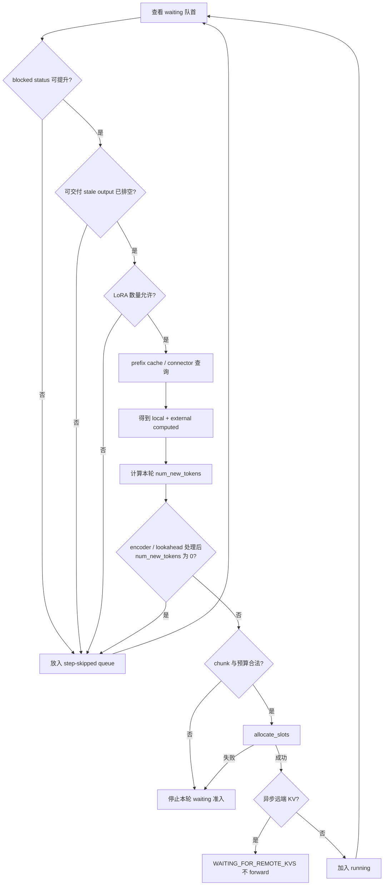

> **读图方法：** 阅读“第二段：再接纳 WAITING 请求”这张流程图时，先把方框看成对象或状态，把箭头看成数据或控制的移动。第一遍从上向下建立顺序，第二遍再核对分支发生的条件。

### 4.9.1 Skip 与 break 的区别

当前会阻塞 waiting 准入的状态包括：structured-output grammar 尚未就绪、远端 KV 尚未
接收完成，以及 streaming request 正在等待下一段输入。此外，当该请求仍在途且需向客户端交付的过时输出（`drop_stale_output=False`）尚未排空、LoRA 数量限制、connector 暂时无法确定命中长度或
encoder-cache transfer 尚未完成，也都可能只影响当前请求。源码会把这类请求临时移到
step-skipped queue，然后继续检查其他请求。若配置为丢弃 stale output，则不需要等待旧
输出排空，不能把所有 stale 情况都概括为同一条阻塞规则。

但 sequence slot 已满、预算不足、关闭 chunked prefill 时队首请求放不下，或当前 waiting
请求 KV 无法分配时，通常执行 `break`。这决定了后面的请求能否绕过队首。

v0.33.0 对其中一种 `break` 做了修正（#59030，提交 `43caf5b35`）：waiting 请求经 encoder 输入调度
（`_try_schedule_encoder_inputs`）和 prefill lookahead 预留（`_reserve_prefill_lookahead`）后若
`num_new_tokens == 0`，v0.32.0 执行 `break`（可视为上文“预算不足”的一种）；v0.33.0 改为
`skip_request` 把它移入 step-skipped 队列（持有 KV 的进 `step_skipped_kv_holding`，否则进
`step_skipped_waiting`）后 `continue`，不再挡住后面的请求。关闭 chunked prefill 且
`num_new_tokens > request_token_budget` 时的 `break`、spec decode padding 放弃调度时的 `break`、
以及 Mamba 对齐后 `num_new_tokens == 0` 的 `break` 均未改。

LoRA 数量限制的口径也在 v0.33.0 变了（#60306）：已被调度的 LoRA 集合现在取自**全部**
`self.running` 请求，而不只是本轮被调度的那些，因为暂时没被调度（如等输出、encoder 预算
不足）的 running 请求仍会在后面的 step 回到 batch。

[测试] `tests/v1/core/test_scheduler.py` - `test_waiting_encoder_stall_does_not_starve_later_requests`、
`test_waiting_encoder_stall_kv_holder_keeps_drain_priority`、
`test_max_loras_counts_running_request_awaiting_output`

### 4.9.2 Waiting 分配失败不会立即抢占 running

Running 路径会为已有请求抢占；waiting 准入路径的 `allocate_slots()` 失败则停止接纳。
默认策略优先保护已有工作，不会为了每个新请求立刻驱逐 running 请求。

高优先级新请求也不是一到达就无条件打断 GPU 上的低优先级请求。Priority 首先影响
waiting 顺序；只有后续 KV 压力触发 victim 选择时，低优先级 running 才更可能被抢占。

## 4.10 Chunked Prefill 怎样工作

长 prompt 的 prefill 通常计算密集，而 decode 请求每轮工作量较小。如果一个 8K prompt
独占整轮甚至多轮，已经在输出的请求会出现明显 inter-token latency 抖动。

**直觉：让长任务分段让路。** 假设同一执行路径既有短 decode 请求，也有一个很长
的 prompt。如果一次处理整个 prompt，该次执行可能拉长已有请求下一次采样的等待。
Chunked prefill 让长 prompt 分多轮推进，可与 decode 共享预算。例如本轮允许长请求
计算 512 个 token，剩余部分留到后续轮次；512 是教学配置，不是推荐默认值。

分块能缓解干扰，但不会保证所有用户始终流畅：每个 chunk 仍有计算成本，实际间隔
取决于 batch、设备、KV 与调度条件，前端也可能仍在发送已缓冲的结果。

[源码] `vllm/v1/core/sched/scheduler.py` - `Scheduler.schedule` 的预算裁剪与 waiting 准入


Chunked prefill 把长差额裁成预算允许的片段：本轮真正调度的 token 数，是差额与各项上限里最小的那个。

$$
\begin{aligned}
N_{\mathrm{chunk}} = \min\bigl(&N_{\mathrm{remaining}},\; N_{\mathrm{budget}},\; N_{\mathrm{budget,in}},\\
&C_{\mathrm{threshold}},\; C_{\mathrm{other}}\bigr).
\end{aligned}
$$

**白话：**每个上限都说“这一轮最多再给你这么多”，要同时满足所有上限，就只能取最小的那个；没算完的部分留到下一轮。

**其中：**所有项以 token 为单位。$N_{\mathrm{remaining}}$ 是还没算的差额（4.5 的 $N_{\mathrm{new}}$）；
$N_{\mathrm{budget}}$ 是本轮剩余的 token 预算（`token_budget`，不是字节数）；
$N_{\mathrm{budget,in}}$ 是输入侧剩余预算（`input_budget`）减去为 draft 预留的位置（`draft_slots`）之后的值；
$C_{\mathrm{threshold}}$ 是 `long_prefill_token_threshold` 当前生效的值（只在多于一个请求时才起作用，见 4.10.3），没有生效时可以看作无穷大；
$C_{\mathrm{other}}$ 表示其余上限：`max_model_len` 余量、Mamba block 对齐、encoder 预算、prefill lookahead 等。

**怎么算出来：**源码不是一次写出这个 `min`，而是按顺序一层一层往 `num_new_tokens` 上套上限：

1. 先取差额 $N_{\mathrm{remaining}}$；
2. 若 $0<C_{\mathrm{threshold}}<N_{\mathrm{remaining}}$，改成 $C_{\mathrm{threshold}}$（`scheduler.py:805`）；
3. 再和 `token_budget`、`input_budget - draft_slots` 取最小（`:807-809`）；
4. 再依次和 `max_model_len` 余量（`:813-817`）取最小，并经过 Mamba 对齐、encoder 预算、lookahead 保留这几步截断。

每一层的结果都不会比上一层大，所以连续套用，等于一次取所有项的最小值，这就是上式。

算例：用 4.10.1 的上游测试：3 个 800-token prompt，`max_num_batched_tokens=1024`（$N_{\mathrm{budget}}$ 和 $N_{\mathrm{budget,in}}$ 一开始都是 1024，没有 draft），$C_{\mathrm{threshold}}=400$，不计 $C_{\mathrm{other}}$。

- 第一轮，R0：$\min(800,1024,1024,400)=400$；预算剩 $1024-400=624$；
- R1：$\min(800,624,624,400)=400$；预算剩 $624-400=224$；
- R2：$\min(800,224,224,400)=224$。与下面表中的 400、400、224 一致；
- 第三轮，R0、R1 各取 1 个，预算剩 $1024-1-1=1022$；R2 只剩 $800-224-224=352$ 个没算：$\min(352,1022,1022,400)=352$。

**核对：**`vllm/v1/core/sched/scheduler.py:800-817`（running 路径）、`:1290-1341`（waiting 路径；新 decode 请求为保持 CUDA Graph 形状会先补齐到 $1+$`num_spec_tokens`，补齐发生在取最小之前）@ `05caae03`；
`tests/v1/core/test_scheduler.py::test_schedule_concurrent_partial_requests` 断言 `400, 400, 224`、`400, 400, 224`、`1, 1, 352`。

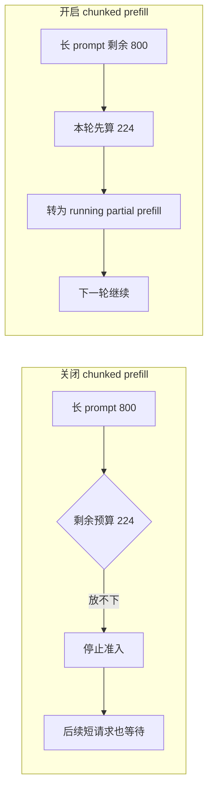

> **读图方法：** 这张图用于压缩“Chunked Prefill 怎样工作”的整体关系。先从左向右找到起点、关键转换和终点，再问每条跨层箭头是否意味着函数调用、消息传递、内存访问或状态更新。

### 4.10.1 上游测试给出的精确例子

`test_schedule_concurrent_partial_requests` 设置 3 个 800-token prompt、
`max_num_batched_tokens=1024`、`long_prefill_token_threshold=400`。

第一轮分配为：

| 请求 | 本轮 token | 原因 |
|---|---:|---|
| R0 | 400 | threshold 截断 |
| R1 | 400 | threshold 截断 |
| R2 | 224 | 剩余 budget 为 1024 - 400 - 400 |

第二轮仍是 `400, 400, 224`。第三轮 R0、R1 已进入普通 decode，各获得 1；R2 获得
$800-224-224=352$ 个剩余 prefill token：它前两轮各算了 224 个，用 prompt 总数减去已算的部分，
剩下的 352 个都在预算和 threshold 之内（计算见上一节的算例）。

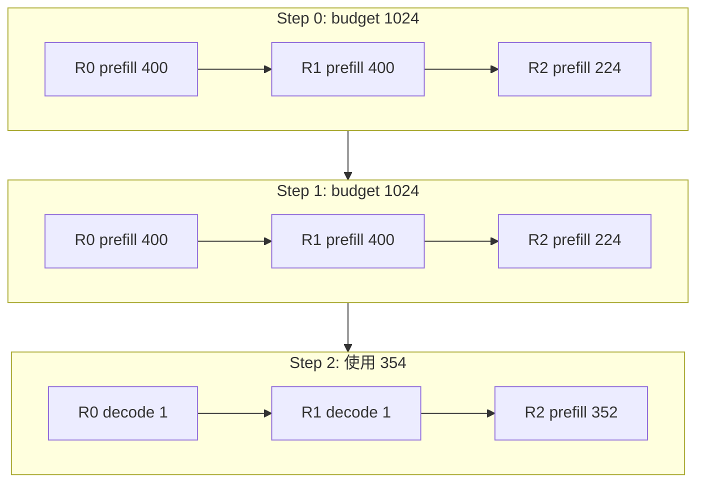

> **读图方法：** 这是“上游测试给出的精确例子”的流程图。先从上向下只追一条主路径，确认输入经过哪些关键阶段到达输出；第二遍再看虚线、回边和旁路，它们通常表示反馈、复用或可选分支。

图中方框不按 token 数等比例缩放，标签给出精确预算。

[测试] `tests/v1/core/test_scheduler.py` - `test_schedule_concurrent_partial_requests`

此测试人工构造 `ModelRunnerOutput` 来验证调度器账本，未运行模型或 GPU；表中的
精确分配只证明该测试配置下的调度结果。

### 4.10.2 关闭切片后的队首语义

上游 `test_schedule_order` 用两个 800-token 长请求和两个 10-token 短请求验证：关闭
chunked prefill 后，如果下一个长请求整体放不进剩余 budget，Scheduler 不会跳过它去
提前执行后面的短请求。这里描述普通生成路径；v0.33.0 对 `is_mm_encoder_only`
豁免这个 `break`：即使 EngineCore 因无 KV 关闭 chunked prefill，encoder-only 长 prompt
仍按 token budget 分步推进，避免请求永远留在 waiting。

[测试] `tests/v1/core/test_scheduler.py` - `test_encoder_only_prompt_longer_than_budget_is_chunked`

这样保留了普通生成路径 waiting queue 的顺序语义，但会让预算出现空余。开启 chunked prefill 后，
长请求可以部分进入，减少这一类空洞。

### 4.10.3 Threshold 不是总 chunk 大小

`long_prefill_token_threshold` 是条件化的额外上限，不是总 chunk 大小。v0.31.0 先从
`get_request_counts()` 取得 running + waiting（含 `kv_holding_waiting`）请求数：
只有多于一个请求时才启用 cap；
单独一个长请求可以使用整轮预算。若同时启用 `long_prefill_token_threshold_adaptive`，
有效 cap 为配置阈值与本轮初始 `input_budget // num_eligible_reqs` 的较大值。

例如预算 1024、阈值 400：单请求可安排 1024；同时有其他请求时仍受 400 限制。
若两请求、阈值 100 且 adaptive=True，有效 cap 提升至 512：先算公平份额 `1024 // 2 = 512`，再取 `max(100, 512) = 512`。这是预算公平份额的下限，
不是每个请求必得 512 的保证。最终还受剩余 token/input budget、encoder、Mamba 对齐和
lookahead 等限制。阈值设为 0 表示关闭额外 cap，不表示关闭 chunked prefill。

[源码] `vllm/v1/core/sched/scheduler.py` - `Scheduler.schedule`

[测试] `tests/v1/core/test_scheduler.py` - `test_long_prefill_threshold_ignored_when_alone`、
`test_long_prefill_threshold_applies_with_other_requests`、`test_long_prefill_threshold_floored_by_fair_share`

## 4.11 Continuous Batching 的逐步例子

下面用简化模型演示动态到达：

| 请求 | 到达 step | prompt | 最大输出 |
|---|---:|---:|---:|
| A | 0 | 12 | 3 |
| B | 1 | 3 | 2 |
| C | 2 | 2 | 2 |

设置：

```text
max_num_scheduled_tokens = 8
long_prefill_token_threshold = 6
max_num_seqs = 3
```

以下是随书教学模型的输出，不是 v0.33.0 生产 Scheduler 的逐步 trace。
教学模型保留无条件 threshold cap，因此只有 A 时仍算 6；上游新版单请求会绕过 cap，
在其他约束允许时可用满 8-token 预算。示例用于说明动态成员变化，不作为新版阈值语义证据。

教学模型得到：

```text
step=00 work=[A:p6]
step=01 work=[A:p6, B:p2]
step=02 work=[A:d1, B:p1, C:p2]
step=03 work=[A:d1, B:d1, C:d1]
```

其中 `p` 表示 prefill，`d` 表示普通 decode。关键现象是：B、C 不需要等 A 完整输出
结束才进入 GPU 工作集合。

这条 trace 是用上面的公式算出来的（教学模型的 $C_{\mathrm{step}}=8$，$C_{\mathrm{threshold}}=6$）：

- step 0 只有 A，差额 12：$\min(12,8,6)=6$，所以 `A:p6`；
- step 1 的 A 还差 6：$\min(6,8,6)=6$，预算剩 $8-6=2$；B 刚到、prompt 为 3：$\min(3,2,6)=2$，所以 `A:p6, B:p2`；
- step 2 的 A 已完成 prefill 并采样了第一个输出，差额 1；B 还差 $3-2=1$；预算剩 $8-1-1=6$，C 刚到、prompt 为 2：$\min(2,6,6)=2$，所以 `A:d1, B:p1, C:p2`；
- step 3 三个请求都进入 decode，各 1 个，$1+1+1=3\le8$，也正好用满 `max_num_seqs=3` 个名额。

与 `python3 examples/ch04_continuous_batching.py` 的输出逐行一致。

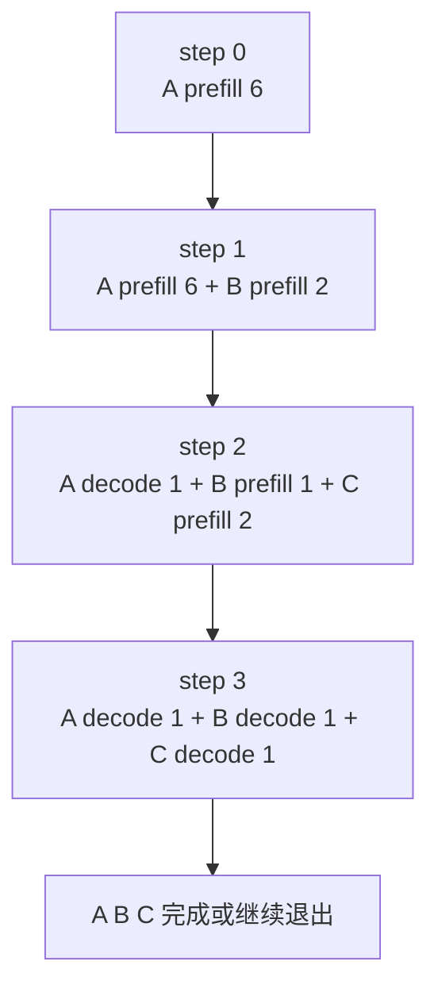

> **读图方法：** 阅读“Continuous Batching 的逐步例子”这张流程图时，先把方框看成对象或状态，把箭头看成数据或控制的移动。第一遍从上向下建立顺序，第二遍再核对分支发生的条件。

这就是 continuous batching 的核心：批次边界仍然存在，但批次成员和每个成员的 token
数在每个边界重新计算。

## 4.12 KV Cache 是调度的硬约束

Scheduler 可以算出理想 token 分配，但只有 KV block 可用时才能真正提交。

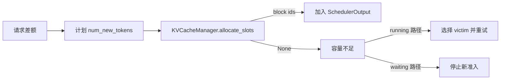

> **读图方法：** 这张图用于压缩“KV Cache 是调度的硬约束”的整体关系。先从左向右找到起点、关键转换和终点，再问每条跨层箭头是否意味着函数调用、消息传递、内存访问或状态更新。

`scheduler_reserve_full_isl=True` 时，准入新请求会检查完整 input sequence 是否能放进 KV，
而不是只看第一个小 chunk。它的目的不是声称“立刻占用所有 prompt block”，而是避免
因首 chunk 很小而过度接纳，随后多个请求一起增长并频繁抢占。

`watermark` 对 waiting/preempted 的准入增加空闲 block 余量。要核对调用点：
Scheduler 传的是 `has_scheduled_reqs=bool(self.running)`，所以实际条件是 **running
集合非空**，不是“本轮已经安排了正数 token”。例如旧请求受节奏限制，本轮没有执行，
但仍留在 running，watermark 依然生效。running 为空时，首个准入请求不加此门槛。

[源码] `vllm/v1/core/sched/scheduler.py` - `Scheduler.schedule` 的 waiting 分配调用

[源码] `vllm/v1/core/kv_cache_manager.py` - `KVCacheManager.allocate_slots`

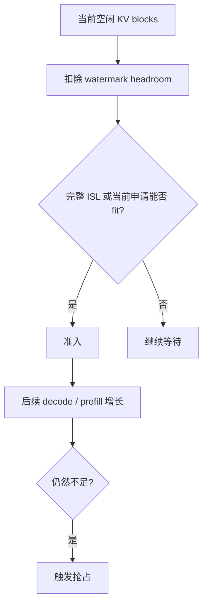

> **读图方法：** 这是“KV Cache 是调度的硬约束”的流程图。先从上向下只追一条主路径，确认输入经过哪些关键阶段到达输出；第二遍再看虚线、回边和旁路，它们通常表示反馈、复用或可选分支。

KV block 的哈希、prefix cache、引用计数、partial block 和 CoW 属于第 05 章。本章只关心
Scheduler 与 KV manager 的资源协议。

## 4.13 Preemption：释放、重置、回队

固定 revision 的 `Scheduler._preempt_request()` 采用**释放缓存引用、重置计算进度、重新调度**
的语义。它保留请求对象及已接受的输出 token，恢复时需要重建的是已有 token 序列的计算状态，
不是只重算原始 prompt，更不是重新生成已经交付的文本。

释放引用也不等于立即抹掉物理 KV：前缀缓存可能保留可复用的 block，在途执行还可能要求延迟
释放。后续准入会重新查询本地或远端缓存，命中的部分可以跳过重算；不能把这一路径概括为
“丢弃所有状态”。

[源码] `vllm/v1/core/sched/scheduler.py` - `Scheduler._preempt_request`、
`_free_request_blocks`、`schedule`

`_preempt_request()` 的关键动作是：

1. 释放请求持有的 KV block；
2. 释放 encoder cache 状态；
3. 从 in-flight prefill 集合移除；
4. 把状态改为 `PREEMPTED`；
5. 把 `num_computed_tokens` 重置为 0；
6. 清空 speculative tokens；
7. 处理异步在途输出的 stale 计数；
8. 清空 output placeholders；
9. 增加 `num_preemptions`；
10. 把请求放回 waiting queue，并记录 preempted id。

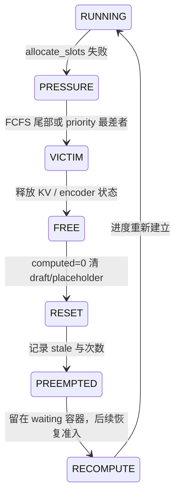

> **读图方法：** 从 RUNNING 追到重新准入，注意归零的是 computed 计数，已接受 token 仍保留。
> PRESSURE、VICTIM、FREE、RESET、RECOMPUTE 是教学步骤，只有 RUNNING 与 PREEMPTED 对应
> `RequestStatus` 枚举；释放步骤还可能受在途工作约束。

### 4.13.1 为什么重置为 0

计算过 token 不代表其 KV 仍存在。既然抢占释放了 block，之后不能仅把序列位置指针挪
回来；必须重新建立 attention 所需状态。Prefix cache 或远端 KV 可能让恢复时重新命中
部分前缀，但本地 `num_computed_tokens` 先归零，避免把已释放状态当成有效状态。

### 4.13.2 为什么抢占可能浪费计算

请求被反复抢占会重复 prefill，增加计算量并恶化 TTFT/TPOT。因此调大并发序列数并不
总能提高吞吐；当 KV 容量不足时，它可能只增加 thrashing。

## 4.14 FCFS 与 Priority 的真实含义

> **本节先看：** 本节要回答：**FCFS 与 Priority 的真实含义**。下面的小节会逐层拆开概念、运行过程和源码落点；第一次阅读先抓对象之间的关系，第二次再记类名、字段和分支。

### 4.14.1 Waiting queue

FCFS 使用 `deque`：

```text
add      -> append
pop      -> popleft
prepend  -> appendleft
```

Priority 使用 heap，排序键来自 `Request.__lt__()`：

```text
(priority, arrival_time, request_id)
```

数值越小，优先级越高；priority 相同则更早到达者优先；再用 request id 保证稳定可比较。
Priority queue 没有“插到最前”概念，`prepend_request()` 与普通 add 等价，最终仍按排序键
决定位置。

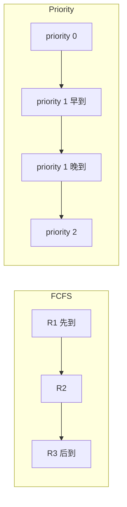

> **读图方法：** 这张图用于压缩“Waiting queue”的整体关系。先从左向右找到起点、关键转换和终点，再问每条跨层箭头是否意味着函数调用、消息传递、内存访问或状态更新。

### 4.14.2 Preemption victim

当 running KV 扩容失败：

| 策略 | victim 选择 |
|---|---|
| FCFS | `running.pop()`，即当前 running 列表尾部 |
| Priority | `(priority, arrival_time)` 最大者，即数值优先级最低、同级更晚者 |

注意“调度谁”和“抢占谁”是两次不同决策。新高优先级请求可能先进入 running；只有当
KV 继续增长并不足时，Scheduler 才选择较差 running victim。

上游 priority 测试证明：输入优先级 `[2, 0, 1]` 时调度顺序是 priority 0、1、2；KV
不足的恢复测试则证明低优先级 running 被抢占，高优先级请求保留并最终让被抢占者恢复。

## 4.15 Prefix Cache 与远端 KV 如何改变准入

Waiting 请求第一次调度时，Scheduler 先询问本地 prefix cache。若命中 $N_{\mathrm{hit,local}}$ 个
token（源码 `num_new_local_computed_tokens`），又从 connector 获得 $N_{\mathrm{hit,ext}}$ 个有效 token（`num_external_computed_tokens`），则起始进度近似为：

$$
N_{\mathrm{computed}}=N_{\mathrm{hit,local}}+N_{\mathrm{hit,ext}}
$$

**白话：**缓存里已经有 KV 的前缀不必再算，所以这个请求的起点，从“本地命中加外部命中”之后开始。

**其中：**$N_{\mathrm{hit,local}}$ 是本地 prefix cache 命中的 token 数；$N_{\mathrm{hit,ext}}$ 是 KV connector 报告的外部命中 token 数，从本地命中的末尾接着数；
$N_{\mathrm{computed}}$ 是请求开始调度时的计算进度（`num_computed_tokens`）；单位都是 token。写“近似”是因为真实实现还要处理 partial tail、block 对齐和 SWA 重放（见下）。

**怎么算出来：**

1. 本地查询：在请求的 block hash 链上找最长命中，命中长度的上限是 $N_{\mathrm{tokens}}-1$（最后一个 token 一定要重算才能得到 logits，`vllm/v1/request.py:352-356`），得到 $N_{\mathrm{hit,local}}$；
2. 外部查询：把本地命中（取整 block 的部分）交给 connector，它返回在这之后还能提供多少 token（`get_num_new_matched_tokens`），这就是 $N_{\mathrm{hit,ext}}$。外部命中从本地命中的末尾开始数，两段不重叠，所以可以直接相加；
3. 两段相加得到 $N_{\mathrm{computed}}$，源码断言结果不超过 $N_{\mathrm{tokens}}$（`scheduler.py:1204`）。

算例：block 大小 $B_{\mathrm{blk}}=16$，prompt 有 $N_{\mathrm{tokens}}=100$ 个 token，本地命中 4 个整 block，$N_{\mathrm{hit,local}}=4\times16=64$，connector 又给出 $N_{\mathrm{hit,ext}}=16$：
$N_{\mathrm{computed}}=64+16=80$ token，$80\le100$，满足断言。

**核对：**`vllm/v1/core/sched/scheduler.py:1200-1204`（`num_new_local_computed_tokens + num_external_computed_tokens`）@ `05caae03`；SWA 重放会再扣掉一段（`:1296` `num_computed_tokens -= num_replay_tokens`）。

剩余工作变成：

$$
N_{\mathrm{new}}=N_{\mathrm{tokens}}-N_{\mathrm{computed}}
$$

**白话：**请求总共有多少已知 token，减去已经不用算的那一段，剩下的才需要这一步安排。

**其中：**$N_{\mathrm{tokens}}$ 是请求当前已知的 token 总数（`num_tokens`）；刚接纳的 waiting 请求没有 draft，也没有 placeholder，所以这里不加这两项；
被抢占后重新接纳的请求，$N_{\mathrm{tokens}}$ 还包含它之前已经生成的输出 token。$N_{\mathrm{new}}$ 仍是预算裁剪之前的差额。

**怎么算出来：**这是 4.5 的 $N_{\mathrm{new}}=N_{\mathrm{target}}-N_{\mathrm{computed}}$ 在 waiting 路径上的特例：没有 draft 和 placeholder 时 $N_{\mathrm{target}}=N_{\mathrm{tokens}}$。
代入上面的例子：$N_{\mathrm{new}}=100-80=20$，这 20 个 token 之后还要经过 4.10 的取最小。
被抢占过的请求：prompt 100 个、已生成 30 个，$N_{\mathrm{tokens}}=130$；若这次没有任何命中，$N_{\mathrm{computed}}=0$（4.13），则 $N_{\mathrm{new}}=130-0=130$。

**核对：**`vllm/v1/core/sched/scheduler.py:1301`（`num_new_tokens = request.num_tokens - num_computed_tokens`）@ `05caae03`。

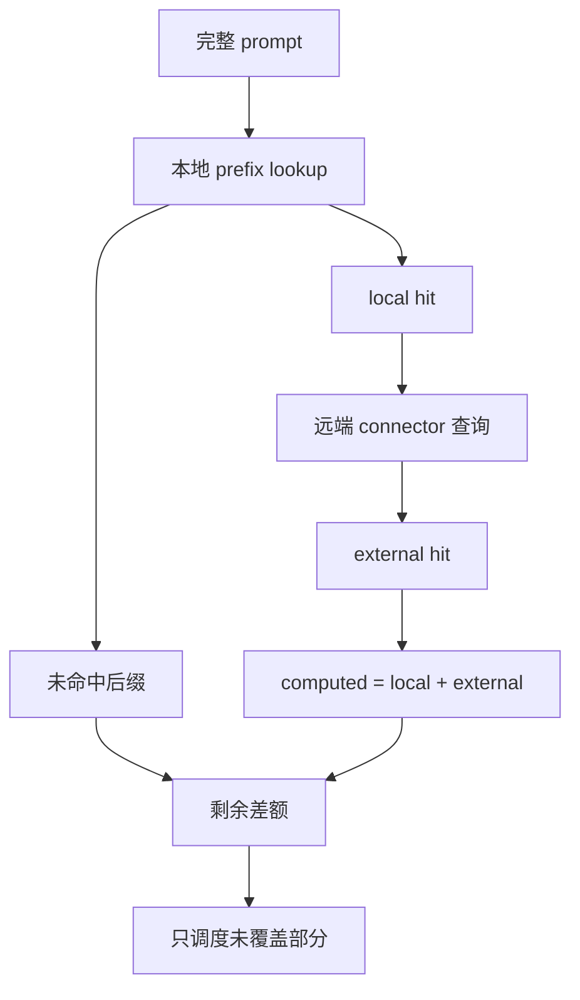

> **读图方法：** 这是“Prefix Cache 与远端 KV 如何改变准入”的流程图。先从上向下只追一条主路径，确认输入经过哪些关键阶段到达输出；第二遍再看虚线、回边和旁路，它们通常表示反馈、复用或可选分支。

真实实现还处理 partial tail、block alignment、Mamba state 边界和外部命中覆盖本地尾块等
细节，第 05 章会展开。

如果 connector 选择异步加载，Scheduler 本轮可以先分配 block 并把请求转为
`WAITING_FOR_REMOTE_KVS`，但 `num_new_tokens=0`，不会执行 forward。等传输完成后再恢复
到可调度状态。

同步加载则会在本轮标记 `has_sync_kv_loads`，让执行侧知道输入依赖外部 KV。

自 v0.32.0 起按 connector 实际加载的 group 判断窗口是否完整恢复：DSV41 的 SWA
bounded replay 只有在窗口未随 KV load 恢复时才回退并重算尾部；加载失败仍可能需要 replay。
异步加载写入的 group 通过 `skip_zeroing_group_ids` 交给 KV manager，避免清零与远端写入
竞争，不能把所有 cache group 都笼统排除在清零之外。

v0.33.0 在这条准入路径上多了三处与前缀命中有关的变化：

1. **EAGLE lookahead 哈希（#61589）。** `Scheduler` 读取 `vllm_config.num_hash_lookahead_tokens`；
   非 0 时把 `use_eagle_block_drop` 置为 `False`，因为哈希已经覆盖了块边界之后的 token，
   不再需要丢掉命中的最后一个块。该值同时传给 KV cache manager 与 Mamba 对齐计算。
   可恢复（streaming）请求若 `num_computed_tokens == 0` 要重算 KV，会先清空并重建
   `block_hashes`，因为驻留 KV 可能还留着已被丢弃 token 的哈希。公式与例子见第 05 章 5.12.4。
2. **命中长度上限（#62591）。** 启用 routed-experts 等 aux output 时，`_get_local_prefix_cache_hit`
   接受 `max_cache_hit_length`，由 `aux_output_connector.max_cache_hit(request)` 给出；外部命中
   则经 `cap_external_hit` 截断。含义是“只复用仍留有辅助输出的前缀”，见 5.12.2。
3. **异步加载推迟（#63827）。** 见 4.20。

[源码] `vllm/v1/core/sched/scheduler.py` - `Scheduler.__init__`、`_get_local_prefix_cache_hit`、`schedule`

[测试] `tests/v1/core/test_scheduler.py` - `test_prefix_hit_is_capped_at_retained_auxiliary_outputs`、
`test_streaming_lookahead_hashes_follow_recomputed_kv`

[源码] `vllm/v1/core/sched/scheduler.py` - `_load_restores_replay_window`、`_mark_prefix_replay`、
`_update_waiting_for_remote_kv`、`schedule`

## 4.16 多模态与 Encoder Budget

对文本模型，token budget 和 KV 通常是主约束。多模态请求还需要安排图像、音频等
encoder 输入。

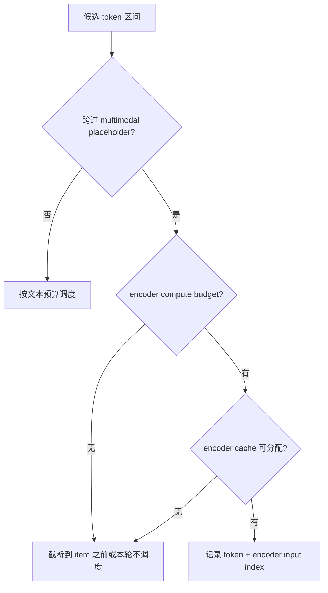

> **读图方法：** 阅读“多模态与 Encoder Budget”这张流程图时，先把方框看成对象或状态，把箭头看成数据或控制的移动。第一遍从上向下建立顺序，第二遍再核对分支发生的条件。

`SchedulerOutput.scheduled_encoder_inputs` 记录每个 request 本轮需要处理的 encoder input
索引。源码测试还验证：如果多模态 item 尚未编码，encoder-only request 不能提前被视为
成功完成。

`disable_chunked_mm_input=True` 时，一个多模态 item 不会被从中间切开。例如文本 `TTTT`
后接图像 token `IIIIIIIIII`，预算只能容纳 `TTTTIIIII` 时，Scheduler 可以先只调度
`TTTT`，下一轮再完整处理图像 item。自 v0.32.0 起，这个范围检查放在 encoder cache 命中与
同 step 重复输入检测之前，所以 warm cache 或重复图像也不能绕过“不切开 item”的限制。
`_allocate_encoder_inputs()` 为真正新输入分配缓存，再为重复输入登记持有关系，避免只编码
一次却过早释放仍被后续 occurrence 使用的内容。

[源码] `vllm/v1/core/sched/scheduler.py` - `_try_schedule_encoder_inputs`、`_allocate_encoder_inputs`

[测试] `tests/v1/core/test_scheduler.py` - `test_no_mm_input_chunking`、
`test_no_mm_input_chunking_for_same_step_duplicate`、`test_same_step_duplicate_encoder_input_stays_cached`

### 4.16.1 “恰好从 item 起点开始”的切分判定（v0.33.0）

设某个多模态 item 在序列中从位置 $\mathrm{pos}_{\mathrm{mm}}$ 开始（源码 `start_pos`），共占 $N_{\mathrm{mm}}$ 个 encoder token
（`num_encoder_tokens`）；本轮请求已计算 $N_{\mathrm{computed}}$ 个 token（`num_computed_tokens`），本轮准备再调度
$N_{\mathrm{new}}$ 个（`num_new_tokens`）。`disable_chunked_mm_input=True` 且不是 encoder-decoder 模型时，
对每个与本轮范围有重叠的 item，“切开 item”的判定为：

$$
\text{split} \iff N_{\mathrm{computed}}+N_{\mathrm{new}} < \mathrm{pos}_{\mathrm{mm}}+N_{\mathrm{mm}}
$$

**白话：**这一块的终点到不了 item 的末尾，就说明这一块只能覆盖 item 的一部分。这种模式下 item 必须在同一步里整个算完，所以这一块要回退。

**其中：**item 占据位置 $[\mathrm{pos}_{\mathrm{mm}},\ \mathrm{pos}_{\mathrm{mm}}+N_{\mathrm{mm}})$，本轮这一块覆盖位置 $[N_{\mathrm{computed}},\ N_{\mathrm{computed}}+N_{\mathrm{new}})$。
“有重叠”指 item 与 $[N_{\mathrm{computed}},\ N_{\mathrm{computed}}+N_{\mathrm{new}}+\delta)$ 相交，其中 $\delta$ 是 `shift_computed_tokens`
（drafter 的前瞻位移，函数默认值为 0，调度循环传入 `num_prefill_lookahead`）。

**怎么算出来：**一块能把 item 算完，当且仅当它的终点不早于 item 的终点：$N_{\mathrm{computed}}+N_{\mathrm{new}}\ge\mathrm{pos}_{\mathrm{mm}}+N_{\mathrm{mm}}$；取反就是上面的式子。
起点在哪里不影响这个判断：从 item 之前开始、恰好从 item 起点开始、从 item 里面开始（前缀命中可以在 item 中间结束），只要终点盖不住末尾，都算切开。

例：文本 `TTTT` 后接 10 个图像 token，$\mathrm{pos}_{\mathrm{mm}}=4$，$N_{\mathrm{mm}}=10$，item 的末尾位置是 $4+10=14$。

- $N_{\mathrm{computed}}=4$（前 4 个文本 token 已算完，恰好站在 item 起点），预算只剩 $N_{\mathrm{new}}=5$：$4+5=9<14$，应当切开。v0.32.0 的守卫写成 `num_computed_tokens < start_pos`，$4<4$ 为假，所以漏判，item 会被切成 5+5；v0.33.0（#52412，提交 `12b005eef`）修复了这一漏判；
- 同样 $N_{\mathrm{computed}}=4$，若 $N_{\mathrm{new}}=10$：$4+10=14<14$ 不成立，整个 item 一次算完，不用回退。

切开之后按下式回退：

$$
N_{\mathrm{new}}' = \max\big(0,\ \mathrm{pos}_{\mathrm{mm}}-(N_{\mathrm{computed}}+\delta)\big)
$$

**白话：**回退后的这一块连同前瞻也不能越过 item 的起点，所以最多只算到 item 之前；如果已经站在 item 起点或者在 item 里面，一个也不算，等下一轮把 item 整个放进来。

**其中：**$N_{\mathrm{new}}'$ 是回退后的本轮 token 数，其余同上。没有 drafter 前瞻时 $\delta=0$，上式就是 $N_{\mathrm{new}}'=\max(0,\mathrm{pos}_{\mathrm{mm}}-N_{\mathrm{computed}})$。

**怎么算出来：**要求回退后的范围连同前瞻位移不越过 item 起点：$N_{\mathrm{computed}}+N_{\mathrm{new}}'+\delta\le\mathrm{pos}_{\mathrm{mm}}$，
解出 $N_{\mathrm{new}}'\le\mathrm{pos}_{\mathrm{mm}}-N_{\mathrm{computed}}-\delta$，再取满足条件的最大非负整数，就是上式。
若 $N_{\mathrm{computed}}\ge\mathrm{pos}_{\mathrm{mm}}$，右边不是正数（$\delta\ge0$），结果为 0。源码把这两种情况写成两个分支：
$N_{\mathrm{computed}}<\mathrm{pos}_{\mathrm{mm}}$ 时用上式，否则直接置 0，两者一致。

继续上面的例子（$\delta=0$）：

- $N_{\mathrm{computed}}=0$、$N_{\mathrm{new}}=6$：$0+6=6<14$，切开，$N_{\mathrm{new}}'=\max(0,4-0)=4$，本轮只算 `TTTT`；若 $\delta=1$，$N_{\mathrm{new}}'=\max(0,4-1)=3$；
- $N_{\mathrm{computed}}=4$、$N_{\mathrm{new}}=5$：$N_{\mathrm{new}}'=\max(0,4-4)=0$，本轮不调度这个请求，下一轮再整体处理；
- 前缀命中在 item 中间结束，$N_{\mathrm{computed}}=7$、$N_{\mathrm{new}}=5$：$7+5=12<14$，切开，$N_{\mathrm{new}}'=\max(0,4-7)=0$。

encoder-decoder 模型被显式排除在这个检查之外。

**核对：**两个式子对应 `vllm/v1/core/sched/scheduler.py:2066-2084`（`_try_schedule_encoder_inputs`）@ `05caae03`。
上游测试 `test_no_mm_input_chunking_at_item_boundary` 用 offset=400、length=800 的 item，以 $(N_{\mathrm{computed}},N_{\mathrm{new}})\to N_{\mathrm{new}}'$ 的写法：
$(0,500)\to400$、$(400,500)\to0$、$(400,800)\to800$、$(600,500)\to0$、$(600,600)\to600$，逐个代入上面两个式子，得到同样的数。
本章此前按 v0.33.0 把触发条件写成还要满足 $N_{\mathrm{computed}}\le\mathrm{pos}_{\mathrm{mm}}$；`05caae03` 的守卫已经没有这个前提，起点在 item 内部时同样回退为 0
（测试 `test_no_mm_input_chunking_after_prefix_cache_hit_inside_item`），本节已按 `05caae03` 改正。

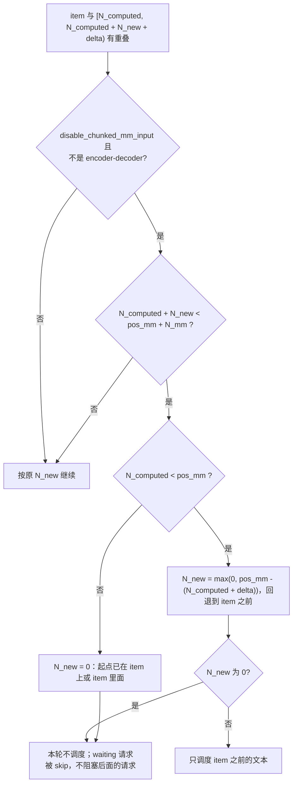

> **读图方法：** 自上而下依次回答四个问题：这个模式是否启用、这一块的终点是否到得了 item 末尾、起点是否还在 item 之前、回退后是否为 0。前两个答案依次为“是、是”才会触发回退；起点在 item 之前时回退到 item 起点（留出 `delta`），否则直接为 0；回退到 0 时，waiting 请求走 4.9.1 里 `skip_request` 的新路径。

[测试] `tests/v1/core/test_scheduler.py` - `test_no_mm_input_chunking_at_item_boundary`

### 4.16.2 encoder cache 的释放与 drafter 前瞻（v0.33.0）

v0.32.0 为了照顾 drafter 的前瞻读取，在 `_free_encoder_inputs()` 里把释放条件推后
`spec_lookahead` 个 token，调度路径也按同样的 shift 截断，结果在 encoder cache 紧张时会互相等待
形成死锁。v0.33.0（#60553，提交 `1641765ff`）去掉了这个推后量：释放条件回到
`start_pos + num_tokens <= num_computed_tokens - num_output_placeholders`，截断也改为
`num_new_tokens = min(num_new_tokens, start_pos - num_computed_tokens)`。依据是 drafter 只读取
`num_computed_tokens` 之前的位置，读不到尚未编码的输入时回退为 token embedding，所以不会引用
已释放的 encoder 输出。EPD（把视觉 encoder 阶段与 prefill/decode 拆到不同实例的部署，即 disaggregated encoder）场景下，`_ec_transfer_pending` 现在用扣除 `prefix_replay_tokens`
之后的位置判断（窗口未随 KV 恢复时），确保回放前缀尾部所需的 encoder 输入也被计入（#62834）。

上面两条规则的算法，用本节 4.16.1 的符号写出来（`start_pos` 是 $\mathrm{pos}_{\mathrm{mm}}$，`num_tokens` 是这个 item 占的 $N_{\mathrm{mm}}$）：

- 释放：item 整个落在“已确认进度”之内才能释放，即 $\mathrm{pos}_{\mathrm{mm}}+N_{\mathrm{mm}}\le N_{\mathrm{computed}}-N_{\mathrm{placeholders}}$。减去 $N_{\mathrm{placeholders}}$，是因为还在途的 speculative 位置可能被拒绝，使 $N_{\mathrm{computed}}$ 回退到 item 里面。
  例：$\mathrm{pos}_{\mathrm{mm}}=4$、$N_{\mathrm{mm}}=10$，结束位置是 14。$N_{\mathrm{computed}}=16$、$N_{\mathrm{placeholders}}=3$ 时 $16-3=13<14$，不释放；$N_{\mathrm{placeholders}}=1$ 时 $16-1=15\ge14$，释放。
- 截断：encoder cache 放不下这个 item（或 encoder 预算耗尽），且 $N_{\mathrm{computed}}<\mathrm{pos}_{\mathrm{mm}}$ 时，本轮只能算到 item 之前，$N_{\mathrm{new}}\leftarrow\min(N_{\mathrm{new}},\ \mathrm{pos}_{\mathrm{mm}}-N_{\mathrm{computed}})$，因为从 $N_{\mathrm{computed}}$ 数到 item 起点正好隔着 $\mathrm{pos}_{\mathrm{mm}}-N_{\mathrm{computed}}$ 个位置。
  例：$\mathrm{pos}_{\mathrm{mm}}=4$、$N_{\mathrm{computed}}=0$、$N_{\mathrm{new}}=6$：$\min(6,4-0)=4$，只算前 4 个文本 token。

**核对：**释放判断在 `vllm/v1/core/sched/scheduler.py:2902-2904`（`_free_encoder_inputs`），截断在 `:2136-2138`（`_try_schedule_encoder_inputs`）@ `05caae03`。

[测试] `tests/v1/core/test_scheduler.py` - `test_drafter_lookahead_encoder_cache_cap_makes_progress`、
`test_ec_connector_waits_for_embeddings_in_prefix_replay`

## 4.17 SchedulerOutput 是执行合同

调度器最终不返回一个简单 request id 列表，而是一个多层数据合同。

```mermaid
flowchart LR
    S[Scheduler state] --> N[scheduled_new_reqs]
    S --> C[scheduled_cached_reqs]
    S --> T[num_scheduled_tokens]
    S --> B[block / copy / zero metadata]
    S --> X[spec / encoder / connector metadata]
    S --> F[finished / preempted ids]
    N --> O[SchedulerOutput]
    C --> O
    T --> O
    B --> O
    X --> O
    F --> O
    O --> MR[Model Runner]
```

> **读图方法：** 这张图用于压缩“SchedulerOutput 是执行合同”的整体关系。先从左向右找到起点、关键转换和终点，再问每条跨层箭头是否意味着函数调用、消息传递、内存访问或状态更新。

### 4.17.1 新请求与缓存请求分开

`scheduled_new_reqs` 携带首次发送给 worker 的完整请求数据。Worker 会缓存这些数据，
之后 `scheduled_cached_reqs` 只发送变化部分，降低每 step 的 CPU/IPC 开销。

被抢占后恢复的请求（resumed）现在统一作为 `NewRequestData` 重新发送：源码注释写明“A resumed request is re-sent in full, like a new one:
its blocks were freed and its worker state dropped at preemption”（`scheduler.py:1558-1559`）；`NewRequestData.prefill_token_ids`
（`output.py:50-51`）装的是“要 prefill 的全部 token：prompt，恢复时再加上已生成的 token”。`CachedRequestData`（`output.py:139-147`）
只剩 `req_ids`、`new_token_ids`、`new_block_ids`、`num_computed_tokens`、`num_output_tokens` 五个字段，不再有 resumed 标记。
第一代 Runner 曾在 cached data 里表达 resumed 差异，它已随 #63373 删除，现在只有这一条路径。

### 4.17.2 核心字段

> **本节先看：** 下面先用表格整理“核心字段”。先横向比较每一列解决的问题和适用边界，再把具体名称映射到源码。

| 字段 | 作用 |
|---|---|
| `num_scheduled_tokens` | request id 到本轮 token 数的映射 |
| `total_num_scheduled_tokens` | 上述值之和，用于不变量和执行判断 |
| `scheduled_spec_decode_tokens` | 本轮要验证的 draft token |
| `scheduled_encoder_inputs` | 需要执行的多模态 encoder item |
| `finished_req_ids` | 两轮之间完成、需通知 worker 清理的请求 |
| `preempted_req_ids` | 本轮抢占、需重置 worker 状态的请求 |
| `new_block_ids_to_zero` | 新 block 使用前需要清零的 id |
| `kv_cache_block_copies` | 本轮执行前需要完成的 CoW copy |
| connector metadata | KV/encoder cache 传输协议数据 |
| `num_spec_tokens_to_schedule` | 动态 speculative decoding 的 K |
| `encoder_input_updates` | MRV2（V2 Model Runner）专用：按请求下发 encoder 输入 CPU payload 的释放或恢复（v0.33.0） |
| `skip_drafts` | 本轮之后提出的 draft 一定用不上，drafter 可以跳过（v0.33.0） |

自 v0.32.0 起已删除 cascade attention 的执行与公共前缀统计链。v0.33.0 还留着的兼容字段 `SchedulerOutput.num_common_prefix_blocks`
和接口 `KVCacheManager.get_num_common_prefix_blocks()`（只返回全零）在 `05caae03` 里都已删除，现在的 `output.py` 与 `kv_cache_manager.py` 里找不到它们。
此外旧的 `block_table_updates` 字段已删除，不应再把完整行替换画成内置输出协议的一部分。

[源码] `vllm/v1/core/sched/output.py` - `SchedulerOutput`

SchedulerOutput 把控制面决定转换为第 07 章 Model Runner 能消费的增量协议。

### 4.17.3 `skip_drafts`：什么时候不必提出 draft（v0.33.0）

spec decode 在每步之后都会提出下一批 draft；但如果本轮之后没有任何请求会去验证它们，这次
drafting 就是浪费。v0.33.0（#62784，提交 `856b98415`）让 Scheduler 判断这一点并写入
`SchedulerOutput.skip_drafts`。只有 `can_skip_drafts`（`num_lookahead_tokens > 0` 且使用 MRV2）
为真时才会判断，否则 `skip_drafts` 恒为 `False`。

对每个本轮被调度的请求 $r$，`_drafts_unused` 判定“它之后的 draft 一定用不上”：

$$
\begin{aligned}
\operatorname{unused}(r)={}&\big[N_{\mathrm{computed}}+N_{\mathrm{new}}<N_{\mathrm{tokens}}\big]\\
&\vee\ \big[N_{\mathrm{out}}+1+a_{\mathrm{async}}\ge N_{\mathrm{max}}\big]
\end{aligned}
$$

$$
\mathrm{skip\_drafts}=\bigwedge_{r\in\mathrm{batch}}\operatorname{unused}(r)
$$

**白话：**第一项说“这一块还没到请求的最后一个已知 token”，也就是一个非末块 prefill，本步不采样，draft 会被丢弃；第二项说“就算所有 draft 都被拒绝，这一步采样出的 token 也会让输出达到
`max_tokens`”，请求马上结束，没有下一次验证。只要有一个请求不满足这两种情况，整体就不能跳过。
stop token 与 stop string 无法提前知道，所以只按这两种“确定”情形判断，偏保守。被抢占的请求
所做的标记不会撤回（“stays set if preempted later”）。

**其中：**$N_{\mathrm{computed}}$ 是本步前已算 token 数（含前缀缓存与 KV connector 命中）；$N_{\mathrm{new}}$ 是本步调度的 token
数；$N_{\mathrm{tokens}}$ 是请求当前已知 token 总数（`num_tokens`）；$N_{\mathrm{out}}$ 是已确认的输出 token 数；$a_{\mathrm{async}}$ 在存在
async output placeholder 时取 1（还有一个在途的采样步），否则取 0；$N_{\mathrm{max}}$ 是 `max_tokens`；$\mathrm{batch}$ 是本轮被调度的全部请求。
$\vee$ 是“或”，$\bigwedge$ 是“全部成立”；单位：前三个量和 $N_{\mathrm{out}}$、$N_{\mathrm{max}}$ 都是 token，$a_{\mathrm{async}}$ 是 0 或 1。

**怎么算出来：**draft 在某一步之后提出，要在该请求的下一次 decode 步里验证；没有下一次 decode 步，draft 就是白提。这样的“确定没有”只有两种：

1. 本步是非末块 prefill：本步算到位置 $N_{\mathrm{computed}}+N_{\mathrm{new}}$，若它仍小于 $N_{\mathrm{tokens}}$，最后一个已知 token 还没算到，本步不采样，下一步仍是 prefill，Scheduler 会丢弃 prefill chunk 之后提出的 draft；
2. 本步采样的是最后一个输出：本步结束后一定已经有 $N_{\mathrm{out}}+1$ 个输出 token（已确认的，加上本步采样的一个）；async 下还有一个在途的采样步，再加 $a_{\mathrm{async}}=1$。
   draft 即使全部被拒，输出数也不会少于这个值，若它已达到 $N_{\mathrm{max}}$，请求就结束，没有下一次验证。

整批能跳过的条件是每个请求都 unused，所以是各请求结果的逻辑与：源码里 `drafts_needed` 只要被任何一个请求置真，`skip_drafts` 就为假（`skip_drafts=not drafts_needed`）。

例：batch 里有 r1（prompt $N_{\mathrm{tokens}}=100$，$N_{\mathrm{computed}}=0$，$N_{\mathrm{new}}=64$，非末块）和 r2（$N_{\mathrm{tokens}}=50$，$N_{\mathrm{out}}=9$，$N_{\mathrm{max}}=10$，
$N_{\mathrm{computed}}=49$，$N_{\mathrm{new}}=1$，$a_{\mathrm{async}}=0$）。r1：$0+64<100$，成立；r2：$49+1<50$ 不成立，但 $9+1+0\ge10$ 成立。
两者都 unused，所以 `skip_drafts=True`。若 r2 的 $N_{\mathrm{max}}=20$，则 $10<20$，r2 需要 draft，整轮
`skip_drafts=False`。

**核对：**`vllm/v1/core/sched/scheduler.py:489-531`（`_drafts_unused`）、`:720`（`drafts_needed = not self.can_skip_drafts`）、`:1725`（`skip_drafts=not drafts_needed`）@ `05caae03`；
测试 `test_skip_drafts_only_when_no_request_can_use_them`、`test_drafts_unused_with_async_placeholders`。

```mermaid
flowchart TD
    A{can_skip_drafts?} -->|否| N[skip_drafts = False]
    A -->|是| B[逐个被调度请求判断 unused]
    B --> C{N_computed + N_new < N_tokens ?}
    C -->|是| U[该请求 unused]
    C -->|否| D{N_out + 1 + a_async ≥ N_max ?}
    D -->|是| U
    D -->|否| X[drafts_needed = True]
    U --> E{还有请求?}
    E -->|是| B
    E -->|否| F{drafts_needed?}
    F -->|否| S[skip_drafts = True]
    F -->|是| N
```

> **读图方法：** 左上角先看开关；然后对每个请求问两个问题：是不是非末块 prefill，是不是这一步必然到 `max_tokens`。任何一个请求两问皆否就置 `drafts_needed`，整轮不能跳过。

[源码] `vllm/v1/core/sched/scheduler.py` - `Scheduler._drafts_unused`、`schedule`

[测试] `tests/v1/core/test_scheduler.py` - `test_skip_drafts_only_when_no_request_can_use_them`、
`test_drafts_unused_with_async_placeholders`

### 4.17.4 `encoder_input_updates`：MRV2 的 encoder 输入 payload（v0.33.0）

MRV2 在 Worker 侧为每个请求保留多模态输入的 CPU payload，供需要重新编码时使用。为了不无限
占内存，v0.33.0（#57368，提交 `373614f66`）让 Scheduler 通过 `_get_encoder_input_updates`
告诉 Worker 哪些输入可以释放、哪些要恢复。非 MRV2 直接返回空字典。规则是：

- 新请求（含 resume、streaming 重新安装）的 `mm_features` 里，有 `data` 且不含 `"address"`
  （即不是共享内存描述符）的输入登记为 pending；共享内存描述符走处理器缓存自己的 ACK 协议，
  EngineCore 无法重放其解析后的 tensor。
- 本轮要（重新）编码的输入若不在 pending 里，把 payload 放进更新表并重新登记；正在被编码的输入（`input_id in encoding`）在释放判断里直接跳过，不会被置 `None`。
- 已确认消费的输入置 `None`（释放）：当 $\mathrm{pos}_{\mathrm{mm}}+N_{\mathrm{mm}}\le N_{\mathrm{confirmed}}$，
  其中确认进度 $N_{\mathrm{confirmed}}=N_{\mathrm{computed}}-\max(N_{\mathrm{placeholders}},N_{\mathrm{in\ flight}})$（源码里的 `position.offset` 与 `position.length` 就是 $\mathrm{pos}_{\mathrm{mm}}$ 与 $N_{\mathrm{mm}}$）；
  encoder-decoder 模型只要 $N_{\mathrm{confirmed}}>0$ 就释放。

**白话：**Scheduler 在 `schedule()` 里已经乐观推进了 `num_computed_tokens`（见 4.18），不能据此
断定图像已被消费，所以要减去还在途的 prefill 与 speculative placeholder，得到“已确认进度”再
和 item 的结束位置比较：item 整个在已确认进度之内，才能释放 payload。

**其中：**$N_{\mathrm{confirmed}}$ 是已确认的计算进度，$N_{\mathrm{in\ flight}}$ 是已提交、结果还没回来的 token 数（`num_in_flight_tokens`），$N_{\mathrm{placeholders}}$ 同 4.5；
$\mathrm{pos}_{\mathrm{mm}}+N_{\mathrm{mm}}$ 是 item 的结束位置（不含）。单位都是 token。

**怎么算出来：**$N_{\mathrm{computed}}$ 里混着两类还没确认的位置：还在途的 prefill chunk（用 $N_{\mathrm{in\ flight}}$ 计量），和异步调度预留的输出 placeholder（用 $N_{\mathrm{placeholders}}$ 计量）。
两类统计的对象有重叠（在途 token 里要采样的位置，同时也记在 placeholder 里），所以不相加，取较大的那个扣掉（偏保守，宁可晚释放）：$N_{\mathrm{confirmed}}=N_{\mathrm{computed}}-\max(N_{\mathrm{placeholders}},N_{\mathrm{in\ flight}})$。
再把它和 item 的结束位置比较。例：图像占位 $\mathrm{pos}_{\mathrm{mm}}=4$、$N_{\mathrm{mm}}=10$，结束位置 $4+10=14$。
某一步调度后 $N_{\mathrm{computed}}=16$，其中 4 个 token 还在途（$N_{\mathrm{in\ flight}}=4$，$N_{\mathrm{placeholders}}=0$）：$N_{\mathrm{confirmed}}=16-\max(0,4)=12$，
$14\le12$ 不成立，payload 保留；这 4 个 token 的结果回来后 $N_{\mathrm{in\ flight}}=0$，$N_{\mathrm{confirmed}}=16-0=16$，$14\le16$ 成立，才释放。
KV 加载失败回滚后，需要重新编码的输入会再次下发 payload。

**核对：**`vllm/v1/core/sched/scheduler.py:2866-2872`（`computed = request.num_computed_tokens - max(request.num_output_placeholders, request.num_in_flight_tokens)`）与释放判断 `:2877-2881` @ `05caae03`；
测试 `test_cpu_encoder_input_updates_wait_for_completed_prefill`。

```mermaid
flowchart TD
    A["schedule() 之后，逐个请求计算 encoder_input_updates"] --> B["新请求的 mm_features：有 data 且不含 address 的 input 登记为 pending"]
    B --> C{"该请求有 pending，或本轮有要编码的 input?"}
    C -->|否| NEXT[跳过该请求]
    C -->|是| D["本轮要编码、不在 pending、且有 data 的 input：payload 放进更新表，并登记 pending"]
    D --> E["N_confirmed = N_computed - max(N_placeholders, N_in_flight)"]
    E --> F{"对 pending 里每个 input（本轮正在编码的除外）：<br/>pos_mm + N_mm ≤ N_confirmed，<br/>或 encoder-decoder 且 N_confirmed > 0 ?"}
    F -->|是| REL["更新表写 None：Worker 释放 payload，移出 pending"]
    F -->|否| KEEP[payload 保留]
    REL --> OUT[encoder_input_updates 发给 Worker]
    KEEP --> OUT
    NEXT --> OUT
```

> **读图方法：** 这张图只回答一个问题：一个 encoder input 的 CPU payload 什么时候发给 Worker、什么时候让 Worker 释放。先看上面两个框，它们决定“发”：新请求登记 pending，本轮要（重新）编码而 pending 里没有的，把 payload 放进更新表；
再看中间的菱形，它决定“放”：用已确认进度而不是乐观推进的进度，和 item 的结束位置比较。分支末端的三个出口都汇到同一个输出：`encoder_input_updates`。

[源码] `vllm/v1/core/sched/output.py` - `SchedulerOutput.encoder_input_updates`

[源码] `vllm/v1/core/sched/scheduler.py` - `Scheduler._get_encoder_input_updates`

[测试] `tests/v1/core/test_scheduler.py` - `test_cpu_encoder_input_updates_wait_for_completed_prefill`、
`test_cpu_encoder_input_updates_resume_and_abort`、`test_cpu_encoder_input_updates_restore_after_kv_load_failure`

## 4.18 为什么 Schedule 后立即乐观推进

`_update_after_schedule()` 在 Model Runner 返回前就执行：

```text
request.num_computed_tokens += num_scheduled_token
request.num_in_flight_tokens += num_scheduled_token
```

（注：此处变量名沿用源码在 `_update_after_schedule` 与 `update_from_output` 两处实现中的单复数命名：前者使用 `num_scheduled_token`，后者使用 `num_tokens_scheduled`。）

然后更新 `is_prefill_chunk`。

```mermaid
sequenceDiagram
    participant S as Scheduler
    participant Q as Request counters
    participant EC as EngineCore
    participant M as Model Runner
    EC->>S: schedule step N
    S->>Q: computed += scheduled
    S->>Q: in_flight += scheduled
    S-->>EC: step N SchedulerOutput
    EC->>M: 经 Executor/Worker 提交 step N
    Note over S,Q: async 等配置允许规划后续 step
    EC->>S: schedule step N+1
    S-->>EC: step N+1 SchedulerOutput
    EC->>M: 经 Executor/Worker 提交
    M-->>EC: step N output
    EC->>S: update_from_output
    S->>Q: in_flight -= scheduled
    S->>Q: 必要时回滚 rejected/stale
```

> **读图方法：** 这是“为什么 Schedule 后立即乐观推进”的时序图。先从左到右确认参与者分别负责什么，再从上到下追踪消息；第一遍只看正常路径，第二遍再看返回、异步消息和失败分支。

这样做支持 PP 或 async scheduling 下多个 batch 同时在途。如果一定等 output 才推进，
Scheduler 就无法为下一轮构造正确位置。

代价是状态变成“预测账本”：后续必须处理 speculative rejection、KV load failure、abort
和 preemption 造成的回滚或 stale output。

## 4.19 `update_from_output()` 怎样结算

Model Runner 返回后，Scheduler 不只是把 token 传出去。主要步骤包括：

```mermaid
flowchart TB
    A[ModelRunnerOutput] --> B[完成 deferred free fence]
    B --> C[处理 connector invalid blocks]
    C --> D[逐 request 减少 in-flight]
    D --> E{request 已 abort/finish?}
    E -->|是| SKIP[忽略迟到结果]
    E -->|否| F{stale output?}
    F -->|drop| SKIP
    F -->|可处理| G[结算 speculative accepted/rejected]
    G --> H[追加 sampled token / pooling output]
    H --> I[检查 stop、length、grammar、error<br/>stop 时裁剪并回退 computed]
    I --> CB[cache_blocks：只缓存已确认部分]
    CB --> J{完成?}
    J -->|是| FREE[释放 request 和 block]
    J -->|否，可恢复会话已停止| RQ[移出旧队列后重新入 waiting]
    J -->|否| KEEP[保留 running/preempted 状态]
    RQ --> OUT
    FREE --> OUT[生成 EngineCoreOutput]
    KEEP --> OUT
```

> **读图方法：** 阅读“`update_from_output()` 怎样结算”这张流程图时，先把方框看成对象或状态，把箭头看成数据或控制的移动。第一遍从上向下建立顺序，第二遍再核对分支发生的条件。

### 4.19.1 In-flight 先减账

每个 scheduled request 先执行 `num_in_flight_tokens -= num_tokens_scheduled`。如果这部分
属于抢占前的 stale share，同时减少 `num_stale_output_tokens`。

### 4.19.2 Abort 与迟到结果

请求可能在 GPU 执行期间被 abort。此时 output 回来后，Scheduler 发现 request 不存在或已
finished，直接跳过，不能让迟到 token 复活请求。这与第 03 章 abort race 的顺序相接。

### 4.19.3 Speculative rejection 回滚

Scheduler 乐观地把 draft 位置计入 computed；Model Runner 验证后若拒绝一部分，update
必须从 `num_computed_tokens` 和 async placeholder 中减去拒绝数。回滚分两步：先结算拒绝，再追加 token 并检查 stop。

**第一步：拒绝回滚。**设本步调度时带了 $N_{\mathrm{spec}}$ 个 draft，模型验证后返回 $k$ 个 token（$k$ 包含最后那个由模型自己采样的 token）。
被接受的 draft 有 $k-1$ 个，被拒绝的有 $N_{\mathrm{spec}}-(k-1)$ 个，两个计数各减去这个数：

$$
\begin{aligned}
N_{\mathrm{computed}}' &= N_{\mathrm{computed}}-\bigl(N_{\mathrm{spec}}-(k-1)\bigr),\\
N_{\mathrm{placeholders}}' &= N_{\mathrm{placeholders}}-\bigl(N_{\mathrm{spec}}-(k-1)\bigr).
\end{aligned}
$$

**白话：**调度时把每个 draft 位置都记成“已经算过”，验证后被拒绝的位置没有用，要把这些位置从进度和预留里退掉。

**其中：**$N_{\mathrm{spec}}$ 是本步实际调度的 draft 数（`len(scheduled_spec_token_ids)`）；$k$ 是返回的 token 数（`len(generated_token_ids)`），
普通自回归每步采样 1 个 token，所以接受数是 $k-1$（源码 `num_accepted = max(len(generated_token_ids) - num_sampled, 0)`，这里 `num_sampled_tokens_per_step` 为 1）；
单位都是 token。只在输出不是 stale 时执行，且 $N_{\mathrm{computed}}>0$、$N_{\mathrm{placeholders}}>0$ 才分别扣减；$k$ 是本节的局部字母。

**怎么算出来：**每个 draft 在调度时占一个位置，所以本步调度的 draft 数是 $N_{\mathrm{spec}}$。验证时从前往后逐个比对：前面接受的 draft 变成输出 token，再加上模型自己采样的那一个 token，
所以 $k=\text{accepted}+1$（accepted 是被接受的 draft 数），接受数 $=k-1$，拒绝数 $=N_{\mathrm{spec}}-(k-1)$。回滚的就是拒绝数：这些位置在调度时已经被记进 $N_{\mathrm{computed}}$（async 下也记进了 $N_{\mathrm{placeholders}}$）。
例：$N_{\mathrm{spec}}=3$、$k=3$（接受 2 个，拒绝 1 个）：拒绝数 $=3-(3-1)=1$。同步调度下 $N_{\mathrm{placeholders}}=0$，只有 $N_{\mathrm{computed}}$ 会变。

**核对：**`vllm/v1/core/sched/scheduler.py:2312-2332`（`num_accepted`、`num_rejected`、两处 `-= num_rejected`）@ `05caae03`。

**第二步：stop 裁剪。**v0.33.0 把“追加 token、检查 stop、结算 placeholder”统一放进基类
`Scheduler._update_request_with_output()`，`AsyncScheduler` 不再覆盖这个方法：这一搬迁以及下文
`cache_blocks` 的上移、placeholder 扣减都来自 #61589（提交 `2fb320d83`）。#58668（提交
`d486219fc`）只新增了 stop 裁剪的账目。关键是 stop 发生在一次返回的多个 token 中间时的账：设本次返回
$k$ 个 token，第 $j$ 个触发 stop（$1\le j\le k$），则（$N_{\mathrm{computed}}$、$N_{\mathrm{placeholders}}$ 取第一步结算之后的值）

$$
N_{\mathrm{computed}}' = N_{\mathrm{computed}}-(k-j),\qquad N_{\mathrm{placeholders}}' = N_{\mathrm{placeholders}}-k
$$

**白话：**被 stop 截掉的 $k-j$ 个 token 不会交付，所以要从 computed 里退掉，否则可恢复会话从错误的位置继续；但 placeholder 是为“这次返回的
全部 token”预留的，所以按 $k$ 全额扣除。stale 输出（`is_stale`）两项都不动。

**其中：**$N_{\mathrm{computed}}$ 是 `num_computed_tokens`（已计入这 $k$ 个新 token 中除最后一个以外的全部）；$N_{\mathrm{placeholders}}$ 是
`num_output_placeholders`，$N_{\mathrm{placeholders}}'=N_{\mathrm{placeholders}}-k$ 只在 $N_{\mathrm{placeholders}}>0$ 且输出不是 stale 时成立，同步调度下 $N_{\mathrm{placeholders}}=0$ 不扣；
$k$、$j$ 是本节的局部字母，单位是 token 个数和序号。

**怎么算出来：**

1. 第一步之后，$N_{\mathrm{computed}}$ 覆盖这 $k$ 个新 token 中除最后一个以外的全部（最后一个 token 的 KV 要到下一步才会算），也就是比“序列加上这 $k$ 个 token 之后的长度”少 1；
2. stop 发生在第 $j$ 个：序列只保留前 $j$ 个新 token，覆盖范围变成前 $j-1$ 个，所以 computed 要少 $(k-1)-(j-1)=k-j$ 个；
3. placeholder 是调度时为本步将产生的 $1+N_{\mathrm{spec}}$ 个位置预留的：第一步已经扣掉了拒绝的部分，剩下的正好是返回的 $k$ 个，不论 stop 在哪都已兑现，所以在这里一次扣完。

算例（async + spec decode，一次调度带 3 个 draft；为让数字简单，设上一步的结果都已回来）：调度前 $N_{\mathrm{tokens}}=20$、$N_{\mathrm{computed}}=19$、$N_{\mathrm{placeholders}}=0$，请求挂着 3 个 draft。

1. 调度：running 路径 $N_{\mathrm{new}}=20+3+0-19=4$（最后一个已知 token 加 3 个 draft）；调度后 $N_{\mathrm{computed}}=19+4=23$，在途 token 为 4，async 再把 $N_{\mathrm{placeholders}}$ 加 $1+3=4$；
2. 结果回来，$k=3$（接受 2 个 draft，第 3 个被拒，再加上模型采样的 1 个）。先减账：在途 token $4\to0$；
3. 第一步，拒绝回滚：拒绝数 $=3-(3-1)=1$，$N_{\mathrm{computed}}=23-1=22$，$N_{\mathrm{placeholders}}=4-1=3$；
4. 第二步，逐个追加 token，第 $j=2$ 个触发 stop：$N_{\mathrm{computed}}'=22-(3-2)=21$，$N_{\mathrm{placeholders}}'=3-3=0$；序列只保留 2 个新 token，$N_{\mathrm{tokens}}=22$。

终点检查：$N_{\mathrm{computed}}=21=N_{\mathrm{tokens}}-1$，和“最后一个 token 的 KV 还没算”的约定一致。

**核对：**`vllm/v1/core/sched/scheduler.py:2810-2826`（`_update_request_with_output` 里 `num_computed_tokens -= len(new_token_ids) - num_new` 与 `num_output_placeholders -= num_new_tokens`）@ `05caae03`；
测试 `tests/v1/streaming_input/test_scheduler_streaming.py::test_next_chunk_fully_computed_after_stop_on_accepted_draft`。上面的 23、22、21 这组数字是按源码规则手算的，不是测试输出。

```mermaid
sequenceDiagram
    participant S as Scheduler.schedule
    participant Q as Request 计数
    participant M as Model Runner
    participant U as update_from_output
    Note over Q: 起点 N_tokens=20, N_computed=19, N_placeholders=0, 3 个 draft
    S->>Q: N_new = 20 + 3 + 0 - 19 = 4
    S->>Q: _update_after_schedule：N_computed 到 23，在途 token 到 4
    Note over Q: async 再把 N_placeholders 加 1+3，到 4
    S-->>M: 提交 4 个 token（1 个已知 + 3 个 draft）
    M-->>U: 返回 k=3 个 token（2 个 draft 被接受，1 个被拒）
    U->>Q: 在途 token 减 4，到 0
    U->>Q: 第一步，拒绝回滚：N_computed 23 到 22，N_placeholders 4 到 3
    U->>Q: 逐个追加 token，第 j=2 个触发 stop
    U->>Q: 第二步，stop 裁剪：N_computed 22 到 21，N_placeholders 3 到 0
    Note over Q: 终点 N_tokens=22, N_computed=21 = N_tokens - 1
    U->>Q: cache_blocks(request, 21 - 0)
```

> **读图方法：** 这是 speculative rejection 回滚的时间线。先从左到右认四个角色，Q 是被改的那组计数，其余三个是改它的人；再从上到下看三次改账：调度时按乐观值记账，结果回来后先退拒绝的 draft，再按 stop 位置退被截掉的 token。每一步右边的数字就是该步之后的计数，最后一行的两个数应满足 `N_computed = N_tokens - 1`。同步调度时 `N_placeholders` 恒为 0，只看 `N_computed` 那条线。

之后，若请求原为 RUNNING、本次输出不是 stale，且此前有 placeholder 或开启了 spec decode，
基类会调用 `kv_cache_manager.cache_blocks(request, num_computed_tokens - num_in_flight_tokens)`，
只缓存已确认的部分：这个上限是 $N_{\mathrm{cacheable}}=N_{\mathrm{computed}}-N_{\mathrm{in\ flight}}$，上面的算例里是 $21-0=21$；这段逻辑原先在 `AsyncScheduler` 里，由 #61589 搬到基类。

[测试] `tests/v1/core/test_scheduler.py` - `test_finished_spec_request_caches_completed_blocks`、
`test_async_output_does_not_cache_inflight_tokens`；
`tests/v1/streaming_input/test_scheduler_streaming.py` - `test_next_chunk_fully_computed_after_stop_on_accepted_draft`

### 4.19.4 完成后释放

新 token 在 Scheduler 侧可能触发 EOS、stop token ID、长度上限、重复检测或 grammar
错误。stop string 需要前端 `OutputProcessor` 增量解码后判断，再发 abort 给后端；
Scheduler 自己不搜索字符串。完成请求
被移出 running/preempted 集合，释放 KV/encoder/connector 资源，并生成带 finish reason
的 `EngineCoreOutput`。

v0.33.0 对 `update_from_output()` 的结尾有两处相关改动。其一，structured-output grammar 编译失败
的请求，`grammar_compile_error_reqs` 现在是 `dict[str, RequestError]`：值是
`RequestError(code="validation_error", message="Invalid structured outputs: …")`，
`EngineCoreOutput.error` 带回前端，调用者得到的是参数错误而不是引擎错误（#62872，提交
`13058ef4d`）。其二，可恢复（streaming）请求在 `_handle_stopped_request()` 里没有真正结束时
（会话继续），不再立即入队，而是记入 `continuing_reqs`，等已停止请求从 running / waiting 队列
移出之后统一 `_enqueue_waiting_request()`，保证每个请求恰好在一个队列中。这修复了“在被抢占
状态下 stop 的可恢复会话”同时留在两个队列的问题（#58778，提交 `f98ae6a9f`）。

[测试] `tests/v1/core/test_scheduler.py` - `test_grammar_compile_error_finishes_only_request`；
`tests/v1/streaming_input/test_scheduler_streaming.py` - `test_session_resumes_after_stop_while_preempted`、
`test_non_resumable_request_stays_dequeued_after_stop_while_preempted`

[源码] `vllm/v1/core/sched/utils.py` - `check_stop`

[源码] `vllm/v1/engine/output_processor.py` - `OutputProcessor.process_outputs`

Partial prefill 本身通常不产生可见 token 输出；只有到达可采样位置后才向上游发送结果。

## 4.20 多个在途 Batch 为什么需要 Fence

第 03 章看到 PP 或 async scheduling 可以让多个 batch 同时在途。此时“请求已逻辑完成”
不等于“GPU 已停止写它的 block”。

```mermaid
sequenceDiagram
    participant S as Scheduler
    participant G as GPU stream
    participant P as KV block pool
    S->>G: step 10 写 block 7
    S->>S: request abort / finish
    Note over S,P: 不能立刻把 block 7 给新请求
    S->>P: deferred free, fence=10
    G-->>S: step 10 output 完成
    S->>P: processed fence 到达, block 7 可回池
```

> **读图方法：** 这是“多个在途 Batch 为什么需要 Fence”的时序图。先从左到右确认参与者分别负责什么，再从上到下追踪消息；第一遍只看正常路径，第二遍再看返回、异步消息和失败分支。

当前实现对某些 KV connector consumer + 多在途 batch 组合启用 `defer_block_free`：

- 非空 schedule step 增加 `sched_step_seq`；
- request 记录最后调度序号；
- update 确认 GPU 写入完成后增加 `processed_step_seq`；
- 只有 fence 满足时才真正把 block 归还 pool。

否则，新请求或远端 KV load 可能重用一个仍被旧 GPU 工作写入的 block，形成数据竞争。

### 4.20.1 异步 KV load 也要等 fence（v0.33.0）

HiSparse（把稀疏 MLA 的 KV 卸载到主机内存的方案）解码端在页面被池复用之前仍会读取已释放的页面，所以“往一个被复用的页面里加载 KV”
也必须等在途 step 结束。v0.33.0（#63827，提交 `8780c3f83`）新增 `defer_async_loads`：
它为真当且仅当 `defer_block_free` 已开启且 `kv_cache_config.hisparse_host_num_blocks` 不是
`None`。准入时若 `load_kv_async and defer_async_loads and sched_step_seq > processed_step_seq`，
Scheduler 不立即调用 `connector.update_state_after_alloc`，而是登记
`deferred_loads[request_id] = (fence_seq, num_external_tokens, queries, hits)`；
`update_from_output()` 在 `processed_step_seq += 1` 并排空 `deferred_frees` 之后调用
`_drain_deferred_loads()`，把 `fence_seq <= processed_step_seq` 的加载真正启动，同时补记
connector 前缀缓存命中统计。若请求在加载尚未启动时被 abort，`deferred_loads.pop()` 命中就说明
加载从未开始，不会再有“接收完成”回报，因此不必延迟释放 block。

```mermaid
sequenceDiagram
    participant S as Scheduler
    participant G as GPU stream
    participant K as KV connector
    S->>G: step 10 执行（可能读旧页面）
    S->>S: 新请求命中外部 KV，需要异步加载
    Note over S: sched_step_seq(10) > processed_step_seq(9)
    S->>S: deferred_loads[req] = fence 10
    G-->>S: step 10 输出完成，processed_step_seq = 10
    S->>S: _drain_deferred_frees，再 _drain_deferred_loads
    S->>K: update_state_after_alloc(req, blocks, num_tokens)
    K-->>S: 开始写入新页面
```

> **读图方法：** 从上往下，关注 `sched_step_seq` 与 `processed_step_seq` 的比较：加载请求出现时，如果还有 step 在途，就先登记 fence；等该 step 的输出回来，才允许 connector 往页面里写。

[测试] `tests/v1/core/test_deferred_block_free.py` - `test_deferred_async_load_registers_after_inflight_step`、
`test_async_load_registers_immediately_without_deferral`、
`test_abort_deferred_async_load_frees_after_inflight_step`

## 4.21 系统暂停、Prefill 节拍控制与存活请求判定（has_requests）

> **本节先看：** 本节要回答：**系统暂停、Prefill 节拍控制与存活请求判定（has_requests）**。下面的小节会逐层拆开概念、运行过程和源码落点；第一次阅读先抓对象之间的关系，第二次再记类名、字段和分支。

### 4.21.1 Pause

`PAUSED_ALL` 会把本轮 token budget 置 0，不调度任何请求。`PAUSED_NEW` 则允许已有
running 和 `kv_holding_waiting` 请求继续 drain，普通无 block 的 waiting 保持排队。
这包含已发起但尚未完成的异步 KV load：接收结束后仍要恢复运行，不能仅因为它不在
running 列表就宣布排空完成。等待下一段 streaming input 的闲置会话不能主动推进，
`get_num_unfinished_requests()` 会从 drain 计数中减掉这部分。

[源码] `vllm/v1/core/sched/scheduler.py` - `Scheduler.schedule`、`get_num_unfinished_requests`

[测试] `tests/v1/core/test_scheduler.py` - `test_pause_new_drains_async_kv_loads`、
`test_pause_new_ignores_streaming_session_waiting_for_input`

v0.33.0 在 Scheduler 之外多了一道门：用户暂停（`pause_generation`）的 `abort` / `wait` 模式下，
EngineCore 在请求进入 Scheduler 之前就以可重试的 `engine_paused` 错误拒绝新 ADD（#51488），
所以 `PAUSED_NEW` 下 Scheduler 看到的“普通 waiting”主要来自暂停前就已排队的请求。
`SchedulerInterface` 为此新增 `has_request(request_id)`：包含等待下一段输入的 streaming
会话，用来让这些会话的后续输入不被误拒。详见第 03 章 3.12。

### 4.21.2 Prefill 节拍：由 EngineCore 计数，Scheduler 只执行

`prefill_schedule_interval`（记 $I_{\mathrm{pf}}$）的含义在 v0.33.0 变宽（#54627，提交 `ed3050add`）：
“只在每 $I_{\mathrm{pf}}$ 步里放一步 prefill，其余步只做 decode；$I_{\mathrm{pf}}=1$ 表示每步都可以 prefill。”
延期的那一步**完全没有 prefill**，连已被接纳的长 prompt 的后续 chunk 也不推进，所以长 prompt
最多要多花约 $I_{\mathrm{pf}}$ 倍的步数：每多一个 chunk，就要多等 $I_{\mathrm{pf}}$ 步才能再推进一次。
例：一个原本连续 3 步能算完的 prefill，在 $I_{\mathrm{pf}}=4$ 时，放行步是 $n_{\mathrm{step}}=0,4,8$，要到第 9 步才算完。

v0.33.0 里这个节拍由 Scheduler 自己计数（本地节拍，含 `last_prefill_step`）。#66224（`f1d17fe83`，2026-11-09）把它简化：
**计数移到 EngineCore，Scheduler 只接收一个布尔值**。`Scheduler.schedule(throttle_prefills: bool = False)`（`scheduler.py:686`）不再自己数步，
`local_prefill_interval`、`last_prefill_step` 这些字段都已不存在。谁来给出这个布尔值：

| 形态 | 谁驱动 | 说明 |
|---|---|---|
| 非 DP、稠密模型 DP rank | `EngineCore._should_throttle_prefills`（`core.py:712-716`） | $I_{\mathrm{pf}}>1$ 且 `num_executed_steps % I_pf != 0`；`num_executed_steps` 只统计真正调度了 token 的步（`core.py:729-730`），空 `schedule()` 不计；各 rank 各自计数 |
| MoE DP（size>1） | `DPEngineCoreProc._should_throttle_prefills`（`core.py:2748-2755`） | $I_{\mathrm{pf}}>1$ 且 `step_counter % I_pf != 0`；各 DP rank 的 `step_counter` 相同，所以 prefill 对齐在同一步，注释写明新 wave 从 0 开始，空闲后第一步立即放行 |

Scheduler 拿到 `throttle_prefills` 后，是否真的延期还要再判一次（`scheduler.py:733-735`）：

$$
\mathrm{defer}\iff \mathrm{throttle}\ \wedge\ \neg\,\mathrm{cap\_bound}\ \wedge\ \exists\,\text{running decode},\qquad
\mathrm{throttle}\iff I_{\mathrm{pf}}>1\ \wedge\ (n_{\mathrm{step}} \bmod I_{\mathrm{pf}})\neq 0
$$

**白话：**每 $I_{\mathrm{pf}}$ 步里只有 $n_{\mathrm{step}}$ 能被 $I_{\mathrm{pf}}$ 整除的那一步放行 prefill，其余步“让给 decode”；但如果上一次放行后 waiting 队列还堆着请求（容量被
prefill 占满，$\mathrm{cap\_bound}$ 为真），或者根本没有 decode 可做，就不延期，避免模型空转或 waiting 队列无限增长。

**其中：**$I_{\mathrm{pf}}$ 是 `prefill_schedule_interval`；$n_{\mathrm{step}}$ 是上面说的步计数（`num_executed_steps` 或 `step_counter`，无单位的非负整数）；
$\mathrm{cap\_bound}$ 是 `prefill_capacity_bound`（上一轮放行 prefill 后，waiting 队列里仍有没被接纳的请求，即容量已经占满时为真；
源码为 `num_waiting > len(deferred_waiting)`，`scheduler.py:1620`）；“running decode”指 `running` 里至少有一个不是 prefill chunk 的请求；
$\wedge$ 是“且”，$\neg$ 是“非”，$\exists$ 是“存在”，$n_{\mathrm{step}} \bmod I_{\mathrm{pf}}$ 是 $n_{\mathrm{step}}$ 除以 $I_{\mathrm{pf}}$ 的余数。

**怎么算出来：**公式是把两段源码按顺序拼起来：

1. EngineCore 一侧：`throttle = interval > 1 and step % interval != 0`，即“不是节拍点”（`core.py:712-716`、`:2748-2755`）；
2. Scheduler 一侧：`defer_prefills = (throttle_prefills and not prefill_capacity_bound) and any(not r.is_prefill_chunk for r in running)`（`scheduler.py:733-735`），即在“不是节拍点”之上，再要求容量没被占满、且有 decode 可做。

三个条件是“且”的关系，所以任何一个不成立都不延期。

算例：$I_{\mathrm{pf}}=4$，且 $\mathrm{cap\_bound}$ 为假、一直有 decode：

| $n_{\mathrm{step}}$ | $n_{\mathrm{step}} \bmod 4$ | throttle | defer |
|---:|---:|---|---|
| 0 | 0 | 假 | 假，放行 prefill |
| 1、2、3 | 1、2、3 | 真 | 真，只做 decode |
| 4 | 0 | 假 | 假，放行 prefill |
| 5 | 1 | 真 | 真，只做 decode |

所以 prefill 最多在第 1、5、9…步出现（按第几步算，$n_{\mathrm{step}}=0,4,8$）。若 $n_{\mathrm{step}}=2$ 时 $\mathrm{cap\_bound}$ 为真，则 $\neg\,\mathrm{cap\_bound}$ 为假，这一步也放行。
与 v0.33.0 的本地节拍不同，放行点现在只由 $n_{\mathrm{step}} \bmod I_{\mathrm{pf}}$ 决定，不再从“最近一次真正带 prefill 的步”重新起算。

**核对：**`vllm/v1/engine/core.py:712-716`、`:2748-2755`；`vllm/v1/core/sched/scheduler.py:733-735`、`:1620` @ `05caae03`；
测试 `test_prefill_interval_counts_only_executed_steps`（EngineCore 只数执行过 token 的步）、`test_dp_prefill_schedule_interval`。

延期时 Scheduler 做两件事：正在 running 的 prefill chunk 本步跳过（`scheduler.py:783`），waiting 里需要本地 prefill 计算的请求就此停止接纳
（`:1285`）；decode 仍然照跑。只在没有延期的步上刷新 $\mathrm{cap\_bound}$（`:1618-1620`）。

```mermaid
flowchart TD
    EC["EngineCore 每步计数 n_step（只统计调度了 token 的步）"] --> T{"I_pf > 1 且 n_step mod I_pf != 0 ?"}
    T -->|否| ALL["不延期：本步可以 prefill"]
    T -->|是| B{"prefill_capacity_bound?"}
    B -->|是| ALL
    B -->|否| D{"存在 running decode?"}
    D -->|否| ALL
    D -->|是| DEF["defer_prefills = True：本步只做 decode"]
    ALL --> U["非延期步：重算 prefill_capacity_bound"]
    DEF --> V["延期步：prefill_capacity_bound 不变"]
```

> **读图方法：** 顶部的方框是 EngineCore 一侧的计数（MoE DP 时用各 rank 相同的 `step_counter`，否则用 `num_executed_steps`）；其下三个菱形是 Scheduler 一侧的三个“放行”理由：节拍到点、容量被占满、没有 decode 可做。三个都不成立才延期。最下面两个框说明 `prefill_capacity_bound`（$\mathrm{cap\_bound}$）只在没有延期的步上刷新。

[源码] `vllm/v1/core/sched/scheduler.py` - `Scheduler.schedule`

[源码] `vllm/v1/engine/core.py` - `EngineCore._should_throttle_prefills`、`DPEngineCoreProc._should_throttle_prefills`

[源码] `vllm/config/scheduler.py` - `SchedulerConfig.prefill_schedule_interval`

[测试] `tests/v1/engine/test_engine_core.py` - `test_prefill_interval_counts_only_executed_steps`

[测试] `tests/v1/distributed/test_async_llm_dp.py` - `test_dp_prefill_schedule_interval`

### 4.21.3 `has_requests()` 不只看用户是否未完成

Scheduler 可能还要完成 connector 的 KV 清理或 pending push。即使没有普通 unfinished
request，EngineCore 也可能需要继续驱动空 step 处理系统工作。因此不要把“没有用户
token 输出”直接等同于“内核可以睡眠”。

## 4.22 配置参数怎样影响吞吐与延迟

> **本节先看：** 本节要回答：**配置参数怎样影响吞吐与延迟**。下面的小节会逐层拆开概念、运行过程和源码落点；第一次阅读先抓对象之间的关系，第二次再记类名、字段和分支。

### 4.22.1 参数表

> **本节先看：** 下面先用表格整理“参数表”。先横向比较每一列解决的问题和适用边界，再把具体名称映射到源码。

| 参数 | 增大或开启后的常见收益 | 主要风险 |
|---|---|---|
| `max_num_batched_tokens` | 更大 prefill 吞吐、更高设备利用率 | 单 step 更长，decode 延迟抖动 |
| `max_num_scheduled_tokens` | Scheduler 每轮可发更多工作 | 受实际 batch 追加位置限制 |
| `max_num_seqs` | 更多 decode 并发 | KV 压力、CPU 开销、graph shape 增多 |
| `max_num_active_seqs` | 提高 RUNNING 准入上限 | 不改变 Runner/graph 容量，须不大于 `max_num_seqs` |
| `long_prefill_token_threshold` | 多请求时单个长 prefill 可推进更多 | 单请求绕过；0 关闭额外 cap |
| `long_prefill_token_threshold_adaptive` | cap 至少为初始 input budget 的请求公平份额 | 不保证均匀实际分配 |
| `scheduler_reserve_full_isl` | 减少过度准入和 thrashing | 极端小 KV 下更保守 |
| `watermark` | 给增长留余量，减少抢占 | 降低可立即使用的容量 |
| `prefill_schedule_interval` | decode 连续推进更久；DP rank 时延更整齐 | 新请求 TTFT 增加；长 prompt 最多多花约 I 倍步数 |
| `policy=priority` | 支持业务等级和紧急请求 | 低优先级 starvation 风险 |

`max_num_queued_reqs` 和 `max_num_queued_tokens` 属于前端 admission/QoS 阀门：达到上限时
新请求可返回 HTTP 503，让流量在实例之间重试。它们控制进入系统的 backlog，不等同于
Scheduler 单轮预算。

### 4.22.2 调优不是单向拉大参数

> **本节先看：** 这一小节先用图建立“调优不是单向拉大参数”的整体路径。先找输入、关键状态和输出，再阅读图后的源码解释，不必一开始记住全部节点。

```mermaid
flowchart TB
    T[吞吐] --- B[max batched tokens / seqs]
    L[TTFT 与 TPOT] --- B
    K[KV 稳定性] --- B
    T --- C[chunk / threshold]
    L --- C
    K --- R[reserve full ISL / watermark]
    T --- R
```

> **读图方法：** 阅读“调优不是单向拉大参数”这张流程图时，先把方框看成对象或状态，把箭头看成数据或控制的移动。第一遍从上向下建立顺序，第二遍再核对分支发生的条件。

常见现象：

- batch token 太小：prefill 被切得过碎，kernel/CPU 开销占比上升；
- batch token 太大：长 prefill step 拉长，decode TPOT 出现尖峰；
- seq 数太大：KV 容量不足，preemption 增多，实际吞吐下降；
- reserve/watermark 太保守：GPU 有余量但 waiting 很长；
- priority 使用不当：低优先级请求长期拿不到准入机会。

正确方法是同时观察 TTFT、TPOT、throughput、KV usage、preemption 和 queue depth，第 10
章会建立完整实验方法。

## 4.23 随书最小调度器

本章提供 [教学模型](../../examples/ch04_continuous_batching.py)，只依赖 Python 标准库。

### 4.23.1 保留了什么

> **本节先看：** 下面先给出“保留了什么”的结论清单。先理解每一项为什么存在，再记参数名或实现细节。

- 请求按 step 动态到达；
- waiting/running/preempted/finished 状态；
- `target - computed` 差额；
- running-first、waiting-second；
- scheduled token 与 input budget；
- sequence slot；
- chunked prefill 与 long prefill threshold；
- FCFS 和 priority；
- KV token 容量与 recompute preemption；
- schedule 后乐观推进、update 后追加输出；
- 每 step 可读 trace。

### 4.23.2 刻意省略了什么

> **本节先看：** 下面先给出“刻意省略了什么”的结论清单。先理解每一项为什么存在，再记参数名或实现细节。

- 真实 block 粒度、hash、prefix cache 和 CoW；
- encoder、LoRA、grammar、connector；
- speculative acceptance 与 placeholder；
- PP cadence、DP balance、CUDA Graph；
- 多 client、真实 token id 与 stop 条件；
- GPU 执行时间和性能模型。

因此它用于验证控制流直觉，不能预测真实吞吐。

### 4.23.3 运行

> **本节先看：** 下面的代码或调用链只保留“运行”的主干。阅读时依次寻找输入、状态变化和输出，暂时忽略辅助分支。

```bash
python3 examples/ch04_continuous_batching.py
python3 -m unittest tests/test_ch04_continuous_batching.py
```

测试覆盖：

1. 新请求在旧请求完成前加入；
2. decode 与 chunked prefill 共享预算；
3. token/input/sequence 三类预算不越界；
4. priority 数值越小越先；
5. KV 压力下抢占最低优先级请求并重算；
6. FCFS 抢占 running 尾部；
7. 关闭 chunking 后不绕过放不下的队首长请求。

## 4.24 建议实验

完整实验步骤见 [第 4 章实验记录](../../experiments/ch04-continuous-batching.md)。建议依次
完成以下实验。

### 实验 A：Static 与 Continuous

构造输出长度差异很大的请求，比较固定 batch 与教学调度器。记录每个新请求的
first scheduled step 和 finished step。

### 实验 B：改变 Token Budget

固定 workload，尝试 `4、8、16、32`。观察每轮 scheduled token 总数、长 prompt chunk
数量、短请求首次进入时间和总 step 数。

### 实验 C：开启/关闭 Chunked Prefill

使用“长请求小于整轮预算、但大于本轮剩余预算”的配置，例如预算 1024，先安排一个
800-token 请求，再排另一个 800-token 请求和一个 10-token 请求。关闭 chunking 时第二个
长请求放不进剩余 224，后面的短请求也等下一轮。不要在关闭 chunking 时设置 prompt
大于整轮容量来无限等待；真实配置校验可能直接拒绝这类组合。

### 实验 D：KV Pressure

设置很小的 `kv_capacity_tokens`，并关闭教学模型的 full-prompt guard，让多个请求先过度
准入，再在增长时触发抢占。记录 `num_preemptions` 和重复计算 token。

### 实验 E：FCFS 与 Priority

给晚到请求更高优先级。验证它会先从 waiting 入场，并在 KV 压力下保留；再构造持续高
优先级流量，观察低优先级 starvation。

## 4.25 用上游测试校正文档结论

阅读 Scheduler 不能只看 happy path。当前 revision 的测试提供了几组关键反例。

### 证据 1：多个 partial prefill 可同时 running

`tests/v1/core/test_scheduler.py::test_schedule_concurrent_partial_requests`
证明 3 个长请求可以在同一轮分别获得 400、400、224 token，下一轮继续 partial prefill，
而不是“一轮只允许一个 prefill 请求”。

### 证据 2：关闭 chunking 后不绕过队首

`test_schedule_order` 证明关闭 chunked prefill 时，后续短请求不会因为能放入剩余预算就
越过前面的长请求。

### 证据 3：在途执行可引发后续抢占

`test_preempt_during_execution` 构造两个各占 5 block 的请求。在多个 batch 在途场景中，
第一个请求后续扩容时 KV 已满，于是第二个 running 请求被标为 `PREEMPTED`。

### 证据 4：Priority 的方向

`test_priority_scheduling_basic_ordering` 明确证明 lower value means higher priority。不要按
“数字越大等级越高”的业务习惯反向解释。

### 证据 5：Priority 抢占后会恢复

`test_priority_scheduling_preemption_and_resumption_when_out_of_kv` 在有限 block 下让低优先级
请求先运行、高优先级请求后到。容量不足后，低优先级者被抢占；高优先级者完成后，旧
请求重新入场。

### 证据 6：Pause 不能漏掉已经占用 KV 的等待请求

`test_pause_new_drains_async_kv_loads` 分别覆盖 load 在 pause 前后完成的情况：已加载请求
继续输出并释放 KV，普通 queued 请求仍等待，drain 后 reset 才能成功。
`test_pause_new_ignores_streaming_session_waiting_for_input` 则防止闲置会话把 drain 永久卡住。

这些测试是章节结论的一部分，而不是附属资料。源码重构后，应先运行或重读相应测试，
再更新本文。

## 4.26 阅读 Scheduler 的调试方法

遇到“请求为什么没被调度”，不要只盯 `waiting` 长度。按以下顺序记录一次 step：

```text
1. request status 和所在容器
2. num_tokens_with_spec / placeholders / num_computed_tokens
3. 初始 token_budget / input_budget / draft_slots
4. threshold、max_model_len、encoder 等裁剪后的 num_new_tokens
5. allocate_slots 的输入和返回值
6. 本轮是否发生 preemption
7. waiting loop 是 continue 还是 break
8. SchedulerOutput 中是否出现该 request id
9. _update_after_schedule 后的 computed / in_flight
10. update_from_output 是否把输出判为 stale、finished 或 rejected
```

```mermaid
flowchart LR
    Q[请求没输出] --> S{SchedulerOutput 有它吗?}
    S -->|没有| C[查状态、预算、队列、KV]
    S -->|有| M{ModelRunnerOutput 有对应 row 吗?}
    M -->|没有| R[查 runner batch / 执行异常]
    M -->|有| U{update 是否跳过?}
    U -->|是| A[查 abort / stale / failed KV / finish]
    U -->|否| O[查 OutputProcessor / detokenize]
```

> **读图方法：** 这张图用于压缩“阅读 Scheduler 的调试方法”的整体关系。先从左向右找到起点、关键转换和终点，再问每条跨层箭头是否意味着函数调用、消息传递、内存访问或状态更新。

这个分层方法能避免把前端断流、Scheduler 未准入和 Model Runner 无输出混成同一个问题。

## 4.27 常见误解与修正

> **本节先看：** 本节要回答：**常见误解与修正**。下面的小节会逐层拆开概念、运行过程和源码落点；第一次阅读先抓对象之间的关系，第二次再记类名、字段和分支。

### 误解 1：Continuous batching 是一个独立模块

**修正：** 它是 EngineCore 循环、Scheduler 重选、请求动态到达、完成释放和 Model
Runner 增量 batch 更新共同形成的行为。

### 误解 2：Scheduler 先做完整 prefill，再做完整 decode

**修正：** V1 用 token 差额统一表示工作，同一 step 可以同时包含 decode 和 partial
prefill。

### 误解 3：`max_num_batched_tokens` 就是 batch size

**修正：** 它是 token 输入容量；`max_num_seqs` 才约束 sequence 数，而且两者还不覆盖
KV、encoder 和模型长度约束。

### 误解 4：普通 decode 永远只调度 1 token

**修正：** 常规自回归路径通常如此；speculative、diffusion、async placeholder 等路径
可能不同。

### 误解 5：高优先级请求到达就立即中断低优先级请求

**修正：** running 仍先调度。新请求先按 priority 从 waiting 准入；真正抢占发生在 KV
分配失败时。

### 误解 6：被抢占请求保留所有计算进度

**修正：** 当前 `_preempt_request()` 把 `num_computed_tokens` 重置为 0 并释放 block；恢复
时可能重新命中 cache，但不能假设旧 KV 仍有效。

### 误解 7：Running 请求每轮都一定在 SchedulerOutput 中

**修正：** 资源或 cadence 约束可以让它本轮获得 0 token，源码允许继续检查后面的请求。

### 误解 8：Full ISL guard 等于一次性分配全部 prompt block

**修正：** 它是准入时的容量 fit 检查，用来避免过度接纳；实际本轮仍按当前工作申请
和记录 block。

### 误解 9：Schedule 修改 computed 是 bug

**修正：** 这是多 batch 在途所需的乐观状态推进；update 负责结算与回滚。

## 4.28 本章小结

V1 Scheduler 的核心不是“判断现在是 prefill 还是 decode”，而是维护一个不断变化的
token 目标，并让每个请求的 `num_computed_tokens` 追上它。

一次调度的主干是：

```text
初始化多种预算
-> 先遍历 running
-> 必要时为 running 抢占 KV
-> 若本轮无抢占，按 pause 状态处理 KV-holding / 普通 waiting
-> 构造 SchedulerOutput
-> 乐观推进 computed / in-flight
-> Model Runner 执行
-> update_from_output 结算、回滚、完成和释放
```

Continuous Batching 从这个循环自然产生：请求可以逐 step 进入、推进、暂停、恢复和退出，
而不是被固定 batch 的最长请求绑住。

Chunked prefill 把长 prompt 从不可分割的大任务变成 token 级片段，使它能与 decode 共享
预算；KV 容量则给这种灵活性设置硬边界。抢占可以恢复服务，但会制造 recompute 成本，
因此 sequence 并发、token budget、full-ISL guard 和 watermark 必须共同调优。

下一章进入 KV Cache 内部，解释 Scheduler 得到的 block id 从哪里来、prefix hit 如何判定、
block 怎样引用和回收，以及 PagedAttention 为什么需要 block table。

## 4.29 自检问题

第一遍先完成前 5 题；余下题目是第二遍源码阅读的扩展题库，不要求一次做完。

> **本节先看：** 建议先不看答案，用自己的话回答下面的问题。能够解释原因、画出数据流并指出源码位置，才算真正理解。

1. 为什么 static batching 在请求长度差异大时浪费严重？
2. 为什么说 continuous batching 是跨 step 重组，而不是一个固定 tensor 技巧？
3. RUNNING 请求为什么可能不出现在本轮 SchedulerOutput？
4. `num_tokens`、`num_tokens_with_spec` 和 `num_computed_tokens` 分别是什么？
5. 普通 prefill 完成并采样首 token 后，为什么下一轮差额通常是 1？
6. `max_num_scheduled_tokens` 与 `max_num_batched_tokens` 有什么区别？
7. `draft_slots` 消耗哪一种预算？
8. 为什么 waiting KV 分配失败通常不抢占 running？
9. 关闭 chunked prefill 后，为什么队首长请求可能让剩余预算空着？
10. FCFS 和 priority 分别怎样选择 preemption victim？
11. 为什么 preemption 要把 computed 重置为 0？
12. Full ISL guard 解决什么问题？
13. 异步远端 KV load 为什么可以分配 block 却不执行 forward？
14. SchedulerOutput 为什么区分 new 与 cached request data？
15. 为什么 schedule 后要在 output 返回前增加 computed？
16. Abort 后迟到的 ModelRunnerOutput 应怎样处理？
17. Deferred block free 防止什么数据竞争？
18. 调大 `max_num_seqs` 为什么可能降低实际吞吐？

## 4.30 源码追踪题

> **本节先看：** 这些题目要求把概念重新落到代码。先从给出的入口搜索定义和调用点，再记录对象、状态与边界，不要只找到同名符号。

1. 在 `Scheduler.__init__()` 中找到两个 token 上限的回退关系。
2. 从 `schedule()` 开头定位“没有全局 prefill/decode phase”的注释。
3. 标出 running 差额公式中 spec token 和 placeholder 的位置。
4. 找到 `num_new_tokens == 0` 时使用 `continue` 的原因注释。
5. 分别追踪 FCFS 与 priority victim 选择。
6. 证明已在本轮调度的 victim 会恢复 token/input/encoder budget。
7. 找到 waiting loop 不会在本轮发生抢占后执行的条件。
8. 找到关闭 chunking 时队首请求放不下所执行的 `break`。
9. 从 prefix lookup 追到 local + external computed token 合并。
10. 找到 async remote KV load 转换请求状态且不 forward 的分支。
11. 列出 `SchedulerOutput` 中与 KV block 生命周期相关的字段。
12. 找到 `_update_after_schedule()` 的两个乐观计数。
13. 在 `update_from_output()` 中追踪 speculative rejection 回滚。
14. 找到 abort/finish 后跳过迟到输出的判断。
15. 从 deferred free 条件追到 schedule/update fence。

## 4.31 参考答案

<details>
<summary>1. Static batching 的浪费</summary>

固定成员必须等待最长请求。较短请求结束后留下空槽，新请求不能及时填充，造成设备利用
率下降和队首阻塞。
</details>

<details>
<summary>2. Continuous batching 的定义</summary>

EngineCore 每轮重新调用 Scheduler；请求可在轮次之间进入或退出，Scheduler 重新决定
成员和 token 数，因此 batch 跨 step 持续重组。
</details>

<details>
<summary>3. Running 不等于 scheduled</summary>

Encoder budget、PP/async cadence、模型长度、Mamba 对齐或 lookahead 可能让某个 running
请求得到 0 token；源码继续检查后续请求。
</details>

<details>
<summary>4. 三个 token 计数</summary>

`num_tokens` 是 prompt 加已接受输出；`num_tokens_with_spec` 再加 draft；computed 是调度器
认为已经计算或已提交计算的位置。
</details>

<details>
<summary>5. Prefill 后差 1</summary>

Prompt 位置已计算，forward 采样出一个新 token 并追加到目标序列，但该新 token 本身的
KV 尚需下一轮计算，因此 target 比 computed 多 1。
</details>

<details>
<summary>6. 两个 token budget</summary>

Scheduled 上限约束 Scheduler 发出的确认工作；batched 上限约束单轮输入容量。模型会追加
位置时，前者可以小于后者。
</details>

<details>
<summary>7. Draft slots</summary>

源码从 input budget 中扣除 `num_new_tokens + draft_slots`，而 token budget 只扣
`num_new_tokens`。
</details>

<details>
<summary>8. Waiting 失败不抢占</summary>

策略优先保护已有 running 工作。Waiting allocate 失败时停止准入，避免为新请求立即制造
更多抖动。
</details>

<details>
<summary>9. 关闭 chunking 的队首阻塞</summary>

请求必须整体放入当前 request budget；放不下执行 `break`，后续短请求不能绕过它。
</details>

<details>
<summary>10. Victim 选择</summary>

FCFS 从 running 尾部 pop；priority 选择 `(priority, arrival_time)` 最大者，也就是优先级数值
更大、同级更晚者。
</details>

<details>
<summary>11. Computed 重置</summary>

抢占释放了支撑这些位置的 KV block。把 computed 保留会让后续 attention 引用不存在或已
复用的状态。
</details>

<details>
<summary>12. Full ISL guard</summary>

准入时验证完整 input sequence 能否容纳，避免只看首个小 chunk 而过度接纳，随后频繁
抢占和重算。
</details>

<details>
<summary>13. Async KV load</summary>

Scheduler 先为传输占住目标 block，将状态设为 WAITING_FOR_REMOTE_KVS；数据尚未到达，
所以 `num_new_tokens=0`，不能 forward。
</details>

<details>
<summary>14. New 与 cached data</summary>

Worker 首次接收并缓存完整请求，后续只收增量，减少每 step 的序列化和 IPC 成本。
</details>

<details>
<summary>15. 乐观推进</summary>

PP/async 场景需要在旧 batch 尚未完成时规划新 batch。先推进位置并记录 in-flight，之后由
update 处理拒绝、失败和 stale 回滚。
</details>

<details>
<summary>16. Abort 的迟到输出</summary>

Update 发现请求不存在或已 finished 后直接跳过，不能追加 token 或改变终态。
</details>

<details>
<summary>17. Deferred free</summary>

防止旧 GPU step 仍写某 block 时，Scheduler 已把它分给新请求或远端 KV load。只有完成
序号越过 fence 后才回池。
</details>

<details>
<summary>18. Seq 数过大</summary>

更多并发会增加 KV 占用和调度开销。容量不足时 preemption/recompute 增多，抵消甚至超过
并发收益。
</details>

## 4.32 源码与资料索引

> **本节先看：** 下面按主题整理本章使用的证据入口。需要复核结论时，优先按路径和符号定位，不依赖可能漂移的行号。

- `vllm/v1/core/sched/scheduler.py`：`Scheduler.__init__`、`schedule`、
  `_preempt_request`、`_update_after_schedule`、`update_from_output`
- `vllm/v1/core/sched/output.py`：`SchedulerOutput`、`NewRequestData`、
  `CachedRequestData`
- `vllm/v1/core/sched/request_queue.py`：`SchedulingPolicy`、`FCFSRequestQueue`、
  `PriorityRequestQueue`
- `vllm/v1/request.py`：`Request`、`RequestStatus`、`num_tokens_with_spec`、
  `Request.__lt__`
- `vllm/config/scheduler.py`：`SchedulerConfig`
- `vllm/v1/core/kv_cache_manager.py`：`allocate_slots`、`get_computed_blocks`
- `vllm/v1/core/sched/async_scheduler.py`：异步 placeholder 与调度扩展（v0.33.0 起 `_update_request_with_output` 已上移到基类）
- `vllm/v1/core/sched/interface.py`：`SchedulerInterface.has_request`
- `vllm/v1/engine/core.py`：schedule/execute/update 的调用者
- `tests/v1/core/test_scheduler.py`：partial prefill、顺序、抢占、priority、encoder 测试
- `tests/v1/core/test_deferred_block_free.py`：多在途 batch 的 block free fence、异步加载推迟
- `tests/v1/streaming_input/test_scheduler_streaming.py`：streaming 会话的 stop / 抢占 / 回退
- [本项目第 4 章教学模型](../../examples/ch04_continuous_batching.py)
- [本项目第 4 章测试](../../tests/test_ch04_continuous_batching.py)
- [第 4 章实验记录](../../experiments/ch04-continuous-batching.md)
- [全书章节源码映射](../../meta/chapter-source-map.md)

## 完成状态

> **本节先看：** 这里区分正文完成、静态源码核对和真实 GPU 运行验证。没有执行过的实验不会因为正文完整就被标记为已验证。

- [x] 解释 static 与 continuous batching 的根本差异。
- [x] 覆盖 Request 状态、计数和统一 token 差额模型。
- [x] 区分 scheduled/input/sequence/model/KV/encoder 约束。
- [x] 逐段解释 running-first 与 waiting-second。
- [x] 用上游测试推导 chunked prefill 的精确例子。
- [x] 覆盖 FCFS、priority、preemption 和 recompute。
- [x] 解释 prefix/remote KV、多模态和 SchedulerOutput 边界。
- [x] 解释乐观计数、stale output、rollback 和 deferred free。
- [x] 提供标准库教学模型、7 个单元测试和实验方案。
- [ ] 在真实 NVIDIA GPU 上采集 continuous batch、KV usage 和 preemption trace。
- [ ] 在真实在线服务上比较 TTFT、TPOT 与 throughput。
- [ ] 由独立审阅者复核后将状态改为 `verified`。

2026-10-19 已按 v0.32.0 复核暂停排空、encoder-only 分块、pooling 长度边界与输出协议；
静态证据和本次 CPU 教学测试记录见 [升级核对](../../meta/upgrade-v0.32.0-2026-10-19/04-scheduler.md)。
2026-11-10 已对照 v0.33.0（`4ba787ec9959`）静态复核，修订清单见
[v0.33.0 升级核对](../../meta/upgrade-v0.33.0-2026-11-10/04-scheduler.md)。
那是 v0.33.0 时代的核对；当前阅读基线是 `05caae03`（2026-11-10 重新钉扎）。

本章正文已经完整，`content_complete=true`。当前机器缺少可用 vLLM GPU runtime，
因此 `runtime_verified=false`，按项目规则保持 `draft`。

