# 第07章 Executor、Worker 与 Model Runner

> Scheduler 已经决定本 step 计算哪些 token。谁把这个决定广播到 GPU，谁维护请求状态，
> 谁真正调用模型，谁又把 logits 变成下一个 token？

## 本章定位

第 04 章得到 `SchedulerOutput`，第 05 章为请求分配 KV blocks，第 06 章解释 block table 与
attention backend。本章把这些局部机制装回一次完整的模型执行：

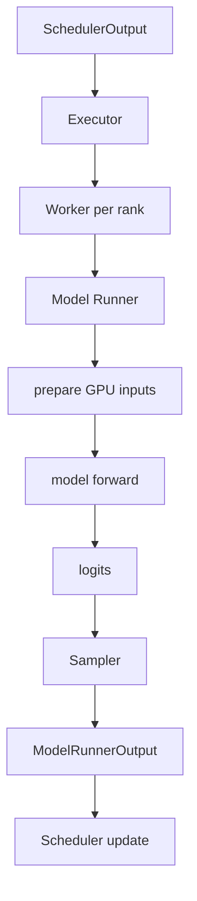

> **读图方法：** 阅读“本章定位”这张流程图时，先把方框看成对象或状态，把箭头看成数据或控制的移动。第一遍从上向下建立顺序，第二遍再核对分支发生的条件。

这一段调用链看起来只是“跑模型”，实际上同时跨越五类边界：编排、进程、设备、并行和状态。
本章绑定源码 revision `05caae03c20f69436ff7ec23ded339ea104f1a01`（vLLM `main`，提交日期 2026-11-09；正文最初按 v0.33.0 `4ba787ec` 写成，2026-11-10 重新钉扎到此 revision：源码引用与行号已逐条核对，Model Runner V1 删除已重新绑定；其余行为未在 05caae03 上全面重核，清单见 `meta/upgrade-main-05caae03-2026-11-10/`），继续使用以下标签：

- **源码事实**：当前 revision 可直接定位的行为。
- **设计意图**：源码注释或同 revision 设计文档表达的目标。
- **设计含义**：由多处源码共同推出的解释。
- **教学模型**：随书纯 Python 程序，只验证契约，不模拟 CUDA 性能。

> **版本说明（v0.32.0 → v0.33.0）：** 旧正文基线是 v0.32.0（`5df63a72…`）。v0.32.0 位于 release 分支，
> 与 v0.33.0 的 merge-base 是 `fe341a53`，所以只有 `fe341a53..4ba787ec` 里真正在 v0.33.0 祖先链内的
> 提交才写入正文，逐条用 `git merge-base --is-ancestor <commit> 4ba787ec` 核验，清单见 7.32。
> 2026-11-10 已按这个 revision 对本章涉及的源码文件做静态复核（读代码与 diff，没有运行 GPU 或上游测试）。
> v0.33.0 之后、已是 `05caae03` 祖先的 main 变化，以“main 上的变化（已包含在本书基线中，正文尚未展开）”注记保留，后续批次补写；不是 `05caae03` 祖先的才会标为“未发版”（目前没有这样的条目）。

## 阅读目标

读完本章后，你应该能够：

1. 区分 Executor、Worker、Model Runner、Model、Attention backend 与 Sampler。
2. 追踪 `SchedulerOutput` 怎样到达所有 rank，并解释为什么通常只取一个 rank 的回复。
3. 说明 `rank`、`local_rank`、`rpc_rank` 与 driver worker 的差异。
4. 解释 Worker 启动时设备、分布式通信、随机种子、显存快照和 Runner 的先后顺序。
5. 从 Hugging Face `architectures` 追到 vLLM model class、loader 和 `load_weights()`。
6. 写出可用于 KV Cache 的显存预算公式，并指出它的假设。
7. 将 request-local token 切片还原成 flat `input_ids`、`positions` 与 ragged boundaries。
8. 追踪模型 forward、PP intermediate tensors、logits 与 sampling。
9. 区分 V1 Engine 与 Model Runner V2（MRV2），并知道 Model Runner V1（MRV1）已被 #63373 移除。
10. 理解 `execute_model()` 与 `sample_tokens()` 为什么通过临时状态分成两步。

## 如何阅读本章

执行栈可以类比为一条生产线：Executor 决定调用哪些工作站，Worker 管理一个设备环境，
Model Runner 把调度结果装配成 tensor，模型执行数值计算，Sampler 选出 token。名字都
带“执行”，但它们拥有的资源和状态完全不同。

阅读本章时先给每个对象贴三个标签：运行在哪个进程、拥有哪个设备、输入输出是什么。
只要这三个问题能回答，就不会把 Executor 的分布式编排、Worker 的设备生命周期和
Runner 的 batch 构造混在一起。

第一次阅读追单 GPU、普通文本生成的完整 step；第二次加入 TP/PP 广播和返回值规则；
第三次再看 MRV2 的 persistent batch、warmup、CUDA Graph 与异步输出。模型内部算子已经在第 01 和
第 06 章建立基础，本章重点是它们怎样被系统正确地调用。

**先分清数据搬运。** H2D 是 CPU 主机内存到 GPU 设备内存，D2H 是反向拷贝；
rank 是通信参与进程的编号，shard 是它负责的数据分片。persistent row 是给请求长期
保留的状态行，本轮 batch row 则会随请求排序变化，二者用索引表连接。

**第一遍走法：** 读 7.1–7.3、7.6、7.11–7.14、7.16–7.18 和 7.23，先跑单卡教学链；
通信与 Runner 自动选择第二遍细读。**停下来追：** 请求 B 存在状态行 3，本轮排第 0，
模型该读哪行？通过 `idx_mapping[0]=3` 收集状态，不能直接把状态行 0 当作 B。

## 7.1 五层执行栈：先把名字放对位置

> **本节先看：** 本节要回答：**五层执行栈：先把名字放对位置**。下面的小节会逐层拆开概念、运行过程和源码落点；第一次阅读先抓对象之间的关系，第二次再记类名、字段和分支。

### 7.1.1 Executor：编排 Worker

`Executor` 决定 Worker 在哪里、如何启动、如何接收控制消息、如何汇总返回值。它不实现
Transformer layer，也不直接做 QK matmul。

[源码] `vllm/v1/executor/abstract.py` - `Executor`

### 7.1.2 Worker：拥有一个设备执行环境

`WorkerBase` 是硬件执行接口。GPU `Worker` 负责设备映射、分布式初始化、构造 Runner、加载模型、
profile 显存、初始化 KV Cache、warmup/capture，以及把每个 step 交给 Runner。

[源码] `vllm/v1/worker/worker_base.py` - `WorkerBase`

[源码] `vllm/v1/worker/gpu_worker.py` - `Worker`

### 7.1.3 Model Runner：把调度语义翻译为模型输入

Runner 持有模型和执行期状态，把“请求 A 本轮算 3 个 token”翻译为：

```text
input_ids, positions, query_start_loc, seq_lens,
block_tables, slot_mappings, attention metadata, sampling state ...
```

### 7.1.4 Model 与 Sampler

模型类组织 embedding、Transformer layers、norm、LM head 和 logits；Sampler 执行约束、惩罚、
temperature、top-k/top-p、随机采样与 logprobs。Scheduler 决定**算哪些位置**，Sampler 决定
**这些位置生成什么 token**。

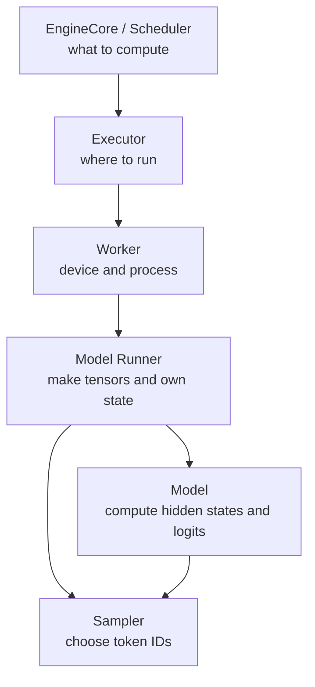

> **读图方法：** 这张图用于压缩“Model 与 Sampler”的整体关系。先从上向下找到起点、关键转换和终点，再问每条跨层箭头是否意味着函数调用、消息传递、内存访问或状态更新。

**设计含义：** 所有 rank 没收到 step 是 Executor/RPC 问题；device 选错是 Worker 问题；position 或
block table 错是 Runner 问题；层数值错是 Model/backend 问题；token 分布错才进入 Sampler。

### 执行栈所有权与职责矩阵

先区分 Python 对象所在的进程与数值运算发生的设备。以下采用 GPU 文本生成路径，
Model 和 Sampler 对象由 Worker 侧 CPU 代码持有，具体 tensor 运算才提交给 GPU。

| 组件 | 对象所在进程 | 主要持有状态 | 输入与输出 | 职责 |
|---|---|---|---|---|
| Executor | EngineCore 所在进程 | Worker 句柄、通信与结果收集状态 | SchedulerOutput → Future、None 或模型输出，视方法/模式而定 | 派发执行与采样 |
| Worker | 由 executor 决定；uni 可与 core 同进程 | 设备环境、Runner | 执行指令 → 同步/异步输出或阶段结果 | 设备初始化、加载与执行入口 |
| Model Runner | Worker 所在进程 | 模型、采样器、请求状态、输入缓冲区 | SchedulerOutput → 中间张量、待采样状态或 ModelRunnerOutput | 准备输入、调用模型并组织采样，不只生成 input_ids |
| Model | Worker 所在进程；tensor 计算在设备上 | 权重和层对象 | 模型输入 → hidden states；LM head 另算 logits | 模型数值计算 |
| Sampler | Worker 所在进程；主要采样运算在设备上 | 采样参数和请求状态 | 未归一化 logits → token IDs、可选 logprobs 等 | 约束、过滤与选择 token |

Logits 是分数，不是概率分布；单卡也不必然对应 uni executor，进程归属仍要看配置。

[源码] `vllm/v1/worker/gpu_worker.py` - `Worker.init_device`

[源码] `vllm/v1/worker/gpu/model_runner.py` - `GPUModelRunner.execute_model`、`sample_tokens`

[源码] `vllm/v1/worker/gpu/sample/sampler.py` - `Sampler.__call__`

## 7.2 两个“V1”：V1 Engine 与已被移除的 MRV1

“V1”曾经指两个互不相干的东西。**vLLM V1 Engine** 是引擎代际，对应 `vllm/v1/engine/`、`vllm/v1/core/`，至今仍是主线。
**Model Runner V1（MRV1）** 是 GPU Worker 里的第一代 Runner（`v1/worker/gpu_model_runner.py` 加上配套的持久 batch、
采样器、投机解码 proposer 和 CUDA Graph dispatcher）。后者已被 `aac1b2a4f3`（[#63373](https://github.com/vllm-project/vllm/pull/63373)，
`[Core] Remove Model Runner V1`，2026-11-07）整体删除：这个提交删掉 66 个文件、改动 435 个文件，MRV1 不在 v0.33.0 中，
但在本书固定的 `05caae03` 里已经不存在。所以在这个 revision 上，“V1 Engine 用哪套 Runner”只有一个答案。

| 维度 | 名称 | 当前源码位置 |
|---|---|---|
| Engine 代际 | V1 Engine | `vllm/v1/engine/`、`vllm/v1/core/` |
| GPU Runner | MRV2（类名仍叫 `GPUModelRunner`） | `vllm/v1/worker/gpu/model_runner.py:203` |
| encoder-only Runner | `MMEncoderModelRunner` | `vllm/v1/worker/mm_encoder_model_runner.py` |
| CPU Worker 的 Runner | `CPUModelRunner`（MRV2 `GPUModelRunner` 的子类）；平台无 Triton 时改用 `StandaloneCPUModelRunner` | `vllm/v1/worker/cpu/model_runner.py:10`、`vllm/v1/worker/cpu/standalone_model_runner.py:115`（选择见 `cpu_worker.py:149-158`） |

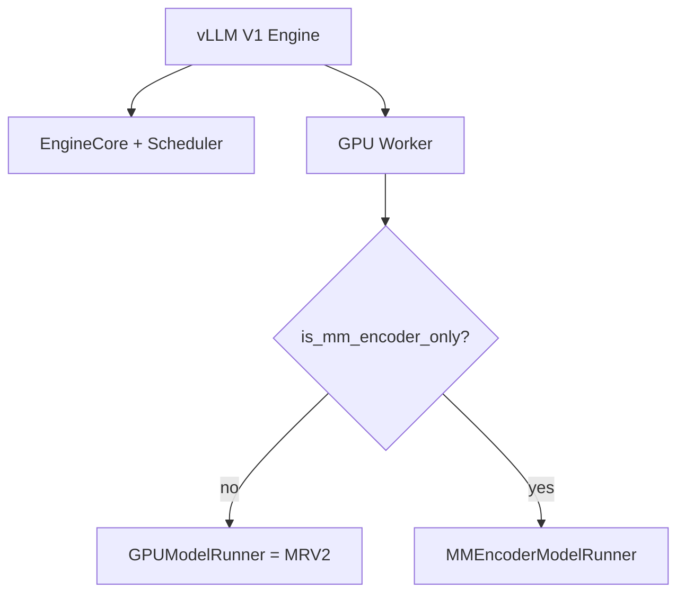

> **读图方法：** 先看顶层的 V1 Engine，再看 Worker 下方唯一的分叉。这个分叉不是“选哪一代 Runner”，而是“这个实例是否只跑多模态 encoder”：一次 Worker 实例只构造其中一种 Runner。以前这里还有一支指向 MRV1，现在已经删除。

“用了 V1 Engine，因此一定使用 `v1/worker/gpu_model_runner.py`”这句话在 v0.33.0 及以前是错误的，现在更是不可能：
该文件已不存在。GPU Worker 在 `_make_model_runner`（`vllm/v1/worker/gpu_worker.py:584`）里直接构造 MRV2 的 `GPUModelRunner`
（`:590-592`），encoder-only 配置构造 `MMEncoderModelRunner`（`:586-589`）；不再有 `VllmConfig.use_v2_model_runner` 之类的开关。
MRV2 的设计目标和它为何取代 MRV1，仍可读 `docs/design/model_runner_v2.md`；该文档沿用“V1 对比 MRV2”的历史口吻，
V1 的描述是历史对照，不是当前代码。

[源码] `vllm/v1/worker/gpu_worker.py` - `Worker._make_model_runner`

[设计] `docs/design/model_runner_v2.md` - “Introduction”

## 7.3 Executor 如何选择

`Executor.get_class()` 读取 `parallel_config.distributed_executor_backend`：

| backend | 实现 | 典型边界 |
|---|---|---|
| `uni` | `UniProcExecutor` | Worker 与 Executor 同一进程 |
| `mp` | `MultiprocExecutor` | multiprocessing Worker |
| `ray` | `RayExecutorV2` | Ray actor 编排（v0.33.0 中只剩 V2） |
| `external_launcher` | `ExecutorWithExternalLauncher` | `torchrun` 等外部启动器 |
| Python 类/限定名 | 自定义 `Executor` 子类 | out-of-tree 扩展 |

[源码] `vllm/v1/executor/abstract.py` - `Executor.get_class`（L64；`ray` 分支 L76–L79 @ `05caae03`）

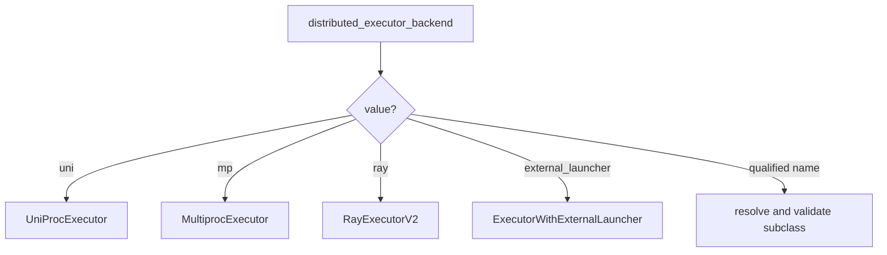

> **读图方法：** 阅读“Executor 如何选择”这张流程图时，先把方框看成对象或状态，把箭头看成数据或控制的移动。第一遍从上向下建立顺序，第二遍再核对分支发生的条件。

共同初始化先保存配置分区，再调用具体 `_init_executor()`。EngineCore 之后仍使用统一接口执行显存
探测、KV 初始化、warmup、`execute_model()` 和 `sample_tokens()`。

**v0.33.0 对 `ray` 分支的改动。** v0.32.0 的 `get_class()` 还会读环境变量
`VLLM_USE_RAY_V2_EXECUTOR_BACKEND`，在旧的 Ray compiled-graph 实现 `RayDistributedExecutor` 与
`RayExecutorV2` 之间二选一。`e57bb4ace`（#61712）删除了旧实现及其 Ray 通信器、`ray_utils` 辅助模块和
`VLLM_USE_RAY_COMPILED_DAG_*` 一类环境变量；`52e88e25e`（#62228）再删除这个选择开关本身。
所以在 `4ba787ec` 中 `ray` 只会得到 `RayExecutorV2`，读到旧文章或旧 issue 里的
`RayDistributedExecutor` 时，它在当前 revision 里已经不存在。Ray 后端的 actor 拓扑见第 09 章。

### 7.3.1 UniProc 并不等于没有 Worker

`UniProcExecutor` 仍创建 wrapper 和真实 Worker，只是调用不经过跨进程消息队列：

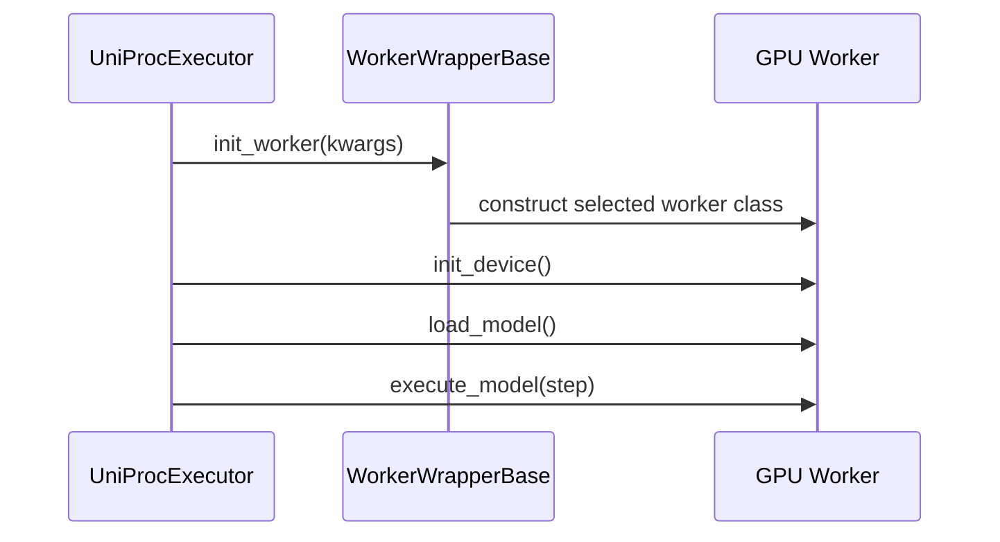

> **读图方法：** 这是“UniProc 并不等于没有 Worker”的时序图。先从左到右确认参与者分别负责什么，再从上到下追踪消息；第一遍只看正常路径，第二遍再看返回、异步消息和失败分支。

[源码] `vllm/v1/executor/uniproc_executor.py` - `UniProcExecutor._init_executor`

若 Worker 返回 `AsyncModelRunnerOutput`，同步路径调用 `get_output()`；non-blocking 路径用
`AsyncOutputFuture` 延迟完成。

### 7.3.2 External launcher 的特殊假设

`ExecutorWithExternalLauncher` 每个 Executor 只创建一个 Worker，rank 与 `local_rank` 来自
`env://`。多个外部启动的 Engine 依赖确定性调度处理相同 prompts，而不是由一个 Executor 拥有
全部 Worker。配置解析会把 `VLLM_ENABLE_V1_MULTIPROCESSING` 设为 `0`，Executor 初始化时也会
再次断言 multiprocessing 已关闭；这不是可选调优，而是该执行方式保持各 Engine 调度一致的
运行条件。源码测试通过 `torchrun` 检查各 rank 的 KV 配置与生成结果一致。

[测试] `tests/distributed/test_torchrun_example.py` - external launcher offline inference

关闭路径在 v0.33.0 也有变化：`ExecutorWithExternalLauncher.shutdown()` 在 `super().shutdown()` 之后调用
`destroy_model_parallel()`（`uniproc_executor.py` L219，类定义 L161 @ `05caae03`，`c07c59f82`，#62241），
像 `MultiprocExecutor` 的 Worker 一样提前释放 vLLM 自己的 TP/PP/DP/EP 通信组。world group 与默认 process group
可能属于外部启动器，所以不在释放范围内。

这解释了 `rpc_rank` 与 global `rank` 为何不能永远视为同一值。还要区分 Runner 能力边界：
external launcher 的纯 TP 路径可以使用 MRV2；只有与 `PP>1` 组合时，`VllmConfig._get_model_runner_unsupported_features`
（`vllm/config/vllm.py:3119`）才把 “pipeline parallelism with external_launcher” 列为不支持项。
[#63373](https://github.com/vllm-project/vllm/pull/63373) 之前这里是“回退到 MRV1”；MRV1 删除后，`_validate_model_runner`（`:3446`）
对任何不支持项直接抛 `ValueError`（“The GPU model runner does not support: …”），不再回退。

## 7.4 MultiprocExecutor：广播命令，只收需要的回复

`Executor.collective_rpc()` 的接口注释建议它用于控制消息，大量数据应建立专门数据面。
Multiprocessing 实现把方法名、参数和 output rank 放入 broadcast message queue。

[源码] `vllm/v1/executor/multiproc_executor.py` - `MultiprocExecutor.collective_rpc`

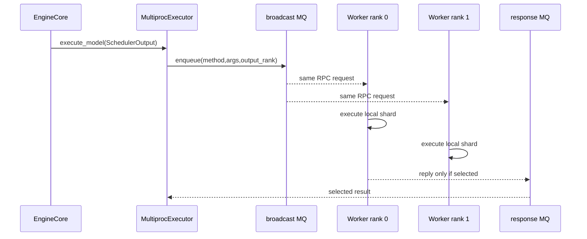

> **读图方法：** 这是“MultiprocExecutor：广播命令，只收需要的回复”的时序图。先从左到右确认参与者分别负责什么，再从上到下追踪消息；第一遍只看正常路径，第二遍再看返回、异步消息和失败分支。

### 7.4.1 所有 rank 都执行，通常只返回一个 rank

TP/PP 中每个 rank 都必须参与计算和 collectives，但 Scheduler 不需要 N 份等价 token 输出。
`execute_model()` 与 `sample_tokens()` 因而广播到所有 Worker，同时设置
`unique_reply_rank=self.output_rank`。

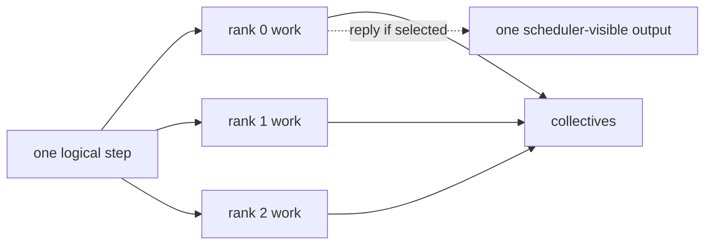

> **读图方法：** 阅读“所有 rank 都执行，通常只返回一个 rank”这张流程图时，先把方框看成对象或状态，把箭头看成数据或控制的移动。第一遍从左向右建立顺序，第二遍再核对分支发生的条件。

“只回复”不等于“只有一个 rank 运行”。让非输出 rank 跳过 forward 会令 collective 永久等待。

这张图限定为没有 KV/encoder connector 输出聚合器的普通路径。有聚合器时，
`collective_rpc` 会把发给 Worker 的 `output_rank` 置为 `None`，收集所有 rank 回复，
再合并 connector 元数据并选出面向 Scheduler 的输出。“最后只得到一份输出”不等于
“通信时永远只收一个 rank”。

[源码] `vllm/v1/executor/multiproc_executor.py` - `MultiprocExecutor.collective_rpc`

### 7.4.2 WorkerProc 的 busy loop 与错误路径

每个 `WorkerProc` 初始化 Worker、设备和模型，报告 `READY`，再持续 dequeue RPC、调用方法并按条件
enqueue output。异常会转成 failure status；Executor 读取后抛出，Worker monitor 还会在进程死亡时
关闭 Executor 并触发 failure callback。

[源码] `vllm/v1/executor/multiproc_executor.py` - `WorkerProc.worker_main`

[源码] `vllm/v1/executor/multiproc_executor.py` - `WorkerProc._execute_worker_rpc`

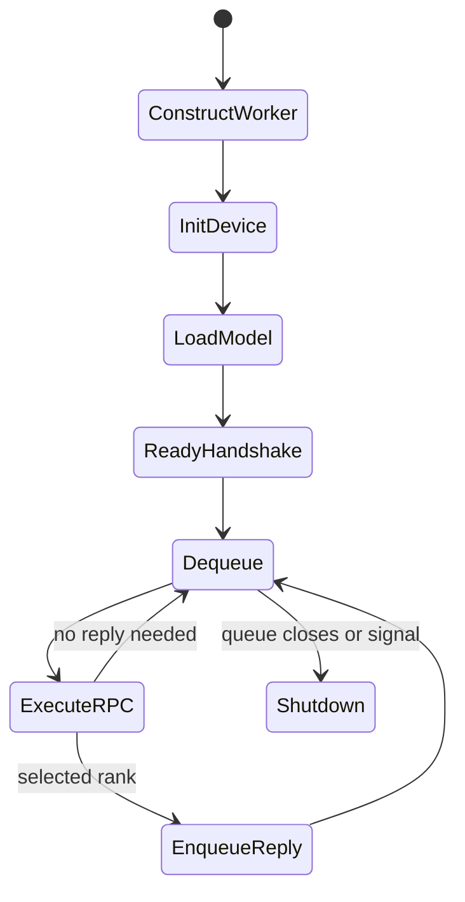

> **读图方法：** 这是“WorkerProc 的 busy loop 与错误路径”的状态图。先找初始状态，再沿箭头观察触发条件和状态变化；重点不是背状态名，而是弄清谁触发转换、转换后哪些资源需要更新。

[测试] `tests/distributed/test_multiproc_executor.py` - 初始化、RPC、rank reply 与 PP 覆盖

### 7.4.3 v0.33.0 新增：并发启动、watchdog 与带 KV 输出的失败回复

上一节的 busy loop 在 v0.33.0 有三处行为变化。它们都发生在“Worker 进程已经存在、但还没进入稳态
服务”或“某个 RPC 失败”的边缘，所以放在一起看。

1. **非 fork 启动方式下并发启动本地 Worker。** `52f44839f`（#60028）让 `MultiprocExecutor._init_executor`
   先调用 `_can_start_workers_concurrently(inherited_fds)`：只有 `inherited_fds is None`（也就是
   multiprocessing 启动方式不是 fork，包括 spawn/forkserver）、本节点 `local_world_size > 1`、平台不是 CPU、且没有开启
   `numa_bind` 时才返回真，此时用 `ThreadPoolExecutor` 同时拉起本地各个 `WorkerProc`；否则退回原来的
   逐个启动。fork 会把前一个 Worker 继承的 socket fd 传给后一个，CPU 后端的 OpenMP 环境和 NUMA 的
   `numactl` 包装都会逐 Worker 改写进程全局状态，这些情形不能并行。并发路径仍按 rank 顺序收集句柄，
   即使某个启动失败，也把已创建的句柄放进待就绪列表，以便清理时终止它们。创建全部 Worker 之后才等
   `READY`，这一点与以前相同。
2. **可选的 stack-dump watchdog。** `1c8799197`（#55700）新增 `WatchdogConfig`（`timeout` 默认 300 秒、
   `check_interval` 默认 10 秒、`dump_dir` 默认为空）。`dump_dir` 为空表示不启用。启用后，EngineCore
   进程（`start_watch_dog(f"engine_{dp_rank}", …)`）和每个 `WorkerProc`（`worker_{rank}`）各起一个后台线程；
   主循环每处理一步或一个 RPC 就 `feed()`，阻塞等待输入时包在 `disable()` 里，超过 `timeout` 没有
   喂食就把所有线程的栈追加写到 `VLLM_STACK_DUMP_for_<name>_<pid>.log`。它只负责留下诊断信息，
   不会杀进程或重启。Worker 发现父进程退出（death pipe 关闭）和 EngineCore 收到 `SIGTERM` 时，也会通过 `handle_failure` 记一次栈。
3. **失败回复可以携带 KV connector 输出。** 开启 `enable_fault_tolerance`（默认 `False`）的 P/D 分离
   部署里，一个 step 失败时，已经发生的 KV 传输不能被丢掉，否则对应 block 会泄漏。`e7bb7e2f2`（#56430）
   为 `WorkerProc.ResponseStatus` 增加 `FAILURE_WITH_KV_OUTPUT`，`AsyncModelRunnerOutput` 增加抽象方法
   `get_kv_connector_output()`；`enqueue_output` 在 `get_output()` 抛错且 connector 输出非空时，把
   `KVConnectorOutput` 作为失败回复发出。Executor 侧的 `get_response` 看到这个状态时：没开 fault
   tolerance 或已经 `is_failed`，仍然直接抛 `RuntimeError`；否则先把各 rank 的 KV 输出交给
   `kv_output_aggregator.ft_defer_kv_connector_outputs`，再抛 `RuntimeError("One or more workers failed")`。

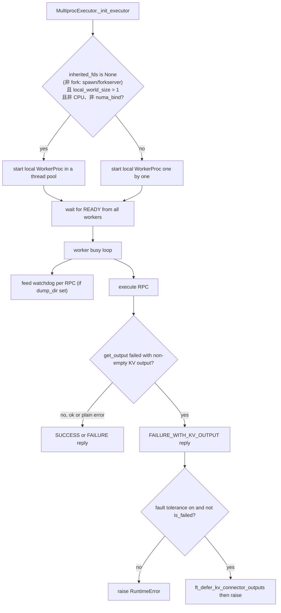

> **读图方法：** 这是“并发启动、watchdog 与失败回复”的流程图，分成启动和失败两段。上半段看启动判定菱形：四个条件都满足才并行，否则退回串行，两条路在 `READY` 汇合；下半段从 busy loop 往下，看 RPC 出错时是否带着非空 KV 输出，带着就走 `FAILURE_WITH_KV_OUTPUT`，再由 fault tolerance 开关决定是直接抛错还是先把 KV 输出交给聚合器暂存。watchdog 只是旁路，不改变任何分支。

[源码] `vllm/v1/executor/multiproc_executor.py` - `MultiprocExecutor._can_start_workers_concurrently`（L346，调用点 L245 @ `05caae03`）

[源码] `vllm/utils/watch_dog.py` - `ThreadedWatchDog`（L41）；`vllm/config/watchdog_config.py` - `WatchdogConfig`（L13）；`WorkerProc` 启动点 `multiproc_executor.py` L1081，EngineCoreProc 启动点 `vllm/v1/engine/core.py` L1757 @ `05caae03`

[源码] `vllm/v1/executor/multiproc_executor.py` - `WorkerProc.ResponseStatus`（L1128）、`WorkerProc.enqueue_output`（L1130）、`MultiprocExecutor.collective_rpc.get_response`（L522，状态判断 L535 @ `05caae03`）

## 7.5 WorkerWrapper 与三种 rank

`WorkerWrapperBase` 先保存 `rpc_rank`/`global_rank`，等每进程环境和插件就绪后才在
`init_worker()` 中解析 `worker_cls` 并构造真实 Worker。


> **读图方法：** 这是“WorkerWrapper 与三种 rank”的流程图。先从左向右只追一条主路径，确认输入经过哪些关键阶段到达输出；第二遍再看虚线、回边和旁路，它们通常表示反馈、复用或可选分支。

[源码] `vllm/v1/worker/worker_base.py` - `WorkerWrapperBase.init_worker`

| 名称 | 含义 |
|---|---|
| `rpc_rank` | Worker 在当前 Executor RPC 列表中的索引 |
| global `rank` | 分布式 world 中的全局 rank |
| `local_rank` | 当前节点上选择设备的局部索引 |

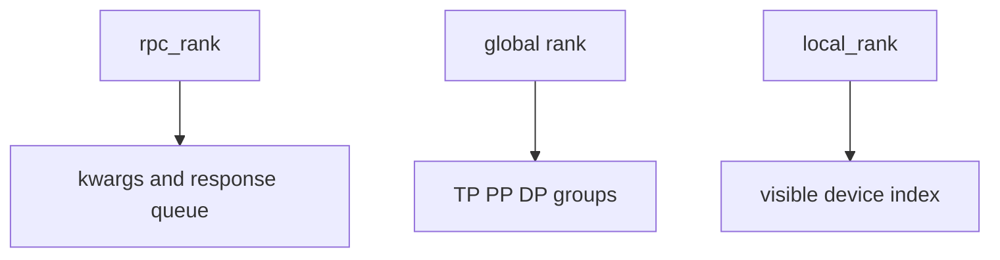

> **读图方法：** 阅读“WorkerWrapper 与三种 rank”这张流程图时，先把方框看成对象或状态，把箭头看成数据或控制的移动。第一遍从上向下建立顺序，第二遍再核对分支发生的条件。

简单布局中三者可能相同，external launcher、多 Executor 或复杂 DP 下不能依赖这种巧合。

`local_rank` 到“可见设备索引”的换算，在 v0.33.0 集中到 `ParallelConfig.get_local_gpu_index()`：
`be4ce2e50`（#61237）把原本内联在 `Worker.init_device()` 里的 DP 偏移算式收进这个方法，供 NUMA 绑定共用。
当 backend 不是 `ray`/`external_launcher`、`data_parallel_backend` 不是 `ray` 且单 DP 副本不跨节点时，
返回 `local_rank + dp_local_rank * world_size`，其余情形直接返回 `local_rank`。

[源码] `vllm/config/parallel.py` - `ParallelConfig.get_local_gpu_index`（L939）；
`vllm/v1/worker/gpu_worker.py` - `Worker.init_device`（调用点 L458 @ `05caae03`）

**Worker extension 生命周期钩子。** 配置了 `worker_extension_cls` 时，v0.33.0 中 `WorkerWrapperBase` 会记住这个类
（`de8291e24`，#59463）：`WorkerWrapperBase.init_device()` 在调用 `self.worker.init_device()` 之后，再调用类上可选的 `init_worker_extension(worker)`（L388），
`shutdown()` 里先调用可选的 `destroy_worker_extension(worker)`（L272）再关闭 Worker，销毁钩子抛出的异常只记日志，
不会阻止后续清理。两个钩子都不是必须实现的。

[源码] `vllm/v1/worker/worker_base.py` - `WorkerWrapperBase.init_worker`、`WorkerWrapperBase.init_device`
（`init_worker_extension` 在其中调用，L388）、`WorkerWrapperBase.shutdown`（`destroy_worker_extension`，L272；@ `05caae03`）

## 7.6 GPU Worker 启动顺序

> **本节先看：** 这一小节先用图建立“GPU Worker 启动顺序”的整体路径。先找输入、关键状态和输出，再阅读图后的源码解释，不必一开始记住全部节点。

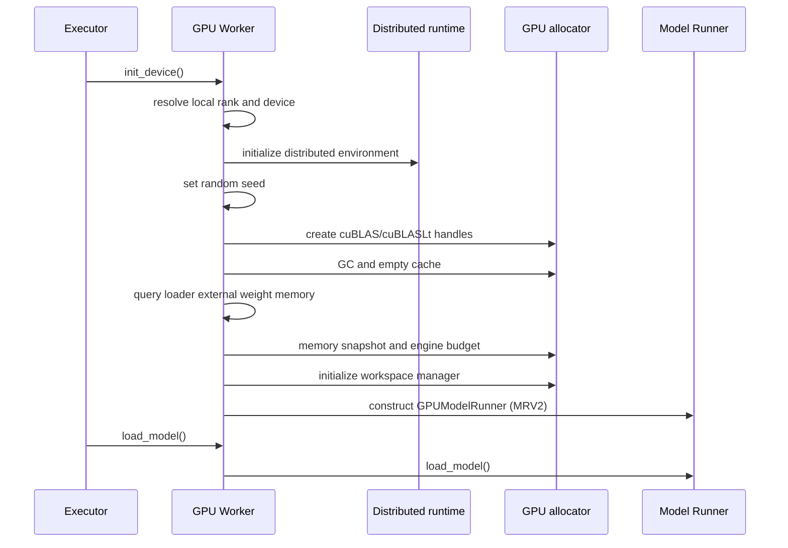

> **读图方法：** 这是“GPU Worker 启动顺序”的时序图。先从左到右确认参与者分别负责什么，再从上到下追踪消息；第一遍只看正常路径，第二遍再看返回、异步消息和失败分支。

[源码] `vllm/v1/worker/gpu_worker.py` - `Worker.init_device`

> **v0.33.0 补充：** 同样的“先占住、再快照”逻辑也用于 cuBLAS。`9cede34a6`（#61044）在 `set_random_seed` 之后、
> `MemorySnapshot` 之前，用一个 16×16 的 `torch.mm`（走 cuBLAS）和一个带 bias 的 `torch.nn.functional.linear`
> （走 cuBLASLt）预先创建 handle（`gpu_worker.py` L536 @ `05caae03`）。原因是 cuBLAS 直接向 CUDA 要 handle 内存，
> torch 看不到，也不会像自己的 `cudaMalloc` 失败时那样先释放空闲缓存再重试；profiling 可能把 torch 缓存涨到
> 显存已满，之后第一次 cuBLAS 调用就会 OOM。提前创建后，handle 内存和 NCCL 缓冲一样计入快照基线。

### 7.6.1 NCCL 为什么早于显存快照

源码明确在 `MemorySnapshot` 前初始化 distributed environment，使 NCCL 等通信缓冲区已占用显存。
否则会高估 KV Cache 空间：

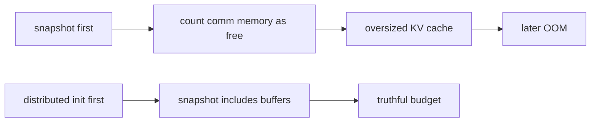

> **读图方法：** 这是“NCCL 为什么早于显存快照”的流程图。先从左向右只追一条主路径，确认输入经过哪些关键阶段到达输出；第二遍再看虚线、回边和旁路，它们通常表示反馈、复用或可选分支。

### 7.6.2 Runner 在什么时候构造

`init_device()`（`vllm/v1/worker/gpu_worker.py:453`）末尾调用 `_init_workspace_and_model_runner()`（`:567`）：先初始化
workspace manager，再在 `_maybe_get_memory_pool_context(tag="runtime")` 里调用 `_make_model_runner()`（`:584`）构造 Runner。
`_make_model_runner` 只有一个二分支：`is_mm_encoder_only` 为真构造 `MMEncoderModelRunner`，否则构造 MRV2 的
`vllm/v1/worker/gpu/model_runner.py::GPUModelRunner`。（MRV1 存在时，这里还要读 `vllm_config.use_v2_model_runner` 决定导入哪个文件；
该字段和对应分支随 #63373 一起删除。）Runner 构造只建立配置和缓冲区结构，随后
`Worker.load_model()` 才在权重 allocator context 中调用 Runner 的 `load_model()`。
子类 Worker（例如 CPU Worker，见 7.2 的表）可以覆盖这个构造点，所以不能把上图当作所有 Worker 类型的枚举。
Triton（用 Python 写 GPU kernel 的编译器和语言）的硬性检查位置在 v0.33.0 也变了：`432b1003f`（#62576）把原来在配置校验 `_validate_v2_model_runner` 里的
`ValueError("Model Runner V2 requires Triton.")` 删掉，改到 `Worker.__init__` 一开头；#63373 之后这是唯一的 Triton 检查
（`gpu_worker.py:225-226`）：没有 Triton 且平台没有独立 CPU Runner（`current_platform.uses_standalone_cpu_model_runner()`）时
抛 `ValueError("vLLM's model runner requires Triton.")`，也就是 Worker 真正启动时才报。配置侧已不再有“没有 Triton 就退回 MRV1”的分支（见 7.22）。

[源码] `vllm/v1/worker/gpu_worker.py` - `Worker._init_workspace_and_model_runner`、
`Worker._make_model_runner`

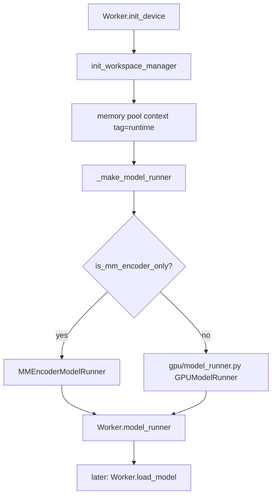

> **读图方法：** 从上到下读一次就够：`init_device` 先准备 workspace，再进入 `_make_model_runner`，唯一的菱形只区分 encoder-only 与普通 GPU 路径，两条支路都落到同一个 `Worker.model_runner` 字段；`load_model` 发生在更后面，不在这张图里构造 Runner。

## 7.7 从 architecture 到模型实例

以 `architectures=["LlamaForCausalLM"]` 为例，路径不是简单调用 Transformers AutoModel：

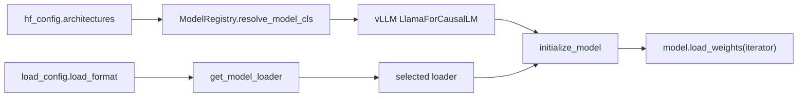

> **读图方法：** 这张图用于压缩“从 architecture 到模型实例”的整体关系。先从左向右找到起点、关键转换和终点，再问每条跨层箭头是否意味着函数调用、消息传递、内存访问或状态更新。

Registry 解决“用哪个 Python 类”；load format 解决“权重从哪里、以什么格式读取”。二者正交。

[源码] `vllm/model_executor/model_loader/utils.py` - `get_model_architecture`

[源码] `vllm/model_executor/models/registry.py` - `_ModelRegistry.resolve_model_cls`

[源码] `vllm/model_executor/model_loader/__init__.py` - `get_model_loader`

`initialize_model()` 构造模块；默认 loader 生成 `(name, tensor)` iterator，调用模型自身
`load_weights()`，再执行量化处理、weight tying 和 attention post-load 初始化。

[源码] `vllm/model_executor/model_loader/utils.py` - `initialize_model`

[源码] `vllm/model_executor/model_loader/default_loader.py` - `DefaultModelLoader.load_weights`

[源码] `vllm/model_executor/models/llama.py` - `LlamaForCausalLM.load_weights`

## 7.8 TP 权重为何不会先完整复制再切

参数对象和 layer weight loader 知道 TP rank、分片维度和 packed mapping。checkpoint iterator 交付
权重时，本地参数接收属于当前 rank 的 shard。

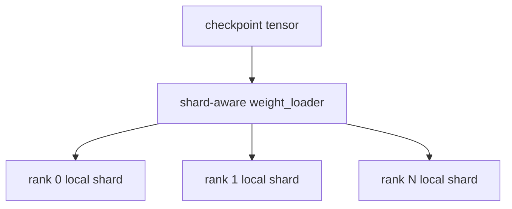

> **读图方法：** 这是“TP 权重为何不会先完整复制再切”的流程图。先从上向下只追一条主路径，确认输入经过哪些关键阶段到达输出；第二遍再看虚线、回边和旁路，它们通常表示反馈、复用或可选分支。

这也允许 packed QKV、gate/up projection 与量化格式使用专门映射。不同 load format、量化或 CPU
offload 会改变 I/O 和搬运方式；可靠结论是**最终本地参数由分片感知 loader 填充**，不能无条件
断言所有格式只从磁盘读取精确 shard 字节。

## 7.9 显存 Profiling：怎样算出 KV Cache 预算

用户未显式指定 `kv_cache_memory_bytes` 时，Worker profile 非 KV 峰值并计算：

$$
M_{\mathrm{KV}}=M_{\mathrm{requested}}-M_{\mathrm{nonKV}}-M_{\mathrm{graph},\mathrm{applied}}
$$

- 所有 `M` 的单位都是 byte（换成 GiB 时所有项一起换）；
- 先取 `M_util = ceil(total_memory * gpu_memory_utilization)`，不是 free memory 乘利用率；
  普通进程内加载时 `M_requested=M_util`。若 loader 报告外部进程已持有权重
  `M_external>0`，则 `M_requested=M_util-M_external`，并检查余量为正且 free memory
  足以满足这个余量。外部权重不能因为不归当前进程 allocator 所有就漏算；
- `M_nonKV` 包含权重及 profile 期间非 KV 消耗；
- `M_graph,applied` 是实际扣除的 CUDA Graph 内存估算。环境变量
  `VLLM_MEMORY_PROFILER_ESTIMATE_CUDAGRAPHS` 默认值为 `1`，即默认应用估算；显式设为 `0`
  才不扣此项。在 `05caae03` 上，Worker 只按两件事决定要不要去估算：平台是 CUDA-alike（含 ROCm）或 XPU，
  且这个环境变量为真（`gpu_worker.py` L755–L760）。`cudagraph_mode` 是否为 `NONE`、`cudagraph_mm_encoder`
  是否开启这类判断已不在 Worker 里（#63778，`dc4d977d97`），而是移进 `GPUModelRunner.profile_cudagraph_memory()`：
  开启 `cache_config.enable_extensible_kv_cache` 时它直接返回 0（`gpu/model_runner.py` L1129–L1136）；
  否则交给 `cudagraph_utils.py::profile_cudagraph_memory`，该函数在 `cudagraph_mode == NONE` 且
  `runner.needs_cudagraph_capture()` 也为假时返回 0（L1010–L1014）。`needs_cudagraph_capture()` 把 encoder graph
  也算进去（`gpu/model_runner.py` L1138–L1146），所以只剩 encoder graph 要捕获时仍会得到估算
  （`7128f568a`，#58243）。不能把开关开启等同于必有非零预留。

[源码] `vllm/v1/worker/gpu_worker.py` - `Worker.determine_available_memory`（估算条件 L748–L760 @ `05caae03`）

[源码] `vllm/v1/worker/gpu/model_runner.py` - `GPUModelRunner.profile_cudagraph_memory`、`needs_cudagraph_capture`

[源码] `vllm/v1/worker/gpu/cudagraph_utils.py` - `profile_cudagraph_memory`

[源码] `vllm/envs.py` - `VLLM_MEMORY_PROFILER_ESTIMATE_CUDAGRAPHS`

[源码] `vllm/v1/worker/utils.py` - `request_memory`；
`vllm/v1/worker/gpu_worker.py` - `Worker.init_device`

Worker 内仍保留“opt-in”措辞的注释，但环境变量的实际默认值已经是 `1`。默认行为应以
`vllm/envs.py` 的取值和这里的分支为准，不能仅依据注释推断。

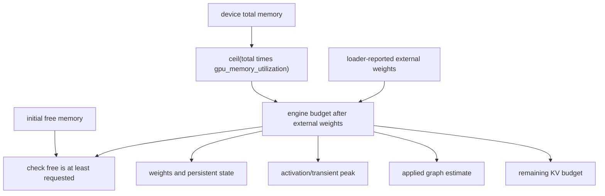

> **读图方法：** 阅读“显存 Profiling：KV Cache 只能拿剩下的”这张流程图时，先把方框看成对象或状态，把箭头看成数据或控制的移动。第一遍从上向下建立顺序，第二遍再核对分支发生的条件。

`profile_run()` 用于容量规划和触发编译，不是线上性能 benchmark。若显式给出 KV bytes，源码仍执行
profile run 以编译最大 batch，但跳过自动 memory profiling，且该容量不再服从
`gpu_memory_utilization` 的自动预算。

[测试] `tests/v1/worker/test_gpu_worker.py` - profile 与 graph 显存会计

[测试] `tests/v1/worker/test_worker_memory_snapshot.py` - Worker 启动快照

## 7.10 KV Cache 初始化与 warmup

> **本节先看：** 这一小节先用图建立“KV Cache 初始化与 warmup”的整体路径。先找输入、关键状态和输出，再阅读图后的源码解释，不必一开始记住全部节点。

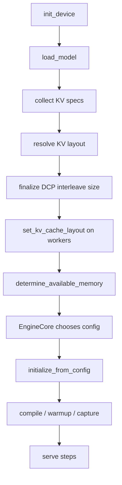

> **读图方法：** 这张图用于压缩“KV Cache 初始化与 warmup”的整体关系。先从上向下找到起点、关键转换和终点，再问每条跨层箭头是否意味着函数调用、消息传递、内存访问或状态更新。注意中间新增的两个节点：KV layout 与 DCP interleave size 都在 profiling 之前由 EngineCore 定好，再一并发给所有 Worker。

先加载模型并收集 KV specs，才能确定 layout；先 profile，才能确定最终池容量。某些
profiling 路径已经会创建最小临时 KV 并估算 graph，不能把图理解成 profile 时绝无
KV 或 capture。v0.33.0 起这个最小 KV 的配置由 `KVCacheConfigBuilder` 生成（`b54458740`，#53558；MRV2 的做法见第 08 章 8.17.1）。最终缓存初始化后，服务前的 warmup/capture 再使用正式布局。
`initialize_from_config()` 先记录 block 数/layout 和由 EngineCore 解析的
`hash_block_size`、`cache_hit_alignment_tokens`，再初始化 KV
connector，然后调用 Runner `initialize_kv_cache()`。warmup 覆盖 compile sizes、kernel warmup、Runner 的
JIT 预热（`warmup_kernels`，由 `kernel_config.enable_jit_warmup` 控制）和非 eager 下的 graph capture。

**v0.33.0 的 profiling 前置步骤。** `EngineCore._initialize_kv_caches`（L277）在 profiling 之前依次做三件事：
`resolve_kv_cache_layout`（L318）、`VllmConfig.adjust_dcp_kv_cache_interleave_size`（L325）、
`model_executor.set_kv_cache_layout(layout.name, cp_kv_cache_interleave_size)`（L326）。
`3e75ccba2`（#62330）把 NIXL P/D 场景下的 DCP interleave 从 `initialize_from_config()` 里初始化 KV connector 时
由各 Worker 各自调整，改成 EngineCore 在 profiling 前用全局 KV cache groups 统一确定，Worker 端的
`WorkerBase.set_kv_cache_layout(kv_cache_layout, cp_kv_cache_interleave_size)`（`worker_base.py` L115）只负责赋值；
sparse indexer 也不再懒加载缓存这个值。`Executor.set_kv_cache_layout` 因此多了一个参数。
最终缓存初始化之后（L408），若启用了 `SimpleCPUOffloadConnector` 且开启 prefix caching，EngineCore 还会向
Executor 取回各 Worker 对齐后的 CPU offload block 数（`get_simple_cpu_offload_num_blocks`，L432，`30aded62d`，
#52921），保证 PP/speculative decoding 下各 Worker 的池大小一致，再写入 `cache_config`。

[源码] `vllm/v1/engine/core.py` - `EngineCore._initialize_kv_caches`（@ `05caae03`）

[源码] `vllm/config/vllm.py` - `VllmConfig.adjust_dcp_kv_cache_interleave_size`（L3460）

[源码] `vllm/v1/engine/core.py` - `EngineCore._initialize_kv_caches`

[源码] `vllm/v1/worker/gpu_worker.py` - `Worker.initialize_from_config`

[源码] `vllm/v1/worker/gpu_worker.py` - `Worker.compile_or_warm_up_model`

> **main 上的变化（已包含在本书基线中，正文尚未展开，后续批次补写）**：以下提交已逐条用 `git merge-base --is-ancestor <提交> 05caae03` 核对，都是本书基线 `05caae03` 的祖先（且都不在 v0.33.0 `4ba787ec` 中）；本章正文仍是 v0.33.0 时代的写法（Model Runner V1 删除除外），条目里 `@` 后的短 SHA 是各提交当时的版本，行号不是 `05caae03` 上的行号。（#62330 这些已在 v0.33.0 中并入上文）详见 meta/main-tracking-2026-10-27.md、meta/main-tracking-2026-10-28.md。
> - main 2026-10-27～10-28：[4d95f222e6](https://github.com/vllm-project/vllm/commit/4d95f222e68bd43acbdfdffad6d46eea70146dcc)（[#61258](https://github.com/vllm-project/vllm/pull/61258)）：Worker/EngineCore 子进程可通过 `numa_utils.configure_subprocess` 做 best-effort NUMA 绑定（默认 `numa_bind=None`）。详见 meta/main-tracking-2026-10-28.md。

## 7.11 SchedulerOutput 到长期请求状态

`SchedulerOutput` 是本 step 增量指令，不是完整请求数据库。Runner 将完成/抢占、新请求、增量 blocks
和每请求 scheduled-token count 应用到自己维护的状态。

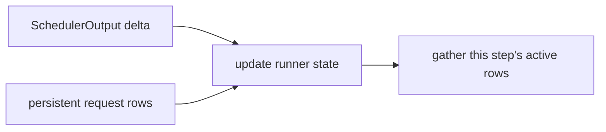

> **读图方法：** 这是“SchedulerOutput 到长期请求状态”的流程图。先从左向右只追一条主路径，确认输入经过哪些关键阶段到达输出；第二遍再看虚线、回边和旁路，它们通常表示反馈、复用或可选分支。

| 状态 | 生命周期 | 示例 |
|---|---|---|
| persistent request state | 请求 active 期间 | token IDs、computed count、block table、sampling params |
| per-step input batch | 当前 step | request order、flat inputs、query boundaries |
| execute-model state | execute 到 sample | hidden/logits、metadata、connector output |
| weights/KV tensors | Worker 或 cache 生命周期 | parameters、KV cache buffers |

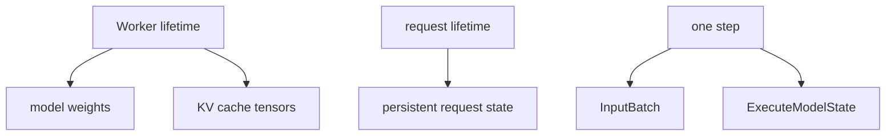

> **读图方法：** 阅读“SchedulerOutput 到长期请求状态”这张流程图时，先把方框看成对象或状态，把箭头看成数据或控制的移动。第一遍从上向下建立顺序，第二遍再核对分支发生的条件。

## 7.12 MRV2 的 persistent batch（MRV1 的旧设计已成历史）

persistent batch 的出发点是：相邻两个 step 的请求集合几乎一样，每步只有少数请求加入或结束，所以与其每步从头
拼 block table、temperature 等大 tensor，不如保留持久 state、只做增量修改。第一代 Runner（MRV1）直接把这些持久
state tensor 当作模型和采样器的输入，因此要求它们的布局与本步执行顺序一致，请求加入、结束、重排时要整块搬动，
还要维护一份冗余的 `CachedRequestState` 备份，async scheduling 下 bookkeeping 更复杂（来源：`docs/design/model_runner_v2.md`
“1. Persistent Batch”的 “Problems with V1's Approach”）。MRV1 与 `CachedRequestState` 都已随 #63373 删除，
本节只讲现在还存在的 MRV2 设计；这份设计文档对 V1 的描述保留着历史口吻，读它时请把 V1 部分当作背景。

MRV2 给每个 active request 一个固定 row（`RequestState`，`vllm/v1/worker/gpu/states.py:9`，空闲行放在 `free_indices`，
`req_id_to_index` 记录请求到行号的映射），直到完成或抢占；每 step 按执行顺序 gather 成 `InputBatch`
（`vllm/v1/worker/gpu/input_batch.py:43`，其中 `idx_mapping` 就是“batch 行 → 持久状态行”）。抢占按完成处理，
恢复时重新 add：被抢占后恢复的请求，现在由 Scheduler 作为 `NewRequestData` 重新发送（旧的 `CachedRequestData.resumed_req_ids` 已随 #63373 删除，
见第 04 章）。

[源码] `vllm/v1/worker/gpu/model_runner.py` - `GPUModelRunner`

[设计] `docs/design/model_runner_v2.md` - “Persistent Batch”

```mermaid
flowchart TB
    subgraph Persistent["permanent rows"]
        R0["row 0: C"]
        R1["row 1: free"]
        R2["row 2: A"]
        R3["row 3: B"]
    end
    ORDER["step order: B, A"] --> IDX["idx_mapping: 3, 2"]
    IDX --> G["GPU gather"]
    R3 --> G
    R2 --> G
    G --> INPUT["contiguous step inputs"]
```

> **读图方法：** 左边四行是持久的 permanent rows（C、A、B 各占一行，row 1 空闲）；本步的执行顺序是 B、A，于是 `idx_mapping` 记下“第 0 个是状态行 3、第 1 个是状态行 2”，GPU 据此把这两行 gather 成连续输入。先看 `idx_mapping` 一条线，再看 gather 的两路输入；状态行本身不搬动，变的只是索引表。

### 7.12.1 StagedWriteTensor 与 async-first

先区分两种搬运：数据可以复制到 GPU，也可以由 GPU 通过已映射的主机地址访问。
UVA（统一虚拟寻址）帮助设备访问映射后的地址，不表示主机 RAM 自动变成 GPU 显存。

当前 block table 默认保存 GPU base。`StagedWriteTensor.apply_write` 把索引、起点和
累计长度放入轮转的 UVA 缓冲区，把实际写入内容通过 H2D 复制，再由 kernel 应用。
因此不能把所有元数据都画成一次 H2D。轮转池复用多份 pinned 主机缓冲区，也不等于
每个 step 都重新分配一块内存。类本身还允许 `uva_instead_of_gpu=True`，此时名为
`gpu` 的成员在平台支持 UVA 时实际是主机内存的设备视图；不支持时回落 GPU。
该模式下写入内容本身也通过 UVA pool 提供，而非一律 H2D；上图限定默认 GPU-base 路径。
字段名不决定物理驻留位置。

这是单 cache group 写入的路径；多个 group 的 block table 使用 `FusedStagedWriter.apply`
合并写入，仍保持相同的数据与元数据搬运边界。

[源码] `vllm/v1/worker/gpu/buffer_utils.py` - `UvaBuffer`、`UvaBufferPool.copy_to_uva`、
`StagedWriteTensor.__init__`、`apply_write`

[源码] `vllm/v1/worker/gpu/block_table.py` - `BlockTables.__init__`、`apply_staged_writes`

[源码] `vllm/v1/worker/gpu/buffer_utils.py` - `FusedStagedWriter.apply`

**写入 kernel 的并行方式（v0.33.0）。** `fc2b6ab45`（#62698）把 staged write 的 Triton kernel 改成二维 grid：
第一维是本次 staged 的写入条数（每条写入是“某一行里从某个起点开始的一段内容”），第二维是
`ceil(最长一段 / 1024)` 个 chunk；每个 program（Triton 里 grid 上的一个并行实例，大致相当于 CUDA 的一个 thread block）只写一条写入里的一个 1024 元素 chunk，
不再在单个 program 里循环写完这一整段。单 group 的 `StagedWriteTensor`（`buffer_utils.py` L169）与多 group 的
`FusedStagedWriter`（L301 @ `05caae03`）两条路径都是这样。这只改变 GPU 上的并行切分，不改变上面的
数据搬运边界：写入内容仍走 H2D，索引/起点/长度仍走 UVA 缓冲。较长的一段写入（例如 block table 一行里的一大段 block ID）
因此不再被一个 program 串行写完。

> **main 上的变化（已包含在本书基线中，正文尚未展开，后续批次补写）**：以下提交已逐条用 `git merge-base --is-ancestor <提交> 05caae03` 核对，都是本书基线 `05caae03` 的祖先（且都不在 v0.33.0 `4ba787ec` 中）；本章正文仍是 v0.33.0 时代的写法（Model Runner V1 删除除外），条目里 `@` 后的短 SHA 是各提交当时的版本，行号不是 `05caae03` 上的行号。（#62698 这些已在 v0.33.0 中并入下文）详见 meta/main-tracking-2026-10-27.md。
> - main 2026-10-25～10-27：[78e2f7960](https://github.com/vllm-project/vllm/commit/78e2f796019384b07c9f9b6d8a371e3ea958b33a)（[#63633](https://github.com/vllm-project/vllm/pull/63633)） 删除写入内容的 `async_tensor_h2d` 分支，默认 GPU-base 路径的写入内容也经 `UvaBufferPool.copy_chunks_to_uva` 进入 UVA 缓冲；上文“把实际写入内容通过 H2D 复制”与下图 `non-blocking H2D` 节点在 main 上不再成立。暂存改用 `array.array`，1-D ndarray/array 按引用保留到 `apply_write`，期间不得修改。

```mermaid
flowchart TD
    BASE["GPU base"] --> APPLY["apply-write kernel"]
    DIFF["CPU staged writes"] --> PACK["write contents"]
    PACK --> COPY["non-blocking H2D"]
    COPY --> APPLY
    DIFF --> INDEX["indices / starts / lengths"]
    INDEX --> UVA["rotating UVA buffers"]
    UVA -->|GPU reads mapped metadata| APPLY
    APPLY --> GRID["2-D grid: writes x 1024-element chunks"]
    GRID --> NEW["updated GPU state"]
```

> **读图方法：** 阅读“StagedWriteTensor 与 async-first”这张流程图时，先把方框看成对象或状态，把箭头看成数据或控制的移动。第一遍从上向下建立顺序，第二遍再核对分支发生的条件。新增的 `GRID` 节点只说明 kernel 内部怎样切活：一条写入拆成多个 1024 元素的 chunk 并行写，上游的 H2D 与 UVA 两条输入线不变。

v0.33.0 还需要区分两类索引和状态驻留：请求 `idx_mapping` 使用 int64，展开后的
请求内位置 `expanded_local_pos` 仍为 int32。`RequestState.all_token_ids` 默认选择 UVA，
但 n-gram speculation 会令 `use_dense_all_token_ids=True`，保存在 GPU 以便反复扫描；
不能把“MRV2 token 历史永远在主机内存”当作固定事实。

[源码] `vllm/v1/worker/gpu/model_runner.py` - `GPUModelRunner.__init__`、`prepare_inputs`

[源码] `vllm/v1/worker/gpu/states.py` - `RequestState.__init__`；
`vllm/v1/worker/gpu/input_batch.py` - `expand_idx_mapping`

**边界：** 设计文档保留 feature-complete 与开放设计警告。运行事实仍需看当前配置与源码选择。

## 7.13 输入准备：request slices 变成 flat batch

假设本轮：A 的 positions 4,5,6 对应 token 21,22,23；B 的 position 9 对应 token 31。Runner 形成：

```text
input_ids       = [21,22,23,31]
positions       = [4,5,6,9]
query_start_loc = [0,3,4]
```

```mermaid
flowchart TB
    A["A: 3 tokens"] --> FLAT["flat token dimension"]
    B["B: 1 token"] --> FLAT
    FLAT --> IDS["input_ids: 21 22 23 31"]
    FLAT --> POS["positions: 4 5 6 9"]
    FLAT --> QSL["query_start_loc: 0 3 4"]
```

> **读图方法：** 这张图用于压缩“输入准备：request slices 变成 flat batch”的整体关系。先从上向下找到起点、关键转换和终点，再问每条跨层箭头是否意味着函数调用、消息传递、内存访问或状态更新。

`query_start_loc[i]:query_start_loc[i+1]` 是请求 i 的 query 区间。block tables、slot mappings、seq
lengths 与 backend metadata 必须使用同一请求顺序。Flat ragged representation 避免大面积 padding，
也允许 prefill/decode 混合。v0.33.0 的持久 block table 保存 manager-block IDs；
需要较小 kernel blocks 的 attention group 在 metadata 构造边界转换自己的表和 KV views，
不能把 kernel-block 展开重新塞回通用输入 batch。具体寻址见第 06 章。

[源码] `vllm/v1/worker/utils.py` - `AttentionGroup.build_metadata`、
`AttentionGroup.map_to_kernel_block_table`

MRV2 主干顺序是 update requests、处理 zero-work、gather state、决定 graph/DP padding、准备 inputs、
gather block tables/slot mappings、构建 attention metadata、forward。

“update requests”在 v0.33.0 多了一小步（`373614f66`，#57368）：`SchedulerOutput.encoder_input_updates`
（`output.py` L256）按 `req_id → {input_id: 载荷或 None}` 告诉 Runner，已经消费完的多模态 CPU 载荷可以释放（置 `None`），
或在 KV 加载回滚后需要重新编码时把载荷放回。MRV2 在 `add_requests`/`update_requests` 之后、
`block_tables.apply_staged_writes()` 之前逐请求调用 `EncoderCache.update_encoder_inputs`
（`model_runner.py` L1847），它只替换该请求 `mm_features` 里对应条目的 `data`，GPU 上的 encoder embedding 和
identifier/placeholder 元数据都不动。

[源码] `vllm/v1/worker/gpu/mm/encoder_cache.py` - `EncoderCache.update_encoder_inputs`（L29 @ `05caae03`）

```mermaid
flowchart TD
    U["update requests"] --> Z{"zero tokens?"}
    Z -->|yes| EMPTY["no-forward / connector path"]
    Z -->|no| G["gather request state"]
    G --> D["graph and DP dispatch"]
    D --> P["input IDs and positions"]
    P --> B["block tables and slots"]
    B --> A["attention metadata"]
    A --> F["model forward"]
```

> **读图方法：** 这是“输入准备：request slices 变成 flat batch”的流程图。先从上向下只追一条主路径，确认输入经过哪些关键阶段到达输出；第二遍再看虚线、回边和旁路，它们通常表示反馈、复用或可选分支。

[源码] `vllm/v1/worker/gpu/model_runner.py` - `GPUModelRunner.execute_model`

## 7.14 Model forward 与 forward context

模型调用表面常见为 `model(input_ids, positions, intermediate_tensors=...)`，但 attention metadata 等
step context 通过 `set_forward_context(...)` 建立，Attention layer 再从 context 获取。

```mermaid
sequenceDiagram
    participant MR as Model Runner
    participant FC as forward context
    participant M as Model
    participant A as Attention
    MR->>FC: set metadata and batch descriptor
    MR->>M: forward(inputs)
    M->>A: layer forward(q,k,v)
    A->>FC: read step metadata
    A->>A: backend KV update and attention
```

> **读图方法：** 这是“Model forward 与 forward context”的时序图。先从左到右确认参与者分别负责什么，再从上到下追踪消息；第一遍只看正常路径，第二遍再看返回、异步消息和失败分支。

所以阅读模型函数签名不足以看全输入，必须同步追踪 forward context。

## 7.15 Pipeline Parallelism：中间 rank 不采样

非首 stage 在 forward 前异步接收上一 stage 的 `IntermediateTensors`；非末 stage forward 后发送到下一
stage；只有末 stage 得到最终 hidden states、logits 和采样职责。

```mermaid
sequenceDiagram
    participant P0 as PP rank 0
    participant P1 as PP rank 1
    participant P2 as PP last rank
    P0->>P0: early layers
    P0-->>P1: IntermediateTensors
    P1->>P1: middle layers
    P1-->>P2: IntermediateTensors
    P2->>P2: final layers and logits
    P2->>P2: sample tokens
```

> **读图方法：** 这是“Pipeline Parallelism：中间 rank 不采样”的时序图。先从左到右确认参与者分别负责什么，再从上到下追踪消息；第一遍只看正常路径，第二遍再看返回、异步消息和失败分支。

Worker 在新 forward 前等待上一 step 尚未完成的 PP send handle，避免覆写发送方仍在读取的 buffer。
非首 rank 用 `irecv_tensor_dict()`，Runner 返回 intermediates 后再 non-blocking send。

MRV2 里采样结果的回传由 `PPHandler`（`pp_utils.py` L55）负责：末 rank 用独立的 NCCL 子通信组
在侧 stream 上广播 sampled tokens 与 `(num_sampled, num_rejected)`，非末 rank 的 `receive()` 提前登记一个
`PendingRecv`，要等 `pp_size` 个 step 之后才由 `get_prev_sampled_outputs()` 消费。
有 speculative decoding 时，广播宽度由 `_sample_len`（L107）决定：本步有 draft 则为 `num_speculative_steps + 1`，
否则为 1，所有 rank 必须一致。`2b4332115`（#64458，main 上的 `d8fdf4f61` 被 cherry-pick 进 v0.33.0）还补上了
draft 本身的广播：末 rank 在 proposer 跑完后调用 `broadcast_drafts()`（L205），非末 rank 的
`receive(input_batch, recv_drafts=...)`（L216）按同样的条件接收，这样非末 rank 才能用真实 draft token id
更新自己的 `req_states.draft_tokens`。两端的条件必须对齐：Runner 里 `recv_drafts` 取 `num_spec_tokens > 0`
（`model_runner.py` L2249），`broadcast_drafts` 的调用也受 `num_spec_tokens > 0` 保护（L2411 @ `05caae03`），
本步没有提出 draft（例如 7.20 的 `skip_drafts`）时双方都不发也不收。

```mermaid
sequenceDiagram
    participant L as PP last rank
    participant N as PP non-last rank
    L->>L: sample target tokens
    L-->>N: broadcast sampled_tokens, num_sampled, num_rejected
    L->>L: propose drafts
    L-->>N: broadcast_drafts (only if num_spec_tokens > 0)
    N->>N: receive(recv_drafts = num_spec_tokens > 0)
    Note over N: consumed pp_size steps later by get_prev_sampled_outputs
```

> **读图方法：** 这是“PP 采样结果与 draft 回传”的时序图。先看左边的末 rank 依次发出两次广播：先是采样结果，等 proposer 跑完再发 draft；再看右边的非末 rank 用同一个条件决定是否接收 draft。最下面的注释提醒：接收到的数据不是当步使用，而是 `pp_size` 个 step 之后才被消费，所以两端“发不发、收不收”的条件错一个就会让 NCCL 广播对不上。

[源码] `vllm/v1/worker/gpu/pp_utils.py` - `PPHandler.receive`、`PPHandler.broadcast`、`PPHandler.broadcast_drafts`（@ `05caae03`）

[源码] `vllm/v1/worker/gpu_worker.py` - `Worker.execute_model`

[源码] `vllm/sequence.py` - `IntermediateTensors`

## 7.16 为什么 execute 与 sample 分成两个方法

`WorkerBase` 规定：若 `execute_model()` 返回 `None`，应立即调用 `sample_tokens()`。MRV2 用
`execute_model_state`（字段声明 `vllm/v1/worker/gpu/model_runner.py:369`，在 `execute_model` 末尾赋值 `:2196`，类型是 `ExecuteModelState`，`:2553`）
保存两次调用间的临时结果。

```mermaid
stateDiagram-v2
    [*] --> Ready
    Ready --> ForwardDone: execute_model
    ForwardDone --> Ready: sample_tokens consumes state
    ForwardDone --> ProtocolViolation: execute_model called again before sample
```

> **读图方法：** 这是“为什么 execute 与 sample 分成两个方法”的状态图。先找初始状态，再沿箭头观察触发条件和状态变化；重点不是背状态名，而是弄清谁触发转换、转换后哪些资源需要更新。

图中的 `ProtocolViolation` 表示违反两阶段调用契约，不是源码里真有同名异常状态。MRV2 的 `execute_model`
（`:1826`）在重复调用时没有显式检查，不能据图推断会抛错（`vllm/v1/worker/gpu/model_runner.py` 里没有 `RuntimeError`）；
相反的方向有保护：`sample_tokens`（`:2222`）发现 `execute_model_state is None` 就直接返回 `None`，注释说明“前一次 `execute_model` 必然失败了”。

[源码] `vllm/v1/worker/gpu/model_runner.py` - `GPUModelRunner.execute_model`、`sample_tokens`

[源码] `vllm/v1/worker/worker_base.py` - `WorkerBase.execute_model`

直接背景包括 structured-output grammar 可在 forward 与 sample 之间交付，以及异步流水重叠。源码注释
说明未来该设计可能变化，所以它是当前 revision 契约，不是永恒 API。

MRV2 保存 input batch、attention metadata、slot mappings、hidden states、DP sync、finished IDs、connector
output、aux hidden states、graph stats 和本轮 `num_spec_tokens_to_schedule`；
DP 协调字段现名为 `dp_sync_state`。`sample_tokens()` 取出后立即清空临时 state（`:2239`）。MRV2 proposal 使用保存的本轮 draft 数，
把超出的 draft slots 设为 `-1`，并只向后续处理传递有效前缀，不能仅凭配置最大值
假设每步产生同样多 draft。

```mermaid
flowchart LR
    EXEC["execute_model"] --> TEMP["ExecuteModelState"]
    TEMP --> GRAM["GrammarOutput may arrive"]
    GRAM --> SAMPLE["sample_tokens"]
    SAMPLE --> CLEAR["clear state"]
    CLEAR --> OUT["ModelRunnerOutput"]
```

> **读图方法：** 阅读“为什么 execute 与 sample 分成两个方法”这张流程图时，先把方框看成对象或状态，把箭头看成数据或控制的移动。第一遍从左向右建立顺序，第二遍再核对分支发生的条件。

## 7.17 Hidden states、logits 与首维

仅 PP 最后 rank 将最终 hidden states 送入 logits processor/LM head。普通 decode 常为每请求一个 logits
position；spec decode 可为一个请求产生多个 positions。

```mermaid
flowchart LR
    H["hidden states for flat tokens"] --> SEL["select logits positions"]
    SEL --> HEAD["LM head / compute_logits"]
    HEAD --> LOG["positions x vocab"]
    LOG --> SAMP["Sampler"]
```

> **读图方法：** 这张图用于压缩“Hidden states、logits 与首维”的整体关系。先从左向右找到起点、关键转换和终点，再问每条跨层箭头是否意味着函数调用、消息传递、内存访问或状态更新。

request count、scheduled token count、logits position count 与 generated token count 是四个不同维度，
不能都笼统叫 `batch_size`。

## 7.18 Sampling 的准确处理顺序

第一代 Runner 的 `Sampler`（`v1/sample/sampler.py`，含“先算 greedy 候选再合并”“全 greedy 提前返回”“gfx1250 融合早退”等分支）
已随 #63373 删除，当前只有 MRV2 的 `Sampler`（`vllm/v1/worker/gpu/sample/sampler.py:42`）。它由 `GPUModelRunner.sample`
（`vllm/v1/worker/gpu/model_runner.py:1703`）调用，调用顺序是：先（可选）经 batch sharding 得到本 rank 负责的 logits，
再把 grammar bitmask 就地写进 logits（`:1734-1741`，见 7.19），然后进入 `Sampler.__call__`（`:131`）。没有 draft token、
或没有 rejection sampler 时直接调用 `self.sampler(logits, input_batch)`；有 draft 时改走 `rejection_sampler`（第 08 章不展开）。

`Sampler.__call__` 本身只做编排：统计 NaN（可选）→ `sample()` → 组装 logprobs → 计算 `num_sampled` / `num_rejected` →
打包 `SamplerOutput`。真正“改 logits”的步骤在 `apply_sampling_params`（`:223`）：若本批没有任何请求需要 logits 处理
（`needs_logits_processing`），在 `:235` 直接返回原 logits；否则先把 logits 拷成 FP32 新 tensor（`:238`），按固定顺序逐个应用
`logits_processors`——logit bias（含 allowed token IDs 与 `min_tokens`）、penalties、bad words、custom processors——
然后 thinking budget、temperature、min-p，最后（如果调用方没要求延后）top-k/top-p。bias 是加法、penalty 是倍率缩放，
二者不可交换，所以列表顺序就是流水线顺序（源码注释原文）。

混合 batch 里 greedy 与 random 请求**没有分成两条路径**：`sample()`（`:275`）把 `skip_top_k_top_p=True` 传给
`apply_sampling_params`，拿到 `processed_logits` 后调用 `_sample_random`（`:325`）；最终落到 `gumbel_sample`
（`vllm/v1/worker/gpu/sample/gumbel.py:393`），kernel 按每个请求的 temperature 决定：`temp == 0` 时不加噪声，
等价于普通 argmax；`temp > 0` 才加 Gumbel 噪声再取 argmax（`gumbel_noised_argmax`，`:172`）。因此**没有比较两个候选再
“择优”的步骤**；也没有“全 greedy 就提前返回”的整批快速路径（只有上面“无需处理就跳过 logits 处理”这一处提前返回）。
logprobs 是否返回、表示原始还是处理后的分布，由 `logprobs_mode` 决定，不能统一叫作“输出概率”。

[源码] `vllm/v1/worker/gpu/sample/sampler.py` - `Sampler.__init__`、`Sampler.__call__`、
`apply_sampling_params`、`sample` / `_sample_random`

[源码] `vllm/v1/worker/gpu/model_runner.py` - `GPUModelRunner.sample`

`sample()` 把 top-k/top-p 留给最终采样分支：满足条件时融合到 FlashInfer 或 XPU sampler，
否则显式过滤（`apply_top_k_top_p`）后走 Triton Gumbel。含 greedy、显式 seed 或要求 processed logprobs 的请求
会影响 fused sampler 的资格（`:304-309` 的 `fused_sampler_eligible`），不能只按平台判断。

```mermaid
flowchart TD
    L2["logits (after grammar bitmask)"] --> NEED{"any request needs logits processing?"}
    NEED -->|no| SK["keep raw logits"]
    NEED -->|yes| F32["copy to FP32"]
    F32 --> BI["logit bias / allowed IDs / min_tokens"]
    BI --> PE["penalties"]
    PE --> BW["bad words"]
    BW --> CUSTOM["custom logits processors"]
    CUSTOM --> TB["thinking budget"]
    TB --> TE["temperature"]
    TE --> MP["min-p"]
    SK --> ELIG
    MP --> ELIG{"fused sampler eligible?"}
    ELIG -->|"yes: FlashInfer or XPU"| FUS["fused top-k/top-p sample"]
    ELIG -->|"no"| TK["apply_top_k_top_p"]
    TK --> GS["gumbel_sample: temp 0 argmax, temp greater than 0 add noise"]
```

> **读图方法：** 先走左侧主干：只有“需要处理”这一问决定要不要做 FP32 拷贝和后面一长串 logits 变换，这些变换的先后顺序就是源码列表顺序。串联到 min-p 之后汇入第二个菱形（图里 `SK` 与 `MP` 两条线都汇入 `ELIG`）：能走融合 sampler 就一步完成 top-k/top-p 和抽样，否则先显式过滤再进 `gumbel_sample`。greedy 请求不会单独分叉，它们在 `gumbel_sample` 里由 temperature 为 0 自然退化为 argmax。

随机路径常把 logits 除以温度：

$$
p_i=\frac{\exp(z_i/T)}{\sum_j\exp(z_j/T)}
$$

本式只适用于 `T>0`，`z`、`p` 的 shape 都是 `[vocab_size]`，概率无单位；`T=0`
走 greedy 语义，不做除零（temperature kernel 对 `T=0` 与 `T=1` 都直接返回，不改 logits，`gumbel.py:34`）。

Top-k 按分数边界筛选，边界并列处理依实现；top-p 按累计概率阈值筛选。即使 temperature 为零，
grammar、allowed tokens、bad words、bias 和 penalties 也可能先改变 argmax。

## 7.19 Grammar mask 的汇合点

MRV2 的 `sample_tokens(grammar_output)`（`vllm/v1/worker/gpu/model_runner.py:2222`）接收 `grammar_output`，传给
`GPUModelRunner.sample`（`:1703`），后者在进入 `Sampler` 之前用 `structured_outputs_worker.apply_grammar_bitmask`
就地改写 logits（`:1734-1741`）。这允许 grammar 计算与模型 forward 并行，并在选 token 前汇合。（MRV1 里同样的汇合点
在旧 `sample_tokens()` 内，已随 #63373 删除。）

```mermaid
sequenceDiagram
    participant GPU as model forward
    participant G as grammar worker
    participant S as sampler
    GPU->>GPU: produce hidden/logits
    G->>G: compute allowed-token mask
    GPU-->>S: ExecuteModelState
    G-->>S: GrammarOutput
    S->>S: mask then sample
```

> **读图方法：** 这是“Grammar mask 的汇合点”的时序图。先从左到右确认参与者分别负责什么，再从上到下追踪消息；第一遍只看正常路径，第二遍再看返回、异步消息和失败分支。

> **main 上的变化（已包含在本书基线中，正文尚未展开，后续批次补写）**：以下提交已逐条用 `git merge-base --is-ancestor <提交> 05caae03` 核对，都是本书基线 `05caae03` 的祖先（且都不在 v0.33.0 `4ba787ec` 中）；本章正文仍是 v0.33.0 时代的写法（Model Runner V1 删除除外），条目里 `@` 后的短 SHA 是各提交当时的版本，行号不是 `05caae03` 上的行号。详见 meta/main-tracking-2026-10-30.md。
> - [322f90a2a](https://github.com/vllm-project/vllm/commit/322f90a2a356a83276bc07236e0e620a4e4fc93a)（[#63219](https://github.com/vllm-project/vllm/pull/63219)）：`GrammarOutput` 删除 `num_acceptable_drafts`（`output.py` L341–L346）；`DraftTokensHandler` 按 req_id 保留 draft（`spec_decode/utils.py` L51–L131），`execute_model` 开头 `begin_step`（`model_runner.py` L1794–L1795），移除时 `discard`（L1198–L1199）。删除 `grammar_invalid_drafts`。PP + structured output 不再依赖当前 batch 整表 draft。

## 7.20 MRV2 sample_tokens 时间线

MRV2 先取出并清空 state。非末 PP rank 接收末 rank 广播并更新本地状态；
若同时启用 PCP，它先恢复 `pcp_manager.global_batch`，按全局请求顺序接收和记账，
而不是把本 rank 的 PCP 局部行当成完整 batch。末 rank 执行 sampling、prompt
logprobs、异步输出 copy、请求状态更新和可选 speculator proposal。

```mermaid
flowchart TD
    TAKE["take and clear state"] --> LAST{"last PP rank?"}
    LAST -->|no| RECV["receive sampled-token broadcast"]
    RECV --> LOCAL["update local state"]
    LOCAL --> CONN["connector-only output"]
    LAST -->|yes| SAMPLE["sample target tokens"]
    SAMPLE --> BC["broadcast tokens"]
    SAMPLE --> LP["prompt logprobs"]
    LP --> ASYNC["start async D2H"]
    ASYNC --> KVC["collect KV transfer results"]
    KVC --> POST["postprocess request state"]
    POST --> DRAFT["optional draft proposal"]
    DRAFT --> DBC["broadcast drafts if proposed"]
    DBC --> FIN["finalize KV step"]
```

> **读图方法：** 这是“MRV2 sample_tokens 时间线”的流程图。先从上向下只追一条主路径，确认输入经过哪些关键阶段到达输出；第二遍再看虚线、回边和旁路，它们通常表示反馈、复用或可选分支。末端的 `KVC → … → DBC → FIN` 是 v0.33.0 的顺序：KV 传输结果在 drafter 运行之前收集，保存动作推迟到 drafter 之后。

[源码] `vllm/v1/worker/gpu/model_runner.py` - `GPUModelRunner.sample_tokens`

**v0.33.0 的两处顺序变化。**

- **KV 传输结果先于 drafter。** `0c5dd18e7`（#62041）让 `sample_tokens` 在有 speculator 时用
  `kv_connector.post_forward(finished_req_ids, defer_finalize=True)` 先收集 KV 传输结果，等 drafter 跑完再调用
  `kv_connector.finalize_step()`（`model_runner.py` L2328 与 L2414 @ `05caae03`）。没有 speculator 时不推迟。
- **没有请求能用 draft 时整步跳过。** `856b98415`（#62784）在 `SchedulerOutput` 里新增 `skip_drafts`
  （`output.py` L311）。Runner 在 `execute_model` 里取 `skip_drafts`（有 DP 同步状态时取
  `dp_sync_state.skip_drafts`，即所有 DP rank 都跳过才跳过；否则取调度输出里的值，L2191），为真时
  `num_spec_tokens_to_schedule` 记为 0，也就不提 draft，同时 PP 的 `broadcast_drafts` 与 `recv_drafts` 随之关闭。
  Scheduler 侧：`self.can_skip_drafts = self.num_lookahead_tokens > 0`（`scheduler.py` L321；#63373 之前这里还要再 `and use_v2_model_runner`）；
  每个被调度请求用 `_drafts_unused`（L489）判断本步之后的 draft 是否用不上（非末尾 prefill chunk，或本步采样后
  必然达到 `max_tokens`），只要有一个请求用得上，`drafts_needed` 就保持为真，整批都用不上才在 L1725
  置 `skip_drafts=True` @ `05caae03`。

辅助输出通过 `aux_output_connector.begin_step()` 注册，再由 `prepare_output()` 产生
`pending_aux_output` 交给 `AsyncOutput`；不再把 `routed_experts` 放在 `ExecuteModelState` 中。
`AsyncOutput.get_output()` 在 copy event 完成后处理辅助输出并填入结果。

[源码] `vllm/v1/worker/gpu/model_runner.py` - `execute_model`、
`sample_tokens`；`vllm/v1/worker/gpu/async_utils.py` - `AsyncOutput.get_output`

`AsyncOutput` 在 state postprocess 前创建并记录 copy event，使 D2H 可与后续工作重叠。“返回 async
wrapper”通常表示 CPU 可消费结构尚在复制，不表示 model forward 尚未发生。

## 7.21 ModelRunnerOutput 与异步输出

`ModelRunnerOutput` 会序列化送回 Scheduler，因此源码建议避免放昂贵 `torch.Tensor`，优先 list 或
NumPy-backed structures。

[源码] `vllm/v1/outputs.py` - `ModelRunnerOutput`

| 字段 | 含义 |
|---|---|
| `req_ids` | 输出请求顺序（`vllm/v1/outputs.py:269`）。旧的 `req_id_to_index` 字段随 #63373 删除，`Scheduler.update_from_output` 现用 `enumerate(model_runner_output.req_ids)` 自己建索引（`scheduler.py:2279`） |
| `sampled_token_ids` | 每请求本 step 生成 token，数量可变 |
| `logprobs` / `prompt_logprobs_dict` | 可选对数概率或配置指定的 logits 信息，不是归一化概率 |
| `kv_connector_output` / `ec_connector_output` | connector 状态 |
| `cudagraph_stats` | graph 执行统计 |
| `aux_output_connector_output` | 辅助输出 connector 的逐请求结果，取代旧的直接 `routed_experts` 字段 |
| `prompt_token_id_logprobs_dict` | 指定 prompt token IDs 的逐请求分数 |
| `sampling_masks` | 配置启用时的采样掩码；单个请求可对应多个生成位置 |

```mermaid
flowchart LR
    GPU["device sample tensors"] --> COPY["D2H / to lists"]
    COPY --> MRO["ModelRunnerOutput"]
    MRO --> IPC["Executor response"]
    IPC --> SCH["Scheduler.update_from_output"]
```

> **读图方法：** 阅读“ModelRunnerOutput 与异步输出”这张流程图时，先把方框看成对象或状态，把箭头看成数据或控制的移动。第一遍从左向右建立顺序，第二遍再核对分支发生的条件。

`sampled_token_ids` 是二维变长结构，因为 speculative/jump decoding 可让不同请求本轮生成不同数量。
v0.33.0 的 `SamplingMaskLists.slice_request()` 也按 `cu_num_generated_tokens` 和 CSR
`offsets` 切出多位置掩码，不再假设一个请求只生成一个位置。
zero-work、非末 PP rank 或 connector-only 路径可合法为空；异常由独立 failure 通道传播。

`AsyncModelRunnerOutput.get_output()` 阻塞到结果可用，可能包括 D2H，且只能调用一次。Multiproc async
路径将 wrapper 交给专门 output thread，使 Worker 主循环更早处理后续工作。

```mermaid
sequenceDiagram
    participant Main as Worker main thread
    participant CUDA as main stream
    participant Copy as copy stream
    participant Out as output thread
    Main->>CUDA: enqueue forward/sample
    CUDA-->>Copy: event dependency
    Copy->>Copy: non-blocking D2H
    Main-->>Out: AsyncModelRunnerOutput
    Out->>Out: get_output when needed
    Out-->>Executor: CPU-visible output
```

> **读图方法：** 这是“ModelRunnerOutput 与异步输出”的时序图。先从左到右确认参与者分别负责什么，再从上到下追踪消息；第一遍只看正常路径，第二遍再看返回、异步消息和失败分支。

[源码] `vllm/v1/outputs.py` - `AsyncModelRunnerOutput`

[源码] `vllm/v1/executor/multiproc_executor.py` - `WorkerProc.async_output_busy_loop`

## 7.22 “选 MRV1 还是 MRV2”的规则已不存在

> **本节先看：** 在 v0.33.0 及以前，这里是一张很长的决策图：HiSparse、watermark、环境变量、Triton、unsupported features 一路判定 MRV1 还是 MRV2。#63373（`aac1b2a4f3`）删除 MRV1 后，这个决策本身没有了对象。本节改讲现在还剩下的三道关口：环境变量检查、`VllmConfig` 校验、Worker 的 Triton 检查。

先说被删掉的东西，免得读旧文章时误用：`VllmConfig.use_v2_model_runner`（property）、`_validate_v1_model_runner`、
`_get_v1_model_runner_unsupported_features`、HiSparse/watermark 对 Runner 的“强制选 V2”规则、ROCm 的 MRV1 默认例外、
“没有 Triton 就退回 MRV1”的自动选择，在 `05caae03` 的 `vllm/config/vllm.py` 里都已不存在；旧的“不支持项自动 fallback
到 MRV1”因此变成了“不支持项直接报错”。

```mermaid
flowchart TD
    ENV{"环境变量 VLLM_USE_V2_MODEL_RUNNER"} -->|"未设置"| CFG["VllmConfig 后处理"]
    ENV -->|"值为 1"| WARN["warning: redundant"]
    WARN --> CFG
    ENV -->|"其他值"| ERR0["ValueError: no longer supported"]
    CFG --> SC["_disable_cudagraphs_for_stock_torch_compile"]
    SC --> VAL["_validate_model_runner"]
    VAL --> UNS{"_get_model_runner_unsupported_features 非空?"}
    UNS -->|yes| ERR1["ValueError: GPU model runner does not support ..."]
    UNS -->|no| CPUQ{"平台用 standalone CPU runner?"}
    CPUQ -->|yes| CPUU{"standalone CPU 不支持项非空?"}
    CPUU -->|yes| ERR2["ValueError: CPU model runner without Triton does not yet support ..."]
    CPUU -->|no| WK["Worker.__init__ Triton 检查"]
    CPUQ -->|no| WK
    WK --> MK["_make_model_runner"]
```

> **读图方法：** 从顶端的环境变量一路向下，每个菱形只有“继续”或“报错”两种出口，没有任何一支再通向另一代 Runner。左右两条报错支（`ValueError`）都发生在构造 Runner 之前；`Worker.__init__` 的 Triton 检查在 Worker 真正启动时才执行（见 7.6.2）。先读主干，再核对各报错条件。

1. **环境变量：** `Platform.validate_environ`（`vllm/platforms/interface.py:1509`，由 `EngineArgs` 在 `vllm/engine/arg_utils.py:2294` 调用）
   遇到 `VLLM_USE_V2_MODEL_RUNNER`：值为 `1` 只打 warning（“redundant and can be unset”），其他任何值（包括旧文档里用来回退的 `0`）
   直接 `ValueError`，提示 Model Runner V1 已移除（`:1514-1524`）。`vllm/envs.py` 的 `environment_variables` 里该变量也已删除。
2. **配置校验：** `VllmConfig` 后处理依次调用 `_disable_cudagraphs_for_stock_torch_compile`（`vllm/config/vllm.py:3428`）和
   `_validate_model_runner`（`:3446`，调用点 `:2000-2001`）。`_get_model_runner_unsupported_features`（`:3119`）只剩两类：
   external launcher + `PP>1`（`pipeline parallelism with external_launcher`），以及启用 u-batching/DBO 时由
   `_get_dbo_unsupported_features`（`:3367`）给出的组合限制：LoRA、`PP>1`、`prefill_context_parallel_size > 1`、多模态/encoder-decoder、
   hybrid 模型、PIECEWISE CUDA graph、encoder-only。v0.33.0 的 “DBO 与 speculative decoding 不能同开”和 decode CP 限制已不在
   这份清单里（#61464，见 `meta/main-tracking-2026-10-29.md`），只有 prefill CP 仍被禁止。任何不支持项都会让
   `_validate_model_runner` 抛出 `ValueError("The GPU model runner does not support: …")`。
3. **standalone CPU runner：** 平台的 `uses_standalone_cpu_model_runner()`（无 Triton 的 CPU 路径）为真时，还要过
   `_get_standalone_cpu_model_runner_unsupported_features`（`:3135`）：多模态 encoder-only、投机解码、prompt embeddings、diffusion、
   custom logits processors、DCP/PCP、batch-sharded sampling、微批、EPLB、routed-expert 辅助输出、多模态 tower/connector LoRA 都会被拒绝。
4. **Triton：** `Worker.__init__`（`vllm/v1/worker/gpu_worker.py:225-226`）在没有 Triton 且平台没有独立 CPU Runner 时抛
   `ValueError("vLLM's model runner requires Triton.")`。

[源码] `vllm/config/vllm.py` - `_get_model_runner_unsupported_features`、`_validate_model_runner`、
`_get_standalone_cpu_model_runner_unsupported_features`、`_get_dbo_unsupported_features`

[源码] `vllm/platforms/interface.py` - `Platform.validate_environ`

[测试] `tests/test_config.py` - `test_model_runner_supports_speculative_method`、`test_model_runner_supports_custom_logits_processors`、
`test_rocm_keeps_compiled_deepseek_defaults`
（静态阅读，未运行上游测试）

旧的 fallback 测试 `test_v2_model_runner_heterogeneous_vocab_draft_falls_back_to_v1`、
`test_watermarking_forces_model_runner_v2` 在 `05caae03` 的 `tests/test_config.py` 里已不存在。

> **main 上的变化（已包含在本书基线中，正文尚未展开，后续批次补写）**：以下提交已逐条用 `git merge-base --is-ancestor <提交> 05caae03` 核对，都是本书基线 `05caae03` 的祖先（且都不在 v0.33.0 `4ba787ec` 中）；本章正文仍是 v0.33.0 时代的写法（Model Runner V1 删除除外），条目里 `@` 后的短 SHA 是各提交当时的版本，行号不是 `05caae03` 上的行号。详见 meta/main-tracking-2026-10-29.md。
> - [d7f68d4c7d](https://github.com/vllm-project/vllm/commit/d7f68d4c7d31004e257b7b2ff142b4edd83e0d8c)（[#62748](https://github.com/vllm-project/vllm/pull/62748)）：`sampler.apply_staged_writes()` 仅在本步有 `scheduled_new_reqs` 时调用（`model_runner.py` L1298–L1302 @ `36d4ef654`）。
> - [06e172b5cf](https://github.com/vllm-project/vllm/commit/06e172b5cf8845c80c40a6eaaecbcbde3e38e8df)（[#59341](https://github.com/vllm-project/vllm/pull/59341)）：MRV2 lm_head LoRA 的 `prompt_lora_mapping` 按 `num_logits`（每请求 1+drafts 行）展开（`lora_utils.py` L99–L104；调用处 L1913）。
> - [65faf4efa0](https://github.com/vllm-project/vllm/commit/65faf4efa0281fc2e04096a28cd35fb8dc7d3218)（[#63237](https://github.com/vllm-project/vllm/pull/63237)）：routed experts capturer 在 `profile_run` 中、KV cache profiling 之前初始化。

stock `torch.compile` 与 MRV2：Runner 加载模型后调用共享的 `compile_model_with_stock_torch`（`vllm/v1/worker/gpu/model_runner.py:577`），
但配置会把 CUDA Graph 改为 NONE 并清空 capture sizes（`_disable_cudagraphs_for_stock_torch_compile`，细节见 8.15）。

投机解码的 speculator 现在由 `init_speculator`（`vllm/v1/worker/gpu/spec_decode/__init__.py:18`）按
`speculative_config.speculator_config.speculator_class`（一个类的限定名，由每种 method 的 `SpeculatorConfig` 子类声明，
基类见 `vllm/v1/worker/gpu/spec_decode/speculator_config.py:25`）解析并构造；构造参数是 `(vllm_config, device)`，
构造函数声明了 `req_states` 时才额外传入持久 `RequestState`（`:47`）；类没有声明 `speculator_class` 的 method 抛
`NotImplementedError("… is not supported yet.")`（`:35`）。这一路径不再按 `use_ngram()` / `method == "dflash"` 做分支。
PCP+PP 和 Elastic EP 的迁移边界在第 09 章展开；不应把“Runner 支持”解释成所有组合支持。

MRV2 的设计目标是 permanent rows、async-first、GPU-native input metadata、Triton sampler、模块化和显式
graph manager。下表是 `docs/design/model_runner_v2.md` 保留的“V1 → MRV2”设计差异，**仅作历史对照**：
MRV1 已被删除，二者不再共存，也不再有“MRV1 仍覆盖部分 V2 尚不支持的组合”这种能力边界。

| 维度 | 旧 MRV1（已删除） | MRV2 |
|---|---|---|
| 文件组织 | 单个大文件 `gpu_model_runner.py` | `gpu/` 下模块化 |
| persistent batch | state 与输入布局耦合 | permanent row + per-step gather |
| async | 后续适配 | async-first |
| metadata | 持久输入与 CPU bookkeeping 较多 | 更多 GPU-native preparation |
| sampler | PyTorch-oriented | Triton-oriented modular sampler |
| graph 管理 | 相对隐式 | explicit graph manager |

## 7.23 一次完整 step

> **本节先看：** 这一小节先用图建立“一次完整 step”的整体路径。先找输入、关键状态和输出，再阅读图后的源码解释，不必一开始记住全部节点。

```mermaid
sequenceDiagram
    participant EC as EngineCore
    participant S as Scheduler
    participant E as Executor
    participant W as Worker ranks
    participant R as Model Runner
    participant M as Model
    participant P as Sampler
    EC->>S: schedule()
    S-->>EC: SchedulerOutput
    EC->>E: execute_model(SchedulerOutput, non_block=True)
    E->>W: broadcast same step
    E-->>EC: Future
    EC->>S: get_grammar_bitmask
    S-->>EC: GrammarOutput
    W->>R: execute_model(step, PP input)
    R->>R: update state and prepare tensors
    R->>M: forward under context
    M-->>R: hidden / intermediates
    R-->>EC: 经 Worker / Executor 返回 None
    EC->>E: sample_tokens(GrammarOutput)
    E->>W: broadcast sampling call
    W->>R: sample_tokens(grammar)
    R->>P: process logits and sample
    P-->>R: tokens and logprobs
    R-->>W: async or sync output
    W-->>E: selected rank reply
    E-->>EC: ModelRunnerOutput
    EC->>S: update_from_output
    S->>S: append, finish, free, reschedule
```

> **读图方法：** 这是“一次完整 step”的时序图。先从左到右确认参与者分别负责什么，再从上到下追踪消息；第一遍只看正常路径，第二遍再看返回、异步消息和失败分支。

本图展开需要单独 `sample_tokens` 的普通文本生成路径；若 execute 已返回完整输出，
EngineCore 不重复采样。箭头上的派发者是 EngineCore，Scheduler 只生成工作和结算状态。

五次语义转换是：

```text
request policy
-> SchedulerOutput delta
-> per-rank execution command
-> flat GPU tensors and runtime context
-> per-request sampled outputs
```

## 7.24 随书教学模型

> **本节先看：** 下面的代码或调用链只保留“随书教学模型”的主干。阅读时依次寻找输入、状态变化和输出，暂时忽略辅助分支。

```bash
python3 examples/ch07_execution_pipeline.py
python3 -m unittest tests.test_ch07_execution_pipeline -v
```

`examples/ch07_execution_pipeline.py` 保留了核心执行机制：包含执行器与加载器的选择分发、跨 Worker 广播与唯一回复 rank、持久化请求槽位、抢占重入、非齐整（ragged）张量打平、execute 与 sample 临时状态交接、流水线并行中间张量传递，以及多维采样流水线。

```mermaid
flowchart LR
    REAL["real contracts"] --> MINI["teaching model"]
    MINI --> TEST["14 CPU tests"]
    TEST --> PROOF["shape/state/order invariants"]
    REAL -. "CUDA performance omitted" .-> LIMIT["runtime boundary"]
```

> **读图方法：** 这张图用于压缩“随书教学模型”的整体关系。先从左向右找到起点、关键转换和终点，再问每条跨层箭头是否意味着函数调用、消息传递、内存访问或状态更新。

它省略真实 Transformer、KV tensor、CUDA stream、collectives、量化、LoRA、spec decode 和 connector
数据面。测试通过不能证明 GPU kernel 正确或性能达标。

## 7.25 测试与实验

`tests/test_ch07_execution_pipeline.py` 的 14 个测试覆盖：

- Executor、registry、loader 选择；
- ragged flatten、zero-work、preemption/re-add；
- execute state 必须消费与 PP intermediate；
- greedy、penalties、top-k、seeded sampling；
- 全 Worker 同 step 与 selected-rank output。

上游证据包括 `tests/distributed/test_multiproc_executor.py`、
`tests/v1/worker/test_gpu_worker.py`、`tests/v1/worker/test_gpu_model_runner.py`、
`tests/basic_correctness/models/test_basic_correctness.py` 与 `tests/test_config.py`。

完整 GPU 实验协议见 `experiments/ch07-execution-pipeline.md`，按以下顺序逐步增加成本：

```mermaid
flowchart LR
    CPU["CPU contract tests"] --> CFG["config probes"]
    CFG --> SG["single-GPU trace"]
    SG --> CMP["MRV2 golden-output regression"]
    CMP --> DIST["distributed trace"]
    DIST --> PROF["performance attribution"]
```

> **读图方法：** 这是“测试与实验”的流程图。先从左向右只追一条主路径，确认输入经过哪些关键阶段到达输出；第二遍再看虚线、回边和旁路，它们通常表示反馈、复用或可选分支。

关键原则是分离 request update、input prepare、forward、sampling、D2H、RPC 与 Scheduler update，
不能把端到端 step latency 命名为 kernel time。

## 7.26 常见误解修正

> **本节先看：** 下面先给出“常见误解修正”的结论清单。先理解每一项为什么存在，再记参数名或实现细节。

1. **Executor 就是模型执行。** Executor 编排 Worker；Runner/Model 才组织设备计算。
2. **UniProc 没有 Worker。** 它有 Worker，只是无跨进程队列。
3. **只有 output rank 执行。** 所有 rank 执行，selected rank 只控制回复。
4. **三种 rank 永远相等。** 它们分别属于 RPC、distributed world 和本地设备坐标。
5. **Worker 就是模型。** Worker 持有 Runner，Runner 再持有 model、sampler 和状态。
6. **模型类就是 loader。** Registry 选 class，load format 选 loader。
7. **TP 每卡先加载完整模型。** 本地参数由 shard-aware loader 填充；I/O 路径因格式而异。
8. **利用率预算全部给 KV。** 必须扣除非 KV 峰值和应用后的 graph 预留。
9. **Profile run 是 benchmark。** 它用于容量和编译准备。
10. **每请求每轮一个 token。** Prefill、chunking、spec decode 都可打破。
11. **一个 batch_size 描述所有首维。** request/token/logits/generated counts 不同。
12. **全部模型输入都在签名中。** Runtime metadata 还通过 forward context。
13. **非末 PP rank 也采样。** 它传 intermediates，末 rank 采样。
14. **execute 返回 None 是失败。** 正常两阶段路径就是如此。
15. **Sampling 只是 argmax。** 约束、惩罚、过滤和随机数都会改变结果。
16. **Async output 表示尚未 forward。** 常见是主机可见结果仍在 D2H。
17. **V1 Engine 对应两套 Runner。** V1 Engine 与 Runner 世代是不同维度；MRV1 已随 #63373 删除，现在只有 MRV2。
18. **不支持的组合会自动回退到别的 Runner。** 没有可回退的对象了：`_validate_model_runner` 对不支持项直接 `ValueError`（7.22）。
19. **MRV2 没有能力边界。** MRV2 取代 MRV1 之后，原先靠 MRV1 兜底的组合变成了显式报错，边界仍在，只是不再有第二个 Runner 接住。
20. **空 output 一定错误。** Zero-work、connector-only、非末 PP 都可合法为空。

## 7.27 源码追踪练习

> **本节先看：** 下面先给出“源码追踪练习”的结论清单。先理解每一项为什么存在，再记参数名或实现细节。

1. 从 `MultiprocExecutor.execute_model()` 追到 WorkerProc，证明广播与唯一回复是两件事。
2. 从 UniProc 或 WorkerProc 画出 wrapper、device、distributed、Runner、model load 启动顺序。
3. 从 Llama architecture 追到 registry、initialize、default loader 和 `load_weights()`。
4. 假设 requested=70 GiB、non-KV=18 GiB、graph=3 GiB，计算 KV budget，并说明为何不等于 token 数。
5. 对 3 个请求调度 4、1、2 个 token，写 flat inputs、positions、`query_start_loc`。
6. 追踪 PP 的上一轮 send wait、receive、forward、send 和 last-rank sample。
7. 对照 `docs/design/model_runner_v2.md` 的 V1 描述与 MRV2 `apply_sampling_params` 的顺序（temperature 在 penalties 之后、min-p 之前），定位 grammar 汇合点（`GPUModelRunner.sample`）。
8. 从 `_get_model_runner_unsupported_features` 构造两个会被拒绝的配置，解释报错发生在配置阶段而不是 Worker 启动之后。

## 7.28 设计题

> **本节先看：** 下面先给出“设计题”的结论清单。先理解每一项为什么存在，再记参数名或实现细节。

1. 每个 TP Worker 都回传完整输出会增加哪些无效成本？
2. Distributed init 在 snapshot 后发生时，怎样稳定复现 KV 预算 OOM？
3. Permanent rows 简化增量写，但预分配最大 rows 有何容量权衡？
4. 若 execute state 跨两个 step，怎样标记 tensor 所属 step 防止串数据？
5. Grammar mask 全 GPU 化能否消除两阶段 API？还依赖哪些 CPU 状态？
6. D2H 与下一 step 共用 pinned buffer 时，应选双缓冲、版本号还是 event？
7. 自定义 loader 的“全部权重加载”校验如何处理量化生成参数和 tied weights？
8. MRV1 删除后没有对照实现，怎样为 MRV2 的 sampler 设计 golden-output 回归测试（固定 seed 与已知 logits），避免随机采样差异造成误判？

## 7.29 调试清单

> **本节先看：** 下面先给出“调试清单”的结论清单。先理解每一项为什么存在，再记参数名或实现细节。

1. 固定 commit、Executor backend、Runner 选择和启动参数。
2. 记录 rpc/global/local rank、device 与并行 groups。
3. 确认所有参与 rank 收到同一 logical step。
4. 区分 output rank 与 PP last rank。
5. 验证 snapshot 在 distributed init 之后。
6. 分开权重、activation peak、graph pool 和 KV 显存。
7. 检查 persistent row 与 per-step row mapping。
8. 手算 inputs、positions、boundaries、block table、slot mapping。
9. 验证 forward context 与模型调用属于同一 step。
10. PP 下检查 tensor keys、shape、dtype 和 handle wait。
11. 确认旧 execute state 已被 sample 清空。
12. 用 greedy、关闭 spec/grammar 缩小采样分支。
13. 对比 raw logits、processed logits、mask 和最终 token。
14. 分开 GPU compute 与 D2H/output processing。
15. 最后进入 kernel 或 collective 微观 trace。

```mermaid
flowchart TD
    BAD["hang, OOM, wrong token"] --> CFG["config and runner"]
    CFG --> RANK["rank and device"]
    RANK --> RPC["same step on ranks"]
    RPC --> MEM["memory accounting"]
    MEM --> STATE["persistent/step rows"]
    STATE --> INPUT["inputs and metadata"]
    INPUT --> PP["PP and collectives"]
    PP --> SAMPLE["sampling"]
    SAMPLE --> COPY["D2H and output"]
    COPY --> KERNEL["kernel trace"]
```

> **读图方法：** 阅读“调试清单”这张流程图时，先把方框看成对象或状态，把箭头看成数据或控制的移动。第一遍从上向下建立顺序，第二遍再核对分支发生的条件。

## 7.30 本章源码索引

> **本节先看：** 本节要回答：**本章源码索引**。下面的小节会逐层拆开概念、运行过程和源码落点；第一次阅读先抓对象之间的关系，第二次再记类名、字段和分支。

### Executor 与 Worker

> **本节先看：** 下面先给出“Executor 与 Worker”的结论清单。先理解每一项为什么存在，再记参数名或实现细节。

- `vllm/v1/executor/abstract.py`：`Executor`、`get_class`、RPC、execute/sample。
- `vllm/v1/executor/uniproc_executor.py`：`UniProcExecutor`、`AsyncOutputFuture`、external launcher。
- `vllm/v1/executor/multiproc_executor.py`：`MultiprocExecutor`、`collective_rpc`、`WorkerProc`。
- `vllm/v1/worker/worker_base.py`：`WorkerBase`、`WorkerWrapperBase`。
- `vllm/v1/worker/gpu_worker.py`：device、`_make_model_runner`、load、profile、KV init、warmup、execute/sample。
- `vllm/v1/worker/utils.py`：`request_memory` 与 `AttentionGroup` 的布局转换。
- `vllm/utils/watch_dog.py`、`vllm/config/watchdog_config.py`：stack-dump watchdog（7.4.3）。
- `vllm/v1/engine/core.py`：`EngineCore._initialize_kv_caches` 的 layout/DCP interleave/CPU offload 顺序（7.10）。

### Model 与权重

> **本节先看：** 下面先给出“Model 与权重”的结论清单。先理解每一项为什么存在，再记参数名或实现细节。

- `vllm/model_executor/model_loader/__init__.py`：loader registry 与 `get_model_loader`。
- `vllm/model_executor/model_loader/utils.py`：architecture、initialize、post-load processing。
- `vllm/model_executor/model_loader/default_loader.py`：weight iterator 与 load。
- `vllm/model_executor/models/registry.py`：`_ModelRegistry.resolve_model_cls`。
- `vllm/model_executor/models/llama.py`：`LlamaForCausalLM.load_weights`。

### Runner、Sampling 与输出

> **本节先看：** 下面先给出“Runner、Sampling 与输出”的结论清单。先理解每一项为什么存在，再记参数名或实现细节。

- `vllm/v1/worker/gpu/model_runner.py`：MRV2 execute/sample 与 `ExecuteModelState`。
- `vllm/v1/worker/gpu/input_batch.py`、`vllm/v1/worker/gpu/states.py`：MRV2 inputs/state。
- `vllm/v1/worker/gpu/pp_utils.py`：`PPHandler` 的 sampled token 与 draft 广播（7.15）。
- `vllm/v1/worker/gpu/mm/encoder_cache.py`：`EncoderCache.update_encoder_inputs`（7.13）。
- `vllm/v1/worker/gpu/spec_decode/__init__.py`：`init_speculator`（按 `speculator_class` 构造）。
- `vllm/v1/worker/gpu/sample/sampler.py`：MRV2 Sampler。
- `vllm/v1/outputs.py`：`ModelRunnerOutput`、`AsyncModelRunnerOutput`。
- `vllm/sequence.py`：`IntermediateTensors`。
- `vllm/config/vllm.py`：`_validate_model_runner` 与 unsupported features。
- `docs/design/model_runner_v2.md`：MRV2 设计意图与边界。

## 7.31 与前后章节的接口

> **本节先看：** 这一小节先用图建立“与前后章节的接口”的整体路径。先找输入、关键状态和输出，再阅读图后的源码解释，不必一开始记住全部节点。

```mermaid
flowchart LR
    C4["第04章：调度决策 schedule"] --> C7["第07章：模型执行栈 execute"]
    C5["第05章：KV 所有权 own KV"] --> C7
    C6["第06章：KV 寻址 address KV"] --> C7
    C7 --> C8["第08章：编译与 CUDA Graph"]
    C7 --> C9["第09章：多卡分布式"]
    C8 --> C10["第10章：实验与优化"]
    C9 --> C10
```

> **读图方法：** 这张图用于压缩“与前后章节的接口”的整体关系。先从左向右找到起点、关键转换和终点，再问每条跨层箭头是否意味着函数调用、消息传递、内存访问或状态更新。

第 08 章深入 dispatch、stable buffers、compile ranges、CUDA Graph 与 async scheduling；第 09 章展开
TP/PP/DP/EP/PCP/DCP groups 和 collectives；第 10 章将 prepare、forward、sample、communication 与
D2H 分开测量。

## 7.32 v0.32.0 → v0.33.0 变更核验表

下表列出本章正文为 v0.33.0 改写时依据的全部上游提交（`05caae03` 重新绑定新增的依据是 #63373 `aac1b2a4f3`，清单见 `meta/upgrade-main-05caae03-2026-11-10/`），目的是让读者能自己复核“这条改动确实在 v0.33.0 里”。
核验方法是：在上游仓库里对每个提交运行 `git merge-base --is-ancestor <提交> 4ba787ec9959e566d3b587a796dff07673324da5`，
下表“祖先链”一列全部为“是”（2026-11-10 运行）。v0.32.0（`5df63a72`）位于 release 分支，所以不能拿它的
祖先关系判断；各提交对旧正文的影响，是对照 `git diff 5df63a72 4ba787ec` 与旧正文得到的结论。
#64458 在 v0.33.0 中的提交是 cherry-pick `2b4332115`，main 上的原提交 `d8fdf4f61` 不在祖先链内。

| 提交（PR） | 主题 | 祖先链 | 本章位置 |
|---|---|---|---|
| `8530aed2b`（#61701） | 删除 Medusa 与 MLP speculator | 是 | 当时的 7.22 fallback 清单（该清单已随 #63373 删除） |
| `e57bb4ace`（#61712） | 删除旧 Ray compiled-graph executor | 是 | 7.3 表格、流程图与说明、`examples/ch07_execution_pipeline.py` |
| `52e88e25e`（#62228） | 删除 `VLLM_USE_RAY_V2_EXECUTOR_BACKEND` | 是 | 7.3 |
| `c07c59f82`（#62241） | external launcher 关闭时释放通信组 | 是 | 7.3.2 |
| `52f44839f`（#60028） | 非 fork 启动方式下并发启动本地 Worker | 是 | 7.4.3 |
| `1c8799197`（#55700） | Engine/Worker stack-dump watchdog | 是 | 7.4.3 |
| `e7bb7e2f2`（#56430） | 失败回复携带 KV connector 输出 | 是 | 7.4.3 |
| `de8291e24`（#59463） | Worker extension 生命周期钩子 | 是 | 7.5 |
| `be4ce2e50`（#61237） | `get_local_gpu_index` | 是 | 7.5 |
| `9cede34a6`（#61044） | 快照前创建 cuBLAS handle | 是 | 7.6 |
| `432b1003f`（#62576） | MRV2 Triton 检查移到 Worker 构造 | 是 | 7.6.2、7.22 |
| `7128f568a`（#58243） | encoder graph 显存估算条件 | 是 | 7.9 |
| `3e75ccba2`（#62330） | DCP interleave 在 profiling 前由 EngineCore 确定 | 是 | 7.10 |
| `30aded62d`（#52921） | 对齐 CPU offload 池大小 | 是 | 7.10 |
| `b54458740`（#53558） | 最小 KV 配置改由 `KVCacheConfigBuilder` 生成 | 是 | 7.10 |
| `fc2b6ab45`（#62698） | staged write 二维 grid | 是 | 7.12.1 |
| `e71172335`（#58800） | MRV1 `Sampler` 的 gfx1250 融合采样早退 | 是 | 当时的 7.18（代码已随 #63373 删除，正文不再保留） |
| `373614f66`（#57368） | `encoder_input_updates` | 是 | 7.13 |
| `2b4332115`（#64458） | PP draft/sampled-token 广播 | 是 | 7.15 |
| `0c5dd18e7`（#62041） | KV 传输结果先于 drafter 收集 | 是 | 7.20 |
| `856b98415`（#62784） | `skip_drafts` | 是 | 7.20 |

不在 v0.33.0 祖先链内、但已是 `05caae03` 祖先、仍只以注记保留（正文尚未展开）的 main 变化有：#61258、#63633、#63219、
#61464、#62748、#59341、#63237（#63778 已写入 7.9 正文）。

## 本章小结

一次模型 step 的稳定心智模型是：

1. Scheduler 形成增量 `SchedulerOutput`；
2. Executor 向所有参与 Worker 广播；unique rank 只控制回复；
3. Worker 拥有设备/分布式环境，并在通信初始化后做显存快照；
4. Registry 选 model class，loader 选 checkpoint 路径，模型 loader 填本地参数；
5. KV 显存是 requested budget 扣除非 KV 峰值和 graph 预留后的余量；
6. Runner 维护长期请求状态，并 gather 成本轮 flat GPU inputs；
7. MRV2 是 V1 Engine 内唯一的 GPU Runner（MRV1 已随 #63373 删除）；它使用 permanent row + per-step gather；
8. Forward context 把 runtime metadata 送入模型层；
9. 非末 PP rank 传 intermediates，末 rank 形成 logits 和 tokens；
10. execute/sample 通过临时 state 交接；
11. Sampling 是约束、惩罚、温度、过滤和随机选择的流水线；
12. Async output 延迟主机可见结果，最终 `ModelRunnerOutput` 回到 Scheduler。

本章正文、30 余幅流程/状态图、教学模型、实验方案和 14 个 CPU 测试已经完成，
`content_complete=true`。当前机器没有可用的 vLLM NVIDIA GPU runtime，未执行真实模型加载、
NCCL/PP、CUDA memory profiling、MRV2 golden-output 回归和异步 D2H trace，因此
`runtime_verified=false`，状态保持 `draft`。

## 第一遍自检

先用自己的话回答下面三个问题，再展开线索。前面的源码追踪题和设计题留作第二遍
阅读；不需要第一次就掌握所有硬件与功能分支。

1. execute_model 返回 None，下一步应怎样判断是正常两阶段执行还是错误？
2. 某个 TP rank 不回传结果，能否让它跳过 forward？
3. 请求 B 长期保存在状态行 3，本轮排在 batch 第 0 行，Runner 应如何取得它的数据？

<details>
<summary>答题线索</summary>

1. 先按接口调用 sample_tokens，检查待采样状态与执行异常；None 本身可以是正常阶段结果，不能单凭它认定 GPU 失败。
2. 不能。回复选择与计算参与是两回事；该 rank 仍可能必须参与模型分片计算和 collective。
3. 通过本轮索引映射把 batch 行 0 映射到状态行 3，再收集输入与块表；不能直接把持久表的第 0 行当作 B。

</details>

