# 第08章 异步执行、torch.compile 与 CUDA Graph

> 当一次模型 forward 已经缩短到几毫秒，性能问题往往不再只是“GPU 算得够不够快”，
> 而是 CPU 能否及时准备下一批输入、Python 能否少做重复工作，以及成百上千个 kernel
> 能否减少每次前向传播的内核发射与提交开销（kernel launch/dispatch overhead）。

## 本章定位

第 07 章已经走通 `SchedulerOutput -> Worker -> Model Runner -> Model -> Sampler`。本章不再
改变模型数学，而是研究这条路径怎样减少等待和重复开销。

首先要拆开三个经常被混为一谈的优化轴：

| 优化轴 | 主要对象 | 要减少的成本 | 不直接解决什么 |
|---|---|---|---|
| 调度与输出异步化 | `AsyncScheduler`、batch queue、copy stream | CPU/GPU 相互等待、D2H 阻塞 | 不减少 Transformer FLOPs |
| `torch.compile` | Dynamo、FX、vLLM backend、Inductor、passes | Python 图解释、算子边界、内核与中间开销 | 不自动等于 CUDA Graph replay |
| CUDA Graph | dispatcher、static buffer、capture/replay | kernel launch 与框架提交开销 | 不减少 kernel 内部计算量 |

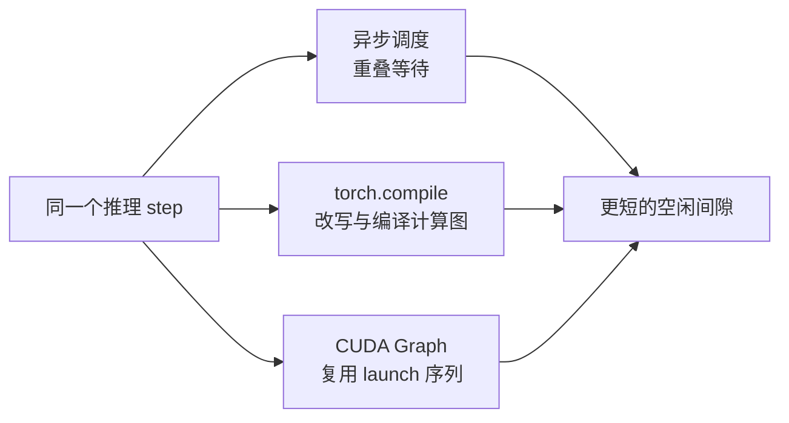

> **读图方法：** 阅读“本章定位”这张流程图时，先把方框看成对象或状态，把箭头看成数据或控制的移动。第一遍从左向右建立顺序，第二遍再核对分支发生的条件。

**核心结论：** 三者可以协同，但它们不是同一个开关，也不是严格的先后版本。定位性能
问题时，必须先确认收益来自哪一层。

本章绑定源码 revision `05caae03c20f69436ff7ec23ded339ea104f1a01`（vLLM `main`，提交日期 2026-11-09，美国太平洋时间；2026-11-10 核对源码引用与行号），沿用以下标签：

- **源码事实**：该 revision 下可直接定位的行为。
- **设计意图**：源码注释或同 revision 设计文档给出的目标。
- **设计含义**：由多处源码共同推出的解释。
- **教学模型**：随书纯 Python 实现，只验证契约，不模拟 CUDA 性能。

> **版本说明（v0.32.0 → v0.33.0）：** 旧正文基线是 v0.32.0（`5df63a72…`）。v0.32.0 位于 release 分支，
> 与 v0.33.0 的 merge-base 是 `fe341a53`，所以只有 `fe341a53..4ba787ec` 里真正在 v0.33.0 祖先链内的
> 提交才写入正文，逐条用 `git merge-base --is-ancestor <commit> 4ba787ec` 核验，清单见 8.26。
> 2026-11-10 已按这个 revision 对本章涉及的源码文件做静态复核（读代码与 diff，没有运行 GPU 或上游测试）。
> v0.33.0 之后、已是 `05caae03` 祖先的 main 变化，以“已在本书基线中、未在正文展开的变化”注记保留；不是 `05caae03` 祖先的才会标为“未发版”（目前没有这样的条目）。

## 阅读目标

读完本章后，你应该能够：

1. 把一个 step 的 CPU preparation、H2D、GPU forward、sampling、D2H 和 scheduler update 分开。
2. 解释 batch queue 与 `AsyncScheduler` 各自解决什么问题。
3. 解释 `num_output_placeholders` 为什么是“未确认进度”，以及 stale output 为什么不能再次扣减。
4. 区分 `CompilationMode` 与 `CUDAGraphMode`。
5. 从 `@support_torch_compile` 追到 Dynamo、vLLM backend、graph split、Inductor 和 cache。
6. 解释 piecewise graph 为什么常以 attention 等不易捕获操作为边界。
7. 说明 CUDA Graph 对 shape、地址、控制流和 workspace 生命周期的要求。
8. 解释配置模式与运行时模式的区别。
9. 从 batch shape 追踪到 MRV2 `CudaGraphManager` 的选择结果。
10. 解释 warmup、capture 顺序、显存预留与 fallback。
11. 设计同时报告冷启动、稳定态、graph hit、padding 和显存的实验。

## 如何阅读本章

这一章包含三个容易混淆但彼此独立的问题：CPU 与 GPU 工作能否重叠、PyTorch 图能否
编译优化、CUDA kernel 启动序列能否捕获后 replay。先分别理解三者解决的开销，再看
vLLM 如何把它们组合起来。

不需要预先掌握编译器理论。遇到 graph、guard、dynamic shape 和 capture size 时，先
用“录制一条固定条件下可重复执行的流水线”理解：条件变化可能重新编译，地址变化可能
无法 replay，shape 不匹配则需要 padding、换图或回退 eager。

第一次阅读只比较 eager、compile、CUDA Graph 三条路径；第二次研究 async scheduler
的 placeholder 和确认边界；第三次再进入 MRV2 的 `CudaGraphManager`。性能图必须同时看
冷启动、稳定态、显存和正确性，不能只比较一个平均延迟数字。

**先翻译编译器名词。** 计算图是运算与数据依赖的关系图；Dynamo 从 Python 执行中
捕获它，FX 是图的表示，Inductor 把图转成可运行代码。pass 是一次图改写；guard 是
复用图之前的条件检查；eager 是直接执行模型运算。CUDA Graph 另外记录 GPU 工作的
提交关系，与“用编译器改写运算”是两件事。

**第一遍走法：** 读 8.1–8.2、8.6、8.9–8.10、8.11 和 8.20，再补 8.3–8.5 的异步
账本；`CudaGraphManager` 内部第二遍追。**停下来算：** 实际 3 token 使用 4-token graph，
多算 1 个 padding 位置，地址仍要稳定；graph 命中不等于没有额外计算。

## 8.1 先建立正确的时间成本模型

> **本节先看：** 本节要回答：**先建立正确的时间成本模型**。下面的小节会逐层拆开概念、运行过程和源码落点；第一次阅读先抓对象之间的关系，第二次再记类名、字段和分支。

### 8.1.1 “GPU utilization 低”不只说明算子慢

一次 decode step 可以粗略拆成：

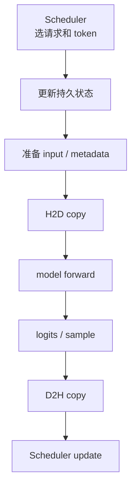

> **读图方法：** 这张图用于压缩“GPU utilization 低不只说明算子慢”的整体关系。先从上向下找到起点、关键转换和终点，再问每条跨层箭头是否意味着函数调用、消息传递、内存访问或状态更新。

先构造完全串行、不重叠的教学模型。以下所有 $\Delta t$ 都是耗时，单位统一为毫秒，
下标分别代表调度、准备、主机到设备拷贝、前向、采样、设备到主机拷贝和结算：

$$
\begin{aligned}
\Delta t_{\mathrm{step}}={}&\Delta t_{\mathrm{sched}}+\Delta t_{\mathrm{prepare}}+\Delta t_{\mathrm{H2D}}\\
&+\Delta t_{\mathrm{forward}}+\Delta t_{\mathrm{sample}}+\Delta t_{\mathrm{D2H}}+\Delta t_{\mathrm{update}}.
\end{aligned}
$$

只有阶段互不重叠时才能直接相加；实际 trace 中不能把重叠区间重复计入墙钟耗时。
异步执行的目标不是把右侧每一项都变为零，而是在依赖允许时让它们重叠。

**白话：** 完全串行时，一个 step 花的时间就是上图每个方框耗时的总和，因为每一段都要等前一段做完才开始。

**其中：** $\Delta t_{\mathrm{step}}$ 是一个 step 的总耗时；右边七项依次是 scheduler 调度、准备 input 与 metadata（含上图“更新持久状态”那一框）、H2D 拷贝、model forward、logits 与采样、D2H 拷贝、scheduler 结算，单位都是 ms。

**怎么算出来：** 上图的箭头把八个方框串成一条线，每一段紧接上一段开始、互不重叠，所以总耗时就是逐段相加；
“更新持久状态”和“准备 input / metadata”都是 CPU 在 forward 之前做的准备工作，公式里合并成 $\Delta t_{\mathrm{prepare}}$。

算例（教学数字，不是实测）：

$$
\Delta t_{\mathrm{step}}=0.5+1.0+0.3+6.0+0.4+0.2+0.6=9.0\ \mathrm{ms}
$$

其中 forward 占 $6.0/9.0\approx67\%$；调度、准备、结算这三段 CPU 侧工作合计 $0.5+1.0+0.6=2.1\ \mathrm{ms}$，约占 23%。
这 2.1 ms 正是后面几节想“藏到 GPU 工作后面”的部分：如果它们能完全被其余阶段的时间盖住，墙钟耗时最多降到 $9.0-2.1=6.9\ \mathrm{ms}$——这只是上限直觉，不是预测。
单位检查：七项都是 ms，相加仍是 ms。

**核对：** 这是教学模型，没有对应的源码公式；八个方框对应的真实阶段见 8.3 节和 8.5 节。七项相加即可复算。

### 8.1.2 为什么 decode 更容易暴露 launch 开销

Prefill 一次处理许多 token，矩阵通常更大；普通 decode 每个请求只推进少量 token。模型越小、
batch 越小、每次算子越短，Python 调用和 kernel launch 在总时间中的占比越明显。

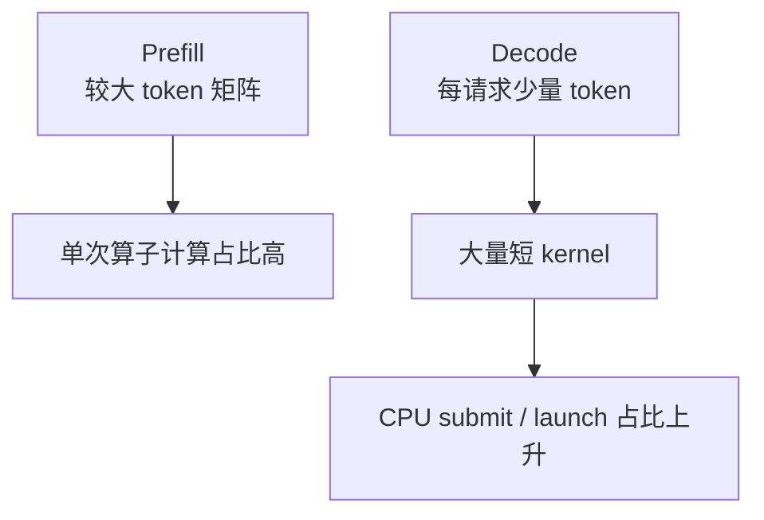

> **读图方法：** 这是“为什么 decode 更容易暴露 launch 开销”的流程图。先从上向下只追一条主路径，确认输入经过哪些关键阶段到达输出；第二遍再看虚线、回边和旁路，它们通常表示反馈、复用或可选分支。

**设计含义：** CUDA Graph 对短小、重复、shape 可覆盖的 decode batch 往往更有吸引力；但这不是
“decode 一定更快”的无条件结论。实际收益仍取决于模型、硬件、batch、attention backend 和命中率。

### 生活化类比：预先编排的操作清单

CUDA Graph 可以类比预先定义的一组操作及依赖：CPU 不必每轮重新逐项安排其中的
GPU 工作，而是启动已经准备好的可执行图。它记录的是操作和地址关系，不是缓存
上一轮的计算答案。真实输入内容仍要更新，GPU 每次仍需重新计算。

当 kernel 很短、CPU 提交速度跟不上时，减少逐次提交可能缩短 GPU 空隙。但 eager
提交本来就可以与 GPU 执行重叠；不是每启动一个 kernel 都等它完成，也没有适用于
所有机器的固定微秒数。应使用本机 trace 判断是否受 launch 开销限制。
[NVIDIA 的示例](https://developer.nvidia.com/blog/cuda-graphs/)也区分逐次同步、
重叠提交与 graph replay，数字只适用于文中的测量条件。

类比的边界是 **只有被捕获且条件匹配的区域才可重放**。请求形状、地址、backend
与功能组合变化时，vLLM 会选择相应 descriptor 或回退。FULL forward、分段 PIECEWISE、
图外输入准备与采样不能合起来称为“整个 step 只有一次启动”。

[源码] `vllm/v1/worker/gpu/cudagraph_utils.py` - `CudaGraphManager.dispatch`

[源码] `vllm/compilation/cuda_graph.py` - `CUDAGraphWrapper.__call__`

### 8.1.3 延迟、吞吐和冷启动是三张账

> **本节先看：** 这一小节先用图建立“延迟、吞吐和冷启动是三张账”的整体路径。先找输入、关键状态和输出，再阅读图后的源码解释，不必一开始记住全部节点。

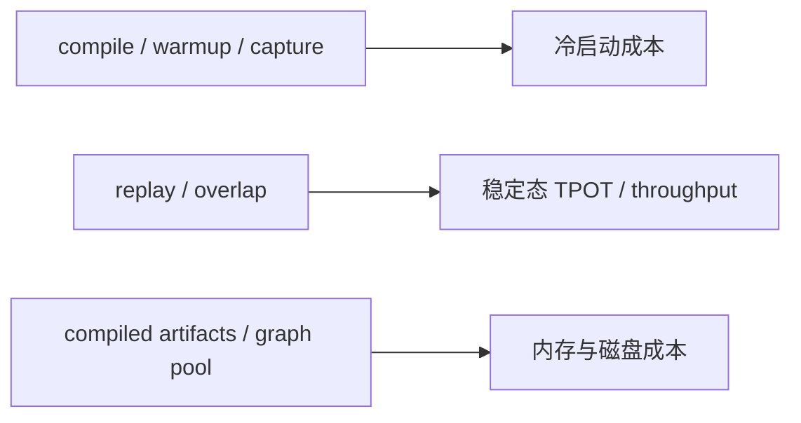

> **读图方法：** 阅读“延迟、吞吐和冷启动是三张账”这张流程图时，先把方框看成对象或状态，把箭头看成数据或控制的移动。第一遍从左向右建立顺序，第二遍再核对分支发生的条件。

只看稳定态 token/s 会漏掉：

- 第一次编译与 profiling 的时间。
- CUDA Graph capture 的时间。
- graph pool、静态输入输出和编译产物占用。
- 未命中 shape 的 eager fallback。
- padding 带来的额外计算。

## 8.2 同步 step 与 batch queue

> **本节先看：** 本节要回答：**同步 step 与 batch queue**。下面的小节会逐层拆开概念、运行过程和源码落点；第一次阅读先抓对象之间的关系，第二次再记类名、字段和分支。

### 8.2.1 普通 `EngineCore.step`

普通路径先 schedule，再以 `non_block=True` 发起 `execute_model()`，同时计算 grammar bitmask，随后
`future.result()` 等 Worker 结果；如果 execute 阶段只留下待采样状态，再调用 `sample_tokens()`。

[源码] `vllm/v1/engine/core.py` - `EngineCore.step`

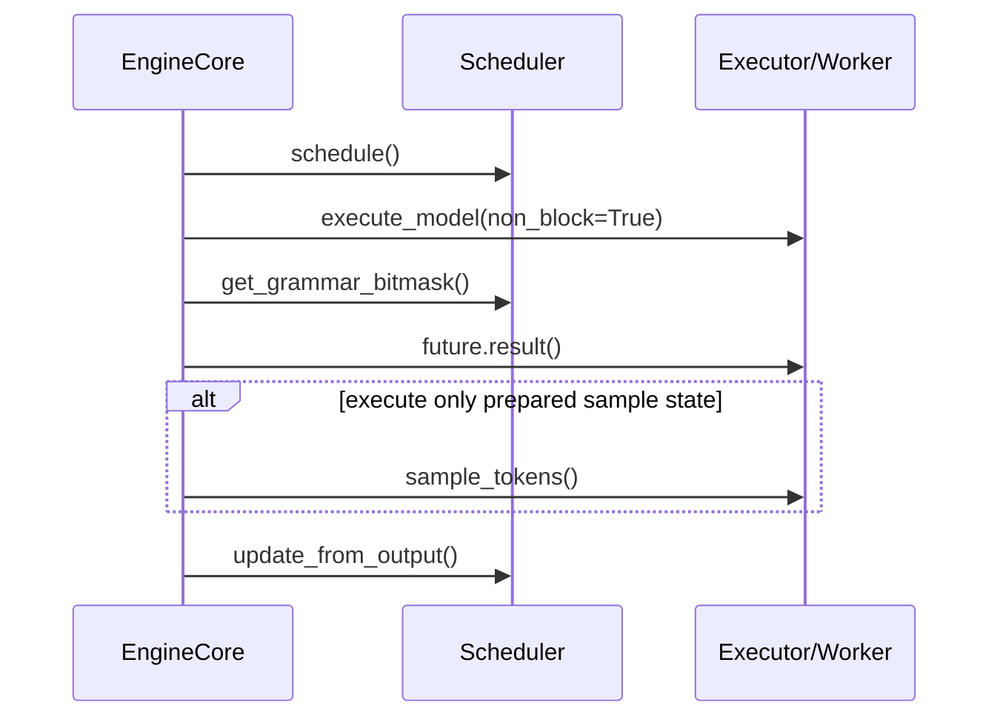

> **读图方法：** 这是“普通 `EngineCore.step`”的时序图。先从左到右确认参与者分别负责什么，再从上到下追踪消息；第一遍只看正常路径，第二遍再看返回、异步消息和失败分支。

这里已经有局部并行：Worker 执行时，EngineCore 可以准备 grammar。但普通 `step()` 仍要在本 step
末尾拿到结果，才能进入下一次完整调度。

### 8.2.2 batch queue 先填队列，再取最老结果

当 `vllm_config.max_concurrent_batches > 1` 时，EngineCore 使用
`step_with_batch_queue()`。普通路径优先提交新 batch，队列达到容量或没有后续工作时，
等待最老 Future。若新 batch 的 structured-output grammar 依赖上一轮结果，则需要先结算
旧输出，即使队列还没满；第 03 章 3.11.3 节解释这一例外。

[源码] `vllm/v1/engine/core.py` - `EngineCore.__init__`、`EngineCore.step_with_batch_queue`

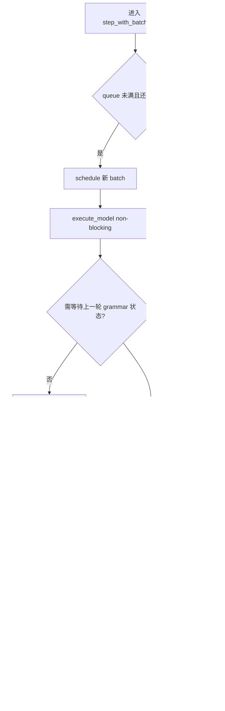

> **读图方法：** 这是“batch queue 先填队列，再取最老结果”的流程图。先从上向下只追一条主路径，确认输入经过哪些关键阶段到达输出；第二遍再看虚线、回边和旁路，它们通常表示反馈、复用或可选分支。

队列使用 `appendleft()` 和 `pop()`，因此等待的是最早提交的 batch，而不是最新 batch。

### 8.2.3 `max_concurrent_batches` 从哪里来

当前实现（`vllm/config/vllm.py:559`）只有两步：

- Pipeline Parallelism 需要 `pp_size` 个并发 batch 填充 pipeline，基础值就是 `pp_size`。
- 只要 `scheduler_config.async_scheduling` 为真，再加 1，得到 `pp_size + 1`，让 CPU 调度与 GPU 执行重叠。

没有别的分支。算例（$\mathrm{PP}$ 记 `pipeline_parallel_size`，结果是 `max_concurrent_batches`，对应 `vllm/config/vllm.py:562-565`）：

| $\mathrm{PP}$ | async scheduling | `max_concurrent_batches` |
|---:|---|---:|
| 1 | 关闭 | 1 |
| 1 | 开启 | 2（一个 batch 在 GPU 上跑，下一个在 CPU 上准备，就是 8.2.4 的两级流水） |
| 4 | 关闭 | 4 |
| 4 | 开启 | 5 |

第一代 Runner（MRV1）曾让 async 窗口在 `pp_size <= 1` 时固定为 2，并在配置层拒绝 MRV1 + async + PP>1；
MRV1 随 #63373 删除后，这些条件、以及只在 MRV1 下才计算的 `v1_async_sched_incompat`（#62521 曾用它把“投机解码方法不被支持”和
`disable_padded_drafter_batch=True` 两条限制挡在 MRV1 之外）都不存在了。因此这两条旧限制已无处可查，MRV2 下它们本来就不生效。

[源码] `vllm/config/vllm.py` - `VllmConfig.max_concurrent_batches`（@ `05caae03`）

现在影响 async scheduling 能否开启的，是 `VllmConfig` 后处理里的另一段（`vllm/config/vllm.py:1587-1633`）：显式开启时，
ROCm DeepEP high-throughput + DBO 或所选 executor 后端不支持 async scheduling 会直接抛 `ValueError`；未显式指定（`None`）时，
pooling 模型、executor 不支持、ROCm DeepEP-HT+DBO 这三种情况自动关闭，其余自动开启。

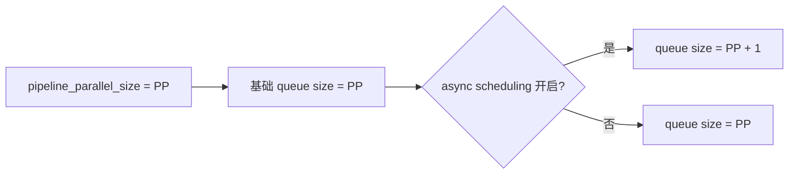

> **读图方法：** 从左向右先读 PP（`pipeline_parallel_size`）如何形成基础队列长度，再看唯一的判断“async scheduling 是否开启”：开启就多 1，关闭保持 PP。图里没有 Runner 版本的分支，这正是 MRV1 被删除后的结果。

**纠正：** batch queue 不等于 `AsyncScheduler`。PP 即使不启用 async scheduler，也可能因为填充
pipeline 而拥有并发 batch 队列；`AsyncScheduler` 进一步改变 request progress 的表示，使同一请求在
输出尚未回到 CPU 时仍可继续被调度。

### 8.2.4 一个两级流水教学模型

设每个 step 的 CPU prepare 为 $\Delta t_{\mathrm{prepare}}=2\ \mathrm{ms}$，GPU execute 为 $\Delta t_{\mathrm{forward}}=5\ \mathrm{ms}$
（这个两级模型把 GPU 上要做的事统称为 $\Delta t_{\mathrm{forward}}$），共 $n_{\mathrm{step}}=4$ 个同步 step，需要：

$$
n_{\mathrm{step}}\,(\Delta t_{\mathrm{prepare}}+\Delta t_{\mathrm{forward}})=4\times(2+5)=28\ \mathrm{ms}
$$

**白话：** 同步执行时每一步都是“先准备、再等 GPU 跑完”，4 步就是把“准备 + 执行”重复 4 次。

**其中：** $n_{\mathrm{step}}$ 是这个例子里连续跑的 step 数（4）；$\Delta t_{\mathrm{prepare}}$、$\Delta t_{\mathrm{forward}}$ 的单位是 ms。

**怎么算出来：** 一步是 $2+5=7\ \mathrm{ms}$；每一步开始准备之前都要等上一步的 GPU 完成，所以 4 步首尾相接，$4\times7=28\ \mathrm{ms}$。
单位检查：ms 乘以无量纲的步数，仍是 ms。结果与下面第一张时序图一致：S3 的 run 结束在 28 ms。

若 CPU 能准备下一步并与上一轮 GPU 重叠，则教学模型得到 22 ms：

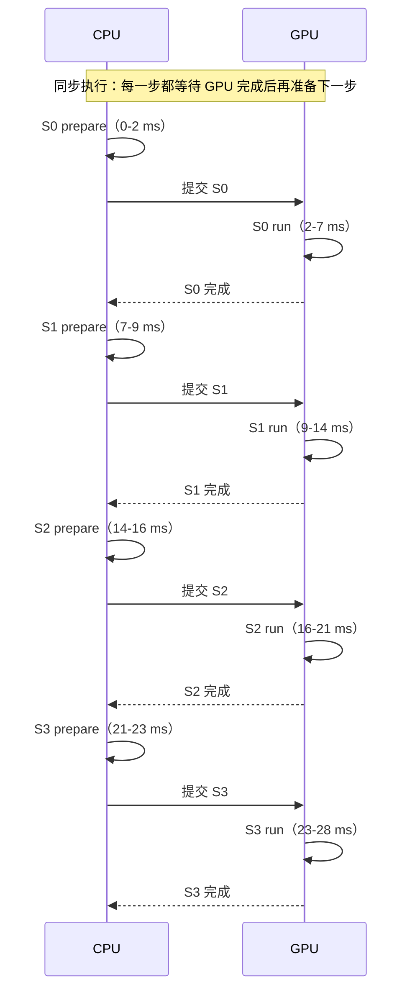

> **读图方法：** 这是“一个两级流水教学模型”的时序图。先从左到右确认参与者分别负责什么，再从上到下追踪消息；第一遍只看正常路径，第二遍再看返回、异步消息和失败分支。

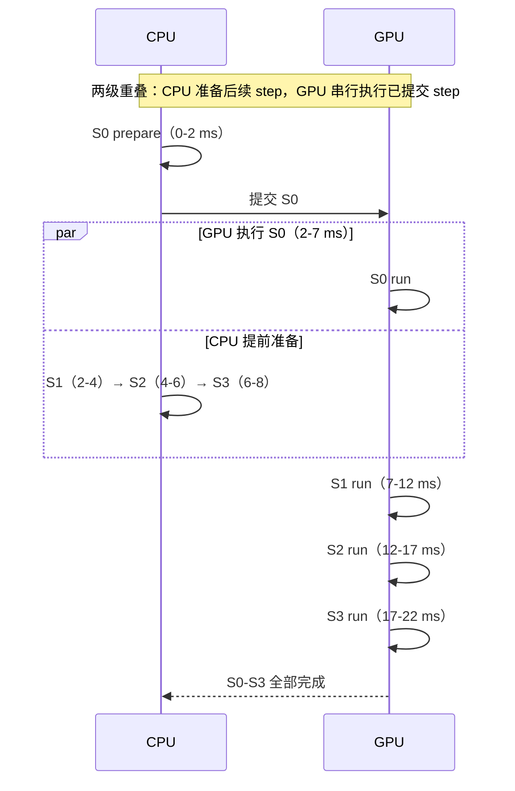

> **读图方法：** 这是“一个两级流水教学模型”的时序图。先从左到右确认参与者分别负责什么，再从上到下追踪消息；第一遍只看正常路径，第二遍再看返回、异步消息和失败分支。

重叠之后的耗时也可以一步步推出来：

$$
\Delta t_{\mathrm{prepare}}+(n_{\mathrm{step}}-1)\max(\Delta t_{\mathrm{prepare}},\Delta t_{\mathrm{forward}})+\Delta t_{\mathrm{forward}}=2+3\times5+5=22\ \mathrm{ms}
$$

**白话：** 第 0 步的准备躲不掉；之后每多一步，墙钟只多“两个阶段里较慢的那个”；最后一步的 GPU 要完整跑完。

**怎么算出来：** 第 0 步开始时 GPU 无事可做，所以先付出一次 $\Delta t_{\mathrm{prepare}}=2\ \mathrm{ms}$（时序图里 S0 prepare 占 0–2 ms）。
此后 CPU 和 GPU 同时干活：GPU 做某一步的时候 CPU 在准备下一步，下一步何时能开始取决于较慢的一方。这里 GPU（5 ms）比 CPU（2 ms）慢，
CPU 总能在 GPU 跑完之前准备好，GPU 一直满载，每多一步多 5 ms；最后一步 GPU 完整跑 5 ms。所以 $2+3\times5+5=22\ \mathrm{ms}$。
GPU 更慢时可化简成 $\Delta t_{\mathrm{prepare}}+n_{\mathrm{step}}\Delta t_{\mathrm{forward}}=2+4\times5=22\ \mathrm{ms}$（S0 的 2 ms 加上 S0–S3 四段 GPU 执行，对应时序图里 GPU 从 2 ms 一直跑到 22 ms）。
反过来，若 CPU 更慢（例如 prepare 5 ms、execute 2 ms），瓶颈换成 CPU，结果是 $n_{\mathrm{step}}\Delta t_{\mathrm{prepare}}+\Delta t_{\mathrm{forward}}=4\times5+2=22\ \mathrm{ms}$，数字相同但原因不同。
对比同步的 28 ms，这个例子省下 6 ms，也就是 $3\times\Delta t_{\mathrm{prepare}}$：S1、S2、S3 三次准备都被 GPU 执行盖住了（只有 S0 的准备躲不掉）。
单位检查：各项都是 ms，乘整数、取 $\max$ 都不改单位，结果仍是 ms。

**核对：** 把 $n_{\mathrm{step}}=4$、$\Delta t_{\mathrm{prepare}}=2$、$\Delta t_{\mathrm{forward}}=5$ 代入通式得 $2+3\times5+5=22$，与同步式 $4\times(2+5)=28$ 对照。把 $n_{\mathrm{step}}=1$ 代入通式得 $\Delta t_{\mathrm{prepare}}+\Delta t_{\mathrm{forward}}$，与同步式一致：单步没有流水收益。

这只是说明重叠的上限直觉。真实 vLLM 还有 scheduler state、H2D/D2H stream、PP、DP 同步和 sampling
依赖，不能直接用该公式预测生产收益。

## 8.3 `AsyncScheduler`：用 placeholder 表示尚未知的 token

> **本节先看：** 本节要回答：**`AsyncScheduler`：用 placeholder 表示尚未知的 token**。下面的小节会逐层拆开概念、运行过程和源码落点；第一次阅读先抓对象之间的关系，第二次再记类名、字段和分支。

### 8.3.1 同一请求为何能提前进入下一步

同步 scheduler 在输出到达后才知道新 token。异步调度希望在结果仍在 Worker/GPU 时继续安排工作，
于是必须区分：

- **乐观进度**：已经安排计算，但输出尚未确认。
- **确认进度**：即使所有在途 speculative token 被拒绝，也不会回退的位置。

当前源码用 `request.num_output_placeholders` 表示未确认 token 数。
`Scheduler._handle_stopped_request`（`scheduler.py` L2774 @ `05caae03`）里的 `safe_frontier` 就是用它算的。

[源码] `vllm/v1/core/sched/async_scheduler.py` - `AsyncScheduler._update_after_schedule`


> **读图方法：** 阅读“同一请求为何能提前进入下一步”这张流程图时，先把方框看成对象或状态，把箭头看成数据或控制的移动。第一遍从左向右建立顺序，第二遍再核对分支发生的条件。

本节涉及两条保守边界，它们回答的是两个不同的问题：

$$
N_{\mathrm{confirmed}}=N_{\mathrm{computed}}-N_{\mathrm{placeholders}}
$$

$$
N_{\mathrm{cacheable}}=N_{\mathrm{computed}}-N_{\mathrm{in\ flight}}
$$

**白话：** 第一个差值回答“输出序列里哪些位置已经确定”，可恢复的流式请求停止后就以它作为继续的安全起点
（`Scheduler._handle_stopped_request` 中的 `safe_frontier`）；第二个差值回答“按 computed − in-flight 算，哪些 token 的 KV 已经不会再被在途
step 改写”，源码在 `update_from_output` 里用它作为 `cache_blocks` 的边界（见 8.4.3）。它不是“此刻能否登记 prefix cache”的全部答案：prompt 的 block 另在 `allocate_slots` 调度时就会登记，见下。decode step 里两者通常相等，prefill chunk 只计入 in-flight，所以
这条边界更保守。v0.32.0 的 `cache_blocks` 用的是第一个差值，v0.33.0 起改用第二个（`2fb320d83`，#61589，见 8.4.3）。

**其中：** 单位都是 token。

- $N_{\mathrm{computed}}$：`request.num_computed_tokens`，scheduler 已经乐观推进的位置，不是 GPU 已算完的位置；
- $N_{\mathrm{placeholders}}$：`request.num_output_placeholders`，已排进在途 step、但输出位置还没确认的 token 数；
- $N_{\mathrm{in\ flight}}$：`request.num_in_flight_tokens`，已经调度、但对应 step 的输出还没回到 scheduler 的全部 token，
  既含输出位置，也含 prefill chunk。

**怎么算出来：** $N_{\mathrm{computed}}$ 在**调度时**就被加上去：`Scheduler._update_after_schedule` 对每个被调度的请求同时做
`num_computed_tokens += num_scheduled_token` 和 `num_in_flight_tokens += num_scheduled_token`（`vllm/v1/core/sched/scheduler.py:1834-1835`，$N_{\mathrm{new}}$ 是本步给它调度的 token 数，源码循环变量是 `num_scheduled_token`）；
`AsyncScheduler._update_after_schedule` 再给**非 prefill chunk** 的请求加 placeholder（`async_scheduler.py:31-47`）。所以两条边界的算法都是
“先乐观加上去，再把还没落地的部分减掉”：

1. $N_{\mathrm{confirmed}}$：乐观位置减去还没确认的输出位置数；
2. $N_{\mathrm{cacheable}}$：乐观位置减去所有在途 token（输出位置加 prefill chunk）。

算例（教学数字）：

| 情形 | $N_{\mathrm{computed}}$ | $N_{\mathrm{placeholders}}$ | $N_{\mathrm{in\ flight}}$ | $N_{\mathrm{confirmed}}$ | $N_{\mathrm{cacheable}}$ |
|---|---:|---:|---:|---:|---:|
| A. 稳态 decode：已确认 100 个，2 个 decode step 在途 | 102 | 2 | 2 | $102-2=100$ | $102-2=100$ |
| B. 100-token prompt 的第一个 prefill chunk（64 token）刚调度 | 64 | 0 | 64 | $64-0=64$ | $64-64=0$ |

情形 A 里每个在途 step 带来 1 个输出位置，placeholder 数与 in-flight 数相等，两条边界重合。情形 B 的 chunk 在 `AsyncScheduler._update_after_schedule` 里被跳过
（`is_prefill_chunk` 为真，`async_scheduler.py:31-32`），不加 placeholder，但整段 64 个 token 都在途，它们的 KV 还没算完，所以按 $N_{\mathrm{computed}}-N_{\mathrm{in\ flight}}$ 代数上得 0。注意表里是“刚调度完”的两个计数的代数快照：源码求 $N_{\mathrm{cacheable}}$ 的地方（`scheduler.py:2390-2393`）在 `update_from_output` 里，`:2286` 已先减去刚返回那一步的 `num_in_flight_tokens`，并且只在 8.4.3 的条件成立时才调用；prompt 的 block 另在 `allocate_slots` 调度时就按 `min(total_computed_tokens + num_new_tokens, request.num_tokens)` 登记（`kv_cache_manager.py:640-646`），不受这条边界限制。
B 行的 $N_{\mathrm{confirmed}}=64$ 只是代数结果：prefill 中途没有输出位置，源码用 `num_computed_tokens - num_output_placeholders` 的地方包括请求停止后的 `_handle_stopped_request`（`scheduler.py:2781`）和 ec_connector 的缓存可用性检查（`:794`）。

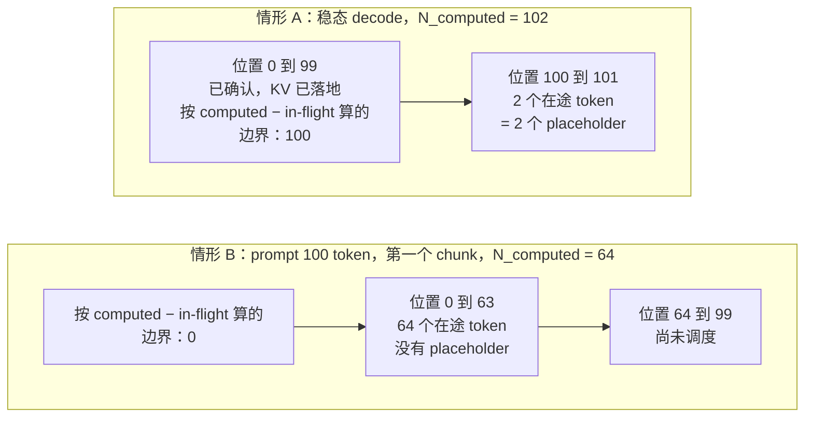

> **读图方法：** 上下两个子图是上表的两行，每个方框是一段 token 位置区间。情形 A：在途 token 恰好是输出位置，所以“已确认”与按 computed − in-flight 算的边界重合在位置 100；情形 B：整段 chunk 都在途，该边界为 0。
> 阅读时只需比较两个子图里该边界落在何处。图中数字与表格一致，边界来自 `num_computed_tokens - num_in_flight_tokens`（`scheduler.py:2392`）。

**核对：** `examples/ch08_async_compile_graph.py::AsyncRequestState.confirmed_tokens` 就是 $N_{\mathrm{confirmed}}$ 的教学实现，
`tests/test_ch08_async_compile_graph.py::PlaceholderTest` 覆盖 $N_{\mathrm{computed}}$ 与 placeholder 同步增加、$N_{\mathrm{confirmed}}$ 不变；
$N_{\mathrm{cacheable}}$ 在源码里是 `cache_blocks(request, request.num_computed_tokens - request.num_in_flight_tokens)`（`scheduler.py:2390-2393`）。

这些差值是源码用于限制缓存/释放的边界，不能当作 GPU 完成事件。例如最后一段 prefill 刚提交时，computed 已增加，
GPU 可能还没算完；第 05 章的本地 hash 登记也可能先于 forward。需释放在途 block 时，还要看适用的 step fence，
不能只减 placeholder。

### 8.3.2 schedule 后 placeholder 如何增加

对于非 prefill chunk，请求本轮调度之后的 placeholder 数是：

$$
N_{\mathrm{placeholders}}'=N_{\mathrm{placeholders}}+N_{\mathrm{sampled}}+N_{\mathrm{spec}}
$$

**白话：** 一步 decode 会多出一个正常采样的输出位置，外加每个 draft token 一个位置；这些位置的值都要等 worker 返回才知道，所以每个位置先占一个 placeholder。

**其中：** 单位都是 token。$N_{\mathrm{placeholders}}$、$N_{\mathrm{placeholders}}'$ 是调度前、后的 `num_output_placeholders`（撇号表示更新后的值）；
$N_{\mathrm{sampled}}$ 是每步正常采样产生的 token 数，即 `num_sampled_tokens_per_step`（自回归为 1，没有 AR bonus token 的 diffusion 路径为 0）；
$N_{\mathrm{spec}}$ 是这一步随该请求一起调度的 speculative token 数，即 `len(spec_decode_tokens.get(req_id, ()))`。

**怎么算出来：** 源码就是一次加法：`request.num_output_placeholders += self.num_sampled_tokens_per_step + cur_num_spec_tokens`（`async_scheduler.py:45-47`）。
算例（与 `PlaceholderTest` 同一组数）：调度前 $N_{\mathrm{computed}}=10$、$N_{\mathrm{placeholders}}=0$，本步 $N_{\mathrm{sampled}}=1$、$N_{\mathrm{spec}}=3$：
$N_{\mathrm{placeholders}}'=0+1+3=4$；同时 $N_{\mathrm{computed}}$ 也被加上本步调度的 $1+3=4$ 个 token，变成 14，所以
$N_{\mathrm{confirmed}}=14-4=10$ 不变——乐观位置前移了，已确认位置没动。这正是下面 8.3.3 的图里 `num_output_placeholders = 4` 的来历。

**核对：** `examples/ch08_async_compile_graph.py::AsyncRequestState.schedule_decode` 与测试 `test_schedule_moves_optimistic_not_confirmed_boundary`（14、4、10）一致。

随后：

- `num_output_placeholders` 增加该数量。
- `spec_token_ids` 暂时设为 `-1` 列表。
- 真正 draft/spec token ID 由 Worker 后续更新。
- MRV2 把下一次 decode eligible step 设为 `current_step + decode_stagger`。默认
  `decode_stagger=pp_size`；仅 XPU 且关闭 `VLLM_XPU_PP_MICROBATCH` 时为 1。
- spec placeholder 列表长度随本轮 `SchedulerOutput.num_spec_tokens_to_schedule` 更新，
  不能一律看成初始化时的固定 speculative token 数。

[源码] `vllm/v1/core/sched/async_scheduler.py` - `AsyncScheduler.__init__`、
`_update_after_schedule`

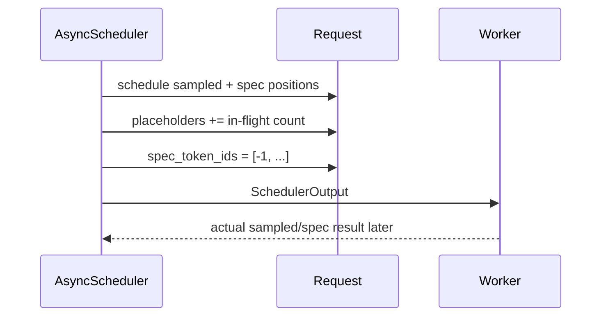

> **读图方法：** 这是“schedule 后 placeholder 如何增加”的时序图。先从左到右确认参与者分别负责什么，再从上到下追踪消息；第一遍只看正常路径，第二遍再看返回、异步消息和失败分支。

### 8.3.3 placeholder 不是 token ID

`-1` 是暂时代替尚未获得的 spec token ID；`num_output_placeholders` 是请求级计数。两者相关但不是
同一个字段，也不能把 placeholder 当作合法 token 送入模型。

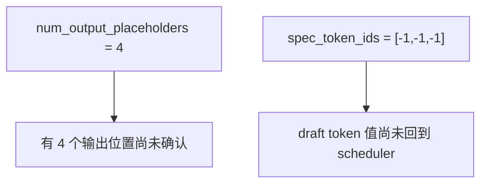

> **读图方法：** 这是“placeholder 不是 token ID”的流程图。先从上向下只追一条主路径，确认输入经过哪些关键阶段到达输出；第二遍再看虚线、回边和旁路，它们通常表示反馈、复用或可选分支。

### 8.3.4 structured output 为什么可能延迟 sampling

结构化输出 grammar 可能依赖上一轮真实 token。若请求已有未确认 placeholder，新的 grammar bitmask
不能假设这些 token 已知。`SchedulerOutput.pending_structured_output_tokens` 会标记该依赖，batch queue
将当前 sampling 延迟到先前输出被处理之后。

[源码] `vllm/v1/core/sched/async_scheduler.py` - `AsyncScheduler._update_after_schedule`

[源码] `vllm/v1/engine/core.py` - `EngineCore.step_with_batch_queue`

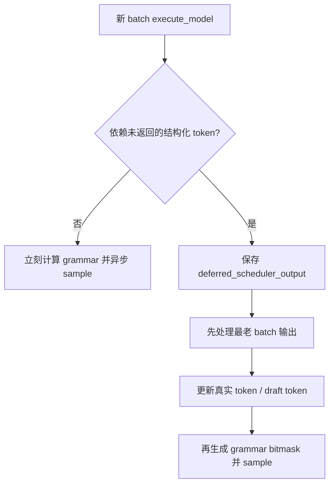

> **读图方法：** 阅读“structured output 为什么可能延迟 sampling”这张流程图时，先把方框看成对象或状态，把箭头看成数据或控制的移动。第一遍从上向下建立顺序，第二遍再核对分支发生的条件。

这说明异步不是“无视依赖”。它把没有依赖的工作提前，把有依赖的工作明确延迟。

> **已在本书基线中、未在正文展开的变化：** 以下提交都是本书基线 `05caae03` 的祖先（且都不在 v0.33.0 `4ba787ec` 中）；本章正文对它们尚未展开，仍按 v0.33.0 时代的写法叙述（Model Runner V1 删除除外）。条目里 `@` 后的短 SHA 是各提交当时的版本，行号不是 `05caae03` 上的行号。区间为 vLLM main 2026-10-29～10-30（UTC，`36d4ef654..2eae56c4b`，不含起点）。
> - 同 #63219：deferred grammar 取的是逐请求保留的 draft（`begin_step` 在 `pending_structured_output_tokens` 时只收集 `scheduled_spec_decode_tokens` 的 req_id，`utils.py` L67–L74）。

## 8.4 stale output、抢占与确认边界

> **本节先看：** 本节要回答：**stale output、抢占与确认边界**。下面的小节会逐层拆开概念、运行过程和源码落点；第一次阅读先抓对象之间的关系，第二次再记类名、字段和分支。

### 8.4.1 为什么会有 stale output

batch queue 中可以有多个在途 step。若请求因 KV 压力被抢占，scheduler 会回滚它的乐观状态；但
更早提交给 Worker 的计算不会凭空消失，它的结果仍可能稍后返回。相对于已经回滚或重新加入的请求
状态，这就是 stale output。

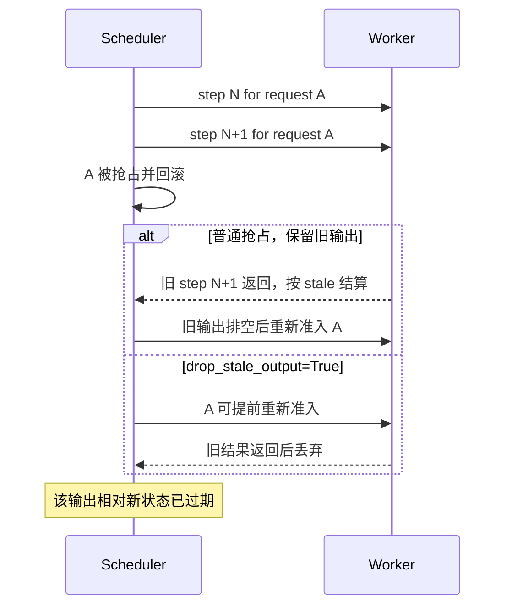

> **读图方法：** 这是“为什么会有 stale output”的时序图。先从左到右确认参与者分别负责什么，再从上到下追踪消息；第一遍只看正常路径，第二遍再看返回、异步消息和失败分支。

### 8.4.2 stale output 为什么不能扣 placeholder

抢占时 placeholder 已被清零：`Scheduler._preempt_request`（`scheduler.py` L1775 @ `05caae03`）把
`num_output_placeholders` 设为 0，并把 `num_stale_output_tokens` 设为当时的 `num_in_flight_tokens`。若旧结果返回后
再执行普通的 `num_output_placeholders -= len(new_token_ids)`，计数会下溢。

v0.33.0 的实现（`2fb320d83`，#61589）里 `AsyncScheduler` 已经不再覆写 `_update_request_with_output`，
这段逻辑直接位于基类 `Scheduler._update_request_with_output(request, new_token_ids, is_stale=False)`
（`scheduler.py` L2801 @ `05caae03`），同步与异步调度共用。`Scheduler.update_from_output` 对每个请求先做三件事
（L2284 起）：

1. 把这一步的 token 数从 `num_in_flight_tokens` 扣掉；
2. 若 `num_stale_output_tokens > 0`，按同样的数量扣减它，并把本次输出标为 `output_is_stale`；
3. 如果请求是 `drop_stale_output` 模式（见 8.4.1 的第二条分支），stale 输出整份丢弃（L2306）。

然后调用 `_update_request_with_output(..., is_stale=output_is_stale)`：逐个追加 token 并检查 stop；
命中 stop 时修剪多余 token，只有非 stale 时才回退 `num_computed_tokens`；最后只在**非 stale 且
`num_output_placeholders > 0`** 时，按**返回的全部 token 数**（含因 stop 被修剪的）扣减 placeholder，并断言
不小于零（L2826）。stale 输出不再扣减，因为抢占已经清零。

[源码] `vllm/v1/core/sched/scheduler.py` - `Scheduler._update_request_with_output`（L2801 @ `05caae03`）、
`Scheduler.update_from_output`、`Scheduler._preempt_request`

[源码] `vllm/v1/core/sched/async_scheduler.py` - `AsyncScheduler._update_after_schedule`（v0.33.0 中该类只剩
`__init__` 与这一个覆写）

[测试] `tests/v1/core/test_async_scheduler.py` - `test_kv_pressure_preemption_with_inflight_output`

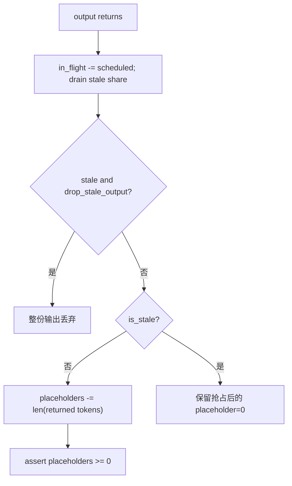

> **读图方法：** 这是“stale output 为什么不能扣 placeholder”的流程图。先从上向下只追一条主路径，确认输入经过哪些关键阶段到达输出；第二遍再看虚线、回边和旁路，它们通常表示反馈、复用或可选分支。注意最上面两层是 v0.33.0 补画的：每个输出先扣在途计数、先判断是否 drop 模式，之后才轮到 `is_stale` 这一问；只有“非 stale”分支会动 placeholder。

### 8.4.3 KV cache 只能推进到确认边界

v0.33.0 里，`cache_blocks` 的调用从已删除的 `AsyncScheduler._update_request_with_output` 搬到了
`Scheduler.update_from_output`（`2fb320d83`，#61589；`scheduler.py` L2372–L2390 @ `05caae03`）。
同时满足下面三个条件才调用：输出**不是** stale；`_update_request_with_output` 之前请求状态为 `RUNNING`；
并且以下三者之一成立：更新前 `num_output_placeholders > 0`；`Scheduler` 自身的 `self.num_spec_tokens > 0`（配置的投机 token 数，与同步/异步调度无关）；
或者模型含 Mamba 层（`has_mamba_layers`）、**没有**开启 async scheduling 且开启了 prefix caching——`05caae03` 新增的第三个分支，让同步调度下的 Mamba 状态也在退役或完成前发布。
调用形式是：

```text
cache_blocks(request, request.num_computed_tokens
                      - request.num_in_flight_tokens)
```

也就是只把 8.3.1 中的 $N_{\mathrm{cacheable}}$ 之前的区间纳入可缓存边界。这里的 `has_output_placeholders` 要在
`_update_request_with_output` **之前**记录，因为 placeholder 会在其中被扣减。与 v0.32.0 相比有两处行为变化：
边界从 `num_computed_tokens - num_output_placeholders` 改成了 `num_computed_tokens - num_in_flight_tokens`；
旧的异步路径对所有更新前为 `RUNNING` 的请求（包括 stale 输出）都会调用，v0.33.0 中 stale 输出不再触发。

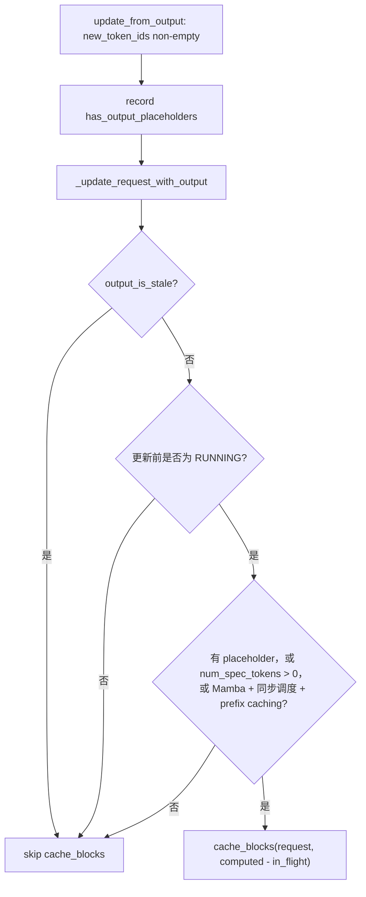

> **读图方法：** 从上往下依次过三个菱形。第一个菱形（output_is_stale?）答“是”就跳过；答“否”才继续。第二个（更新前是否为 RUNNING）和第三个（有 placeholder、num_spec_tokens > 0，或 Mamba 同步调度且开启 prefix caching 三者之一）必须都答“是”，才会走到 cache_blocks(request, computed - in_flight)。任一为“否”，直接走到 skip cache_blocks。第二个菱形排除更新前已不是 RUNNING 的请求（例如已被抢占）。

[源码] `vllm/v1/core/sched/scheduler.py` - `Scheduler.update_from_output`（`cache_blocks` 调用 L2390 @ `05caae03`）

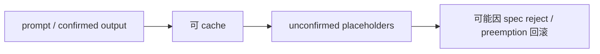

> **读图方法：** 阅读“KV cache 只能推进到确认边界”这张流程图时，先把方框看成对象或状态，把箭头看成数据或控制的移动。第一遍从左向右建立顺序，第二遍再核对分支发生的条件。

同样的确认边界还用于保护多模态 encoder input：乐观进度虽然可能越过 placeholder range，但如果
回滚仍可能重新进入该范围，就不能提前释放 encoder cache。

[测试] `tests/v1/core/test_scheduler.py` - `test_free_encoder_inputs_respects_unconfirmed_placeholders`

### 8.4.4 异步正确性的本质

> **本节先看：** 这一小节先用图建立“异步正确性的本质”的整体路径。先找输入、关键状态和输出，再阅读图后的源码解释，不必一开始记住全部节点。

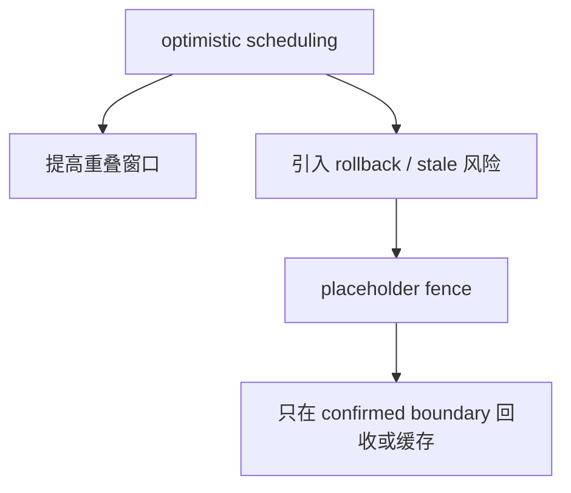

> **读图方法：** 这张图用于压缩“异步正确性的本质”的整体关系。先从上向下找到起点、关键转换和终点，再问每条跨层箭头是否意味着函数调用、消息传递、内存访问或状态更新。

**设计含义：** 异步优化不是单纯把 `future.result()` 移走，而是把状态机从“只有已知进度”升级为
“可提交内容的边界 + 在途工作”。若没有这个双边界模型，吞吐提升会直接变成状态一致性问题。

## 8.5 输出异步拷贝：另一个重叠层

> **本节先看：** 本节要回答：**输出异步拷贝：另一个重叠层**。下面的小节会逐层拆开概念、运行过程和源码落点；第一次阅读先抓对象之间的关系，第二次再记类名、字段和分支。

### 8.5.1 MRV2 的 `AsyncOutput`

MRV2 sampler 输出仍在 GPU。`AsyncOutput` 在独立 copy stream 上等待 main stream，然后把 sampled
token、logprobs、NaN 计数和 sampling mask 等异步搬到 CPU，并记录一个 blocking event。
辅助输出现通过 `pending_aux_output.enqueue_cpu_copy()` 排队，待 event 完成后由
`process_output()` 写入 `aux_output_connector_output`，不再直接搬运旧 `routed_experts` 字段。

[源码] `vllm/v1/worker/gpu/async_utils.py` - `AsyncOutput.__init__`、`AsyncOutput.get_output`

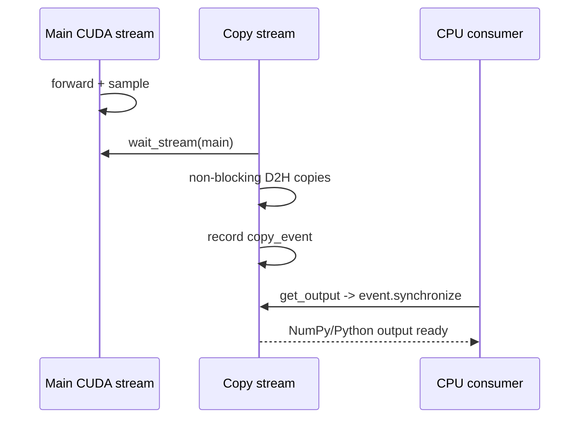

> **读图方法：** 这是“MRV2 的 `AsyncOutput`”的时序图。先从左到右确认参与者分别负责什么，再从上到下追踪消息；第一遍只看正常路径，第二遍再看返回、异步消息和失败分支。

`AsyncOutput` 必须保留 GPU tensor 引用，因为 copy stream 还在读取这些 storage；若对象过早释放，
caching allocator 可能复用内存。

### 8.5.2 `non_blocking=True` 不是自动异步

真正的异步传输还依赖：

- 合适的 host memory，例如 pinned memory。
- 正确的 stream wait 关系。
- 源 tensor 生命周期覆盖 copy。
- 消费端在读取前等待 event。

```mermaid
flowchart TD
    N["non_blocking=True"] --> P{"host buffer / backend 支持?"}
    P -- 否 --> S["可能仍同步或收益很小"]
    P -- 是 --> L{"源生命周期与 stream 依赖正确?"}
    L -- 否 --> E["数据竞争或读到被复用 storage"]
    L -- 是 --> A["可与 CPU 或其他 stream 重叠"]
```

> **读图方法：** 阅读“`non_blocking=True` 不是自动异步”这张流程图时，先把方框看成对象或状态，把箭头看成数据或控制的移动。第一遍从上向下建立顺序，第二遍再核对分支发生的条件。

### 8.5.3 staged write 与 async scheduling 的关系

MRV2 使用持久 GPU/CPU state 和 staged writes，把多个状态变更先记录，再在安全位置统一应用。它是
降低 Python/拷贝开销和规避写后读竞争的基础设施，但不能等同于 `AsyncScheduler`。

[源码] `vllm/v1/worker/gpu/buffer_utils.py` - `StagedWriteTensor`

[源码] `vllm/v1/worker/gpu/states.py` - `apply_staged_writes`

```mermaid
flowchart LR
    S["SchedulerOutput delta"] --> Q["stage CPU/GPU writes"]
    Q --> B["安全边界 apply_staged_writes"]
    B --> F["forward reads stable state"]
```

> **读图方法：** 这张图用于压缩“staged write 与 async scheduling 的关系”的整体关系。先从左向右找到起点、关键转换和终点，再问每条跨层箭头是否意味着函数调用、消息传递、内存访问或状态更新。

## 8.6 `torch.compile` 到底编译什么

> **本节先看：** 本节要回答：**`torch.compile` 到底编译什么**。下面的小节会逐层拆开概念、运行过程和源码落点；第一次阅读先抓对象之间的关系，第二次再记类名、字段和分支。

### 8.6.1 从 Python `forward` 到 compiled callable

简化后的路径是：

```mermaid
flowchart TD
    P["Python model.forward"] --> D["TorchDynamo trace"]
    D --> FX["FX graph"]
    FX --> VB["VllmBackend"]
    VB --> Pass["custom passes / split"]
    Pass --> I["Inductor or configured backend"]
    I --> K["compiled runnable"]
```

> **读图方法：** 这是“从 Python `forward` 到 compiled callable”的流程图。先从上向下只追一条主路径，确认输入经过哪些关键阶段到达输出；第二遍再看虚线、回边和旁路，它们通常表示反馈、复用或可选分支。

Dynamo 捕获 Python 级运算图，FX 表示图结构，vLLM backend 决定如何切分与增加 passes，Inductor
生成和调度具体内核。真实路径还包括 fake tensor、AOTAutograd、cache、动态 shape 和平台后端。

### 8.6.2 四种 `CompilationMode`

当前 `CompilationMode` 是独立枚举：

| 模式 | 含义 |
|---|---|
| `NONE` | 不应用 `torch.compile`；是否 replay 另由 CUDA Graph 配置决定 |
| `STOCK_TORCH_COMPILE` | 标准 `torch.compile` pipeline |
| `DYNAMO_TRACE_ONCE` | 单次 Dynamo trace，移除 guard，要求控制流适配动态 shape |
| `VLLM_COMPILE` | vLLM 自定义 backend，支持 cache、piecewise、shape specialization 和 passes |

[源码] `vllm/config/compilation.py` - `CompilationMode`、`CompilationConfig.mode`

```mermaid
flowchart TB
    M["CompilationMode"] --> N["NONE"]
    M --> S["STOCK_TORCH_COMPILE"]
    M --> D["DYNAMO_TRACE_ONCE"]
    M --> V["VLLM_COMPILE"]
    V --> C["cache"]
    V --> P["piecewise"]
    V --> R["compile ranges / sizes"]
    V --> F["custom fusion passes"]
```

> **读图方法：** 阅读“四种 `CompilationMode`”这张流程图时，先把方框看成对象或状态，把箭头看成数据或控制的移动。第一遍从上向下建立顺序，第二遍再核对分支发生的条件。

### 8.6.3 当前默认不是固定写死在 `CompilationConfig` 中

`CompilationConfig.mode` 和 `cudagraph_mode` 初始可以为 `None`，随后由 `VllmConfig` 的 optimization
level 填默认值。当前 `VllmConfig.optimization_level` 默认是 `O2`：

- `O0`：`CompilationMode.NONE` + `CUDAGraphMode.NONE`。
- `O1`：编译开启，CUDA Graph 默认 `PIECEWISE`。
- `O2`：编译开启，CUDA Graph 默认 `FULL_AND_PIECEWISE`。
- `O3`：当前同样默认 `FULL_AND_PIECEWISE`，并使用对应 passes 配置。

[源码] `vllm/config/vllm.py` - `OPTIMIZATION_LEVEL_TO_CONFIG`、`VllmConfig.__post_init__`

```mermaid
flowchart LR
    O["optimization_level"] --> C["CompilationConfig defaults"]
    C --> M["mode"]
    C --> G["cudagraph_mode"]
    C --> P["pass_config"]
    C --> K["kernel_config"]
```

> **读图方法：** 这张图用于压缩“当前默认不是固定写死在 `CompilationConfig` 中”的整体关系。先从左向右找到起点、关键转换和终点，再问每条跨层箭头是否意味着函数调用、消息传递、内存访问或状态更新。

用户显式设置的字段不会被 optimization-level 默认值覆盖。因此记录实验配置时不能只写“O2”，还要
记录最终解析后的 `CompilationConfig`。

## 8.7 `@support_torch_compile` 与一次 trace

> **本节先看：** 本节要回答：**`@support_torch_compile` 与一次 trace**。下面的小节会逐层拆开概念、运行过程和源码落点；第一次阅读先抓对象之间的关系，第二次再记类名、字段和分支。

### 8.7.1 装饰器怎样改变模型类

许多模型类使用 `@support_torch_compile`。装饰器把
`TorchCompileWithNoGuardsWrapper` 加入类的基类，并包装 `__init__` 和 `__call__`。

[源码] `vllm/compilation/decorators.py` - `support_torch_compile`、`_support_torch_compile`

```mermaid
classDiagram
    class ModelClass {
      +forward()
    }
    class TorchCompileWithNoGuardsWrapper {
      +_compiled_callable
      +__call__()
    }
    ModelClass --|> TorchCompileWithNoGuardsWrapper : decorator injects base
```

> **读图方法：** 这是“装饰器怎样改变模型类”的类型关系图。先分清接口、实现和持有关系，再结合正文确认运行时真正实例化的是哪个类；类图说明结构，不等同于调用先后。

当 mode 为 `NONE` 或 `STOCK_TORCH_COMPILE`，或模型明确不支持时，装饰器内部路径可设置
`do_not_compile`；stock mode 由更高层 Runner 处理，不能据此误判为完全未编译。

v0.33.0 给装饰器加了一个参数 `use_aot_compile`（默认 `True`，`decorators.py` L129 附近 @ `05caae03`）。
设为 `False` 时，这个模型类在 `DYNAMO_TRACE_ONCE` 与 `VLLM_COMPILE` 两种 mode 下都不走模型级 AOT；
`VLLM_COMPILE` 下还会跳过 mega 与 direct 编译产物，只保留底层 PyTorch 图缓存。这个开关会沿
`TorchCompileWithNoGuardsWrapper` 传到 `CompilationConfig.init_backend(..., use_aot_compile=...)` 与
`VllmBackend`/`CompilerManager`（`c068db0e1`，#58918，用于把 Transformers 后端从 AOT 缓存换成图缓存）。
它只是把“该模型允许 AOT”与全局环境变量 `VLLM_USE_AOT_COMPILE` 再做一次与运算，不改变 piecewise 切图本身。

### 8.7.2 为什么强调 trace once 与 guard

普通 Dynamo 会依据 Python 值、shape、类型等建立 guards；guard 失败可能触发重新 trace/compile。
vLLM 的 wrapper 在非 stock mode 下尽量移除 guards，第一次调用触发一次编译，之后直接复用。

[源码] `vllm/compilation/wrapper.py` - `TorchCompileWithNoGuardsWrapper`

```mermaid
flowchart TD
    F["first call"] --> T["mark dynamic dims"]
    T --> D["Dynamo trace"]
    D --> C["compile"]
    C --> R["compiled callable"]
    N["next call"] --> G{"guard strategy accepts?"}
    G -- 是 --> R
    G -- 否 --> X["fail/recompile depending mode"]
```

> **读图方法：** 阅读“为什么强调 trace once 与 guard”这张流程图时，先把方框看成对象或状态，把箭头看成数据或控制的移动。第一遍从上向下建立顺序，第二遍再核对分支发生的条件。

移除 guard 是一个带前提的性能选择：模型 forward 不能依赖未被正确表达的动态 shape 控制流，否则
可能把只适用于第一次输入的路径错误地复用。

### 8.7.3 dynamic shape 不等于任意 shape

`DynamicShapesConfig` 支持 backed、unbacked 等策略。动态维度让同一 compiled graph 覆盖一组 shape，
但 compiled range、kernel 约束、CUDA Graph capture size 仍会限制可复用范围。

```mermaid
flowchart LR
    DS["dynamic dimension"] --> CR["compiled range can cover many sizes"]
    CG["CUDA Graph"] --> CS["captured padded size / descriptor"]
    CR --> Both["两套 shape 规则同时存在"]
    CS --> Both
```

> **读图方法：** 这张图用于压缩“dynamic shape 不等于任意 shape”的整体关系。先从左向右找到起点、关键转换和终点，再问每条跨层箭头是否意味着函数调用、消息传递、内存访问或状态更新。

## 8.8 vLLM compile：切图、compile ranges 与 cache

> **本节先看：** 本节要回答：**vLLM compile：切图、compile ranges 与 cache**。下面的小节会逐层拆开概念、运行过程和源码落点；第一次阅读先抓对象之间的关系，第二次再记类名、字段和分支。

### 8.8.1 为什么需要 splitting ops

attention、KV update、Mamba mixer 等操作可能具有动态 metadata、外部状态修改或 backend-specific
capture 约束。默认配置可把这些操作作为边界，将完整 FX graph 切成：

```mermaid
flowchart LR
    G0["embedding / norm / linear"] --> A0["attention breakpoint"]
    A0 --> G1["MLP / residual"]
    G1 --> A1["attention breakpoint"]
    A1 --> G2["remaining graph"]
```

> **读图方法：** 这是“为什么需要 splitting ops”的流程图。先从左向右只追一条主路径，确认输入经过哪些关键阶段到达输出；第二遍再看虚线、回边和旁路，它们通常表示反馈、复用或可选分支。

[源码] `vllm/config/compilation.py` - `CompilationConfig._attention_ops`、
`CompilationConfig.set_splitting_ops_for_v1`

[源码] `vllm/compilation/backends.py` - `split_graph`

`split_graph()` 特别保留原始 node 顺序，因为带 mutation 的图若被重排，语义可能改变。

> **已在本书基线中、未在正文展开的变化：** 以下提交都是本书基线 `05caae03` 的祖先（且都不在 v0.33.0 `4ba787ec` 中）；本章正文对它们尚未展开，仍按 v0.33.0 时代的写法叙述（Model Runner V1 删除除外）。条目里 `@` 后的短 SHA 是各提交当时的版本，行号不是 `05caae03` 上的行号。区间为 vLLM main 2026-10-29～10-30（UTC，`36d4ef654..2eae56c4b`，不含起点）。
> - [d1ad431de](https://github.com/vllm-project/vllm/commit/d1ad431de60f995585e75d66bb5bea55f313ca96)（[#64279](https://github.com/vllm-project/vllm/pull/64279)）：撤销 #42129 的 `_VllmFallbackAllowList`（把所有 `vllm::*` / `vllm_aiter::*` 当作 Inductor `FALLBACK_ALLOW_LIST`）。allow-list 内 custom op 的 fallback 不带默认 layout 约束，整图编译时 `vllm::unified_kv_cache_update` 会收到 head-major key，`reshape_and_cache_flash` 只读 `key.stride(0)` 并假设 head 紧排，KV cache 被写乱。默认 mode 3 在 attention / KV-cache op 处切图，二者不在同一 Inductor graph，不受影响；`splitting_ops: []` 或 compile mode 1/2（Transformers backend）把 attention 与 KV 写入编进同一张图才会触发。v0.33.0（`4ba787ec`）的 `vllm/env_override.py` 同样仍带该 allow-list（`_VllmFallbackAllowList`）。

### 8.8.2 piecewise compilation 不是“attention 不编译”的唯一含义

默认 Dynamo-level split 会把 splitting op 放在独立 subgraph，把其他 subgraph 交给
`PiecewiseBackend`。如果启用 Inductor graph partition，切分发生在 Inductor codegen 阶段，passes 和
fusion 可以先看到完整图，再把标记为 cudagraph-unsafe 的部分留在 graph 外。

```mermaid
flowchart TB
    FX["FX graph"] --> A{"use_inductor_graph_partition?"}
    A -- 否 --> D["Dynamo/FX level split"]
    D --> I1["compile each safe subgraph"]
    A -- 是 --> I2["whole graph passes/fusions"]
    I2 --> P["Inductor-time partitions"]
```

> **读图方法：** 阅读“piecewise compilation 不是attention 不编译的唯一含义”这张流程图时，先把方框看成对象或状态，把箭头看成数据或控制的移动。第一遍从上向下建立顺序，第二遍再核对分支发生的条件。

### 8.8.3 compile size 与 capture size 不是一回事

`compile_sizes` 用于为某些具体 shape 生成 specialization；`compile_ranges_endpoints` 定义可覆盖的
动态范围。CUDA Graph 的 `cudagraph_capture_sizes` 则决定实际 capture 的 padded token 数。
（`05caae03` 起，MRV2 的 capture 配置拆成 `prefill_cudagraph_capture_token_sizes`（非均匀 decode 的 batch，按 token 数）和
`decode_cudagraph_capture_request_sizes`（均匀 decode，按请求数）；`cudagraph_capture_sizes` 在 MRV2 下被文档标为 deprecated，
解析完成后保存的是每个已捕获 graph 的 token 数。字段说明在 `vllm/config/compilation.py:752-791`，拆分的细节见 8.14.7。）

[源码] `vllm/config/compilation.py` - `CompilationConfig.compile_sizes`、
`CompilationConfig.compile_ranges_endpoints`、`CompilationConfig.cudagraph_capture_sizes`

```mermaid
flowchart LR
    Runtime["runtime tokens = 13"] --> CR["compiled range 9..16"]
    Runtime --> Pad["CUDA Graph pad to 16"]
    CR --> Kernel["选择 compiled runnable"]
    Pad --> Replay["选择 captured graph"]
```

> **读图方法：** 这张图用于压缩“compile size 与 capture size 不是一回事”的整体关系。先从左向右找到起点、关键转换和终点，再问每条跨层箭头是否意味着函数调用、消息传递、内存访问或状态更新。

第一代 Runner 的 dispatcher 曾验证具体 `compile_sizes` 不会被 CUDA Graph padding 改成另一个 size，否则抛错；
这段检查随 MRV1 一起删除，`05caae03` 里 MRV2 的 `CudaGraphManager` 没有对应校验（`vllm/v1/worker/gpu/cudagraph_utils.py` 与
`vllm/v1/worker/gpu/model_runner.py` 都不再引用 `compile_sizes`）。所以现在“把 compile size 选成 capture size 里的值”只是建议，不再有启动期保护。

### 8.8.4 `PiecewiseBackend` 在启动期编译全部范围

每个可编译 subgraph 构造 `PiecewiseBackend`，为 general ranges 和显式 compile sizes 建立
`RangeEntry`，并在有 FX graph 时执行 `compile_all_ranges()`；从缓存恢复、没有 graph 时则走
`load_all_ranges()`。运行时按 shape 查找已经准备好的 callable。

[源码] `vllm/compilation/piecewise_backend.py` - `PiecewiseBackend`

```mermaid
flowchart TD
    P["PiecewiseBackend init"] --> E["build RangeEntry set"]
    E --> C["compile_all_ranges"]
    C --> R["runtime shape arrives"]
    R --> S["specific size first"]
    S --> F["otherwise containing range"]
    F --> Call["call precompiled runnable"]
```

> **读图方法：** 这是“`PiecewiseBackend` 在启动期编译全部范围”的流程图。先从上向下只追一条主路径，确认输入经过哪些关键阶段到达输出；第二遍再看虚线、回边和旁路，它们通常表示反馈、复用或可选分支。

这体现了“服务请求到达前完成主要编译”的设计方向，避免随机请求在稳定态突然承担完整编译成本。

### 8.8.5 编译缓存为什么必须包含源码因素

`CompilationConfig.compile_factors()`（`vllm/config/compilation.py:950`）列出会影响 input-to-hidden graph 的配置字段，嵌套 config 用各自的
`compile_factors()`，忽略 debug path、运行时统计等不改变图结构的字段；它返回的是 factor 字典（`get_compile_factors`，`vllm/config/utils.py:386`），
再由 `hash_factors`（`vllm/config/utils.py:416`）做 SHA-256。#65652（`a7a5d0919`）用它取代了旧的各 config 的 `compute_hash()`。
装饰器还收集 Dynamo trace 涉及的文件，用于在源码变化时使 cache 失效。

[源码] `vllm/config/compilation.py` - `CompilationConfig.compile_factors`

[源码] `vllm/compilation/decorators.py` - `_support_torch_compile` 包装后的 `__call__`

```mermaid
flowchart LR
    CFG["graph-affecting config"] --> H["cache hash"]
    SRC["traced source files"] --> H
    ENV["compile-related environment"] --> H
    MODEL["model forward identity"] --> H
    H --> Cache["compiled artifact directory"]
```

> **读图方法：** 阅读“编译缓存为什么必须包含源码因素”这张流程图时，先把方框看成对象或状态，把箭头看成数据或控制的移动。第一遍从左向右建立顺序，第二遍再核对分支发生的条件。

`VLLM_DISABLE_COMPILE_CACHE` 可禁用读取/保存缓存。冷启动比较必须区分 cold cache 与 warm cache。
v0.33.0 起还要看模型是否声明了 `use_aot_compile=False`（见 8.7.1）：此时 `CompilerManager` 不读写 vLLM 自己的缓存文件，
只依赖底层 PyTorch 图缓存，所以同一台机器上“热缓存”对这类模型的含义不同。

## 8.9 CUDA Graph：复用的是 launch 序列

> **本节先看：** 本节要回答：**CUDA Graph：复用的是 launch 序列**。下面的小节会逐层拆开概念、运行过程和源码落点；第一次阅读先抓对象之间的关系，第二次再记类名、字段和分支。

### 8.9.1 eager launch 的重复成本

Eager 模式每轮由 CPU 逐个提交 kernel：

```mermaid
sequenceDiagram
    participant CPU
    participant GPU
    CPU->>GPU: launch kernel 1
    CPU->>GPU: launch kernel 2
    CPU->>GPU: launch kernel 3
    CPU->>GPU: launch kernel ...
    CPU->>GPU: launch kernel N
```

> **读图方法：** 这是“eager launch 的重复成本”的时序图。先从左到右确认参与者分别负责什么，再从上到下追踪消息；第一遍只看正常路径，第二遍再看返回、异步消息和失败分支。

CUDA Graph capture 记录一段可重放工作，稳定态由一次 `replay()` 提交：

```mermaid
sequenceDiagram
    participant CPU
    participant GPU
    CPU->>GPU: graph.replay()
    GPU->>GPU: kernel 1 -> 2 -> 3 -> ... -> N
```

> **读图方法：** 这是“eager launch 的重复成本”的时序图。先从左到右确认参与者分别负责什么，再从上到下追踪消息；第一遍只看正常路径，第二遍再看返回、异步消息和失败分支。

它减少的是 CPU 提交与框架调度开销，不改变每个 kernel 内部的 FLOPs。

### 8.9.2 capture、warmup、replay

> **本节先看：** 这一小节先用图建立“capture、warmup、replay”的整体路径。先找输入、关键状态和输出，再阅读图后的源码解释，不必一开始记住全部节点。

```mermaid
stateDiagram-v2
    [*] --> Warmup
    Warmup --> Capture
    Capture --> Stored
    Stored --> Replay
    Replay --> Replay
    Stored --> Fallback: descriptor not matched
```

> **读图方法：** 这是“capture、warmup、replay”的状态图。先找初始状态，再沿箭头观察触发条件和状态变化；重点不是背状态名，而是弄清谁触发转换、转换后哪些资源需要更新。

Warmup 用来触发 lazy initialization、编译、autotune 和 attention metadata 初始化；capture 才记录
正式图。把第一次运行直接当 capture，容易把初始化动作放进不可捕获区间或获得不稳定 workspace。

### 8.9.3 为什么地址必须稳定

捕获的 kernel 参数包含 tensor 指针。下一次 replay 若传入全新 tensor，即使 shape 相同，data pointer
也可能不同。

```mermaid
flowchart LR
    C["capture"] --> P["input pointer = 0xAAA"]
    R1["replay with same buffer"] --> P2["pointer = 0xAAA"]
    R2["new tensor same shape"] --> P3["pointer = 0xBBB"]
    P2 --> OK["合法"]
    P3 --> Bad["不满足 captured pointer contract"]
```

> **读图方法：** 这张图用于压缩“为什么地址必须稳定”的整体关系。先从左向右找到起点、关键转换和终点，再问每条跨层箭头是否意味着函数调用、消息传递、内存访问或状态更新。

因此常见模式不是每轮重建输入 tensor，而是：

1. 预分配固定容量的持久 buffer。
2. 把本轮真实数据 copy 到该 buffer 的前缀。
3. 用 padding 填满 captured shape。
4. replay 使用同一个地址。

```mermaid
flowchart LR
    A["request A data"] --> Copy["copy into static buffer"]
    B["request B data"] --> Copy
    Copy --> Buf["same storage / stable address"]
    Buf --> G["captured graph replay"]
```

> **读图方法：** 这是“为什么地址必须稳定”的流程图。先从左向右只追一条主路径，确认输入经过哪些关键阶段到达输出；第二遍再看虚线、回边和旁路，它们通常表示反馈、复用或可选分支。

### 8.9.4 固定地址还不够

CUDA Graph 路径还要约束：

- kernel 拓扑与控制流。
- 输入/输出 shape 或可接受的 padded descriptor。
- stream 与 event 依赖。
- collective 和 attention backend 的 graph 支持。
- workspace 不能在 capture 后 resize/free。
- 被捕获的 module buffer 不能在 forward 中以不安全方式替换。

MRV2 capture 完成后会 `lock_workspace()`，防止 resize 释放静态 graph buffer。

[源码] `vllm/v1/worker/gpu/model_runner.py` - `GPUModelRunner.capture_model`

## 8.10 配置模式与运行时模式

> **本节先看：** 本节要回答：**配置模式与运行时模式**。下面的小节会逐层拆开概念、运行过程和源码落点；第一次阅读先抓对象之间的关系，第二次再记类名、字段和分支。

### 8.10.1 `CUDAGraphMode` 的五个配置值

> **本节先看：** 下面先用表格整理“`CUDAGraphMode` 的五个配置值”。先横向比较每一列解决的问题和适用边界，再把具体名称映射到源码。

| 配置值 | decode 路径 | mixed/prefill 路径 |
|---|---|---|
| `NONE` | NONE | NONE |
| `PIECEWISE` | PIECEWISE | PIECEWISE |
| `FULL` | FULL | FULL |
| `FULL_DECODE_ONLY` | FULL | NONE |
| `FULL_AND_PIECEWISE` | FULL | PIECEWISE |

[源码] `vllm/config/compilation.py` - `CUDAGraphMode`

```mermaid
flowchart TB
    C["configured CUDAGraphMode"] --> D["decode_mode()"]
    C --> M["mixed_mode()"]
    D --> R["runtime FULL / PW / NONE"]
    M --> R
```

> **读图方法：** 阅读“`CUDAGraphMode` 的五个配置值”这张流程图时，先把方框看成对象或状态，把箭头看成数据或控制的移动。第一遍从上向下建立顺序，第二遍再核对分支发生的条件。

### 8.10.2 只有三个合法运行时值

`FULL_DECODE_ONLY` 和 `FULL_AND_PIECEWISE` 是由两个具体模式组成的配置策略，不会作为
`ForwardContext.cudagraph_runtime_mode` 直接执行。合法 runtime modes 只有：

```text
NONE, PIECEWISE, FULL
```

`ForwardContext.__post_init__()` 会断言这一点。

[源码] `vllm/forward_context.py` - `ForwardContext`、`set_forward_context`

**纠正：** 日志显示配置为 `FULL_AND_PIECEWISE`，不代表某个 batch 的 runtime mode 也叫
`FULL_AND_PIECEWISE`。必须看该 batch 最终 dispatch 的 `FULL`、`PIECEWISE` 或 `NONE`。

### 8.10.3 四种执行层级

> **本节先看：** 这一小节先用图建立“四种执行层级”的整体路径。先找输入、关键状态和输出，再阅读图后的源码解释，不必一开始记住全部节点。

```mermaid
flowchart TB
    E["compile NONE + CG NONE"] --> E1["原始模型调用，不编译也不 replay"]
    P["PIECEWISE"] --> P1["safe partitions replay"]
    P1 --> P2["breakpoint ops eager"]
    F["FULL"] --> F1["entire selected forward captured/replayed"]
    C["Compiled but CG NONE"] --> C1["compiled kernels, normal launches"]
```

> **读图方法：** 这张图用于压缩“四种执行层级”的整体关系。先从上向下找到起点、关键转换和终点，再问每条跨层箭头是否意味着函数调用、消息传递、内存访问或状态更新。

“已编译但无 CUDA Graph（compiled but no CUDA Graph）”是合法组合；“全图 CUDA Graph 但不开启 torch.compile”也可以成立。默认
piecewise 路径通常依赖 vLLM compile，当前还有 breakable CUDA Graph 的替代路径。

> **已在本书基线中、未在正文展开的变化：** 以下提交都是本书基线 `05caae03` 的祖先（且都不在 v0.33.0 `4ba787ec` 中）；本章正文对它们尚未展开，仍按 v0.33.0 时代的写法叙述（Model Runner V1 删除除外）。条目里 `@` 后的短 SHA 是各提交当时的版本，行号不是 `05caae03` 上的行号。区间为 vLLM main 2026-10-29～10-30（UTC，`36d4ef654..2eae56c4b`，不含起点）。
> - [d6fbd9478](https://github.com/vllm-project/vllm/commit/d6fbd947824959eabc6165751f8b9cd4aa83f546)（[#51012](https://github.com/vllm-project/vllm/pull/51012)）：CUDA 上 Qwen3.5 六个 architecture 并入 `default_breakable_cudagraph_architectures()`（`vllm/config/vllm.py` L76–L84、L140–L143）；非 CUDA 仍走旧 `torch.compile` 实现。不是删除 `torch.compile` 机制。

## 8.11 MRV1 `CudagraphDispatcher` 已删除：它的职责现在在哪里

> **本节先看：** 这一节原来讲第一代 Runner 的 `CudagraphDispatcher`（key 集合、`BatchDescriptor` 最小化、padding、dispatch 优先级、`num_reqs` 要求）。#63373（`aac1b2a4f3`）把 `v1/cudagraph_dispatcher.py` 和它的测试类 `TestCudagraphDispatcher` 一起删除，现在选 graph 的只有 MRV2 的 `CudaGraphManager`（8.14）。下表告诉你原来的每个概念今天对应什么；不再保留已删代码的细节。

| 旧 `CudagraphDispatcher` 的概念 | 今天在哪里（`05caae03`） |
|---|---|
| `initialize_cudagraph_keys` 生成合法 key 集 | `CudaGraphManager._init_candidates`（`vllm/v1/worker/gpu/cudagraph_utils.py:289`），见 8.14.3 |
| 最小的 `BatchDescriptor` 当 key | `BatchExecutionDescriptor`（`cudagraph_utils.py:75`），见 8.14.1。`BatchDescriptor`（`vllm/forward_context.py:30`）仍在，只用作 forward context 里的批描述，字段是 `num_tokens`、`num_reqs`、`uniform`、`num_active_loras`（不再有 `has_lora`） |
| padding 到最小可容纳的 capture size | 同一 token 数下，`_candidates[(i, lora)]` 指向“token 数 ≥ i 的最小已捕获 descriptor”（`:411-426`），`CudaGraphManager.dispatch`（`:558`）取它；见 8.14.3 的图 |
| FULL 优先于 PIECEWISE，超过最大 capture 就 NONE | 同一 token 数的候选里 FULL 排在 PIECEWISE 前（`:411` 循环顺序）；没有任何兼容候选就返回 `cg_mode=NONE` 的 descriptor（`:596-599`） |
| `valid_modes` / `invalid_modes` 禁用 FULL | 不再存在；是否可用由 `_is_compatible`（`:115`）按 descriptor 字段判断，见 8.14.2 |
| FULL 要精确的 padded `num_reqs`，PIECEWISE 把它放宽为 `None` | 保留：`BatchExecutionDescriptor.num_reqs` 的注释写明 `None` 表示 PIECEWISE 不需要 request padding（`:81`）；混合 FULL graph 的 `num_reqs = min(num_tokens, max_num_reqs)`（`:372`） |
| `get_capture_descs()` | `CudaGraphManager.capture` 读 `_capture_descs`（`:456`），见 8.13.1 |

表里的 `num_reqs = min(num_tokens, max_num_reqs)` 可以这样读：捕获一个有 `num_tokens` 个 token 的 FULL graph 时，要先定下它“按多少个请求”来捕获。
每个请求至少占 1 个 token，所以请求数不会超过 token 数；同时不能超过 runner 的上限 `max_num_reqs`（来自 `scheduler_config.max_num_seqs`，`cudagraph_utils.py:180`），取两者较小值
（`:372`；`:315` 对 varlen decode graph 的注释给的是同一个上界：最坏情况每请求 1 个 token，或 `max_num_reqs`）。例如 `max_num_reqs=256`：捕获 8 个 token 的 graph 得 `num_reqs=8`，捕获 512 个 token 的得 256。
PIECEWISE 回放时请求数没有限制，不需要 request padding，所以 `num_reqs=None`（`:370`）。更完整的 descriptor 构造见 8.14。

[源码] `vllm/v1/worker/gpu/cudagraph_utils.py` - `CudaGraphManager._init_candidates`、`CudaGraphManager.dispatch`

[源码] `vllm/forward_context.py` - `BatchDescriptor`

仍然有效的一个小细节：`set_forward_context` 在调用方没有传 `batch_descriptor` 但给了 `num_tokens` 时，会自己补一个只含
`num_tokens` 的 `BatchDescriptor`（`vllm/forward_context.py:328`）。v0.32.0 只在 `cudagraph_runtime_mode != NONE` 时才补；
v0.33.0 起去掉了这个条件（`a8be1500b`，#61388），源码注释的理由是“在模型级 sequence parallelism 之前保留 batch 大小”。
wrapper 仍只信任 manager 给出的 runtime mode，这一点不受影响。

```mermaid
flowchart LR
    T1["1 token"] --> C1["graph 1"]
    T2["2 tokens"] --> C2["graph 2"]
    T3["3 tokens"] --> C4["pad -> graph 4"]
    T5["5..8 tokens"] --> C8["pad -> graph 8"]
    T9["9 tokens"] --> None["超过最大 capture -> NONE"]
```

> **读图方法：** 假设 token-keyed graph 的 capture sizes 是 `[1, 2, 4, 8]`。每个实际 token 数沿箭头走到“最小的、不小于它的 graph”，这就是 padding；最右下角的 9 没有候选，只能回到 NONE（eager）。这是 `_init_candidates` 里 `current_range_start` 循环（`:420-426`）的效果。Padding 减少需要捕获的 shape 数量，但会执行额外的 padded rows；更多 capture sizes 降低 padding，同时增加启动时间和 graph memory。

## 8.12 `CUDAGraphWrapper`：捕获与 replay 的通用契约

> **本节先看：** 本节要回答：**`CUDAGraphWrapper`：捕获与 replay 的通用契约**。下面的小节会逐层拆开概念、运行过程和源码落点；第一次阅读先抓对象之间的关系，第二次再记类名、字段和分支。

### 8.12.1 wrapper 信任 dispatcher

`CUDAGraphWrapper` 自身不重新判断 shape 合法性。它从 `ForwardContext` 读取 runtime mode 与
`BatchDescriptor`：

- 没有 forward context：直接调用 runnable。
- runtime mode 为 NONE 或与 wrapper mode 不匹配：直接调用 runnable。
- mode 匹配且 key 未见过：capture。
- mode 匹配且 key 已存在：replay。

[源码] `vllm/compilation/cuda_graph.py` - `CUDAGraphWrapper.__call__`

```mermaid
flowchart TD
    Call["wrapper call"] --> FC{"forward context exists?"}
    FC -- 否 --> Direct["runnable"]
    FC -- 是 --> Match{"runtime mode == wrapper mode?"}
    Match -- 否 --> Direct
    Match -- 是 --> Key{"descriptor already captured?"}
    Key -- 否 --> Cap["capture and store output refs"]
    Key -- 是 --> Rep["graph.replay"]
```

> **读图方法：** 这张图用于压缩“wrapper 信任 dispatcher”的整体关系。先从上向下找到起点、关键转换和终点，再问每条跨层箭头是否意味着函数调用、消息传递、内存访问或状态更新。

### 8.12.2 wrapper 不拥有持久输入 buffer

源码 docstring 明确指出，它不会存储 persistent buffers，也不会把 runtime input 自动 copy 到这些
buffer。稳定输入地址由 wrapper 外部保证。DEBUG 模式会记录并检查 tensor `data_ptr()`，帮助发现地址
变化。

```mermaid
flowchart LR
    Caller["Runner / persistent buffers"] --> Stable["guarantee stable addresses"]
    Dispatcher["valid descriptor"] --> Wrapper["CUDAGraphWrapper"]
    Stable --> Wrapper
    Wrapper --> CaptureReplay["capture or replay"]
```

> **读图方法：** 这是“wrapper 不拥有持久输入 buffer”的流程图。先从左向右只追一条主路径，确认输入经过哪些关键阶段到达输出；第二遍再看虚线、回边和旁路，它们通常表示反馈、复用或可选分支。

**纠正：** 把 `CUDAGraphWrapper` 看成“自动静态化任意 Python 函数”的容器是错误的。它只负责在
已经满足输入、shape 和 context 契约后执行 capture/replay。

### 8.12.3 nested wrappers 如何共存

Full wrapper 可以包住整个模型，piecewise wrappers 位于内部 compiled partitions。runtime mode 决定
哪一层工作：

```mermaid
flowchart TB
    Full["FULL wrapper outside model"] --> Model["compiled model"]
    Model --> PW1["PIECEWISE wrapper 1"]
    Model --> Attn["attention breakpoint"]
    Model --> PW2["PIECEWISE wrapper 2"]
    RF["runtime FULL"] --> Full
    RP["runtime PIECEWISE"] --> PW1
    RP --> PW2
```

> **读图方法：** 阅读“nested wrappers 如何共存”这张流程图时，先把方框看成对象或状态，把箭头看成数据或控制的移动。第一遍从上向下建立顺序，第二遍再核对分支发生的条件。

FULL runtime 时内部 PIECEWISE wrapper 因 mode 不匹配而直通，外层捕获整个调用；PIECEWISE runtime
时外层直通，内部 wrappers capture/replay safe pieces。

## 8.13 capture 顺序与显存

> **本节先看：** 本节要回答：**capture 顺序与显存**。下面的小节会逐层拆开概念、运行过程和源码落点；第一次阅读先抓对象之间的关系，第二次再记类名、字段和分支。

### 8.13.1 为什么 piecewise 先于 full

MRV2 `CudaGraphManager.capture`（`vllm/v1/worker/gpu/cudagraph_utils.py:456`）按 PIECEWISE 再 FULL（`:482` 的循环）、每类从大 size 到小 size（`_capture_descs` 按 `num_tokens` 降序，`:391`）捕获。
源码注释给出的原因是：不宽于最宽 PIECEWISE graph 的 FULL graph，能放进 graph pool 里已经分配好的 buffer（旧版本的注释写的是 piecewise activations 更大，二者说的是同一件事）。

[源码] `vllm/v1/worker/gpu/cudagraph_utils.py` - `CudaGraphManager.capture`

```mermaid
flowchart LR
    PBig["PIECEWISE largest"] --> PSmall["PIECEWISE smaller"]
    PSmall --> FBig["FULL largest"]
    FBig --> FSmall["FULL smaller"]
    PBig --> Pool["establish reusable graph pool buffers"]
```

> **读图方法：** 这张图用于压缩“为什么 piecewise 先于 full”的整体关系。先从左向右找到起点、关键转换和终点，再问每条跨层箭头是否意味着函数调用、消息传递、内存访问或状态更新。

### 8.13.2 每个 descriptor 都先 warmup

MRV2 manager 对每个 descriptor：

1. `create_forward_fn(desc, warmup=True)` 准备输入。
2. 用 `CUDAGraphMode.NONE` 跑 warmup。
3. piecewise compiled 路径以 PIECEWISE mode 触发内部 wrappers。
4. full 或 breakable piecewise 使用 fresh attention state 再 capture。

```mermaid
sequenceDiagram
    participant M as CudaGraphManager
    participant R as Runner factory
    participant F as forward_fn
    M->>R: create(desc, warmup=True)
    M->>F: run(NONE)
    alt compiled PIECEWISE
        M->>F: run(PIECEWISE)
    else FULL or breakable PIECEWISE
        M->>R: create(desc, warmup=False)
        M->>F: capture run
    end
```

> **读图方法：** 这是“每个 descriptor 都先 warmup”的时序图。先从左到右确认参与者分别负责什么，再从上到下追踪消息；第一遍只看正常路径，第二遍再看返回、异步消息和失败分支。

### 8.13.3 capture size 数量为什么会消耗显存

每个 descriptor 可能因以下维度扩张：

```mermaid
flowchart LR
    S["token capture sizes"] --> Product["descriptor combinations"]
    L["LoRA cases"] --> Product
    Q["decode query lengths"] --> Product
    U["microbatch counts"] --> Product
    M["FULL / PIECEWISE"] --> Product
    Product --> Time["capture time"]
    Product --> Mem["graph metadata / pool / outputs"]
```

> **读图方法：** 阅读“capture size 数量为什么会消耗显存”这张流程图时，先把方框看成对象或状态，把箭头看成数据或控制的移动。第一遍从左向右建立顺序，第二遍再核对分支发生的条件。

因此“多捕获 shape 总会更快”不成立。合理配置要看实际 batch 分布，而不是追求零 padding。

## 8.14 MRV2 `CudaGraphManager`

> **本节先看：** 本节要回答：**MRV2 `CudaGraphManager`**。下面的小节会逐层拆开概念、运行过程和源码落点；第一次阅读先抓对象之间的关系，第二次再记类名、字段和分支。

### 8.14.1 MRV2 descriptor 更细

MRV2 使用 `BatchExecutionDescriptor` 描述“一个批要怎么跑”，既用来给已捕获的 graph 当 key，也用来描述运行时的一个批。它有七个字段：

| 字段 | 含义 | 可以是 `None` 吗 |
|---|---|---|
| `cg_mode` | 这个 descriptor 对应的运行时模式：`FULL`、`PIECEWISE` 或 `NONE` | 否 |
| `num_tokens` | graph 捕获时的 token 数（padding 之后），或运行时批的 token 数 | 否 |
| `num_reqs` | 请求数；`None` 表示不需要 request padding（PIECEWISE graph） | 是 |
| `uniform_token_count` | 均匀 decode 里每个请求的 query token 数；`None` 表示不约束 | 是 |
| `max_query_len` | 每个请求 query 长度的上界，只有 varlen decode graph 设置它 | 是 |
| `num_active_loras` | 这个 graph 对应的 LoRA 情形（0 表示没有活跃 LoRA） | 否 |
| `num_ubatches` | 批被切成几个微批（DBO）；1 表示不切 | 否 |

[源码] `vllm/v1/worker/gpu/cudagraph_utils.py` - `BatchExecutionDescriptor`（`:75-89`，字段注释在 `:81`、`:83-85`、`:88`）

```mermaid
classDiagram
    class BatchExecutionDescriptor {
      CUDAGraphMode cg_mode
      int num_tokens
      int_or_none num_reqs
      int_or_none uniform_token_count
      int_or_none max_query_len
      int num_active_loras
      int num_ubatches
    }
```

> **读图方法：** 这张类图只有一个类，没有继承或持有关系，要看的是字段类型：带 `or_none` 的三个字段（`num_reqs`、`uniform_token_count`、`max_query_len`）可以为空，空值在 8.14.2 的匹配条件里有特殊含义；其余字段始终有值。

相比 `vllm/forward_context.py:30` 里仍在的 `BatchDescriptor`（见 8.11；字段是 `num_tokens`、`num_reqs`、`uniform`、`num_active_loras`），
`BatchExecutionDescriptor` 多了 `cg_mode`，并把布尔的 `uniform` 换成能区分不同 query 长度的 `uniform_token_count`，
再加上 `max_query_len`（varlen decode，即自适应验证下每个请求 query 长度不一的 decode）和 `num_ubatches`
（Dual-Batch Overlap，DBO，双批次重叠微批次机制），所以它能表达这些场景下的兼容条件。

本节的公式要同时谈“这一批”和“被选中的那张 graph”，两者用同一组字段名，所以先约定符号。
下表左列是代码名，中列是“批”的数学记号，右列是“graph（descriptor 字段）”的记号：

| 代码名 | 批（`dispatch` 的输入） | graph（descriptor 的字段） |
|---|---|---|
| `num_tokens` | $T$（token） | $N_{\mathrm{graph}}$（token，padding 之后） |
| `num_reqs` | $R$（请求） | $R_{\mathrm{graph}}$（请求） |
| `uniform_token_count` | $N_{\mathrm{uni}}$（token/请求），空值写 $\varnothing$ | 字段写成代码样式 `desc.uniform_token_count` |
| `num_ubatches` | $n_{\mathrm{ub}}$（个） | `desc.num_ubatches` |

$T$ 与 $N_{q,r}$ 沿用全书约定（第 1 节）：$T=\sum_r N_{q,r}$，$N_{q,r}$ 是请求 $r$ 本步的 query token 数。
选中 graph 后多出来的行数叫 padding：

$$
N_{\mathrm{pad}}=N_{\mathrm{graph}}-T
$$

**白话：** graph 的形状是固定的，批比 graph 小就要补空行，补了多少行就是 $N_{\mathrm{pad}}$。这些空行也会被计算，所以 $N_{\mathrm{pad}}$ 越大越浪费。

**其中：** $T$ 是这一批实际的 token 数，$N_{\mathrm{graph}}$ 是命中的 descriptor 的 `num_tokens`，单位都是 token；$N_{\mathrm{pad}}\ge0$，没命中任何 graph（`NONE`）时不补行，$N_{\mathrm{pad}}=0$。

**怎么算出来：** 一次相减。例如批里有 $T=5$ 个 token，命中一张 $N_{\mathrm{graph}}=8$ 的 graph，则 $N_{\mathrm{pad}}=8-5=3$：这一步多算 3 个空 token，占 graph 的 $3/8=37.5\%$（比例是教学上的量，源码不记它）。
单位检查：token 减 token 仍是 token。

**核对：** `make_cudagraph_stats` 把 `num_paddings` 记成 `batch_desc.num_tokens - num_tokens`（`cudagraph_utils.py:92-100`，`:98`），在 `observability_config.cudagraph_metrics` 打开时由 `execute_model` 调用（`model_runner.py:1921-1922`）。

[源码] `vllm/v1/worker/gpu/cudagraph_utils.py` - `make_cudagraph_stats`

### 8.14.2 compatibility 不是简单相等

一个 captured descriptor 可以覆盖较小的实际批，但必须同时满足六个条件，任何一个不满足就整体拒绝：

$$
\begin{aligned}
\mathrm{compat}\;=\;&\bigl(\mathtt{desc.uniform\_token\_count}=\varnothing\ \lor\ \mathtt{desc.uniform\_token\_count}=N_{\mathrm{uni}}\bigr)\\
\land\;&\bigl(\mathtt{desc.max\_query\_len}=\varnothing\ \lor\ (\mathtt{max\_query\_len}\neq\varnothing\ \land\ \mathtt{desc.max\_query\_len}\ge\mathtt{max\_query\_len})\bigr)\\
\land\;&\bigl(R_{\mathrm{graph}}=\varnothing\ \lor\ R_{\mathrm{graph}}\ge R\bigr)\\
\land\;&N_{\mathrm{graph}}\ge T\\
\land\;&\mathtt{desc.num\_active\_loras}=\mathtt{num\_active\_loras}\\
\land\;&\mathtt{desc.num\_ubatches}=n_{\mathrm{ub}}
\end{aligned}
$$

**白话：** 一张 graph 能不能替这一批干活，要看六件事：query 形状对不对、query 长度够不够短、请求槽位够不够、token 行数够不够、LoRA 情形一样不一样、微批切法一样不一样。空值 $\varnothing$（`None`）表示这张 graph 在这一项上“不挑”。

**其中：** $\varnothing$ 表示 `None`；$\mathtt{max\_query\_len}$ 是这一批每个请求 query 长度的上界，调用方可以传 $\varnothing$；其余记号见 8.14.1。注意前两行里“graph 一侧为空”和“批一侧为空”的含义不对称：

- graph 的 `uniform_token_count` 为空（PIECEWISE）：能接任何 query 形状；graph 的值非空而批的 $N_{\mathrm{uni}}=\varnothing$（批不是均匀 decode）：拒绝。
- graph 的 `max_query_len` 为空：不约束 query 长度；graph 有这个约束而批传入 $\varnothing$：**拒绝**。Runner 对含 prefill 的批显式传 $\varnothing$（`model_runner.py:1871-1873`），防止一个短 prefill 块被塞进 varlen decode graph。

**怎么算出来：** 把 `_is_compatible` 的 `return` 里用 `and` 连起来的六项逐项翻译成逻辑式，不增不减。下面用一个均匀 decode graph 和一个 varlen decode graph（教学数字）各试几个批：

| graph | 批 | 结果 | 原因 |
|---|---|---|---|
| FULL，$N_{\mathrm{graph}}=8$，$R_{\mathrm{graph}}=8$，`uniform_token_count=1` | $T=5$，$R=5$，$N_{\mathrm{uni}}=1$ | 命中 | 六项都满足，$N_{\mathrm{pad}}=3$ |
| 同上 | $T=5$，$R=2$（一个 4 token 的 prompt 块加一个 decode），$N_{\mathrm{uni}}=\varnothing$ | 拒绝 | 第 1 项：graph 要求 1，批不是均匀 decode |
| FULL，$N_{\mathrm{graph}}=12$，$R_{\mathrm{graph}}=12$，`max_query_len=3` | $T=7$，$R=4$，`max_query_len=3` | 命中 | 第 2 项 $3\ge3$，第 3、4 项 $12\ge4$、$12\ge7$ |
| 同上 | $T=7$，$R=4$，`max_query_len=4` | 拒绝 | 第 2 项 $3\ge4$ 不成立：有请求的 query 比 graph 假设的更长 |
| 同上 | $T=7$，$R=4$，`max_query_len` 为 $\varnothing$ | 拒绝 | 第 2 项：graph 有约束而批传空 |

单位检查：前四项比较的是 token 数或请求数，同类量相比；后两项比较的是计数，没有单位。

**核对：** `_is_compatible`（`cudagraph_utils.py:115-142`，`return` 在 `:129-142`）逐项对应；四条注释在 `:124-128`。批一侧的 `max_query_len=None` 来自 `model_runner.py:1871-1873`。

```mermaid
flowchart TD
    C["candidate descriptor"] --> T{"num_tokens 足够?"}
    T -- 否 --> X["reject"]
    T -- 是 --> R{"num_reqs 足够或为 None?"}
    R -- 否 --> X
    R -- 是 --> Q{"uniform / max_query_len 兼容?"}
    Q -- 否 --> X
    Q -- 是 --> PREFILL{"graph 约束 max_query_len, 批却传 None?"}
    PREFILL -- 是 --> X
    PREFILL -- 否 --> L{"LoRA 情形和 ubatch 数都相同?"}
    L -- 否 --> X
    L -- 是 --> Hit["graph hit"]
```

> **读图方法：** 这张图把 `_is_compatible` 的六项 `and` 拆成串联的判断，任何一个“否”都落到同一个 reject 节点，所以只有一条路能到 graph hit。顺序与源码里 `and` 的书写顺序不同，但 `and` 与顺序无关，结果一样。菱形里的 `PREFILL` 判断专门挡住“短 prefill 误入 varlen decode graph”。

[源码] `vllm/v1/worker/gpu/cudagraph_utils.py` - `_is_compatible`


### 8.14.3 candidate table 把 dispatch 变成热路径查找

初始化时 manager 一次性算好两张查找表，运行时 `dispatch` 只做字典查找，再依次验证 compatibility，而不是遍历所有 captured graphs：

- **token 表** `_candidates`：键是 `(num_tokens, 生效的 LoRA 情形)`，值是候选 descriptor 列表；
- **decode 表** `_decode_descs`：键是 `(uniform_token_count, LoRA 情形, num_ubatches)`，值是一个按请求数下标的 descriptor 列表。

decode 表是 `05caae03` 比 v0.33.0 多出的一层（vLLM #63406，`abf98672c`，提交日期 2026-11-03，美国太平洋时间，是 `05caae03` 的祖先、不在 v0.33.0 中，同一个提交把 capture 配置拆成 prefill 和 decode 两类，见 8.14.7）。
下面先弄清“什么批能查 decode 表”，再分别看两张表怎么建、怎么查。

#### 哪些批算均匀 decode

Runner 在 dispatch 之前先给批分类，得到 $N_{\mathrm{uni}}$：

$$
N_{\mathrm{uni}}=
\begin{cases}
\max_r N_{q,r}, & \text{if } \mathtt{decode\_graph\_eligible}\ \text{and}\ R>0\ \text{and}\ T=R\cdot\max_r N_{q,r}\\
\varnothing, & \text{otherwise}
\end{cases}
$$

**白话：** 所有请求这一步的 query 一样长（比如都只算 1 个 token，或都是“1 个新 token 加 2 个 draft token”共 3 个），才叫均匀 decode；只要有一个请求长度不同，或者批里混着真正的 prefill，就不是。

**其中：** $N_{q,r}$ 是请求 $r$ 本步的 query token 数（token），$T=\sum_rN_{q,r}$ 是批的 token 数，$R$ 是请求数；$\varnothing$ 表示空；公式里的 $\mathtt{decode\_graph\_eligible}$ 是源码的同名布尔值，意思是“可走 decode graph”：批里没有 prefill，或者每个 prefill 请求这一步只算 1 个新 token 且前面已有上下文（`one_token_ext`，这样的请求在运行时和 decode 一样）。开启自适应验证时 $T$ 由 `adaptive_verification.get_num_tokens` 给出。

**怎么算出来：**

1. 取批里最长的 query，记 $m=\max_rN_{q,r}$；
2. 如果所有请求都恰好是 $m$ 个 token，那么总数 $T$ 必然等于 $R\cdot m$；反过来，只要有一个请求比 $m$ 短，$T<R\cdot m$。所以“$T=R\cdot m$”正好判断“全都一样长”；源码还要求 $R>0$（空批不算均匀 decode），整个判断是 `is_uniform_query_len`（`utils.py:1052`）；
3. 再叠加 `decode_graph_eligible`：形状像 decode 的 prefill 块（例如一个 prompt 块恰好和 decode 批一样长）不能算。

教学数字：8 个请求都只算 1 个 token，$T=8$，$m=1$，$R\cdot m=8=T$，所以 $N_{\mathrm{uni}}=1$；4 个请求各算 3 个 token（$N_{\mathrm{spec}}=2$ 个 draft），$T=12=4\times3$，$N_{\mathrm{uni}}=3$；
8 个请求里有一个算 2 个 token，其余算 1 个，$T=9$，$m=2$，$R\cdot m=16\ne9$，所以 $N_{\mathrm{uni}}=\varnothing$。
单位检查：token/请求 $\times$ 请求 = token，与 $T$ 同单位。

**核对：** `is_uniform_query_len`（`vllm/v1/worker/utils.py:1046-1052`）与 `get_uniform_decode_token_count`（`:1055-1062`）；`gather_batch_req_state`（`model_runner.py:1376-1457`，`decode_graph_eligible` 在 `:1427-1439`，自适应验证改写 $T$ 在 `:1421-1423`）；
`execute_model` 里 `max_query_len` 对不可走 decode graph 的批置空在 `:1871-1873`。

[源码] `vllm/v1/worker/utils.py` - `is_uniform_query_len`、`get_uniform_decode_token_count`

#### token 表：每个 token 数只指向“刚好够大”的那一组

token 键的 descriptor（PIECEWISE，或 FULL 与 varlen decode）按 `num_tokens` 排序后分组，每个 token 数 $t$ 只指向其中一组：

$$
N_{\mathrm{pick}}(t)=\min\{\,N_{\mathrm{graph}}\in\mathcal S_{\mathrm{mode}}\ :\ N_{\mathrm{graph}}\ge t\,\}
$$

**白话：** 批有 $t$ 个 token，就补到“已捕获的、不小于 $t$ 的最小 token 数”，补得最少。

**其中：** $\mathcal S_{\mathrm{mode}}$ 是同一个运行时模式、同一个 LoRA 情形下，已生成的 token 键 descriptor 的 `num_tokens` 的集合（token）；$N_{\mathrm{pick}}(t)$ 是 $t$ 对应的组的 token 数。同一个 $N_{\mathrm{graph}}$ 下可能有不止一个 descriptor（例如 DBO 孪生版本，见下），它们同属一组。

**怎么算出来：**

1. 把每个模式的 descriptor 按 `num_tokens` 升序排好（`:412-415`）；
2. `groupby` 把 `num_tokens` 相同的并成一组，设不同的 token 数从小到大是 $u_1<u_2<\cdots$；
3. 第 $k$ 组负责的键从 $u_{k-1}+1$ 到 $u_k$（第一组从 0 开始），即 `for i in range(current_range_start, num_tokens + 1)`，处理完把起点挪到 $u_k+1$（`:420-426`）；
4. 所以键 $t$ 落在使 $u_k\ge t$ 的最小的组里，这就是 $N_{\mathrm{pick}}(t)$；比最大的 $u_k$ 还大的 $t$ 没有键，查不到候选；
5. 外层 `for mode in (FULL, PIECEWISE)`（`:411`）先处理 FULL 再处理 PIECEWISE，同一个键的候选列表里 FULL 的组排在 PIECEWISE 前面。

教学数字：PIECEWISE 的 token 数是 $\{8,16,32,64\}$。键 0–8 指向 8，9–16 指向 16，17–32 指向 32，33–64 指向 64；$t=65$ 以上没有键。
$t=20$ 查到 $N_{\mathrm{pick}}=32$，$N_{\mathrm{pad}}=32-20=12$。
单位检查：全是 token。

**核对：** 把 `_init_candidates` 的 `:411-426` 原样用这组数字跑一遍：键 5→8、9→16、20→32、64→64，键 65 为空（可在不含 torch 的 Python 里复制那几行并构造 descriptor 复算）。

[源码] `vllm/v1/worker/gpu/cudagraph_utils.py` - `CudaGraphManager._init_candidates`

再看“FULL 排在前面”的含义：它不是按 padding 最少排序，而是 FULL 优先。开启自适应验证、模式为 `FULL_AND_PIECEWISE` 时，decode 批（`max_query_len` 非空）既可能有 FULL 的 varlen graph，也有 PIECEWISE graph。
教学数字：varlen decode graph 的 token 数是 $\{3,6,12,24\}$（每个 graph 的 `num_reqs=min(num_tokens, max_num_reqs)`，`max_query_len=3`），PIECEWISE 的是 $\{8,16,32\}$，`max_num_reqs=16`。

| 批 | 候选列表（先 FULL 后 PIECEWISE） | 选中 | $N_{\mathrm{pad}}$ |
|---|---|---|---|
| $T=7$，$R=4$，`max_query_len=3` | FULL 12，PIECEWISE 8 | FULL 12 | $12-7=5$ |
| $T=7$，$R=4$，`max_query_len` 为空（批里有 prefill） | 同上 | FULL 12 被 `_is_compatible` 拒绝，选 PIECEWISE 8 | $8-7=1$ |
| $T=30$，$R=15$，`max_query_len=3` | 只有 PIECEWISE 32（FULL 最大才 24） | PIECEWISE 32 | $2$ |

第一行说明：即使 PIECEWISE 的 padding 更小（1 行），也是 FULL 先被选中，因为候选列表是先放 FULL 的组、再放 PIECEWISE 的组构造出来的（`:411`），`dispatch` 取第一个兼容的，不比较 padding 大小。

#### decode 表：按请求数当下标

均匀 decode 批的 graph 是按“请求数 $n$ 个、每个请求 $q$ 个 token”捕获的，所以 decode 表直接用请求数当下标：

$$
R_{\mathrm{key}}=\left\lceil\frac{T}{N_{\mathrm{uni}}}\right\rceil,\qquad
\mathrm{tbl}[j]=\operatorname{arg\,min}\bigl\{R_{\mathrm{graph}}\ :\ R_{\mathrm{graph}}\ge j\bigr\}
$$

**白话：** 先把批的 token 数折算回“相当于多少个请求”，再查表里“能装下这么多请求的最小 graph”。

**其中：** $R_{\mathrm{key}}$ 是查表用的请求数（请求；源码变量 `n`），$N_{\mathrm{uni}}$ 是 8.14.3 开头得到的每请求 token 数；$\mathrm{tbl}$ 是 `_decode_descs[(uniform_token_count, LoRA 情形, num_ubatches)]` 这一组的列表，$j=0,1,2,\dots$ 是下标；$\operatorname{arg\,min}$ 取的是使 $R_{\mathrm{graph}}$ 最小且仍不小于 $j$ 的那个 descriptor（按 $R_{\mathrm{graph}}$ 比较）。

**怎么算出来：**

1. 建表（`:394-409`）：把同一组（同 $N_{\mathrm{uni}}$、LoRA、微批数）的 decode descriptor 按 `num_tokens` 升序处理，对每个 descriptor 执行 `table.extend([desc] * (desc.num_reqs + 1 - len(table)))`；
2. 这条语句让列表长度补到 $R_{\mathrm{graph}}+1$，新补出来的每个下标都指向当前 descriptor。因为 descriptor 是从小到大处理的，每个下标 $j$ 最先被“第一个 $R_{\mathrm{graph}}\ge j$”的 descriptor 填上，也就是最小者；
3. 查表（`:578-584`）：算出 $R_{\mathrm{key}}$，只有 $R_{\mathrm{key}}<\mathrm{len}(\mathrm{tbl})$ 才把 `tbl[R_key]` 放到候选列表最前面，再走 `_is_compatible`。

教学数字：$N_{\mathrm{uni}}=1$，decode 请求数集合是 $\{1,2,4,8\}$。逐个处理：

| 处理的 graph | 补之前长度 | 补多少个 | 表（下标 0 起，写各项的 $R_{\mathrm{graph}}$） |
|---|---:|---:|---|
| $R_{\mathrm{graph}}=1$ | 0 | $1+1-0=2$ | `[1, 1]` |
| $R_{\mathrm{graph}}=2$ | 2 | $2+1-2=1$ | `[1, 1, 2]` |
| $R_{\mathrm{graph}}=4$ | 3 | $4+1-3=2$ | `[1, 1, 2, 4, 4]` |
| $R_{\mathrm{graph}}=8$ | 5 | $8+1-5=4$ | `[1, 1, 2, 4, 4, 8, 8, 8, 8]` |

于是 $T=5$、$N_{\mathrm{uni}}=1$ 时 $R_{\mathrm{key}}=\lceil5/1\rceil=5$，`tbl[5]` 是 $R_{\mathrm{graph}}=8$ 的 graph，$N_{\mathrm{pad}}=8-5=3$。
$T=9$ 时 $R_{\mathrm{key}}=9$，而表长是 9（下标 0–8），$9<9$ 不成立，没有 decode 候选，退回 token 表。
单位检查：token 除以 token/请求得请求，向上取整仍是请求。

**为什么用 $\lceil T/N_{\mathrm{uni}}\rceil$ 而不是真实请求数 $R$：** 开启 DP 时，各 rank 的 token 数会被同步到最大值再 dispatch（`dp_utils.py:206-218`），这时 $T$ 可能比本 rank 真实的 $R\cdot N_{\mathrm{uni}}$ 大。
例如本 rank 只有 3 个 1-token 请求，另一个 rank 有 7 个，同步后 $T=7$，查到 $R_{\mathrm{graph}}=8$ 的 graph；`_is_compatible` 仍用真实的 $R=3$ 检查 $R_{\mathrm{graph}}\ge R$。

**核对：** 上面的表和下一张表，是把 `_init_candidates` 的 `:394-409`（建表）和 `dispatch` 的 `:578-584`（查表）原样用同一组数字跑出来的：表是 `[1, 1, 2, 4, 4, 8, 8, 8, 8]`（因为 $N_{\mathrm{uni}}=1$，每项的 `num_tokens` 也等于它的 $R_{\mathrm{graph}}$），$T=5$ 命中 8，$T=9$ 退回 token 表。

综合一个例子（教学数字）：模式 `FULL_AND_PIECEWISE`，PIECEWISE 的 token 数 $\{8,16,32,64\}$，decode 请求数 $\{1,2,4,8\}$，`max_num_reqs=16`，$N_{\mathrm{uni}}=1$：

| 批 | 走的表 | 结果 | $N_{\mathrm{pad}}$ |
|---|---|---|---|
| $T=5$，$R=5$，$N_{\mathrm{uni}}=1$ | decode 表 `tbl[5]` | FULL，$N_{\mathrm{graph}}=8$，$R_{\mathrm{graph}}=8$ | 3 |
| $T=9$，$R=9$，$N_{\mathrm{uni}}=1$ | decode 表没有下标 9，token 表 9→16 | PIECEWISE 16 | 7 |
| $T=20$，$R=3$，$N_{\mathrm{uni}}=\varnothing$ | token 表 20→32 | PIECEWISE 32 | 12 |
| $T=70$，$R=3$，$N_{\mathrm{uni}}=\varnothing$ | 没有键 | `NONE`（不 padding） | 0 |

它与 token 表并存，所以 decode graph 的大小现在按“请求数”而不是“token 数”选。没有命中时 `dispatch` 返回 `cg_mode=NONE` 的 descriptor，`num_tokens` 保持原值（`:596-602`）。
`dispatch` 只在 graph 已经捕获（`_graphs_captured`）且 `num_tokens>0` 时才查表（`:576`）。

[源码] `vllm/v1/worker/gpu/cudagraph_utils.py` - `CudaGraphManager.dispatch`

```mermaid
flowchart TD
    B["一个批: num_tokens, num_reqs, uniform_token_count, max_query_len, LoRA 数"] --> G{"graph 已捕获且 num_tokens > 0?"}
    G -- 否 --> NONE["返回 cg_mode=NONE, 不 padding"]
    G -- 是 --> TK["candidates = token 表[num_tokens, LoRA]: FULL 组在前, PIECEWISE 组在后"]
    TK --> U{"uniform_token_count 非空?"}
    U -- 否 --> SCAN
    U -- 是 --> K["n = cdiv(num_tokens, uniform_token_count)"]
    K --> D{"n < len(decode 表)?"}
    D -- 否 --> SCAN
    D -- 是 --> F["candidates = decode 表[n] 放最前, 其后是 token 表候选"]
    F --> SCAN["按顺序试 _is_compatible, 第一个兼容的胜出"]
    SCAN -- 有 --> HIT["返回该 descriptor; padding = desc.num_tokens - num_tokens"]
    SCAN -- 没有 --> NONE
```

> **读图方法：** 这张图只有一条主路径：上到下依次经过“有没有 graph”“是不是均匀 decode”“decode 表有没有这个下标”，三次判断都只影响候选列表里有谁、谁排第一；真正拍板的是最后的 `SCAN`。读图时先看 `n` 是怎么从 `num_tokens` 算出来的，再看“否”分支怎么回到 token 表候选，最后看两个出口：命中的 descriptor 或 `NONE`。

#### DBO：FULL descriptor 的微批孪生

满足 uniform-query、token 数和 DBO 阈值时，`_maybe_ubatch_twin()` 还会为 FULL descriptor 生成微批版本；DBO capture 使用微批线程对应的 capture stream，失败时会清理挂起线程。
这不表示 PIECEWISE 也支持 DBO capture（`_maybe_ubatch_twin` 一开头就要求 `cg_mode == FULL`，`:270`；DBO 的 forward_fn 对 PIECEWISE 直接 `assert`，`:792-794`）。

[源码] `vllm/v1/worker/gpu/cudagraph_utils.py` - `_maybe_ubatch_twin`、
`_capture_stream` / `capture`

孪生版本沿用原 descriptor 的请求划分，所以要求“每个请求的 token 数恰好相等”：

$$
N_{\mathrm{uni}}=\left\lfloor\frac{N_{\mathrm{graph}}}{R_{\mathrm{graph}}}\right\rfloor,\qquad N_{\mathrm{graph}}\bmod R_{\mathrm{graph}}=0
$$

**白话：** 一张 graph 要有孪生版本，它的 token 数必须能被请求数整除，商就是每请求的 token 数；除不尽就不是均匀批，没有孪生。

**其中：** $N_{\mathrm{graph}}$、$R_{\mathrm{graph}}$ 是原 descriptor 的 `num_tokens`、`num_reqs`；商是孪生 descriptor 的 `uniform_token_count`。此外还要 $N_{\mathrm{graph}}\ge n_{\mathrm{ub}}$（每个微批至少一个 token）和 $N_{\mathrm{graph}}\ge$ `dbo_decode_token_threshold`；这里无论原 descriptor 是什么形状，阈值都按 decode 的那个取（`uniform_decode=True`），这样所有 DP rank 生成同一批候选。孪生的 `num_ubatches` 取 $n_{\mathrm{ub}}$。

**怎么算出来：** `divmod(desc.num_tokens, desc.num_reqs)` 同时给商和余数（`:274`），余数非零就 `return None`（`:275-276`）。
教学数字：decode graph $N_{\mathrm{graph}}=24$、$R_{\mathrm{graph}}=8$：$24=8\times3$ 余 0，商 3，有孪生（`uniform_token_count=3`）。
token 键的 FULL graph $N_{\mathrm{graph}}=12$，而 $R_{\mathrm{graph}}=\min(12,\ \texttt{max\_num\_reqs}=8)=8$（`:372`）：$12=8\times1+4$，余 4，没有孪生；$N_{\mathrm{graph}}=16$ 则 $16=8\times2$，有孪生（每请求 2 个 token）。
单位检查：token 除以请求得 token/请求。

**核对：** `_maybe_ubatch_twin`（`cudagraph_utils.py:262-287`；`:270-276` 前置条件，`:277-284` 阈值，`:285-287` 生成孪生）；`get_num_ubatches`（`vllm/v1/worker/ubatch_utils.py:134-136`）、`check_ubatch_thresholds`（`:139-147`）。

v0.33.0 还修了 DBO 运行期的两处细节。`2c19f6793`（#63372）：`UBatchRunner` 把每个微批的起始 token 偏移
`token_offsets` 传给微批线程（`vllm/v1/worker/gpu/ubatch_utils.py` L497），routed-experts capturer 写 `device_buffer` 时加上
`dbo_current_ubatch_token_offset()`（`vllm/model_executor/layers/fused_moe/routed_experts_capturer.py` L115），否则各微批都从第 0 行写，会互相覆盖。
`66bf93154`（#63476）：微批线程出错时，报告的是**最先记录**的失败（`failed = next(iter(errors))`，
`vllm/v1/worker/gpu/ubatch_utils.py` L562 @ `05caae03`），而不是编号最小的微批。

> **已在本书基线中、未在正文展开的变化：** 以下提交都是本书基线 `05caae03` 的祖先（且都不在 v0.33.0 `4ba787ec` 中）；本章正文对它们尚未展开，仍按 v0.33.0 时代的写法叙述（Model Runner V1 删除除外）。条目里 `@` 后的短 SHA 是各提交当时的版本，行号不是 `05caae03` 上的行号。区间为 vLLM main 2026-10-28～10-29（UTC，`0106c8abc..36d4ef654`，不含起点）。（#63372、#63476 这些已在 v0.33.0 中并入上文）
> - main 2026-10-28～10-29：[cdd2750cd5](https://github.com/vllm-project/vllm/commit/cdd2750cd5e7d90849282a16bc46c21bbc58bcbd)（[#61464](https://github.com/vllm-project/vllm/pull/61464)） 允许 DBO 与 speculative decoding / DCP 组合（见 ch07 注记）；[d7f68d4c7d](https://github.com/vllm-project/vllm/commit/d7f68d4c7d31004e257b7b2ff142b4edd83e0d8c)（[#62748](https://github.com/vllm-project/vllm/pull/62748)） idle 步跳过 sampler staged writes；[458334f00f](https://github.com/vllm-project/vllm/commit/458334f00f7cbff7c8a1feae449656aa7343c476)（[#63819](https://github.com/vllm-project/vllm/pull/63819)） `warmup_kernels` 末尾调用 `acceptance_estimator.warmup()`（`warmup.py` L255–L259 @ `36d4ef654`），并固定 DFlash prepare `BLOCK_SIZE=128`。

### 8.14.4 MRV2 的三条执行分支

Runner 完成 dispatch、padding、input/attention preparation 后，按 `batch_desc.cg_mode` 分三条：

- FULL：输入已经 copy 到持久 graph buffers，先 `kv_connector.pre_forward`，再直接 `run_fullgraph(desc)`，不进入 `set_forward_context`（capture 时已经在 forward context 里把整次 forward 录下来，运行时只靠已绑定的 buffers 更新数据）。
- PIECEWISE：建立 `ForwardContext`，调用 `run_pw_graph()`。
- NONE：同样建立 `ForwardContext`，直接调用模型。

在后两条（非 FULL）里，有一个先于它们判断的特例：如果这一步用了 DBO（`batch_desc.num_ubatches > 1`，`model_runner.py:2008`，此时 `ubatch_state` 非空），就交给 `ubatch_runner.run()` 按微批执行。
PIECEWISE 的 descriptor 的 `num_ubatches` 恒为 1，而 `_is_compatible` 要求 descriptor 与批的 `num_ubatches` 相等（`cudagraph_utils.py:141`），所以走到这里的 `cg_mode` 只会是 NONE；命中 FULL 孪生的批已在上面的 FULL 分支走掉。
DBO 的 graph 只有 FULL（8.14.3），所以这条特例实际是“DBO 开着但这一步没命中 graph”的 eager 微批路径。

[源码] `vllm/v1/worker/gpu/model_runner.py` - `GPUModelRunner.execute_model`（FULL 分支 `:2121-2129`；非 FULL 的 `set_forward_context` 从 `:2137` 起，DBO 特例 `:2151-2155`，PIECEWISE `:2156-2162`，NONE `:2164-2166`）

```mermaid
flowchart TD
    D["BatchExecutionDescriptor"] --> M{"cg_mode == FULL?"}
    M -- 是 --> F["kv_connector.pre_forward\nrun_fullgraph(desc)"]
    M -- 否 --> C["set_forward_context\nkv_connector.pre_forward"]
    C --> U{"ubatch_state 非空?"}
    U -- 是 --> B["ubatch_runner.run\n(DBO eager 微批)"]
    U -- 否 --> P{"cg_mode == PIECEWISE?"}
    P -- 是 --> PW["run_pw_graph"]
    P -- 否 --> E["model(**inputs)"]
```

> **读图方法：** 这张图的判断顺序就是 `execute_model` 里 `if/else` 的顺序：先问是不是 FULL（是就不进 forward context），不是再进 forward context，然后依次问有没有 DBO 微批、是不是 PIECEWISE，都不是才是 NONE。三条分支的区别主要在“输入从哪来”：FULL 用 capture 时绑定的 buffers，其余两条把输入作为普通参数传给模型。

FULL 分支不再传入普通 model arguments，因为输入已经放入 capture 时绑定的 buffers。

### 8.14.5 full graph 的输出也要持久化

`ModelCudaGraphManager.capture()` 把 full graph 产生的 hidden states 或 PP intermediate tensors copy 到
manager 持有的持久输出 buffer；replay 后按 descriptor size 返回相应切片。

```mermaid
flowchart LR
    subgraph Capture["capture 时 (torch.cuda.graph 内)"]
        FW["model forward"] --> OUT["模型输出: graph pool 里的临时张量"]
        OUT --> CP["copy 到 self.hidden_states[:num_tokens]"]
    end
    subgraph Replay["replay 时"]
        RP["graph.replay: 重放同一串 kernel, 含这次 copy"] --> PB["持久 buffer 被刷新"]
        PB --> SL["返回 buffer[:desc.num_tokens]"]
    end
    CP -. "同一块显存地址" .-> PB
```

> **读图方法：** 左右两个方框分别是 capture 和 replay 两个时刻。先看左边：模型输出本身是 graph 内部的临时张量，不能直接交给调用方，所以 capture 时把它 copy 到 manager 的持久 buffer，这次 copy 也被录进 graph。再看右边：replay 重放的 kernel 里就包含这次 copy，持久 buffer 因此每次都被刷新，返回的只是它的前 `desc.num_tokens` 行。虚线表示两边指向同一块地址。

持久 buffer 在第一次需要存输出时按需分配（`store_capture_output` 的 “allocating on first use”，`cudagraph_utils.py:701-715`），之后 capture 与 replay 都复用它。
第一次分配发生在最先 warmup 的 descriptor 上：capture 顺序是先 PIECEWISE 后 FULL（8.13.1），而每个 descriptor 的 warmup 都以 `forward_fn(CUDAGraphMode.NONE)` 运行，这条路径会调用 `store_capture_output`。
所以第一个存下来的输出可能来自最宽的 PIECEWISE descriptor，比最宽的 decode graph 窄（源码注释 `:691-692`），buffer 因此按所有 descriptor 里最宽的一个分配：

$$
N_{\mathrm{buf}}=\max_{\mathrm{desc}}N_{\mathrm{graph}},\qquad M_{\mathrm{buf}}=N_{\mathrm{buf}}\,D\,b_{\mathrm{elem}}
$$

**白话：** 所有 graph 共用同一块输出 buffer，所以它必须装得下最宽的那张 graph 的输出；字节数就是“行数 × 每行宽度 × 每个元素的字节数”。

**其中：** $N_{\mathrm{buf}}$ 是 buffer 的行数（token），取遍 `_capture_descs` 里所有模式（含 PIECEWISE）的 `num_tokens` 最大值；$D$ 是 hidden size（元素），$b_{\mathrm{elem}}$ 是每个元素的字节数；$M_{\mathrm{buf}}$（byte）是一个形状为 `[N_buf, D]` 的 hidden states buffer 的大小。
源码是 `new_empty((max(max_tokens, x.shape[0]), *x.shape[1:]))`，第二个 `max` 项只是保险（第一个存下的输出行数本来就不超过最宽 descriptor）。
开启 aux hidden states 时每个 aux 张量各有一份同样大小的 buffer；非最后一个 PP rank 则是 intermediate tensors 的每个张量各一份。

**怎么算出来：**

1. 先取最宽的 descriptor：`max_tokens = max(d.num_tokens for ...)`（`:693-696`）；
2. 第一个输出 `x` 的形状是 `[num_tokens, D]`，按 `[max_tokens, D]` 分配（`persistent_like`，`:698-699`）；
3. 每个元素 $b_{\mathrm{elem}}$ byte，所以总字节数是 $N_{\mathrm{buf}}\cdot D\cdot b_{\mathrm{elem}}$。

教学数字：最宽 descriptor 有 $N_{\mathrm{buf}}=8192$ 个 token，$D=4096$，bf16（$b_{\mathrm{elem}}=2$）：

$$
8192\times4096\times2=2^{13}\times2^{12}\times2=2^{26}\ \mathrm{byte}=64\ \mathrm{MiB}
$$

单位检查：token $\times$ 元素/token $\times$ byte/元素 = byte；$2^{26}\ \mathrm{byte}=2^{26}/2^{20}\ \mathrm{MiB}=64\ \mathrm{MiB}$。

**核对：** 与 `capture()` 里 `max_tokens`、`persistent_like`、`store_capture_output`（`cudagraph_utils.py:691-740`）一致；`run_fullgraph` 返回 `self.hidden_states[: desc.num_tokens]`（`:854-867`），非最后一个 PP rank 返回 `self.intermediate_tensors[: desc.num_tokens]`。

capture 用的 dummy 输入在 v0.33.0 有两处和输出持久化同等重要的细节：

- **DCP 的 FULL graph 要带 KV 上下文捕获。** `9b5c6707a`（#61496）新增 `set_dcp_capture_context`
  （`cudagraph_utils.py` L870 @ `05caae03`）：当 `block_tables.cp_size > 1` 且捕获 FULL graph 时，先用
  `set_dummy_context` 给 dummy batch 装上带 KV 的上下文，避免主机侧“跳过 DCP context attention”的分支被
  固化进 graph。
- **后续 PP stage 不是一律把 `input_ids` 置空。** `d12ea8e30`（#61016）：非首 PP rank 捕获时，只有
  `requires_raw_input_tokens(model)` 为假才设 `input_ids=None`（L761），需要原始 token 的模型要保留。

另外，捕获 FULL graph 时，如果 descriptor 没有 `max_query_len`，`prepare_inputs_to_capture` 会把它设成 `num_tokens`
（`:904-907`）：混合 graph 可能回放“一个 prefill 占满整批”的情形，不能只按“每请求 1 个 token”去捕获 attention 元数据。
用的 query 长度是 `desc.max_query_len or desc.uniform_token_count`（`:809`）。

### 8.14.6 piecewise 有两种实现来源

默认 `run_pw_graph()` 调用模型，让 compiled submodules 内部的 PIECEWISE wrappers 工作；若启用
breakable CUDA Graph，则使用 `BreakableCUDAGraphWrapper`。正常 MRV2 初始化已先把
实际加载模型的 `piecewise_capture_available` 传给模式解析：若二者都不可用，
`PIECEWISE` 降为 `NONE`，`FULL_AND_PIECEWISE` 降为 `FULL_DECODE_ONLY`。
capture 中仍保留防御性报错，但它不再是正常配置路径发现缺少 provider 的第一站。

```mermaid
flowchart TD
    A["GPUModelRunner 初始化: piecewise_capture_available = 开了 breakable 或 模型有 compiled 子模块"] --> Q{"配置的模式含 PIECEWISE?"}
    Q -- 否 --> KEEP["模式不变"]
    Q -- 是 --> AV{"piecewise_capture_available?"}
    AV -- 否 --> DG["without_piecewise: PIECEWISE 降为 NONE, FULL_AND_PIECEWISE 降为 FULL_DECODE_ONLY"]
    AV -- 是 --> RUN["运行时 run_pw_graph"]
    RUN --> BR{"use_breakable_cg?"}
    BR -- 否 --> CM["model(**inputs): compiled 子模块里的 PIECEWISE wrapper 完成 capture/replay"]
    BR -- 是 --> BK["BreakableCUDAGraphWrapper(**inputs)"]
    DG --> NOPW["不再有 PIECEWISE graph; capture 里的防御性 RuntimeError 不会触发"]
```

> **读图方法：** 图分两段。上半段发生在启动期：先算出“有没有 PIECEWISE 的实现来源”，没有就在这里降级，所以后面的运行期不会遇到“要 PIECEWISE 却没有 provider”。下半段发生在运行期：只有 `use_breakable_cg` 这个布尔值决定走哪一种实现。如果某条箭头让你疑惑，回到 `resolve_cudagraph_mode_and_sizes` 和 `run_pw_graph` 各看一次。

降级规则（`without_piecewise`）只有两条，其余模式不变：

| 配置的模式 | 没有 PIECEWISE 来源时变成 | 为什么 |
|---|---|---|
| `PIECEWISE` | `NONE` | 没有别的 graph 可用 |
| `FULL_AND_PIECEWISE` | `FULL_DECODE_ONLY` | FULL 的 decode graph 还在，只是少了 prefill 的 PIECEWISE |
| 其他（`FULL`、`FULL_DECODE_ONLY`、`NONE`） | 不变 | 本来就不含 PIECEWISE |

`piecewise_capture_available` 是两个条件的“或”：开启了 breakable CUDA Graph，或者模型里有处于启用状态的 `@support_torch_compile` 子模块（`has_compiled_submodule`）。
开启自适应验证时，Runner 会先调用 `resolve_adaptive_cudagraph_mode` 调整一次模式，再做上面的解析（`model_runner.py:787-803`）。

[源码] `vllm/v1/worker/gpu/model_runner.py` - graph 初始化（`piecewise_capture_available` 在 `:787-790`，传入 `resolve_cudagraph_mode_and_sizes` 在 `:796-804`）

[源码] `vllm/config/compilation.py` - `CUDAGraphMode.without_piecewise`（`:156-161`）、
`resolve_cudagraph_mode_and_sizes`（降级在 `:1632-1644`）

[测试] `tests/test_config.py` - `test_resolve_cudagraph_mode_uses_loaded_piecewise_provider`

[源码] `vllm/v1/worker/gpu/cudagraph_utils.py` - `has_compiled_submodule`（`:145-151`）、
`ModelCudaGraphManager.capture`（防御性报错 `:681-689`）、`CudaGraphManager.run_pw_graph`（`:627-632`）


### 8.14.7 capture size 为什么拆成 prefill 与 decode 两套

在 MRV2 里，capture size 不再是一张“token 数”列表，而是两套：

- **prefill 的 token 数列表**：给不是均匀 decode 的批用（含 prefill、或各请求 query 长度不同），按 token 数 $T$ 去凑；
- **decode 的请求数列表**：给均匀 decode 的批用，按请求数 $R$ 去凑，graph 的 token 数是“请求数 $\times$ 每请求 token 数”。

这是 vLLM #63406（`abf98672c`）的改动。拆开的原因写在 `_set_cudagraph_sizes` 的注释里（`vllm/config/vllm.py:2405-2420`）：
均匀 decode 批的 token 数一定是 $N_{\mathrm{uni}}$ 的整数倍，如果仍按 token 步长取网格，网格里的数多半不是整数倍，用不上。
例如每请求 17 个 token 时，网格里的 560 要向上取整到 $\lceil560/17\rceil\times17=33\times17=561$ 个 token，和 560 对不上，`dispatch` 会拒绝它；
改成按请求数取网格，每个数乘 $N_{\mathrm{uni}}$ 都是整数倍，条目全都能用，数量也和不用 speculative decoding 时差不多。
同一段注释还给出了规模：`max_num_seqs=512`、16 个 draft token 时，按 token 步长把网格延伸到最宽的 decode 要 581 个尺寸，按请求数的网格只要 100 个。

[源码] `vllm/config/vllm.py` - `VllmConfig._set_cudagraph_sizes`、`VllmConfig._split_cudagraph_capture_sizes`

#### 哪个 `cudagraph_mode` 用哪套列表

`CudaGraphManager._init_candidates` 根据 `cudagraph_mode` 的两个分量选列表（`decode_mode()` 是 decode 批用的模式，`mixed_mode()` 是其余批用的模式，二者相同的模式没有“分开的 decode 例程”，`separate_routine()` 为假）：

| `cudagraph_mode` | decode 批（均匀 decode） | 其余批（prefill、混合） |
|---|---|---|
| `NONE` | eager | eager |
| `PIECEWISE` | PIECEWISE，按 prefill 的 token 数列表 | 同左 |
| `FULL` | FULL，按 prefill 的 token 数列表（`num_reqs=min(num_tokens, max_num_reqs)`） | 同左 |
| `FULL_DECODE_ONLY` | FULL，按 decode 的请求数列表 | eager（不生成 prefill graph） |
| `FULL_AND_PIECEWISE` | FULL，按 decode 的请求数列表 | PIECEWISE，按 prefill 的 token 数列表 |

开启自适应验证（varlen decode）时，decode 批的 query 长度不一，target 的 decode graph 改成按 token 数的 FULL graph（`max_query_len` 非空），用 `get_varlen_decode_cudagraph_token_sizes` 的网格，
decode 的请求数列表此时只用于 draft 的 decode graph（`cudagraph_utils.py:313-330`；`compilation.py:787-791` 的字段说明）。

这张表可以用 `_init_candidates` 的 `:309-392` 对五种模式各跑一遍核对：教学数字 prefill 的 token 数 $\{8,16\}$、decode 的请求数 $\{1,2\}$、`max_num_reqs=16` 时，
`PIECEWISE` 只生成 PIECEWISE 的 8、16；`FULL` 只生成 FULL 的 8、16（`num_reqs` 分别是 8、16）；`FULL_DECODE_ONLY` 只生成 FULL 的 1、2（`uniform_token_count=1`）；
`FULL_AND_PIECEWISE` 两者都有；`NONE` 什么也不生成。

[源码] `vllm/v1/worker/gpu/cudagraph_utils.py` - `CudaGraphManager._init_candidates`（decode descriptor `:331-355`，token 键 descriptor `:357-383`，按模式排序 `:385-392`）、
`vllm/config/compilation.py` - `CUDAGraphMode.decode_mode`、`CUDAGraphMode.mixed_mode`

#### 一个 query 长度要捕获哪些 `(请求数, query 长度)`

decode 的请求数列表只是候选，真正捕获哪些 graph，还要结合这个 query 长度最多有多少请求，以及 decode graph 最多能装多少 token。
记 decode 的请求数列表为 $\mathcal L_{\mathrm{dec}}$（升序），其中第 $j$ 个是 $R_j$；对一个 query 长度 $N_{\mathrm{uni}}$：

$$
\begin{aligned}
N_{\mathrm{dec,cap}}&=\min\bigl(N_{\mathrm{cap}},\ N_{\mathrm{dec,budget}}\bigr)\\
R_{\mathrm{lim}}&=\min\Bigl(R_{\mathrm{uni,max}},\ \Bigl\lfloor\frac{N_{\mathrm{dec,cap}}}{N_{\mathrm{uni}}}\Bigr\rfloor\Bigr)\\
\mathcal E(N_{\mathrm{uni}})&=\bigl\{\bigl(\min(R_j,\,R_{\mathrm{lim}}),\ N_{\mathrm{uni}}\bigr)\ :\ R_j\in\mathcal L_{\mathrm{dec}},\ R_j\le R_{j^\ast}\bigr\},\qquad R_{j^\ast}=\min\{R_j\ge R_{\mathrm{lim}}\}
\end{aligned}
$$

$R_{j^\ast}$ 是列表里第一个不小于 $R_{\mathrm{lim}}$ 的元素，更大的元素不会被捕获；列表里没有这样的元素（所有 $R_j<R_{\mathrm{lim}}$）时全部保留，不压缩；$R_{\mathrm{lim}}<1$ 时 $\mathcal E$ 为空。
每个元素 $(R_{\mathrm{graph}},N_{\mathrm{uni}})$ 生成一个 descriptor：`num_reqs=`$R_{\mathrm{graph}}$，`uniform_token_count=`$N_{\mathrm{uni}}$，`num_tokens=`$N_{\mathrm{graph}}=R_{\mathrm{graph}}\,N_{\mathrm{uni}}$。

**白话：** 先定 decode graph 最多能有多少 token（不能比所有 graph 里最宽的那张还宽，也不能超过 decode 自己的预算）；再算这个 query 长度下最多能装多少个请求；最后把请求数列表里超出上限的第一个数“压”到上限，更大的丢掉，这样刚好覆盖到上限。

**其中：**

- $N_{\mathrm{cap}}$（token）是 `max_cudagraph_capture_size`，配置解析完之后它是所有要捕获的 graph 里最宽的 token 数（`vllm.py:2727-2728`）；注释说明 attention backend 按这个“记录的最大值”给 buffer 定尺寸，所以更宽的 decode graph 会算错（`cudagraph_utils.py:332-336`）；
- $N_{\mathrm{dec,budget}}$（token）是 `max_decode_cudagraph_capture_tokens`，没设置时等于 $N_{\mathrm{cap}}$（源码 `config.max_decode_cudagraph_capture_tokens or max_tokens`，`compilation.py:71-75`；SM100 上默认设成 8192）；
- $R_{\mathrm{uni,max}}$（请求）是这个 query 长度的批最多有的请求数：没有动态 speculative decoding 时就是 `max_num_seqs`，有时每个 query 长度对应一个更小的上界（`get_decode_cudagraph_query_lens`，`vllm.py:676-705`）；
- $\mathcal L_{\mathrm{dec}}$ 是 decode 的请求数列表（下一小节说它怎么来），$R_j$ 是其中的一个请求数；$\mathcal E(N_{\mathrm{uni}})$ 是这个 query 长度要捕获的（请求数，query 长度）对的集合。

**怎么算出来：** 对应 `decode_cudagraph_capture_shapes`（`compilation.py:54-68`）的几行：

1. `limit = min(max_reqs, max_tokens // q)`：请求数既不能超过这个 query 长度的批能有的请求数，也不能让请求数乘 query 长度超过 token 上限，整数除法就是向下取整；
2. `reachable = sizes[: bisect_left(sizes, limit) + 1]`：`bisect_left` 找到第一个不小于 limit 的位置，加 1 是把这个元素也包含进来，其后的丢掉；
3. `min(n, limit)`：这个“第一个不小于上限的元素”被压到上限，使上限本身一定被捕获；
4. 只有 `limit >= 1` 才生成。

教学数字：$\mathcal L_{\mathrm{dec}}=\{1,2,4,8,16\}$，$N_{\mathrm{uni}}=3$，$R_{\mathrm{uni,max}}=100$。

| $N_{\mathrm{dec,cap}}$（token） | $R_{\mathrm{lim}}=\min(100,\lfloor N_{\mathrm{dec,cap}}/3\rfloor)$ | 取到的 $R_j$ | 捕获的（$R_{\mathrm{graph}}$, $N_{\mathrm{uni}}$） | $N_{\mathrm{graph}}$（token） |
|---:|---:|---|---|---|
| 24 | $\min(100,8)=8$ | 1, 2, 4, 8（8 刚好等于上限，之后的 16 丢掉） | (1,3), (2,3), (4,3), (8,3) | 3, 6, 12, 24 |
| 20 | $\min(100,6)=6$ | 1, 2, 4, 8（8 是第一个不小于 6 的，被压成 6） | (1,3), (2,3), (4,3), (6,3) | 3, 6, 12, 18 |

第二行的最后一个 graph 是 $6\times3=18$ 个 token，不是 24：上限 20 只能装下 6 个 3-token 的请求。
再看多个 query 长度：$\mathcal L_{\mathrm{dec}}=\{1,2,4,8,16\}$，$N_{\mathrm{dec,cap}}=8192$，各 query 长度的最大请求数是 $\{1\!:\!16,\ 2\!:\!5,\ 3\!:\!2\}$：
$N_{\mathrm{uni}}=1$ 的上限是 16，捕获 $R_{\mathrm{graph}}\in\{1,2,4,8,16\}$；$N_{\mathrm{uni}}=2$ 的上限是 5，捕获 $\{1,2,4,5\}$（8 被压成 5）；$N_{\mathrm{uni}}=3$ 的上限是 2，捕获 $\{1,2\}$。
单位检查：$N_{\mathrm{dec,cap}}$（token）除以 $N_{\mathrm{uni}}$（token/请求）得请求数，$R_{\mathrm{graph}}N_{\mathrm{uni}}$ 又回到 token。

**核对：** 把 `decode_cudagraph_capture_shapes`（`compilation.py:54-68`）和 `decode_cudagraph_capture_max_tokens`（`:71-75`）的函数体原样复制到不含 torch 的 Python 里，用上面的数据调用，输出与表一致（例如 `sizes=[1,2,4,8,16]`、`query_lens={3:100}`、`max_tokens=24` 得 `[(1,3),(2,3),(4,3),(8,3)]`，`max_tokens=20` 得 `[(1,3),(2,3),(4,3),(6,3)]`）。
manager 里的调用在 `_init_candidates` 的 `:337-341`。
同一个函数在配置解析时也会跑一遍，用来决定“要记录哪些 token 数”，那一遍的 token 上限是 `min(max_num_batched_tokens, max_decode_cudagraph_capture_tokens or max_num_batched_tokens)`（`vllm.py:2677-2687`），此时 $N_{\mathrm{cap}}$ 还没有定下来；两遍用的是同一个函数，只是上限的来源不同。

[源码] `vllm/config/compilation.py` - `decode_cudagraph_capture_shapes`、`decode_cudagraph_capture_max_tokens`

#### 两套列表的默认网格

没有手动配置时，两套列表都由“网格函数”生成。prefill 的 token 网格和 decode 的请求数网格用同一种走法：从 1 开始，每一步按当前位置决定步长，然后向上取到步长的整数倍，最后补上上限本身：

$$
x_{\mathrm{next}}=\bigl(\lfloor x/\mathrm{stride}(x)\rfloor+1\bigr)\,\mathrm{stride}(x),\qquad
\mathrm{stride}(x)=2^{\max\left(0,\ \left\lfloor\log_2\max\left(1,\ \mathrm{step}(x)\right)\right\rfloor\right)}
$$

其中 decode 请求数网格的 $\mathrm{step}(x)=0.65\,x^{2/3}$，prefill token 网格的 $\mathrm{step}(x)=\min\bigl(x,\ \max(8,\ x/4),\ 0.07\max(x,4096)\bigr)$。

**白话：** 小的时候每个数都捕获（步长 1），数越大，相邻两个 graph 之间跳得越远，因为大 batch 的 padding 浪费占比小；步长总是 2 的幂，保证数都落在整齐的位置上。

**其中：** $x$ 是网格里当前的数（decode 网格里是请求，prefill 网格里是 token）；$\mathrm{step}(x)$ 是“想要的步长”（同单位），$\mathrm{stride}(x)$ 是不超过它的最大 2 的幂（至少为 1）；$x_{\mathrm{next}}$ 是向上取到 $\mathrm{stride}(x)$ 的整数倍后的下一个数；走到上限 `limit`（decode 是请求数上限，prefill 是 token 上限）就停，并把 `limit` 补进去。

**怎么算出来：** 这是 `_walk_grid` 的循环（`compilation.py:78-86`）。取 decode 网格、`limit=16`：

| 当前 $x$ | $\mathrm{step}(x)=0.65x^{2/3}$ | $\mathrm{stride}(x)$ | $x_{\mathrm{next}}$ |
|---:|---:|---:|---:|
| 1 | 0.65，$\max(1,\cdot)=1$ | $2^0=1$ | 2 |
| 2 | 1.03 | 1 | 3 |
| 3 | 1.35 | 1 | 4 |
| 4 | 1.64 | 1 | 5 |
| 5 | 1.90 | 1 | 6 |
| 6 | 2.15，$\lfloor\log_2\rfloor=1$ | $2^1=2$ | $(6/2\!\to\!3,\ +1)\times2=8$ |
| 8 | 2.60 | 2 | 10 |
| 10 | 3.02 | 2 | 12 |
| 12 | 3.41 | 2 | 14 |
| 14 | 3.78 | 2 | 16 |

走到 16 后不再小于上限，补上 `limit=16`，网格是 $\{1,2,3,4,5,6,8,10,12,14,16\}$（11 个）。
prefill token 网格同理：$x=1$ 时 $\mathrm{step}=\min(1,8,286.7)=1$，下一个是 2；$x=2$ 时步长 2，下一个 4；$x=4$ 步长 4，下一个 8；$x=8$ 步长 8，下一个 16；
$x=16$ 时 $\mathrm{step}=\min(16,\max(8,4),\ldots)=8$，下一个 24；一路到 64 之后，$\mathrm{step}(64)=\min(64,\max(8,16),286.7)=16$，步长 16，每个 2 的幂区间内取 4 个点（80、96、112、128，然后 160、192、224、256……）。
规模（用同一组函数体算出，与函数注释一致）：decode 网格 `limit=1024` 有 64 个数，`limit=256` 有 37 个，`limit=16` 有 11 个；prefill 网格 `limit=8192` 有 54 个，`limit=1024` 有 27 个；
`performance_mode="interactivity"` 时 prefill 网格前面 1–32 全部保留（`dense_head`），8192 时变成 79 个。
单位检查：decode 网格全是请求数，prefill 网格全是 token 数，两者不能混着比。

**核对：** `decode_cudagraph_capture_grid`（`compilation.py:122-126`）、`prefill_cudagraph_capture_grid`（`:89-99`）、`_walk_grid`（`:78-86`）；
把这三个函数复制到 Python 里：`decode_cudagraph_capture_grid(16)` 输出 `[1, 2, 3, 4, 5, 6, 8, 10, 12, 14, 16]`，`len(decode_cudagraph_capture_grid(1024))==64`，`len(prefill_cudagraph_capture_grid(8192))==54`。

[源码] `vllm/config/compilation.py` - `decode_cudagraph_capture_grid`、`prefill_cudagraph_capture_grid`、`varlen_decode_cudagraph_capture_grid`

#### 配置怎么变成两套列表

`VllmConfig._split_cudagraph_capture_sizes` 在配置解析时把两套列表各自定下来，“各用各的大小、上限或默认值，互不借用”（函数文档，`vllm.py:2554-2566`）。分五种情形，prefill 和 decode 两侧各自判断（`vllm.py:2624` 起 prefill、`:2643` 起 decode）：

| 情形 | prefill 的 token 数列表 | decode 的请求数列表 |
|---|---|---|
| 用户设了 `prefill_/decode_cudagraph_capture_*_sizes` | 去掉 $[1,\ \texttt{max\_num\_batched\_tokens}]$ 之外的数；超过 `max_prefill_...` 上限就报错（`:2609-2631`） | 去掉 $[1,\ \texttt{max\_num\_seqs}]$ 之外的数；超过 `max_decode_...` 上限就报错（`:2643-2650`） |
| 这一侧没给列表，但设了本侧的上限，或者在 SM100 系 GPU（数据中心 Blackwell）上 | prefill 侧：设了 `max_prefill_...` 或在 SM100 → prefill 网格，上限 = 该值（缺省 8192），且不超过 `max_num_batched_tokens`（`:2632-2639`） | decode 侧：设了 `max_decode_...` 或在 SM100 → decode 网格，上限 = $\min$(该值, `max_num_seqs`)（缺省 `max_num_seqs`，`:2651-2656`） |
| 这一侧什么都没设（非 SM100 的默认；两侧各自判断，只设一边时另一边走这一行） | 直接沿用共享列表 `cudagraph_capture_sizes`（`:2640-2641`） | 由共享列表折算（下面的公式，`:2657-2667`） |
| 只设了旧的 `cudagraph_capture_sizes` / `max_cudagraph_capture_size` | 同上沿用，并打一条 deprecated 警告（`:2583-2591`）；SM100 的宽默认值此时不启用（`:2600-2602`） | 同上 |
| 旧字段和新字段同时设了 | 报 `ValueError`（`:2713-2726`）；例外是旧字段的值正好等于一次解析后记下的值（同一份配置再解析一遍） | 同左 |

SM100 上还会把 `max_decode_cudagraph_capture_tokens` 默认设成 8192（`:2600-2607`）。非 SM100 的默认路径最常见，decode 的请求数列表这样从共享列表折算：

$$
\mathcal L_{\mathrm{dec}}=\Bigl\{\min\bigl(\lceil T_j/N_{\mathrm{uni}}\rceil,\ R_{\max}\bigr)\ :\ T_j\in\mathcal L_{\mathrm{shared}},\ N_{\mathrm{uni}}\in\mathcal Q,\ \lceil T_j/N_{\mathrm{uni}}\rceil\,N_{\mathrm{uni}}\le N_{\mathrm{shared}}\Bigr\}
$$

**白话：** 把旧的 token 列表里每个数 $T_j$ 当成“想要的 token 数”，对每个 query 长度向上取整成整数个请求；取整之后若超过共享上限就不要，再把请求数压到 `max_num_seqs` 以内。

**其中：** $\mathcal L_{\mathrm{shared}}$ 是共享的旧 token 列表 `cudagraph_capture_sizes`（拆分前，token），$T_j$ 是其中一个数；$\mathcal Q$ 是 target 的 decode query 长度集合（token/请求）；$R_{\max}$ 是 `max_num_seqs`（请求）；$N_{\mathrm{shared}}$ 是折算时的共享上限，即拆分之前的 `max_cudagraph_capture_size`（token）。

**怎么算出来：** 对 $\mathcal L_{\mathrm{shared}}$ 里每个 $T_j$、对 $\mathcal Q$ 里每个 query 长度：先 `cdiv(s, q)` 得请求数；再要求 `cdiv(s, q) * q <= shared_max`，即取整后的 token 数不能超出共享上限；最后与 `max_num_seqs` 取最小，放进集合去重（`:2660-2667`）。
教学数字：$\mathcal L_{\mathrm{shared}}=\{1,2,4,8,16,24,32\}$，$N_{\mathrm{uni}}=3$（1 个 token 加 2 个 draft），$N_{\mathrm{shared}}=32$，$R_{\max}=256$：

| $T_j$ | $\lceil T_j/3\rceil$ | $\lceil T_j/3\rceil\times3$ | $\le32$? | 进入 $\mathcal L_{\mathrm{dec}}$ |
|---:|---:|---:|---|---:|
| 1 | 1 | 3 | 是 | 1 |
| 2 | 1 | 3 | 是 | 1（重复，去重） |
| 4 | 2 | 6 | 是 | 2 |
| 8 | 3 | 9 | 是 | 3 |
| 16 | 6 | 18 | 是 | 6 |
| 24 | 8 | 24 | 是 | 8 |
| 32 | 11 | 33 | 否 | 丢掉 |

得 $\mathcal L_{\mathrm{dec}}=\{1,2,3,6,8\}$。decode graph 的 token 数是 $\{3,6,9,18,24\}$，加上 prefill 的 $\{1,2,4,8,16,24,32\}$，去重排序后记回 `cudagraph_capture_sizes`：
$\{1,2,3,4,6,8,9,16,18,24,32\}$（11 个），`max_cudagraph_capture_size` 记为其中的最大值 32（`:2677-2728`）。
这个记回的最大值就是上一小节的 $N_{\mathrm{cap}}$。
单位检查：$\lceil T_j/N_{\mathrm{uni}}\rceil$ 是请求数，再乘 $N_{\mathrm{uni}}$ 回到 token，才能和 token 的上限 $N_{\mathrm{shared}}$ 比较。

再看常见的默认配置（`max_num_seqs=256`，只有 target 的 1 个 token 的 decode，$N_{\mathrm{uni}}=1$，`max_num_batched_tokens=8192`，非 SM100）：
共享上限 $\min(256\times1\times2,\ 512)=512$（`:2397-2404`，非 SM100 的默认上限是 512，SM100 是 1024），共享列表是 $[1,2,4]+\mathrm{range}(8,256,8)+\mathrm{range}(256,513,16)$，共 $3+31+17=51$ 个（`:2474-2486`；`max_num_batched_tokens` 在上限内才会再补一个，这里 8192 超过 512，所以不补，`:2487-2492`）。
prefill 的 token 数列表直接沿用这 51 个；decode 的请求数列表是 $\{\min(T_j,256)\}$ 去重，共 35 个（$1,2,4,8,\ldots,248$ 加上 256），最后记回的 `cudagraph_capture_sizes` 还是这 51 个。

**核对：** 上述数字用 `_split_cudagraph_capture_sizes` 的函数体（以一个只带这些属性的对象当 `self`）原样运行得到：51 个 prefill、35 个 decode，记回 51 个；教学数字那一组得 $\mathcal L_{\mathrm{dec}}=[1,2,3,6,8]$、记回 `[1,2,3,4,6,8,9,16,18,24,32]`。
共享列表的字段在 `vllm/config/compilation.py:752`，上限字段在 `:848`；默认形状由 `vllm.py:2467-2492` 生成。

#### 捕获多少张 graph

拆分之后，每张 graph 是一个 descriptor，数量等于“每套列表的长度 $\times$ LoRA 情形数”之和，DBO 孪生再多一份：

$$
n_{\mathrm{desc}}=n_{\mathrm{lora}}\Bigl(\sum_{N_{\mathrm{uni}}\in\mathcal Q}\lvert\mathcal E(N_{\mathrm{uni}})\rvert+\lvert\mathcal L_{\mathrm{pre}}\rvert\Bigr)
$$

**白话：** FULL 的 decode graph 数是各 query 长度的（请求数, query 长度）对数之和；PIECEWISE 的 token graph 数是 prefill 列表的长度；两者相加，再乘以 LoRA 情形数（每种 LoRA 情形各捕获一遍）。

**其中：** $n_{\mathrm{lora}}$ 是 `len(lora_capture_cases)`（没有 LoRA 时是 1，只有情形 0）；$\mathcal E(N_{\mathrm{uni}})$ 见上；$\mathcal L_{\mathrm{pre}}$ 是 prefill 的 token 数列表。
公式只适用于 `FULL_AND_PIECEWISE`、没有 DBO 孪生、没有 varlen decode、没有 `use_kda_recoverssm` 过滤的情形；`FULL` 或 `PIECEWISE` 没有 decode 那一项，`FULL_DECODE_ONLY` 没有 prefill 那一项（上表）。

**怎么算出来：** `_init_candidates` 对每个（请求数, query 长度）对和每种 LoRA 情形（`product(decode_shapes, lora_capture_cases)`，`:342-344`）各生成一个 decode descriptor，对 prefill 的每个 token 数和每种 LoRA 情形（`:357-359`）各生成一个 token 键 descriptor。
教学数字：prefill 的 token 数 $\{8,16,32,64\}$，decode 的请求数 $\{1,2,4,8\}$，$\mathcal Q=\{1,3\}$（两个 query 长度各有至少 8 个请求的上限），3 种 LoRA 情形：
$\lvert\mathcal E(1)\rvert=\lvert\mathcal E(3)\rvert=4$，$n_{\mathrm{desc}}=3\times(4+4+4)=36$，其中 FULL 的 24 个、PIECEWISE 的 12 个。
单位检查：个数乘个数，无单位。

**核对：** 同样的数据用 `_init_candidates` 的函数体运行：无 LoRA 时 FULL 8 个（token 数 24, 12, 8, 6, 4, 3, 2, 1）、PIECEWISE 4 个；3 种 LoRA 情形时分别乘 3，得 24 和 12。graph 越多，capture 越久、占用的显存越多，这就是 8.13.3 的结论；本节的新信息是 decode 的 graph 数现在只和请求数网格有关。

```mermaid
flowchart TD
    subgraph CFG["配置解析 (VllmConfig._split_cudagraph_capture_sizes)"]
        P["prefill_cudagraph_capture_token_sizes\ntoken 数网格或用户列表"]
        DQ["decode_cudagraph_capture_request_sizes\n请求数网格或由共享列表折算"]
    end
    DQ --> SH["decode_cudagraph_capture_shapes\n每个 query 长度得到若干 (请求数, query 长度) 对"]
    SH --> DD["FULL decode descriptor\nnum_tokens = 请求数 x query 长度, num_reqs = 请求数, uniform_token_count = query 长度"]
    P --> PD["token 键 descriptor\nPIECEWISE 的 num_reqs = None; FULL 的 num_reqs = min(num_tokens, max_num_reqs)"]
    DD --> DT["_decode_descs\n键 (uniform_token_count, LoRA, num_ubatches)"]
    PD --> TT["_candidates\n键 (num_tokens, LoRA)"]
    DT --> DISP["dispatch"]
    TT --> DISP
```

> **读图方法：** 从上到下读：最上面是两份来自配置的列表，它们互不依赖；中间把它们各自展开成 descriptor；下面把 descriptor 放进两张不同的查找表，`dispatch` 同时用这两张表（decode 表的结果排在候选最前面，8.14.3）。看这张图的重点是“哪一套列表最终进了哪一张表”：请求数列表只经过 `decode_cudagraph_capture_shapes` 进 decode 表，token 数列表直接进 token 表。

#### 其他平台与分支

- **CPU**：CPU 平台不捕获 CUDA graph。`CpuPlatform.check_and_update_config` 把 `cudagraph_capture_sizes` 置空（`vllm/platforms/cpu.py:369`）；`CPUModelRunner` 继承 `GPUModelRunner`（`vllm/v1/worker/cpu/model_runner.py:10`），预热只对通用形状跑 `profile_run`（`:12-16`）；
  独立的 `StandaloneCPUModelRunner` 做 DP 协调时直接传 `cudagraph_mode=0`（`vllm/v1/worker/cpu/standalone_model_runner.py:1036`）。所以本节的表和公式只描述 CUDA-like GPU 上的行为。
- **draft 模型的 decode graph**：EAGLE、EAGLE3、单模块 MTP、draft model 在 `num_speculative_tokens` 不小于 2 时，第一步之后的“一 token draft decode”步骤不用 target 的请求数列表，而是单独用 `decode_cudagraph_capture_grid(max_num_seqs)`（`VllmConfig.get_draft_decode_cudagraph_request_sizes`，`vllm.py:707-729`；原因是 target 的 decode 上限可能远低于 `max_num_seqs`），
  speculator 构造自己的 `CudaGraphManager` 时通过 `decode_request_sizes` 传入（`vllm/v1/worker/gpu/spec_decode/autoregressive/speculator.py:49-51`）。
- **recoverSSM**：`use_kda_recoverssm` 开着时，token 数超过 `max_num_reqs` 乘 `uniform_decode_query_len`（`max_decode_tokens`，`cudagraph_utils.py:302-304`）的 token 键 descriptor 不生成（`:360-364`）。

## 8.15 attention backend 决定 full graph 能走多远

> **本节先看：** 本节要回答：**attention backend 决定 full graph 能走多远**。下面的小节会逐层拆开概念、运行过程和源码落点；第一次阅读先抓对象之间的关系，第二次再记类名、字段和分支。

### 8.15.1 四级支持能力

`AttentionCGSupport` 定义：

| 等级 | 能力 |
|---|---|
| `ALWAYS` | 支持 mixed prefill/decode full graph |
| `UNIFORM_BATCH` | 支持相同 query length 的 uniform batch，包括合适的 spec decode |
| `UNIFORM_SINGLE_TOKEN_DECODE` | 只支持 query length 1 的 uniform decode |
| `NEVER` | 不支持 full CUDA Graph attention |

[源码] `vllm/v1/attention/backend.py` - `AttentionCGSupport`

```mermaid
flowchart LR
    N["NEVER"] --> S1["single-token decode"]
    S1 --> U["uniform batch"]
    U --> A["ALWAYS / mixed batch"]
```

> **读图方法：** 阅读“四级支持能力”这张流程图时，先把方框看成对象或状态，把箭头看成数据或控制的移动。第一遍从左向右建立顺序，第二遍再核对分支发生的条件。

多个 attention group/backend 共存时，Runner 取最弱支持等级，再解析最终 graph mode。

### 8.15.2 自动降级的方向

主要规则包括：

- mixed FULL 且支持为 `NEVER`：直接抛出 `ValueError`，不是静默降级。
- mixed FULL 且支持介于 `NEVER` 与 `ALWAYS` 之间：先降为 `FULL_AND_PIECEWISE` 或
  `FULL_DECODE_ONLY`，随后仍继续检查 decode/spec 条件。
- decode FULL 但支持为 `NEVER`：若 piecewise 可用则降为 PIECEWISE，否则 NONE。
- spec decode query length 大于 1，但支持低于 `UNIFORM_BATCH`：同样降为 PIECEWISE 或 NONE。

[源码] `vllm/config/compilation.py` - `CompilationConfig.resolve_cudagraph_mode_and_sizes`

```mermaid
flowchart TD
    Req["requested graph mode"] --> Fatal{"mixed FULL and support NEVER?"}
    Fatal -- 是 --> Error["ValueError"]
    Fatal -- 否 --> Mixed{"mixed FULL but below ALWAYS?"}
    Mixed -- 是 --> Hybrid["FULL decode + PW/NONE mixed"]
    Mixed -- 否 --> Decode["检查 decode FULL / spec query 支持"]
    Hybrid --> Decode
    Decode --> Resolve["保留模式或降为 PIECEWISE/NONE"]
    Resolve --> Provider{"loaded piecewise provider available?"}
    Provider -- 否 --> Strip["without_piecewise: PW->NONE, FULL_AND_PW->FULL_DECODE_ONLY"]
    Provider -- 是 --> Final["resolved mode"]
    Strip --> Final
```

> **读图方法：** 从顶部先检查会直接报错的 mixed FULL + NEVER 组合；其余路径经过 mixed 模式调整后，还要汇合到 decode/spec 检查。降级是有序检查，不是命中第一条后就返回。

### v0.33.0：移除的优化不是当前 fallback 分支

cascade attention 已移除，不能继续把它列成当前 FULL graph 禁用条件。
同样被移除的是 torch.compile 的 sequence-parallel 与 AsyncTP fusion passes，包括旧
`enable_sp`、`fuse_gemm_comms` 的相关配置/自动门控；不是异步调度、普通 TP 或所有模型级
sequence parallelism 被移除。模型内部的序列切分仍应单独看，例如
`ParallelConfig.use_sequence_parallel_moe`，不再依赖这些编译 passes。

MRV2 可使用 stock torch.compile（Runner 加载模型后调用 `compile_model_with_stock_torch`），但 `_disable_cudagraphs_for_stock_torch_compile`
（`vllm/config/vllm.py:3428`）会把 graph mode 改为 NONE、最大 capture size 设为 0，并清空 capture sizes。
“支持 stock compile”不等于“stock compile 可与 MRV2 FULL graph 组合”。

[源码] `vllm/config/vllm.py` - `_disable_cudagraphs_for_stock_torch_compile`、`_get_model_runner_unsupported_features`

[源码] `vllm/config/compilation.py` - `CompilationConfig`

[源码] `vllm/config/parallel.py` - `ParallelConfig.use_sequence_parallel_moe`

### 8.15.3 其他会触发 NONE 或降级的条件

当前配置和 Runner 还会考虑：

- `enforce_eager`。
- 平台是否支持 static graph。
- pooling model。
- encoder-decoder 的 encoder input step。
- 某些 KV connector 的 layerwise async 操作。
- DeepEP high-throughput 等特定组合。
- splitting ops、graph partition 与模型提供的 piecewise capture 的兼容关系。
- 加载后的模型是否真的提供 piecewise capture；请求配置不等于实际 provider。

```mermaid
flowchart LR
    User["user config"] --> Resolve["config resolution"]
    Platform["platform"] --> Resolve
    Model["model type"] --> Resolve
    Attn["attention backend"] --> Resolve
    Feature["connector/spec/model-SP"] --> Resolve
    Resolve --> Final["resolved mode + runtime fallback"]
```

> **读图方法：** 这是“其他会触发 NONE 或降级的条件”的流程图。先从左向右只追一条主路径，确认输入经过哪些关键阶段到达输出；第二遍再看虚线、回边和旁路，它们通常表示反馈、复用或可选分支。

因此实验报告必须记录“请求配置”和“最终解析配置”，不能只记录命令行原值。

## 8.16 从配置到一次 replay 的完整调用链

> **本节先看：** 本节要回答：**从配置到一次 replay 的完整调用链**。下面的小节会逐层拆开概念、运行过程和源码落点；第一次阅读先抓对象之间的关系，第二次再记类名、字段和分支。

### 8.16.1 启动阶段

> **本节先看：** 这一小节先用图建立“启动阶段”的整体路径。先找输入、关键状态和输出，再阅读图后的源码解释，不必一开始记住全部节点。

```mermaid
flowchart TD
    A["EngineArgs / VllmConfig"] --> B["apply optimization defaults"]
    B --> C["resolve compile mode / splitting ops"]
    C --> D["load @support_torch_compile model"]
    D --> F["模型构造时选择 attention backend"]
    F --> KV["收集 KV specs，解析 layout，初始化 metadata 路径"]
    KV --> E["dummy/profile 调用可触发 compile"]
    E --> G["按 backend 能力解析 graph mode"]
    G --> H["build dispatch descriptors"]
    H --> I["warmup and capture"]
    I --> J["lock stable workspace"]
```

> **读图方法：** 阅读“启动阶段”这张流程图时，先把方框看成对象或状态，把箭头看成数据或控制的移动。第一遍从上向下建立顺序，第二遍再核对分支发生的条件。

Worker 的 `compile_or_warm_up_model()` 负责运行 warmup/compile，再调用 Runner `capture_model()`。

[源码] `vllm/v1/worker/gpu_worker.py` - `Worker.compile_or_warm_up_model`

### 8.16.2 稳定态 MRV2

> **本节先看：** 这一小节先用图建立“稳定态 MRV2”的整体路径。先找输入、关键状态和输出，再阅读图后的源码解释，不必一开始记住全部节点。

```mermaid
flowchart TD
    Batch["num reqs/tokens/query/LoRA/u-batches"] --> Disp["CudaGraphManager.dispatch"]
    Disp --> Desc["BatchExecutionDescriptor"]
    Desc --> Prep["prepare persistent inputs + attention"]
    Prep --> Branch{"FULL / PW / NONE"}
    Branch --> Out["hidden/intermediate output"]
```

> **读图方法：** 这是“稳定态 MRV2”的流程图。先从上向下只追一条主路径，确认输入经过哪些关键阶段到达输出；第二遍再看虚线、回边和旁路，它们通常表示反馈、复用或可选分支。

### 8.16.4 与异步 batch queue 合起来看

> **本节先看：** 这一小节先用图建立“与异步 batch queue 合起来看”的整体路径。先找输入、关键状态和输出，再阅读图后的源码解释，不必一开始记住全部节点。

```mermaid
sequenceDiagram
    participant CPU as EngineCore/Scheduler CPU
    participant WR as Worker/Runner CPU
    participant GPU as GPU streams
    CPU->>WR: submit batch N
    WR->>GPU: dispatch + H2D + replay/forward N
    CPU->>CPU: schedule batch N+1 with placeholders
    CPU->>WR: submit batch N+1
    GPU->>GPU: sample N and async D2H
    WR-->>CPU: output N when event ready
    CPU->>CPU: confirm placeholders and update cache boundary
```

> **读图方法：** 这是“与异步 batch queue 合起来看”的时序图。先从左到右确认参与者分别负责什么，再从上到下追踪消息；第一遍只看正常路径，第二遍再看返回、异步消息和失败分支。

这里同时出现：scheduler-level optimistic state、Worker non-blocking future、GPU graph replay 与 output copy
stream。它们的边界不同，排查 race 时必须沿对象和 stream 分层。

## 8.17 显存预算与 graph profiling

> **本节先看：** 本节要回答：**显存预算与 graph profiling**。下面的小节会逐层拆开概念、运行过程和源码落点；第一次阅读先抓对象之间的关系，第二次再记类名、字段和分支。

### 8.17.1 graph capture 不能等 KV 分配后才发现 OOM

MRV2 在真实 KV cache 分配前估计 CUDA Graph 内存：建立最小 KV cache，在 throwaway graph pool 中
执行一次 profiling capture，测量后清理，再进入真实初始化。

[源码] `vllm/v1/worker/gpu/cudagraph_utils.py` - `profile_cudagraph_memory`

```mermaid
flowchart TD
    M["model weights loaded"] --> K["minimal profiling KV cache"]
    K --> T["throwaway graph pool"]
    T --> C["sample capture"]
    C --> E["estimate total graph memory"]
    E --> Clean["discard profiling graphs/KV"]
    Clean --> Real["allocate real KV cache with headroom"]
```

> **读图方法：** 这张图用于压缩“graph capture 不能等 KV 分配后才发现 OOM”的整体关系。先从上向下找到起点、关键转换和终点，再问每条跨层箭头是否意味着函数调用、消息传递、内存访问或状态更新。

FULL graph 绑定 KV pointer，profiling 只捕获最大的少数 descriptor，再外推总成本；PIECEWISE、encoder
和 speculator graph 则完整测量。profiling graph 必须丢弃，因为它们引用 throwaway state，复用会产生
悬空 storage 风险。

v0.33.0 在这条路径上有四处与旧正文相比的变化：

1. **最小 KV cache 的构造方式。** `b54458740`（#53558）引入可插拔的 `KVCacheConfigBuilder`。
   `_init_minimal_kv_cache_for_profiling`（`cudagraph_utils.py` L1114）在 v0.33.0 中先
   `get_kv_cache_config_builder(vllm_config)`，再用 `get_kv_cache_groups_from_builder` 取 groups，最后
   `builder.get_kv_cache_config_from_groups(..., num_blocks=min_blocks)`（L1129）；旧版先临时改写
   `cache_config.num_gpu_blocks_override` 再恢复的做法已经删除。`min_blocks` 的取法没变。
2. **什么时候需要 profile。** 这里说的是 `cudagraph_utils.py` 里的 `profile_cudagraph_memory`：它只在 `cudagraph_mode == NONE` 且
   `runner.needs_cudagraph_capture()` 也为假时才直接返回 0；并且是否还有 graph 要捕获统一问
   `runner.needs_cudagraph_capture()`，而不只问 decoder 的 `manager.needs_capture()`。因此只开 encoder
   graph 时也会得到估算（`7128f568a`，#58243）。（Runner 上的同名方法还有开启 `enable_extensible_kv_cache` 时直接返回 0 的早退，见第 4 项。）
3. **profiling pass 不测 adaptive verification。** `capture_model(profile_only=True)` 时跳过
   adaptive verification 的 cost 曲线 profiling（`4135590ff`，#63431），这类 dummy run 与 graph 内存无关。
4. **EPLB 统计不受影响。** `GPUModelRunner.profile_cudagraph_memory`（`gpu/model_runner.py` L1129–L1136 @ `05caae03`）在开启 `enable_extensible_kv_cache` 时先直接返回 0，这一早退发生在 `eplb.suppress()` 之前；其余路径才把实际估算包在 `eplb.suppress()` 里（`87e7dce3a`，#56716），因此 profiling/warmup 的 dummy 流量不进入 EPLB 负载统计。

### 可选 cuMem graph pool 的边界

v0.33.0 可把 CUDA Graph 放入支持 sleep offload 的 cuMem pool；这不是无条件开启。
`use_cumem_cudagraph_pool` 同时要求 sleep_mode_offload_cudagraph、enable_sleep_mode、
sleep backend 为 cumem、graph mode 非 NONE，以及 CUDA-like 平台。
profiling 使用 throwaway pool 并恢复原 global pool 与 wrapper pool，不能把临时捕获的指针用于正常 replay。

[源码] `vllm/config/vllm.py` - `use_cumem_cudagraph_pool`

[源码] `vllm/v1/worker/gpu/cudagraph_utils.py` - `profile_cudagraph_memory`

### 8.17.2 graph memory 与 KV cache 是竞争关系

> **本节先看：** 下面用公式表达关系。先确认每个量的含义和单位，再沿等号或运算符检查推导。

$$
M_{\mathrm{KV}}=M_{\mathrm{req}}-M_{\mathrm{nonKV}}-M_{\mathrm{graph}}
$$

**白话：** 这与第 07 章 7.9 是同一个式子：KV Cache 拿到的是“预算扣掉非 KV、再扣掉 graph 估算”之后剩下的，graph 多占一份，KV 就少一份，这就是“竞争关系”。
这个式子写 $=$：源码里它是一次整数减法（`vllm/v1/worker/gpu_worker.py:789-793`），三项相减精确相等；
真正“近似”的是 $M_{\mathrm{graph}}$ 本身——它是一次临时捕获得到的估算，不等于运行时 graph 实际占用的每个 byte。

**其中：** 各项单位均为 byte。$M_{\mathrm{KV}}$ 是可分给 KV Cache 的显存，$M_{\mathrm{req}}$ 是请求的显存预算（`requested_memory`），$M_{\mathrm{nonKV}}$ 是 profile 得到的非 KV 占用，
$M_{\mathrm{graph}}$ 是实际应用的 graph 估算（源码变量 `cudagraph_memory_estimate`，`gpu_worker.py:755-760`、`:792`；$M_{\mathrm{KV}}$ 对应 `available_kv_cache_memory_bytes`，`:789-793`）。先按 `ceil(total_memory * gpu_memory_utilization)` 得到利用率预算。
若 loader 报告外部进程持有权重，则 $M_{\mathrm{req}}$ 还要扣除该外部权重，余量必须为正；free memory 是否足以满足该余量的检查在开启 `enable_extensible_kv_cache` 时会跳过（`utils.py:819-822`）；
普通进程内加载没有这项扣除。该式描述自动预算路径，
不覆盖显式 `kv_cache_memory_bytes` 的手动容量分支。固定 revision 默认启用
`VLLM_MEMORY_PROFILER_ESTIMATE_CUDAGRAPHS=1`；禁用该项只改变估算是否扣除，不代表 graph
运行时不占显存。Worker 侧的估算资格只检查平台是 CUDA-like 或 XPU，并且该环境变量为真（`gpu_worker.py:756-760`）；
是否真有 graph 要捕获由 Runner 自己判断：`profile_cudagraph_memory`（`vllm/v1/worker/gpu/cudagraph_utils.py:994`）只在
`cudagraph_mode == NONE` 且 `needs_cudagraph_capture()` 也为假时返回 0，所以只剩 encoder graph（`cudagraph_mm_encoder` 且没有 `enforce_eager`）
的配置也会预留显存（`7128f568a`，#58243；#63778 `dc4d977d97` 把原先 Worker 里的 `cudagraph_mode != NONE` 前提去掉，`use_v2_model_runner` 条件随 MRV1 删除一并消失）。

**怎么算出来：** 算法与 7.9 完全相同（从 $M_{\mathrm{req}}$ 起逐项扣减），这里只看 graph 一项的影响。沿用 7.9 的教学数字：$M_{\mathrm{req}}=72\ \mathrm{GiB}$、$M_{\mathrm{nonKV}}=20\ \mathrm{GiB}$：

| $M_{\mathrm{graph}}$ | $M_{\mathrm{KV}}$ | 按 $M_{\mathrm{tok}}=128\ \mathrm{KiB/token}$ 折算 |
|---:|---:|---:|
| 1.5 GiB | $72-20-1.5=50.5$ GiB | $50.5\ \mathrm{GiB}\div128\ \mathrm{KiB/token}=413696$ token |
| 3.0 GiB | $72-20-3.0=49.0$ GiB | $49.0\ \mathrm{GiB}\div128\ \mathrm{KiB/token}=401408$ token |

$M_{\mathrm{graph}}$ 每多 1.5 GiB，$M_{\mathrm{KV}}$ 就少 1.5 GiB，折合 $1.5\ \mathrm{GiB}\div128\ \mathrm{KiB/token}=12288$ token（$413696-401408=12288$）。
$M_{\mathrm{tok}}$ 是每 token 的 KV 字节数：$2\times32\times8\times128\times2=131072\ \mathrm{byte}=128\ \mathrm{KiB}$（32 层、8 个 KV head、head 维 128、bf16 每元素 2 byte，与 ch01 的 GQA 算例同一组数）；这里的折算忽略 block 取整，只演示量级。
单位检查：GiB 除以 KiB/token 得 token（$1\ \mathrm{GiB}=2^{20}\ \mathrm{KiB}$）。

**核对：** 与 7.9 的算例、`gpu_worker.py:789-793` 一致；上表数字把 $M_{\mathrm{graph}}$ 代入式子、再除以 $M_{\mathrm{tok}}$ 即可复算。

[源码] `vllm/v1/worker/gpu_worker.py` - `Worker.determine_available_memory`

[源码] `vllm/envs.py` - `VLLM_MEMORY_PROFILER_ESTIMATE_CUDAGRAPHS`

捕获更多 graph 可能减少 launch/padding，却压缩 KV block 数，进而降低并发容量或增加抢占。优化不能
只看单 step latency。

```mermaid
flowchart LR
    More["more graph descriptors"] --> Hit["higher hit / less padding"]
    More --> Mem["more startup + graph memory"]
    Mem --> KV["fewer KV blocks"]
    KV --> Preempt["possible more preemption"]
```

> **读图方法：** 这是“graph memory 与 KV cache 是竞争关系”的流程图。先从左向右只追一条主路径，确认输入经过哪些关键阶段到达输出；第二遍再看虚线、回边和旁路，它们通常表示反馈、复用或可选分支。

## 8.18 如何阅读 profile，而不是被时间线误导

> **本节先看：** 本节要回答：**如何阅读 profile，而不是被时间线误导**。下面的小节会逐层拆开概念、运行过程和源码落点；第一次阅读先抓对象之间的关系，第二次再记类名、字段和分支。

### 8.18.1 CPU wall time 与 CUDA event time

> **本节先看：** 这一小节先用图建立“CPU wall time 与 CUDA event time”的整体路径。先找输入、关键状态和输出，再阅读图后的源码解释，不必一开始记住全部节点。

```mermaid
flowchart TB
    CPU["perf_counter / tracing"] --> C1["schedule, prepare, wait, serialization"]
    CUDA["CUDA events"] --> G1["device stream intervals"]
    Sync["synchronize"] --> Both["connect async work to host observation"]
```

> **读图方法：** 阅读“CPU wall time 与 CUDA event time”这张流程图时，先把方框看成对象或状态，把箭头看成数据或控制的移动。第一遍从上向下建立顺序，第二遍再核对分支发生的条件。

CPU 调用 `graph.replay()` 很快返回，不代表 GPU 已完成；GPU event 只描述所在 stream 的设备时间，
不自动包含 scheduler、RPC 或排队。报告必须说明每个计时区间和同步点。

### 8.18.2 graph hit 统计必须与 padding 一起看

`CUDAGraphStat` 记录 unpadded tokens、padded tokens、padding 数和 runtime mode。高 FULL hit 若伴随大量
padding，未必比低 hit 更好。

[源码] `vllm/compilation/cuda_graph.py` - `CUDAGraphStat`、`CUDAGraphLogging`

```mermaid
flowchart LR
    H["graph hit rate"] --> Decision["performance interpretation"]
    P["padding ratio"] --> Decision
    K["kernel time"] --> Decision
    C["CPU submit time"] --> Decision
```

> **读图方法：** 这张图用于压缩“graph hit 统计必须与 padding 一起看”的整体关系。先从左向右找到起点、关键转换和终点，再问每条跨层箭头是否意味着函数调用、消息传递、内存访问或状态更新。

### 8.18.3 建议观察的区间

> **本节先看：** 下面的代码或调用链只保留“建议观察的区间”的主干。阅读时依次寻找输入、状态变化和输出，暂时忽略辅助分支。

```text
request arrival
  -> scheduler.schedule
  -> persistent state update / prepare inputs
  -> H2D complete
  -> forward start/end
  -> sampler start/end
  -> D2H copy issued/completed
  -> scheduler.update_from_output
  -> frontend emits output
```

不要把“从 Python 函数进入到返回”的时间直接命名为 kernel time。

## 8.19 常见故障与定位顺序

> **本节先看：** 本节要回答：**常见故障与定位顺序**。下面的小节会逐层拆开概念、运行过程和源码落点；第一次阅读先抓对象之间的关系，第二次再记类名、字段和分支。

### 8.19.1 意外 recompilation

检查：

1. dynamic dims 是否正确标记。
2. control flow 是否依赖未建模 shape/value。
3. 是否使用 stock compile 与不同 guard 策略。
4. trace 涉及的源码或配置是否改变。
5. compile range 是否覆盖 runtime shape。

```mermaid
flowchart TD
    R["unexpected compile"] --> G["guard failure?"]
    G --> D["dynamic dim/control flow"]
    R --> C["cache miss?"]
    C --> H["hash/source/env changed"]
    R --> O["shape outside precompiled ranges?"]
```

> **读图方法：** 这是“意外 recompilation”的流程图。先从上向下只追一条主路径，确认输入经过哪些关键阶段到达输出；第二遍再看虚线、回边和旁路，它们通常表示反馈、复用或可选分支。

### 8.19.2 graph mode 总是 NONE

检查：

```mermaid
flowchart TD
    N["runtime NONE"] --> I{"keys/graphs initialized?"}
    I -- 否 --> Init["startup/capture/config path"]
    I -- 是 --> Size{"tokens <= max capture?"}
    Size -- 否 --> Shape["capture sizes"]
    Size -- 是 --> Allow{"FULL/PW allowed?"}
    Allow -- 否 --> Feature["force eager/encoder/DP"]
    Allow -- 是 --> Key["descriptor mismatch: req/query/LoRA/ubatch"]
```

> **读图方法：** 阅读“graph mode 总是 NONE”这张流程图时，先把方框看成对象或状态，把箭头看成数据或控制的移动。第一遍从上向下建立顺序，第二遍再核对分支发生的条件。

### 8.19.3 replay 后结果错误

优先检查：

- 输入地址是否稳定。
- runtime data 是否在 replay 前 copy 完成。
- padding mask、slot mapping、block table 是否同步更新。
- forward 是否替换 module buffer。
- workspace 是否被 resize。
- 不同 stream 是否建立 wait/event 关系。
- profiling graph 是否被错误复用。

### 8.19.4 异步调度下偶发 token 重复或计数下溢

检查：

- preemption 是否发生在有 in-flight step 时。
- stale output 标记是否保留。
- placeholder 是否在抢占时清零，又被旧输出重复扣减。
- scheduler 与 Runner 的 request generation/version 是否一致。
- speculative accepted/rejected count 是否按正确 step 回写。

```mermaid
flowchart LR
    Bug["duplicate/missing token"] --> Step["tag output by step/generation"]
    Step --> Stale["identify stale delivery"]
    Stale --> Fence["verify placeholder fence"]
    Fence --> Pos["verify sampled position exactly once"]
```

> **读图方法：** 这张图用于压缩“async 下偶发 token 重复或计数下溢”的整体关系。先从左向右找到起点、关键转换和终点，再问每条跨层箭头是否意味着函数调用、消息传递、内存访问或状态更新。

## 8.20 教学实现

随书示例位于：

- `examples/ch08_async_compile_graph.py`
- `tests/test_ch08_async_compile_graph.py`

运行：

```bash
python3 examples/ch08_async_compile_graph.py
python3 -m unittest tests.test_ch08_async_compile_graph -v
```

示例包含五个互相独立的模型：

1. `synchronous_timeline()` / `overlapped_timeline()`：展示两级流水的理论重叠。
2. `AsyncRequestState`：展示 decode 的计数关系、preemption 清零和 stale 输出不重复扣减；
   不模拟完整 speculative rejection、prefill、KV 释放或 GPU 完成信号。
3. `GraphMode` / `GraphDispatcher`：展示配置模式拆成 runtime mode、padding 和 fallback（思路取自已删除的 MRV1 dispatcher，不是 MRV2 `CudaGraphManager` 的逐行复刻）。
4. `StaticBuffer` / `CapturedGraph`：展示数据可变但 storage 地址必须稳定。
5. `compile_cache_key()`：展示配置与 traced source 都应参与 cache 失效。

```mermaid
flowchart TB
    Example["ch08 teaching model"] --> T["timeline"]
    Example --> A["async state"]
    Example --> D["graph dispatch"]
    Example --> B["stable buffer"]
    Example --> C["compile cache"]
```

> **读图方法：** 这是“教学实现”的流程图。先从上向下只追一条主路径，确认输入经过哪些关键阶段到达输出；第二遍再看虚线、回边和旁路，它们通常表示反馈、复用或可选分支。

这些代码故意不导入 vLLM、PyTorch 或 CUDA，因此可在 CPU 环境验证状态契约；它不能证明真实 GPU
加速比例、backend 兼容性或 stream race 已被验证。

## 8.21 实验设计

详细协议见 `experiments/ch08-async-compile-cudagraph.md`。至少完成四组对照。

### 实验 A：分离编译与 CUDA Graph

> **本节先看：** 下面的代码或调用链只保留“实验 A：分离编译与 CUDA Graph”的主干。阅读时依次寻找输入、状态变化和输出，暂时忽略辅助分支。

```text
A0: compile NONE, cudagraph NONE
A1: compile VLLM_COMPILE, cudagraph NONE
A2: compile VLLM_COMPILE, cudagraph PIECEWISE
A3: compile VLLM_COMPILE, cudagraph FULL_AND_PIECEWISE
```

比较 cold start、warm start、steady TPOT、throughput、CPU submit、GPU time、graph memory 和 KV blocks。

### 实验 B：shape 分布与 padding

固定请求内容，改变并发和 prompt/decode 长度，记录 `(unpadded, padded, runtime_mode)` 频次。验证 capture
size 增多是否真的减少总时间，而非只提高命中率。

### 实验 C：同步与异步 scheduler

固定模型、seed、请求到达序列和其余配置，对比：

```text
async_scheduling = false
async_scheduling = true
```

同时记录 token 正确性、queue depth、in-flight tokens、preemption、stale outputs、TTFT、TPOT 和 throughput。

### 实验 D：MRV2 的 descriptor 与降级

MRV1 已随 #63373 删除，不再有两个 Runner 的对照。在 MRV2 上改变功能组合（例如 DBO、LoRA、speculative decoding），
分别记录 prepare、forward、sample、D2H 和 scheduler update，以及 `CudaGraphManager.dispatch` 返回的 descriptor。
若某个组合被自动降级，必须报告最终 resolved mode，不能继续称为同条件比较。

## 8.22 源码追踪练习

> **本节先看：** 本节要回答：**源码追踪练习**。下面的小节会逐层拆开概念、运行过程和源码落点；第一次阅读先抓对象之间的关系，第二次再记类名、字段和分支。

### 练习 1：为什么某个 batch 是 PIECEWISE

从 Runner 的 runtime batch facts 开始，记录：

```text
num_tokens
num_reqs
uniform decode?
query length
active LoRA count
microbatch count
encoder / force eager conditions
```

然后追到 `CudaGraphManager` 的 candidate 和最终 descriptor。

### 练习 2：确认边界

构造 request：`num_computed_tokens=100`、`num_output_placeholders=4`。回答：

- prefix cache/encoder release 的安全边界是多少？
- 收到 2 个非 stale token 后是多少？
- 真实 `_preempt_request` 把 computed 和 placeholder 都清零；收到旧输出时为什么
  不能再减 placeholder？为什么不能把“减到 96”当作保留了有效 KV？

### 练习 3：静态地址

在真实 trace 中记录 capture 与 replay 的 `data_ptr()`，并区分：

- 同一个 storage 的内容变化。
- 新建同 shape tensor。
- view/slice 是否仍指向 capture 预期偏移。
- workspace resize 是否使旧 graph 失效。

### 练习 4：冷缓存与热缓存

分别清理和保留 compile cache，至少运行两次启动；记录 traced files、最终 cache path、compile log 和
请求开始服务的时间。不要把 warm-cache 启动时间报告为通用冷启动。

## 8.23 常见误解

> **本节先看：** 下面集中修正最容易由名称或旧版本经验造成的误解。先判断自己原来的理解，再用后面的源码事实校正。

1. **误解：`torch.compile` 就是 CUDA Graph。** 不是。前者生成/优化 callable，后者捕获并 replay
   launch 序列。
2. **误解：异步调度只是把一个函数改成 async。** 不是。它引入 optimistic/confirmed 双进度和 stale
   output 状态机。
3. **误解：batch queue 只由 async scheduling 创建。** 不是。PP 也需要并发 batch 填充 pipeline。
4. **误解：配置为 `FULL_AND_PIECEWISE` 的 batch 会以该名字执行。** 不会，runtime mode 只能是
   FULL、PIECEWISE、NONE。
5. **误解：FULL 表示每个 batch 都 full replay。** descriptor 未命中、超出 size 或功能限制时会 NONE。
6. **误解：同 shape tensor 就能 replay。** 不够，还要满足捕获地址和其他 descriptor/stream 契约。
7. **误解：`CUDAGraphWrapper` 自动管理输入 buffer。** 当前通用 wrapper 明确把该责任留给调用者。
8. **误解：更多 capture sizes 一定更快。** 它可能降低 padding，也会增加 capture 时间和显存。
9. **误解：graph hit 越高性能越好。** 必须同时看 padding、GPU kernel、CPU launch、KV 容量和 workload。
10. **误解：`non_blocking=True` 保证异步。** 还需要 pinned memory、正确 stream 依赖和 tensor 生命周期。
11. **误解：设计文档中的默认值永久有效。** 当前默认由 optimization level、平台、模型和功能组合解析。
12. **误解：没有 NVIDIA GPU 也能验证 CUDA Graph 性能。** CPU 教学测试只能验证状态和选择契约。

图调度教学模型也需服从这些边界：`FULL_AND_PIECEWISE` 的 decode 若禁用 FULL，
仍能命中更宽松的 PIECEWISE key；`FULL_DECODE_ONLY` 没有这种 key 才回退 NONE。这条规则取自已删除的
MRV1 dispatcher（它靠 `valid_modes` / `invalid_modes` 实现，MRV2 里没有这两个概念），教学模型保留它只是为了说明
“FULL 优先、PIECEWISE 兜底、都没有才 NONE”的优先级思路；MRV2 的真实选择见 8.11 与 8.14。

[源码] `vllm/v1/worker/gpu/cudagraph_utils.py` - `CudaGraphManager.dispatch`

## 8.24 本章小结

> **本节先看：** 先用这份清单把本章压缩成一条主线。若某一项还无法用自己的话解释，应回到对应小节和图示，而不是只背结论。

```mermaid
flowchart TB
    Cost["step cost"] --> Async["overlap scheduler / worker / copies"]
    Cost --> Compile["compile graph and kernels"]
    Cost --> CG["capture and replay launches"]
    Async --> State["placeholder + stale-output correctness"]
    Compile --> Split["dynamic ranges + piecewise boundaries + cache"]
    CG --> Static["descriptor + padding + stable address"]
    State --> Runtime["correct and fast runtime"]
    Split --> Runtime
    Static --> Runtime
```

> **读图方法：** 阅读“本章小结”这张流程图时，先把方框看成对象或状态，把箭头看成数据或控制的移动。第一遍从上向下建立顺序，第二遍再核对分支发生的条件。

本章最重要的不是记住五个 mode 名称，而是建立一套可用于阅读和调试的层次：

1. Scheduler 是否允许下一批提前进入？
2. CPU/GPU/stream 之间哪段依赖仍在阻塞？
3. 模型是 eager 还是 compiled callable？
4. compiled graph 是整图还是由 breakpoint 分割？
5. 当前 batch dispatch 到 FULL、PIECEWISE 还是 NONE？
6. 该 descriptor 为什么命中或未命中？
7. static input/output/workspace 的地址和生命周期是否成立？
8. 稳定态收益是否抵消了冷启动与显存成本？

沿这八个问题追踪，才能把“打开 CUDA Graph 后更快/更慢”变成可解释、可复现、可维护的结论。

## 8.25 源码索引

> **本节先看：** 下面按主题整理本章使用的证据入口。需要复核结论时，优先按路径和符号定位，不依赖可能漂移的行号。

### 配置与模式

> **本节先看：** 下面先给出“配置与模式”的结论清单。先理解每一项为什么存在，再记参数名或实现细节。

- [源码] `vllm/config/vllm.py` - `OPTIMIZATION_LEVEL_TO_CONFIG`、
  `VllmConfig.max_concurrent_batches`、`VllmConfig.__post_init__`
- [源码] `vllm/config/scheduler.py` - `SchedulerConfig.async_scheduling`、`get_scheduler_cls`
- [源码] `vllm/config/compilation.py` - `CompilationMode`、`CUDAGraphMode`、
  `CompilationConfig`、`resolve_cudagraph_mode_and_sizes`

### 异步调度与输出

> **本节先看：** 下面先给出“异步调度与输出”的结论清单。先理解每一项为什么存在，再记参数名或实现细节。

- [源码] `vllm/v1/core/sched/async_scheduler.py` - `AsyncScheduler`
- [源码] `vllm/v1/core/sched/scheduler.py` - `Scheduler.update_from_output`、
  `Scheduler._update_request_with_output`、`Scheduler._preempt_request`
- [源码] `vllm/v1/engine/core.py` - `step`、`step_with_batch_queue`
- [源码] `vllm/v1/worker/gpu/async_utils.py` - `AsyncOutput`、`StepTimingCollector`
- [源码] `vllm/v1/worker/gpu/buffer_utils.py` - `StagedWriteTensor`
- [源码] `vllm/v1/worker/gpu/states.py` - staged request-state application

### 编译

> **本节先看：** 下面先给出“编译”的结论清单。先理解每一项为什么存在，再记参数名或实现细节。

- [源码] `vllm/compilation/decorators.py` - `support_torch_compile`
- [源码] `vllm/compilation/wrapper.py` - `TorchCompileWithNoGuardsWrapper`
- [源码] `vllm/compilation/backends.py` - `VllmBackend`、`split_graph`、
  `PiecewiseCompileInterpreter`
- [源码] `vllm/compilation/piecewise_backend.py` - `PiecewiseBackend`
- [源码] `vllm/compilation/caching.py` - compiled artifact cache

### CUDA Graph

> **本节先看：** 下面先给出“CUDA Graph”的结论清单。先理解每一项为什么存在，再记参数名或实现细节。

- [源码] `vllm/forward_context.py` - `BatchDescriptor`、`ForwardContext`
- [源码] `vllm/compilation/cuda_graph.py` - `CUDAGraphWrapper`
- [源码] `vllm/v1/attention/backend.py` - `AttentionCGSupport`
- [源码] `vllm/v1/worker/gpu/cudagraph_utils.py` - MRV2 `CudaGraphManager`、
  `ModelCudaGraphManager`、memory profiling
- [源码] `vllm/v1/worker/gpu/model_runner.py` - MRV2 runtime execution branches

### 关键测试

> **本节先看：** 下面先给出“关键测试”的结论清单。先理解每一项为什么存在，再记参数名或实现细节。

- [测试] `tests/v1/core/test_async_scheduler.py` - async PP、preemption、stale output
- [测试] `tests/v1/core/test_scheduler.py` - placeholder scheduling 与 confirmed boundary
- [测试] `tests/v1/cudagraph/test_cudagraph_dispatch.py` - `CUDAGraphWrapper` 的 capture/replay/嵌套契约
- [测试] `tests/v1/cudagraph/test_cudagraph_manager.py` - MRV2 `CudaGraphManager` 的 dispatch 与 descriptor 选择
- [测试] `tests/compile/test_config.py` - graph mode、capture size 与 config resolution
- [测试] `tests/compile/test_decorator.py` - compile decorator 与 runtime mode
- [测试] `tests/v1/worker/test_gpu_model_runner_v2_cudagraph_profiling.py` - MRV2 graph memory profiling

本机当前无可用 vLLM NVIDIA CUDA runtime，因此本章标记为 `draft`：源码、图解和 CPU 契约测试已完成，
真实 GPU capture/replay、显存和 profiler 数据仍需按实验协议在目标硬件上复核。

## 8.26 v0.32.0 → v0.33.0 变更核验表

下表列出本章正文为 v0.33.0 改写时依据的全部上游提交，目的是让读者能自己复核“这条改动确实在 v0.33.0 里”。
核验方法是：在上游仓库里对每个提交运行 `git merge-base --is-ancestor <提交> 4ba787ec9959e566d3b587a796dff07673324da5`，
下表“祖先链”一列全部为“是”（2026-11-10 运行）。v0.32.0（`5df63a72`）位于 release 分支，所以不能拿它的
祖先关系判断；各提交对旧正文的影响，由 `git diff 5df63a72 4ba787ec` 对照旧正文得到。

| 提交（PR） | 主题 | 祖先链 | 本章位置 |
|---|---|---|---|
| `2fb320d83`（#61589） | 删除 `AsyncScheduler._update_request_with_output`，逻辑并入 `Scheduler`；`cache_blocks` 边界改为 `computed - in_flight` | 是 | 8.3.1、8.4.2、8.4.3 |
| `f1dbfef79`（#62521） | async scheduling 的投机解码限制只对 MRV1 生效 | 是 | 当时的 8.2.3（相关代码已随 #63373 删除） |
| `c068db0e1`（#58918） | `support_torch_compile(use_aot_compile=...)` | 是 | 8.7.1、8.8.5 |
| `a8be1500b`（#61388） | `set_forward_context` 在 `num_tokens` 非空时总是补 `BatchDescriptor` | 是 | 8.11 |
| `2c19f6793`（#63372） | DBO 各微批的 routed-experts 偏移 | 是 | 8.14.3 |
| `66bf93154`（#63476） | 报告最先失败的微批 | 是 | 8.14.3 |
| `9b5c6707a`（#61496） | DCP FULL graph 带 KV 上下文捕获 | 是 | 8.14.5 |
| `d12ea8e30`（#61016） | 后续 PP stage 保留原始 `input_ids` | 是 | 8.14.5 |
| `763e3f7c9`（#46399） | MRV1 下对固定 K 的 proposer 关闭动态 SD | 是 | 当时的 8.15.3（相关代码已随 #63373 删除，正文不再保留） |
| `b54458740`（#53558） | `KVCacheConfigBuilder`，最小 KV 构造改走 builder | 是 | 8.17.1 |
| `7128f568a`（#58243） | encoder graph 显存估算条件 | 是 | 8.17.1、8.17.2 |
| `4135590ff`（#63431） | profiling pass 跳过 adaptive verification 计时 | 是 | 8.17.1 |
| `87e7dce3a`（#56716） | profiling/warmup 不计入 EPLB 统计 | 是 | 8.17.1 |

不在 v0.33.0 祖先链内、但已是 `05caae03` 祖先、仍只以注记保留（正文尚未展开）的 main 变化有：#63219、#64279、#51012、#61464、#62748、
#63819（#63778 已写入 8.17 正文）。

## 第一遍自检

先用自己的话回答下面三个问题，再展开线索。前面的源码追踪题和设计题留作第二遍
阅读；不需要第一次就掌握所有硬件与功能分支。

1. 关闭 torch.compile 是否足以证明某一步没有 CUDA Graph replay？
2. 新建一个 shape 相同的 tensor 后，能否直接复用原来捕获的图？
3. 看到 non_block=True 和 Future，就能断言两轮 GPU 计算已经并行了吗？

<details>
<summary>答题线索</summary>

1. 不能。编译模式和 CUDA Graph 是不同配置维度，还需检查最终 runtime graph mode 与实际 dispatch。
2. 不能只比较 shape。捕获的地址、缓冲区生命周期及其他 descriptor 条件也要满足，常见做法是向持久输入缓冲区写入新内容。
3. 不能。Future 可能已经完成，调用方也可能立即等待；重叠还要看数据依赖、stream、队列与实际时间线。

</details>

