# 第09章 分布式与多 GPU 推理

> 多 GPU 推理的核心不是“把同一段 Python 复制到多张卡”，而是回答三个问题：
> **谁拥有哪部分状态，谁计算哪部分结果，结果必须怎样通信才能仍等价于单卡计算。**

## 本章定位

前八章主要沿着一个 EngineCore 和一个 Worker 的视角理解 vLLM。本章把视角拉远：
模型权重、KV Cache、请求队列和中间激活可以沿不同维度切分，而每种切法都改变进程数、
通信算子、故障边界和性能上限。

最容易混淆的地方，是把所有“多卡”都叫作 Tensor Parallel。实际上：

| 并行方式 | 主要切分对象 | 同一请求是否跨 rank | 典型通信 | 主要解决的问题 |
|---|---|---:|---|---|
| TP | 每层权重与 hidden dimension | 是 | all-reduce、all-gather | 单卡放不下层内权重 |
| PP | Transformer layers | 是 | point-to-point send/recv | 单卡放不下全部层 |
| DP | 请求与整套执行状态 | 否，普通 dense 场景 | 控制面统计或 MoE collective | 扩展总吞吐 |
| EP | MoE experts | 是 | all-to-all、combine | 分布专家权重和计算 |
| PCP | 预填上下文并行（PCP）：切分 prefill token 块 | 是 | gather、重排 | 分摊长 prompt 的 prefill |
| DCP | 解码上下文并行（DCP）：切分 decode KV 历史 | 是 | all-gather/reduce-scatter 或 all-to-all | 分摊长上下文 decode attention |

这里的“同一请求是否跨 rank”描述主要数据路径。即使普通 DP 中一个请求只进入一个 DP
engine，控制面仍可能汇总各 engine 的队列和 KV 使用率；启用 MoE wide EP 后，不同 DP
rank 还会进入同一专家通信域。

## 阅读目标

读完本章后，你应当能够：

1. 从 TP、PP、DP、PCP、DCP 配置推导 worker 数量、global rank 和各 process group。
2. 用矩阵公式解释 Column Parallel 与 Row Parallel 为什么分别需要 gather 或 reduce。
3. 跟踪 PP 中 layer ownership、`IntermediateTensors` 和异步 send/recv 生命周期。
4. 解释为什么 DP 通常拥有独立的 EngineCore、Scheduler 和 KV Cache。
5. 解释 EP 的 route、dispatch、local expert compute、combine 四个阶段。
6. 区分 PCP 与 DCP，尤其理解 DCP partial attention 不能直接求平均。
7. 根据部署边界选择 UniProc、Multiproc、Ray（v0.33.0 只剩 `RayExecutorV2` 一种实现）或 external launcher。
8. 用拓扑表、通信量模型和分层日志定位 hang、OOM 与扩展效率下降。

---

## 如何阅读本章

学习分布式时不要从缩写表开始。先问“什么东西太大或太慢”，再决定切权重、切层、切
请求、切专家还是切上下文。每种并行方式都可以用三问描述：切分对象是什么，哪些 rank
必须通信，通信结果在哪里重新合并。

rank 公式优先画坐标而不是死记乘法。把一个 worker 看成位于 DP、PP、PCP、TP 等轴上的
一个坐标点，process group 就是在固定其他坐标后沿某一轴取出的一组点。DCP 复用 TP
或 PCP 已有 worker，因此不会像新轴一样增加进程数，这是本章尤其需要避免的误区。

第一次阅读只掌握 TP、PP、DP；第二次加入 EP、PCP、DCP；第三次再看 executor、NCCL
和跨节点部署。任何“并行更快”的结论都必须同时核算计算量、通信量、显存和请求规模。

**先把通信做成小数例子。** 两个 rank 的局部结果为 `[1,2]`、`[3,4]`：求和式
all-reduce 让双方都得到 `[4,6]`；all-gather 得到拼接的 `[1,2,3,4]`。NCCL 是 GPU
通信库，Gloo 常用于 CPU 通信；MoE 是用路由器选择部分专家网络参与每个 token 的模型。

**第一遍走法：** 读 9.1–9.7，运行 9.18 的拓扑与矩阵例子，再读 9.16 的排障；
EP、PCP、DCP 是进阶支线。**停下来算：** TP=2、PP=2、DP=2、PCP=1，共 8 个 Worker；
这还没计 API 与 EngineCore 进程。只说“8 卡”不能确定一条请求经过哪些设备。

## 9.1 先问瓶颈，再选并行方式

> **本节先看：** 本节要回答：**先问瓶颈，再选并行方式**。下面的小节会逐层拆开概念、运行过程和源码落点；第一次阅读先抓对象之间的关系，第二次再记类名、字段和分支。

### 9.1.1 “模型放不下”和“吞吐不够”不是同一个问题

假设一份完整模型需要 70 GiB 权重，而单卡只有 48 GiB。增加 DP 不会解决问题，因为
每个 DP engine 仍要持有完整模型。此时应优先考虑 TP、PP，或者对 MoE 使用 EP。

**白话：**“放不放得下”是一道除法：先算每张卡要装多少权重，再和单卡显存比。

**其中：**完整权重 70 GiB、单卡显存 48 GiB 是教学数字，不是某个真实模型；TP 把层内权重切成 $\mathrm{TP}$ 份，
所以每卡权重约为 $70\ \mathrm{GiB}/\mathrm{TP}$（“约”是因为 LayerNorm 权重等小张量每个 rank 上都有完整一份）；
DP 不切权重，每个 DP engine 的每张卡仍是 70 GiB。

**怎么算出来：**

| 配置 | 每卡权重 | 与 48 GiB 比 | 结论 |
|---|---|---|---|
| 单卡，或 TP=1 只加 DP | $70\ \mathrm{GiB}$ | 超出 $70-48=22\ \mathrm{GiB}$ | 放不下 |
| TP=2 | $70/2=35\ \mathrm{GiB}$ | 还剩 $48-35=13\ \mathrm{GiB}$ | 权重放得下；13 GiB 还要装 KV Cache、激活和 CUDA Graph 等（第 05、08 章） |

**核对：**这是教学数字，不对应源码。“切成 $\mathrm{TP}$ 份”的规则见 §9.5（权重沿一个维度切）；
KV head 少于 TP 时 K/V 投影会复制而不是切分，所以“约”要打折扣，见 §9.1.3 引用的 `LlamaAttention.__init__`
（`vllm/model_executor/models/llama.py:148-156` @ `05caae03`）。

反过来，如果模型已经能在一张卡上运行，但服务有大量互不相关的请求，DP 往往比 TP
更直接：每张卡运行完整副本，各自处理请求，避免每层都发生跨卡 collective。

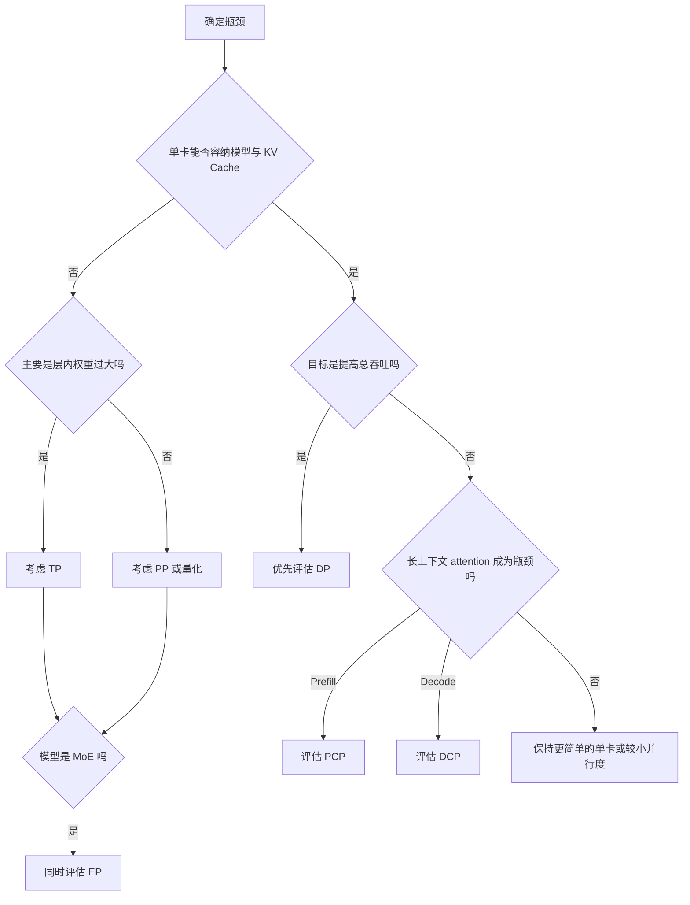

> **读图方法：** 阅读“模型放不下和吞吐不够不是同一个问题”这张流程图时，先把方框看成对象或状态，把箭头看成数据或控制的移动。第一遍从上向下建立顺序，第二遍再核对分支发生的条件。

### 9.1.2 一项配置可能同时改变容量、延迟和吞吐

并行策略没有单一收益：

- 增大 TP 通常降低每卡权重，但增加高频 collective。
- 增大 PP 降低每卡层数，但引入 stage 间传输和流水气泡。
- 增大 DP 增加模型副本与 KV Cache 副本，换取独立处理更多请求。
- 增大 EP 降低每 rank 专家数，但 token 分布不均会制造 straggler。
- PCP/DCP 针对 context 维度，约束 attention backend 和 CUDA Graph 模式。

因此，“用了 8 张卡”不是完整实验条件。至少还要写明 `TP=多少、PP=多少、DP=多少、
PCP/DCP=多少、互联是什么、请求分布是什么`。

### 9.1.3 并行策略选择决策表

这张表用于提出候选方案，不作性能排名。先确认模型与功能组合受支持，再用相同
负载比较吞吐、延迟、显存与通信；具体约束在本章后续小节展开。

| 策略 | 切分对象 | 主要通信 | 容量与适用边界 |
|---|---|---|---|
| TP | 层内参数与计算 | 依层实现进行规约或收集 | 常减少每卡权重；KV heads 过少时可能复制，延迟不保证降低 |
| PP | 模型层段 | stage 间中间张量传输 | 每卡保留本段状态；在线与离线均可评估，需考虑气泡和负载平衡 |
| DP | 请求 | 普通 dense 副本可较独立；跨 DP 的 EP 需要同步 | 每个逻辑副本可内部组合 TP/PP，不要求整个模型放入单卡 |
| EP | MoE 专家 | dispatch/compute/combine 相关通信 | 非专家层仍有自己的布局；适用性取决于模型、后端和专家负载 |
| PCP | prefill token/chunk | 收集与原序重排等 | 增加 worker 数；本版本 MRV2 有 MLA、DCP、speculation 与 graph 等组合限制（见 §9.9.3） |
| DCP | attention context/KV | Query 准备、局部 attention 和 LSE 合并 | 复用已有 ranks，不新增设备；实际 KV 分片与收益需看配置 |

例如高速互联可能有利于 TP，但“有 NVLink”不能推出 TP 必然更快；“长上下文”
也不能推出任意 PCP/DCP 组合都能启用。

[源码] `vllm/model_executor/models/llama.py` - `LlamaAttention.__init__` 的 KV head 复制分支

[源码] `vllm/config/parallel.py` - `ParallelConfig` 的并行度及组合校验

---

## 9.2 rank、world size 与 process group

> **本节先看：** 本节要回答：**rank、world size 与 process group**。下面的小节会逐层拆开概念、运行过程和源码落点；第一次阅读先抓对象之间的关系，第二次再记类名、字段和分支。

### 9.2.1 三种 rank 不应混用

在 `vllm/distributed/parallel_state.py` 的 `GroupCoordinator` 中，至少需要区分：

| 名称 | 含义 | 常见用途 |
|---|---|---|
| global rank | 进程在全局 worker world 中的编号 | 建立全局 group、日志定位 |
| local rank | 进程在本机上的编号 | 绑定 CUDA device |
| rank in group | 进程在某个 TP/PP/DP group 内的编号 | 判断 first/last rank、切 shard |

例如 global rank 6 可能绑定本机 `cuda:2`，同时是某个 TP group 的 rank 0、某个 PP group
的 rank 1。看到日志中的 `rank=0` 时，必须先确认它属于哪个命名空间。

**v0.33.0 补充：local rank 怎样换算成本机 GPU 编号。** 上表的 local rank 是 Worker 在“自己这个 DP engine”
内的本机编号，不一定等于本机 `cuda:N` 的 `N`。同一台机器上放多个 DP engine 时，换算公式是：

$$
g=\ell+i_{\mathrm{dp}}\times W_{\mathrm{engine}},\qquad W_{\mathrm{engine}}=\mathrm{TP}\times\mathrm{PP}\times\mathrm{PCP}
$$

**白话：**同一台机器上，第 0 个 DP engine 占前 $W_{\mathrm{engine}}$ 张卡，第 1 个 DP engine 紧接着占下一段 $W_{\mathrm{engine}}$ 张卡，
所以要把 engine 序号乘以每个 engine 的卡数，再加上 Worker 在 engine 内的编号。

**其中：**$g$ 是本机逻辑 GPU 编号（Worker 绑定 `cuda:g`）；$\ell$ 是 Worker 的 local rank，即它在本 engine 内的编号；
$i_{\mathrm{dp}}$ 是这个 DP engine 在**本机**上的序号（`data_parallel_rank_local`，缺省时回退为 `data_parallel_index`）；
$W_{\mathrm{engine}}$ 是一个 DP engine 的 Worker 数，等于 `ParallelConfig.world_size`（§9.3.1）。
TP、PP、PCP 是无单位正整数；$g,\ell,i_{\mathrm{dp}}$ 是从 0 开始的整数，且 $0\le\ell<W_{\mathrm{engine}}$。

**怎么算出来：**

1. 一个 DP engine 的 $W_{\mathrm{engine}}$ 个 Worker 各占一张卡，占用本机一段连续的 $W_{\mathrm{engine}}$ 个编号；
2. 本机上排第 $i_{\mathrm{dp}}$ 位的 engine 前面已有 $i_{\mathrm{dp}}$ 个 engine，它们一共占了 $i_{\mathrm{dp}}\times W_{\mathrm{engine}}$ 张卡，
   所以本 engine 的第一张卡编号是 $i_{\mathrm{dp}}\times W_{\mathrm{engine}}$；
3. engine 内第 $\ell$ 号 Worker 在这一段里排第 $\ell$ 位（从 0 数），卡号就是段首加 $\ell$。

算例一（对应下面的图）：TP=2、PP=1、PCP=1、同机 DP=2，$W_{\mathrm{engine}}=2\times1\times1=2$。
engine 0 的偏移是 $0\times2=0$，两个 Worker（$\ell=0,1$）落在 $g=0,1$；
engine 1 的偏移是 $1\times2=2$，两个 Worker 落在 $g=2+0=2$ 与 $g=2+1=3$。

算例二（对应上面的 global rank 6）：TP=2、PP=2、PCP=1、DP=2，$W_{\mathrm{engine}}=2\times2\times1=4$。
global rank 6 属于 DP engine 1，是该 engine 内的 $\ell=2$ 号 Worker（PP stage 1、TP rank 0，$1\times2+0=2$）。
如果两个 engine 在**同一台 8 卡机**上，它的本机序号是 $i_{\mathrm{dp}}=1$，$g=2+1\times4=6$，绑定 `cuda:6`；
如果是两台 4 卡机、每台只放一个 engine，每台机器上的本机序号都是 $i_{\mathrm{dp}}=0$，$g=2+0\times4=2$，绑定 `cuda:2`，
这就是上面说的“global rank 6 可能绑定本机 `cuda:2`”。

只有当 backend 不是 `ray` / `external_launcher`、DP backend 不是 `ray` 且一个 DP engine 不跨节点
（`nnodes_within_dp == 1`）时才加偏移；其余情况直接返回 $\ell$，由 Ray 或外部 launcher 先决定设备可见性。

**核对：**公式对应 `ParallelConfig.get_local_gpu_index`（`vllm/config/parallel.py:939-953` @ `05caae03`：条件判断、
`return local_rank + dp_local_rank * self.world_size` 与回退的 `return local_rank`）；Worker 在 `init_device` 里调用它
（`vllm/v1/worker/gpu_worker.py:458` @ `05caae03`）。

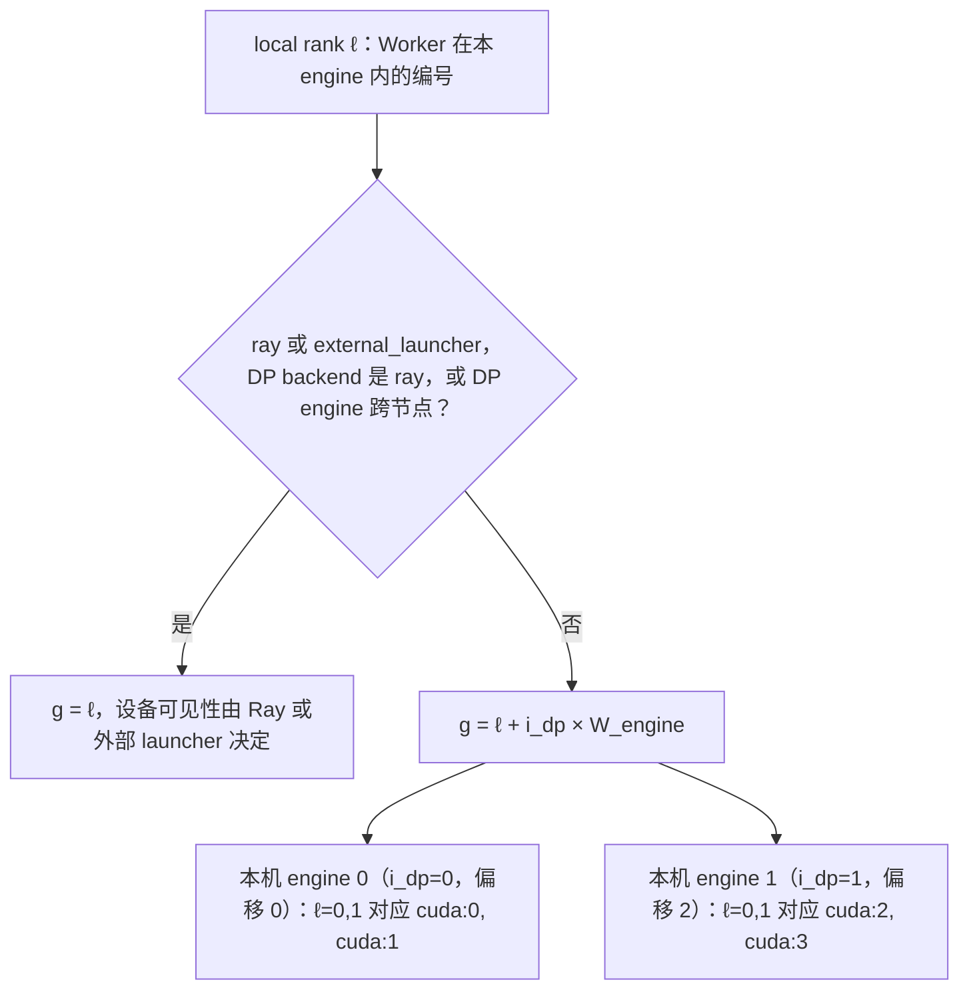

> **读图方法：** 这张图只回答一个问题：Worker 的 local rank 怎样变成 `cuda:N`。第一遍只看菱形：回答“是”的部署由 Ray 或外部 launcher 决定哪张卡可见，本节公式不适用，$g$ 就等于 $\ell$；
> 回答“否”才进入公式。第二遍看最下面两个方框：它们是 TP=2、PP=1、PCP=1、同机 DP=2 的算例，偏移等于本机 engine 序号乘每个 engine 的卡数 2。
> 读完后应能对任意 TP、PP、PCP 和本机 engine 序号算出一个 Worker 的 `cuda:N`，并说清它与 global rank、rank in group 不是同一个编号。

同一个 Worker 在三个命名空间里的编号，用算例二（TP=2、PP=2、PCP=1、DP=2，两台 4 卡机各放一个 DP engine）画出来：

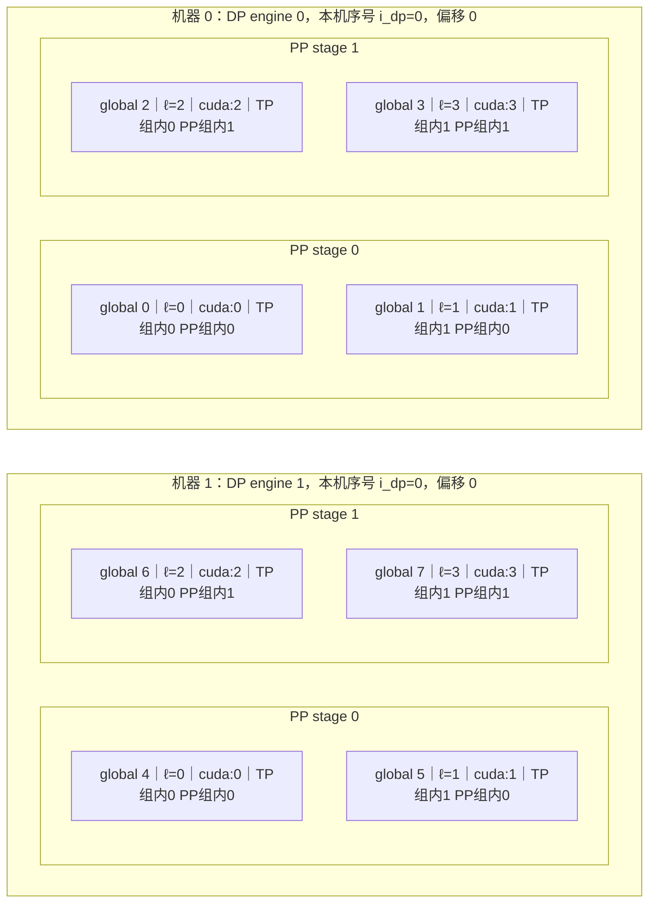

> **读图方法：** 这张图只回答一个问题：同一个 Worker 的 global rank、local rank 和“组内编号”各是多少。每个方框是一个 Worker，方框里从左到右依次是 global rank、local rank $\ell$、本机 `cuda:g`、它在 TP 组和 PP 组里的位置；
> 大框是机器（也是一个 DP engine），中框是 PP stage，同一个中框里的两个方框属于同一个 TP 组。同一台机器里，图上的上下顺序与 stage 编号相反：stage 1 在上、stage 0 在下，编号以框标题为准。先找“global 6”：它在机器 1，$\ell=2$，$g=2+0\times4=2$，所以是 `cuda:2`，在 TP 组 $\{6,7\}$ 里排第 0、在 PP 组 $\{4,6\}$ 里排第 1，与 §9.3.2 的列表一致。
> 再对照机器 0 的“global 2”：它的 $\ell$、`cuda:g` 和 TP/PP 组内编号与 global 6 完全相同，只有 global rank 不同——这就是看日志时必须先问“哪个编号”的原因。
> 如果两个 engine 改放在同一台 8 卡机上，机器 1 的偏移变成 $1\times4=4$，global 6 就绑定 `cuda:6`，图中其余编号不变。

v0.32.0 里 Worker 初始化、NUMA 绑定和网卡亲和各自复制了一份换算，NUMA 与网卡两份只乘了 `TP×PP`，漏掉 PCP；
v0.33.0 的 #61237 把它们合并到同一个方法 `ParallelConfig.get_local_gpu_index`，并统一计入 PCP。
该 PR 的标题是“Share PCP-aware local GPU indexing for NUMA binding”；`PCP>1` 时排查 NUMA 或网卡亲和问题，先确认三处都走这个入口。

[源码] `vllm/config/parallel.py` - `ParallelConfig.get_local_gpu_index`（`parallel.py:939-953` @ `05caae03`）

[源码] `vllm/v1/worker/gpu_worker.py` - `Worker.init_device`

### 9.2.2 group 是 collective 的参与者集合

Collective 不是“向所有 GPU 广播”的模糊动作。每次 all-reduce、all-gather 或
all-to-all 都在一个明确 process group 内执行；参与者集合、调用顺序、张量 shape 或
dtype 不一致，都可能导致 hang 或结果错误。

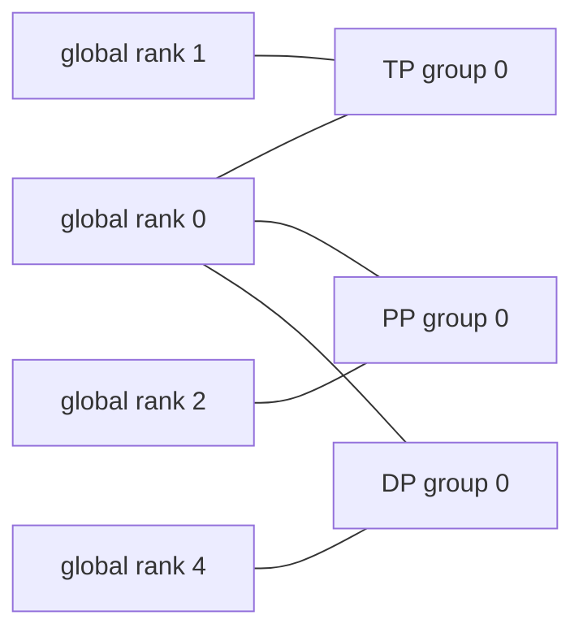

> **读图方法：** 这张图用于压缩“group 是 collective 的参与者集合”的整体关系。先从左向右找到起点、关键转换和终点，再问每条跨层箭头是否意味着函数调用、消息传递、内存访问或状态更新。

`GroupCoordinator` 同时维护：

- CPU group，通常由 Gloo 承担元数据或对象通信；
- device group，承担 GPU tensor collective；
- 可选 device communicator，例如自定义 all-reduce 路径；
- 可选 message queue broadcaster，用于执行器控制面。

这解释了为什么“Gloo 正常”不能证明 NCCL 正常，也解释了某些 PP 传输为何先在 CPU
group 交换 tensor metadata，再在 device group 发送真正的 GPU tensor。

### 9.2.3 常见通信原语

> **本节先看：** 下面先用表格整理“常见通信原语”。先横向比较每一列解决的问题和适用边界，再把具体名称映射到源码。

| 原语 | 输入与输出直觉 | 本章典型场景 |
|---|---|---|
| all-reduce | 每 rank 输入同 shape，所有 rank 得到规约结果 | Row Parallel partial sum |
| all-gather | 每 rank 提供一片，所有 rank 得到拼接结果 | Column Parallel gather、DCP |
| reduce-scatter | 先规约，再把结果切回各 rank | DCP attention 输出 |
| all-to-all | 每 rank 向每个 rank 发送不同片段 | EP token dispatch |
| broadcast | 一个 root 把相同内容发给组内成员 | Worker RPC、控制数据 |
| send/recv | 一对 rank 点对点传输 | PP activation |

---

## 9.3 从配置推导 rank 张量

> **本节先看：** 本节要回答：**从配置推导 rank 张量**。下面的小节会逐层拆开概念、运行过程和源码落点；第一次阅读先抓对象之间的关系，第二次再记类名、字段和分支。

### 9.3.1 当前源码中的 world size 公式

固定版本 `05caae03...` 的 `ParallelConfig.__post_init__`（`parallel.py:1062-1070` @ `05caae03`，与 v0.32.0 相同）使用：

$$
W_{\mathrm{engine}}=\mathrm{TP}\times \mathrm{PP}\times \mathrm{PCP}
$$

$$
W_{\mathrm{all\_dp}}=\mathrm{TP}\times \mathrm{PP}\times \mathrm{PCP}\times \mathrm{DP}
$$

**白话：**每多一个并行维度，Worker 数就乘上这个维度的路数；DCP 不在乘积里，因为它复用已有的 rank（§9.3.4）。

**其中：**TP、PP、PCP、DP 是各并行度（无单位正整数）；$W_{\mathrm{engine}}$ 是一个 DP engine 内的 Worker 数，
$W_{\mathrm{all\_dp}}$ 是所有 DP engine 的 Worker 总数，两者都不含 API、EngineCore 等辅助进程。

**怎么算出来：**把每个 Worker 看成 rank 张量（§9.3.2）里的一个格点：

1. 一个 DP engine 内，格点沿 PP、PCP、TP 三个轴展开，格点数是三个轴长之积 $\mathrm{TP}\times\mathrm{PP}\times\mathrm{PCP}$，每个格点是一个 Worker 进程（一张卡）；
2. DP 是最外层的轴，把整个 engine 复制 $\mathrm{DP}$ 份，所以总数再乘 $\mathrm{DP}$。

算例：TP=2、PP=2、PCP=1、DP=2：$W_{\mathrm{engine}}=2\times2\times1=4$，$W_{\mathrm{all\_dp}}=4\times2=8$，
与 §9.3.2 的表（8 个 rank）一致，也与本章开头“停下来算”的 8 个 Worker 一致。把 PCP 改成 2，$W_{\mathrm{engine}}$ 翻倍成 8；把 DCP 改成 2，两个公式的结果都不变。

**核对：**`ParallelConfig.__post_init__` 先令 `world_size = PP × TP × PCP`，再在 `external_launcher` 下乘 DP
（`vllm/config/parallel.py:1062-1070` @ `05caae03`）；属性 `world_size_across_dp` 是 `world_size × data_parallel_size`
（`parallel.py:704-707`）。教学代码里 `ParallelTopology.worker_world_size` 与 `world_size_across_dp`
（`examples/ch09_parallel_topology.py:48-57`）与这两个公式一一对应，运行 `python3 examples/ch09_parallel_topology.py`
会打印 `workers per DP engine: 4` 与 `workers across DP: 8`。

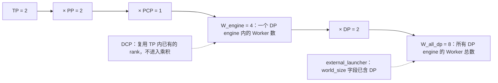

> **读图方法：** 这张图只回答一个问题：Worker 数是由哪些并行度怎样乘出来的。先顺着实线从左到右读：TP、PP、PCP 三个因子依次相乘得到一个 DP engine 的 $W_{\mathrm{engine}}$，再乘 DP 得到 $W_{\mathrm{all\_dp}}$，框里的数字是上文算例（TP=2、PP=2、PCP=1、DP=2）。
> 再看两条虚线：DCP 指向 $W_{\mathrm{engine}}$ 但不乘任何数，表示它只重新解释已有的 rank；external_launcher 指向 $W_{\mathrm{all\_dp}}$，表示这条路径下 `world_size` 字段本身就已经是总数，不能再乘一次 DP。

源码字段附近仍有把 `world_size` 简写成 “TPxPP” 的旧说明，但真实赋值已经包含 PCP。
因此本书以执行代码为准：**PCP 会增加 worker process 数，DCP 不会。**

`external_launcher` 是特殊路径：外部系统已经启动全部进程，`ParallelConfig.__post_init__`
会把 DP 也并入字段 `world_size`。因此上面的两个公式描述的是普通内部启动路径的逻辑量；
在 external launcher 下，`world_size` 本身已经是 `TP×PP×PCP×DP`。此时若再机械读取
`world_size_across_dp = world_size×DP`，会把 DP 重复计算，不能把该 property 无条件当作
真实进程总数。读代码时必须同时确认启动方式和字段的消费位置。
算例：TP=2、PP=1、PCP=1、DP=2 且使用 `external_launcher`：`world_size` 是 $2\times1\times1\times2=4$（真实进程数），
而 `world_size_across_dp` 是 $4\times2=8$，把 DP 数了两遍。

所有并行度都是无单位正整数。
能写出乘法不代表组合可运行：此版本已移除 `ParallelConfig` 中 PCP 与 DP 不能同时开启的
通用禁令，且自 v0.32.0 起 MRV2 PCP 不再禁止 `PP>1`（v0.33.0 沿用），但仍要满足 MLA、DCP、speculation 和 graph
约束。移除一个校验不代表任意组合可运行。先检查合法性，再算部署规模。

[源码] `vllm/config/parallel.py` - `ParallelConfig` 的 PCP/DCP 校验、`__post_init__`

本书基线 `05caae03` 里，`ParallelConfig.numa_bind` 的默认值已是 `None`（[4d95f222e6](https://github.com/vllm-project/vllm/commit/4d95f222e68bd43acbdfdffad6d46eea70146dcc)，[#61258](https://github.com/vllm-project/vllm/pull/61258)；`parallel.py:350` @ `05caae03`）：
`None` 时在多 NUMA、`numactl`、spawn、mp/uni 等条件满足时 best-effort 自动绑定（软 memory preference，`_numa_bind_auto`）；显式 `True` 为严格绑定（失败即启动错误），`False` 关闭。


### 9.3.2 rank 的逻辑布局是一个多维张量

`initialize_model_parallel` 把 ranks 解释为：

```text
ExternalDP x DP x PP x PCP x TP
```

不考虑 ExternalDP 时，TP 是最内层、变化最快的维度。设
`TP=2, PP=2, PCP=1, DP=2`，global rank 可排成：

| DP | PP | PCP | TP=0 | TP=1 |
|---:|---:|---:|---:|---:|
| 0 | 0 | 0 | 0 | 1 |
| 0 | 1 | 0 | 2 | 3 |
| 1 | 0 | 0 | 4 | 5 |
| 1 | 1 | 0 | 6 | 7 |

由此得到：

```text
TP groups = [[0,1], [2,3], [4,5], [6,7]]
PP groups = [[0,2], [1,3], [4,6], [5,7]]
DP groups = [[0,4], [1,5], [2,6], [3,7]]
EP groups = [[0,1,4,5], [2,3,6,7]]
```

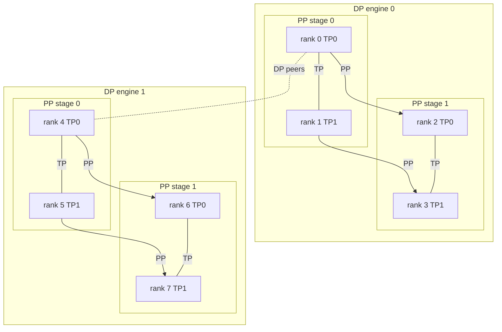

> **读图方法：** 这是“rank 的逻辑布局是一个多维张量”的流程图。先从上向下只追一条主路径，确认输入经过哪些关键阶段到达输出；第二遍再看虚线、回边和旁路，它们通常表示反馈、复用或可选分支。

### 9.3.3 各 group 是对 rank 张量做切片或转置

> **本节先看：** 下面先给出“各 group 是对 rank 张量做切片或转置”的结论清单。先理解每一项为什么存在，再记参数名或实现细节。

- TP group：固定 DP、PP、PCP，沿 TP 取一行。
- PCP group：固定 DP、PP、TP，沿 PCP 取一列。
- PP group：固定 DP、PCP、TP，沿 PP 取一列。
- DP group：固定 PP、PCP、TP，沿 DP 取一列。
- EP group：固定 PP，把 DP、PCP、TP 展平为一个专家并行维度（只有 MoE 模型才创建 EP group，dense 模型没有）。

这是比背 rank 列表更可靠的心智模型。只要画出 rank 张量，就能重新推导 group。

**白话：**rank 张量里每个格点有四个坐标（DP、PP、PCP、TP）。全局 rank 就是按“TP 变化最快”把坐标展平成一维编号；
固定其中三个坐标、让第四个坐标走遍它的取值，得到的那几个 rank 就是一个 group。

**其中：**$i_{\mathrm{dp}}$、$i_{\mathrm{pp}}$、$i_{\mathrm{pcp}}$、$i_{\mathrm{tp}}$ 是 Worker 在 DP、PP、PCP、TP 四个轴上的坐标，
都从 0 起，分别小于 $\mathrm{DP}$、$\mathrm{PP}$、$\mathrm{PCP}$、$\mathrm{TP}$；$\mathrm{rank}$ 是全局 rank（无 ExternalDP 时）：

$$
\mathrm{rank}=\bigl((i_{\mathrm{dp}}\,\mathrm{PP}+i_{\mathrm{pp}})\,\mathrm{PCP}+i_{\mathrm{pcp}}\bigr)\,\mathrm{TP}+i_{\mathrm{tp}}
$$

**怎么算出来：**

1. 这是行主序展平，最内层的 TP 每走一格，rank 加 $1$；PCP 每走一格要越过 $\mathrm{TP}$ 个 rank，加 $\mathrm{TP}$；
   PP 每走一格要越过一整个 PCP×TP 块，加 $\mathrm{PCP}\times\mathrm{TP}$；
   DP 每走一格加 $\mathrm{PP}\times\mathrm{PCP}\times\mathrm{TP}=W_{\mathrm{engine}}$。把四个“每走一格”乘上各自坐标再相加，就是上面的公式；
2. group 是固定另外三个坐标、让这一个坐标从 0 走到轴长减 1，所以成员之间的间隔就是第 1 步的“每走一格加多少”：
   TP group 间隔 $1$，PCP group 间隔 $\mathrm{TP}$，PP group 间隔 $\mathrm{PCP}\times\mathrm{TP}$，DP group 间隔 $W_{\mathrm{engine}}$；
3. EP group 不沿单个轴：固定 PP 坐标后，把 DP、PCP、TP 三个轴合成一个维度。

算例：TP=2、PP=2、PCP=1、DP=2，四个间隔分别是 TP 的 $1$、PP 的 $1\times2=2$、DP 的 $2\times1\times2=4$。
坐标 $(i_{\mathrm{dp}},i_{\mathrm{pp}},i_{\mathrm{pcp}},i_{\mathrm{tp}})=(1,1,0,0)$ 的 rank 是 $((1\times2+1)\times1+0)\times2+0=6$，与 §9.3.2 的表一致。
它所在的 TP group：间隔 1，$i_{\mathrm{tp}}=0,1$，成员 $\{6,7\}$；PP group：间隔 2，$i_{\mathrm{pp}}=0,1$，成员 $\{4,6\}$；
DP group：间隔 4，$i_{\mathrm{dp}}=0,1$，成员 $\{2,6\}$；EP group：固定 $i_{\mathrm{pp}}=1$，$i_{\mathrm{dp}}$ 与 $i_{\mathrm{tp}}$ 各取 0、1，成员 $\{2,3,6,7\}$。
这四组都出现在 §9.3.2 的列表里。

**核对：**`initialize_model_parallel` 把 rank 排成 `[ExternalDP, DP, PP, PCP, TP]` 五维张量（`vllm/distributed/parallel_state.py:2164-2170` @ `05caae03`，这里取 ExternalDP=1），
TP group 是 `view(-1, TP)`（`:2175`），PCP 是 `transpose(3, 4)`（`:2285-2287`），PP 是 `transpose(2, 4)`（`:2305`），DP 是 `transpose(1, 4)`（`:2321`），
EP 是 `transpose(1, 2)` 后按 DP×PCP×TP 重排（`:2343-2353`，且只在 MoE 模型里创建）；
教学代码 `ParallelTopology.rank` 与 `groups`（`examples/ch09_parallel_topology.py:58`、`:94`）给出同样的公式和四组列表。

### 9.3.4 DCP 复用现有进程

当 PCP 关闭时，TP size 必须能被 DCP size 整除；DCP 在已有 TP ranks 上建立子组，不增加
worker 数。当 PCP 开启时，当前配置要求 DCP 为 `1`、`PCP` 或 `TP×PCP`，并优先跨 PCP
维度形成 context group。

这个差异直接影响容量规划：`PCP=2` 会让每个 DP engine 的 worker 数翻倍，`DCP=2`
不会自动多启动两张卡，而是重新解释既有 ranks 的 attention 工作。

**算一算：DCP 取值是否合法。**这是两条校验规则，同样要会手算：

| 条件 | 合法的 DCP | 算例 |
|---|---|---|
| $\mathrm{PCP}=1$ | 整除 TP 的数，即 $\mathrm{TP}\bmod\mathrm{DCP}=0$ | TP=8：DCP 可取 1、2、4、8；DCP=3 不合法（$8\bmod3=2$） |
| $\mathrm{PCP}>1$ | 只能取 $1$、$\mathrm{PCP}$、$\mathrm{TP}\times\mathrm{PCP}$ 三个值之一 | TP=4、PCP=2：DCP 可取 1、2、8；DCP=4 不合法（4 不在 $\{1,2,8\}$ 里） |

**核对：**`ParallelConfig` 的校验（`vllm/config/parallel.py:638-651` @ `05caae03`：`pcp == 1` 时检查 `tp % dcp`，否则检查 `dcp not in (1, pcp, tp * pcp)`）；
教学代码 `ParallelTopology.__post_init__`（`examples/ch09_parallel_topology.py:39-46`）有同样的两条检查。

---

## 9.4 V1 的进程与对象拓扑

> **本节先看：** 本节要回答：**V1 的进程与对象拓扑**。下面的小节会逐层拆开概念、运行过程和源码落点；第一次阅读先抓对象之间的关系，第二次再记类名、字段和分支。

### 9.4.1 不要把 API、EngineCore 和 Worker 算成同一层

一个常见多进程部署包含：


> **读图方法：** 阅读“不要把 API、EngineCore 和 Worker 算成同一层”这张流程图时，先把方框看成对象或状态，把箭头看成数据或控制的移动。第一遍从左向右建立顺序，第二遍再核对分支发生的条件。

- API 层负责协议、输入输出处理与流式响应。
- EngineCore 拥有 Scheduler、KVCacheManager 和 request state。
- Executor 把一次逻辑 Worker 调用分发到所有相关 ranks。
- Worker 绑定设备，持有模型 shard、KV cache tensor 和 ModelRunner。

因此“8 GPU 就是 8 个进程”并不可靠。API server、EngineCore、DP coordinator、Ray
actor 或监控进程都可能额外存在；真正 GPU worker 数才由并行拓扑推导。

### 9.4.2 TP/PP/PCP 通常扩展一个 EngineCore 下的 Worker group

这些并行方式共同完成同一个 engine 内的一批请求。Scheduler 做出一次决策后，Executor
需要让相关 ranks 以一致顺序执行，否则 collective 无法配对。

### 9.4.3 DP 通常增加完整 EngineCore

普通 DP 中，每个 DP engine 拥有独立：

- Scheduler 的 waiting/running 队列；
- KVCacheManager 和 block 生命周期；
- TP×PP×PCP Worker group；
- 请求 ID 与执行进度。

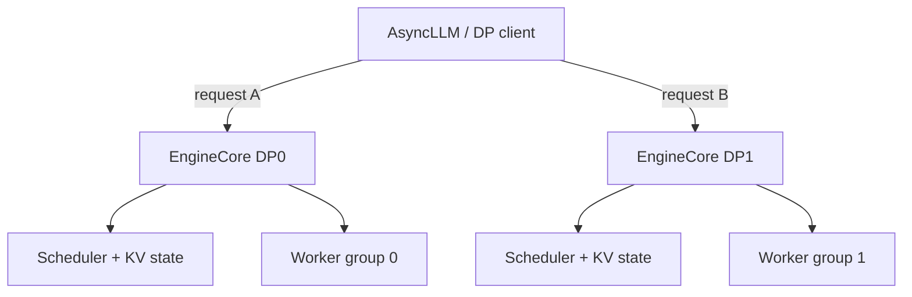

> **读图方法：** 这张图用于压缩“DP 通常增加完整 EngineCore”的整体关系。先从上向下找到起点、关键转换和终点，再问每条跨层箭头是否意味着函数调用、消息传递、内存访问或状态更新。

这就是为什么请求从 DP0 迁移到 DP1 并非“改一个路由指针”：它的 Scheduler 状态、KV
blocks 和模型执行上下文并不在那里。

### 9.4.4 dense DP 与 MoE DP 的同步边界不同

Dense 模型的 DP engines 可以大体独立推进。启用跨 DP 的 EP 后，来自不同 DP engines 的
workers 可能属于同一个 EP group。只要某些 ranks 进入 all-to-all，其他 ranks 也必须以
匹配顺序参与；空闲 engine 可能需要 dummy step 或 coordinated request wave。

---

## 9.5 Tensor Parallel：切一层，而不是切请求

> **本节先看：** 本节要回答：**Tensor Parallel：切一层，而不是切请求**。下面的小节会逐层拆开概念、运行过程和源码落点；第一次阅读先抓对象之间的关系，第二次再记类名、字段和分支。

### 9.5.1 Column Parallel Linear

对线性层 `Y = X A + b`，把权重沿输出维切成 $\mathrm{TP}$ 份：

$$
A=[A_0,A_1,\ldots,A_{\mathrm{TP}-1}]
$$

每个 TP rank 计算：

$$
Y_i=XA_i+b_i
$$

**白话：**输出的每一列只依赖权重的同一列。所以把权重按列切开，每个 rank 用完整的输入 $X$ 乘自己那几列，
直接得到输出的那几列，算的时候不需要和别的 rank 通信。

**其中：**先用 shape 建立坐标：`X:[T,D_in]`、`A:[D_in,D_out]`、`b:[D_out]`，$T$ 是本步 token 数，
$D_{\mathrm{in}}$、$D_{\mathrm{out}}$ 是输入、输出宽度（元素数），$\mathrm{TP}$ 是 TP 路数，$i=0,\ldots,\mathrm{TP}-1$ 是 TP rank 序号
（$D_{\mathrm{out}}$ 必须能被 $\mathrm{TP}$ 整除）。Column 切分后 `A_i:[D_in,D_out/TP]`、`b_i:[D_out/TP]`、`Y_i:[T,D_out/TP]`：
$A_i$ 是 $A$ 的第 $i$ 份列块，$b_i$ 是偏置里对应这些列的那一段，$Y_i$ 是本 rank 算出的输出列块。

**怎么算出来：**

1. 矩阵乘的第 $j$ 列输出只用到 $A$ 的第 $j$ 列，与其他列无关；
2. 把 $A$ 的列按顺序分成 $\mathrm{TP}$ 块，分块乘法给出 $XA=[XA_0,XA_1,\ldots,XA_{\mathrm{TP}-1}]$；
3. 偏置对每个输出列各加一个数，所以也按同样的列切成 $b_i$，每个 rank 加自己那一段：$Y_i=XA_i+b_i$，把各块拼起来就是 $XA+b$。

算例（TP=2，教学数字）：$X=[1,2]$（$T=1$、$D_{\mathrm{in}}=2$），$A=\begin{bmatrix}1&2&3&4\\5&6&7&8\end{bmatrix}$（$D_{\mathrm{out}}=4$），$b=[1,1,1,1]$。
完整计算：$XA=[1\times1+2\times5,\ 1\times2+2\times6,\ 1\times3+2\times7,\ 1\times4+2\times8]=[11,14,17,20]$，加 $b$ 得 $[12,15,18,21]$。
切分后 $A_0=\begin{bmatrix}1&2\\5&6\end{bmatrix}$、$A_1=\begin{bmatrix}3&4\\7&8\end{bmatrix}$，$b_0=b_1=[1,1]$：
rank 0 算 $[11,14]+[1,1]=[12,15]$，rank 1 算 $[17,20]+[1,1]=[18,21]$，两块拼起来是 $[12,15,18,21]$，与完整计算相同。
shape 检查：$Y_i$ 是 `[1,2]`，两块拼成 `[1,4]`。

**核对：**`ColumnParallelLinear` 的文档字符串同样写 $Y=XA+b$、`A = [A_1, ..., A_p]`（`vllm/model_executor/layers/linear.py:439-443` @ `05caae03`，源码从 1 起数，其中 `p` 是源码对 TP 的记法）；
偏置按 `output_size_per_partition` 建（`:550-551`）；`forward` 里 `skip_bias_add` 为假才把偏置交给本地矩阵乘（`:623`）；
教学代码 `column_parallel_linear` 返回不含偏置的 $XA_i$（`examples/ch09_parallel_topology.py:184`），对上面的 $X,A$ 得到 `[[[11, 14]], [[17, 20]]]`。

先用 shape 看本地结果：它是最终输出的一组列。如果下一个算子也接受分片输出，可以继续保持分片；若
调用者要求完整 hidden states，则执行 all-gather：

$$
Y=\operatorname{concat}(Y_0,Y_1,\ldots,Y_{\mathrm{TP}-1})
$$

**白话：**all-gather 把每个 rank 手里的列块按 rank 序号首尾相接，之后每个 rank 都持有完整的 $Y$。

**其中：**$Y_i$ 的 shape 是 `[T,D_out/TP]`，$\operatorname{concat}$ 沿最后一维（列）按 $i=0,1,\ldots$ 的顺序拼接，结果 $Y$ 的 shape 是 `[T,D_out]`。

**怎么算出来：**上面的算例里 $Y_0=[12,15]$、$Y_1=[18,21]$，沿列拼接得 $[12,15,18,21]$，两个 `[1,2]` 变成 `[1,4]`，列数 $\mathrm{TP}\times D_{\mathrm{out}}/\mathrm{TP}=D_{\mathrm{out}}$。
每个 rank 要从其余 $\mathrm{TP}-1$ 个 rank 各收到 $T\times D_{\mathrm{out}}/\mathrm{TP}$ 个元素，上例每个 rank 收到 2 个元素，是完整 $Y$（4 个元素）的 $(\mathrm{TP}-1)/\mathrm{TP}=1/2$。

**核对：**`gather_output` 为真且 `tp_size > 1` 时调用 `tensor_model_parallel_all_gather(output_parallel)`（`linear.py:629-630` @ `05caae03`），
它默认沿 `dim=-1` 拼接（`vllm/distributed/communication_op.py:17-21`）；教学代码 `all_gather_columns`（`examples/ch09_parallel_topology.py:190`）按行拼接各 rank 的输出列，得到 `[[11, 14, 17, 20]]`（不含偏置）。

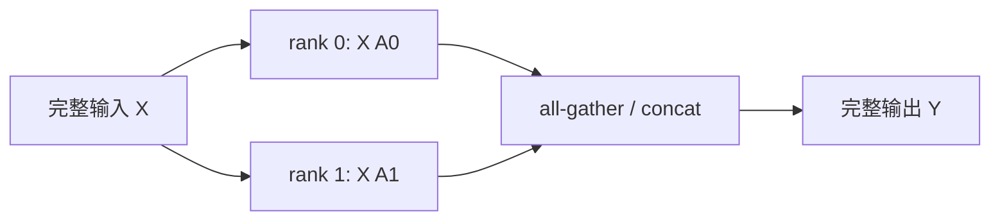

> **读图方法：** 这是“Column Parallel Linear”的流程图。先从左向右只追一条主路径，确认输入经过哪些关键阶段到达输出；第二遍再看虚线、回边和旁路，它们通常表示反馈、复用或可选分支。

`vllm/model_executor/layers/linear.py` 的 `ColumnParallelLinear` 体现了这套契约；是否 gather
由构造参数 `gather_output`（默认 `False`）、`tp_size > 1` 与后续算子布局决定，不是每次都无条件通信。

### 9.5.2 Row Parallel Linear

把权重沿输入维切分：

$$
\begin{aligned}
A &= \begin{bmatrix} A_0 \\ A_1 \\ \vdots \\ A_{\mathrm{TP}-1} \end{bmatrix},\\
X &= [X_0,X_1,\ldots,X_{\mathrm{TP}-1}].
\end{aligned}
$$

每个 rank 只能得到 partial output：

$$
Y^{\mathrm{part}}_i=X_iA_i
$$

最终输出是所有 partial output 的和：

$$
Y=\sum_{i=0}^{\mathrm{TP}-1} Y^{\mathrm{part}}_i+b
$$

**白话：**切在输入维上，每个 rank 只看到输入的一段和权重对应的几行，算出来的只是“部分和”，还不是最终输出。
必须把各 rank 的部分和**加**起来；把它们拼接是错的。

**其中：**这里 `X_i:[T,D_in/TP]`、`A_i:[D_in/TP,D_out]`，所以每个 $Y^{\mathrm{part}}_i$ 的 shape 是 `[T,D_out]`，与最终的 $Y$ 相同，
只是只累加了部分输入维度；$b$ 是偏置 `[D_out]`，整个输出只加一次；$i=0,\ldots,\mathrm{TP}-1$ 是 TP rank 序号。

**怎么算出来：**

1. 输出的每个元素是对输入维 $k$ 的一个求和：$Y[t,j]=\sum_{k}X[t,k]\,A[k,j]$；
2. 把求和下标 $k$ 切成 $\mathrm{TP}$ 段，第 $i$ 段由 rank $i$ 负责，它只需要 $X$ 的对应列 $X_i$ 和 $A$ 的对应行 $A_i$，算出这一段的和 $Y^{\mathrm{part}}_i=X_iA_i$；
3. 加法可以分段结合，所以各段的和相加等于整个和：$XA=\sum_iX_iA_i$；偏置不依赖 $k$，最后加一次。

算例（TP=2，教学数字）：$X=[1,2]$、$A=\begin{bmatrix}3\\4\end{bmatrix}$（$T=1$、$D_{\mathrm{in}}=2$、$D_{\mathrm{out}}=1$）。
完整结果是 $1\times3+2\times4=11$。切分后 rank 0 持有 $X_0=[1]$、$A_0=[3]$，算出 $Y^{\mathrm{part}}_0=3$；rank 1 持有 $X_1=[2]$、$A_1=[4]$，算出 $Y^{\mathrm{part}}_1=8$。
求和 $3+8=11$，与完整结果一致；concat 得到 $[3,8]$ 就错了。
加上偏置 $b=[1]$：只有 rank 0 把 $b$ 加进自己的部分和（$3+1=4$），all-reduce 之后 $4+8=12=11+1$；如果每个 rank 都加，会得到 $4+9=13$，偏置被加了两次。
shape 检查：$[1,1]\cdot[1,1]=[1,1]$，$Y^{\mathrm{part}}_i$ 与 $Y$ 同为 `[1,1]`。

**核对：**`RowParallelLinear` 的文档字符串同样把 $A$ 沿第一维、$X$ 沿第二维切成 `p` 份（`p` 是源码对 TP 的记法；`vllm/model_executor/layers/linear.py:1686-1697` @ `05caae03`）；
`forward` 里 `bias_ = None if (self.tp_rank > 0 or self.skip_bias_add) else self.bias`（`:1847`），保证偏置不被加多次；
`reduce_results` 且 `tp_size > 1` 时对 `output_parallel` 做 all-reduce（`:1850-1851`）；
教学代码 `row_parallel_linear` 与 `all_reduce_sum`（`examples/ch09_parallel_topology.py:202`、`:220`）对 $X=[1,2]$、$A=[[3],[4]]$ 分别给出 `[[[3]], [[8]]]` 与 `[[11]]`（不含偏置）。

默认 `reduce_results=True` 且 `TP>1` 时执行 all-reduce；关闭规约则返回 partial
output，让上层继续处理。直接加 bias 的路径只在 TP rank 0 加一次；若
`skip_bias_add=True`，bias 单独返回，交给调用者融合，不能无条件说它在规约前相加。

[源码] `vllm/model_executor/layers/linear.py` - `RowParallelLinear.forward`

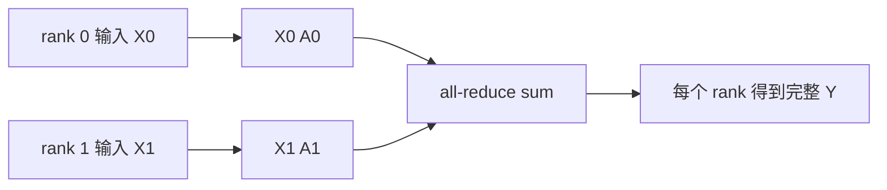

> **读图方法：** 阅读“Row Parallel Linear”这张流程图时，先把方框看成对象或状态，把箭头看成数据或控制的移动。第一遍从左向右建立顺序，第二遍再核对分支发生的条件。

### 9.5.3 MLP 中为何常把两种布局配对

一个典型 MLP 可以先用 Column Parallel 扩展 hidden dimension，让中间 activation 保持
分片；再用 Row Parallel 收缩回 hidden dimension，并在末尾 all-reduce。这样避免在两层
之间先 gather 再 split。

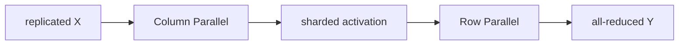

> **读图方法：** 这张图用于压缩“MLP 中为何常把两种布局配对”的整体关系。先从左向右找到起点、关键转换和终点，再问每条跨层箭头是否意味着函数调用、消息传递、内存访问或状态更新。

**在基础 dense TP 路径中，Column → Row 可以避免中间收集。** 以无额外上下文
并行、无 sequence parallel 特例的 Llama 路径为例，QKV 投影后可按本地 heads 做
attention，`o_proj` 再合并局部贡献；MLP 的 gate/up 投影后可本地做门控，`down_proj`
再合并贡献。这样中间结果不必先 all-gather、紧接着又切回分片。

在这组条件下，两个默认 RowParallelLinear 端点各做一次 all-reduce。但不能推广为
所有 Transformer 层“严格只有两次通信”：DCP、MoE、其他并行布局或优化会改变路径。
也不能凭空假设优化前必有四次同等成本同步，进而声称通信时间一定减半。

[源码] `vllm/model_executor/models/llama.py` - `LlamaAttention`、`LlamaMLP`

[源码] `vllm/model_executor/layers/linear.py` - `RowParallelLinear.forward`

### 9.5.4 权重加载也必须理解 shard 语义

checkpoint 往往保存完整或按其他格式切分的 tensor。TP layer 的 `weight_loader` 根据当前
TP rank 和 shard dimension 只装载本地片段。排查 shape 错误时，应同时记录：

- checkpoint tensor shape；
- 参数对象的本地 shape；
- shard dimension 与 shard id；
- packed projection 是否把 Q/K/V 或 gate/up 放在同一 tensor；
- quantization 是否改变物理布局。

### 9.5.5 TP 为什么可能更慢

粗略地，一层的时间可以写成：

$$
\Delta t_{\mathrm{layer}}(\mathrm{TP})\approx \frac{\Delta t_{\mathrm{compute}}(1)}{\mathrm{TP}}+\Delta t_{\mathrm{collective}}(\mathrm{TP})+\Delta t_{\mathrm{imbalance}}
$$

**白话：**TP 路并行时，一层的耗时 = 被摊薄的计算时间 + 这一层必须付的通信时间 + 最慢的 rank 拖出来的等待。
计算能摊薄，通信和等待摊不薄，所以 TP 不一定更快。

**其中：**$\Delta t_{\mathrm{layer}}(\mathrm{TP})$ 是 TP 路时一层的耗时；$\Delta t_{\mathrm{compute}}(1)$ 是单卡（TP=1）时这一层的计算耗时；
$\Delta t_{\mathrm{collective}}(\mathrm{TP})$ 是这一层所有 collective（例如 all-reduce）的总耗时，TP=1 时没有；
$\Delta t_{\mathrm{imbalance}}$ 是各 rank 计算量或速度不均造成的等待，不小于 0；单位都是 s 或 ms。这是本书的粗略教学模型，$\Delta t_{\mathrm{layer}}$ 等记号是本书记号，不是源码里的变量。

**怎么算出来：**

1. 理想情况下，矩阵乘的计算量均分给 $\mathrm{TP}$ 个 rank，各自并行算，每个 rank 只花单卡的 $1/\mathrm{TP}$：$\Delta t_{\mathrm{compute}}(1)/\mathrm{TP}$；
2. 但每个 RowParallel 端点都要做 collective（§9.5.3；这是 `reduce_results=True` 的默认路径），它有固定的启动延迟，数据量也不随计算变小，不能被 $\mathrm{TP}$ 摊薄，所以直接加上 $\Delta t_{\mathrm{collective}}(\mathrm{TP})$；
3. collective 要等所有 rank 到齐，一层结束的时刻由最慢的 rank 决定，所以再加上等待 $\Delta t_{\mathrm{imbalance}}$。

算例（教学数字）：大 batch，$\Delta t_{\mathrm{compute}}(1)=1.0\ \mathrm{ms}$、TP=2、$\Delta t_{\mathrm{collective}}(2)=0.1\ \mathrm{ms}$、$\Delta t_{\mathrm{imbalance}}=0.02\ \mathrm{ms}$：
$\Delta t_{\mathrm{layer}}(2)\approx1.0/2+0.1+0.02=0.62\ \mathrm{ms}$，比单卡的 $1.0\ \mathrm{ms}$ 快，加速约 $1.0/0.62\approx1.6$ 倍。
小 batch decode，$\Delta t_{\mathrm{compute}}(1)=0.1\ \mathrm{ms}$、其他不变：$\Delta t_{\mathrm{layer}}(2)\approx0.1/2+0.1+0.02=0.17\ \mathrm{ms}$，比单卡的 $0.1\ \mathrm{ms}$ 还慢。
单位检查：ms $+$ ms $+$ ms $=$ ms。

**核对：**这是估算模型，源码里没有对应函数；它与 §9.14.1 的 alpha-beta 通信模型是同一个思路（固定延迟加数据量除以带宽）。
实际占比要用 profiler 的时间线测，不能用这个公式代替测量。

小 batch decode 的矩阵乘较小，$\Delta t_{\mathrm{compute}}(1)/\mathrm{TP}$ 的收益有限，而每层 collective 的固定启动
延迟仍存在。PCIe、跨 NUMA 或跨节点 TP 会进一步放大通信成本。所以“TP=2 比单卡慢”
完全可能是合理结果，不表示 TP 实现错误。

---

## 9.6 Pipeline Parallel：按层切模型

> **本节先看：** 本节要回答：**Pipeline Parallel：按层切模型**。下面的小节会逐层拆开概念、运行过程和源码落点；第一次阅读先抓对象之间的关系，第二次再记类名、字段和分支。

### 9.6.1 layer partition 的真实规则

`vllm/distributed/utils.py:get_pp_indices` 负责默认层划分。它不仅做平均除法，还把余数
从倒数第二个 stage 开始向前逐个分配，每个 stage 加一层，最后一 stage 不接收余数。
12 层、PP=5 的层数是 `[2,2,3,3,2]`：多出来的 2 层给了 stage 3 和 stage 2，stage 0 和最后的 stage 4 都没有。
显式设置 `VLLM_PP_LAYER_PARTITION` 时则使用校验后的自定义分配。

**白话：**先让每个 stage 平分，再把除不尽的余数一层一层补给倒数第二个、倒数第三个……stage；最后一个 stage 不补，
因为它还要承担最终 norm（见 §9.6.3）。

**其中：**$L$ 是模型层数，PP 是 stage 数；stage 编号从 0 起；`partitions` 是各 stage 层数组成的列表，下标 $-1$ 表示最后一个 stage、$-2$ 表示倒数第二个，依此类推；
stage 的层区间写成左闭右开 $[\mathrm{start},\mathrm{end})$。

**怎么算出来：**

1. 每个 stage 先分到基数 $\lfloor L/\mathrm{PP}\rfloor$ 层；
2. 余数是 $L\bmod\mathrm{PP}$，有几层余数就给几个 stage 各加一层，顺序是 `partitions[-2]`、`partitions[-3]`……（源码里的 `for i in range(2, remaining_layers + 2): partitions[-i] += 1`）；
3. stage $k$ 的 $\mathrm{start}$ 是前面所有 stage 的层数之和，$\mathrm{end}=\mathrm{start}+\mathtt{partitions}[k]$。

算例一：$L=10$、PP=3：基数 $\lfloor10/3\rfloor=3$，余数 $10\bmod3=1$，给 `partitions[-2]`（stage 1）加一层，得 `[3,4,3]`；
区间是 $[0,3)$、$[3,7)$、$[7,10)$，总层数 $3+4+3=10$。
算例二：$L=12$、PP=5：基数 $\lfloor12/5\rfloor=2$，余数 $12\bmod5=2$，给 `partitions[-2]`（stage 3）和 `partitions[-3]`（stage 2）各加一层，得 `[2,2,3,3,2]`，总层数 $2+2+3+3+2=12$。

**核对：**`get_pp_indices`（`vllm/distributed/utils.py:239-256` @ `05caae03`：基数、余数循环与前缀和）；教学代码 `pipeline_partitions`
（`examples/ch09_parallel_topology.py:233`）对 $L=10$、PP=3 给出 `[(0, 3), (3, 7), (7, 10)]`，对 $L=12$、PP=5 给出 `[(0, 2), (2, 4), (4, 7), (7, 10), (10, 12)]`。

例如 10 层、PP=3（算例一的结果）：

```text
stage 0: [0, 3)  -> 3 layers
stage 1: [3, 7)  -> 4 layers
stage 2: [7, 10) -> 3 layers
```

若只是用 `ceil(num_layers / pp)` 手算，$L=10$、PP=3 会得到 $\lceil10/3\rceil=4$ 层一段的边界 $[0,4)$、$[4,8)$、$[8,10)$，与上面不同。

### 9.6.2 `PPMissingLayer` 表达“不归本 rank 所有”

`make_layers` 只在本 PP stage 实例化真实 Transformer layers；其他位置放置
`PPMissingLayer`。加载 checkpoint 时，`is_pp_missing_parameter` 会跳过不属于本 stage 的
参数。因此每个 rank 看见的 Python 模型骨架可以相似，但真实参数 ownership 不同。

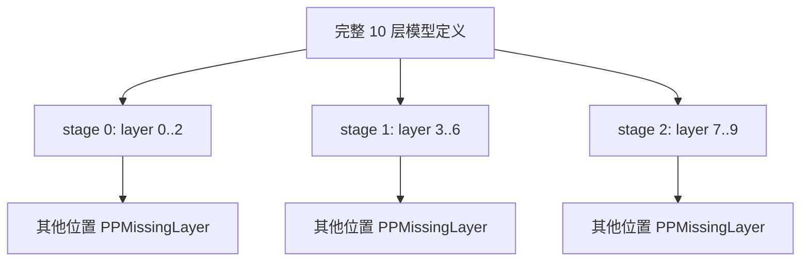

> **读图方法：** 这是“`PPMissingLayer` 表达不归本 rank 所有”的流程图。先从上向下只追一条主路径，确认输入经过哪些关键阶段到达输出；第二遍再看虚线、回边和旁路，它们通常表示反馈、复用或可选分支。

### 9.6.3 首 stage 和末 stage 承担不同职责

以 Llama 路径为例：

- PP first rank 负责 token embedding 的查表（`LlamaModel.forward` 只在 `is_first_rank` 时调用 `embed_input_ids`，`llama.py:414-420` @ `05caae03`）。
  `embed_tokens` 这个模块本身在 Llama 里还会在另外两种情况下于最后一个 rank 上构建：`tie_word_embeddings` 为真（`lm_head` 与它共享权重），
  或 `spec_decode_needs_target_embed(vllm_config)` 为真（hidden-state drafter 可能复用目标模型的输入 embedding）；其余 rank 放 `PPMissingLayer`（`llama.py:377-388`）；
- 非 first rank 从 `IntermediateTensors` 取得上游 hidden states；
- 非 last rank 执行本地 layers 后返回 `IntermediateTensors`；
- PP last rank 执行最终 norm，并进入 logits 与 sampling 路径。

这不是“每张卡跑完整 forward，只忽略一部分输出”。每个 stage 的输入输出协议都不同。

### 9.6.4 Worker 如何传 intermediate tensors

`Worker.execute_model` 在非 first PP rank 上先调用 `irecv_tensor_dict`，在本地执行完成后，
非 last rank 调用 `isend_tensor_dict`。元数据经 CPU group 传递，GPU tensor 经 device group
传递。

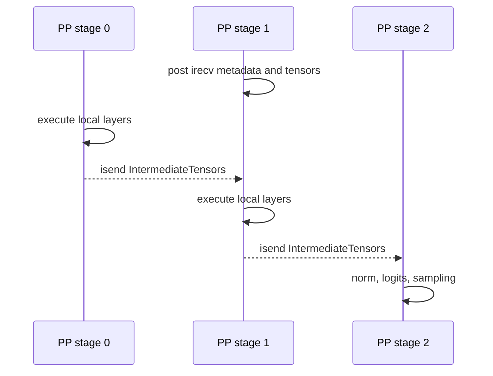

> **读图方法：** 这是“Worker 如何传 intermediate tensors”的时序图。先从左到右确认参与者分别负责什么，再从上到下追踪消息；第一遍只看正常路径，第二遍再看返回、异步消息和失败分支。

对在发送侧 TP ranks 上重复的完整 tensor，启用张量分片传输与对端聚合优化（`_should_use_all_gather`）后，各 rank **先切片并发送
自己的片段**；下一个 PP stage 的对应 peer 收到片段，等待接收完成后，再在接收侧
TP group 内 all-gather 恢复完整 tensor。这减少了跨 stage 重复发送完整张量的字节数，
同时增加接收侧 TP group 的通信；端到端收益需要结合互连拓扑测量。已经分片的 tensor（例如特定 SP residual）
需要关闭该 gather 优化，不能重复切分。

**算一算：切片发送省了多少字节。**

**白话：**发送侧 TP 各 rank 手里的这份 tensor 是一模一样的副本。与其每个 rank 都把整份发给下一个 stage 的对应 rank，
不如每个 rank 只发 $1/\mathrm{TP}$ 片，接收侧再用 all-gather 把片拼回去。

**其中：**$M_{\mathrm{payload}}$ 是这个 tensor 的字节数；TP 是发送侧（也是接收侧）的 TP 路数；默认只有 tensor 的元素数能被 $\mathrm{TP}$ 整除时才切片
（`_should_use_all_gather` 的默认判据；调用方可以按 key 覆盖，例如已经分片的 tensor 设为不切）。

**怎么算出来：**不切片时，$\mathrm{TP}$ 个 rank 各发 $M_{\mathrm{payload}}$ 字节，跨 stage 的链路上一共 $\mathrm{TP}\times M_{\mathrm{payload}}$；
切片时每个 rank 只发 $M_{\mathrm{payload}}/\mathrm{TP}$，合计 $M_{\mathrm{payload}}$，跨 stage 的字节数降到原来的 $1/\mathrm{TP}$，代价是接收侧多一次 TP 内 all-gather。
算例（教学数字）：hidden states 的 shape 是 `[T,D]`，取 $T=1024$、$D=4096$、bf16（2 byte/元素）：
$M_{\mathrm{payload}}=1024\times4096\times2\ \mathrm{byte}=8\ \mathrm{MiB}$。TP=4 时，每个 rank 发 $8/4=2\ \mathrm{MiB}$，四个 rank 合计 $4\times2=8\ \mathrm{MiB}$；
不切片则是 $4\times8=32\ \mathrm{MiB}$。单位检查：token $\times$ 元素/token $\times$ byte/元素 $=$ byte。

**核对：**发送侧用 `tensor.reshape(all_gather_size, -1)[all_gather_rank]` 取自己那一片（`vllm/distributed/parallel_state.py:1224-1227` @ `05caae03`）；
判据是 `numel % all_gather_group.world_size == 0`（`:1073-1085`）；接收侧在 `:1338-1360` 同样判断，先收片再 `all_gather` 并还原 shape。

[源码] `vllm/distributed/parallel_state.py` - `GroupCoordinator.isend_tensor_dict`、
`irecv_tensor_dict`、`_should_use_all_gather`

[源码] `vllm/v1/worker/gpu_worker.py` - `Worker.execute_model`

### 9.6.5 异步 send 的 buffer 生命周期

`isend` 返回并不表示远端已经消费完数据。当前 Worker 会保存前一次 send handles，并在
下一 step 覆盖或复用相关 buffer 前等待它们完成。

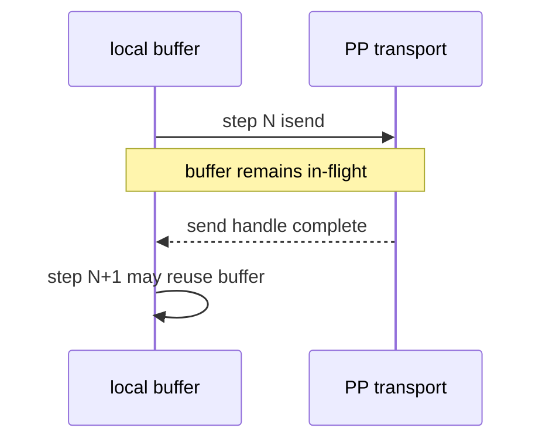

> **读图方法：** 这是“异步 send 的 buffer 生命周期”的时序图。先从左到右确认参与者分别负责什么，再从上到下追踪消息；第一遍只看正常路径，第二遍再看返回、异步消息和失败分支。

如果自定义代码在 handle 完成前改写 buffer，错误可能表现为偶发输出损坏，而不是立即
崩溃。这是异步通信中必须显式维护的 ownership 边界。

### 9.6.6 为什么所有 rank 都执行，但只有一个 rank 返回结果

一次 PP+TP forward 需要全部 ranks 参与，然而最终 sampling 结果只需从输出 rank 返回
EngineCore。MultiprocExecutor 当前计算的输出 rank 与末 PP stage、TP/PCP 布局有关，公式
为 `world_size - tensor_parallel_size * prefill_context_parallel_size`，定位末 PP stage 中
PCP rank 0、TP rank 0 的 Worker。普通执行路径选择它向 EngineCore 回复，是 Executor 的
输出路由约定，不表示只有它计算 logits、采样或持有结果。

**白话：**这个 Executor 约定回复 EngineCore 的 Worker，是最后一个 PP stage 里排第一的那个（PCP 序号 0、TP 序号 0）。

**其中：**`world_size` 是一个 DP engine 的 Worker 数，即 $W_{\mathrm{engine}}=\mathrm{TP}\times\mathrm{PP}\times\mathrm{PCP}$（§9.3.1）；
输出 rank 记为 $\mathrm{rank}_{\mathrm{out}}$，它是 engine 内的 rank，而不是 DP 全局 rank。

$$
\mathrm{rank}_{\mathrm{out}}=W_{\mathrm{engine}}-\mathrm{TP}\times\mathrm{PCP}
$$

**怎么算出来：**engine 内的 rank 按 PP、PCP、TP 展平，TP 变化最快（§9.3.3）；最后一个 PP stage 占最后 $\mathrm{PCP}\times\mathrm{TP}$ 个 rank，
它的第一个 rank 就是总数减去这段长度；这个 rank 的 PCP 坐标和 TP 坐标都是 0。
算例一（源码注释里的例子）：TP=8、PP=4、PCP=1，$W_{\mathrm{engine}}=32$，$32-8\times1=24$：stage 3 占 rank 24 到 31，24 号是它的 TP rank 0。
算例二：TP=2、PP=2、PCP=2，$W_{\mathrm{engine}}=8$，$8-2\times2=4$：stage 1 占 rank 4 到 7，4 号是 PCP 0、TP 0（按 §9.3.3 的公式 $((0\times2+1)\times2+0)\times2+0=4$）。

**核对：**`MultiprocExecutor._get_output_rank` 返回 `world_size - tensor_parallel_size * prefill_context_parallel_size`，注释里同样用 TP=8、PP=4 算出 $32-8=24$
（`vllm/v1/executor/multiproc_executor.py:683-697` @ `05caae03`）。

例如 MRV2 启用 batch-sharded sampling 时，会让不同 TP ranks 为各自负责的请求采样，
再通过 `gather_sampler_output` 汇合结果。KV/encoder connector 的输出聚合器还可能要求
Executor 收集多个 rank 的回复；不能把“一份最终响应”写成所有配置下只收一个 rank。

[源码] `vllm/v1/executor/multiproc_executor.py` - `MultiprocExecutor._get_output_rank`、
`collective_rpc`

### v0.33.0：batch-sharded sampling 可与自适应验证同开，PP 广播宽度随 draft 变化

> **本节先看：** 这里记录 v0.32.0 到 v0.33.0 之间落在本章的两处变化。其一，TP 上“按请求分片采样”不再排斥自适应验证；其二，PP 末 stage 向其他 stage 广播采样结果的“宽度”，现在由当步有没有 draft 决定。两处都只发生在 MRV2（Model Runner V2）路径。

**一、batch-sharded sampling 与 adaptive verification（#58466，`7050ef881`）**

v0.32.0 的 `VllmConfig._validate_batch_sharded_sampling` 在自适应验证开启时直接拒绝 batch-sharded sampling。
原因是每个请求实际验证几个 draft 要到 GPU 上才决定，而 CPU 端的分片计划（`BatchShardMetadata`）按“调度时的上限”
构建，预算收紧后两边的 logits 行数对不上。v0.33.0 删除了这条限制，做法是让分片计划也使用“实际接纳的 draft 数”：
`BatchSharder` 多了构造参数 `adaptive_verification_enabled`，`AdaptiveVerificationManager` 在分片开启时把接纳数拷回 host
（构造参数 `copy_admitted_drafts_to_host`）。每个请求的实际 logits 行数按下式计算：

$$
N_{\mathrm{row},i}=N_{\mathrm{sch},i}-N_{\mathrm{drf},i}+N_{\mathrm{acc},i}
$$

**白话：**先按“调度上限”给请求预留 logits 行，再把“调度了但没被接纳”的 draft 行扣掉，得到真正参与采样的行数。

**其中：**$i$ 是 batch 内的请求序号；$N_{\mathrm{sch},i}$ 是调度时该请求预留的 logits 行数，$N_{\mathrm{drf},i}$ 是调度时它带的 draft token 数，
$N_{\mathrm{acc},i}$ 是自适应验证实际接纳的 draft 数，满足 $0\le N_{\mathrm{acc},i}\le N_{\mathrm{drf},i}$；
$N_{\mathrm{row},i}$ 是实际参与采样的 logits 行数。四个量都以“行”或“token”为单位，是非负整数。
注意 $N_{\mathrm{sch},i}$ 是按调度上限预留的 logits 行数，**不等于**第 04 章里请求本步被调度的 token 数 $N_{\mathrm{scheduled}}$。
未启用自适应验证时 $N_{\mathrm{acc},i}=N_{\mathrm{drf},i}$，公式退化为 $N_{\mathrm{row},i}=N_{\mathrm{sch},i}$。

**怎么算出来：**

1. 调度时一个请求要采样的 logits 行数是“它的 draft token 数 + 每步新采样的位置数（通常为 1）”，即通常 $N_{\mathrm{sch},i}=N_{\mathrm{drf},i}+1$（源码 `num_logits = num_draft_tokens_per_req + num_bonus_tokens`，其中 `num_bonus_tokens` 默认是 1，来自 `num_new_sampled_tokens_per_step`）；
2. 自适应验证只接纳其中 $N_{\mathrm{acc},i}$ 个 draft，其余 $N_{\mathrm{drf},i}-N_{\mathrm{acc},i}$ 个 draft 对应的行不再参与采样，要从预留的行数里扣掉；
3. 所以 $N_{\mathrm{row},i}=N_{\mathrm{sch},i}-(N_{\mathrm{drf},i}-N_{\mathrm{acc},i})$，整理成上面的式子；代入第 1 步，$N_{\mathrm{row},i}=1+N_{\mathrm{acc},i}$。

算例（教学数字）：batch 里 3 个请求，各带 $N_{\mathrm{drf},i}=3$ 个 draft，所以 $N_{\mathrm{sch},i}=3+1=4$；自适应验证实际接纳 $N_{\mathrm{acc},i}=3,1,0$。
$N_{\mathrm{row},i}=4-3+3=4$、$4-3+1=2$、$4-3+0=1$，合计 $4+2+1=7$ 行，而按调度上限预留是 $3\times4=12$ 行。
各 TP rank 按请求归属汇总自己要发送的行数：TP=2 时请求 0、1、2 的 owner 是 rank 0、1、0（见下面的归属规则），rank 0 发送 $4+1=5$ 行，rank 1 发送 $2$ 行，合计仍是 7。

各 TP rank 按 batch 内位置 $i$ 决定请求归属（owner 是 $i\bmod\mathrm{TP}$，`shard_owners`；有 draft logits 缓存时按缓存里记录的 owner，`owners_of`），
再用 $N_{\mathrm{row},i}$ 汇总出每个 owner 的发送行数，所以所有 rank 不经通信就算出同一份计划。
（v0.33.0 的 #58466 当时按 `req_state_idx % TP` 归属；`05caae03` 已改为按 batch 位置，见本节后文 #64356。）

**核对：**`BatchSharder.shard_sampler_inputs` 里 `num_logits_per_req_np = np.diff(cu_num_logits_np)`，自适应验证开启时再减 `num_draft_tokens_per_req`、加 `num_admitted_draft_tokens_np`
（`vllm/v1/worker/gpu/sample/batch_shard.py:262-274` @ `05caae03`），再用 `np.bincount(req_owner_np, weights=...)` 汇总每个 owner 的行数（`:278-280`）；
$N_{\mathrm{sch},i}$ 的来源是 `num_logits = num_draft_tokens_per_req + num_bonus_tokens`（`vllm/v1/worker/gpu/model_runner.py:1502-1503`）；
归属函数 `shard_owners`（`batch_shard.py:85-87`）。

[源码] `vllm/v1/worker/gpu/sample/batch_shard.py` - `BatchSharder.__init__`、`BatchSharder.shard_sampler_inputs`（`batch_shard.py:209-228`、`:262-275`、`:336-351` @ `05caae03`）

[源码] `vllm/v1/worker/gpu/spec_decode/adaptive_verification.py` - `AdaptiveVerificationManager` 的构造参数 `copy_admitted_drafts_to_host`（`adaptive_verification.py:234` 声明、`:269` 赋值，类定义在 `:227` @ `05caae03`）

**二、PP 下 spec-decode 的 sampled token / draft 广播（#64458，v0.33.0 中为 cherry-pick `2b43321152`，原提交 `d8fdf4f61`）**

PP 里只有末 stage 能采样，其他 stage 必须拿到“上一步采样出的 token（以及投机解码的 draft）”才能给下一步准备输入，
所以末 stage 用专用 NCCL 子组向其他 stage 广播。#64458 修复了三处问题：

- 采样结果的列数不再固定为 `max_sample_len = 投机步数 + 1`：当步 `num_draft_tokens > 0` 才用这个宽度，否则只广播 1 列
  （`PPHandler._sample_len`，`pp_utils.py:107-109`）。发送端 `broadcast` 与接收端 `receive` 用同一个函数，保证两端 `shape` 一致。
  这个宽度的算法见本节下面“**算一算：广播宽度与字节数**”。
- draft 的广播与接收必须成对：接收端 `receive(input_batch, recv_drafts=...)` 的 `recv_drafts` 要等于“末 stage 这一步是否调用
  `broadcast_drafts`”。模型运行器用 `num_spec_tokens > 0` 同时决定两端（`model_runner.py:2248-2249`、`:2410-2411`）；
  没有提出 draft 的一步（例如 `skip_drafts`）两端都不广播；collective 两端必须成对调用，否则无法配对。
- 接收端不再在 `get_prev_sampled_outputs` 里就地改写 `draft_tokens_to_update`：它把 `draft_tokens` 放进返回字典，
  由 `postprocess_sampled(draft_tokens=...)` 调用的 `post_update` 统一写入请求状态。

- `broadcast_drafts` 还有第二个前提：只有同一步 `sampled_tokens_broadcast` 为真才真正发送（`pp_utils.py:205-208`）。该标志在 `broadcast`
  里设置：当 `compute_need_sampled_mask(input_batch)` 为 `None`（没有请求需要给后续步提供采样结果）时置 `False` 并直接返回，否则置 `True`
  （`pp_utils.py:281-287`）。接收端 `receive` 用同一个 `compute_need_sampled_mask(input_batch)` 判断并提前返回（`:221-224`），
  所以两端对“这一步有没有广播”的结论一致。

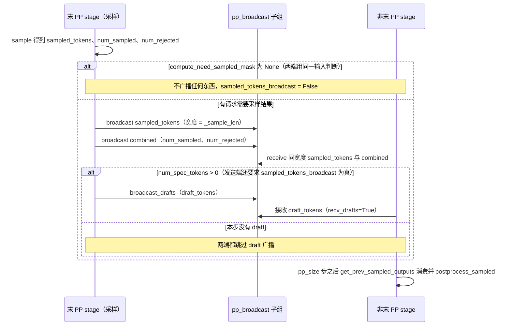

> **读图方法：** 这是“PP 下 sampled token / draft 广播”的时序图。第一遍只看最外层 `alt`：没有请求需要采样结果时整步什么都不广播；
> 第二遍再看内层 `alt`：draft 是否广播由 `num_spec_tokens > 0` 同时决定两端，并且发送端还要求 `sampled_tokens_broadcast` 为真。
> 读完后应记住：collective 两端的“是否参与”和“张量形状”必须由同一个条件推出。

**算一算：广播宽度与字节数。**

**白话：**一个请求每步最多产出“投机步数个 draft 被接受，再加 1 个新采样的 token”，所以采样结果最多需要“投机步数 + 1”列；
这一步根本没有 draft 时，只要 1 列就够，广播也就窄了。

**其中：**“投机步数”是配置的 speculative 步数（`num_speculative_steps`），这里记作 $k$ 只在本段使用；`max_sample_len` 是广播宽度的上限，
`num_reqs` 是 batch 内的请求数。`sampled_tokens` 的 shape 是 `[num_reqs, 宽度]`（int64，8 byte/元素），`combined` 的 shape 是 `[2, num_reqs]`（int32，4 byte/元素）。

**怎么算出来：**

1. 宽度上限 `max_sample_len` $=k+1$：最多接受 $k$ 个 draft，再加 1 个新采样的 token；
2. 当步宽度是 `max_sample_len`（`num_draft_tokens > 0`）或 1（没有 draft）；
3. 字节数 $=$ 行数 $\times$ 宽度 $\times$ 每元素字节数，`combined` 另算。

算例（教学数字）：$k=3$、`num_reqs` $=8$。有 draft 的一步：宽度 $3+1=4$，`sampled_tokens` 是 $8\times4\times8=256\ \mathrm{byte}$，`combined` 是 $2\times8\times4=64\ \mathrm{byte}$；
没有 draft 的一步：宽度 1，`sampled_tokens` 是 $8\times1\times8=64\ \mathrm{byte}$，`combined` 不变。
两端必须用同一个宽度：发送端的 `shape[-1]` 与接收端 `torch.empty(num_reqs, sample_len)` 对不上，collective 就会错位。

**核对：**`self.max_sample_len = num_speculative_steps + 1`（`vllm/v1/worker/gpu/pp_utils.py:70` @ `05caae03`）；`_sample_len` 返回 `max_sample_len if input_batch.num_draft_tokens > 0 else 1`（`:107-109`）；
接收端按 `[num_reqs, sample_len]` 与 `[2, num_reqs]` 分配（`:233-237`），发送端断言 `sampled_token_ids.shape[-1] == self._sample_len(input_batch)`（`:295`）。

[源码] `vllm/v1/worker/gpu/pp_utils.py` - `PPHandler._sample_len`、`PPHandler.receive`、`PPHandler.broadcast_drafts`、`PPHandler.get_prev_sampled_outputs`

[源码] `vllm/v1/worker/gpu/model_runner.py` - `GPUModelRunner.sample_tokens`

#64458 在 v0.33.0 中以 cherry-pick `2b43321152` 存在；原提交 `d8fdf4f61` 不在 v0.33.0 祖先链内（`git merge-base --is-ancestor` 核对）。

> 在 v0.33.0 之后、已包含在本书基线 `05caae03` 中、与本节相关的变化如下。条目里 `@` 后的短 SHA 和行号是各提交当时的版本，不一定等于 `05caae03` 上的行号。已落入 v0.33.0 的 #58466 与 #64458 见上一小节正文。
> - main 2026-10-25～10-27：[26cbb47d4](https://github.com/vllm-project/vllm/commit/26cbb47d48e6b1de8ab2b4bc1c839821ffcfd56b)（[#63554](https://github.com/vllm-project/vllm/pull/63554)） 让 probabilistic draft 的 draft logits 缓存也按 batch-shard 分片：开启 batch-sharded sampling、无 draft watermarker 且 speculator 支持时，每个 TP rank 只分配 `cdiv(max_num_reqs, TP)` 行，只存自己负责验证的请求（owner `req_state_idx % TP`，行 `req_state_idx // TP`）；custom rejection sampler 不能读分片 logits。（已被 #64356 取代，见下条）
> - main 2026-10-27～10-28：[820be160ce](https://github.com/vllm-project/vllm/commit/820be160ce0dc9098deaa2a4c6b5fc534c43881d)（[#64151](https://github.com/vllm-project/vllm/pull/64151)） 在上述分片条件上增加 `prefill_context_parallel_size == 1`（`vllm/v1/worker/gpu/spec_decode/speculator.py` L282–L287 @ `0106c8abc`）。PCP 开启时关闭 batch-sharded draft logits，因为 `PCPManager.sync_drafts` 按 request state 整行索引 draft logits。
> - main 2026-10-28～10-29：[cdd2750cd5](https://github.com/vllm-project/vllm/commit/cdd2750cd5e7d90849282a16bc46c21bbc58bcbd)（[#61464](https://github.com/vllm-project/vllm/pull/61464)） DBO 可与 speculative decoding 及 decode CP 同开（prefill CP 仍禁；`vllm.py` L3247–L3270 @ `36d4ef654`）；[edad8b03c5](https://github.com/vllm-project/vllm/commit/edad8b03c5285a1c12e7e4f83c1af709b319a01b)（[#61294](https://github.com/vllm-project/vllm/pull/61294)） 跨 PP stage 合并 KV cache layout 支持集。
> - main 2026-10-29～10-30：[66875d312](https://github.com/vllm-project/vllm/commit/66875d3127534183b5ea723964fc7ec388e89722)（[#64356](https://github.com/vllm-project/vllm/pull/64356)）：新增 `DraftLogitsCache`（main 新增文件 `spec_decode/draft_logits.py` L80–L185 @ `2eae56c4b`）。分片 cache 每步 `assign` 按 in-batch 位置 i 分配 rank `i % tp`、行 `i // tp`（`batch_shard.py` L67–L78 现按 batch position，不再按 `req_state_idx`），owner 记入 `shard_mapping`，verification 用 `owners_of`；行每步复用，`stale_drafts` 标记行被改派的 draft。复制 cache（或无 draft logits）按 `shard_owners(num_reqs, tp)` 轮转；从未 draft 的请求仍按 slot 定 owner。

**怎么算出来：分片 draft logits 缓存的 owner、行号与行数。**上面 #63554、#64356 两条里的 `i % tp`、`i // tp`、`cdiv(max_num_reqs, TP)` 是三个整数运算。

**白话：**把 batch 里的请求按位置轮流分给 $\mathrm{TP}$ 个 rank（像发牌），每个 rank 在自己的缓存里按“收到的第几张”记行号；
每个 rank 最多存几行，由最大请求数除以 rank 数向上取整决定。

**其中：**$i$ 是请求在 batch 里的位置（从 0 起），TP 是 TP 路数；owner 是 $i\bmod\mathrm{TP}$，行号是 $\lfloor i/\mathrm{TP}\rfloor$；
`cdiv` 是向上取整的除法，`max_num_reqs` 是一步最多容纳的请求数。

**怎么算出来：**

1. owner：位置 $0,1,\ldots,\mathrm{TP}-1$ 依次分给 rank $0,1,\ldots,\mathrm{TP}-1$，位置 $\mathrm{TP}$ 又回到 rank 0，所以 owner $=i\bmod\mathrm{TP}$；
2. 行号：每个 rank 每收到 $\mathrm{TP}$ 个位置就多一行，所以位置 $i$ 在它的 owner 里排第 $\lfloor i/\mathrm{TP}\rfloor$ 行；
3. 行数：位置最多时，rank 0 分到位置 $0,\mathrm{TP},2\mathrm{TP},\ldots$，个数是 `max_num_reqs` 除以 $\mathrm{TP}$ 向上取整，其他 rank 不会比它多，所以每个 rank 分配 `cdiv(max_num_reqs, TP)` 行。

算例：TP=4、`max_num_reqs` $=10$。位置 $0$ 到 $9$ 的 owner 依次是 $0,1,2,3,0,1,2,3,0,1$，行号依次是 $0,0,0,0,1,1,1,1,2,2$；
rank 0 持有位置 $0,4,8$，共 3 行，等于 $\lceil10/4\rceil=3$；rank 2 持有位置 $2,6$，只用 2 行，不超过 3。

**核对：**`shard_owners` 返回 `np.arange(num_reqs) % num_shards`、`shard_rows` 返回 `np.arange(num_reqs) // num_shards`
（`vllm/v1/worker/gpu/sample/batch_shard.py:85-87`、`:100-102` @ `05caae03`）；缓存分配 `num_rows = cdiv(max_num_reqs, self._num_shards)`
（`vllm/v1/worker/gpu/spec_decode/draft_logits.py:117`），文档字符串写明“位置 i 给 rank i % tp、行 i // tp，没有 rank 缓存超过 cdiv(num_reqs, tp) 个请求”（`:85-90`）。

[源码] `vllm/v1/worker/gpu/model_runner.py` - `GPUModelRunner.sample`

### 9.6.7 PP 的气泡

若只有一个 microbatch，stage 1 必须等 stage 0，stage 2 又要等 stage 1：

```text
time ->   0     1     2     3     4
stage 0  [A0]  idle  idle
stage 1  idle  [A1]  idle
stage 2  idle  idle  [A2]
```

**算一算：气泡占多大。**

**白话：**画一张“stage × 时间槽”的格子表，忙的格子除以全部格子就是利用率，剩下的就是气泡。

**其中：**这里取 3 个 stage，每个 batch 在每个 stage 上恰好占 1 个时间槽（教学假设：各 stage 耗时相同、不计 stage 间传输时间）。

**怎么算出来：**只有 1 个 batch 时，A0、A1、A2 依次占用 stage 0、1、2，各 1 个时间槽，整张表是 $3\times3=9$ 格，忙的只有 3 格，
利用率 $3/9=1/3$，气泡占 $6/9=2/3$。连续送入 4 个 batch：第 4 个 batch 在第 4 个时间槽进入 stage 0，之后还要再走 2 个时间槽才离开最后的 stage，
总共 $4+2=6$ 个时间槽，表是 $3\times6=18$ 格，忙的有 $4\times3=12$ 格，利用率 $12/18=2/3$。
batch 越多，利用率越高，上限是 1。

**核对：**这是教学假设下的计数，不对应源码里的某个公式；真实的气泡取决于各 stage 的实际耗时和 stage 间传输，要用 profiler 的时间线测。

增加 pipeline batch queue 可以让不同 batch 在 stages 间重叠，但会增加在途状态、KV
确认边界和故障恢复复杂度。PP 的收益取决于 batch 流是否足以填满流水线。

---

## 9.7 Data Parallel：复制执行状态，切分请求

> **本节先看：** 本节要回答：**Data Parallel：复制执行状态，切分请求**。下面的小节会逐层拆开概念、运行过程和源码落点；第一次阅读先抓对象之间的关系，第二次再记类名、字段和分支。

### 9.7.1 DP 的 ownership

普通 DP engine 持有一份完整模型逻辑，其内部仍可使用 TP/PP/PCP。请求进入某个 DP engine
后，其 Scheduler、KV blocks 和输出进度由该 engine 管理。

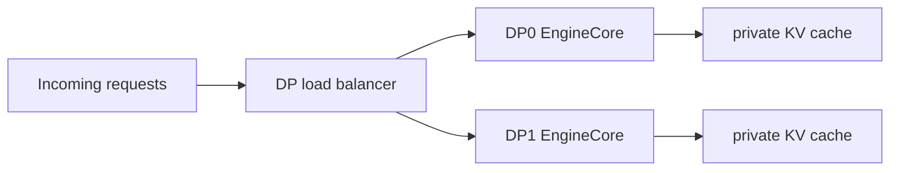

> **读图方法：** 这是“DP 的 ownership”的流程图。先从左向右只追一条主路径，确认输入经过哪些关键阶段到达输出；第二遍再看虚线、回边和旁路，它们通常表示反馈、复用或可选分支。

因此 DP 扩展更接近“多个服务副本”，而不是单次矩阵乘的切分。

### 9.7.2 三类路由方式

`EngineCoreClient.make_async_mp_client` 根据部署模式选择 client：

| 模式 | 代表路径 | 谁选择 DP engine |
|---|---|---|
| external load balancing | `DPAsyncMPClient` | 外部负载均衡器或调用者；v0.33.0 起它也能承接 Elastic EP 扩缩容（见 §9.8.6） |
| internal load balancing | `DPLBAsyncMPClient` | vLLM client 根据 engine stats |
| hybrid/local | 多节点本地 engine 集合 | 外部先选节点，本地再选 engine |

不能只看 `data_parallel_size` 判断路由行为，还要看 external/hybrid 配置。

### 9.7.3 当前内部负载分数

固定源码版本中，`DPLBAsyncMPClient` 的选择逻辑可近似写成：

$$
\mathrm{score}^{\mathrm{base}}_i=\max\bigl(n_{\mathrm{cli}}\times n_{\mathrm{fly},i},\;n_{\mathrm{wait},i}+n_{\mathrm{run},i}\bigr)
$$

若存在 waiting requests，还会加入高 KV 使用率惩罚：

$$
\mathrm{score}_i=\mathrm{score}^{\mathrm{base}}_i+6\,n_{\mathrm{wait},i}\max(0,\rho_{\mathrm{kv},i}-0.5)
$$

**白话：**给每个 engine 打一个“有多忙”的分数，分数越小越闲，新请求发给分数最小的 engine。
基础分取两个估计里较大的一个：本 client 自己发出去、还没完成的请求数（乘上 client 数，粗略当作所有 client 都这样发），
和 coordinator 最近汇报的 waiting 加 running；如果这个 engine 还在排队、而且 KV 已经偏满，再加一笔罚分。

**其中：**$i$ 是 engine 序号；$n_{\mathrm{cli}}$ 是 client 数（`client_count`）；$n_{\mathrm{fly},i}$ 是本 client 发给 engine $i$、尚未完成的请求数（`engine_inflight`）；
$n_{\mathrm{wait},i}$、$n_{\mathrm{run},i}$ 是 coordinator 最近一次汇报的 engine $i$ 的 waiting、running 请求数；$\rho_{\mathrm{kv},i}$ 是它的 KV 使用率（0 到 1）。
分数的单位是“请求数”；$0.5$ 是不罚分的使用率阈值，$6$ 是源码里的系数；惩罚项只在 $n_{\mathrm{wait},i}>0$ 时才有（等于 0 时它本来就是 0，源码里写成 `if waiting`）。

**怎么算出来：**

1. 为什么乘 $n_{\mathrm{cli}}$：本 client 只看得见自己的 in-flight；若 $n_{\mathrm{cli}}$ 个 client 大致均匀地发，全局的在途数约是本地的 $n_{\mathrm{cli}}$ 倍。这个下限是精确计数，不会被 coordinator 的快照重置抹掉，所以一个突发会轮流分散到各 engine；
2. 为什么取 $\max$：别的 client 或旧请求让 engine 更忙时，coordinator 的 $n_{\mathrm{wait},i}+n_{\mathrm{run},i}$ 会更大，取较大者就把这部分负载也算进来；
3. 罚分：$6\times n_{\mathrm{wait},i}\times\max(0,\rho_{\mathrm{kv},i}-0.5)$。使用率不超过 0.5 时不罚，使用率到 1 时罚 $6\times0.5=3$ 倍的 $n_{\mathrm{wait},i}$（源码注释写作“3x waiting at 100%”）：KV 紧张的 engine 上排队的请求放得慢，新请求应强烈地避开。

算例（教学数字，$n_{\mathrm{cli}}=1$，两个 engine）：engine 0：$n_{\mathrm{fly},0}=2$、$n_{\mathrm{wait},0}=0$、$n_{\mathrm{run},0}=4$、$\rho_{\mathrm{kv},0}=0.8$，
基础分 $\max(1\times2,\ 0+4)=4$，没有 waiting，不罚，$\mathrm{score}_0=4$。engine 1：$n_{\mathrm{fly},1}=1$、$n_{\mathrm{wait},1}=2$、$n_{\mathrm{run},1}=1$，基础分 $\max(1\times1,\ 2+1)=3$。
若 $\rho_{\mathrm{kv},1}=0.5$：罚分 $6\times2\times\max(0,0)=0$，$\mathrm{score}_1=3<4$，选 engine 1；
若 $\rho_{\mathrm{kv},1}=0.9$：罚分 $6\times2\times0.4=4.8$，$\mathrm{score}_1=3+4.8=7.8>4$，改选 engine 0。

**核对：**分数的计算在 `DPLBAsyncMPClient.get_core_engine_for_request`（`vllm/v1/engine/core_client.py:1855-1864` @ `05caae03`：`max(self.client_count * inflight, waiting + running)` 与 `score += waiting * 6.0 * max(0.0, kv_cache_usage - 0.5)`）；
快照 `[waiting, running, kv_cache_usage]` 来自 coordinator（`core_client.py:1573-1577`），coordinator 有变化时最多每 100 ms 推送一次（`vllm/v1/engine/coordinator.py:152`、`:265-267`）；
教学代码 `choose_dp_engine`（`examples/ch09_parallel_topology.py:412`）用同一个规则，对上面两组数字分别返回 engine 1 与 engine 0（engine 编号从 0 起）。

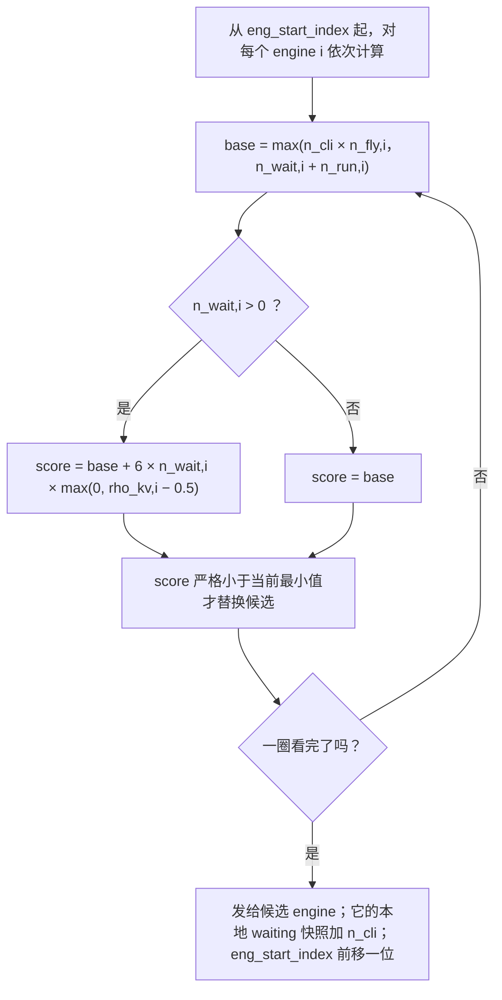

> **读图方法：** 这张图只回答一个问题：一个新请求怎样选 DP engine。第一遍沿主线读：对每个 engine 先算基础分，再按是否在排队决定要不要罚分，最后在一圈里挑分数最小的；
> “严格小于才替换”说明平局时保留先看到的那个。第二遍看最后一个方框的两处副作用：把候选的本地 waiting 快照加 $n_{\mathrm{cli}}$，让 coordinator 下一次更新之前的后续请求能看到这次选择；
> `eng_start_index` 前移一位，让平局时不总是偏向同一个 engine。读完后应能手算两个 engine 的分数并说出选谁。

这不是一个普适调度定理，而是当前版本的启发式。它试图避免仅依据本地 inflight 计数，
也避免把新请求持续压到 KV 已接近紧张的 engine。

### 9.7.4 `DPCoordinator` 汇总什么，以及 v0.33.0 谁来“叫醒”空闲 engine

`vllm/v1/engine/coordinator.py` 中的 coordinator 接收各 engine 的：

- waiting request 数；
- running request 数；
- KV cache usage；
- engine 是否存活和可接收请求。

在需要跨 DP 同步的 MoE 场景，它还维护“请求波次（wave）”：所有 engine 要么一起处于 running，要么一起处于 paused，
波次号记录“集体从 running 回到 paused”的次数。波次的两条边都由 **engine** 通知 coordinator：

- running → paused：DP rank 0 在跨 DP 的 all-reduce 发现全局没有未完成请求后，发出 `wave_complete`；
- paused → running：某个**空闲** engine 收到新请求后发出 `start_wave`，coordinator 再向其余 engine 广播 `START_DP_WAVE`。

v0.33.0（#59559，`a94c31571`）改变了第二条边：v0.32.0 的前端（API server）在发现 engines 处于 paused 时会先向 coordinator
发一条 `FIRST_REQ` 去叫醒其他 engine；现在这条前端路径被删除；除扩缩容标记 `SCALE_ELASTIC_EP` 外，coordinator 收到前端的其他消息只记录一条 error（`coordinator.py:353-355`）。理由写在
`DPCoordinator` 的文档字符串里：前端看到的“是否 running”可能是过期的，而一个 paused 的 engine 会丢弃 `START_DP_WAVE`；
所以只有 engine 自己才知道自己是否真的空闲。`DPEngineCoreProc.add_request` 现在在“有 coordinator、`engines_running` 为假、
调度器未暂停”时就向 coordinator 发 `start_wave`（不再要求 `request_wave != current_wave`）。

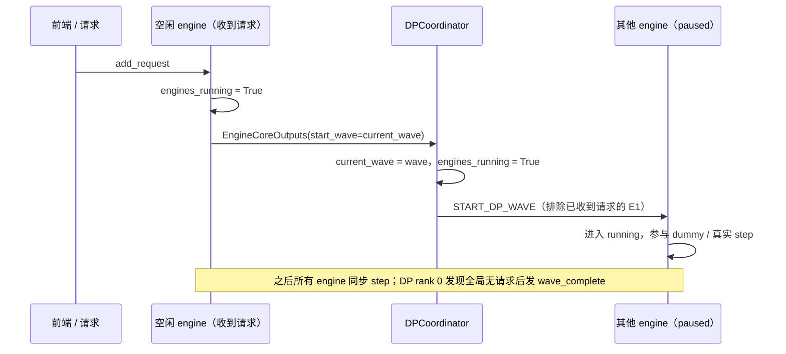

> **读图方法：** 这是“DP 波次唤醒”的时序图。第一遍只看实线：请求先到某个空闲 engine，再由它通知 coordinator，
> coordinator 才广播给其他 engine；第二遍看注意事项：前端不再直接叫醒 engine，因为它看到的 running 状态可能过期。
> 读完后应得到：波次的“开始”和“结束”都以 engine 为信息源，coordinator 只负责转发与记账。

此外，`DPEngineCoreProc.run_busy_loop` 在 engine 由 paused 变为 running、本 engine 是 DP rank 0 且没有待处理的暂停时也补发一次 `start_wave`（`core.py:2831-2843`），
让 coordinator 观察到这条边，而不是假设自己发出的 `START_DP_WAVE` 一定被执行。

[源码] `vllm/v1/engine/coordinator.py` - `DPCoordinator`（类 `coordinator.py:23`，文档字符串说明波次规则）、`DPCoordinatorProc`（`coordinator.py:148`；`wave_complete` 处理 `:414`，`start_wave` 处理 `:428-442` @ `05caae03`）

[源码] `vllm/v1/engine/core.py` - `DPEngineCoreProc.add_request`（`core.py:2661-2674` @ `05caae03`）

### 9.7.5 为什么 MoE DP 需要 lockstep

假设 DP0 有请求、DP1 空闲，但两者的 workers 属于同一个 EP group：

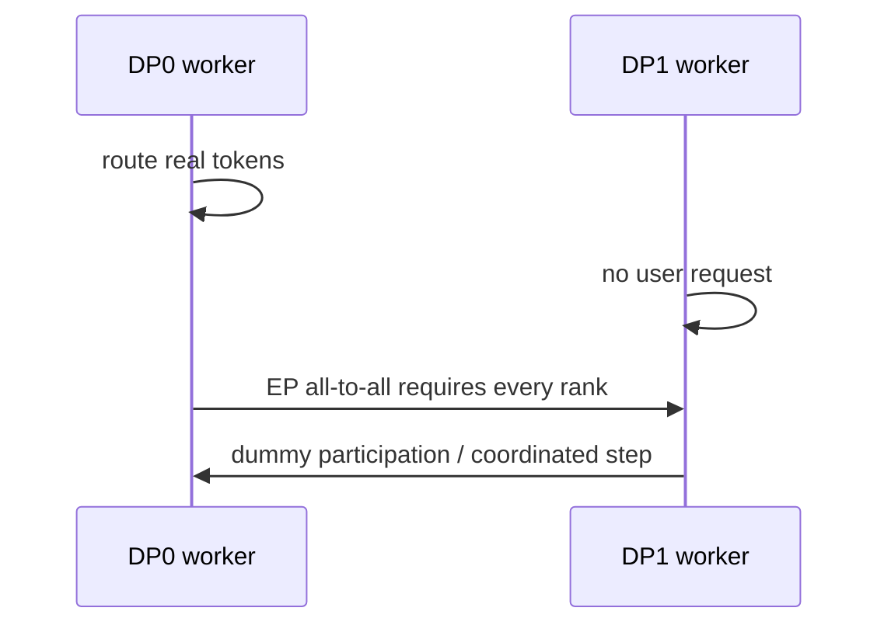

> **读图方法：** 这是“为什么 MoE DP 需要 lockstep”的时序图。先从左到右确认参与者分别负责什么，再从上到下追踪消息；第一遍只看正常路径，第二遍再看返回、异步消息和失败分支。

如果 DP1 完全不进入 all-to-all，DP0 会一直等待。于是 dense DP 中合理的“空闲就睡眠”
策略，在 wide EP 下可能变成死锁。

### 9.7.6 跨 DP batch 协调

`coordinate_batch_across_dp` 对四类事实做跨 DP 规约：原始 token 数、padding 后 token 数、
是否计划 microbatch、graph mode。当前语义包括：

- microbatch 只有所有 DP ranks 都同意时才启用；
- graph 或 microbatch 场景把各 rank padding 到最大 token 数；
- graph mode 取组内最保守的共同模式。

**算一算：padding 与 graph mode 怎样取值。**

**白话：**各 DP rank 每步的 token 数不同，但进入同一组 collective 或同一种 graph 时形状必须一样：把大家补到最大的那个 token 数；
graph mode 取最保守的，只要有一个 rank 不能用 graph，大家都不用。

**其中：**每个 rank 上报四个数：原始 token 数、padding 后 token 数（已含 CUDA Graph、TP 等本地 padding）、是否计划 microbatch（0 或 1）、graph mode
（0 表示不用 graph，1 是 piecewise，2 是 full）。同步之后只有“DP 补齐”这一步会改变各 rank 的 token 数。

**怎么算出来：**

1. 每个 rank 把自己那一项写进一个 $4\times\mathrm{DP}$ 的小张量里自己的那一列、其余填 0，再对整个张量做 SUM all-reduce，于是每个 rank 都拿到所有 rank 的四项；
2. 同步后的 graph mode 是各 rank graph mode 的最小值 $\min$；microbatch 要所有 rank 都计划，并且不会出现空的第二个 microbatch，否则放弃；
3. 只有同步后的 graph mode 不为 0，或者确定要 microbatch 时才补齐，补齐后每个 rank 的 token 数都是各 rank padding 后 token 数的最大值 $\max$；否则各 rank 保持自己的值。

算例（教学数字）：3 个 DP rank，padding 后 token 数是 $48,32,64$。若各 rank 的 graph mode 是 $2,2,2$：$\min=2\ne0$，补齐，三个 rank 都跑 $\max(48,32,64)=64$ 个 token。
若 graph mode 是 $2,2,0$：$\min=0$，且没有 microbatch，不补齐，三个 rank 仍是 $48,32,64$，并且都不用 graph。

**核对：**四项的写入与 SUM all-reduce 见 `_run_ar`（`vllm/v1/worker/dp_utils.py:57-76` @ `05caae03`）；graph mode 取 `tensor[3, :].min()`（`:114-120`），
补齐取 `tensor[1, :].max()`（`:99-111`），触发条件是 `synced_cudagraph_mode != 0 or should_ubatch`（`:181`）；microbatch 的一致性与空 microbatch 检查在 `_post_process_ubatch`（`:79-96`）。

这是正常跨 DP 执行路径的 collective shape 一致性保障，不是普通 API 负载均衡。
此版本另有 `skip_dp_coordination()` 上下文：启用时不做跨 rank 规约，而以本地
padding 数构造结果、保留本地 graph mode；不能把正常路径的同步保证推广到该显式跳过路径。
例如跳过路径上本地 padding 后是 48 个 token、DP=3，结果直接是 $48,48,48$，这只是本 rank 自己的假设，不是别的 rank 的真实值
（`vllm/v1/worker/dp_utils.py:240-251` @ `05caae03`）。


### 9.7.7 DP 状态同步：每隔一段 step 做一次 CPU 小张量 all-reduce

> **本节先看：** DP engine 之间需要不时对齐两件事：“有没有人还有活”和“是否都同意暂停”。这件事用一个只有 2 个元素的 CPU 张量做 all-reduce；v0.33.0 把它从通用的 `torch.distributed.all_reduce` 换成了专门的低延迟实现 `cpu_all_reduce_`。

**同步什么。** `DPEngineCoreProc._has_global_unfinished_reqs` 每 `dp_sync_interval`（默认 16，所有 DP rank 必须一致）步，
以及第 1 步，调用 `ParallelConfig.sync_dp_state`，对每个 rank 的两个 0/1 标志做 SUM：

$$
\Sigma_u=\sum_{r=0}^{\mathrm{DP}-1}u_r,\qquad \Sigma_f=\sum_{r=0}^{\mathrm{DP}-1}f_r
$$

$$
\text{has\_unfinished}=[\Sigma_u>0]\ \lor\ [\Sigma_f\bmod \mathrm{DP}\neq 0],\qquad \text{pause\_consensus}=[\Sigma_f=\mathrm{DP}]
$$

**白话：**第一项是“逻辑或”——只要有一个 rank 还有未完成请求，大家都继续跑；第二项是“全票通过”——所有 rank 都挂起了暂停请求才算
达成暂停共识；如果只有一部分 rank 想暂停（$\Sigma_f$ 不是 $\mathrm{DP}$ 的倍数），其余 rank 仍要继续陪跑，否则 MoE 的 collective 会对不上。

**其中：**$\mathrm{DP}$ 是 DP group 的大小（`dp_group.size()`）；$r$ 是 DP rank；$u_r\in\{0,1\}$ 表示该 rank 是否有未完成请求；
$f_r\in\{0,1\}$ 表示该 rank 是否有待处理的暂停请求；$\Sigma_u,\Sigma_f$ 是 SUM 之后的计数，无单位；$[\cdot]$ 在条件为真时取 1，否则取 0。

**怎么算出来：**

1. 每个 rank 把自己的 $[u_r,f_r]$ 放进 2 元素张量，SUM all-reduce 之后所有 rank 都得到同一对 $[\Sigma_u,\Sigma_f]$；
2. 每一项只取 0 或 1，所以 $\Sigma_u>0$ 等价于“至少有一个 $u_r=1$”，也就是逻辑或；
3. 同样 $0\le\Sigma_f\le\mathrm{DP}$，$\Sigma_f=\mathrm{DP}$ 等价于每个 $f_r$ 都是 1，也就是全票通过；
4. $\Sigma_f\bmod\mathrm{DP}\ne0$ 只在 $0<\Sigma_f<\mathrm{DP}$ 时成立：有人想暂停但没有全票，这些想暂停的 rank 也要继续 step。$\Sigma_f=0$ 或 $\Sigma_f=\mathrm{DP}$ 时余数是 0。

算例（教学数字，$\mathrm{DP}=4$）：

| $u$ | $f$ | $\Sigma_u$ | $\Sigma_f$ | has_unfinished | pause_consensus | 含义 |
|---|---|---|---|---|---|---|
| $[0,0,1,0]$ | $[0,0,0,0]$ | 1 | 0 | 真（$\Sigma_u>0$） | 假 | 只有 rank 2 有活，大家继续 |
| $[0,0,0,0]$ | $[1,1,0,0]$ | 0 | 2 | 真（$2\bmod4=2\ne0$） | 假 | 两个 rank 想暂停，另外两个还没有，继续陪跑 |
| $[0,0,0,0]$ | $[1,1,1,1]$ | 0 | 4 | 假（$4\bmod4=0$） | 真 | 全票暂停 |
| $[0,0,0,0]$ | $[0,0,0,0]$ | 0 | 0 | 假 | 假 | 全部空闲，没有暂停请求，波次结束 |

**核对：**`ParallelConfig.sync_dp_state` 里 `has_unfinished_global = tensor[0].item() > 0 or pause_count % dp_size != 0`，返回 `(has_unfinished_global, pause_count == dp_size)`
（`vllm/config/parallel.py:966-991` @ `05caae03`）；调用处 `DPEngineCoreProc._has_global_unfinished_reqs` 在第 1 步和每 `dp_sync_interval` 步同步一次（`vllm/v1/engine/core.py:2847-2851`）。
表中四行的结果与这两行代码一致。

**容错分支。** 若没有达成暂停共识，且启用了 fault tolerance 并且 sentinel 记录协调器已被禁用（`self.enable_fault_tolerance and self.ft_sentinel.coordinator_disabled`），
函数不再返回 `has_unfinished`，而是直接返回 `True`：各 engine 保持继续 step，不做空闲暂停（`vllm/v1/engine/core.py:2864-2866` @ `05caae03`）。
上面的公式描述的是没有走到这一分支时的结果。

**怎么 all-reduce。** 这个张量很小，而且在 CPU（gloo）上，瓶颈是往返延迟而不是带宽；#61767 的标题就是“Low-latency CPU all-reduce for DP metadata syncs”，它引入
`vllm.distributed.utils.cpu_all_reduce_`：先把 $\mathrm{DP}$ 拆成块大小 $G_2$（$\mathrm{DP}$ 的最大 2 的幂因子，源码写作 `world_size & -world_size`）和块数 $n_{\mathrm{grp}}=\mathrm{DP}/G_2$，
块内做 recursive doubling（递归倍增），块间再做一次并发交换；#63016 让它把 `cpu_distributed_timeout` 传到每次点对点等待上。

**白话：**`world_size & -world_size` 是位运算技巧：它只保留二进制里最低位的那个 1，而最低位的 1 对应的值恰好就是 $\mathrm{DP}$ 的最大 2 的幂因子，
所以 $G_2$ 是 $\mathrm{DP}$ 里“能整齐地两两配对”的最大块；$\mathrm{DP}$ 除以它就是块数。

**其中：**$G_2$ 是块大小，是 2 的幂；$n_{\mathrm{grp}}$ 是块数；$\mathrm{DP}$ 是 2 的幂时 $G_2=\mathrm{DP}$、$n_{\mathrm{grp}}=1$。

**怎么算出来：**把 $\mathrm{DP}$ 写成二进制，找到最低位的 1，这一位代表的数就是 $G_2$；再用 $\mathrm{DP}/G_2$ 得到 $n_{\mathrm{grp}}$，它一定是奇数。

| $\mathrm{DP}$ | 二进制 | 最低位的 1 对应的值，即 $G_2$ | $n_{\mathrm{grp}}=\mathrm{DP}/G_2$ |
|---:|---|---:|---:|
| 6 | `110` | 2 | 3 |
| 12 | `1100` | 4 | 3 |
| 8 | `1000` | 8 | 1 |
| 5 | `101` | 1 | 5 |

**核对：**`block_size = world_size & -world_size`、`num_blocks = world_size // block_size`（`vllm/distributed/utils.py:91-92` @ `05caae03`）。

**recursive doubling 的白话**：一个块里有 $G_2$ 个 rank。第 1 轮每个 rank 与“编号异或 1”的伙伴互相发送并相加，各自手里的和就覆盖了 2 个 rank；
第 2 轮改与“编号异或 2”的伙伴交换，覆盖 4 个 rank；第 3 轮异或 4，覆盖 8 个……每一轮覆盖的 rank 数翻倍，所以 $G_2$ 个 rank 只要 $\log_2 G_2$ 轮，
并且块里**每个** rank（不是只有某个根）最后都拿到整块的总和（源码里 `peer = rank ^ mask`，`mask` 依次为 1、2、4……，`utils.py:106-115`）。

例如 $\mathrm{DP}=6$：$G_2=2$、$n_{\mathrm{grp}}=3$。

| 步骤 | 做什么 | 例子（$u=[1,0,0,0,0,1]$） |
|---|---|---|
| 块内（$\log_2 G_2=1$ 轮） | rank `2k` 与 `2k+1` 互换并相加 | 三个块的块和为 $(1,0,1)$ |
| 块间（1 次并发交换） | 每个 rank 与其他块里同一位置的 rank 交换块和，按块序相加 | 每个 rank 得到 $\Sigma_u=1+0+1=2$ |

所有 rank 都按相同顺序相加，所以各 rank 得到的结果逐 bit 一致（源码文档字符串的承诺）。点对点轮数为
$\log_2 G_2+\mathbf{1}[n_{\mathrm{grp}}>1]$，$\mathrm{DP}$ 为 2 的幂时只有 $\log_2 \mathrm{DP}$ 轮。

**轮数怎么算：**块内每轮覆盖的 rank 数翻倍，覆盖 $G_2$ 个需要 $\log_2G_2$ 轮；块间只有当 $n_{\mathrm{grp}}>1$ 时才多 1 次并发交换，指示函数 $\mathbf{1}[n_{\mathrm{grp}}>1]$ 就是这一次。
$\mathrm{DP}=6$：$\log_22+1=2$ 轮；$\mathrm{DP}=8$：$\log_28+0=3$ 轮；$\mathrm{DP}=5$：$G_2=1$，没有块内阶段，$\log_21+1=1$ 轮（每个 rank 直接与其余 4 个 rank 并发交换）；$\mathrm{DP}=12$：$\log_24+1=3$ 轮。
核对：块内循环 `while mask < block_size`（`utils.py:106-115`），块间交换 `if num_blocks > 1`（`utils.py:117-139`）。

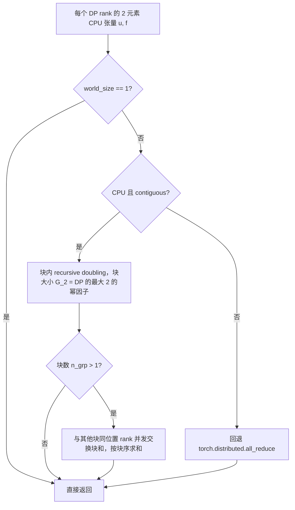

> **读图方法：** 这是 `cpu_all_reduce_` 的流程图。第一遍沿“否→是→是”的主路径走到底，对应 $\mathrm{DP}$ 非 2 的幂且是 CPU 张量；
> 第二遍再看两个旁路：单 rank 直接返回；非 CPU 或非连续张量先回退通用 `all_reduce`，再沿箭头回到“直接返回”（源码在 `torch.distributed.all_reduce` 之后 `return tensor`）。读完后应知道：它只是 gloo 上的小张量 SUM，
> 不替代 NCCL 数据面通信。

`GroupCoordinator.cpu_all_reduce_` 是对应的 group 级封装（使用该 group 的 `cpu_group` 与 `cpu_timeout`）。

[源码] `vllm/config/parallel.py` - `ParallelConfig.sync_dp_state`（`parallel.py:966-991` @ `05caae03`）

[源码] `vllm/distributed/utils.py` - `cpu_all_reduce_`（`utils.py:75-140` @ `05caae03`）

[源码] `vllm/v1/engine/core.py` - `DPEngineCoreProc._has_global_unfinished_reqs`（`core.py:2847-2868` @ `05caae03`）

---

## 9.8 Expert Parallel：切 experts，搬 tokens

> **本节先看：** 本节要回答：**Expert Parallel：切 experts，搬 tokens**。下面的小节会逐层拆开概念、运行过程和源码落点；第一次阅读先抓对象之间的关系，第二次再记类名、字段和分支。

### 9.8.1 TP 与 EP 的差别

TP 把一个 dense layer 的矩阵切到多 rank；EP 则让每个 rank 拥有一组完整 experts。当前
`FusedMoEParallelConfig.make` 在启用 EP 时把 `DP×PCP×TP` 展平为 EP size，并把 MoE-local
TP 视为 1。

```mermaid
flowchart TB
    H[Tokens hidden states] --> R[Router top-k]
    R --> D[Dispatch by expert owner]
    D --> E0[rank 0 complete experts]
    D --> E1[rank 1 complete experts]
    E0 --> C[Combine to source token order]
    E1 --> C
    C --> O[Weighted token outputs]
```

> **读图方法：** 这张图用于压缩“TP 与 EP 的差别”的整体关系。先从上向下找到起点、关键转换和终点，再问每条跨层箭头是否意味着函数调用、消息传递、内存访问或状态更新。

### 9.8.2 expert placement

当前实现支持：

- `linear`：每 rank 获得连续 expert IDs；
- `round_robin`：expert IDs 轮转分配到 ranks。

当 expert 数不能整除 EP size 时，当前代码把余数给**前面的 ranks**。源码某处说明仍写着
“最后的 ranks”，那是陈旧注释；本书以 `ExpertMapManager` 的实际计算为准。

例如 10 experts、EP=4 的 linear placement：

```text
rank 0: experts 0,1,2
rank 1: experts 3,4,5
rank 2: experts 6,7
rank 3: experts 8,9
```

### 9.8.3 route、dispatch、compute、combine

> **本节先看：** 下面先给出“route、dispatch、compute、combine”的结论清单。先理解每一项为什么存在，再记参数名或实现细节。

1. Router 为每个 token 选择 top-k experts 和权重。
2. Dispatch 根据 expert owner 把 token hidden states 发到目标 rank。
3. 每个 rank 对收到的 tokens 执行本地完整 expert MLP。
4. Combine 把结果送回 token 的源位置，并按 router weight 聚合。

```mermaid
sequenceDiagram
    participant S0 as source rank 0
    participant S1 as source rank 1
    participant E0 as expert rank 0
    participant E1 as expert rank 1
    S0->>E1: tokens routed to experts on rank 1
    S1->>E0: tokens routed to experts on rank 0
    E0->>E0: local expert compute
    E1->>E1: local expert compute
    E0-->>S1: return expert outputs
    E1-->>S0: return expert outputs
```

> **读图方法：** 这是“route、dispatch、compute、combine”的时序图。先从左到右确认参与者分别负责什么，再从上到下追踪消息；第一遍只看正常路径，第二遍再看返回、异步消息和失败分支。

`moe_runner` 与 modular kernel 路径把 prepare、expert compute、finalize 分开；某些 all-to-all
实现可以异步准备或完成通信，但依旧必须维护 token mapping 与 buffer 生命周期。

### 9.8.4 EP 性能由最忙的 rank 决定

设 rank `i` 收到的 routed tokens 为 `n_i`，一次专家层的关键路径近似由：

$$
T_{\mathrm{EP}}\approx T_{\mathrm{dispatch}}+\max_i T_{\mathrm{expert}}(n_i)+T_{\mathrm{combine}}
$$

决定。平均 token 数很均匀并不足够，某个 batch 内 router 热点就会让其他 ranks 等待。
因此应记录每 rank/expert token histogram，而不只看总 tokens/s。

### 9.8.5 all-to-all backend 不是可忽略细节

不同实现可能采用 all-gather+reduce-scatter、原生 all-to-all 或面向特定硬件的通信 kernel。
选择受 dtype、token 数、拓扑和后端能力影响。调优 EP 时必须把 backend 与 placement 写入
实验记录，否则相同 `EP=8` 可能是完全不同的数据路径。

---

### v0.32.0：编译 SP 与模型级 SP 分开

移除的是 torch.compile sequence-parallel / AsyncTP passes，不是把所有序列并行从 vLLM 删除。
`ParallelConfig.use_sequence_parallel_moe` 仍由 all-to-all backend、EP 开启、TP>1、DP>1 等条件决定，
MoE dispatch/combine 仍可能使用 sequence-parallel 输入。不要拿旧 compile pass 配置去开启它，
也不要由 pass 删除推断 TP、EP 或模型内 SP 的通信全都消失。

[源码] `vllm/config/parallel.py` - `use_sequence_parallel_moe`、`use_all2all`

v0.32.0 的 MRV2 unsupported-feature 清单不再含 Elastic EP；这只是取消统一回退条件（MRV1 被删除后，该清单只剩 external launcher + `PP>1` 与 DBO 组合，见第 07 章 7.22），
扩缩容仍有独立校验与暂停策略。`_eep_commit_pause_mode` 在 V2 无法复用
fused MoE kernel 的情况下选择 wait，否则选择 keep；不能把支持 EEP 理解为任意组合都无须 drain。

[源码] `vllm/config/vllm.py` - `_get_model_runner_unsupported_features`

[源码] `vllm/v1/engine/core_client.py` - `DPAsyncMPClient._eep_commit_pause_mode`（`core_client.py:1695`；`DPLBAsyncMPClient` 继承它，并在 `:2138`、`:2211` 调用 @ `05caae03`）

**v0.33.0：Elastic EP 在 external LB 下也能扩缩容。** #43202（`dd9e07a25`）把 `_eep_commit_pause_mode` 和
`_setup_elastic_ep_reconfig_bootstrap` 从 `DPLBAsyncMPClient` 上移到它的父类 `DPAsyncMPClient`，并给后者新增
`prepare_elastic_ep`、`commit_elastic_ep`、`abort_external_elastic_ep` 与 `ExternalElasticEPScaleCoordinator`
（`core_client.py:1561`、`:1737-1770`）。因此 v0.32.0 里“Elastic EP 与 `data_parallel_external_lb` 或 `data_parallel_hybrid_lb`
都不兼容”的启动校验，在 v0.33.0 改成只拒绝 hybrid LB（`parallel.py:1080-1084`）：external LB 下由外部调用者驱动 prepare / commit，
`DPAsyncMPClient` 自己不路由请求；`_get_external_eep_coordinator` 要求 `enable_elastic_ep` 与 external LB 同时成立。
独立启动的新 rank 没有外部 utility 调用方去参加“提交之后的 resume barrier”，所以 `DPEngineCoreProc.run_busy_loop`
对 `worker_type == "new"` 且 external LB 的 engine 自己调用 `resume_scheduler`（`core.py:2775-2782`）。

这里只记录归属与校验的变化；扩缩容的完整流程见下面的 9.8.6。

[源码] `vllm/distributed/elastic_ep/external_elastic_ep.py` - `ExternalElasticEPScaleCoordinator`（`external_elastic_ep.py:205` @ `05caae03`）

### 9.8.6 Elastic EP：在线扩缩 DP×EP

> **本节先看：** Elastic EP 不是换一种 expert 路由算法，而是在服务不中断的前提下增减 data-parallel engine（从而改变 EP world）。控制面走 prepare →（可选排空）→ commit；数据面在 commit 窗口短暂挡住 forward，切换 process group 与 expert 映射。上面只记录了归属与校验；本节补上扩缩容主路径。

**谁触发。** 内部负载均衡（`DPLBAsyncMPClient`）可以自行驱动，但其 `prepare_elastic_ep` 要求 `data_parallel_backend == "ray"`（`core_client.py:2013-2015` @ `05caae03`）。v0.33.0 起外部负载均衡（`DPAsyncMPClient`）也可以，前提是 `enable_elastic_ep` 且不是 hybrid LB（见本节之前已有段落）。HTTP 入口：

- `POST /scale_elastic_ep`，body 为 `new_data_parallel_size`（正整数）和可选的 `drain_timeout`（默认 120 秒）（`api_router.py:38-65` @ `05caae03`）。该入口调用 `AsyncLLM.scale_elastic_ep`（`async_llm.py:1321` @ `05caae03`）：先 `prepare_elastic_ep`，再按需排空，最后 `commit_elastic_ep`。排空只在环境变量 `VLLM_ELASTIC_EP_DRAIN_REQUESTS` 打开时发生，默认关闭。
- `POST /is_scaling_elastic_ep` 用来查询当前阶段（`api_router.py:84` @ `05caae03`）。

Engine 侧，`DPEngineCoreProc.reinitialize_distributed`（`core.py:2870` @ `05caae03`）创建 `ElasticEPScalingState` 并返回 `ready_key`；`commit_prepared_elastic_ep`（`:2924`）只在状态已经 `is_ready_for_switch` 时把 `commit_requested` 置为真，并不自己切 group。Worker 上的实际准备与提交由 `ElasticEPScalingExecutor`（`elastic_execute.py:153` @ `05caae03`）执行；外部 LB 下的 prepare/commit 握手由 `ExternalElasticEPScaleCoordinator`（`external_elastic_ep.py:205` @ `05caae03`）协调。prepare 完成后，`set_scaling_elastic_ep(True)` 会让 `ScalingMiddleware` 在整个扩缩窗口内对除 `/health`、`/is_scaling_elastic_ep` 以外的请求返回 503（`async_llm.py:1359-1362`、`middleware.py:51-63` @ `05caae03`）。

**Scale-up 主路径（existing rank 视角）：**

```mermaid
flowchart TB
    HTTP["POST /scale_elastic_ep"] --> PREP[prepare_elastic_ep]
    PREP --> ST[ElasticEPScalingState<br/>PREPARE]
    ST --> W[elastic_ep_execute: prepare workers]
    W --> SYNC[SYNC_KV_CACHE_MEMORY_SIZE<br/>对齐各 rank KV 预算]
    SYNC --> READY[_mark_ready_for_switch]
    READY --> WAIT[等待 commit_requested]
    WAIT --> COMMIT[COMMIT_SCALE_UP<br/>挡住 forward]
    COMMIT --> GRP["_commit_new_dp_group<br/>+ elastic_ep_execute commit"]
    GRP --> DONE[COMPLETE + reconfigure_finished]
```

> **读图方法：** 这是已有 engine（`worker_type=="existing"`）扩容的状态链。把「等待 commit_requested」看成控制面屏障：prepare 期间旧 engine 仍在正常处理请求；排空和 503 暂停发生在 prepare 完成之后、commit 之前（`async_llm.py:1359-1362` @ `05caae03`）。真正切换 process group 只发生在 commit。新 engine 是另一条链：`PRE_KV_INIT`（先 `prepare_new_worker`，再用 `sync_kv_cache_memory_size(-1)` 拿到预算）→ `PREPARE`（`warmup_new_worker`，然后 `commit_scale_up(False)`，不等待 `commit_requested`）→ `COMPLETE`。不要把 new/existing 画成同一条状态链。

**Scale-down。** 留下来的 ranks 在 `PREPARE` 之后进入 `COMMIT_SCALE_DOWN`，同样要等 `commit_requested` 才会切 group（`ScaleDownRemainingEngineState`，`elastic_state.py:48-51`、`:230-248` @ `05caae03`）。被摘掉的 rank（`worker_type=="removing"`）只有 `PREPARE → COMPLETE`：在 `PREPARE` 里执行 `commit_scale_down(removing=True)`，发送 `EEPNotificationType.SHUTDOWN_COMPLETE`；外部 LB 下还要等 store 上该 rank 的 `shutdown_complete` 键（`elastic_state.py:255-278` @ `05caae03`）。若外部 LB 下该 rank 将被淘汰，API 进程还会 `set_elastic_ep_rank_retired(True)`（`async_llm.py:1363-1369` @ `05caae03`）。commit 成功后，扩缩窗口的 503 会撤掉，但退休标记仍在，该进程继续对非 `/health`、`/is_scaling_elastic_ep` 的请求返回 503，等待外部进程回收（第 03 章 3.4.4 已述）。

**和普通 EP 的边界。** §9.8.1–9.8.5 讲的是静态 topology 下的 route / dispatch / combine；本节只多了「拓扑可变」。负载不均、straggler、all-to-all backend 选择等性能讨论仍然成立——扩容不会自动消除专家热点。

开启 `enable_elastic_ep` 时，`VllmConfig._resolve_extensible_kv_cache` 把可扩展 KV cache 标为不支持，因为扩容会跳过 warmup、复用已经 profile 过的 KV 尺寸（`vllm/config/vllm.py:3204-3208` @ `05caae03`）：若显式打开可扩展 KV cache，会抛出 `ValueError`；若该选项未设置，则被静默关掉（`:3242-3253`）。

[源码] `vllm/entrypoints/serve/elastic_ep/api_router.py` - `scale_elastic_ep`、`is_scaling_elastic_ep`（`:38`、`:84` @ `05caae03`）

[源码] `vllm/v1/engine/async_llm.py` - `AsyncLLM.scale_elastic_ep`（`:1321` @ `05caae03`）

[源码] `vllm/distributed/elastic_ep/elastic_state.py` - `ElasticEPScalingState`、`ScaleUpExistingEngineState`（`:67`、`:35-39` @ `05caae03`）

[源码] `vllm/distributed/elastic_ep/elastic_execute.py` - `ElasticEPScalingExecutor`（`:153` @ `05caae03`）

[源码] `vllm/distributed/elastic_ep/external_elastic_ep.py` - `ExternalElasticEPScaleCoordinator`（`:205` @ `05caae03`）

[源码] `vllm/v1/engine/core.py` - `DPEngineCoreProc.reinitialize_distributed`、`commit_prepared_elastic_ep`（`:2870`、`:2924` @ `05caae03`）

[源码] `vllm/entrypoints/serve/elastic_ep/middleware.py` - `ScalingMiddleware`、`set_elastic_ep_rank_retired`（`:35`、`:30` @ `05caae03`）


## 9.9 PCP 与 DCP：都切 context，但切法不同

> **本节先看：** 本节要回答：**PCP 与 DCP：都切 context，但切法不同**。下面的小节会逐层拆开概念、运行过程和源码落点；第一次阅读先抓对象之间的关系，第二次再记类名、字段和分支。

### 9.9.1 先看差异表

> **本节先看：** 下面先用表格整理“先看差异表”。先横向比较每一列解决的问题和适用边界，再把具体名称映射到源码。

| 维度 | PCP | DCP |
|---|---|---|
| 全称 | Prefill Context Parallel | Decode Context Parallel |
| 主要阶段 | 长 prompt prefill | 长上下文 decode |
| 是否增加 worker world size | 是 | 否，复用已有 ranks |
| 主要 ownership | prefill token chunks | KV token/context shards |
| 结果恢复 | hidden gather 与原序重排 | partial attention 的 LSE 加权合并 |
| 当前主要实现入口 | `PCPManager` | `vllm/v1/attention/ops/dcp.py`、`vllm/v1/worker/cp_utils.py` |

### 9.9.2 PCP 的 DualChunkSwap

MRV2 `PCPManager` 把 prefill tokens 切成 `2×PCP` 个 chunks。rank `r` 同时获得前侧 chunk
`r` 和镜像的后侧 chunk `2×PCP-1-r`，以改善 causal attention 工作量平衡。

例如 16 tokens、PCP=4：

```text
chunks: [0,1] [2,3] [4,5] [6,7] [8,9] [10,11] [12,13] [14,15]
rank 0: [0,1]   + [14,15]
rank 1: [2,3]   + [12,13]
rank 2: [4,5]   + [10,11]
rank 3: [6,7]   + [8,9]
```

```mermaid
flowchart LR
    T[Original token order] --> K{"Decode OR (short prefill AND DCP enabled)?"}
    K -->|no| C[Split into 2 x PCP chunks]
    K -->|yes| DCP{DCP enabled?}
    DCP -->|yes| REP[Replicate full query to participating ranks]
    DCP -->|no| OWNER[Round-robin decode request owner]
    OWNER --> G
    REP --> G[Gather and reorder]
    C --> R0[rank 0: front 0 + back 7]
    C --> R1[rank 1: front 1 + back 6]
    C --> R2[rank 2: front 2 + back 5]
    C --> R3[rank 3: front 3 + back 4]
    R0 --> G[Gather and reorder]
    R1 --> G
    R2 --> G
    R3 --> G
    G --> O[Original logical order]
```

> **读图方法：** 阅读“PCP 的 DualChunkSwap”这张流程图时，先把方框看成对象或状态，把箭头看成数据或控制的移动。第一遍从左向右建立顺序，第二遍再核对分支发生的条件。

Decode 请求不再一概复制：PCP-only（DCP=1）因 KV 在 PCP ranks 上复制，可按当前 step 的
有效 decode 请求序号 round-robin 分配唯一 owner，prefill 和零 token 行不占用该序号。
owner 不必跨 step 固定，hidden states/KV 的恢复保证后续 rank 可继续处理。
启用 DCP 时则需要各参与 rank 都计算 decode query；过短、无法填满全部
`2×PCP` chunks 的 prefill 也会复制，避免某些 rank 缺少 chunk。具体条件是
`(2×PCP-1)×ceil(query_len/(2×PCP)) >= query_len`。图中 rank 0–3 的双 chunk 分支以足长 prefill 为例。
执行结束后 gathered hidden states 还要按原 token 顺序恢复；当前局部行按 decode 在前、
prefill 在后，再按 request 与原片段起点排序。切片和正确重排共同构成算法契约。

### 9.9.3 当前 PCP 不是通用开关

固定版本的 `PCPManager.validate_config` 有明确限制，包括：

- 仅支持 MLA；不与 encoder-decoder、multimodal 或 LoRA 同时使用。v0.32.0 不再禁止 PP 组合。
- speculative decoding 不再由 `validate_config` 里写死的方法列表判断，而是问每种 speculator 配置类的
  `pcp_unsupported_reason(parallel_config)`（调用点 `pcp_manager.py:178-183`；基类 `speculator_config.py:142`）。基类只放行
  `supports_pcp = True` 的方法（类属性默认 `False`，`speculator_config.py:60`）；目前显式置 `True` 的是 DSpark（`dspark/config.py:29`）和
  单模块 MTP（`mtp/config.py:24`），多模块 MTP 显式为 `False`（`multi_module_mtp/config.py:11`）。结果和以前一样：允许 DSpark 或单模块 MTP，
  不支持其他方法或多模块 MTP。DSpark 在 draft model 使用 MLA 且 `DCP` 不在 `(1, PCP)` 内时拒绝，即要求 `DCP=1` 或 `DCP=PCP`（`dspark/config.py:132-143`）。
- 通用配置已不再禁止 PCP 与 DP 组合，但仍需通过其他配置和后端校验。
- PCP 与 `DCP>1` 同时使用时，仅支持 sparse MLA，且要求 `dcp_comm_backend="ag_rs"`。
- sparse MLA 且 `DCP=1` 时，CUDA Graph 默认必须为 NONE；v0.33.0（#62377）只对 `deepseek_v32`（DeepSeek-V3.2）与 `glm_moe_dsa`（GLM-5.2/5.3）
  两类 `model_type` 放开，其他 sparse MLA 模型仍要设 `-cc.cudagraph_mode=NONE`（`pcp_manager.py:157-217` @ `05caae03`）。
- full graph 仅可用于分离的 decode routine：允许 FULL_DECODE_ONLY 或
  FULL_AND_PIECEWISE；PIECEWISE 和 NONE 仍可用，但还要满足上述 sparse MLA 约束。

因此旧版本“PCP 禁用所有 speculation/full graph”的规则已不适用；也不能反过来
说 PCP 全面支持它们。升级实验必须记录完整组合，而不只是 PCP size。

[源码] `vllm/v1/worker/gpu/pcp_manager.py` - `PCPManager.validate_config`、`replicated_requests`、`_iter_rank_chunks`

[源码] `vllm/config/parallel.py` - `ParallelConfig.pcp_shard_decode_requests`

> **main 上的变化（已包含在本书基线中，正文尚未展开，后续批次补写）**：以下提交已逐条用 `git merge-base --is-ancestor <提交> 05caae03` 核对，都是本书基线 `05caae03` 的祖先（且都不在 v0.33.0 `4ba787ec` 中）；本章正文仍是 v0.33.0 时代的写法（Model Runner V1 删除除外），条目里 `@` 后的短 SHA 是各提交当时的版本，行号不是 `05caae03` 上的行号。区间为 vLLM main 2026-10-25～10-27（a7407ab44..ed1a73079），详见 meta/main-tracking-2026-10-27.md。
> - [af6665b5d](https://github.com/vllm-project/vllm/commit/af6665b5dd2098898dce52b9e1c5005863738024)（[#61994](https://github.com/vllm-project/vllm/pull/61994)）：DeepSeek-V4.1 模型层原先在 PCP 下拒绝一切 speculative decoding；main 改为允许固定长度 DSpark（其他方法和 adaptive verification 仍报错）。有 spec 时 compressor ring 在每个 PCP rank 聚合完整 tail 以支持拒绝回滚，`PCPManager.sync_drafts` 从 PCP rank 0 广播 draft tokens 与 draft logits，保证各 rank 验证同一提议。上文 `validate_config` 的方法级限制不变。

PCP+PP 时，非末 PP rank 的 `sample_tokens` 恢复 global batch 后接收末 rank 输出；
因此 PP 输出同步使用全局请求顺序，不是每个 PCP rank 的局部行序。

[源码] `vllm/v1/worker/gpu/model_runner.py` - `GPUModelRunner.sample_tokens`

### v0.33.0：PCP 的创建时机、MoE padding 掩码与 rank 局部批元数据

> **本节先看：** 这一节只补 v0.32.0 到 v0.33.0 之间 `PCPManager` 的三处变化：它何时被创建、MoE 如何知道“哪些 gather 来的行是 padding”、以及每个 rank 的局部批次现在携带哪些全局信息。第一遍记住“为什么要在 profiling 之前创建”，第二遍再看具体字段。

**一、创建时机提前（#60946，`bfdbfa163`）。** v0.32.0 里 `maybe_build_pcp_manager` 要等 KV block tables 建好才调用；v0.33.0 在
`GPUModelRunner.__init__` 里就创建 `PCPManager`（`model_runner.py:322`，早于显存 profiling），KV cache 初始化完成后再用
`set_block_tables` 补挂 block tables（`pcp_manager.py:109`，`model_runner.py:770-771`）。这样 profiling 和 CUDA graph capture 使用的 dummy
batch 也走同一个管理器：`PCPManager` 的方法 `prepare_inputs_to_capture` 改名为 `prepare_inputs_for_capture_or_profile`（`pcp_manager.py:723`）。
注意只有 `PCPManager` 的这个方法改了名；`cudagraph_utils.py:891` 里同名的模块级函数 `prepare_inputs_to_capture` 仍是原名。

**二、MoE 的 padding 掩码要和 gather 之后的行对齐（#60946）。** 当 PCP>1 且没有 EP all2all kernel 时，`MoERunner._maybe_dispatch`
会把各 PCP rank 的 token 沿 batch 维 all-gather 后再路由（`moe_runner.py:853-860`）。gather 之后行数是 $P\times\hat T$，
而 `is_padding` 原来只描述本 rank 的 $\hat T$ 行，路由内核（如 `fused_topk_bias_router`、`dsv4_topk`）会把 padding 行的权重置 0、
expert id 置 −1（这套“把 padding 行的 expert id 强制为 −1、让后续计算丢弃它们”的机制由环境变量 `VLLM_MOE_SKIP_PADDING` 控制，
默认开启，`envs.py:1716`；例如 `model_runner.py:1469` 只在它为真时才填写 dummy batch 的 `is_padding`），
所以掩码必须按 gather 后的行重新展开。`PCPManager` 为此维护 `_moe_is_padding`（长度 `max_num_tokens × PCP`，
仅当 `moe_gathers_tokens = not enable_expert_parallel` 为真时创建，`pcp_manager.py:931`），逐行写成：

$$
m_{r,t}=\big[\,t\ \ge\ n_r\,\big],\qquad r=0,\dots,P-1,\quad t=0,\dots,\hat T-1
$$

**白话**：每个 rank 先把自己的真实 token 排在前面、padding 排在后面；gather 之后各 rank 的片段按 rank 顺序首尾相接，所以第 $r$ 段里
“序号不小于该 rank 真实 token 数”的位置就是 padding。

**符号说明**：$P$ 是 PCP size；$\hat T$ 是 padding 后每个 rank 的局部行数；$n_r$ 是第 $r$ 个 rank 的真实 token 数（`per_rank_num_tokens`）；
$m_{r,t}\in\{0,1\}$ 表示 gather 后第 $r$ 段第 $t$ 行是否为 padding；$[\cdot]$ 条件为真取 1。所有量都是无单位整数。
例如 $P=2$、$\hat T=4$、$n=(3,2)$：掩码为 `[0,0,0,1 | 0,0,1,1]`，其中 1 的位置不参与专家计算。

```mermaid
flowchart LR
    A[GPUModelRunner.__init__] --> B[maybe_build_pcp_manager：block_tables 暂为 None]
    B --> C[显存 profiling / 捕获用 dummy batch：prepare_inputs_for_capture_or_profile]
    C --> D[KV cache 初始化后 set_block_tables]
    D --> E[partition_batch：本 rank 局部批次]
    E --> F[MoE all_gather PCP token]
    F --> G[用展开后的 _moe_is_padding 路由，padding 行不占专家]
```

> **读图方法：** 这是 `PCPManager` 生命周期与 MoE padding 的流程图。第一遍从左到右看 A→D：管理器先于 block tables 存在；
> 第二遍看 E→G：每步的局部批次经 all-gather 后，用重新展开的 padding 掩码做路由。读完后应知道：掩码的行数必须与 MoE 实际看到的行数一致。

**三、局部批次携带全局信息（#62384，`c7476c7a6`）。** v0.33.0 新增 `PCPBatchMetadata`（`pcp_manager.py:29`），挂在 PCP rank 局部
`InputBatch.pcp` 上：`global_num_tokens`（PCP 切分之前未 padding 的 token 数）、`global_query_lens_np`、`global_seq_lens_cpu_upper_bound_np`，
以及仅在 PCP+DCP 时存在的 `dcp_local_seq_lens_cpu_upper_bound`（取代 v0.32.0 直接挂在 `InputBatch` 上的同名字段）。
它的第一个使用者是 DeepSeek-V4.1-Flash 的“解码侧 SWA 有界重放”。白话：SWA 是 sliding-window attention（滑动窗口注意力）；“有界重放”是指，
最后一个写 KV 的层把整批所有行的 KV 都写完之后，只拥有 SWA KV 的后续层不再对整条 prompt 重算，而是只对每个请求**最后 `window` 行**再跑一遍
（`CacheConfig.swa_bounded_replay`，默认 `True`，`cache.py:372`；实现见 `vllm/models/deepseek_v41/decoder_replay_layers.py` 的模块文档字符串）。落到 PCP 上：每个被裁剪的请求要跨所有 PCP rank，所以各 rank 要能从自己的局部片段
推出同一个全局保留长度；这属于模型专属路径，本书不展开。

[源码] `vllm/v1/worker/gpu/pcp_manager.py` - `PCPManager.set_block_tables`、`PCPManager.moe_is_padding`、`PCPBatchMetadata`、`maybe_build_pcp_manager`

[源码] `vllm/model_executor/layers/fused_moe/runner/moe_runner.py` - `MoERunner._maybe_dispatch`

### 9.9.4 DCP 如何分配 KV token

DCP 使用已有 ranks 分摊 decode attention 的 context。一个简化 owner 公式是：

$$
\operatorname{owner}(p)=\left\lfloor\frac{p}{I}\right\rfloor\bmod\mathrm{DCP}
$$

式中 $p$ 是全局 token 位置，$I$ 是 `interleave` 对应的连续 token 数。它允许
连续若干位置先归同一 rank，再轮转到下一个 rank。

```mermaid
flowchart TB
    Q[One decode query] --> A0[rank 0 attends local KV shard]
    Q --> A1[rank 1 attends local KV shard]
    A0 --> P0[partial output O0 and LSE0]
    A1 --> P1[partial output O1 and LSE1]
    P0 --> M[LSE-weighted merge]
    P1 --> M
    M --> O[global attention output]
```

> **读图方法：** 这张图用于压缩“DCP 如何分配 KV token”的整体关系。先从上向下找到起点、关键转换和终点，再问每条跨层箭头是否意味着函数调用、消息传递、内存访问或状态更新。

### 9.9.5 partial attention 为什么不能求平均

先算一个例子：两个 shard 的未归一化概率总量分别为 1 和 3，局部输出分别为 10 和
20。全局应为 $\frac14\times10+\frac34\times20=17.5$，不是平均值 15。下面的对数公式只是
用不容易溢出的方式保存这两个总量。

每个 DCP rank 只看一部分 keys/values。对同一个 Query/head，设其局部注意力打分的对数配分和（Log-Sum-Exp，$\operatorname{LSE} = \log \sum_j \exp(s_{ij})$）为标量 `L_i`，局部输出为长度 `[D_v]` 的向量 `O_i`。全局归一化量是：

$$
L=\log\sum_i e^{L_i}
$$

最终输出是：

$$
O=\sum_i e^{L_i-L}O_i
$$

直接计算 `(O_0+O_1)/2` 隐含假设两个 shard 的 softmax denominator 相同，通常不成立。
当前 DCP 接口用 LSE 保存归一化信息；仅有局部归一化输出而没有 LSE 或等价的
分母信息，无法精确合并。所有指数权重无单位，求和后为 1；输出仍是 `[D_v]`。
空 shard 必须贡献零权重，不能让无效 LSE 导致 NaN。

### 9.9.6 DCP 的两类通信路径

当前代码包含 AG+RS/AR 与 A2A 等路径：

- AG+RS/AR：本地 attention 之后，all-gather 各 rank 的 LSE，修正局部输出权重，
  再 reduce-scatter 或 all-reduce 求和。Query 的 gather 属于更前面的准备阶段。
- A2A：`dcp_a2a_lse_reduce` 的输入已经是局部 attention 输出及 LSE；把二者打包，
  做一次 all-to-all，随后解包并按 LSE 加权合并，输出按 head 分给目标 rank。
  不能把它画成“先 A2A、再 attention、再逆向 A2A”。

[源码] `vllm/v1/attention/ops/dcp.py` - `cp_lse_ag_out_rs`、`cp_lse_ag_out_ar`、
`dcp_a2a_lse_reduce`

哪条路径更快取决于 token shape、互联与 kernel 支持，不能只根据理论字节数下结论。

### 9.9.7 Context Parallel 与 KV Cache

PCP/DCP 会改变 block table、slot mapping 或 token owner 的解释。KV Cache 总章中“一个逻辑
token 映射到一个 block slot”的原则仍成立，但物理 slot 可能属于某个 context rank。
排查时必须同时打印 logical position、block id、slot mapping、DCP owner 和 local rank。

**v0.33.0：DCP 与 KV block 大小、P/D 分离下的 interleave。** 启用 DCP 后，被 DCP 分片的注意力 KV 一个 block 在逻辑上覆盖
$\mathrm{block\_size}\times\mathrm{DCP}$ 个连续 token 位置，而 Mamba/GDN 这类按 rank 复制的状态不乘（`resolve_dcp_kv_block_size`，
`kv_cache_utils.py:736-738` @ `05caae03`）。NIXL P/D 分离下，`cp_kv_cache_interleave_size` 要与本地 block 大小对齐；#62330（`3e75ccba2`）把这一步
从 worker 端搬到 `VllmConfig.adjust_dcp_kv_cache_interleave_size`（`vllm.py:3460`），由 EngineCore 在显存 profiling 之前、用全局 KV cache groups
调用一次（`core.py:324-325`），随后经 `set_kv_cache_layout(layout.name, cp_kv_cache_interleave_size)` 把结果发给 workers。
所以 profiling 时 workers 看到的 interleave 已是最终值；KV 初始化的完整步骤见第 5 章。

[源码] `vllm/config/vllm.py` - `VllmConfig.adjust_dcp_kv_cache_interleave_size`

[源码] `vllm/v1/core/kv_cache_utils.py` - `resolve_dcp_kv_block_size`

---

## 9.10 Executor backend：谁启动 Worker，谁传 RPC

> **本节先看：** 本节要回答：**Executor backend：谁启动 Worker，谁传 RPC**。下面的小节会逐层拆开概念、运行过程和源码落点；第一次阅读先抓对象之间的关系，第二次再记类名、字段和分支。

### 9.10.1 factory 的选择

`vllm/v1/executor/abstract.py:Executor.get_class` 根据配置选择（`abstract.py:64-103` @ `05caae03`）。判断顺序是：先看
`distributed_executor_backend` 是不是一个 `Executor` 子类，再依次比较字符串 `"ray"`、`"mp"`、`"uni"`、`"external_launcher"`，
最后把其他字符串当成全限定类名导入并检查它是 `Executor` 子类：

```mermaid
flowchart TD
    A[Executor.get_class] --> T{backend 本身是 Executor 子类?}
    T -- 是 --> X1[直接使用该类]
    T -- 否 --> C{backend 字符串}
    C -- ray --> R2[RayExecutorV2]
    C -- mp --> M[MultiprocExecutor]
    C -- uni --> U[UniProcExecutor]
    C -- external_launcher --> E[ExecutorWithExternalLauncher]
    C -- 其他字符串 --> X2[按全限定名导入并校验为 Executor 子类]
```

> **读图方法：** 这是 `Executor.get_class` 的判断顺序图。第一遍沿“backend 字符串”那条主路径，对应常见的 `ray` / `mp` / `uni`；
> 第二遍再看最上面的“自定义子类”和最下面的“全限定名”两个扩展入口。读完后应知道：v0.33.0 的 `ray` 分支没有第二个选项，
> v0.32.0 里的 legacy 出口已经不存在。

v0.32.0 的 `ray` 分支还多一次 `envs.VLLM_USE_RAY_V2_EXECUTOR_BACKEND` 判断（默认真）来选 `RayExecutorV2` 或 legacy
`RayDistributedExecutor`；v0.33.0 把它删成无条件返回 `RayExecutorV2`（#61712，`e57bb4ace`），环境变量本身随后在 #62228（`52e88e25e`）删除。

当 `distributed_executor_backend` 没有显式给出时，`ParallelConfig.__post_init__` 先按下面的 `if/elif` 顺序补上（`parallel.py:1152-1197` @ `05caae03`）。
只有跨 DP 的总 worker 数 `world_size_across_dp > 1` 才进入这条链，初值是 `mp`，然后**从上到下第一个命中的分支生效**：

1. TPU 且 `VLLM_XLA_USE_SPMD` → `uni`；
2. CUDA 且 `nnodes > 1` → `mp`；
3. CUDA 且本机 GPU 数小于 `world_size` → 直接 `ValueError`（提示用 `--distributed-executor-backend ray` 或设置 `--nnodes`），不会改选 `ray`；
4. 只有前三条都没命中，`data_parallel_backend == "ray"` → `ray`；
5. 再往下，Ray 可用，并且 `self.placement_group` 已设置，或 Ray 已初始化且 `get_current_placement_group()` 非空 → `ray`；
6. 都不满足则保持 `mp`。

链外的 `world_size == 1` 且仍未设置时才是 `uni`（`:1196-1197`）。另外，`nnodes > 1` 只允许 `mp`、`uni` 或 `external_launcher`（`:1204-1212`）。
所以不能把“Ray 可用”理解成覆盖了前面几种情形：多节点 CUDA 和 GPU 不足都在 `ray` 判断之前就有了结果。

```mermaid
flowchart TD
    S[backend 未显式设置且 world_size_across_dp > 1] --> A{TPU 且 SPMD?}
    A -- 是 --> U[uni]
    A -- 否 --> B{CUDA 且 nnodes > 1?}
    B -- 是 --> M1[mp]
    B -- 否 --> C{CUDA 且 GPU 数 < world_size?}
    C -- 是 --> ERR[ValueError]
    C -- 否 --> D{data_parallel_backend == ray?}
    D -- 是 --> R1[ray]
    D -- 否 --> E{Ray 可用且在 placement group 内?}
    E -- 是 --> R2[ray]
    E -- 否 --> M2[mp]
```

> **读图方法：** 这是默认 backend 的 `if/elif` 顺序图。从上往下只走“否”这条路径，终点是 `mp`；每个“是”都是一个更早的出口。
> 读完后应知道：越靠上的条件优先级越高，`ray` 只能在前三个条件都不成立时才被选中。

不要只因为代码库里存在 `vllm/v1/executor/ray_executor_v2.py` 就认定运行时一定使用它；最终选择要看 factory
和配置。

[源码] `vllm/v1/executor/abstract.py` - `Executor.get_class`

[源码] `vllm/config/parallel.py` - `ParallelConfig.__post_init__`

### 9.10.2 UniProc

UniProc 在 EngineCore 进程内直接构造一个 Worker，省去多进程 RPC，适合单 rank 路径和
调试。它仍通过统一 Executor 接口暴露 `execute_model`、`sample_tokens` 等方法。

### 9.10.3 Multiproc

MultiprocExecutor 的控制面主要通过 message queue 广播 Worker RPC；每个 WorkerProc 在
busy loop 中接收方法名与参数，执行后回传结果。模型 forward 内真正的 TP/PP/EP 数据面
通信，则走 torch distributed device process groups。

```mermaid
flowchart LR
    EC[EngineCore] -->|RPC name and args| MQ[Message queue]
    MQ --> W0[WorkerProc 0]
    MQ --> W1[WorkerProc 1]
    W0 <--> |NCCL/device group| W1
    W0 -->|result| OUT[Output queue]
    W1 -. 仅被选中或需聚合时回复 .-> OUT
    OUT --> EC
```

> **读图方法：** 阅读“Multiproc”这张流程图时，先把方框看成对象或状态，把箭头看成数据或控制的移动。第一遍从左向右建立顺序，第二遍再核对分支发生的条件。

控制面正常不代表数据面正常。若所有 Worker 都收到 `execute_model` 后才 hang，应优先检查
collective 顺序、shape 和 NCCL 网络，而不是 API queue。

**v0.33.0：spawn 方式下并发启动 Worker（#60028，`52f44839f`）。** 以前 `MultiprocExecutor._init_executor` 按 `local_rank` 逐个启动 Worker 进程；
spawn 要重新 import 大量模块，串行启动时这些 import 排队等待。v0.33.0 在满足下列全部条件时用线程池并发启动本机 Worker
（`_can_start_workers_concurrently`，`multiproc_executor.py:346-358`；`_start_workers_concurrently`，`:361` @ `05caae03`）：

- 不是 fork（fork 路径要把前一个 Worker 的文件描述符继承给下一个，`inherited_fds` 不为 `None`：fork 时是一个列表，spawn 时是 `None`）；
- 本机 Worker 数大于 1，且不是 CPU 后端（CPU 后端要逐个设置 OpenMP 环境）；
- 没有启用 `numa_bind`（`numactl` 包装会逐个改写 `os.environ` 或 multiprocessing 的可执行文件）。

不满足时仍是原来的逐个启动。无论哪条路径，已经启动的 Worker 句柄都会按 rank 顺序放进 `unready_workers`，保证中途失败时能统一清理。
Worker 启动之后的 `wait_for_ready` 阶段不变。

[源码] `vllm/v1/executor/multiproc_executor.py` - `MultiprocExecutor._can_start_workers_concurrently`、`MultiprocExecutor._start_workers_concurrently`

### 9.10.4 Ray：v0.33.0 只剩 `RayExecutorV2`

> **本节先看：** 先记住结论：现在 `distributed_executor_backend="ray"` 只会得到 `RayExecutorV2`。它是一个 `MultiprocExecutor` 子类：控制面用 message queue，数据面用 NCCL，Ray 只负责“把 Worker 作为 actor 放到哪张卡上”。

- v0.32.0 中 `ray` 默认已经走 `RayExecutorV2`，legacy `RayDistributedExecutor`（Ray actor RPC 加 Ray Compiled Graph）只在显式关闭
  `VLLM_USE_RAY_V2_EXECUTOR_BACKEND` 时使用；v0.33.0 的 #61712 删除了 `vllm/v1/executor/` 下的 legacy 文件 `ray_executor.py`（含 `RayDistributedExecutor`）、
  `vllm/distributed/device_communicators/` 下的 `ray_communicator.py`，以及 compiled-graph 专用的环境变量 `VLLM_USE_RAY_COMPILED_DAG_CHANNEL_TYPE`、`VLLM_USE_RAY_COMPILED_DAG_OVERLAP_COMM`、
  `VLLM_USE_RAY_WRAPPED_PP_COMM`。
- `RayExecutorV2`（`ray_executor_v2.py:239`）继承 `MultiprocExecutor`，沿用基于 message queue 的控制面和 NCCL 数据面，
  类属性 `uses_ray = True`、`supports_pp = True`（`:249-250`）。Worker 是 Ray actor（`RayWorkerProc`，`:79`），由 Ray 的 placement group 决定放置。
- 同一节点上的 Worker 与 driver 用共享内存 `MessageQueue`，其他节点用 TCP（`n_local_reader=0`，`_init_message_queues`，`:193-213`）。
- GPU 分配不改写 `CUDA_VISIBLE_DEVICES`：先按 placement group bundle 放置 actor，再发现每个 actor 实际拿到的物理 GPU id，
  最后用 `initialize_worker` 把 local rank 与 `assigned_physical_gpu_ids` 一并交给 Worker（`:79-106` 的类文档字符串给出这三步顺序）。
- #61713（`4a89316ef`）删除了 legacy 遗留的“driver 节点必须有 GPU”约束：`initialize_ray_cluster` 不再有 `require_gpu_on_driver` 参数，
  `RayExecutorV2._init_executor` 直接调用 `initialize_ray_cluster(self.parallel_config)`（`ray_executor_v2.py:295`）。
  同一个 PR 还把测试依赖 `requirements/test/cuda.in` 里的 `ray[cgraph,default]` 改成 `ray[default]`（`nightly-torch.txt`、`rocm.in` 同改）。
- Ray 同样需要正确的 GPU placement、node ordering 与 distributed init 地址；这些在 Ray 之下仍然成立。

```mermaid
flowchart TD
    D[driver：RayExecutorV2._init_executor] --> P[initialize_ray_cluster：得到 placement group]
    P --> B[按节点排序 bundle，为每个 rank 分配 bundle]
    B --> Q[创建广播 MessageQueue：driver 节点共享内存，其余 TCP]
    Q --> A[按 bundle 创建 RayWorkerProc actor，延迟初始化]
    A --> G[读取每个 actor 的节点与物理 GPU id]
    G --> I[initialize_worker：local_rank + assigned_physical_gpu_ids]
    I --> R[收集响应 MQ 句柄，run 启动 worker_busy_loop]
    R --> W[wait_until_ready 屏障后开始收发 RPC]
```

> **读图方法：** 这是 `RayExecutorV2` 启动顺序图。第一遍只看每一步的名词：先有 placement group，再有 MQ，再有 actor，最后才初始化
> Worker 并开始 RPC；第二遍对照 `ray_executor_v2.py` 的 “Step 1…9” 注释。读完后应明白：Ray 主要负责放置与资源编排，
> 之后的 RPC 与 NCCL 通信和 `MultiprocExecutor` 一致。

“使用 Ray”只说明资源编排层，不自动消除 NCCL 或 rank 拓扑问题。

[源码] `vllm/v1/executor/ray_executor_v2.py` - `RayExecutorV2`、`RayWorkerProc`

### 9.10.5 External launcher

External launcher 面向 `torchrun` 兼容启动器：外部系统已经按 rank 启动进程，并通过
`RANK`、`LOCAL_RANK`、`MASTER_ADDR`、`MASTER_PORT` 让 Worker 使用 `env://` 初始化。每个
Executor 只创建一个本地 Worker；所有 ranks 必须收到确定性相同的输入和调用顺序。配置会
强制把 `VLLM_ENABLE_V1_MULTIPROCESSING` 设为 `0`，Executor 初始化时再次断言该条件；因此
external launcher 与 V1 multiprocessing 不是可自由组合的两个开关。

---

## 9.11 从单机扩展到多机

> **本节先看：** 本节要回答：**从单机扩展到多机**。下面的小节会逐层拆开概念、运行过程和源码落点；第一次阅读先抓对象之间的关系，第二次再记类名、字段和分支。

### 9.11.1 单机优先把高频通信留在高速互联内

TP 和 EP 的 collective 可能每层发生，通常应优先放在 NVLink/NVSwitch 域内；PP 只在
stage 边界传 activation，较适合作为跨节点边界；DP 的普通请求路径最独立，也常用于跨
节点扩展。这是经验规则，不替代测量。

```mermaid
flowchart TB
    subgraph N0[Node 0]
        G00[GPU0]
        G01[GPU1]
        G00 <-->|high-frequency TP| G01
    end
    subgraph N1[Node 1]
        G10[GPU0]
        G11[GPU1]
        G10 <-->|high-frequency TP| G11
    end
    G00 -->|PP peer: TP rank 0| G10
    G01 -->|PP peer: TP rank 1| G11
```

> **读图方法：** 这张图用于压缩“单机优先把高频通信留在高速互联内”的整体关系。先从上向下找到起点、关键转换和终点，再问每条跨层箭头是否意味着函数调用、消息传递、内存访问或状态更新。

### 9.11.2 启动参数必须形成同一事实

多机至少需要一致确认：

- master address 与 port；
- node rank、global rank、local rank；
- world size 与 local world size；
- 每个 rank 可见的 CUDA device；
- 模型文件和 tokenizer 是否可访问；
- 网络接口和 NCCL transport；
- 每个节点的软件、driver 与 CUDA ABI。

一个 rank 使用 8、另一个 rank 使用 16 作为 world size，通常不会友好报错，而会让部分
ranks 永久等待不存在的参与者。

### 9.11.3 hostname 可达不等于 collective 可达

控制面 TCP、Gloo 和 NCCL 可能选择不同接口。排查多机连接时应分别验证：

1. 进程 rendezvous 是否完成；
2. CPU group 是否能做小对象通信；
3. GPU group 是否能做最小 tensor collective；
4. 大 payload 是否受带宽、MTU、RDMA 或防火墙影响。

---

## 9.12 通信与计算重叠：优化之前先守住正确性

> **本节先看：** 本节要回答：**通信与计算重叠：优化之前先守住正确性**。下面的小节会逐层拆开概念、运行过程和源码落点；第一次阅读先抓对象之间的关系，第二次再记类名、字段和分支。

### 9.12.1 重叠依赖三个条件

要让通信与计算真正重叠，通常需要：

- 通信是异步提交的，而不是调用点同步等待；
- 后续计算与通信没有数据依赖；
- buffer 在通信完成前不被覆盖或释放。

```mermaid
sequenceDiagram
    participant C as Compute stream
    participant M as Communication
    C->>M: launch async collective
    C->>C: run independent work
    M-->>C: completion event
    C->>C: consume communicated result
```

> **读图方法：** 这是“重叠依赖三个条件”的时序图。先从左到右确认参与者分别负责什么，再从上到下追踪消息；第一遍只看正常路径，第二遍再看返回、异步消息和失败分支。

只加 `async_op=True` 不保证重叠。如果紧接着 `wait()`，或者两个操作争用同一关键资源，
时间线仍可能串行。

### 9.12.2 collective 顺序是全组协议

下面的逻辑在单进程中看似正常，在两个 ranks 上会 hang：

```text
rank 0: all_reduce(A) -> all_gather(B)
rank 1: all_gather(B) -> all_reduce(A)
```

每个 rank 都调用了相同两个 collective，但顺序不一致。分布式正确性不仅要求“调用集合
相同”，还要求 group、顺序、shape、dtype 与参与次数匹配。

### 9.12.3 graph capture 又增加一层约束

CUDA Graph 要求稳定地址与可捕获操作。跨 rank graph replay 还要求 ranks 对 graph mode、
padding shape 和 collective 顺序达成一致。第 8 章的 `coordinate_batch_across_dp` 正是将
异步调度、graph 与分布式约束交汇起来的例子。

---

## 9.13 启动与一次执行的完整调用链

> **本节先看：** 本节要回答：**启动与一次执行的完整调用链**。下面的小节会逐层拆开概念、运行过程和源码落点；第一次阅读先抓对象之间的关系，第二次再记类名、字段和分支。

### 9.13.1 启动阶段

> **本节先看：** 这一小节先用图建立“启动阶段”的整体路径。先找输入、关键状态和输出，再阅读图后的源码解释，不必一开始记住全部节点。

```mermaid
flowchart TD
    A[EngineArgs / VllmConfig] --> B[ParallelConfig validation]
    B --> C[EngineCoreClient selection]
    C --> D[Create one or multiple EngineCore]
    D --> E[Executor.get_class]
    E --> F[Start Worker processes or actors]
    F --> G[init_device and distributed environment]
    G --> H[initialize_model_parallel groups]
    H --> I[load local weight shards]
    I --> J[allocate local KV cache]
    J --> K[compile and warm up]
```

> **读图方法：** 阅读“启动阶段”这张流程图时，先把方框看成对象或状态，把箭头看成数据或控制的移动。第一遍从上向下建立顺序，第二遍再核对分支发生的条件。

每一步都建立后续运行所依赖的不可变事实：rank、device、group、weight shard 和 KV tensor
shape。启动错误不应只在最终 OOM 时处理，应从最早出现不一致的边界定位。

### 9.13.2 运行阶段：TP+PP 的一个 step

> **本节先看：** 这一小节先用图建立“运行阶段：TP+PP 的一个 step”的整体路径。先找输入、关键状态和输出，再阅读图后的源码解释，不必一开始记住全部节点。

```mermaid
sequenceDiagram
    participant EC as EngineCore
    participant EX as Executor
    participant P0 as PP0 TP group
    participant P1 as PP1 TP group
    EC->>EC: Scheduler.schedule
    EC->>EX: execute_model(SchedulerOutput)
    EX->>P0: broadcast same RPC
    EX->>P1: broadcast same RPC
    P0->>P0: TP local matmul and collectives
    P0-->>P1: IntermediateTensors
    P1->>P1: TP local matmul and collectives
    P1-->>EX: forward 结束，等待 sampling
    EX-->>EC: execute 阶段结果
    EC->>EX: sample_tokens(grammar)
    EX->>P0: sampling RPC，接收 token 广播
    EX->>P1: sampling RPC，末 stage 采样
    P1-->>EX: output rank result
    EX-->>EC: ModelRunnerOutput
```

> **读图方法：** 这是“运行阶段：TP+PP 的一个 step”的时序图。先从左到右确认参与者分别负责什么，再从上到下追踪消息；第一遍只看正常路径，第二遍再看返回、异步消息和失败分支。

### 9.13.3 运行阶段：DP+EP 的一个 wave

> **本节先看：** 这一小节先用图建立“运行阶段：DP+EP 的一个 wave”的整体路径。先找输入、关键状态和输出，再阅读图后的源码解释，不必一开始记住全部节点。

```mermaid
sequenceDiagram
    participant C as DP Coordinator
    participant E0 as EngineCore DP0
    participant E1 as EngineCore DP1
    participant W0 as EP ranks from DP0
    participant W1 as EP ranks from DP1
    C-->>E0: START_DP_WAVE（需要启动 wave 时）
    C-->>E1: START_DP_WAVE（唤醒空闲 engine）
    Note over E0,E1: 各自 busy loop 推进；不逐 step 等 coordinator 发令
    E0->>W0: execute batch
    E1->>W1: execute batch/dummy
    W0->>W1: route and all-to-all
    W1->>W0: combine all-to-all
```

> **读图方法：** 这是“运行阶段：DP+EP 的一个 wave”的时序图。先从左到右确认参与者分别负责什么，再从上到下追踪消息；第一遍只看正常路径，第二遍再看返回、异步消息和失败分支。

---

## 9.14 性能模型：先估字节，再看时间线

> **本节先看：** 本节要回答：**性能模型：先估字节，再看时间线**。下面的小节会逐层拆开概念、运行过程和源码落点；第一次阅读先抓对象之间的关系，第二次再记类名、字段和分支。

### 9.14.1 alpha-beta 通信模型

一个简化通信时间模型是：

$$
T_{\mathrm{comm}}\approx n_{\mathrm{phase}}\alpha+\frac{B_{\mathrm{payload}}}{\beta}
$$

式中 $n_{\mathrm{phase}}$ 是通信阶段数，$\alpha$ 是每阶段固定延迟（秒），
$B_{\mathrm{payload}}$ 是传输字节量，$\beta$ 是有效带宽（byte/s），结果为秒。若资料给的是 bit/s，要先除以 8。小 tensor 高频 collective 常被 $\alpha$ 主导，大 tensor 则更受
带宽影响。该模型不能替代 NCCL profile，但能帮助判断：合并通信、降低频次和减少字节中
哪一种更可能有效。

### 9.14.2 扩展效率

若单卡吞吐为 `Q_1`，使用 `p` 卡的吞吐为 `Q_p`：

$$
\mathrm{speedup}=\frac{Q_p}{Q_1}
$$

$$
\mathrm{efficiency}=\frac{Q_p}{pQ_1}
$$

效率低不一定是通信问题，也可能来自：

- 每 rank batch 太小，GEMM 利用率下降；
- PP stage 不平衡；
- EP token skew；
- DP load balancer 把长请求聚到同一 engine；
- KV capacity、CPU input prep 或网络 serving 成为新瓶颈。

### 9.14.3 并行方式的成本轮廓

> **本节先看：** 下面先用表格整理“并行方式的成本轮廓”。先横向比较每一列解决的问题和适用边界，再把具体名称映射到源码。

| 方式 | 高频成本 | 容量收益 | 典型风险 |
|---|---|---|---|
| TP | 每层 collective | 权重按 TP 分片 | 小 batch latency 上升 |
| PP | stage boundary activation | layers 按 PP 分片 | bubble、stage imbalance |
| DP | 模型与 KV 副本 | 请求容量线性扩展潜力 | 负载不均、显存重复 |
| EP | 每个 MoE layer token exchange | experts 分片 | token skew、all-to-all |
| PCP | prefill gather/reorder | prompt 工作分摊 | 功能限制、重排开销 |
| DCP | attention partial merge | context 工作分摊 | backend/LSE 约束 |

---

## 9.15 配置前的检查清单

> **本节先看：** 本节要回答：**配置前的检查清单**。下面的小节会逐层拆开概念、运行过程和源码落点；第一次阅读先抓对象之间的关系，第二次再记类名、字段和分支。

### 9.15.1 拓扑

> **本节先看：** 下面先给出“拓扑”的结论清单。先理解每一项为什么存在，再记参数名或实现细节。

- 写出 `TP、PP、DP、PCP、DCP` 的具体值。
- 计算每个 DP engine 的 worker world size 与跨 DP 总 worker 数。
- 列出每个 global rank 的 node、local rank、device 和坐标。
- 列出 TP/PP/DP/EP/PCP/DCP groups。
- 确认 DCP divisibility 和 PCP 功能限制。

### 9.15.2 容量

> **本节先看：** 下面先给出“容量”的结论清单。先理解每一项为什么存在，再记参数名或实现细节。

- 每 rank 权重与量化 metadata 占用。
- CUDA context、compile 与 graph capture 额外显存。
- 每 DP engine 的 KV Cache 是独立预算。
- PP stage 层数和非 layer 参数是否平衡。
- EP 每 rank expert 数及最大 routed tokens。

### 9.15.3 通信

> **本节先看：** 下面先给出“通信”的结论清单。先理解每一项为什么存在，再记参数名或实现细节。

- 高频 collective 是否跨节点。
- NCCL 实际选择的网络接口与 transport。
- tensor shape、dtype 和调用顺序是否一致。
- 是否存在 async buffer 复用。
- profile 中 compute 与 communication 是否真的重叠。

---

## 9.16 分层排查多 GPU 故障

> **本节先看：** 本节要回答：**分层排查多 GPU 故障**。下面的小节会逐层拆开概念、运行过程和源码落点；第一次阅读先抓对象之间的关系，第二次再记类名、字段和分支。

### 9.16.1 初始化 hang

> **本节先看：** 这一小节先用图建立“初始化 hang”的整体路径。先找输入、关键状态和输出，再阅读图后的源码解释，不必一开始记住全部节点。

```mermaid
flowchart TD
    A[Startup hang] --> B{所有进程都启动了吗}
    B -- 否 --> C[检查 launcher、资源与日志]
    B -- 是 --> D{rendezvous 完成吗}
    D -- 否 --> E[检查 master addr/port/world size]
    D -- 是 --> F{CPU group collective 正常吗}
    F -- 否 --> G[检查路由、防火墙、接口]
    F -- 是 --> H{GPU collective 正常吗}
    H -- 否 --> I[检查 device binding、NCCL、拓扑]
    H -- 是 --> J[检查模型 load/warmup 的 rank 分支]
```

> **读图方法：** 阅读“初始化 hang”这张流程图时，先把方框看成对象或状态，把箭头看成数据或控制的移动。第一遍从上向下建立顺序，第二遍再核对分支发生的条件。

### 9.16.2 运行中 hang

先找最后一个所有 ranks 都完成的逻辑事件，再比较每个 rank 的下一操作：

1. RPC method 是否一致；
2. process group 是否一致；
3. collective 类型与序号是否一致；
4. tensor shape/dtype/device 是否一致；
5. 某 rank 是否因异常提前退出；
6. PP send/recv peer 是否配对；
7. MoE 空闲 DP rank 是否仍参与 wave。

### 9.16.3 OOM

多卡 OOM 要区分：

- 模型 shard 不均，例如 PP stage 多一层或 EP 多一个 expert；
- KV Cache 预算按最小剩余显存对齐；
- CUDA Graph capture 只在部分 rank 额外占用；
- 某个 EP rank 因 token skew 需要更大临时 buffer；
- local rank 绑定错误，两个进程挤在同一 GPU。

### 9.16.4 输出错误但不 hang

优先检查：

- Row Parallel bias 是否重复加入；
- gather/concat dimension 是否正确；
- PP intermediate tensor key、shape 和顺序；
- EP combine 是否恢复 source token order 并乘 router weights；
- PCP gather 后是否恢复原逻辑顺序；
- DCP 是否使用 LSE 加权而不是平均；
- async send buffer 是否过早复用。

### 9.16.5 性能没有扩展

> **本节先看：** 这一小节先用图建立“性能没有扩展”的整体路径。先找输入、关键状态和输出，再阅读图后的源码解释，不必一开始记住全部节点。

```mermaid
flowchart TD
    A[Scaling efficiency low] --> B{GPU 有长 idle gap 吗}
    B -- 是 --> C[看 PP bubble、CPU、调度、straggler]
    B -- 否 --> D{collective 占比高吗}
    D -- 是 --> E[看 topology、payload、频次和 overlap]
    D -- 否 --> F{每 rank GEMM 变小了吗}
    F -- 是 --> G[并行度过高或 batch 太小]
    F -- 否 --> H[看 KV、serving 网络与负载分布]
```

> **读图方法：** 这张图用于压缩“性能没有扩展”的整体关系。先从上向下找到起点、关键转换和终点，再问每条跨层箭头是否意味着函数调用、消息传递、内存访问或状态更新。

---

## 9.17 正确性验证：先证明等价，再谈加速

> **本节先看：** 本节要回答：**正确性验证：先证明等价，再谈加速**。下面的小节会逐层拆开概念、运行过程和源码落点；第一次阅读先抓对象之间的关系，第二次再记类名、字段和分支。

### 9.17.1 分层验证顺序

> **本节先看：** 下面先给出“分层验证顺序”的结论清单。先理解每一项为什么存在，再记参数名或实现细节。

1. **代数层**：小矩阵验证 TP shard 后 gather/reduce 等价于完整 matmul。
2. **拓扑层**：打印 rank coordinates 和 groups，与配置公式核对。
3. **组件层**：验证 PP partition、expert map、PCP chunk、DCP owner。
4. **模型层**：固定 seed 和 sampling，比较单卡与多卡 logits/output。
5. **服务层**：比较请求完成数、顺序、错误率、abort 与超时行为。
6. **故障层**：人为终止 rank 或制造配置错误，确认错误可诊断而非静默卡死。

### 9.17.2 浮点比较不能要求逐 bit 相同

Collective 改变加法顺序，TP/EP 还可能选用不同 kernel。正确比较应使用任务允许的
`atol/rtol`、logit top-k 一致性或固定 greedy 输出，而不是要求所有浮点位完全相同。

### 9.17.3 任何性能实验都要带正确性门槛

若某配置吞吐更高，却丢请求、提前截断输出、改变 sampling 参数或频繁 fallback，它不是
有效优化。第 10 章会把 correctness gate 纳入每一轮 benchmark。

---

## 9.18 随章教学代码

[`examples/ch09_parallel_topology.py`](../../examples/ch09_parallel_topology.py) 不依赖 PyTorch、
CUDA 或 NCCL，用于验证代数与基础拓扑契约，而非完整复制当前上游配置校验：

- `ParallelTopology`：rank 坐标以及 TP/PP/DP/EP/PCP/DCP groups；
- `column_parallel_linear`、`row_parallel_linear`：TP 矩阵切分；
- `pipeline_partitions`：当前默认 PP 层划分；
- `pcp_dual_chunk_assignment`：PCP 双 chunk 分配；
- `pcp_decode_owners`：PCP-only 的逐步 decode owner 与 DCP 查询复制；
- `dcp_token_owner`、`lse_weighted_combine`：DCP owner 与正确归并；
- `expert_map`、`dispatch_tokens`、`combine_expert_outputs`：EP 数据流；
- `choose_dp_engine`：当前内部 DP 负载分数的教学近似；
- `collective_time_us`：alpha-beta 通信估算。

运行：

```bash
python3 examples/ch09_parallel_topology.py
python3 -m unittest tests.test_ch09_parallel_topology
```

示例输出中的 `TP=2, PP=2, DP=2` 应得到每个 DP engine 4 个 workers、跨 DP 共 8 个
workers，并打印与 9.3 节一致的 groups。

教学模拟器已移除旧基线的 `PCP>1 && DP>1` 禁令，并测试组合后的 DP/PCP/EP groups。
但 `pcp_dual_chunk_assignment` 只演示足长 prefill 的双 chunk 划分，不覆盖新版
PCP+DCP 的短 prefill 复制、speculation 和 CUDA Graph 行为；新增 decode owner 函数也不模拟 collective 或真实 PP 执行；它也不模拟模型/backend
合法性校验。因此构造成功只证明拓扑可展开，不证明该配置可在真实模型上运行。

### 9.18.1 为什么教学代码不启动 NCCL

它用于验证不依赖硬件的**结构不变量**，不能预测真实 collective 性能，也不能证明 vLLM
GPU 路径已在当前机器运行。真实运行记录应填写
[`experiments/ch09-distributed.md`](../../experiments/ch09-distributed.md)。

---

## 9.19 建议实验

> **本节先看：** 下面的实验从单变量和可观察现象开始。运行前先写预期，运行后同时记录环境、结果和限制。

### 实验 A：把配置展开成 rank 表

分别对以下配置打印 rank coordinates 与全部 groups：

```text
TP=2 PP=1 DP=1 PCP=1 DCP=1
TP=2 PP=2 DP=2 PCP=1 DCP=1
TP=2 PP=1 DP=1 PCP=2 DCP=2
```

检查 group 内 rank 是否完整、无重复，并验证每个 rank 在每种启用的维度中恰好属于一个
group。

### 实验 B：TP 等价性与性能

先用小矩阵证明 Column/Row Parallel 等价于完整 matmul，再在真实模型上比较 TP=1/2：

- 每 rank 权重显存；
- prefill/decode latency；
- collective 时间占比；
- 不同 batch 与输入输出长度；
- NVLink 与 PCIe 拓扑。

不预设 TP=2 必然更快。

### 实验 C：PP activation 与 bubble

使用 PP=2，记录：

- 每 stage layer 区间；
- intermediate tensor keys、shape、dtype；
- send/recv 时间线；
- 实际 batch queue 深度、在途 batch 数、吞吐、显存与延迟。容量由 PP、Runner 和
  async 配置推导，不是可独立从 1 调起的公开参数；若做自定义调度实验需另记修改。

### 实验 D：DP 负载均衡

构造短长请求混合 workload，按时间记录每个 engine 的 waiting/running/KV usage 和新请求
归属。比较轮询、外部 LB 和内部 score，关注 p95/p99，不只看总吞吐。

### 实验 E：EP token skew

每个 MoE layer 记录 expert token histogram、每 rank routed tokens、all-to-all 时间和最慢 rank。
比较 linear 与 round-robin placement，但保持 workload、seed 与 backend 不变。

### 实验 F：故障注入

依次制造：

- 一个 rank 的 world size 错误；
- 一个 rank 绑定错误 GPU；
- PP stage 的 tensor shape 不一致；
- 运行中终止一个 worker。

记录首次可见错误、超时时间、其他 ranks 的最后 collective，并形成排障手册。

---

## 9.20 练习题

第一遍先完成前 5 题；余下题目是第二遍源码阅读的扩展题库，不要求一次做完。

> **本节先看：** 下面先给出“练习题”的结论清单。先理解每一项为什么存在，再记参数名或实现细节。

1. `TP=4, PP=2, PCP=2, DP=3` 的形式乘积分别是多少？v0.32.0 不再禁止 PCP+PP 后，
   为什么这个乘积仍不能证明模型可运行？请列出 MLA、speculation、DCP 与 graph 约束。
2. 为什么 `DCP=2` 不一定需要比 `DCP=1` 多两倍进程？
3. 对 `TP=2, PP=2, DP=2` 手工推导 rank 5 的坐标和三个 process groups。
4. 证明 Row Parallel Linear 的 partial outputs 必须求和，不能 concat。
5. 12 层模型使用 PP=5 时，根据 `get_pp_indices` 推导每 stage 层区间。
6. 为什么 PP 的非末 stage 不应该执行最终 sampling？
7. 为什么普通 dense DP 可以独立推进，而跨 DP 的 EP 可能需要 dummy step？
8. 13 experts、EP=4 时，linear 与 round-robin placement 分别是什么？
9. 给出两个 DCP shards 的 `LSE` 与局部输出，计算全局输出并比较简单平均。
10. 设计一个实验区分 TP 性能下降来自 collective latency 还是 GEMM 规模变小。

---

## 9.21 常见误解与纠正

> **本节先看：** 下面先给出“常见误解与纠正”的结论清单。先理解每一项为什么存在，再记参数名或实现细节。

1. **误解：多 GPU 就是 TP。** 纠正：并行方式取决于切分对象。
2. **误解：GPU 数等于进程总数。** 纠正：API、EngineCore、Coordinator 也可能是进程。
3. **误解：`world_size` 永远是 TP×PP。** 纠正：当前 worker world size 包含 PCP；上下文还
   可能讨论跨 DP 总规模。
4. **误解：DCP 会增加 world size。** 纠正：DCP 复用已有 ranks。
5. **误解：增大 TP 一定降低单请求延迟。** 纠正：小 batch 常被 collective 固定延迟主导。
6. **误解：Column Parallel 每层都必须 all-gather。** 纠正：后续算子可继续消费分片输出。
7. **误解：Row Parallel 输出应 concat。** 纠正：每 rank 是同一输出的 partial sum。
8. **误解：每个 PP stage 都加载完整参数。** 纠正：非本地层由 `PPMissingLayer` 占位并跳过加载。
9. **误解：`isend` 返回后 buffer 可立即覆盖。** 纠正：必须等待 send handle 完成。
10. **误解：只有返回结果的 rank 执行 forward。** 纠正：全部相关 ranks 都必须参与。
11. **误解：DP ranks 共用 Scheduler 和 KV Cache。** 纠正：普通 DP engine 的执行状态独立。
12. **误解：空闲 MoE DP rank 可以完全睡眠。** 纠正：wide EP collective 可能要求其参与。
13. **误解：EP 把每个 expert 再按 TP 切分。** 纠正：当前 EP 模式让每设备拥有完整 experts，
    MoE-local TP 为 1。
14. **误解：expert 余数给最后 ranks。** 纠正：当前实现给前面的 ranks。
15. **误解：PCP 就是 DCP。** 纠正：阶段、进程数、ownership 和归并公式都不同。
16. **误解：DCP partial outputs 直接平均。** 纠正：必须使用 LSE 权重恢复全局 softmax。
17. **误解：Ray 会自动解决通信问题。** 纠正：Ray 管理资源，GPU 数据面仍依赖正确 collective。
18. **误解：collective 全部出现一次就不会 hang。** 纠正：group、顺序、shape 和 dtype 也必须一致。

---

## 9.22 本章总结：用七个问题阅读任何分布式路径

面对一段多 GPU 代码，依次问：

1. **切什么？** 权重、layers、requests、experts 还是 context tokens？
2. **谁拥有状态？** 模型 shard、KV block、request state 和临时 buffer 在哪个 rank？
3. **rank 怎样排列？** global/local/group rank 分别是什么？
4. **在哪个 group 通信？** 参与者、顺序、shape 和 dtype 是否一致？
5. **怎样恢复单卡语义？** concat、sum、token reorder 还是 LSE-weighted merge？
6. **关键路径是谁？** 最慢 stage、最忙 expert rank、collective 还是 CPU control plane？
7. **如何证明？** 拓扑表、小规模代数测试、真实 trace 和端到端正确性是否相互印证？

掌握这七个问题，就不必死记每个 backend 的细节；即使源码演进，也能从 ownership 与
communication contract 重新建立理解。

---

## 9.23 源码阅读索引

建议按以下顺序阅读固定版本源码：

1. `vllm/config/parallel.py`：`ParallelConfig`、world size 与配置约束。
2. `vllm/distributed/parallel_state.py`：`GroupCoordinator` 和各 process group。
3. `vllm/distributed/utils.py`：`get_pp_indices`。
4. `vllm/model_executor/layers/linear.py`：Column/Row Parallel Linear。
5. `vllm/model_executor/models/utils.py`：`make_layers`、`PPMissingLayer`。
6. `vllm/model_executor/models/llama.py`：PP first/last stage 模型路径。
7. `vllm/v1/worker/gpu_worker.py`：分布式初始化、PP send/recv 和执行。
8. `vllm/v1/engine/core_client.py`：DP clients 与内部负载均衡。
9. `vllm/v1/engine/coordinator.py`、`vllm/v1/engine/core.py`：DP coordinator 与 DP EngineCore processes。
10. `vllm/v1/worker/dp_utils.py`：跨 DP batch 协调。
11. `vllm/v1/executor/`：UniProc、Multiproc、`RayExecutorV2`（原 legacy `RayDistributedExecutor` 已在 v0.33.0 删除）、external launcher。
12. `vllm/model_executor/layers/fused_moe/`：expert map、runner、modular kernel 和 all-to-all。
13. `vllm/v1/worker/gpu/pcp_manager.py`：PCP DualChunkSwap。
14. `vllm/v1/worker/cp_utils.py`、`vllm/v1/attention/ops/dcp.py`：DCP 通信与归并。
15. `tests/distributed/`、`tests/v1/engine/`、`tests/v1/worker/`：边界条件与回归测试。
16. `vllm/entrypoints/serve/elastic_ep/api_router.py`、`middleware.py`：`/scale_elastic_ep` 入口与扩缩容期暂停服务。
17. `vllm/distributed/elastic_ep/elastic_state.py`、`elastic_execute.py`、`external_elastic_ep.py`：扩缩容状态机、Worker 执行与外部 LB 协调。
18. `vllm/v1/engine/async_llm.py`、`vllm/v1/engine/core.py`：`scale_elastic_ep`、`reinitialize_distributed`、`commit_prepared_elastic_ep`。

本章源码基线为 vLLM main commit `05caae03c20f69436ff7ec23ded339ea104f1a01`（前一发布基线 v0.33.0 为
`4ba787ec9959e566d3b587a796dff07673324da5`）。正文已按该基线核对源码引用与行号，并反映 Model Runner V1 删除；
除此之外，未在该基线上将其余运行时行为逐一重新核实。
v0.32.0（`5df63a7203cdb9328d824a27b682e77c7b9928be`）到 v0.33.0 的变化在各节以“v0.33.0”标出。当前环境没有可用的 NVIDIA 多 GPU vLLM
运行条件，因此真实 NCCL/Ray 多机实验仍标记为 `runtime_verified: false`，不能把静态源码
核对和 CPU 教学测试表述成真实 GPU 验证。

## 第一遍自检

先用自己的话回答下面三个问题，再展开线索。前面的源码追踪题和设计题留作第二遍
阅读；不需要第一次就掌握所有硬件与功能分支。

1. TP=2、PP=2、DP=2、PCP=1 时有多少 Worker？启用合法的 DCP=2 是否把这个数量翻倍？
2. Row Parallel 两个 rank 对同一个输出分别贡献 3 和 8，应相加还是拼接？为什么？
3. 两个 attention shard 的未归一化总量为 1 和 3、局部输出为 10 和 20，怎样合并？

<details>
<summary>答题线索</summary>

1. 共有 8 个 Worker；DCP 复用已有 ranks，不再增加 Worker。API、EngineCore 等其他进程要另算。
2. 应相加为 11，因为它们分别累加了部分输入维度，是同一输出的部分和；拼接会改变输出 shape 和含义。
3. 按四分之一与四分之三加权，结果为 17.5；平均值 15 不正确。LSE 是保存归一化信息并稳定合并的一种方式。

</details>

