# 第10章 实验、性能分析与优化

> “更快”不是一个指标，“GPU utilization 更高”不是一个结论，“改完 tokens/s 上升”也
> 不是完整归因。可信优化必须从 workload 和 SLO 开始，以正确性、重复测量和可解释证据结束。

## 本章定位

前九章解释了 vLLM 为什么能工作。本章回答工程上最后、也最容易被误用的问题：

```text
面对一个真实 workload，如何知道瓶颈在哪里，怎样选择改动，并证明收益来自目标机制？
```

这一章不是参数大全。参数名会变化，硬件会变化，模型结构也会变化；更稳定的能力是建立
从用户指标到内部机制的证据链：

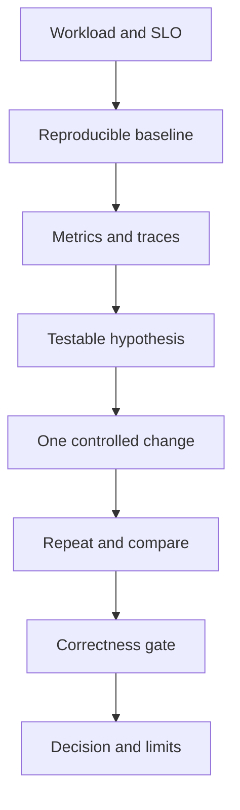

> **读图方法：** 阅读“本章定位”这张流程图时，先把方框看成对象或状态，把箭头看成数据或控制的移动。第一遍从上向下建立顺序，第二遍再核对分支发生的条件。

## 阅读目标

读完本章后，你应当能够：

1. 区分 latency、TTFT、ITL、TPOT、E2EL、throughput 和 goodput。
2. 选择 latency、offline throughput、online serve、component 或 kernel benchmark。
3. 构造固定、Poisson、burst、ramp-up 和 trace replay workload。
4. 区分客户端排队、服务端 Scheduler queue、prefill、decode 与 detokenization 时间。
5. 使用 vLLM 日志、Prometheus、PyTorch Profiler、Proton 和 Nsight Systems 分层定位。
6. 设计单变量实验、参数扫描和 Pareto 选择，而不是只找单一最大 tokens/s。
7. 对 Scheduler、KV Cache、compile/CUDA Graph 和多 GPU 参数做有边界的优化。
8. 把正确性、错误率、尾延迟、显存和稳定性纳入回归门槛。

---

## 如何阅读本章

这一章不是命令清单，而是一套证明优化有效的方法。先写假设，再选指标、控制变量和负载，
最后才运行 benchmark。没有假设的 profile 很容易得到大量时间线，却不知道下一步该改
什么。

指标公式不需要复杂统计背景，但必须分清分子、分母和观察者。TTFT、TPOT、ITL、E2EL
描述的时间区间不同；吞吐和 goodput 对“完成”也有不同要求。先在单个请求时间线上标点，
再聚合百分位，能避免把客户端排队、服务端排队和 GPU 执行混成一个数字。

第一次阅读建立指标词典和五层 benchmark；第二次学习 profiler 与诊断树；第三次设计
完整实验矩阵。任何结果至少同时报告正确性、延迟分布、吞吐、资源使用和实验环境，单个
峰值数字不能支持生产结论。

**先认识统计词。** SLO 是预先规定的服务目标；p99 是把样本排序后约 99% 不超过
的值，受样本量和插值方法影响，不是最大值。CV 是标准差除以均值，用于观察相对波动；
benchmark 测性能，profiler 解释耗时所在。先保留原始样本，再计算汇总值。

**第一遍走法：** 读 10.1–10.4、10.7、10.10、10.18，运行 10.23，再做综合案例；
多种 profiler 与扫参工具可第二遍选读。**停下来算：** 发送后 0.3 秒收到首 token，
共 5 token，末 token 在 0.5 秒，$\mathrm{TPOT}=\frac{0.5-0.3}{5-1}=0.05$ 秒（分母是 5 个 token 之间的 4 个间隔）；客户端发前排队另计。

## 10.1 先定义“谁觉得快”

> **本节先看：** 本节要回答：**先定义谁觉得快**。下面的小节会逐层拆开概念、运行过程和源码落点；第一次阅读先抓对象之间的关系，第二次再记类名、字段和分支。

### 10.1.1 不同使用者的目标不同

> **本节先看：** 下面先用表格整理“不同使用者的目标不同”。先横向比较每一列解决的问题和适用边界，再把具体名称映射到源码。

| 角色或场景 | 更关心的指标 | 可能接受的代价 |
|---|---|---|
| 交互式聊天用户 | TTFT、ITL、p99 | 为低延迟牺牲部分总吞吐 |
| 批量离线生成 | total/output tokens/s、成本 | 接受较高单请求延迟 |
| API 平台 | goodput、错误率、尾延迟 | 在 SLO 内最大化容量 |
| 长文档处理 | prefill latency、KV 容量 | 较慢 decode 可能可接受 |
| 实时语音 | 实时率倍率（RTFx）、稳定 ITL | 输出吞吐必须跟上音频时长 |
| 模型开发者 | kernel latency、数值误差 | 暂不包含完整 serving 开销 |

同一个配置可以让离线吞吐上升，同时让交互 p99 TTFT 变差。没有目标用户与 SLO，“更快”
就没有可判定含义。

### 10.1.2 四种常见优化目标

> **本节先看：** 下面先给出“四种常见优化目标”的结论清单。先理解每一项为什么存在，再记参数名或实现细节。

1. **降低空载延迟**：系统几乎没有排队时，一个请求最快能多快。
2. **提高峰值容量**：在可接受错误率下最大 request/token throughput。
3. **提高 SLO goodput**：满足 TTFT/TPOT/E2EL 门槛的请求数每秒最大。
4. **降低资源成本**：同样 SLO 下减少 GPU 数、显存或功耗。

这些目标需要不同 benchmark。固定 batch latency 无法替代 online goodput，kernel benchmark
也无法直接回答每 GPU 能服务多少并发用户。

---

## 10.2 在请求时间线上定义指标

> **本节先看：** 本节要回答：**在请求时间线上定义指标**。下面的小节会逐层拆开概念、运行过程和源码落点；第一次阅读先抓对象之间的关系，第二次再记类名、字段和分支。

### 10.2.1 客户端看到的时间线

> **本节先看：** 这一小节先用图建立“客户端看到的时间线”的整体路径。先找输入、关键状态和输出，再阅读图后的源码解释，不必一开始记住全部节点。

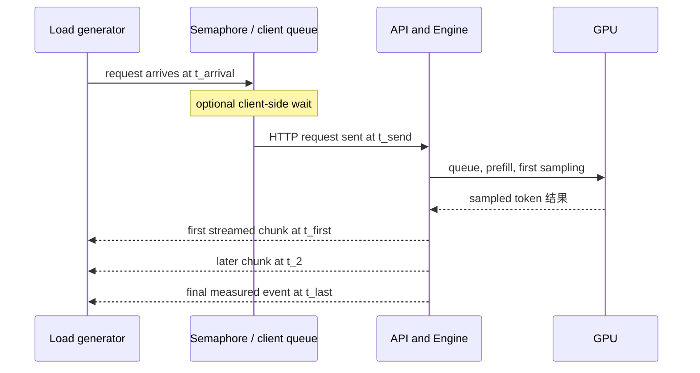

> **读图方法：** 这是“客户端看到的时间线”的时序图。先从左到右确认参与者分别负责什么，再从上到下追踪消息；第一遍只看正常路径，第二遍再看返回、异步消息和失败分支。

先采用每个内容事件对应一个 token 的教学模型。所有 $t$ 来自同一客户端时钟，
以下时间差统一用秒；$N_{\mathrm{out}}$ 是这个请求的输出 token 数，不是响应消息条数。由此定义：

$$
\Delta t_{\mathrm{client\ queue}}=t_{\mathrm{send}}-t_{\mathrm{arrival}}
$$

$$
\mathrm{TTFT}=t_{\mathrm{first}}-t_{\mathrm{send}}
$$

$$
\mathrm{ITL}_j=t_j-t_{j-1},\qquad j=2,3,\dots,N_{\mathrm{out}}
$$

$$
\mathrm{E2EL}=t_{\mathrm{last}}-t_{\mathrm{send}}
$$

**白话：**在一个请求的时间线上标出四类点：到达、发出、第一次收到输出、最后一次收到输出；每个指标都是其中两个点相减。

**其中：**$t_{\mathrm{arrival}}$ 是请求到达 load generator（创建任务）的时刻；$t_{\mathrm{send}}$ 是请求函数里 `session.post(...)` 之前读的时钟（`start_time`）；
$t_j$ 是第 $j$ 个被计入的流式事件的时刻，$t_1=t_{\mathrm{first}}$，$t_{N_{\mathrm{out}}}=t_{\mathrm{last}}$（教学模型里一个事件一个 token，所以事件数等于 $N_{\mathrm{out}}$）。
$\Delta t_{\mathrm{client\ queue}}$ 是请求在客户端 semaphore 前等的时间，$\mathrm{TTFT}$ 是首 token 时延，$\mathrm{ITL}_j$ 是第 $j-1$ 与第 $j$ 个事件的间隔（第 1 个事件前面没有“上一个事件”，所以从 $j=2$ 起），
$\mathrm{E2EL}$ 是端到端时延；单位都是秒。

**怎么算出来：**这四个式子是定义式，每个差值对应源码里一条读时钟语句。以 completion 适配器为例：`st = time.perf_counter()` 记下 $t_{\mathrm{send}}$（`vllm/benchmarks/lib/endpoint_request_func.py:248`）；
首个被计入的事件执行 `output.ttft = timestamp - st`（`:289`）；之后每个事件把 `timestamp - most_recent_timestamp` 追加进 `output.itl`（`:293`）；
结束时 `output.latency = most_recent_timestamp - st`（`:313`）。客户端排队则在 `vllm/benchmarks/serve.py:1016`：`output.client_queue_time = output.start_time - request_arrival_time`，其中 `request_arrival_time` 在创建请求任务时读取（`:1110`）。
chat 适配器的对应语句在 `:450`、`:487`、`:491`、`:514`，形状相同。

再取一个教学用的请求走一遍（数字不是实测）：$t_{\mathrm{arrival}}=0$，$t_{\mathrm{send}}=0.2$，5 个事件的时刻依次是 $0.50$、$0.53$、$0.60$、$0.65$、$0.70$（秒），即 $t_{\mathrm{first}}=0.50$、$t_{\mathrm{last}}=0.70$。

- $\Delta t_{\mathrm{client\ queue}}=0.2-0=0.2$ 秒；
- $\mathrm{TTFT}=0.50-0.2=0.3$ 秒；
- $\mathrm{ITL}_2,\dots,\mathrm{ITL}_5$ 依次是 $0.53-0.50=0.03$、$0.60-0.53=0.07$、$0.65-0.60=0.05$、$0.70-0.65=0.05$ 秒，共 $N_{\mathrm{out}}-1=4$ 个样本；
- $\mathrm{E2EL}=0.70-0.2=0.5$ 秒。

单位检查：每个量都是两个时间戳相减，所以都是秒。$\mathrm{E2EL}$ 从 $t_{\mathrm{send}}$ 起算，不含那 0.2 秒客户端排队；需要含排队时，`serve.py:1362-1368` 另报 `e2el_including_client_queue`
（$=\mathrm{E2EL}+\Delta t_{\mathrm{client\ queue}}$，仅在设置了 max concurrency 且 request rate 有限时），本例是 $0.5+0.2=0.7$ 秒。

**核对：**随书 `examples/ch10_benchmark_reasoning.py` 的 `RequestTrace(arrival_time=0.0, send_time=0.2, token_times=(0.50, 0.53, 0.60, 0.65, 0.70), prompt_tokens=1)`
给出的 `client_queue_time`、`ttft`、`itls`、`e2el` 与上面一致（浮点误差在 $10^{-12}$ 秒以内）；`ttft`、`itls` 与上面的定义同义，`e2el` 只在 `last_response_time` 未设置时与定义同义（设置后，$t_{\mathrm{last}}$ 改取适配器给出的末计时点 `last_response_time`，而不是最后一个事件的时刻）。

若输出 token 数 $N_{\mathrm{out}}>1$：

$$
\mathrm{TPOT}=\frac{\mathrm{E2EL}-\mathrm{TTFT}}{N_{\mathrm{out}}-1},\qquad N_{\mathrm{out}}>1
$$

**白话：**TPOT 是“首个 token 之后，平均每多生成一个 token 要多久”：先从总耗时里扣掉首 token 的那一段，再平摊到剩下的 token 上。

**其中：**$N_{\mathrm{out}}$ 是这个请求实际输出的 token 数（token）；$\mathrm{E2EL}-\mathrm{TTFT}$ 是首事件之后的时间（秒）；$\mathrm{TPOT}$ 的单位是秒/token。
$N_{\mathrm{out}}=1$ 时首 token 之后没有 token，分母为 0，所以要求 $N_{\mathrm{out}}>1$。

**怎么算出来：**

1. 把 $t_{\mathrm{send}}$ 到 $t_{\mathrm{last}}$ 拆成两段：先是到首事件的 $\mathrm{TTFT}$，然后是首事件之后的各个间隔，即
   $\mathrm{E2EL}=\mathrm{TTFT}+\sum_{j=2}^{N_{\mathrm{out}}}\mathrm{ITL}_j$（相邻时刻之差相加，中间的时刻互相抵消，只剩 $t_{\mathrm{last}}-t_{\mathrm{send}}$）；
2. 移项得 $\mathrm{E2EL}-\mathrm{TTFT}=\sum_{j=2}^{N_{\mathrm{out}}}\mathrm{ITL}_j$，这是 $N_{\mathrm{out}}-1$ 个间隔之和；
3. 首 token 之后还剩 $N_{\mathrm{out}}-1$ 个 token，平均每个 token 的耗时就是这个和除以 $N_{\mathrm{out}}-1$。

代入上面的算例：$\mathrm{TPOT}=\frac{0.5-0.3}{5-1}=0.05$ 秒/token，恰好等于 4 个 ITL 样本的平均 $\frac{0.03+0.07+0.05+0.05}{4}=0.05$。单位检查：秒 $\div$ token $=$ 秒/token。

**核对：**`vllm/benchmarks/serve.py:655-658`：`if output_len > 1:` 才计算 `tpot = (latency - ttft) / (output_len - 1)`，与上式一致。
但源码里的 `output_len` 优先取 usage 的 `completion_tokens`，缺失时才用 tokenizer 重数（`:636-651`），所以分母是 token 数，不是事件数：
一个事件带多个 token 时，TPOT 仍按 token 数平摊，而 ITL 样本数是事件数减 1，“TPOT 等于 ITL 平均”只在上面“一事件一 token”的教学模型里成立。
另外，usage 里没有 token 数且没有 tokenizer 时（`tokenizer is None`），`output_len` 被记为 1（`:638-640`），不满足 `output_len > 1`，这个请求不产生 TPOT 样本（goodput 判定里按 0 处理）。

### 生活化直觉：聊天体验与测量指标怎样对应

用户体感可以帮助理解指标，但网页上的一个汉字不等于模型 token，也不等于一条
SSE 事件。下表沿用本章 `bench serve` 的客户端计时起点，并与“点击发送”的 UI
体验区分；阈值由业务 SLO 决定，没有通用的阅读速度换算标准。

| 指标 | 体验上的近似对应 | 本章测量口径 | 需要注意 |
|---|---|---|---|
| TTFT | 等待首次响应 | 请求函数内 HTTP 调用前的计时点，到首个被适配器计入的流式事件 | 不含请求函数前的 semaphore 排队；也未必等于首个可见汉字 |
| TPOT | 首次响应后的平均生成速度 | $\frac{\mathrm{E2EL}-\mathrm{TTFT}}{N_{\mathrm{out}}-1}$，$N_{\mathrm{out}}>1$ | 单位为秒/token，不能按汉字数计算 |
| ITL | 流式更新是否有长间隔 | 相邻被计入的流式事件间隔 | 事件可能含多个 token，不是逐字时间 |
| E2EL | 等待整个回复结束 | 请求函数内 HTTP 调用前的计时点，到适配器规定的末计时点 | 相同口径且 $N_{\mathrm{out}}>1$ 时为 $\mathrm{TTFT}+(N_{\mathrm{out}}-1)\,\mathrm{TPOT}$ |

**白话：**表里 TPOT 与 E2EL 两行互为移项：知道 TTFT、TPOT 和 token 数，就能算出 E2EL，反过来也一样。

**其中：**符号同 10.2.1：$N_{\mathrm{out}}$ 是输出 token 数，TTFT、E2EL 的单位是秒，TPOT 的单位是秒/token。

**怎么算出来：**把 $\mathrm{TPOT}=\frac{\mathrm{E2EL}-\mathrm{TTFT}}{N_{\mathrm{out}}-1}$ 两边乘 $N_{\mathrm{out}}-1$、再加 $\mathrm{TTFT}$，
得 $\mathrm{E2EL}=\mathrm{TTFT}+(N_{\mathrm{out}}-1)\,\mathrm{TPOT}$：首 token 的等待，加上其余 $N_{\mathrm{out}}-1$ 个 token 各自的平均耗时。
例如生成 5 个 token，$\mathrm{TTFT}=0.3$ 秒、$\mathrm{TPOT}=0.05$ 秒/token，则 $\mathrm{E2EL}=0.3+(5-1)\times0.05=0.5$ 秒；若用户在发送
之前已经等待 0.2 秒，UI 的总体验还需单独计入这段等待。

**核对：**与 10.2.1 的算例（$0.3$、$0.05$、$0.5$）一致。

[源码] `vllm/benchmarks/serve.py` - `calculate_metrics`

[源码] `vllm/benchmarks/lib/endpoint_request_func.py` - completion/chat 请求适配器

**计时点的精确含义。** 本章将 `t_send` 简称为发送起点，但源码实际在
`session.post(...)` 调用之前记录 `perf_counter()`，不是网卡发出首字节的时刻。
因此请求函数内后续的连接等待、编码、网络与响应处理可能计入 TTFT/E2EL；客户端
信号量等待则单列。读取日志时应追到计时语句，不能只依据字段名判断边界。

[源码] `vllm/benchmarks/lib/endpoint_request_func.py` - `async_request_openai_completions`、
`async_request_openai_chat_completions`

### 10.2.2 ITL 与 TPOT 不是同一个统计量

> **本节先看：** 下面先给出“ITL 与 TPOT 不是同一个统计量”的结论清单。先理解每一项为什么存在，再记参数名或实现细节。

- ITL 是每两个流式事件之间的样本，长请求会贡献更多样本。
- TPOT 是每个请求一个平均值，每个请求在分位数中权重相同。
- 一个请求只有一个输出 token 时，当前 `bench serve` 把其 TPOT 视为 0 用于 goodput，
  但不会把它加入普通 TPOT 样本列表。

因此 `p99 ITL` 与 `p99 TPOT` 可能不同，不能互换名称。

### 10.2.3 chunk 不一定严格等于 token

`vllm/benchmarks/lib/endpoint_request_func.py` 在流式响应中按收到的有效消息记录时间；某些 serving backend
可能在一个 chunk 中携带多个 tokens。当前 benchmark 会优先使用 usage 中的 completion
token 数，缺失时可能重新 tokenize 文本；ITL 列表则来自流式事件间隔。

所以跨 backend 比较前必须确认：

- streaming 是否开启；
- backend 是否逐 token flush；
- usage 是否返回真实 token 数；
- tokenizer 是否与服务端一致。

**当前适配器的首/末事件规则。** completion 与 chat 适配器只在含 choices 的消息上
更新末时间戳；chat 的 trailing usage-only 消息不再延长 E2EL。与旧版对比时，这一计时修正本身
就可能降低 chat 的 E2EL/TPOT，不能当作 GPU 提速。

v0.33.0 又把 chat 适配器的“首事件”判定收紧：只有 `_choice_has_streamed_output()`
（`vllm/benchmarks/lib/endpoint_request_func.py:398`）为真的 choice 才算已流出输出，才会启动 TTFT、
追加 ITL 并推进末时间戳。判定规则是：`delta` 里有非空的 `content`、`reasoning`、`tool_calls` 或
`function_call`；或者 `content` 恰为空串且**没有** `role` 字段（例如一个特殊 token 在
`skip_special_tokens` 下解码成空串，仍是真实生成的 token）。只带 `role` 的开头元数据消息不再触发首事件计时。
所以 chat 的 TTFT 现在对准第一个真正承载输出的 chunk，而不是“第一条带 choices 的消息”；
它和 v0.32.0 的差异取决于服务端把 role 消息放在首个输出之前多久，不能当作服务端变快或变慢
（[dcf8158cd](https://github.com/vllm-project/vllm/commit/dcf8158cd)，
[#62341](https://github.com/vllm-project/vllm/pull/62341)）。

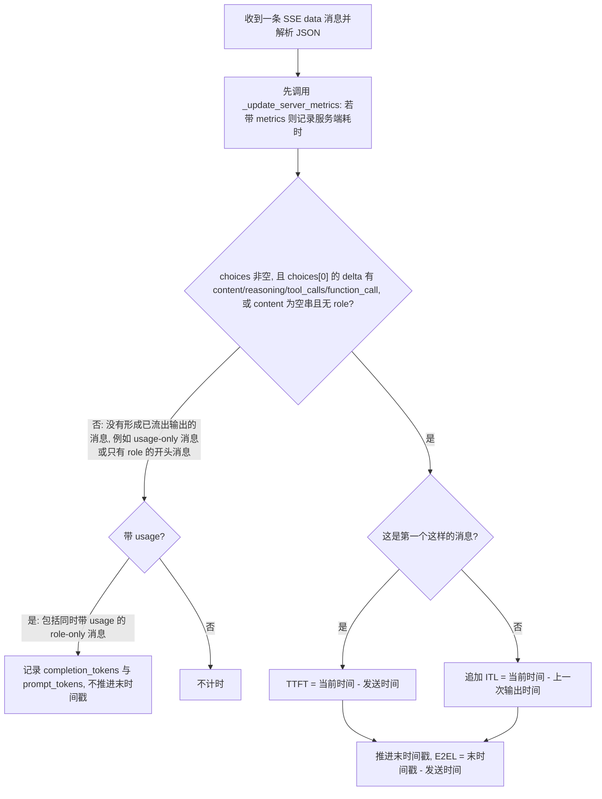

> **读图方法：** 这是 chat 适配器处理每条流式消息的判定图。先看第一道判定“这条消息是否形成已流出输出”，只有通过的消息才能产生 TTFT 或 ITL；没通过的消息一律走左侧分支，源码里这是 `if … elif usage` 的 `elif`（`endpoint_request_func.py:497`），所以只要带 usage 就记 token 数，不论 choices 是否为空，也不改变任何计时。

此外，v0.33.0 不再对每个网络读到的字节块先 `strip()`：completion、chat、audio 三个适配器都直接把原始字节
交给 `StreamedResponseHandler` 按 SSE 消息边界拼接，避免首尾空白在传输分块边界被吞掉
（[02d69c663](https://github.com/vllm-project/vllm/commit/02d69c663)，
[#51172](https://github.com/vllm-project/vllm/pull/51172)）。

此版本还增加 `openai-responses` 适配器：文本 delta 和 reasoning delta 都参与 TTFT/ITL
计时，仅文本 delta 累积到返回文本；usage 从终结事件取值，但终结事件不推进末时间戳。
没有 token delta、缺少终结事件或收到错误事件均标记失败；不能直接套用 chat 的事件规则。

[源码] `vllm/benchmarks/lib/endpoint_request_func.py` -
`async_request_openai_completions`、`async_request_openai_chat_completions`、
`async_request_openai_responses`

### 10.2.4 E2EL 不等于服务器纯推理时间

客户端 E2EL 还包含网络、协议解析与流式传输。vLLM 内部 metrics 中的 inference time 则
从首次 scheduled 到最后 token，二者处于不同观测边界。两边同时记录，才能区分服务器
变慢和网络/客户端变慢。

---

## 10.3 吞吐与 goodput

> **本节先看：** 本节要回答：**吞吐与 goodput**。下面的小节会逐层拆开概念、运行过程和源码落点；第一次阅读先抓对象之间的关系，第二次再记类名、字段和分支。

### 10.3.1 三种吞吐分母相同，分子不同

设 benchmark duration 为 $\Delta t_{\mathrm{bench}}$ 秒、成功请求数为 $n_{\mathrm{req}}$、成功请求的输入和输出 token 总数
分别为 $N_{\mathrm{in}}^{\Sigma}$、$N_{\mathrm{out}}^{\Sigma}$。请求吞吐单位是 request/s，token 吞吐单位是 token/s：

$$
\mathrm{thr}_{\mathrm{req}}=\frac{n_{\mathrm{req}}}{\Delta t_{\mathrm{bench}}}
$$

$$
\mathrm{thr}_{\mathrm{out}}=\frac{N_{\mathrm{out}}^{\Sigma}}{\Delta t_{\mathrm{bench}}}
$$

$$
\mathrm{thr}_{\mathrm{tot}}=\frac{N_{\mathrm{in}}^{\Sigma}+N_{\mathrm{out}}^{\Sigma}}{\Delta t_{\mathrm{bench}}}
$$

**白话：**同一段时间里数三样东西：完成了多少请求、产出了多少输出 token、一共处理了多少输入加输出 token，各自除以这段时间，就是请求吞吐、输出吞吐和总 token 吞吐。

**其中：**$\mathrm{thr}_{\mathrm{req}}$ 是请求吞吐（request throughput，request/s），$\mathrm{thr}_{\mathrm{out}}$ 是输出吞吐（output throughput，token/s），
$\mathrm{thr}_{\mathrm{tot}}$ 是总 token 吞吐（total token throughput，token/s）；$\Delta t_{\mathrm{bench}}$ 是整个 benchmark 的时长（秒）；
$n_{\mathrm{req}}$ 是成功请求数（request）；$N_{\mathrm{in}}^{\Sigma}$、$N_{\mathrm{out}}^{\Sigma}$ 是这些成功请求的输入、输出 token 总数（token）。

**怎么算出来：**三个式子的分母是同一个 $\Delta t_{\mathrm{bench}}$，只有分子不同：请求数、输出 token 总数、输入加输出 token 总数。
取教学数字：$\Delta t_{\mathrm{bench}}=20$ 秒，成功请求 $n_{\mathrm{req}}=100$ 个，每个请求输入 512 token、输出 128 token，
所以 $N_{\mathrm{in}}^{\Sigma}=100\times512=51200$ token，$N_{\mathrm{out}}^{\Sigma}=100\times128=12800$ token。则

- $\mathrm{thr}_{\mathrm{req}}=100\ \mathrm{request}\div20\ \mathrm{s}=5\ \mathrm{request/s}$；
- $\mathrm{thr}_{\mathrm{out}}=12800\ \mathrm{token}\div20\ \mathrm{s}=640\ \mathrm{token/s}$；
- $\mathrm{thr}_{\mathrm{tot}}=(51200+12800)\ \mathrm{token}\div20\ \mathrm{s}=3200\ \mathrm{token/s}$。

单位检查：个数除以秒得到“每秒个数”，分子是请求就是 request/s，是 token 就是 token/s。同一次运行里 $\mathrm{thr}_{\mathrm{tot}}$ 是 $\mathrm{thr}_{\mathrm{out}}$ 的 5 倍，
这正是下一段说的：输入很长时 total tokens/s 会远高于 output tokens/s。

**核对：**`vllm/benchmarks/serve.py:778-781`：`request_throughput=completed / dur_s`、`output_throughput=sum(actual_output_lens) / dur_s`、
`total_token_throughput=(total_input + sum(actual_output_lens)) / dur_s`；`dur_s` 是 `:1123` 的 `benchmark_duration`；
`total_input` 与输出 token 数只累计成功请求（`:653`；失败请求在 `:667` 记 0 个输出 token）。

输入很长、输出很短时，total tokens/s 可能很高，却不能说明 decode 很快。报告 tokens/s
时必须写清是 input、output 还是 total。

### 10.3.2 goodput 把 SLO 加入分子

若一个请求必须同时满足 $\mathrm{TTFT}\le\mathrm{SLO}_{\mathrm{ttft}}$、
$\mathrm{TPOT}\le\mathrm{SLO}_{\mathrm{tpot}}$、$\mathrm{E2EL}\le\mathrm{SLO}_{\mathrm{e2el}}$，
令 $n_{\mathrm{SLO}}$ 为达标的成功请求数，$G$ 为 goodput（request/s）：

$$
G=\frac{n_{\mathrm{SLO}}}{\Delta t_{\mathrm{bench}}}
$$

**白话：**goodput 的算法和请求吞吐一样，只是分子不再数“所有成功请求”，而是只数“同时满足全部 SLO 的成功请求”。

**其中：**$\mathrm{SLO}_{\mathrm{ttft}}$、$\mathrm{SLO}_{\mathrm{tpot}}$、$\mathrm{SLO}_{\mathrm{e2el}}$ 是三个阈值（这里按秒写；命令行 `--goodput` 用毫秒）；
$n_{\mathrm{SLO}}$ 是达标的成功请求数（request）；$\Delta t_{\mathrm{bench}}$ 同 10.3.1；$G$ 的单位是 request/s。

**怎么算出来：**先对每个成功请求逐条检查已配置的阈值，全部满足才算达标（AND），再数一数达标的请求，除以 $\Delta t_{\mathrm{bench}}$。
取教学数字：$\Delta t_{\mathrm{bench}}=20$ 秒，成功请求 $n_{\mathrm{req}}=100$ 个；其中 12 个请求 TTFT 超标，8 个请求 TPOT 超标，这两组里有 5 个请求是同一批（两项都超标），没有请求 E2EL 超标。
不达标的请求数是 $12+8-5=15$（两组相加会把“两项都超标”的 5 个数两次，要减掉一次），所以 $n_{\mathrm{SLO}}=100-15=85$，
$G=85\div20=4.25\ \mathrm{request/s}$。同一次运行的请求吞吐是 $100\div20=5\ \mathrm{request/s}$，所以 $G$ 是它的 $85\%$；
因为 $n_{\mathrm{SLO}}\le n_{\mathrm{req}}$，$G$ 永远不会高于请求吞吐。只输出 1 个 token 的请求没有 TPOT 样本，判定时按 TPOT 为 0 处理（见 10.2.2）。
单位检查：$n_{\mathrm{SLO}}$ 是请求个数，除以秒得 request/s，与 $\mathrm{thr}_{\mathrm{req}}$ 同单位，所以 $G$ 可以直接和它比较（$4.25$ 对 $5$）；三个阈值与各自的指标同单位，才能比较大小。

**核对：**`vllm/benchmarks/serve.py:669-692`：每个已配置的阈值把对应的样本列表（`ttfts`、`all_tpots`、`e2els`）和阈值放进 `valid_metrics`、`slo_values`，
毫秒阈值除以 `MILLISECONDS_TO_SECONDS_CONVERSION`（`:65`，值为 1000）；`is_good_req = all([s >= r for s, r in zip(slo_values, req_metric)])`
即“实测值不超过阈值”，对应上式的 $\le$；`request_goodput=good_completed / dur_s`（`:779`）。

当前 `bench serve` 的 goodput 对已配置门槛采用 AND 关系，只计成功请求。CLI 的
`--goodput` 阈值用毫秒，计算时转为秒；未配置门槛时内部 `BenchmarkMetrics.request_goodput` 为 0，
但导出的 JSON `request_goodput` 为 `null`，且不打印 goodput 行。两者都不能解释为
“所有请求都不达标”。吞吐 100 req/s、只有 60 req/s
满足 SLO 时，平台可售卖容量更接近 60，而不是 100。

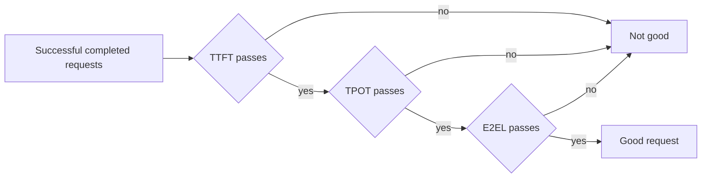

> **读图方法：** 这是“goodput 把 SLO 加入分子”的流程图。先从左向右只追一条主路径，确认输入经过哪些关键阶段到达输出；第二遍再看虚线、回边和旁路，它们通常表示反馈、复用或可选分支。

### 10.3.3 failed requests 不能从报告中消失

只对成功请求计算 latency 分位数会产生幸存者偏差：最慢的请求可能已经 timeout。报告必须
同时包含 completed、failed、错误类型和 timeout 策略。性能更高但错误率上升的实验不能
只展示成功样本的 p50。

---

## 10.4 五层 benchmark 各自回答什么

> **本节先看：** 这一小节先用图建立“五层 benchmark 各自回答什么”的整体路径。先找输入、关键状态和输出，再阅读图后的源码解释，不必一开始记住全部节点。

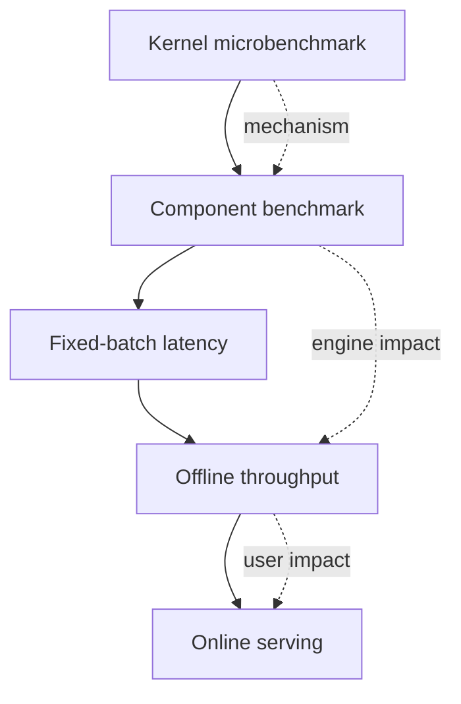

> **读图方法：** 阅读“五层 benchmark 各自回答什么”这张流程图时，先把方框看成对象或状态，把箭头看成数据或控制的移动。第一遍从上向下建立顺序，第二遍再核对分支发生的条件。

| 层级 | 代表工具 | 能回答 | 不能单独回答 |
|---|---|---|---|
| Kernel | attention/GEMM/collective benchmarks | 某 shape 下 kernel 时间 | 端到端吞吐是否上升 |
| Component | `benchmarks/benchmark_block_pool.py` 等 | 单个管理组件成本 | GPU 是否成为瓶颈 |
| Fixed batch | `vllm bench latency` | 固定 batch 完成时间 | 到达率与排队下的尾延迟 |
| Offline | `vllm bench throughput` | 一组已知请求的总处理能力 | HTTP、网络、真实到达过程 |
| Online | `vllm bench serve` | 服务端到端吞吐、TTFT/ITL/E2EL | 单个 kernel 的精确归因 |

优化证据通常要上下贯通：先用 trace 找到热点，再用组件或 kernel benchmark验证机制，最后
回到 online workload 验证用户收益。

---

## 10.5 `vllm bench latency`：固定批次完成时间

> **本节先看：** 本节要回答：**`vllm bench latency`：固定批次完成时间**。下面的小节会逐层拆开概念、运行过程和源码落点；第一次阅读先抓对象之间的关系，第二次再记类名、字段和分支。

### 10.5.1 计时边界

`vllm/benchmarks/latency.py` 构造 `batch_size` 个随机 token prompts，然后：

```text
start = perf_counter()
llm.generate(all prompts)
end = perf_counter()
latency = end - start
```

它不是单 token kernel latency，而是固定批次从 API 调用到所有输出完成的 wall-clock 时间。
如果请求不能在一个 engine step 内完成，Engine 会自动跨多个 batches/steps 推进。

### 10.5.2 默认设计中的几个重要事实

> **本节先看：** 下面先给出“默认设计中的几个重要事实”的结论清单。先理解每一项为什么存在，再记参数名或实现细节。

- 默认有 10 次 warmup、30 次正式迭代。
- 输入和输出长度固定，`ignore_eos=True` 保证输出达到目标长度。
- 可通过 `--disable-detokenize` 排除 detokenization。
- V1 默认启用 prefix caching，但 latency benchmark 默认把它关闭，避免重复 dummy prompts
  让后续迭代被 cache hit 人为加速。
- 输出平均值及 p10/p25/p50/p75/p90/p99，而不是只给一次时间。

### 10.5.3 合适的使用场景

> **本节先看：** 下面先给出“合适的使用场景”的结论清单。先理解每一项为什么存在，再记参数名或实现细节。

- 比较 eager、compile 与 CUDA Graph 的稳定态固定 shape 开销；
- 比较相同 batch 下 TP 或 attention backend；
- 测 cold start 与 warmed steady state，但要分开运行和命名；
- 生成小规模 profiler trace。

它不适合模拟混合长度、随机到达和 Scheduler 排队。

---

## 10.6 `vllm bench throughput`：离线总处理能力

> **本节先看：** 本节要回答：**`vllm bench throughput`：离线总处理能力**。下面的小节会逐层拆开概念、运行过程和源码落点；第一次阅读先抓对象之间的关系，第二次再记类名、字段和分支。

### 10.6.1 所有请求都已知

Offline throughput 把请求集合交给 `LLM.generate` 或 async engine，计时整个集合完成。它适合
批量生成、数据处理和“尽快清空已知队列”的场景。

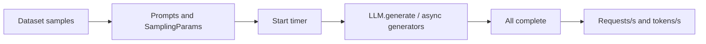

> **读图方法：** 这张图用于压缩“所有请求都已知”的整体关系。先从左向右找到起点、关键转换和终点，再问每条跨层箭头是否意味着函数调用、消息传递、内存访问或状态更新。

### 10.6.2 实际 token 与预期 token

对于能返回 `RequestOutput` 的 vLLM 路径，当前代码从真实 prompt token IDs 与 output token
IDs 统计总量；拿不到 outputs 的路径则用请求中的 `prompt_len + expected_output_len` 估算。
多模态且非 `vllm-chat` 路径还会明确警告 image tokens 计数可能不准确。

这意味着跨 backend 对比前，应确认分子来自实际 token 还是预期 token。

### 10.6.3 warmup 与 `prequeue_requests`

> **本节先看：** 下面先给出“warmup 与 `prequeue_requests`”的结论清单。先理解每一项为什么存在，再记参数名或实现细节。

- `--num-warmups` 使用另一 seed 生成单独 warmup requests，不计入正式时间。
- `prequeue_requests` 先让 scheduling 暂停并把请求全部 enqueue，再唤醒调度；它用于排除逐个
  enqueue 的差异，但不代表 online arrival。
- async engine 路径为每个请求建立 generator，并等待所有 iterators 结束。

修改 prequeue 策略会改变测试问题，不能把两种结果当作同一 workload 的直接 A/B。

---

## 10.7 `vllm bench serve`：真实到达与流式体验

> **本节先看：** 本节要回答：**`vllm bench serve`：真实到达与流式体验**。下面的小节会逐层拆开概念、运行过程和源码落点；第一次阅读先抓对象之间的关系，第二次再记类名、字段和分支。

### 10.7.1 准备、warmup 与正式测量分开

当前 `benchmark` 过程依次执行：

1. endpoint ready check 的单请求试跑；
2. 可选并发 warmup；
3. 可选 `/start_profile`；
4. 记录 Prometheus 中 speculative/diffusion 基线；
5. 按到达过程创建正式请求 tasks；
6. 等待所有 tasks 完成；
7. 停止 profiler 并计算 metrics。

ready check 和 warmup 不进入正式 duration，但会改变 cache、compile 和连接状态。这是有意测
稳定态；若目标是 cold-start，必须另建实验。

正式 duration 的终点在 v0.33.0 也有变化：主 workload 的所有请求完成后先计算
`benchmark_duration`，**然后**才停止 probe 任务（见 10.13.4）。此前先等 probe 退出再计时，会把最后一个
probe 间隔算进主 workload 的吞吐分母。

### 10.7.2 request rate 与 max concurrency 控制不同维度

> **本节先看：** 下面先给出“request rate 与 max concurrency 控制不同维度”的结论清单。先理解每一项为什么存在，再记参数名或实现细节。

- `request_rate` 决定 load generator 产生请求的速度。
- `max_concurrency` 是客户端连接/任务信号量上限。
- 请求先到达 load generator，再可能等待 semaphore；这一段记录为 `client_queue_time`。
- `RequestFuncOutput.start_time` 记录进入请求函数、调用 `session.post` 前的时间，TTFT/E2EL 不包含客户端 semaphore
  等待；整个 benchmark duration 则包含所有到达与完成过程。

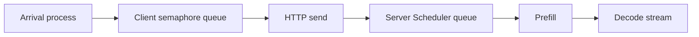

> **读图方法：** 这是“request rate 与 max concurrency 控制不同维度”的流程图。先从左向右只追一条主路径，确认输入经过哪些关键阶段到达输出；第二遍再看虚线、回边和旁路，它们通常表示反馈、复用或可选分支。

因此 max concurrency 太低时，服务器看起来 TTFT 很好，但大量压力被挡在客户端。必须同时
报告 client queue time，否则会误判服务容量。

### 10.7.3 到达过程

当 request rate 有限时，默认 `burstiness=1` 使用 Poisson arrival，也就是指数分布间隔。
更一般地从 Gamma 分布采样。令 $\Delta t$ 为相邻两个请求的发送间隔（秒），$\lambda$ 为
`request_rate` 对应的到达率（request/s），$b$ 为 burstiness（源码参数 `burstiness`）：

$$
\Delta t\sim\operatorname{Gamma}\!\left(\text{shape}=b,\;\text{scale}=\frac{1}{\lambda b}\right)
$$

**白话：**请求之间的间隔是随机的。Gamma 分布有两个旋钮：先把平均间隔固定成 $1/\lambda$（保证平均每秒来 $\lambda$ 个请求），
再用 $b$ 决定间隔忽长忽短的程度，$b$ 越小，间隔越不均匀，请求越“成团”。

**其中：**$b$ 是本节的局部字母（无单位的正数），不是字节数 $b_{\mathrm{elem}}$，也不是第 9 章的偏置 $b_i$；
$\text{shape}$、$\text{scale}$ 是 Gamma 分布的形状参数与尺度参数，对应源码 `np.random.gamma(shape=burstiness, scale=...)`。

- $b<1$ 更 bursty；
- $b=1$ 是 Poisson process；
- $b$ 趋近无穷时，间隔趋近常数 $1/\lambda$；
- `request_rate=inf` 时所有 delay 为 0，近似一次性压入全部请求。

**怎么算出来：**Gamma 分布的均值是 $\text{shape}\times\text{scale}$，方差是 $\text{shape}\times\text{scale}^2$。代入 $\text{shape}=b$、$\text{scale}=\frac{1}{\lambda b}$：

1. 均值 $=b\times\frac{1}{\lambda b}=\frac{1}{\lambda}$，$b$ 约掉了，所以不管 $b$ 取多少，平均间隔都是 $1/\lambda$，平均到达率都是 $\lambda$；
2. 方差 $=b\times\left(\frac{1}{\lambda b}\right)^2=\frac{1}{\lambda^2 b}$，标准差是 $\frac{1}{\lambda\sqrt b}$，标准差除以均值得 $\frac{1}{\sqrt b}$：$b$ 越小，相对波动越大；
3. $b=1$ 时 $\text{shape}=1$，Gamma 分布就是指数分布，也就是 Poisson 到达；$b\to\infty$ 时相对波动 $1/\sqrt b\to0$，间隔趋近常数 $1/\lambda$。

代入 $\lambda=10$ request/s（教学数字），平均间隔都是 $1/10=0.1$ 秒，不表示每个间隔都恰好为 0.1 秒：

| $b$ | $\text{scale}=\frac{1}{\lambda b}$ | 均值 $=b\times\text{scale}$ | 标准差 $=\sqrt b\times\text{scale}$ | 标准差 ÷ 均值 |
|---|---|---|---|---|
| 0.5 | $\frac{1}{10\times0.5}=0.2$ | $0.5\times0.2=0.1$ | $\sqrt{0.5}\times0.2\approx0.141$ | $\approx1.41$ |
| 1 | $\frac{1}{10\times1}=0.1$ | $1\times0.1=0.1$ | $1\times0.1=0.1$ | $1$ |
| 4 | $\frac{1}{10\times4}=0.025$ | $4\times0.025=0.1$ | $2\times0.025=0.05$ | $0.5$ |

三行的均值相同（0.1 秒），只有波动不同。单位检查：$\lambda$ 是 request/s、$b$ 无单位，所以 $\text{scale}=\frac{1}{\lambda b}$ 的单位是 $\frac{1}{\mathrm{request/s}}=\mathrm{s/request}$，也就是每个间隔的秒数，与 $\Delta t$ 同单位；表中的 0.2、0.1、0.025、均值和标准差都是秒，最后一列是两个秒相除，无单位。这也是 10.24 的实验 D“保持平均 RPS 不变，只改 burstiness”的依据。

固定 request rate 时，代码还会把累计 delay 缩放到 `total_requests / request_rate`（待发请求数除以速率），减少总负载漂移：
`total_requests` 个请求有同样多个间隔（第一个请求之前也要先等一个间隔），累计相加后最后一个请求的发送时刻是这些间隔之和，平均应是 `total_requests` $\times\frac{1}{\lambda}$，所以目标总时长取 `total_requests` $\div\lambda$。
例如 `total_requests` 为 100、$\lambda=10$ request/s，目标是 $100\div10=10$ 秒；若这次随机抽样累计得到 10.2 秒（教学数字），就把每个累计 delay 乘 $10\div10.2\approx0.980$，最后一个请求恰在第 10 秒发出。
严格地说，这使最终间隔不再是相互独立的指数样本；“Poisson”描述原始采样方式，
不是归一化后有限序列的精确概率性质。

**核对：**`vllm/benchmarks/serve.py` 的 `get_request`：`assert burstiness > 0`（`:468`）；`request_rate` 为无穷时 delay 取 0（`:497`）；
`burstiness` 为无穷时 delay 取 `1.0 / current_request_rate`（`:499-502`）；其余情况 `theta = 1.0 / (current_request_rate * burstiness)`（`:504`，即上面的 scale）
并 `np.random.gamma(shape=burstiness, scale=theta)`（`:508`）；间隔累加成累计 delay（`:511-512`）；固定速率时 `target_total_delay_s = total_requests / request_rate` 并整体缩放（`:524-526`）。

[源码] `vllm/benchmarks/serve.py` - `get_request`、`calculate_metrics`

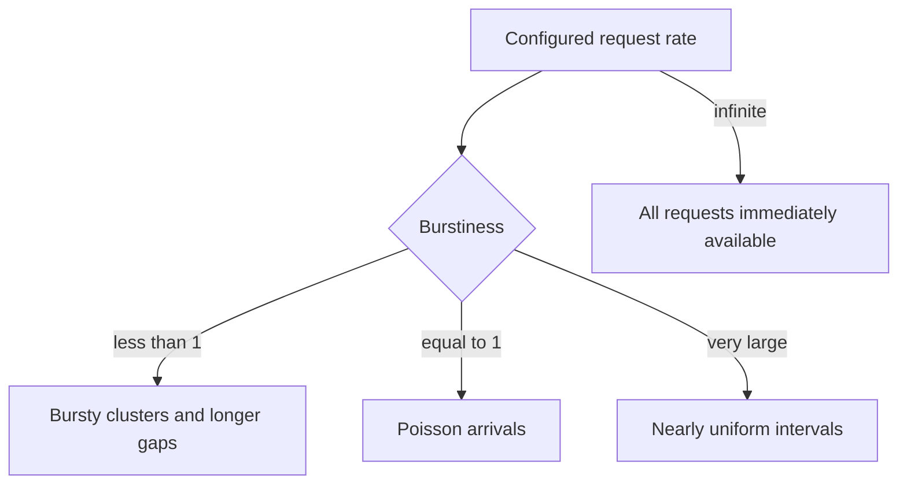

> **读图方法：** 阅读“到达过程”这张流程图时，先把方框看成对象或状态，把箭头看成数据或控制的移动。第一遍从上向下建立顺序，第二遍再核对分支发生的条件。

### 10.7.4 ramp-up 和 trace replay

`bench serve` 可以线性或指数提升 RPS，也可以使用 dataset 中的 timestamps 进行 self-timed
trace replay。前者用于寻找饱和点，后者用于重放真实业务形状。若 trace timestamp 单位错误，
负载会相差几个数量级，因此实验记录必须包含转换 multiplier。

---

## 10.8 workload 是实验的一部分，不是输入附件

> **本节先看：** 本节要回答：**workload 是实验的一部分，不是输入附件**。下面的小节会逐层拆开概念、运行过程和源码落点；第一次阅读先抓对象之间的关系，第二次再记类名、字段和分支。

### 10.8.1 长度分布决定 prefill/decode 比例

> **本节先看：** 下面先用表格整理“长度分布决定 prefill/decode 比例”。先横向比较每一列解决的问题和适用边界，再把具体名称映射到源码。

| workload | 主要压力 | 容易暴露的问题 |
|---|---|---|
| 短输入、长输出 | decode | ITL、CUDA launch、并发 decode batch |
| 长输入、短输出 | prefill | token budget、chunked prefill、attention |
| 长输入、长输出 | KV 与整体容量 | preemption、OOM、尾延迟 |
| 高共享 prefix | prefix cache | hit rate、block reuse、CoW |
| 长短混合 | Scheduler 公平性 | head-of-line interference |
| MoE 路由偏斜 | EP | all-to-all 与 straggler |

只报告平均 input/output length 会隐藏双峰分布。至少给出 min、p50、p90、p99、max 和直方图。

### 10.8.2 random dataset 的用途与风险

Random tokens 适合严格控制 token 长度，不受文本 tokenizer 内容影响；但它不能代表真实
prefix 重复、停止条件、chat template、语言分布和 structured output。因此它适合机制隔离，
不适合作为唯一容量结论。

### 10.8.3 ShareGPT 与真实 trace

真实对话数据提供自然长度与语义，但仍需记录：

- dataset revision 和抽样 seed；
- chat template 与 special tokens；
- 是否使用原回答长度作为 expected output；
- 过滤过长/过短样本的规则；
- sampling 是否 `ignore_eos`。

真实生产 trace 更接近业务，但需脱敏并明确 timestamp、取消请求、重试和多轮 session 的处理。

### 10.8.4 tokenizer 必须对齐

客户端认为 prompt 长 512 tokens，而服务端 tokenizer 得到 540，会同时污染长度分组、吞吐
分子和 max model len 判断。当前 serve benchmark 会尝试通过 `/tokenize` 检测并对齐 prompts，
但 endpoint 不可用时会跳过。v0.33.0 起跳过时的警告会区分原因：连接失败（`base_url` 不可达）、
HTTP 404（服务没有 `/tokenize` 路由，**或者**它不服务名为 `model_id` 的模型，可用 `GET /v1/models` 核对）、
其他 HTTP 状态码，以及其他异常（`vllm/benchmarks/serve.py:_align_prompts_to_server_tokenizer`，
[bafb26366](https://github.com/vllm-project/vllm/commit/bafb26366)，
[#59888](https://github.com/vllm-project/vllm/pull/59888)）。看到任何一条，都说明本次没有做 tokenizer 对齐。
最终报告仍应保存服务端实际 usage。

### 10.8.5 cache 实验必须显式构造重复

测 prefix caching 时至少控制：

- 公共 prefix 长度；
- prefix 数量与每个 prefix 重复次数；
- 请求顺序是聚集还是随机；
- block size 与 partial-tail 条件；
- warm cache、cold cache 或周期 reset；
- hit rate 的 token 口径。

否则“打开 cache 后更快”可能只是在 treatment 中碰巧重复更多 prompts。

---

## 10.9 冷启动、warmup 与稳定态

> **本节先看：** 本节要回答：**冷启动、warmup 与稳定态**。下面的小节会逐层拆开概念、运行过程和源码落点；第一次阅读先抓对象之间的关系，第二次再记类名、字段和分支。

### 10.9.1 一次启动包含多种一次性成本

> **本节先看：** 这一小节先用图建立“一次启动包含多种一次性成本”的整体路径。先找输入、关键状态和输出，再阅读图后的源码解释，不必一开始记住全部节点。

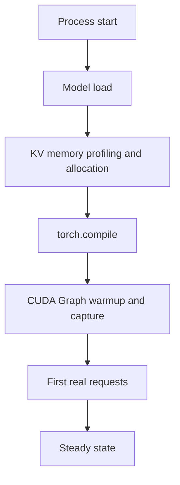

> **读图方法：** 这张图用于压缩“一次启动包含多种一次性成本”的整体关系。先从上向下找到起点、关键转换和终点，再问每条跨层箭头是否意味着函数调用、消息传递、内存访问或状态更新。

把第一请求和第 1000 个请求放在同一个平均值里，会同时测到部署冷启动与稳定态服务，通常
无法解释。

其中“KV memory profiling”这一步在 v0.33.0 多了一个前置动作：`Worker.init_device`（`vllm/v1/worker/gpu_worker.py:453`）在拍内存快照之前先用一次
`torch.mm` 和一次带 bias 的 `torch.nn.functional.linear` 创建 cuBLAS/cuBLASLt handle
（`vllm/v1/worker/gpu_worker.py` 中的注释：这些 handle 由 CUDA 直接分配显存，torch 看不见也无法回收缓存来满足它，
profiling 若把 torch 缓存撑满，首次 cuBLAS 调用就会失败；先创建则让它们与 NCCL buffer 一样计入基线）
（[9cede34a6](https://github.com/vllm-project/vllm/commit/9cede34a6)，
[#61044](https://github.com/vllm-project/vllm/pull/61044)）。
做跨版本对比时，启动日志里的可用 KV 显存应连同 commit 一起记录，不要假设与旧版逐字节相同。

### 10.9.2 warmup 应覆盖会出现的 shape

只 warmup 一个小 batch，不保证大 batch、不同 LoRA、不同 attention mode 或 graph capture
size 已经就绪。第 8 章说明 compile range 与 CUDA Graph descriptor 都与 shape/mode 有关。
实验应记录 warmup workload 是否覆盖正式 workload 的关键 bucket。

### 10.9.3 cache 状态也属于实验状态

需要明确区分：

- cold OS/model cache；
- cold prefix cache；
- warm prefix cache；
- compile cache 命中或未命中；
- CUDA Graph 已 capture 或正在 capture；
- HTTP/TLS connection 是否复用。

### 10.9.4 两类结果都值得报告，但不能混合

> **本节先看：** 下面先给出“两类结果都值得报告，但不能混合”的结论清单。先理解每一项为什么存在，再记参数名或实现细节。

- **Startup experiment**：process start 到 ready、first request TTFT、首次 compile/capture。
- **Steady-state experiment**：完成指定 warmup 后，再开启独立计时窗口。

---

## 10.10 可重复实验的最小合同

> **本节先看：** 本节要回答：**可重复实验的最小合同**。下面的小节会逐层拆开概念、运行过程和源码落点；第一次阅读先抓对象之间的关系，第二次再记类名、字段和分支。

### 10.10.1 固定环境

每个 run 至少保存：

- vLLM commit、未提交修改和构建方式；
- 模型、tokenizer、quantization、LoRA revision；
- GPU 型号、数量、拓扑、driver、CUDA、PyTorch；
- CPU、NUMA、内存和网络；
- 所有 CLI 参数和环境变量；
- container image 或依赖 lock；
- power/clock policy 与同机干扰任务。

记录环境时还要写明 `ParallelConfig.numa_bind` 的取值（`vllm/config/parallel.py:350`，字段说明紧随其后；
[4d95f222e6](https://github.com/vllm-project/vllm/commit/4d95f222e68bd43acbdfdffad6d46eea70146dcc)（[#61258](https://github.com/vllm-project/vllm/pull/61258)）把它的默认值从 `False` 改成 `None`（best-effort 自动绑定））。
默认 `None` 是 best-effort 自动绑定：只有环境支持时才绑定（多个 NUMA 节点、安装了 `numactl`、CPU 亲和性不受限、默认 NUMA 内存策略、`spawn` 启动方式配合 mp/uni executor 与 mp DP），
并且只是“优先用 GPU 本地内存、允许跨节点分配”的软偏好；显式 `True` 是严格绑定，缺少 `numactl` 或探测不到 GPU 到 NUMA 的拓扑时直接启动失败；`False` 关闭绑定。
只写“NUMA 拓扑”而不写该开关的取值，就无法复现 Worker 子进程是否被绑核。

### 10.10.2 固定 workload

> **本节先看：** 下面先给出“固定 workload”的结论清单。先理解每一项为什么存在，再记参数名或实现细节。

- 完整 dataset 或可重建的 seed；
- 每个请求的 prompt/output 长度；
- request rate、burstiness、concurrency；
- sampling、EOS、streaming、detokenize；
- warmup、正式请求数和运行时长；
- timeout、retry 和失败统计。

### 10.10.3 一次只改变一个可归因因素

如果同时把 `max_num_batched_tokens`、TP、dtype 和 attention backend 都改了，即使性能提升，
也不知道哪一项有效，更不知道哪些项互相抵消。第一轮使用单变量实验；确认主要因素后，再
做交互矩阵。

### 10.10.4 多次重复与运行顺序

至少关注：

- 重复次数；
- mean、median、p95/p99；
- 标准差或 coefficient of variation；
- baseline/treatment 交替顺序，避免温度和背景负载随时间单向漂移；
- 每次 run 是否重启服务和清 cache。

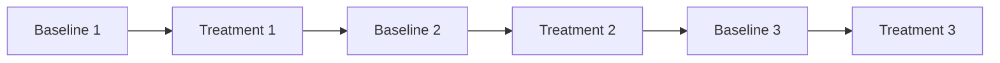

> **读图方法：** 这是“多次重复与运行顺序”的流程图。先从左向右只追一条主路径，确认输入经过哪些关键阶段到达输出；第二遍再看虚线、回边和旁路，它们通常表示反馈、复用或可选分支。

若 treatment 收益 2%，但 baseline 自身 CV 是 5%，目前证据不足以宣称稳定优化。

**白话：**CV 用“波动占均值的几分之几”来衡量噪声；收益比噪声还小，就分不清是优化还是运气。

**其中：**CV 是变异系数，等于样本标准差除以均值，无单位，常写成百分数；样本标准差是各次结果与均值之差的平方和除以（次数减 1）后开方。

**怎么算出来：**取教学数字：同一配置重复 5 次，吞吐是 98、102、100、95、105 token/s。均值是 $(98+102+100+95+105)\div5=100$；各次与均值之差是 $-2$、$+2$、$0$、$-5$、$+5$，
平方和是 $4+4+0+25+25=58$；除以 $5-1=4$ 得方差 $14.5$，开方得标准差约 $3.81$ token/s；$\mathrm{CV}\approx3.81\div100=3.8\%$。
这组数据里，一次重复就可以相差 4% 左右，所以 2% 的差异落在自然波动之内。

**核对：**`examples/ch10_benchmark_reasoning.py` 的 `ExperimentRun.throughput_cv`（`:238`）用 `statistics.stdev`（除以次数减 1）除以均值，与上面的算法一致。

---

## 10.11 客户端 metrics 与 vLLM 内部 metrics 对齐

> **本节先看：** 本节要回答：**客户端 metrics 与 vLLM 内部 metrics 对齐**。下面的小节会逐层拆开概念、运行过程和源码落点；第一次阅读先抓对象之间的关系，第二次再记类名、字段和分支。

### 10.11.1 内部请求时间拆分

`vllm/v1/metrics/stats.py` 中的 request timestamps 使用两类 clock：frontend arrival 是
wall-clock，EngineCore events 是 monotonic。`IterationStats` 最终形成：

$$
\Delta t_{\mathrm{queue}}=t_{\mathrm{scheduled},\mathrm{first}}-t_{\mathrm{queued},\mathrm{first}}
$$

$$
\Delta t_{\mathrm{prefill}}=t_{\mathrm{token},\mathrm{first}}-t_{\mathrm{scheduled},\mathrm{first}}
$$

$$
\Delta t_{\mathrm{decode}}=t_{\mathrm{token},\mathrm{last}}-t_{\mathrm{token},\mathrm{first}}
$$

$$
\Delta t_{\mathrm{inference}}=t_{\mathrm{token},\mathrm{last}}-t_{\mathrm{scheduled},\mathrm{first}}
$$

**白话：**服务端在每个请求身上盖四个时间戳：入队、第一次被调度、第一个 token、最后一个 token；
相邻两个戳相减，得到排队、prefill、decode 三段，再加上“从第一次被调度到最后一个 token”的 inference 总段。

**其中：**$t_{\mathrm{queued},\mathrm{first}}$ 是第一次 QUEUED 事件的时刻（源码 `queued_ts`），$t_{\mathrm{scheduled},\mathrm{first}}$ 是第一次 SCHEDULED 事件的时刻（`scheduled_ts`），
$t_{\mathrm{token},\mathrm{first}}$、$t_{\mathrm{token},\mathrm{last}}$ 是第一个、最后一个 NEW_TOKEN 的时刻（`first_token_ts`、`last_token_ts`），它们都来自 EngineCore 的单调时钟（秒）。
$\Delta t_{\mathrm{queue}}$ 只表示**单个请求**的排队等待；$\Delta t_{\mathrm{prefill}}$ 是从第一次被调度到首 token；$\Delta t_{\mathrm{decode}}$ 是首 token 到末 token；$\Delta t_{\mathrm{inference}}$ 是第一次被调度到末 token。
这里的 $\Delta t_{\mathrm{prefill}}$、$\Delta t_{\mathrm{decode}}$ 是服务端口径，与客户端的 $\mathrm{TTFT}$（10.2.1，含网络与前端）不是同一段。

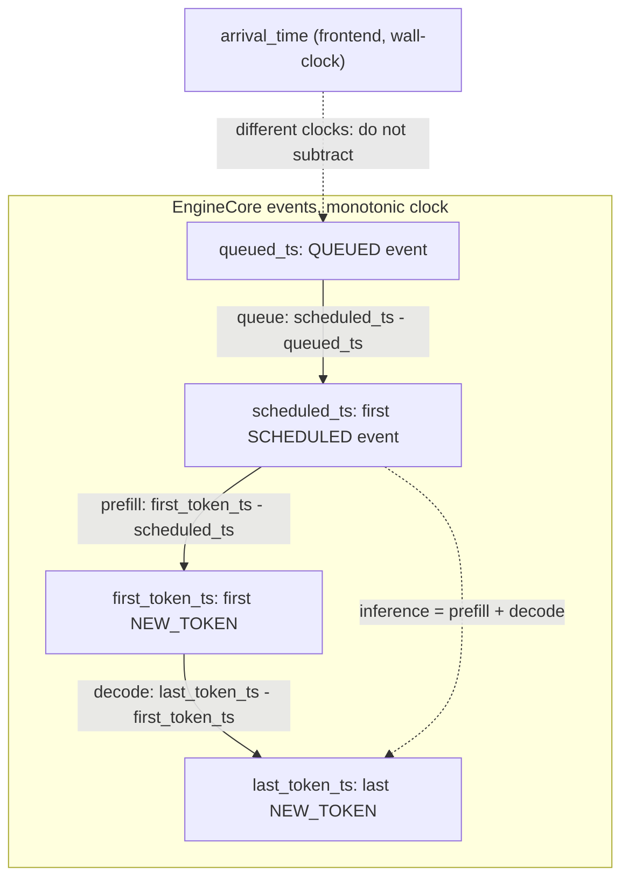

> **读图方法：** 先看实线主链：入队、第一次被调度、首 token、末 token 四个时间戳，相邻两个之间的边就是排队、prefill、decode 三段；
> 再看右侧虚线：inference 不是第四段，而是 prefill 与 decode 两段连起来的总长，它不含排队。最上面的 `arrival_time` 来自 frontend 的 wall-clock，
> 和下面框内的 monotonic 时间戳不在同一个时钟上，所以虚线旁写着不能相减。

**怎么算出来：**每一段都是两个相邻时间戳之差，源码在请求结束时依次计算（`vllm/v1/metrics/stats.py` 的 `update_from_finished_request`）：
`queued_time = scheduled_ts - queued_ts`（`:601`）、`prefill_time = first_token_ts - scheduled_ts`（`:605`）、`decode_time = last_token_ts - first_token_ts`（`:609`）、
`inference_time = last_token_ts - scheduled_ts`（`:613`）。因为 $t_{\mathrm{token},\mathrm{last}}-t_{\mathrm{scheduled},\mathrm{first}}=(t_{\mathrm{token},\mathrm{first}}-t_{\mathrm{scheduled},\mathrm{first}})+(t_{\mathrm{token},\mathrm{last}}-t_{\mathrm{token},\mathrm{first}})$
（中间的 $t_{\mathrm{token},\mathrm{first}}$ 抵消），所以 $\Delta t_{\mathrm{inference}}=\Delta t_{\mathrm{prefill}}+\Delta t_{\mathrm{decode}}$。

取教学数字（秒，EngineCore 单调时钟读数，不是实测）：$t_{\mathrm{queued},\mathrm{first}}=10.00$，$t_{\mathrm{scheduled},\mathrm{first}}=10.12$，
$t_{\mathrm{token},\mathrm{first}}=10.30$，$t_{\mathrm{token},\mathrm{last}}=11.10$。则

- $\Delta t_{\mathrm{queue}}=10.12-10.00=0.12$ 秒；
- $\Delta t_{\mathrm{prefill}}=10.30-10.12=0.18$ 秒；
- $\Delta t_{\mathrm{decode}}=11.10-10.30=0.80$ 秒；
- $\Delta t_{\mathrm{inference}}=11.10-10.12=0.98$ 秒，等于 $0.18+0.80$。

若这个请求共输出 $N_{\mathrm{out}}=17$ 个 token，源码的 `mean_time_per_output_token` 是 $\Delta t_{\mathrm{decode}}\div(N_{\mathrm{out}}-1)=0.80\div16=0.05$ 秒/token
（`stats.py:616-619`，同样不计 prefill 产出的首 token），与客户端 TPOT 的分母同形，只是分子换成服务端的 $\Delta t_{\mathrm{decode}}$。

单位检查：四个量都是同一个单调时钟上两个读数之差，读数以秒计，所以都是秒；$0.18+0.80=0.98$ 单位一致；再除以 token 数才变成秒/token。

**核对：**`stats.py:577-582`：QUEUED 事件写 `queued_ts`，SCHEDULED 事件只在 `scheduled_ts == 0.0` 时写入（“ignore preemptions”，所以是第一次）；
`stats.py:557` 在 prefill 阶段把 `first_token_ts` 设为该次输出的 EngineCore 时间戳，`:562` 每次输出更新 `last_token_ts`。
普通请求只在 `Scheduler.add_request` 记一次 QUEUED（`vllm/v1/core/sched/scheduler.py:3020`），被抢占时只记 PREEMPTED（`:1815`）不再记 QUEUED，所以 $t_{\mathrm{queued},\mathrm{first}}$ 就是这唯一一次；
流式输入会话在更新时会再记一次 QUEUED（`:1899`），那条路径上 `queued_ts` 取最近一次，不在本节讨论范围内。

这些差值的起止点需来自同一时钟；不要用 wall-clock 的 arrival time 去减 monotonic
的 scheduled 时间。按同一请求计算完整区间后再汇总，不能用 E2EL p99 减去各阶段
p99 推导网络延迟，因为几个 p99 可能来自不同请求。

这些内部 token 时间也不是 CUDA kernel 的完成时间。`IterationStats` 使用传入的
EngineCore 输出时间戳记录 first/last token，前端 TTFT 又使用当前输出处理迭代的时间。
要测 GPU 内核，应另用 CUDA events 或 profiler；不能把内部请求指标当作设备计时。

此外，`IterationStats.__init__` 在 v0.33.0 起把 `envs.VLLM_COMPUTE_NANS_IN_LOGITS` 读一次存成实例字段
`compute_nans_in_logits`（`vllm/v1/metrics/stats.py:482`），`update_from_output` 每个请求每步只读这个字段：
在从不启用 envs 缓存的进程（API server）里，每次访问 `envs` 属性都会重新读环境变量，这是一次纯 CPU 开销优化，
不改变 NaN 检测语义（[6fe7401fa](https://github.com/vllm-project/vllm/commit/6fe7401fa)，
[#61710](https://github.com/vllm-project/vllm/pull/61710)）。

[源码] `vllm/v1/metrics/stats.py` - `IterationStats.update_from_output`、`update_from_finished_request`

### 10.11.2 Prometheus 关键指标

> **本节先看：** 下面先用表格整理“Prometheus 关键指标”。先横向比较每一列解决的问题和适用边界，再把具体名称映射到源码。

| 指标 | 类型/语义 | 用途 |
|---|---|---|
| `vllm:num_requests_running` | gauge | 当前活跃请求 |
| `vllm:num_requests_waiting` | gauge | Scheduler queue 压力 |
| `vllm:kv_cache_usage_perc` | gauge，0–1 的占用比例 | KV 池内 block 压力，不是进程显存百分数 |
| `vllm:num_preemptions_total` | counter | KV/调度压力结果 |
| `vllm:prompt_tokens_total` | counter | prompt token 总量 |
| `vllm:prompt_tokens_by_source_total` | labeled counter | 本地计算、cache hit、external KV |
| `vllm:generation_tokens_total` | counter | generation token 总量 |
| `vllm:time_to_first_token_seconds` | histogram | 内部 TTFT |
| `vllm:inter_token_latency_seconds` | histogram | 内部 ITL |
| `vllm:e2e_request_latency_seconds` | histogram | 内部 E2E |
| `vllm:request_queue_time_seconds` | histogram | WAITING 时间 |
| `vllm:request_prefill_time_seconds` | histogram | prefill 区间 |
| `vllm:request_decode_time_seconds` | histogram | decode 区间 |

表中的 counter 使用 `/metrics` 导出样本名，带 `_total`；源码构造 `Counter` 时可不写
该后缀。histogram 表中列的是家族名，实际查询常用 `_bucket`、`_sum`、`_count`。
例如 `kv_cache_usage_perc=0.8` 表示池内约 80% 可分配 block 正被引用，不是 0.8%。

[源码] `vllm/v1/metrics/loggers.py` - `PrometheusStatLogger.__init__`

[设计] `docs/design/metrics.md` - 指标类型与导出名称

### 10.11.3 日志吞吐不是请求总 token 数

`LoggingStatLogger` 的 prompt throughput 使用**实际本地计算的 prompt tokens**，排除 cache
hit 与外部 KV transfer；generation throughput 使用生成 tokens。它按日志间隔计算，不等于
`bench serve` 的总输入 token throughput。

同名“prompt throughput”若分子不同，会得出相反结论。开启 prefix cache 后，本地计算
prompt throughput 可能下降，同时业务输入吞吐上升，这并不矛盾。

### 10.11.4 多进程 Prometheus 目录要清理

若用户自行设置 `PROMETHEUS_MULTIPROC_DIR`，当前代码会警告每次 vLLM run 之间必须清空；
残留 shard 文件可能让 counter/gauge 不准确。把旧 metrics 当成新 run 数据，会直接破坏 A/B。

### 10.11.5 bench serve 结果里的服务端耗时

v0.33.0 的 `bench serve` 可以把服务端自己测的两段耗时随请求一起写进结果，用来和客户端 TTFT 对账
（[ae43d045c](https://github.com/vllm-project/vllm/commit/ae43d045c)，
[#55809](https://github.com/vllm-project/vllm/pull/55809)）。前提有三个：服务以
`--enable-per-request-metrics` 启动；流式请求带 usage（`stream_options.include_usage=true` 或服务端强制包含 usage）；
`n=1`。满足时，最后一条 usage chunk 的 `metrics` 字段携带 `queue_time_ms` 与 `time_to_first_token_ms`，
客户端适配器把它们除以 1000，存为 `RequestFuncOutput.server_queue_time` 与 `server_ttft`（秒）。

要点是**口径不同于客户端 TTFT**：服务端的 `queue_time_ms` 是 `scheduled_ts - queued_ts`（即 10.11.1 的 $\Delta t_{\mathrm{queue}}$，毫秒），
`time_to_first_token_ms` 是 `first_token_ts - scheduled_ts`（即 $\Delta t_{\mathrm{prefill}}$，毫秒；`vllm/entrypoints/generate/base/serving.py` 的
`build_per_request_timing_metrics`，`:73`、`:67`）。后者只覆盖“从首次被调度到首 token”，不含排队、渲染、网络和客户端 semaphore 等待。
客户端 TTFT 与它相减得到的是“排队 + 渲染 + 传输 + 客户端”的合计，不能直接当作网络延迟（参见 10.11.1 关于同一时钟的约束）。

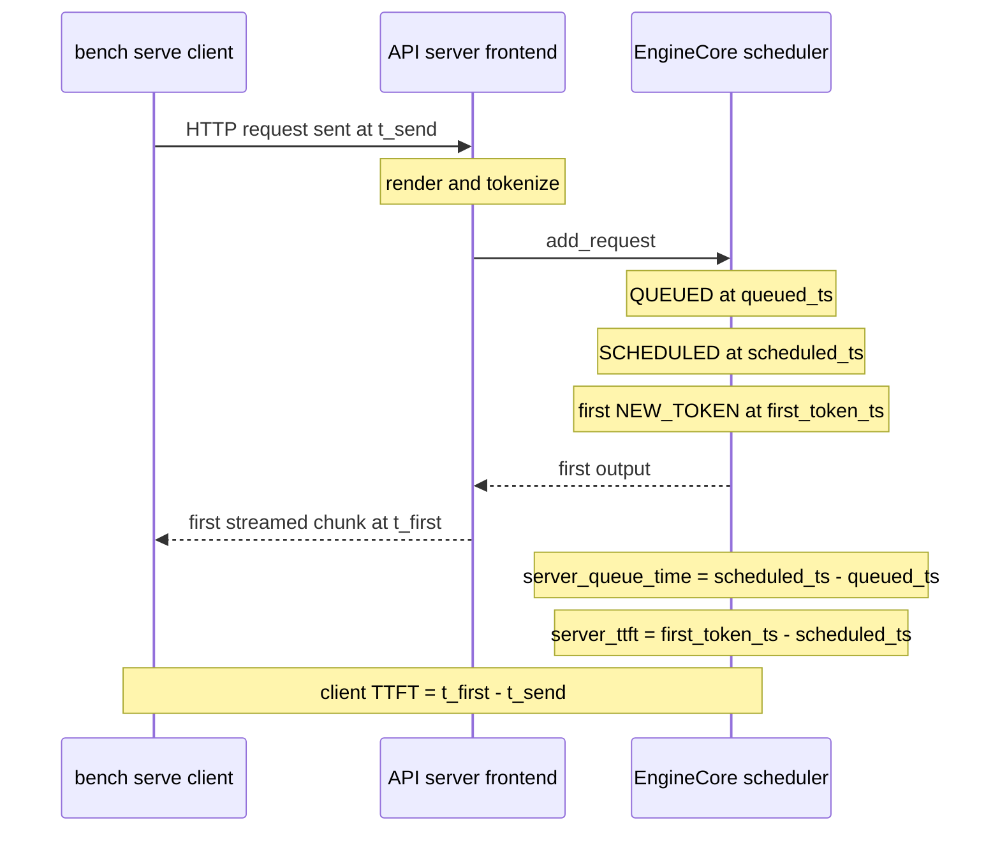

> **读图方法：** 先只看三条竖线上的事件顺序：客户端发出请求、frontend 渲染并交给 EngineCore、EngineCore 内部依次盖入队、被调度、首 token 三个戳，最后首个输出沿原路回到客户端。
> 再看右下三个注释：服务端两段（排队、首次调度到首 token）只占中间一部分，客户端 TTFT 则横跨全部三条线，两者的差就是图中没有被服务端戳覆盖的部分。

**白话：**同一个请求，客户端从“发出”量到“收到首个输出”，服务端只量了自己内部的两段，两者相减能看出“服务端之外”或“服务端排队之外”花了多少。

**其中：**$\Delta t_{\mathrm{queue}}$、$\Delta t_{\mathrm{prefill}}$ 同 10.11.1（秒；字段里是毫秒，客户端适配器除以 1000 后存为 `server_queue_time`、`server_ttft`）；$\mathrm{TTFT}$ 是客户端 TTFT（10.2.1，秒）。

**怎么算出来：**客户端 TTFT 覆盖整条路径，而 $\Delta t_{\mathrm{prefill}}$ 只是其中一段，所以 $\mathrm{TTFT}-\Delta t_{\mathrm{prefill}}$ 里仍包含 $\Delta t_{\mathrm{queue}}$。
取教学数字：客户端 $\mathrm{TTFT}=0.50$ 秒，服务端 `queue_time_ms`=120、`time_to_first_token_ms`=180，即 $\Delta t_{\mathrm{queue}}=120\div1000=0.12$ 秒、$\Delta t_{\mathrm{prefill}}=180\div1000=0.18$ 秒。
相减得 $0.50-0.18=0.32$ 秒；其中 $0.12$ 秒是服务端排队，剩下 $0.32-0.12=0.20$ 秒才是渲染、传输和客户端处理的合计，所以不能把 $0.32$ 秒当作网络延迟。单位检查：字段是毫秒，先除以 1000 换成秒（$120\div1000=0.12$），再与以秒计的 $\mathrm{TTFT}$ 相减；毫秒和秒不能直接相减。

**核对：**`build_per_request_timing_metrics` 里 `time_to_first_token_ms = (first_token_ts - scheduled_ts) * 1000`（`serving.py:67`）、`queue_time_ms = (scheduled_ts - queued_ts) * 1000`（`:73`）；
客户端适配器 `_update_server_metrics` 取这两个字段并除以 1000（`vllm/benchmarks/lib/endpoint_request_func.py:124-125`）。

结果 JSON 里新增 `server_queue_times` 与 `server_ttfts` 两个逐请求列表；只有当至少一个请求带回了这些值时才出现
（`_get_server_metrics_results`，`vllm/benchmarks/serve.py:391`），缺失的请求位置为 `null`。它们与 `ttfts`、`itls`
一样体量大，没有 `--save-detailed` 时会被删掉，并且不会进入 PyTorch benchmark 格式的输出。注意它与结果里已有的
`queue_times`（客户端 max-concurrency semaphore 等待）是两回事。

[源码] `vllm/benchmarks/lib/endpoint_request_func.py` - `RequestFuncOutput`、`_update_server_metrics`

[源码] `vllm/benchmarks/serve.py` - `_get_server_metrics_results`

[源码] `vllm/entrypoints/generate/base/serving.py` - `build_per_request_timing_metrics`

---

## 10.12 从现象到假设：不要让单个指标独自定罪

> **本节先看：** 本节要回答：**从现象到假设：不要让单个指标独自定罪**。下面的小节会逐层拆开概念、运行过程和源码落点；第一次阅读先抓对象之间的关系，第二次再记类名、字段和分支。

### 10.12.1 常见信号组合

> **本节先看：** 下面先用表格整理“常见信号组合”。先横向比较每一列解决的问题和适用边界，再把具体名称映射到源码。

| 现象组合 | 优先假设 | 下一步证据 |
|---|---|---|
| waiting 上升、GPU 持续忙 | GPU/模型执行饱和 | kernel/collective timeline |
| KV usage 高、preemption 增加 | KV 容量压力 | block 数、请求长度、抢占日志 |
| GPU 大量空洞、CPU thread 忙 | input prep/调度/IPC | CPU trace、queue 时间 |
| GPU 忙但 throughput 低 | 小 kernel、通信或低效 shape | kernel summary、batch shape |
| TTFT 差、ITL 正常 | queue/prefill 干扰 | queue/prefill histogram |
| TTFT 正常、ITL 长尾 | decode batch/抢占/通信 | per-step tokens、preemption |
| 平均正常、p99 很差 | burst、长请求或 straggler | 按长度/rank 分组 |
| prefix hit 高但收益低 | 命中粒度或其他瓶颈 | computed tokens、GPU timeline |

### 10.12.2 GPU utilization 的局限

“GPU busy”只说明某段时间有 kernel 执行，不说明：

- kernel 是否达到理想 FLOPS 或带宽；
- shape 是否太小；
- 是否在执行无效 padding；
- 是否大量时间花在 collective；
- 是否满足用户 SLO。

因此 utilization 是入口信号，不是根因结论。

### 10.12.3 MFU/roofline 也需要 workload context

当前 `vllm/v1/metrics/perf.py` 根据模型配置和 SchedulerOutput 估算每 GPU FLOPS 与读写字节，
区分 prefill/decode 的 token-context product。它可帮助判断 compute-bound 或 memory-bound，
但属于解析模型与估算，不是硬件计数器的绝对真值；量化、稀疏和新 kernel 还可能让模型近似
不完整。

---

## 10.13 找饱和点，而不是只测“无限请求”

> **本节先看：** 本节要回答：**找饱和点，而不是只测无限请求**。下面的小节会逐层拆开概念、运行过程和源码落点；第一次阅读先抓对象之间的关系，第二次再记类名、字段和分支。

### 10.13.1 开环与闭环负载

> **本节先看：** 下面先给出“开环与闭环负载”的结论清单。先理解每一项为什么存在，再记参数名或实现细节。

- 固定 request rate 是开环：无论系统变慢，load generator 仍按计划产生请求。
- 仅设置 max concurrency 不会改变上游到达过程；配合无限 request rate 和充足待发
  请求时，向服务端补位的行为才近似闭环：请求完成后释放 slot。有限 rate 与信号量
  同时存在时，仍可能在客户端持续积累等待。
- `request_rate=inf` 且大量 prompts 是一次性 batch pressure，不代表稳态到达。

开环适合观察过载与排队；闭环适合估算一定并发用户下的体验。两者不能混为一个“并发数”。

### 10.13.2 典型饱和曲线

> **本节先看：** 这一小节先用图建立“典型饱和曲线”的整体路径。先找输入、关键状态和输出，再阅读图后的源码解释，不必一开始记住全部节点。

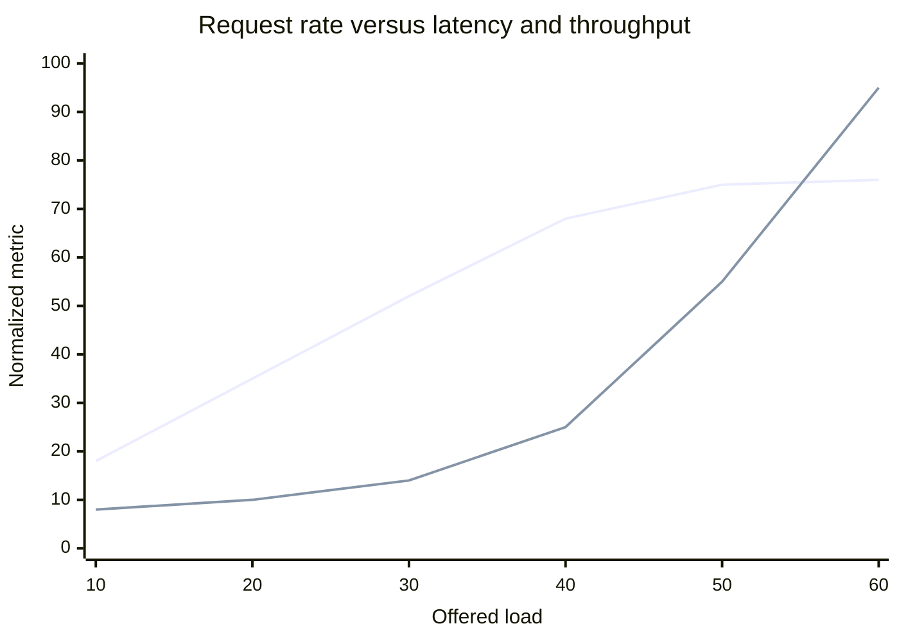

> **读图方法：** 这是“典型饱和曲线”的趋势图。先确认横轴控制变量和纵轴指标，再比较拐点与变化方向；示意曲线用于解释关系，不能替代在指定硬件和负载上的 benchmark。

图中第一条曲线为归一化 throughput，第二条为归一化 p99 latency，数值仅为教学示意。
曲线转折处表示 throughput 开始趋平，而 queue 与 p99 快速上升。生产容量通常应留在转折点
左侧，而不是选择峰值 throughput 对应的过载点。

**排队论直觉：Little’s Law 是平均量之间的关系。** 在相应长期平均存在、观察边界
一致等条件下，利特尔法则（Little's Law）成立：

$$
n_{\mathrm{sys}}=\lambda\,\overline{\Delta t}_{\mathrm{sys}}
$$

若只讨论排队部分，应使用对应的

$$
n_{\mathrm{queue}}=\lambda\,\overline{\Delta t}_{\mathrm{wait}}
$$

不能把系统在途数与纯排队等待时间混用。

**白话：**平均排着多少个请求，等于每秒来多少个请求，乘以每个请求平均待多久；就像浴缸里的水量等于进水速度乘以每滴水停留的时间。

**其中：**$n_{\mathrm{sys}}$ 是系统中平均请求数，$\lambda$ 是有效到达率（request/s），$\overline{\Delta t}_{\mathrm{sys}}$ 是请求在系统中的平均停留时间（秒，包含等待与服务）；
$n_{\mathrm{queue}}$ 是队列中的平均请求数，$\overline{\Delta t}_{\mathrm{wait}}$ 是请求在队列里的平均等待时间（秒）。
横线表示“平均”，与 10.11.1 单个请求的 $\Delta t_{\mathrm{queue}}$ 是两个量。

**怎么算出来：**取一段足够长的观察时间。这段时间里到达了“到达率 $\times$ 观察时长”个请求，每个请求在系统里待了各自的停留时间；把所有请求的停留时间加起来，
得到“请求 $\cdot$ 秒”的总量，等于请求数乘以平均停留时间，即 $\lambda\times$ 观察时长 $\times\overline{\Delta t}_{\mathrm{sys}}$。
这个总量除以观察时长，就是任意时刻系统里的平均请求数，观察时长约掉，得到 $n_{\mathrm{sys}}=\lambda\,\overline{\Delta t}_{\mathrm{sys}}$；把“系统”换成“队列”，同样的推理给出第二式。

例如平均有 20 个请求在系统中，每秒处理 10 个请求（稳态下到达率等于处理率，$\lambda=10$ request/s），则 $\overline{\Delta t}_{\mathrm{sys}}=20\div10=2$ 秒。
再设其中平均有 6 个请求在队列里（教学数字），则 $\overline{\Delta t}_{\mathrm{wait}}=6\div10=0.6$ 秒，剩下的 $2-0.6=1.4$ 秒是平均服务时间。
单位检查：request $=$ (request/s) $\times$ s。

**核对：**这是排队论的定理，不对应 vLLM 的某一行源码，所以没有源码引用。服务端口径上可以做粗略自检：`vllm:num_requests_running` 加 `vllm:num_requests_waiting`（10.11.2）的时间平均对应 $n_{\mathrm{sys}}$，
`waiting` 的时间平均对应 $n_{\mathrm{queue}}$；这两个 gauge 只覆盖引擎内的请求，不含客户端 semaphore 排队，边界必须与 $\lambda$、$\overline{\Delta t}$ 的口径一致。

这条关系本身不提供 p99，也不能单独推出延迟按 $\frac{1}{1-\rho}$ 发散。后者需要特定
队列模型及到达/服务过程假设；vLLM 的动态批处理、变长请求和并行执行不自动符合。

**白话：**$\frac{1}{1-\rho}$ 来自最简单的单服务台队列（M/M/1）：平均停留时间是“纯服务时间”的 $\frac{1}{1-\rho}$ 倍，越接近满载放大越厉害；它是一个模型结论，不是 vLLM 的实测规律。

**其中：**这里的 $\rho=\lambda/\mu$ 是利用率（0 到 1），$\mu$ 是单个服务台每秒能服务的请求数（request/s，本节局部字母），$P_k$ 是稳态时系统里恰有 $k$ 个请求的概率。
所谓“特定队列模型”指 M/M/1：到达是 Poisson、服务时间是指数分布、只有一个服务台，且 $\lambda<\mu$。

**怎么算出来：**

1. 稳态下，“从 $k$ 个变成 $k+1$ 个”的速率等于“从 $k+1$ 个变成 $k$ 个”的速率：$\lambda P_k=\mu P_{k+1}$，即 $P_{k+1}=\rho P_k$，所以 $P_k=\rho^kP_0$；
2. 所有概率之和为 1：$P_0\sum_{k\ge0}\rho^k=\frac{P_0}{1-\rho}=1$，得 $P_0=1-\rho$，$P_k=(1-\rho)\rho^k$；
3. 平均请求数 $n_{\mathrm{sys}}=\sum_{k\ge0}kP_k=\frac{\rho}{1-\rho}$；
4. 由 Little 法则，$\overline{\Delta t}_{\mathrm{sys}}=\frac{n_{\mathrm{sys}}}{\lambda}=\frac{\rho}{\lambda(1-\rho)}=\frac{1}{\mu}\cdot\frac{1}{1-\rho}$（用了 $\rho/\lambda=1/\mu$）。

代入数字：$\frac{1}{1-\rho}$ 在 $\rho=0.5$ 时是 2，$\rho=0.9$ 时是 10，$\rho=0.99$ 时是 100：只有在这个模型里，利用率从 90% 升到 99%，平均停留时间才放大 10 倍。
单位检查：$\rho=\lambda\div\mu$ 是 request/s 除以 request/s，无单位；$\frac{1}{\mu}$ 是秒/request，即一个请求的纯服务时间，乘上无单位的 $\frac{1}{1-\rho}$ 仍是秒；$n_{\mathrm{sys}}=\frac{\rho}{1-\rho}$ 是请求个数，除以 $\lambda$ 得到秒。

**核对：**这是教学模型，不对应 vLLM 源码；也没有说明 vLLM 在某个利用率下实际会慢几倍，需要按 10.13.2 的做法在真实 workload 上测曲线。

[MIT 对 Little’s Law 的说明](https://web.mit.edu/urban_or_book/www/book/chapter4/4.4.html)
强调了平均人数、有效到达率和停留时间的对应关系。

工程上应测量负载增加时的排队和尾延迟曲线，而不是预言某两个负载点一定相差
5–10 倍。提高到达率可能造成过载，优化服务能力则可能同时改善吞吐与延迟；两者
不能都概括为“追求吞吐必然牺牲延迟”。

### 10.13.3 用 goodput 找可服务容量

逐步增加 RPS，记录 request throughput、goodput、p99 TTFT/TPOT 和错误率。最后一个满足
全部 SLO 且 goodput 接近 offered load 的点，才是更有意义的容量估计。

### 10.13.4 probe request 观察受压体验

当前 serve benchmark 可在主 workload 之外周期发送 1-token probe。它能观察背景压力下轻量
请求的延迟，但 probe 本身也增加负载；必须记录 probe rate，并与无 probe baseline 对照。

v0.33.0 修了两处会让 probe 污染结果的实现问题（[c54dca96b](https://github.com/vllm-project/vllm/commit/c54dca96b)，
[#60511](https://github.com/vllm-project/vllm/pull/60511)）：

- **连接池。** 主 session 的连接池上限等于 `--max-concurrency`；probe 与主请求共用时，会排在池子里等连接，
  于是测到的“probe 延迟”里混进了客户端等连接的时间。现在 probe 用自己的 `make_session(1)`（一条独立连接，
  `vllm/benchmarks/serve.py:856` 的 `make_session` 工厂与 probe 循环），主池容量不被占用，也不再被主 workload 反压。
  测试 `test_bench_serve_insecure` 为此加上 `--probe-request-rate 5`，确认独立 session 也遵守 `--insecure`。
- **duration。** 见 10.7.1：先计 `benchmark_duration`，再停 probe。

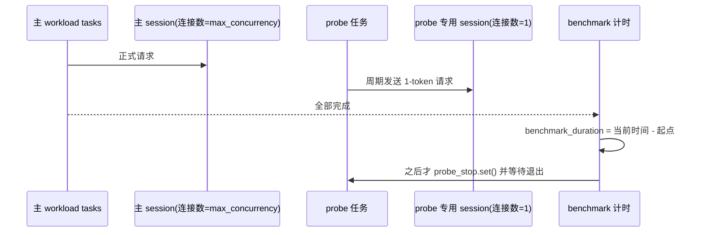

> **读图方法：** 这是 probe 与主 workload 分离后的时序图。先看两条并行的连接路径（主 session 与 probe 专用 session 互不占用连接），再看最下面三行：先停止计时，后停止 probe，所以最后一个 probe 间隔不会进入主 workload 的 duration。

---

## 10.14 参数实验矩阵：每个旋钮改变哪条机制

> **本节先看：** 本节要回答：**参数实验矩阵：每个旋钮改变哪条机制**。下面的小节会逐层拆开概念、运行过程和源码落点；第一次阅读先抓对象之间的关系，第二次再记类名、字段和分支。

### 10.14.1 Scheduler 参数

> **本节先看：** 下面先用表格整理“Scheduler 参数”。先横向比较每一列解决的问题和适用边界，再把具体名称映射到源码。

| 参数方向 | 可能收益 | 可能代价 | 应观察 |
|---|---|---|---|
| 增大 max batched tokens | 更大 prefill/GEMM、吞吐 | 单 step 更长、ITL 抖动、显存 | batch tokens、TTFT、ITL |
| 增大 max sequences | 更多 decode 并发 | KV 占用、小 kernel/调度压力 | running、KV、output TPS |
| chunked prefill | 限制长 prefill 独占 | 更多 steps 和调度开销 | 短请求 TTFT、长请求 E2E |
| scheduling policy | 改善目标请求优先级 | 可能牺牲公平性 | 分组尾延迟、starvation |
| async scheduling | CPU/GPU 重叠 | placeholder 与 feature 限制 | GPU gaps、stale output |

### 10.14.2 KV Cache 参数

> **本节先看：** 下面先用表格整理“KV Cache 参数”。先横向比较每一列解决的问题和适用边界，再把具体名称映射到源码。

| 参数方向 | 可能收益 | 可能代价 | 应观察 |
|---|---|---|---|
| 提高 gpu memory utilization | 更多 blocks、少抢占 | OOM 余量变小 | KV usage、preemption、峰值显存 |
| 调整 block size | 元数据/碎片折中 | kernel/backend 限制 | waste、hit、attention 时间 |
| 开启 prefix caching | 跳过重复 prefill | hash/metadata、低重复无收益 | hit、computed prompt tokens |
| KV dtype/量化 | 增加容量、降低带宽 | 精度和 kernel 支持 | 质量、容量、attention 时间 |
| KV offload/connector | 扩展容量或复用 | 传输延迟与抖动 | external hit、transfer time |

### 10.14.3 compile 与 CUDA Graph 参数

> **本节先看：** 下面先给出“compile 与 CUDA Graph 参数”的结论清单。先理解每一项为什么存在，再记参数名或实现细节。

- eager baseline 用于判断 compile/graph 的净收益。
- compile sizes 影响编译范围与冷启动。
- capture sizes 越多，覆盖更细，但 warmup/显存成本增加。
- padding 到 capture size 可能减少 launch overhead，却增加无效计算。
- backend/feature fallback 必须从运行时 descriptor 或 metrics 确认，不能只看配置值。

### 10.14.4 并行参数

第 9 章已经说明 TP/PP/DP/EP/PCP/DCP 的成本不同。实验矩阵至少同时报告每 GPU 与系统级：

- throughput；
- p99 latency；
- peak memory；
- communication fraction；
- scaling efficiency；
- 成本或 tokens/s/GPU。

只看系统总 tokens/s 会偏向无限增加 GPU，即使单位成本恶化。

---

## 10.15 Profiling：选择能回答问题的工具

> **本节先看：** 本节要回答：**Profiling：选择能回答问题的工具**。下面的小节会逐层拆开概念、运行过程和源码落点；第一次阅读先抓对象之间的关系，第二次再记类名、字段和分支。

### 10.15.1 profiling 会改变被测系统

vLLM 的 profiling 文档明确提示：profiler 用于开发诊断，会显著降低推理性能。开启 shape、
memory、stack 或 FLOPS 记录还会增加额外开销。因此：

- benchmark run 用于量化性能；
- profile run 用于解释时间花在哪里；
- 不要把 profile run 的吞吐当生产性能。

### 10.15.2 PyTorch Profiler

当前 `ProfilerConfig` 支持：

- 由平台决定默认 activities，并可通过 `torch_profiler_activities` 显式选择；
  CUDA Worker 默认 CPU+CUDA，XPU Worker 默认 CPU+XPU，CPU Worker 默认 CPU；
  不支持的 activity 组合会在 Worker 校验时拒绝；
- stack、shape、memory、FLOPS 选项；
- wait/warmup/active schedule；
- delay/max engine iterations；
- rank-qualified trace names；
- 可选 CUDA Graph capture trace。

```text
vllm serve MODEL \
  --profiler-config '{"profiler":"torch","torch_profiler_dir":"./trace"}'

vllm bench serve ... --profile --num-prompts 8
```

Worker 通过 `vllm/profiler/wrapper.py` 的 `create_worker_profiler` 与
`create_graph_capture_profiler` 创建 profiler，配置验证由 `validate_worker_profiler_config`
负责；具体 wrapper 类已不在 `gpu_worker.py` 定义。

多 rank 下每个 Worker 各自产生 trace。比较之前先确认 trace 文件对应的 DP/PP/TP/DCP/EP
坐标，而不是只打开 rank 0。

v0.32.0 的 `/start_profile` 可按 session 指定 `profile_prefix`、`delay_iterations`、
`max_iterations`；后两项必须是非负 JSON 整数，max_iterations=0 表示不限制。
这些迭代边界约束 Worker profiler，不约束 AsyncLLM 前端 CPU profiler；后者从 start 持续到 stop。
即使 Worker 达到迭代上限，也必须调用 `/stop_profile`，否则下一次 start 会返回 HTTP 409。
trace/summary 文件名使用 rank 或 hostname_pid.async_llm 前缀，session prefix 可避免覆盖。

v0.33.0 的 `/start_profile` 请求体多了一个可选字段 `profiler_kwargs`（JSON 对象，
`StartProfileRequest.profiler_kwargs`，`vllm/entrypoints/serve/profile/api_router.py`），
用于**只对这一次 session** 覆盖 PyTorch profiler 的构造参数，例如 `{"record_shapes": true, "with_stack": true}`；
Python API `LLM.start_profile(..., profiler_kwargs=...)` 同样接受。路由层只要求它是 JSON 对象，不检查键名。
Worker 侧 `TorchProfilerWrapper` 把 `profiler_config` 派生的基础参数 `_base_profiler_kwargs` 与请求覆盖项合并
（`vllm/profiler/wrapper.py`：`set_profiler_kwargs`，仅在 profiler 未处于 active 时生效，且保留原来的
`on_trace_ready`）。`Worker.profile` 在每次 start 时都调用它（`vllm/v1/worker/gpu_worker.py:1562`），
每次都从基础参数重新合并，所以上一次的覆盖不会泄漏到下一次。
基类 `WorkerProfiler.set_profiler_kwargs` 是空操作，因此 CUDA、Proton 等非 torch profiler 会忽略该字段
（[dd5e75449](https://github.com/vllm-project/vllm/commit/dd5e75449)，
[#51974](https://github.com/vllm-project/vllm/pull/51974)；该 PR 标题只写了 profile_prefix，
本次 `5df63a72..4ba787ec` 区间内它带来的新增字段是 `profiler_kwargs`）。
对应实验含义：想比较“有/无 shape 记录”的开销，不必重启服务，只需在两次 session 里换 `profiler_kwargs`；
但 stack/shape 仍会显著增加开销，得到的 trace 只用于定位，不能当吞吐数据。

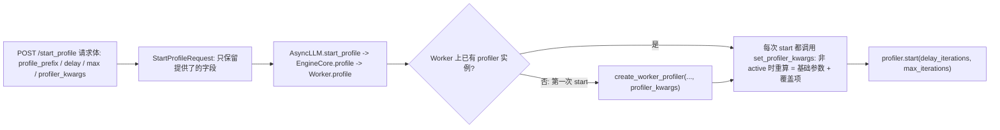

> **读图方法：** 这是 `profiler_kwargs` 从 HTTP 请求到 torch profiler 的传递图。先看上半部分：字段一路透传到 Worker；再看菱形：第一次 session 在创建 profiler 时带上覆盖项，随后每次 start（包括第一次）都经 `set_profiler_kwargs` 按“基础参数 + 本次覆盖项”重算，最后才进入 `start`。

[设计] `docs/contributing/profiling.md` - Profile with PyTorch Profiler

[源码] `vllm/config/profiler.py` - `validate_profile_iteration_bounds`

[源码] `vllm/profiler/wrapper.py` - `TorchProfilerWrapper.set_profiler_kwargs`、`create_worker_profiler`

[源码] `vllm/v1/worker/gpu_worker.py` - `Worker.profile`

### 10.15.3 Proton

Proton 面向 Triton kernel，可输出 aggregate tree 或 Chrome trace。本版本通过 NVIDIA
CUPTI 支持 CUDA Graph attribution，不再一律要求 eager。启用
`proton_graph_attribution=true` 需 Triton >= 3.7、`proton_data="tree"`，且不能与
`periodic_flushing` 同时使用；Worker 在 capture 阶段启动观察，随后分开记录 profile runs。
Chrome trace 需 `proton_data="trace"`，因此仍须 `--enforce-eager` 禁用 CUDA Graph。
不启用 attribution 时，有 CUDA Graph 的执行不能正确归因 replayed kernels。
它适合深入 kernel，但不替代完整 CPU、IPC 和网络时间线。

[源码] `vllm/profiler/wrapper.py` - `ProtonProfilerWrapper`、`create_graph_capture_profiler`

[设计] `docs/contributing/profiling.md` - Profile with Triton Proton

### 10.15.4 Nsight Systems

Nsight Systems 更适合低开销系统时间线，观察：

- CPU thread 与 CUDA API；
- kernel launch gap；
- CUDA Graph nodes；
- NCCL collective；
- streams 间 overlap；
- 多进程时间关系。

多进程 vLLM 常需 `--trace-fork-before-exec=true`，CUDA Graph 可使用
`--cuda-graph-trace=node`；动态 capture 可由 vLLM 的 CUDA profiler API 配合 start/stop。

### 10.15.5 CPU profiler

若 GPU 时间线存在空洞，应继续检查：

- tokenization 与 chat template；
- input processing 与 multimodal preprocessing；
- Scheduler Python；
- block hashing 与 BlockPool；
- IPC serialization、message queue；
- detokenization 与 HTTP streaming。

`cProfile` 适合 Python call 聚合，但对异步并发和跨进程时间线有限；必要时结合 per-process
trace 与日志中的 request ID。

---

## 10.16 读时间线的模式语言

> **本节先看：** 本节要回答：**读时间线的模式语言**。下面的小节会逐层拆开概念、运行过程和源码落点；第一次阅读先抓对象之间的关系，第二次再记类名、字段和分支。

### 10.16.1 launch-bound decode

> **本节先看：** 下面的代码或调用链只保留“launch-bound decode”的主干。阅读时依次寻找输入、状态变化和输出，暂时忽略辅助分支。

```text
GPU: [tiny kernel] gap [tiny kernel] gap [tiny kernel] gap
CPU: launch -------- launch -------- launch --------
```

特征是大量小 kernel 和明显 CPU launch gap。候选措施是 CUDA Graph、算子融合、增大 decode
batch；验证时看 gap 是否缩短，而不只是 GPU utilization 是否上升。

### 10.16.2 memory-bound attention

> **本节先看：** 下面的代码或调用链只保留“memory-bound attention”的主干。阅读时依次寻找输入、状态变化和输出，暂时忽略辅助分支。

```text
GPU: [long attention / KV read] [long attention / KV read]
HBM: near bandwidth limit
SM:  below peak FLOPS
```

长 context decode 常接近该模式。候选是更合适 backend、KV dtype、DCP 或减少 context；增大
算术并行度不一定有效。

### 10.16.3 PP bubble

> **本节先看：** 下面的代码或调用链只保留“PP bubble”的主干。阅读时依次寻找输入、状态变化和输出，暂时忽略辅助分支。

```text
PP0: compute ---- idle ---- compute ---- idle
PP1: idle ---- compute ---- idle ---- compute
```

检查 stage 层数、activation transfer、batch queue 深度和最慢 stage。只优化快 stage 不会缩短
关键路径。

### 10.16.4 EP straggler

> **本节先看：** 下面的代码或调用链只保留“EP straggler”的主干。阅读时依次寻找输入、状态变化和输出，暂时忽略辅助分支。

```text
rank 0: dispatch [expert compute---------------] combine
rank 1: dispatch [expert compute----] waiting  combine
```

需要 expert token histogram、每 rank compute 和 all-to-all，而不是只看全组平均 kernel 时间。

### 10.16.5 CPU control-plane gap

> **本节先看：** 下面的代码或调用链只保留“CPU control-plane gap”的主干。阅读时依次寻找输入、状态变化和输出，暂时忽略辅助分支。

```text
GPU: compute ................. compute
CPU: scheduler/input/IPC work
```

确认这段 gap 是否真的位于 GPU critical path。异步 input prep 即使很慢，只要与 GPU 完全重叠，
也未必影响吞吐。

### 10.16.6 KV pressure 与 preemption

> **本节先看：** 这一小节先用图建立“KV pressure 与 preemption”的整体路径。先找输入、关键状态和输出，再阅读图后的源码解释，不必一开始记住全部节点。

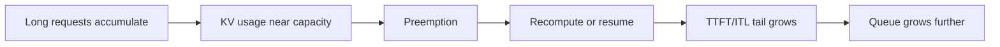

> **读图方法：** 这张图用于压缩“KV pressure 与 preemption”的整体关系。先从左向右找到起点、关键转换和终点，再问每条跨层箭头是否意味着函数调用、消息传递、内存访问或状态更新。

这是反馈循环。仅增大 token budget 可能让瞬时吞吐更高，却更快吃满 KV，最终让尾延迟恶化。

---

## 10.17 Component 与 kernel benchmark 的正确用法

> **本节先看：** 本节要回答：**Component 与 kernel benchmark 的正确用法**。下面的小节会逐层拆开概念、运行过程和源码落点；第一次阅读先抓对象之间的关系，第二次再记类名、字段和分支。

### 10.17.1 `benchmarks/benchmark_block_pool.py`

该微基准反复调用 `BlockPool.get_new_blocks` 和 `free_blocks`，每组前执行 GC，输出 block
元数据分配与回收的平均、最大耗时（微秒）。它没有为每个 block 重新申请 GPU 物理显存，
只能回答 Python block allocator 在指定 pool/allocate size 下的成本，不能说明完整 KV
Cache 或 GPU attention 性能。

### 10.17.2 prefix cache benchmark

`benchmarks/benchmark_prefix_caching.py` 可构造固定 prompt 或 ShareGPT prompts，并重复、排序或打乱。它
适合建立有/无 cache 的对照，但使用 `time.time` 包围整个 `llm.generate`，没有 TTFT/ITL
拆分。若要解释交互体验，应结合 serve benchmark 与 cache metrics。

### 10.17.3 attention/kernel benchmark

必须使用从真实 trace 提取的 shape 分布，而不是只测一个方便的 `batch=1, seq=2048`。至少覆盖：

- prefill 与 decode；
- 常见和尾部 batch sizes；
- context length buckets；
- dtype、head layout、block size；
- eager 与 graph；
- warm cache 与冷 kernel compilation。

### 10.17.4 微基准收益怎样传回端到端

先假设其他阶段耗时不变、阶段串行且工作量固定。$f$ 是该 kernel 占原耗时的比例
（0 到 1），$s$ 是其加速倍数，两者无单位，Amdahl 加速上限为：

$$
\mathrm{speedup}_{\mathrm{total}}\leq\frac{1}{(1-f)+f/s}
$$

**白话：**只有一部分耗时被加速，其余部分原样不动，所以整体能快多少，取决于被加速的部分占多大。

**其中：**$\mathrm{speedup}_{\mathrm{total}}$ 是端到端加速比（原耗时除以新耗时，无单位）；$f$、$s$ 是本节的局部字母（占比与加速倍数，$s>1$ 表示变快）。

**怎么算出来：**把原来的总耗时记作 1：

1. 没被加速的部分占 $1-f$，耗时不变；
2. 被加速的部分原来占 $f$，快 $s$ 倍后只剩 $f/s$；
3. 新总耗时是 $(1-f)+f/s$，加速比是原耗时除以新耗时，即 $\frac{1}{(1-f)+f/s}$。

在上面的假设（串行、其余不变、工作量固定）下这是等式；实际中收益被瓶颈转移或额外开销吃掉时只会更低，所以把它当上限。
代入 $f=0.05$、$s=2$：新总耗时 $0.95+0.05/2=0.975$，加速比 $1\div0.975\approx1.0256$，即速度提升约 2.6%（耗时减少 $1-0.975=2.5\%$）。
即使 $s\to\infty$，新总耗时也不会低于 $1-f=0.95$，加速比不超过 $1\div0.95\approx1.053$，约 5.3%。

**核对：**这是通用定律，不对应 vLLM 源码；上面的数字可以手算验证。

一个占 5% 的 kernel 即使快 2 倍，端到端理论收益也只有约 2.6%。如果报告端到端提升 20%，
说明还改变了别的机制或测量条件，应继续调查。

---

## 10.18 从 baseline 到优化结论的闭环

> **本节先看：** 本节要回答：**从 baseline 到优化结论的闭环**。下面的小节会逐层拆开概念、运行过程和源码落点；第一次阅读先抓对象之间的关系，第二次再记类名、字段和分支。

### 10.18.1 第一步：建立可复现 baseline

先运行足够长的 steady-state workload，保存原始 JSON、Prometheus 区间增量、server log、
GPU telemetry 和完整命令。检查错误率、长度分布和 run-to-run variance。

### 10.18.2 第二步：定位用户指标的主要组成

先区分两种抱怨：“从用户计划发送到看到首字很慢”可能含客户端等待；
`bench serve` 的 TTFT 已排除 semaphore 等待。对后者，应查服务端排队、prefill、
网络和前端处理，不能把客户端排队直接算进 TTFT。

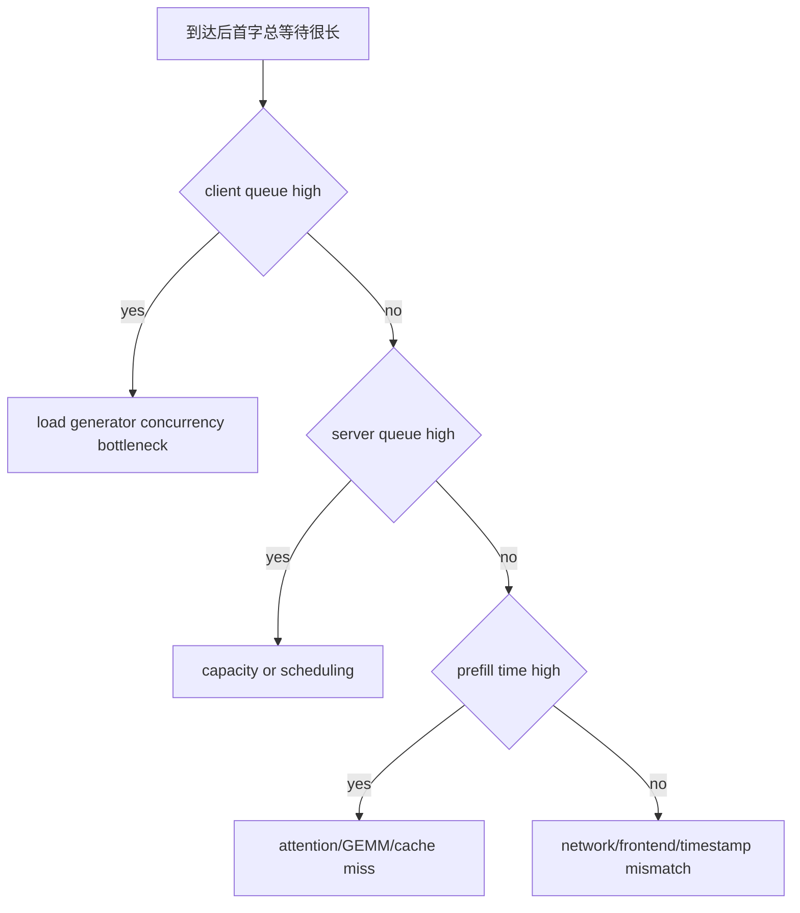

> **读图方法：** 这是“第二步：定位用户指标的主要组成”的流程图。先从上向下只追一条主路径，确认输入经过哪些关键阶段到达输出；第二遍再看虚线、回边和旁路，它们通常表示反馈、复用或可选分支。

### 10.18.3 第三步：提出可证伪假设

坏假设：“Scheduler 太慢。”

可测试假设：“在短长混合 workload 中，长 prefill 让每个 engine step 超过 80 ms，导致短请求
p99 TTFT；限制每 step prefill tokens 后，短请求 p99 TTFT 应下降，同时 GPU idle 不明显上升。”

后者明确了场景、机制、可观察证据和潜在代价。

### 10.18.4 第四步：只改一个因素并重复

记录 treatment 唯一差异，交替运行，多次重复。令 $x_{\mathrm{treatment}}$、
$x_{\mathrm{baseline}}$ 为相同单位的测量值，百分比变化为：

$$
\Delta_{\%}=\left(\frac{x_{\mathrm{treatment}}}{x_{\mathrm{baseline}}}-1\right)\times100\%
$$

**白话：**用 treatment 的值除以 baseline 的值，看比 1 多了还是少了，再换成百分数。

**其中：**$x_{\mathrm{treatment}}$、$x_{\mathrm{baseline}}$ 是同一指标在 treatment 和 baseline 下的测量值（单位相同，常取多次重复的均值）；$\Delta_{\%}$ 是相对变化，无单位，用百分数表示，$\Delta_{\%}$ 是本节的局部字母。

**怎么算出来：**比值 $x_{\mathrm{treatment}}/x_{\mathrm{baseline}}$ 等于 1 表示没变；减去 1 得到“相对 baseline 多了几分之几”，乘 $100\%$ 变成百分数。
例如 p99 TTFT 从 800 ms 变成 680 ms（教学数字）：$680\div800=0.85$，$0.85-1=-0.15$，即 $-15\%$；吞吐从 1000 token/s 变成 1080 token/s：$1080\div1000=1.08$，$1.08-1=0.08$，即 $+8\%$。

**核对：**与 `examples/ch10_benchmark_reasoning.py` 的 `compare_runs`（`throughput_change_pct`、`p99_latency_change_pct`，`:271-278`）的写法一致：`treatment / baseline - 1` 再乘 100。

对于 latency，负 change 是改善；对于 throughput，正 change 是改善。报告中必须明确方向。

### 10.18.5 第五步：通过 correctness gate

至少检查：

- 成功请求数与错误率；
- 固定 greedy 输出或 logit 容差；
- output length 与 finish reason；
- NaN/corrupted metrics；
- timeout、abort、server health；
- 长时间内存稳定性。

### 10.18.6 第六步：写出适用边界

一项优化可能只对 H100、短 decode、batch>32、特定 attention backend 有效。明确边界不是削弱
结论，而是让结论可以被正确复用。

---

## 10.19 综合案例：长 prompt 干扰短聊天请求

> **本节先看：** 本节要回答：**综合案例：长 prompt 干扰短聊天请求**。下面的小节会逐层拆开概念、运行过程和源码落点；第一次阅读先抓对象之间的关系，第二次再记类名、字段和分支。

### 10.19.1 问题定义

Workload 包含：

- 80% 短请求：input p50 128、output p50 128；
- 20% 长请求：input p50 8192、output p50 64；
- Poisson arrival；
- SLO：短请求 TTFT p99 < 1 s、TPOT p99 < 80 ms；
- 目标：最大化满足 SLO 的 request goodput。

### 10.19.2 Baseline 要记录的证据

> **本节先看：** 这一小节先用图建立“Baseline 要记录的证据”的整体路径。先找输入、关键状态和输出，再阅读图后的源码解释，不必一开始记住全部节点。

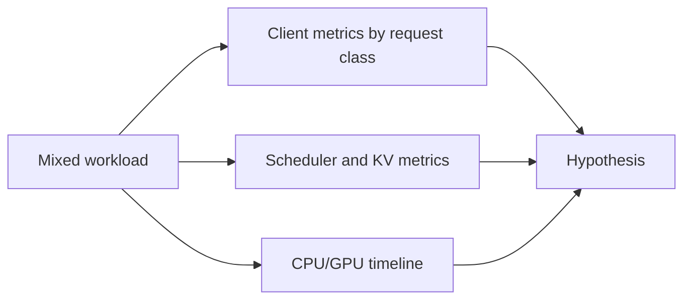

> **读图方法：** 阅读“Baseline 要记录的证据”这张流程图时，先把方框看成对象或状态，把箭头看成数据或控制的移动。第一遍从左向右建立顺序，第二遍再核对分支发生的条件。

- 按短/长请求分别计算 TTFT/TPOT/E2EL；
- Scheduler iteration 的 context/generation tokens；
- waiting/running、KV usage、preemptions；
- 每 step GPU kernel 时间和 idle gap；
- CUDA Graph mode/fallback。

### 10.19.3 候选实验顺序

> **本节先看：** 下面先给出“候选实验顺序”的结论清单。先理解每一项为什么存在，再记参数名或实现细节。

1. 调整 chunked prefill/token budget，观察短请求 TTFT 与长请求 E2EL 的交换。
2. 调整 max sequences，观察 decode batch 和 KV pressure。
3. 确认 prefix cache 是否真实命中，避免把共享 prefix 假设写进结论。
4. 检查 graph padding/capture bucket，避免新 batch shape 频繁 eager fallback。
5. 容量仍不足时，再比较 DP 扩展或 workload 隔离。

### 10.19.4 结果不能只是一张总表

总 request throughput 上升可能掩盖短请求 SLO 恶化。至少按 request class 给出：

| 配置 | 类别 | req/s | p99 TTFT | p99 TPOT | p99 E2EL | goodput | preemptions |
|---|---|---:|---:|---:|---:|---:|---:|
| baseline | short | | | | | | |
| baseline | long | | | | | | |
| treatment | short | | | | | | |
| treatment | long | | | | | | |

### 10.19.5 合格结论示例的结构

> **本节先看：** 下面的代码或调用链只保留“合格结论示例的结构”的主干。阅读时依次寻找输入、状态变化和输出，暂时忽略辅助分支。

```text
在固定 commit、模型、H100xN、Poisson RPS 和 80/20 长度分布下，配置 X 相对 baseline
使短请求 p99 TTFT 下降 A%，总 output throughput 变化 B%，长请求 p99 E2EL 上升 C%。
trace 显示最长 prefill step 从 D ms 降至 E ms，GPU idle 增加 F%。所有 greedy 输出通过
容差检查，错误率均为 0。该结论未验证其他 GPU、MoE 和 prefix-heavy workload。
```

---

### v0.32.0：区分等待、KV 取回与缓存来源

Prometheus 的 `vllm:num_requests_kv_fetch_by_stage` 仅在配置为 KV consumer 时注册，
按 waiting_to_start、in_progress、completed_waiting 区分异步 KV 取回阶段。
`vllm:prompt_tokens_cached_by_source` 则在准入时按 device、host、disk、p2p 或
external_unspecified 计数，不能把所有缓存命中都解释为本地 HBM 复用。
新增指标帮助定位等待来源，不改变 TTFT/ITL 的时间单位，也不自动证明缓存有端到端收益。

[源码] `vllm/v1/metrics/loggers.py` - `PrometheusStatLogger`

## 10.20 参数扫描与 Pareto frontier

> **本节先看：** 本节要回答：**参数扫描与 Pareto frontier**。下面的小节会逐层拆开概念、运行过程和源码落点；第一次阅读先抓对象之间的关系，第二次再记类名、字段和分支。

### 10.20.1 为什么不选“分数最高的一行”

多个参数共同决定 throughput、latency、显存和成本，通常不存在所有指标都最优的配置。
若方案 B 在所有目标上都不差于 A，且至少一个目标严格更好，就称 B **支配** A。
Pareto frontier（帕累托前沿）保留未被其他候选支配的方案；并不要求每个目标都严格改善。

先看一组教学数据，数值不是 vLLM 实测结果。假设只优化吞吐和 p99 延迟，且工作负载、
硬件和正确性条件相同：

| 方案 | 输出吞吐（token/s，越高越好） | p99 延迟（ms，越低越好） | 判断 |
|---|---:|---:|---|
| A | 100 | 100 | 被 B 支配：延迟相同，吞吐更低 |
| B | 150 | 100 | 保留 |
| C | 200 | 160 | 保留：与 B 各有取舍 |
| D | 120 | 140 | 被 B 支配：吞吐更低，延迟更高 |

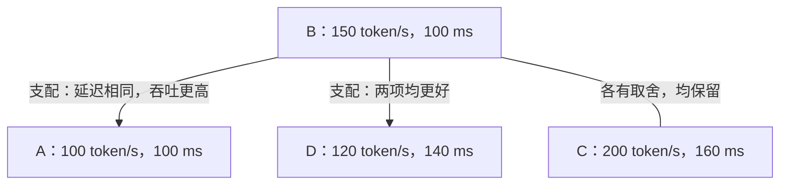

> **读图方法：** 先沿有向边看 B 为什么能淘汰 A、D，再看 B 与 C 之间表示取舍的无向线。
> 节点位置不是坐标值，比较依据是上表；读完应能解释为什么高吞吐的 C 和低延迟的 B 都在前沿。

若业务要求 p99 不超过 120 ms，这组候选应选 B；没有该约束时，前沿本身不能替读者决定。
真实实验还应考虑测量噪声，不能把统计上无法区分的小差异当作确定优势。

教学实现见 `examples/ch10_benchmark_reasoning.py` 的 `pareto_frontier`。

### 10.20.2 当前 `bench sweep`

`ParameterSweep` 从 JSON 读取命名参数组合，把键归一化为 CLI 参数并运行 server/benchmark
组合。workload sweep 可以从 serial 到 batch 估计范围，再探索中间 request rate 或
max concurrency。结果汇总后可绘图。

v0.32.0 新增 `--warmup-num-prompts`，在每个参数组合前执行一轮不计入正式结果的 warmup，
单独保存为 warmup.json。`--continue-on-error` 可记录 .failure.json 并继续后续运行，
失败返回 None，不能混入成功测量的平均值。warmup 失败也可能在该选项下继续，因此报告必须
检查失败文件，不能只看最后的汇总图。

[源码] `vllm/benchmarks/sweep/serve.py` - `run_comb`

[测试] `tests/benchmarks/sweep/test_param_sweep.py` - `test_run_comb_excludes_warmup_from_measured_results`、`test_run_comb_continue_on_error_keeps_later_runs`

上面的教学例子使用“吞吐越高、延迟越低”两项目标。当前上游 `plot_pareto.py` 使用的则是
`tokens_per_user` 与 `tokens_per_gpu`，两轴均越高越好；不能把教学坐标直接当作该工具的输出口径。

**源码边界：** `_pareto_frontier` 按两轴降序排列，再保留第二轴满足
`y_val >= best_y - epsilon` 的点。这会保留近似持平的点，甚至可能保留“第一轴更小、第二轴
相同”的被支配点。因此工具画出的集合不严格等同于上文的数学定义，解释报告时应检查
原始数值和容差。

[源码] `vllm/benchmarks/sweep/plot_pareto.py` - `_pareto_frontier`

### 10.20.3 每用户与每 GPU 效率

令 $\mathrm{thr}_{\mathrm{out}}$ 为输出吞吐（token/s），$n_{\mathrm{users}}$ 为用户数，
$n_{\mathrm{GPU}}$ 为 GPU 数。每用户与每 GPU 的生成速率分别为：

$$
\mathrm{thr}_{\mathrm{user}}=\frac{\mathrm{thr}_{\mathrm{out}}}{n_{\mathrm{users}}}
$$

$$
\mathrm{thr}_{\mathrm{GPU}}=\frac{\mathrm{thr}_{\mathrm{out}}}{n_{\mathrm{GPU}}}
$$

$\mathrm{thr}_{\mathrm{user}}$ 的单位为 token/(s·user)，$\mathrm{thr}_{\mathrm{GPU}}$ 为 token/(s·GPU)。

**白话：**把总的输出速度平摊到每个用户、每张卡上，看“一个用户能分到多快”“一张卡产出多快”。

**其中：**$\mathrm{thr}_{\mathrm{out}}$ 同 10.3.1；$n_{\mathrm{users}}$ 是用户数（或并发数，user）；$n_{\mathrm{GPU}}$ 是 GPU 数（GPU）。

**怎么算出来：**两式都只是一次除法，单位跟着分母走：$\frac{\mathrm{token/s}}{\mathrm{user}}=\mathrm{token/(s\cdot user)}$，$\frac{\mathrm{token/s}}{\mathrm{GPU}}=\mathrm{token/(s\cdot GPU)}$。
取教学数字 $\mathrm{thr}_{\mathrm{out}}=4000$ token/s、$n_{\mathrm{users}}=50$、$n_{\mathrm{GPU}}=8$：
$\mathrm{thr}_{\mathrm{user}}=4000\div50=80$ token/(s·user)，$\mathrm{thr}_{\mathrm{GPU}}=4000\div8=500$ token/(s·GPU)。总产出不变时，GPU 越多，$\mathrm{thr}_{\mathrm{GPU}}$ 越低。

**核对：**`vllm/benchmarks/sweep/plot_pareto.py` 的 `_prepare_records`：`tokens_per_user = throughput / user_count`（`:122`）、`tokens_per_gpu = throughput / gpu_count`（`:123`），
其中 `throughput` 取 `output_throughput`（`:115`），与上面两式同形。

**工具行为与物理含义需要分开。** `_infer_user_count` 优先使用指定字段，否则用
`request_rate`，最后才回退到 peak concurrency。但 request/s 不是用户数：
$1000\ \mathrm{token/s}\div10\ \mathrm{request/s}=100\ \mathrm{token/request}$，单位是 token/request，不能标成每用户生成速率。
要使用上面的第一式，应显式提供有定义的活跃用户/并发数，并在图上写清分母。

GPU 数可由显式字段或 $n_{\mathrm{GPU}}=\mathrm{TP}\times\mathrm{PP}\times\mathrm{DP}$ 推导（缺失的字段按 1 计，`_infer_gpu_count` 逐项相乘，`plot_pareto.py:80-87`）；
例如 $\mathrm{TP}=2$、$\mathrm{PP}=1$、$\mathrm{DP}=4$ 得 $2\times1\times4=8$ 张卡。当前默认推导未计入 PCP，含 PCP 的实验真实卡数是 $\mathrm{TP}\times\mathrm{PP}\times\mathrm{PCP}\times\mathrm{DP}$（第 9 章的 $W_{\mathrm{all\_dp}}$），应
显式提供 GPU count。这些是对上游工具结果的解释限制，不是推荐照搬的估算方法。

[源码] `vllm/benchmarks/sweep/plot_pareto.py` - `_infer_user_count`、`_infer_gpu_count`、
`_prepare_records`

### 10.20.4 扫参防止组合爆炸

采用分阶段策略：

1. 粗扫 workload，找到未饱和、转折、过载三个区域。
2. 单变量粗扫主要 engine 参数。
3. 淘汰被明显支配或不通过正确性门槛的点。
4. 在 frontier 附近做细扫和多次重复。
5. 对最终候选做长时间 soak 与真实 trace replay。

---

## 10.21 回归验证：性能通过还不算完成

> **本节先看：** 本节要回答：**回归验证：性能通过还不算完成**。下面的小节会逐层拆开概念、运行过程和源码落点；第一次阅读先抓对象之间的关系，第二次再记类名、字段和分支。

### 10.21.1 正确性层

> **本节先看：** 下面先给出“正确性层”的结论清单。先理解每一项为什么存在，再记参数名或实现细节。

- greedy 输出与 token IDs；
- sampling distribution 的统计测试；
- logprobs、structured output、stop conditions；
- prefix cache 命中与未命中一致性；
- TP/PP/EP/DCP 数值容差；
- multimodal/LoRA/spec decode 组合。

### 10.21.2 稳定性层

> **本节先看：** 下面先给出“稳定性层”的结论清单。先理解每一项为什么存在，再记参数名或实现细节。

- 长时间错误率与 timeout；
- worker/EngineCore 是否重启；
- host/GPU memory 是否持续增长；
- metrics cardinality 与 Prometheus 文件是否泄漏；
- abort 和 client disconnect 是否释放 KV blocks；
- 过载后能否恢复到正常 queue。

### 10.21.3 性能层

> **本节先看：** 下面先给出“性能层”的结论清单。先理解每一项为什么存在，再记参数名或实现细节。

- 不只比较 mean，保留原始样本；
- 同时比较 p50/p95/p99/max；
- 按输入长度、输出长度、request class、DP engine 分组；
- 报告 startup 与 steady-state；
- 报告每 GPU 效率和显存。

### 10.21.4 自动回归阈值要考虑噪声

固定 `throughput >= baseline * 0.99` 在噪声 3% 的机器上会频繁误报。

**白话：**这条阈值只允许新结果比 baseline 低 1%；如果机器自己的波动就有 3%，那么什么都没改，一次测量也常常低于阈值，被判成“回归”。

**其中：**“噪声 3%”指单次测量相对均值的标准差 $\sigma=3\%$（本节局部符号），容差是 $1\%$；$\Phi(z)$ 是标准正态分布的累积概率（本节局部符号），$\Phi(z)$ 表示正态随机量不超过 $z$ 个标准差的概率。
下面的数字建立在两条教学假设上：测量误差服从均值为 0 的正态分布，各次测量相互独立；真实噪声未必如此。

**怎么算出来：**“误报”指什么都没改、测量值却落到阈值以下。分两种情形：

1. **baseline 近似等于真值**（例如取自很长的历史均值，自身误差可以忽略）：新测量相对 baseline 的偏差服从标准差 $\sigma=3\%$ 的正态分布，阈值在 $-1\%$，
   误报概率是 $\Phi\!\left(\frac{-1\%}{3\%}\right)=\Phi(-0.333)\approx0.369$，约 37%；
2. **baseline 本身也只是一次带噪声的测量**：baseline 和新测量各带标准差 $3\%$ 的独立误差，两者之差的标准差是 $3\%\times\sqrt2\approx4.24\%$，
   误报概率是 $\Phi\!\left(\frac{-1\%}{4.24\%}\right)=\Phi(-0.236)\approx0.407$，约 41%。

两种情形下，每 10 次什么都没改的比较里都约有 4 次误报。单位检查：容差与 $\sigma$ 都是相对均值的百分数，相除得到无单位的 $z$ 值。

**核对：**不对应 vLLM 源码，可以在 Python 里手算复核：`statistics.NormalDist().cdf(-1/3)` 为 $0.3694$，`statistics.NormalDist().cdf(-1/(3*2**0.5))` 为 $0.4068$。

更稳妥的方法是建立
历史分布、控制运行环境、使用重复样本并为不同 benchmark 设置不同容差。阈值也不能掩盖
严重错误率或正确性失败。

---

## 10.22 报告与原始数据

> **本节先看：** 本节要回答：**报告与原始数据**。下面的小节会逐层拆开概念、运行过程和源码落点；第一次阅读先抓对象之间的关系，第二次再记类名、字段和分支。

### 10.22.1 每次 run 的目录建议

> **本节先看：** 下面的代码或调用链只保留“每次 run 的目录建议”的主干。阅读时依次寻找输入、状态变化和输出，暂时忽略辅助分支。

```text
run-2026-09-07T120000/
  command.txt
  environment.json
  workload.jsonl
  benchmark-result.json
  prometheus-before.txt
  prometheus-after.txt
  server.log
  gpu-telemetry.csv
  traces/
  correctness.json
```

### 10.22.2 为什么保留原始逐请求数据

聚合表不能重新回答：

- p99 是否由一种长度请求主导；
- 某一分钟是否发生过载；
- failed requests 的原始错误是什么；
- client queue 与 server queue 如何相关；
- 一个新 SLO 下 goodput 是多少。

逐请求 start time、TTFT、ITLs、E2EL、长度和错误使后续分析成为可能。

### 10.22.3 JSON 中必须携带 schema/version

此版本 latency/throughput JSON 新增 `model_id`；serve 会脱敏 header 参数后打印或保存
参数，仍须自行检查其他输出中是否含私密数据。这不改变计时边界或吞吐公式。

指标字段会演进。至少保存工具 commit、命令、字段单位和 schema version，避免半年后把秒
当毫秒、把 expected tokens 当 actual tokens。

### 10.22.4 跨版本比较前先看口径变化清单

把 v0.32.0 与 v0.33.0 的 benchmark 数字放在一起比较之前，先确认本章讲过的几处测量口径是否随版本变了，
否则差异可能来自工具而不是引擎。下面五项都已包含在 v0.33.0 中，只涉及 `bench serve` 的测量与记录，不改变引擎行为：

| 变化 | 影响哪类比较 | 正文位置 |
|---|---|---|
| chat 流式只在带实质内容的事件上记 TTFT（#62341） | 跨版本 chat TTFT、ITL | 10.2.3 |
| probe 请求用独立 session，`benchmark_duration` 先于停止 probe 计算（#60511） | 带 probe 的吞吐、request/s | 10.7.1、10.13.4 |
| SSE 流不再对每个网络块 `strip()`（#51172） | 输出文本与 token 计数 | 10.2.3 |
| 结果里新增服务端 `server_queue_times`、`server_ttfts`（#55809） | 与客户端 TTFT 对账 | 10.11.5 |
| cuBLAS handle 先于显存快照创建（#61044） | 可用 KV 显存、启动日志里的 profile 数 | 10.9.1 |

v0.32.0→v0.33.0 与本章实验直接相关的破坏性变更是：暂停期间新请求返回 HTTP 503（[#51488](https://github.com/vllm-project/vllm/pull/51488)）。压测脚本若在 `pause_generation` 窗口内（`abort`、`wait` 模式）发请求，
会得到 503 而不是排队等待，需要在报告里把这类失败与容量拒绝分开统计。

---

## 10.23 随章教学代码

[`examples/ch10_benchmark_reasoning.py`](../../examples/ch10_benchmark_reasoning.py) 是一个无
第三方依赖的指标与实验分析器，包含：

- `RequestTrace`：客户端 arrival/send/token timestamps；
- TTFT、ITL、TPOT、E2EL 与 client queue 边界；
- `summarize`：request/output/total token throughput 和 goodput；
- NumPy 默认风格的线性插值 percentile；
- `ExperimentRun`：重复样本、CV 与 baseline/treatment change；
- `pareto_frontier`：吞吐越高、p99 越低的非支配点；
- `RuntimeSignals` 与 `diagnose`：从信号提出假设，而非自动宣称根因。

运行：

```bash
python3 examples/ch10_benchmark_reasoning.py
python3 -m unittest tests.test_ch10_benchmark_reasoning
```

24 个单元测试覆盖计时边界、失败请求、goodput AND 语义、ITL 展平、噪声、正确性门槛和
Pareto dominance。

### 10.23.1 教学代码与真实 benchmark 的边界

该脚本不会启动 vLLM、发送 HTTP 或测量 GPU。它用于让读者在 CPU 上验证指标公式，并分析
逐 token 的教学 timestamps。若直接分析真实 benchmark 导出的 SSE 事件，必须额外
提供服务端实际输出 token 数（`completion_tokens`）和适配器的末计时点
（`last_response_time`），不能把事件条数当作 token 数。GPU 性能结论必须来自真实环境，记录在
[`experiments/ch10-optimization.md`](../../experiments/ch10-optimization.md)。

---

## 10.24 全书综合实验

> **本节先看：** 本节要回答：**全书综合实验**。下面的小节会逐层拆开概念、运行过程和源码落点；第一次阅读先抓对象之间的关系，第二次再记类名、字段和分支。

### 实验 A：固定 batch 的 eager/compile/graph

使用 `bench latency`，固定模型、batch、input/output length，分别测 cold start 与 warmed
steady state。记录 compile/capture 时间、峰值显存、均值和 p99。

### 实验 B：offline Scheduler/KV 扫描

使用 `bench throughput` 和固定 request list，扫描 token budget、max sequences、prefix cache，
记录 actual input/output tokens、preemption 与 computed/cache-hit prompt tokens。

### 实验 C：online 饱和曲线

使用 `bench serve` 从低 RPS 扫到过载，固定 Poisson arrival 和 max concurrency，绘制 request
throughput、goodput、p99 TTFT/TPOT、client queue、server queue。

### 实验 D：burst sensitivity

保持平均 RPS 不变，比较 burstiness `0.5、1、infinity`。验证平均吞吐相近时，queue 和尾延迟
是否显著不同。

### 实验 E：prefix cache

固定公共 prefix 数、长度、重复次数和顺序，比较 cache off、cold on、warm on。用
`prompt_tokens_by_source` 证明实际跳过了计算。

### 实验 F：多 GPU 扩展效率

比较 TP/DP/PP 候选，报告系统 throughput、tokens/s/GPU、communication fraction、显存与 p99，
并验证输出等价。

### 实验 G：一次 profiler 归因闭环

从 online p99 回溯到内部 queue/prefill/decode，再到 CPU/GPU timeline 和 component benchmark；
实施一个单变量修改，复测并写出 Amdahl 一致性检查。

### 实验 H：长时间回归

对最终候选执行至少一个超过短 benchmark 数量级的 soak，包含取消、timeout、长度尾部和过载
恢复，检查内存、错误率与 metrics。

---

## 10.25 练习题

第一遍先完成前 5 题；余下题目是第二遍源码阅读的扩展题库，不要求一次做完。

> **本节先看：** 下面先给出“练习题”的结论清单。先理解每一项为什么存在，再记参数名或实现细节。

1. 某请求在客户端等待 semaphore 200 ms，发送后 300 ms 收到首 token，之后 4 个 token 的
   间隔为 40/50/60/50 ms。计算 client queue、TTFT、E2EL、TPOT 和 ITL 样本。
2. 为什么把 total tokens/s 与 output tokens/s 混用会偏向长 prompt workload？
3. 100 req/s 完成，但只有 70 req/s 同时满足 TTFT 与 TPOT SLO，应该怎样报告？
4. 解释 `request_rate=inf` 与稳定 100 RPS 的差别。
5. 为什么 max concurrency 太低会让服务器 TTFT 看起来很好？
6. 设计实验区分 prefix cache 收益和 warmup/compile 收益。
7. treatment throughput 提升 3%，baseline CV 为 5%，还需要哪些证据？
8. 某 kernel 占端到端 10%，加速 4 倍，根据 Amdahl 定律估计上限。
9. 为什么 `prompt_tokens` 日志 throughput 和业务输入 token throughput 可能方向相反？
10. 给出一个 p99 TTFT 高但 GPU utilization 低的可证伪假设。
11. 怎样判断 TP=2 的总吞吐提升是否值得两倍 GPU 成本？
12. 为 Scheduler token budget 与 max sequences 设计两阶段扫参矩阵。

---

## 10.26 常见误解与纠正

> **本节先看：** 下面先给出“常见误解与纠正”的结论清单。先理解每一项为什么存在，再记参数名或实现细节。

1. **误解：tokens/s 越高，用户体验越好。** 纠正：TTFT、ITL、尾延迟和 goodput 可能变差。
2. **误解：平均延迟足够。** 纠正：排队系统的 p95/p99 往往决定 SLO。
3. **误解：一次 benchmark 就能比较。** 纠正：需要 warmup、重复和噪声估计。
4. **误解：第一次运行代表稳定态。** 纠正：model load、compile、capture 和 cache 都是一次性状态。
5. **误解：warmup 越多越科学。** 纠正：warmup 必须匹配目标状态，并明确是否预热 cache。
6. **误解：`request_rate=inf` 就是生产峰值。** 纠正：它近似一次性提交，不是随机稳态到达。
7. **误解：max concurrency 就是服务器并发。** 纠正：它也可能在客户端拦截请求。
8. **误解：TTFT 包含 client semaphore queue。** 纠正：当前 serve benchmark 单独记录该等待。
9. **误解：一个 SSE chunk 永远是一个 token。** 纠正：backend 可能打包多个 tokens。
10. **误解：TPOT 就是所有 ITL 的平均。** 纠正：TPOT 先按请求平均，样本权重不同。
11. **误解：失败请求可以从 latency 报告忽略。** 纠正：这会造成幸存者偏差。
12. **误解：GPU utilization 高说明优化成功。** 纠正：无效 padding 和通信也能让 GPU 很忙。
13. **误解：profiler trace 中测得的吞吐可直接用于容量。** 纠正：profiling 自身有显著开销。
14. **误解：微基准快 20%，端到端也快 20%。** 纠正：收益受热点占比和系统瓶颈转移限制。
15. **误解：只改一个参数就不需要记录其他配置。** 纠正：环境漂移同样能改变结果。
16. **误解：prefix hit rate 高一定节省同等比例时间。** 纠正：还取决于命中 token 数和剩余瓶颈。
17. **误解：峰值 throughput 点就是生产配置。** 纠正：通常应选择饱和拐点左侧或 SLO frontier。
18. **误解：性能通过后不必测正确性。** 纠正：少生成、丢请求或数值错误都能虚假提速。
19. **误解：Pareto frontier 会自动选出唯一最佳配置。** 纠正：它只去掉被支配点，最终选择仍由 SLO
    和成本权重决定。
20. **误解：同名 metrics 在客户端与服务器含义相同。** 纠正：计时点、clock 和 token 分子可能不同。

---

## 10.27 本章总结：优化报告的十个问题

在接受任何“vLLM 优化了 X%”的结论前，逐项问：

1. **目标是谁？** 交互、离线、平台容量还是成本？
2. **指标是什么？** TTFT、TPOT、ITL、E2EL、哪一种 tokens/s 或 goodput？
3. **workload 是什么？** 长度、到达、burst、prefix、sampling 是否固定？
4. **计时边界在哪里？** 是否含 client queue、网络、detokenize、warmup？
5. **baseline 可复现吗？** commit、硬件、命令、环境和原始数据是否齐全？
6. **只改了什么？** 是否存在共同变化或状态污染？
7. **证据链是什么？** 用户指标、内部 metrics、trace 与组件测试是否一致？
8. **噪声多大？** 重复、CV、顺序和置信程度如何？
9. **正确吗？** 输出、失败、NaN、超时和稳定性是否过关？
10. **边界是什么？** 哪些模型、硬件和 workload 尚未验证？

当这十个问题都有答案，优化才从“跑分变化”成为可复用的工程知识。

---

## 10.28 源码阅读索引

建议按以下顺序阅读固定版本源码：

1. `vllm/benchmarks/latency.py`：固定 batch、warmup 与 percentile。
2. `vllm/benchmarks/throughput.py`：offline 请求构造、计时和 token 统计。
3. `vllm/benchmarks/serve.py`：arrival process、concurrency、goodput 与结果聚合。
4. `vllm/benchmarks/lib/endpoint_request_func.py`：客户端 start/TTFT/ITL/E2EL 时间戳。
5. `vllm/benchmarks/datasets/datasets.py`：random、ShareGPT、timed trace 与 prefix repetition。
6. `vllm/benchmarks/sweep/param_sweep.py`：参数组合到 CLI。
7. `vllm/benchmarks/sweep/serve_workload.py`：serial 到 batch 的 workload 探索。
8. `vllm/benchmarks/sweep/plot_pareto.py`：每用户/每 GPU 与 frontier。
9. `vllm/v1/metrics/stats.py`：Scheduler、request 和 prompt token stats。
10. `vllm/v1/metrics/loggers.py`：日志与 Prometheus 指标定义和聚合。
11. `vllm/v1/metrics/prometheus.py`：多进程 registry 生命周期。
12. `vllm/v1/metrics/perf.py`：FLOPS/bytes 解析模型与 MFU。
13. `vllm/config/profiler.py`、`vllm/profiler/wrapper.py`、
    `vllm/v1/worker/gpu_worker.py`：profiler 配置、wrapper/factory 与 Worker 控制。
14. `docs/contributing/profiling.md`：PyTorch、Proton、Nsight Systems 工作流。
15. `benchmarks/benchmark_block_pool.py`、`benchmarks/benchmark_prefix_caching.py` 和
    `benchmarks/attention_benchmarks/`：组件与 kernel 层实例。
16. `tests/benchmarks/`：CLI、dataset adapter、sweep 和参数稳定性测试。

本章源码基线为 vLLM main commit `05caae03c20f69436ff7ec23ded339ea104f1a01`（前一发布基线 v0.33.0 为
`4ba787ec9959e566d3b587a796dff07673324da5`），指标教学代码的 CPU 测试通过。正文已按该基线核对源码引用与行号，并反映 Model Runner V1 删除；
除此之外，未在该基线上将其余运行时行为逐一重新核实。当前机器没有可用的 NVIDIA GPU vLLM
运行环境，因此 profiler、NCCL 与真实服务性能数据仍标记为 `runtime_verified: false`。
本章给出的数值曲线均为教学示意，不能冒充实测结果。

## 第一遍自检

先用自己的话回答下面三个问题，再展开线索。前面的源码追踪题和设计题留作第二遍
阅读；不需要第一次就掌握所有硬件与功能分支。

1. 请求在发送前等了 0.2 秒，计时起点后 0.3 秒见首 token，共 5 token，末事件在 0.5 秒：TTFT、TPOT 和额外客户端等待各是多少？
2. 改动后 output tokens/s 上升，但输出明显变短且 timeout 增多，可以宣称性能优化成功吗？
3. profile 显示 kernel 很快，为什么用户仍可能等很久？下一步应查看哪些边界？

<details>
<summary>答题线索</summary>

1. TTFT 为 0.3 秒，TPOT 为 0.05 秒/token，发送前等待 0.2 秒单独记录；这里是假设每事件一 token 的教学例子。
2. 不能。工作量与成功样本分布已改变；应固定请求和停止条件，同时报告失败率、长度、正确性与尾延迟。
3. 还可能有客户端或服务端排队、输入准备、RPC、D2H、输出处理和网络等待。按同一请求的时间戳定位，不能把 kernel 时间当作端到端时间。

</details>

